# 📡 فید کانال‌های تلگرام

آخرین بررسی: ۱۴۰۵/۰۸/۲۳ ۱۳:۳۵ (به وقت تهران)

هر ساعت به‌روز می‌شود. از هر کانال ۲۰ پست آخر نمایش داده می‌شود؛ عکس‌ها ۲۴ ساعت می‌مانند، برای ویدیو فقط متن و لینک پست آمده است. متن همه‌ی پست‌ها در پوشه‌ی [archive](archive/) نگه‌داری می‌شود.

## فهرست کانال‌ها

- [irnetmonitor](#irnetmonitor) · آخرین پست: ۱۴۰۵/۰۸/۲۰ ۱۶:۰۵
- [CyberNigga2](#cybernigga2) · آخرین پست: ۱۴۰۵/۰۸/۲۰ ۲۳:۰۰
- [kaavoush](#kaavoush) · آخرین پست: ۱۴۰۵/۰۸/۲۳ ۱۲:۴۱
- [iaghapour](#iaghapour) · آخرین پست: ۱۴۰۵/۰۸/۲۲ ۲۱:۰۱
- [MatinSenPaii](#matinsenpaii) · آخرین پست: ۱۴۰۵/۰۸/۲۳ ۱۲:۵۸
- [whitedns](#whitedns) · آخرین پست: ۱۴۰۵/۰۸/۲۳ ۰۲:۲۴
- [ircfspace](#ircfspace) · آخرین پست: ۱۴۰۵/۰۸/۲۳ ۱۱:۴۶
- [patt_channel_x](#patt_channel_x) · آخرین پست: ۱۴۰۵/۰۸/۲۳ ۱۱:۵۳
- [mahsa_net](#mahsa_net) · آخرین پست: ۱۴۰۵/۰۸/۰۱ ۲۲:۵۹
- [VahidOnline](#vahidonline) · آخرین پست: ۱۴۰۵/۰۸/۲۳ ۰۰:۴۵

---

## irnetmonitor

[کانال در تلگرام](https://t.me/irnetmonitor) · [آرشیو متن](archive/irnetmonitor/)

**🕒 ۱۴۰۵/۰۸/۲۰ ۱۶:۰۵** · [پست 5241](https://t.me/irnetmonitor/5241)

🖼 *(عکس بعد از ۲۴ ساعت حذف شده)*

شبکه ایرانسل  تهران از صبح امروز دچار قطعی های گسترده اینترنت بین الملل شده  ( شبکه داخلی مشکلی ندارد ) . مشخص نیست دقیقا چه کاری دارن انجام میدهند

· · ·

**🕒 ۱۴۰۵/۰۸/۱۳ ۱۲:۲۳** · [پست 5240](https://t.me/irnetmonitor/5240)

خوب به سلامتی دموکرات ها رای اکثریت رو اوردن و کاخ سفید رو حسینیه کردین،  مبارکتون باشه خطر جنگ هم دور شد ازتون ، آقای وزارت قطع ارتباطات حالا وقتش نیست یکم نت رو شل کنید؟ اختلال نندازید و از این جور پدرسگ بازیا؟

· · ·

**🕒 ۱۴۰۵/۰۸/۰۹ ۱۸:۳۰** · [پست 5239](https://t.me/irnetmonitor/5239)

↪️ فوروارد از Pishdad Network🫡

**اعلام وضعیت زرد اینترنت ⚠️⚠️⚠️**  
(این هشدار برای دو هفته آینده است)  

در شرایط فعلی توصیه می‌شود:  

- ترافیک سرورهای اندازه یک هفته حداقل شارژ داشته باشید.  
- حساب اعتباری سایت برای مواقع ضروری شارژ داشته باشد.  
- سرورهای مورد نیاز چه ایران و خارج زودتر تهیه کنید.  

شبکه پیشداد

· · ·

**🕒 ۱۴۰۵/۰۸/۰۹ ۱۸:۱۸** · [پست 5238](https://t.me/irnetmonitor/5238)

[iran internet monitor](https://t.me/irnetmonitor) pinned «⚠️ اطلاعیه فوری  طبق اطلاعات دریافتی از چند دیتاسنتر معتبر و پیگیری‌های انجام‌شده، احتمال اعمالل قطعی اینترنت بین‌الملل از هفته آینده مطرح شده است.  با توجه به احتمال بروز اختلال در دسترسی به اینترنت و سرویس‌های وابسته، توصیه می‌شود در صورت وابستگی فعالیت‌های…»

· · ·

**🕒 ۱۴۰۵/۰۸/۰۹ ۱۸:۱۸** · [پست 5237](https://t.me/irnetmonitor/5237)

⚠️ اطلاعیه فوری  

طبق اطلاعات دریافتی از چند دیتاسنتر معتبر و پیگیری‌های انجام‌شده، احتمال اعمالل قطعی اینترنت بین‌الملل از هفته آینده مطرح شده است.  

با توجه به احتمال بروز اختلال در دسترسی به اینترنت و سرویس‌های وابسته، توصیه می‌شود در صورت وابستگی فعالیت‌های کاری یا تجاری شما به اینترنت، اقدامات ضروری از جمله تهیه نسخه پشتیبان (Backup) از اطلاعات، ذخیره فایل‌های مهم و انجام امور ضروری را در اسرع وقت انجام دهید.

· · ·

**🕒 ۱۴۰۵/۰۸/۰۶ ۰۲:۰۹** · [پست 5236](https://t.me/irnetmonitor/5236)

عرزشی ، ساندیسی ، پاسدار ، حمال جمهوری اسلامی ،  زوزه بکش

🎬 ویدیو: [مشاهده در تلگرام](https://t.me/irnetmonitor/5236)

· · ·

**🕒 ۱۴۰۵/۰۸/۰۶ ۰۱:۵۷** · [پست 5235](https://t.me/irnetmonitor/5235)

🔴 #خبر\_فوری  
لحظاتی پیش کانال 14 اسرائیل نتایج به‌روزرسانی شده از انتخابات اسرائیل را منتشر کرد:  
ائتلاف به رهبری نتانیاهو 61 کرسی را به دست آورده است و دولت بعدی اسرائیل را تشکیل خواهد داد.

· · ·

**🕒 ۱۴۰۵/۰۸/۰۶ ۰۱:۵۱** · [پست 5234](https://t.me/irnetmonitor/5234)

خوب به نظر باید جمهوری اسلامی دوباره چیزایی که باز کرده رو ببنده  چون بنیامین نتانیاهو برنده انتخابات شد و کون جمهوری اسلامی رو به زودی هدف خواهد گرفت 😂

· · ·

**🕒 ۱۴۰۵/۰۸/۰۵ ۱۸:۵۶** · [پست 5233](https://t.me/irnetmonitor/5233)

فوری :  
از دقایقی پیش گشایش هایی در پروتکل های مسدود شده هفته های اخیر به مقصد دیتاسنتر های معروف در  اکثر اپراتور ها انجام شده و از وضعیت انقباضی  و جنگی خارج شد  

تست شده با همراه اول ، ایرانسل ، رایتل در تهران

· · ·

**🕒 ۱۴۰۵/۰۸/۰۳ ۱۶:۲۴** · [پست 5232](https://t.me/irnetmonitor/5232)

🖼 *(عکس بعد از ۲۴ ساعت حذف شده)*

پینگ گیتوی ابراروان ریجن اسیاتکشونو مشاهده فرمایید... تست با شبکه 5g ایرانسل ! نوار قلب یه مریض رو به موت هم اینطوری نیست والا

· · ·

**🕒 ۱۴۰۵/۰۸/۰۳ ۱۶:۲۱** · [پست 5231](https://t.me/irnetmonitor/5231)

🖼 *(عکس بعد از ۲۴ ساعت حذف شده)*

در این روزها شاهد تجربه  پر اختلال ترین و بی کیفیت ترین اینترنت در ایران هستیم ... ، فقط وصلیم ... عملا هیچکار نمیشه کرد  کیفیت منفی صفر

· · ·

**🕒 ۱۴۰۵/۰۸/۰۲ ۱۶:۵۵** · [پست 5230](https://t.me/irnetmonitor/5230)

↪️ فوروارد از منیجیت | Manageit

**⭕️ گزارش شبکه:**  
بررسی ترافیک CDN منیجیت نشان میدهد ارتباطات زیرساخت در حال تست فرآیندهایی است که VPNهای داخل شبکه ایران را شناسایی و مسدود کند، احتمالا قرار است بعد از قطع اینترنت بین المللی این سیاست‌ها به صورت کامل بر روی شبکه داخلی اجرایی شوند، همچنین در چند روز اخیر مسدود شدن آی پی ها و دامنه‌هایی که روی CDN ها و سرورهای داخل ایران هستند شدت گرفته است.

· · ·

**🕒 ۱۴۰۵/۰۸/۰۱ ۱۲:۰۵** · [پست 5229](https://t.me/irnetmonitor/5229)

مهملات و توهمات ایرانسل در مورد افزایش تعرفه ها   

[https://irancell.ir/b/332391/internet-price-change-aban-1405](https://irancell.ir/b/332391/internet-price-change-aban-1405)

· · ·

**🕒 ۱۴۰۵/۰۸/۰۱ ۰۲:۴۸** · [پست 5228](https://t.me/irnetmonitor/5228)

↪️ فوروارد از شهر سخت افزار

🖼 *(عکس بعد از ۲۴ ساعت حذف شده)*

**🔴 اینترنت موبایل از بامداد جمعه گران شد؟**  

📱 ظاهراً از بامداد امروز جمعه ۱ آبان، قیمت بسته‌های اینترنت موبایل افزایش پیدا کرده و کاربران با تعرفه‌های بالاتری نسبت به قبل روبه‌رو شده‌اند.  

💸 بررسی‌های اولیه حاکی از افزایش چشمگیر قیمت برخی بسته‌هاست؛ با این حال هنوز اطلاعیه رسمی درباره این تغییر قیمت منتشر نشده است.  

⚠️ فعلاً جزئیات میزان افزایش قیمت و علت آن مشخص نیست و باید دید اپراتورها یا نهادهای مسئول چه توضیحی ارائه می‌کنند.  

[**🌐در شهرسخت‌افزار بخوانید**](https://www.shahrsakhtafzar.com/fa/news/internet-operator/62711-mobile-internet-package-price-hike-iran)  

**🆔**[**@ShahrSakhtAfzar**](https://t.me/ShahrSakhtAfzar)

· · ·

**🕒 ۱۴۰۵/۰۷/۲۹ ۱۸:۰۴** · [پست 5227](https://t.me/irnetmonitor/5227)

↪️ فوروارد از زومان | Zoomon

🖼 *(عکس بعد از ۲۴ ساعت حذف شده)*

**قطع فوری اینترنت در صورت آغاز جنگ جدید؛ دستور صادر شد**  

بر اساس اطلاعات دریافتی زومان، نهادهای بالادستی در نامه‌ای رسمی و الزام‌آور تأکید کرده‌اند که در صورت آغاز جنگ جدید، دسترسی کاربران در ایران به اینترنت بین‌الملل باید بلافاصله قطع شود.  

این تصمیم به عنوان یک تکلیف اجرایی تعیین شده است تا در شرایط درگیری نظامی، دسترسی به شبکه جهانی قطع شود.  

[🌐 در زومان بخوانید](https://www.zoomon.ir/behind-the-news/9226-iran-war-internet-blackout-order/?utm_source=Telegram&amp;utm_term=pr86wljqv)  

🆔 [@thezoomon](https://t.me/thezoomon)

· · ·

**🕒 ۱۴۰۵/۰۷/۲۹ ۱۴:۳۲** · [پست 5226](https://t.me/irnetmonitor/5226)

وضعیت جیتر و پینگ بعد از هر بار مسدودی vpn ها بسیار خوب و استییل میشه ( مثل امروز )   

دلایل این وضعیت:   
۱- ترافیک عظیم vpn ها از شبکه موقتا خارج میشه و بعد از چند روز vpn پرووایدر ها مجددا با روش جدید برمیگردند و دوباره شبکه رو بهم میریزن   

۲- پهنای باند بین الملل ایران محدوده و وزارت هیچ تصمیمی جهت افزایش آن با این وضعیت قیمت دلار ندارد

· · ·

**🕒 ۱۴۰۵/۰۷/۲۹ ۱۴:۰۸** · [پست 5225](https://t.me/irnetmonitor/5225)

در همکاری جدیدی که وزارت ارتباطات با وزارت نیرو اغاز کرده هر روز شبکه اینترنت در ایران به این صورت شده

🎬 ویدیو: [مشاهده در تلگرام](https://t.me/irnetmonitor/5225)

· · ·

**🕒 ۱۴۰۵/۰۷/۲۸ ۰۳:۴۳** · [پست 5224](https://t.me/irnetmonitor/5224)

بروزرسانی :  
اکثر پروتکل های شبکه مثل gre ,... در اکثر اپراتور ها مسدود شد   

همچنین رنج ایپی های اتصال اولیه ( پورت 3074 udp ) بازی های call of duty  نیز مسدود شده اند و برای ورود به صفحه اصلی گیم باید از vpn استفاده کنید   
رنج های مسدود شده :  

[185.34.106.0/24](http://185.34.106.0/24)  
[185.34.107.0/24](http://185.34.107.0/24)

· · ·

**🕒 ۱۴۰۵/۰۷/۲۵ ۲۲:۴۰** · [پست 5223](https://t.me/irnetmonitor/5223)

اگر پلیر call of duty هستید ، پورت ۳۰۷۴ و کل سرورهای azure  و freesas  بازی فیلتر شده اند ، در حال حاضر فقط سرورهای سفید vultr در فیلترینگ جمهوری اسلامی  با پورت های رنج ۵۰۰۰۰-۶۰۰۰۰ udp وصل هستند که متاسفانه سرورهای دیتاسنتر مذکور کیفیت بسیار پایین ولگ بسیار زیادی دارد

· · ·

**🕒 ۱۴۰۵/۰۷/۲۵ ۲۲:۳۷** · [پست 5222](https://t.me/irnetmonitor/5222)

تغییرات ۲۴ ساعت گذشته اینترنت در ایران :   
۱- مجدد udp  به مقصد خیلی از دیتاسنتر های خارجی در بیشتر isp ها مسدود شد  

۲- در این لحظه که پیغام رو مینویسم پینگ ۵۰ ۶۰ میلی ثانیه افزایش پیدا کرده   

۳- اکثر application layer ها مثل http / https به مقصد دیتاسنتر های خارجی مسدود شده

· · ·

---

## CyberNigga2

[کانال در تلگرام](https://t.me/CyberNigga2) · [آرشیو متن](archive/cybernigga2/)

**🕒 ۱۴۰۵/۰۸/۲۰ ۲۳:۰۰** · [پست 5290](https://t.me/CyberNigga2/5290)

🎬 ویدیو: [مشاهده در تلگرام](https://t.me/CyberNigga2/5290)

· · ·

**🕒 ۱۴۰۵/۰۸/۱۹ ۰۱:۴۲** · [پست 5289](https://t.me/CyberNigga2/5289)

Unc twerking like crazy 😭

🎬 ویدیو: [مشاهده در تلگرام](https://t.me/CyberNigga2/5289)

· · ·

**🕒 ۱۴۰۵/۰۸/۱۸ ۱۲:۱۵** · [پست 5288](https://t.me/CyberNigga2/5288)

🖼 *(عکس بعد از ۲۴ ساعت حذف شده)*

· · ·

**🕒 ۱۴۰۵/۰۸/۱۵ ۲۱:۲۹** · [پست 5287](https://t.me/CyberNigga2/5287)

Individual 🫩

🎬 ویدیو: [مشاهده در تلگرام](https://t.me/CyberNigga2/5287)

· · ·

**🕒 ۱۴۰۵/۰۸/۱۴ ۱۴:۰۱** · [پست 5286](https://t.me/CyberNigga2/5286)

🖼 *(عکس بعد از ۲۴ ساعت حذف شده)*

· · ·

**🕒 ۱۴۰۵/۰۸/۱۲ ۱۶:۴۹** · [پست 5285](https://t.me/CyberNigga2/5285)

🖼 *(عکس بعد از ۲۴ ساعت حذف شده)*

· · ·

**🕒 ۱۴۰۵/۰۸/۱۱ ۰۰:۲۵** · [پست 5284](https://t.me/CyberNigga2/5284)

Life update: i'm losing my shit

· · ·

**🕒 ۱۴۰۵/۰۸/۰۹ ۰۰:۵۹** · [پست 5283](https://t.me/CyberNigga2/5283)

This nigga needs a game developer (C#/C++) without being mentally challenged:  

[@CatwomansHusband](https://t.me/CatwomansHusband)

· · ·

**🕒 ۱۴۰۵/۰۷/۲۹ ۲۲:۵۵** · [پست 5282](https://t.me/CyberNigga2/5282)

🖼 *(عکس بعد از ۲۴ ساعت حذف شده)*

ظاهرا پاکستانی ها تو دانلود پورن با پروکسی ازمون زدن جلو 😢

· · ·

**🕒 ۱۴۰۵/۰۷/۲۹ ۲۲:۳۲** · [پست 5281](https://t.me/CyberNigga2/5281)

فقط چیزی که رو مخم رفته اینه که پروکسی با اینترنت شاتل تست میشه. کلا پروکسی و VPN های مستقیم (بدون تانل) با همه اوپراتور ها جواب نیستن.   

دلم میخواست پروکسی ها، با تمام اینترنت ها تست بشن و نتیجه تو همون پست مشخص باشه اما فعلا راهی ندارم براش ندارم که خودم پیاده کنم. اما شاید با کمک داوطلب بتونم وضعیت هر اوپراتور و منطقه رو مشخص کنیم. اگه نیاز شد پیام میزارم تو کانال

· · ·

**🕒 ۱۴۰۵/۰۷/۲۹ ۲۲:۲۷** · [پست 5280](https://t.me/CyberNigga2/5280)

سیستم اتو پروکسی راه اندازی شد. ازین به بعد هر پروکسی که فیلتر بشه، اتوماتیک 2تا پروکسی جدید جاشو میگیره.  

اگرم به تلگرام برای گرفتن پروکسی های جدید دسترسی پیدا کنید، میتونید ازین وبسایت استفاده کنید:  

[https://elaproxy.github.io](https://elaproxy.github.io/)  

کانال پروکسی:  

[@Ela\_Proxy](https://t.me/Ela_Proxy)

· · ·

**🕒 ۱۴۰۵/۰۷/۲۹ ۱۷:۲۰** · [پست 5278](https://t.me/CyberNigga2/5278)

🖼 *(عکس بعد از ۲۴ ساعت حذف شده)*

What in the actual fuck

· · ·

**🕒 ۱۴۰۵/۰۷/۲۶ ۱۶:۴۰** · [پست 5277](https://t.me/CyberNigga2/5277)

جالبه چنتا پروکسی جدید که گذاشتم رندوم اختلال افتاد. اما همین باعث شد یه ایده ای به سرم بزنه. دارم رو یه سیستمی کار میکنم که هر پروکسی که فیلتر بشه، اتوماتیک 2 تا جدید تو کانال بزاره.  

خوبیش اینه هر ساعت از روز مشکلی واسه هر پروکسی پیش بیاد، اتوماتیک پروکسی جدید میاد تو کانال:  

🫆 [@Ela\_Proxy](https://t.me/Ela_Proxy)

· · ·

**🕒 ۱۴۰۵/۰۷/۲۶ ۱۵:۳۴** · [پست 5276](https://t.me/CyberNigga2/5276)

🖼 *(عکس بعد از ۲۴ ساعت حذف شده)*

· · ·

**🕒 ۱۴۰۵/۰۷/۲۶ ۱۴:۱۱** · [پست 5275](https://t.me/CyberNigga2/5275)

🖼 *(عکس بعد از ۲۴ ساعت حذف شده)*

· · ·

**🕒 ۱۴۰۵/۰۷/۲۵ ۲۲:۵۵** · [پست 5274](https://t.me/CyberNigga2/5274)

اسمش شد:  

[@Ela\_Proxy](https://t.me/Ela_Proxy)  

هر 10 دقیقه ام پروکسی ها خودکار خودشون با اینترنت شاتل تست میشن و پست آپدیت میشه

· · ·

**🕒 ۱۴۰۵/۰۷/۲۵ ۱۴:۲۶** · [پست 5272](https://t.me/CyberNigga2/5272)

🖼 *(عکس بعد از ۲۴ ساعت حذف شده)*

· · ·

**🕒 ۱۴۰۵/۰۷/۱۸ ۱۶:۵۳** · [پست 5271](https://t.me/CyberNigga2/5271)

🖼 *(عکس بعد از ۲۴ ساعت حذف شده)*

This is what C/C++ does to a nigga  
Sent by a Nigga

· · ·

**🕒 ۱۴۰۵/۰۷/۱۸ ۱۶:۰۰** · [پست 5270](https://t.me/CyberNigga2/5270)

↪️ فوروارد از Ela Proxy | اِلا پروکسی

**پروکسی شماره 3  
پروکسی شماره 3  
پروکسی شماره 3**  

[@no\_name\_proxy](https://t.me/no_name_proxy)

· · ·

**🕒 ۱۴۰۵/۰۷/۱۷ ۲۳:۴۶** · [پست 5269](https://t.me/CyberNigga2/5269)

🖼 *(عکس بعد از ۲۴ ساعت حذف شده)*

· · ·

---

## kaavoush

[کانال در تلگرام](https://t.me/kaavoush) · [آرشیو متن](archive/kaavoush/)

**🕒 ۱۴۰۵/۰۸/۲۳ ۱۲:۴۱** · [پست 11070](https://t.me/kaavoush/11070)


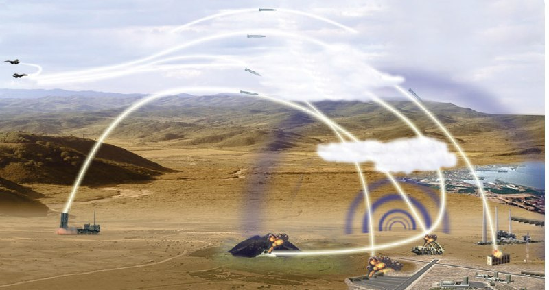

عکس جالبی از موشک بالستیک هواپرتاب ROCKS که مجهز به سیستم اکتساب هدف اتوماتیک الکترواپتیکی و الگوریتم تطبیق صحنه است که قابلیت کار در هر ساعت شبانه روز را دارد. به نظر بخشی از علت دقت بالای آن با CEP=3m به همین سیستم الکترواپتیکی آن در هدایت لحظات پایانی مسیر باز میگردد.  

[**@Exciton\_missile\_program**](https://t.me/Exciton_missile_program) 🚀

· · ·

**🕒 ۱۴۰۵/۰۸/۲۳ ۱۲:۳۱** · [پست 11069](https://t.me/kaavoush/11069)


تفاوت تیم امنیت ملی ترامپ در دوره اول ریاست‌جمهوری او و تیم فعلی او در آنجا مشخص می‌شود که جی‌دی‌ونس از همه ابتدا می‌خواست که با تمام کردن جنگ به هر شکلی، از ماجرا فرار کند و حالا هم همه چیز را تقصیر جنگ می‌‌اندازد اما ایرادی که اعضای تیم اول ترامپ در مصاحبه‌هایشان به کار او می‌گیرند این است که چرا وقتی جنگ را شروع کرد تا ته قضیه نرفت و کار را نصفه و نیمه گذاشت. از پنس تا ونس تفاوت بسیار است.

· · ·

**🕒 ۱۴۰۵/۰۸/۲۳ ۱۲:۲۰** · [پست 11068](https://t.me/kaavoush/11068)

مایک پنس معاون اول سابق ترامپ:  

اکنون که انتخابات میان‌دوره‌ای پشت سر گذاشته شده است، ترامپ باید ارتش آمریکا و اسرائیل را به کار گیرد تا کار ( ایران) را تمام کنند.

🎬 ویدیو: [مشاهده در تلگرام](https://t.me/kaavoush/11068)

· · ·

**🕒 ۱۴۰۵/۰۸/۲۳ ۱۲:۰۴** · [پست 11067](https://t.me/kaavoush/11067)

پیش‌بینی صد در صدی نمی‌توان داشت اما نگاه خود من آن است که تشدید تحریم‌ها و محاصره هر چند روزگار بسیار بدی برای مردم ایران می‌سازد اما به تنهایی بعید است که در کوتاه‌مدت جمهوری اسلامی را به سمت فروپاشی یا پذیرش خواسته‌های آمریکا بکشاند. برای تاثیرگذاری بهتر محاصره هم ابتدا نوعی sanction boost لازم به نظر می‌رسد.

· · ·

**🕒 ۱۴۰۵/۰۸/۲۳ ۰۹:۵۸** · [پست 11066](https://t.me/kaavoush/11066)

روبیو در حالی از بی‌اهمیتی وضعیت اقتصادی ایران برای رهبران کشور حرف زده که همین چند روز قبل، در دفاع از ادامه محاصره دریایی به جای جنگ ابراز امیدواری کرده بود که در صورت افزایش فشار اقتصادی بر ایران وضعیت تغییر کند چون به گفته او «بالاخره باید چیزی برای خوردن داشته باشید. سرانجام واقعیت‌های اقتصادی حتی به ذهن افراطی‌ترین دیوانه‌ها هم نفوذ می‌کند. بنابراین فکر می‌کنم با گذشت زمان، این فشار تأثیر خود را خواهد گذاشت.»

· · ·

**🕒 ۱۴۰۵/۰۸/۲۳ ۰۹:۴۰** · [پست 11065](https://t.me/kaavoush/11065)

مارکو روبیو درباره ایران:  

ایران توسط یک طبقه روحانی شیعه اداره می‌شود. نه صرفاً روحانیون شیعه، بلکه روحانیون شیعه‌ی تندرویی که در تصمیم‌گیری‌هایشان، الهیات به آن‌ها انگیزه می‌دهد. اگر این موضوع را درک نکنید، ایران را درک نکرده‌اید.  
این افراد صرفاً حاکمانِ ایران نیستند؛ برایشان کوچک‌ترین اهمیتی ندارد که وضعیت اقتصاد ایران چگونه است. این‌ها انقلابی هستند.  
اگر به اسناد بنیادینِ «جمهوری اسلامی» نگاه کنید، می‌بینید که در آن آمده است: «رهبر معظم»، رهبرِ \[صرفاً\] ایران نیست. بلکه گفته شده که رهبر معظم انقلاب، رهبرِ تمام مسلمانان — از جمله اهل سنت — است؛ که البته، خودِ آن‌ها (اهل سنت) چنین چیزی را قبول ندارند. و \[طبق این اسناد\]، وظیفه‌ی آن‌ها «صدور انقلاب» است.  
در تاریخ بشریت، هیچ «دولت-ملتی» به اندازه رژیم ایران، وقت یا هزینه صرفِ حمایت از اقدامات تروریستی در سراسر این کره خاکی نکرده است.  
می‌دانم که جنگ با ایران، محبوبیت و طرفداری ندارد. اما باور کنید، هیچ جنگی محبوب نیست. هیچ درگیری نظامی‌ای محبوب نیست.

· · ·

**🕒 ۱۴۰۵/۰۸/۲۳ ۰۹:۳۵** · [پست 11064](https://t.me/kaavoush/11064)

مارکو روبیو درباره ایران:   

ما هرگز نمی‌توانیم به خودمان اجازه دهیم در دنیایی زندگی کنیم، یا فرزندانمان سیاره‌ای را به ارث ببرند، که در آن چنین افرادی با چنین اقداماتی سلاح هسته‌ای داشته باشند. آنها ده‌ها هزار نفر از مردم خود را در خیابان‌ها قتل‌عام کرده‌اند. سپس وقتی زخمی می‌شوید به بیمارستان‌ها می‌روند و شما را روی تخت بیمارستان می‌کشند و اغلب پزشکان و پرستارانی را هم که درمانتان کرده‌اند می‌کشند. این کاری است که با مردم خودشان می‌کنند. تصور کنید اگر سلاح هسته‌ای داشتند با ما چه می‌کردند.

🎬 ویدیو: [مشاهده در تلگرام](https://t.me/kaavoush/11064)

· · ·

**🕒 ۱۴۰۵/۰۸/۲۳ ۰۱:۳۹** · [پست 11062](https://t.me/kaavoush/11062)

طبق گزارش جدید سازمان بین‌المللی انرژی از بازار نفت در ماه اکتبر این بازار پس از ماه‌ها تلاطم در پی جنگ ایران، نشانه‌هایی از بازگشت به تعادل را نشان می‌دهد. در ماه اکتبر برای اولین بار از زمان شروع جنگ در ایران، عرضه جهانی نفت از تقاضا پیشی گرفته و به ۱۰۵/۴ میلیون بشکه رسید. این مازاد عرضه سبب شد که ذخایر جهانی نفت در این ماه ۵۲ میلیون بشکه یا ۱/۷ میلیون بشکه در روز افزایش یابد. البته این هنوز به معنای رسیدن سطح تولید جهانی به سطح سال گذشته نبود و پیشی گرفتن عرضه از تقاضا به علت سرکوب تقاضا هم بوده است. اما کاهش تولید حالا تنها به ۲/۹ میلیون بشکه محدود شده است. (حذف ایران از بازار نفت نقش عمده‌ای در ایجاد این کاهش تولید داشته است.) این گزارش پیش‌بینی کرده که مازاد عرضه نفت در ماه‌های آینده هم ادامه داشته باشد. به طور خلاصه اگر در ماه‌های آینده اتفاق بزرگی رخ ندهد بازار نفت بالاخره وارد چشم‌اندازی از ثبات شده است؛ هرچند افزایش هزینه حمل و نقل ( که آن هم وارد روند کاهشی شده) و تنش‌های ژئوپلیتیکی همچنان قیمت‌ها را حدود ۳۰ درصد بالاتر از سال گذشته حفظ کرده است.

· · ·

**🕒 ۱۴۰۵/۰۸/۲۲ ۲۱:۵۹** · [پست 11061](https://t.me/kaavoush/11061)

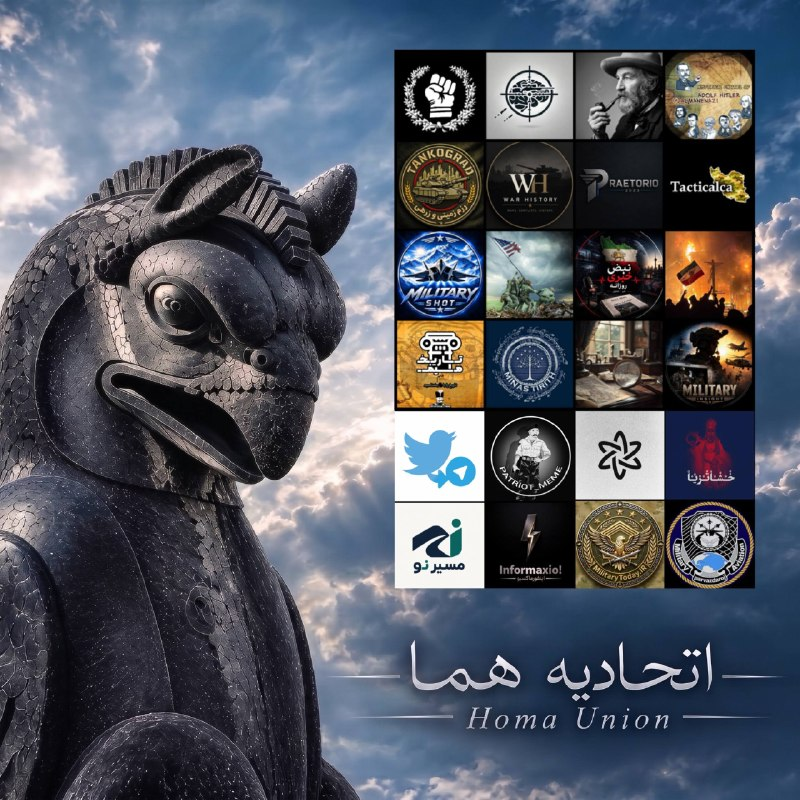

مجموعه‌ای برای گردهمایی علاقه‌مندان به حوزه‌های نظامی و سیاسی؛ جایی برای تبادل نظر، تحلیل، آگاهی و تعامل در فضایی منسجم و هدفمند.  

[اگر به اخبار ، مسائل نظامی و سیاسی علاقه‌مندید و به دنبال فضایی متفاوت برای فعالیت ، همفکری و تبادل نظر هستید، اتحادیه هما منتظر حضور شماست](https://t.me/addlist/jAp53AahnuZhZWU0)…  

«**هما فراتر از یک اتحادیه»**

· · ·

**🕒 ۱۴۰۵/۰۸/۲۲ ۲۱:۱۶** · [پست 11060](https://t.me/kaavoush/11060)

🎬 ویدیو: [مشاهده در تلگرام](https://t.me/kaavoush/11060)

· · ·

**🕒 ۱۴۰۵/۰۸/۲۲ ۲۰:۲۹** · [پست 11059](https://t.me/kaavoush/11059)

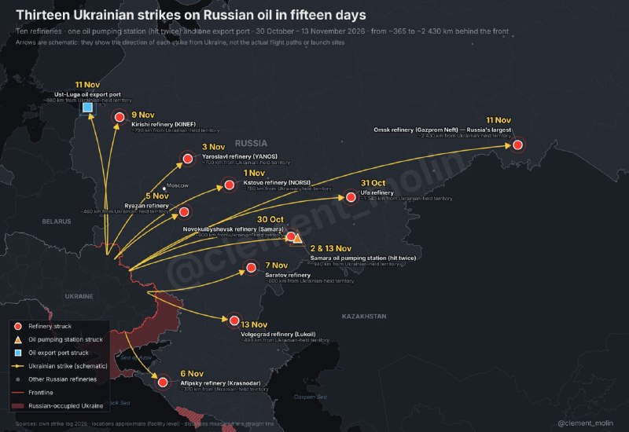

در 15 روز اخیر ارتش اوکراین 10 پالایشگاه بزرگ روسیه و پایانه صادراتی Ust - Luga را با شدتی بسیار بیشتر از حملات گذشته هدف قرار داده به شکلی که عمده پالایشگاه ها بیش از 70 درصد ظرفیت خود را از دست داده اند.  

کارشناسان نظامی 3 دلیل عمده را برای این موضوع متصور هستند:   

1- نرخ شلیک روزانه ارتش اوکراین افزایش یافته و احتمالا تعداد پهپاد انتحاری تولیدی در ماه بیش از 10 هزار فروند باشد   
2- اوکراینی ها از ماژول های ناوبری قدرتمندتر و ضد اخلال استفاده می کنند (بخش بزرگی از پهپادهای اوکراینی را سامانه های EW روسی منحرف میکردند)  
3- تمرکز پدافند هوایی روسیه بر دفاع از مسکو و صنایع تسلیحاتی حساس موجب خالی شدن بیشتر مناطق عمقی خاک روسیه شده است   

[@Minas\_Tirith2024](https://t.me/Minas_Tirith2024)

· · ·

**🕒 ۱۴۰۵/۰۸/۲۲ ۱۹:۱۵** · [پست 11057](https://t.me/kaavoush/11057)

کد تخفیف ده درصدی:  
Kavosh10

· · ·

**🕒 ۱۴۰۵/۰۸/۲۲ ۱۹:۱۵** · [پست 11056](https://t.me/kaavoush/11056)

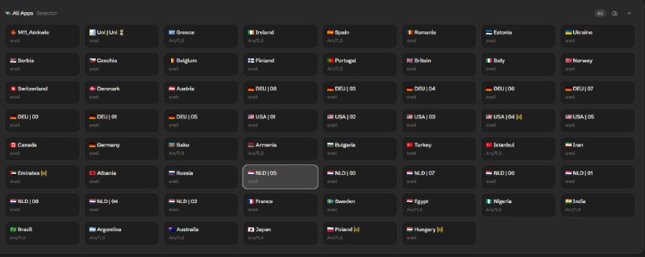

**دنبال یه فیلترشکن خوب برای ویندوز بودی؟** 💻  

معمولا فیلترشکن خوب تو ویندوز کم گیر میاد ولی immortaal رو تو هر دیوایس و هر سیستم عاملی میتونی استفاده کنی ! 🚀  

لوکیشن هارو 👀   
⭐️ **لینک ربات جهت خرید:**  

[**@ImmortalVPNfastbot**](https://t.me/ImmortalVPNfastbot)

· · ·

**🕒 ۱۴۰۵/۰۸/۲۲ ۱۹:۱۲** · [پست 11055](https://t.me/kaavoush/11055)

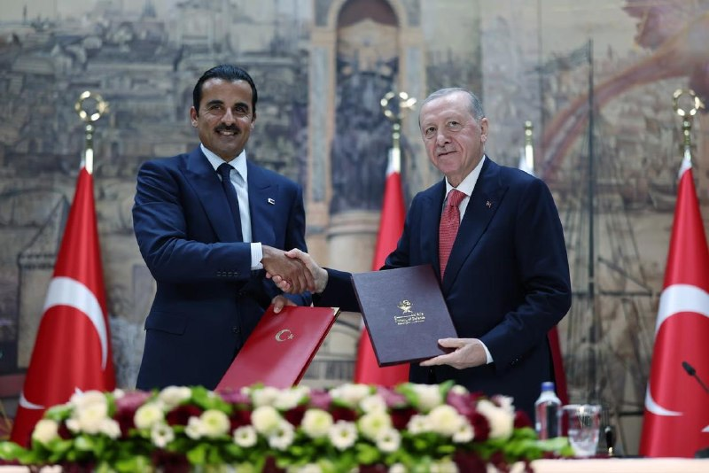

امیر قطر و رئیس‌جمهور ترکیه امروز در استانبول توافقنامه دفاع متقابل امضا کردند.

· · ·

**🕒 ۱۴۰۵/۰۸/۲۲ ۱۸:۴۵** · [پست 11054](https://t.me/kaavoush/11054)

↪️ فوروارد از Praetorio


رومن گوفمن، رئیس موساد، برای مذاکرات با مقامات ارشد دولت ترامپ درباره جنگ با ایران در واشنیگتن حضور دارد.  

به گزارش آکسیوس، این سفر یکی از نزدیک‌ترین مشاوران نتانیاهو، در حالی صورت می‌گیرد که نخست‌وزیر اسرائیل در حال فشار بر دونالد ترامپ، برای از سرگیری جنگ علیه ایران است.  

گوفمن با جان راتکلیف، رئیس سیا، دیدار خواهد کرد. او همچنین برای دیدار با استیو ویتکوف، فرستاده کاخ سفید، به میامی سفر میکند.  

ترامپ تاکنون فشارهای نتانیاهو برای بازگشت به درگیری نظامی را رد کرده است. به‌جای آن در کنار عربستان سعودی، امارات متحده عربی و قطر قرار گرفته تا محاصره دریایی و کمپین فشار اقتصادی علیه ایران را ادامه دهد، در حالی‌که بررسی می‌کند آیا امکان رسیدن به یک توافق وجود دارد یا خیر.  

[@P\_raetorio](https://t.me/P_raetorio)

· · ·

**🕒 ۱۴۰۵/۰۸/۲۲ ۱۸:۲۲** · [پست 11053](https://t.me/kaavoush/11053)

فرمانده **نیروی هوایی** ارتش:  

به هر اقدام دشمن در هر سطحی جواب بالاتری خواهیم داد. بعد از پیام رهبر انقلاب هیچ محدودیتی برای پاسخ نخواهیم داشت.

🎬 ویدیو: [مشاهده در تلگرام](https://t.me/kaavoush/11053)

· · ·

**🕒 ۱۴۰۵/۰۸/۲۲ ۱۷:۲۵** · [پست 11052](https://t.me/kaavoush/11052)

↪️ فوروارد از Praetorio

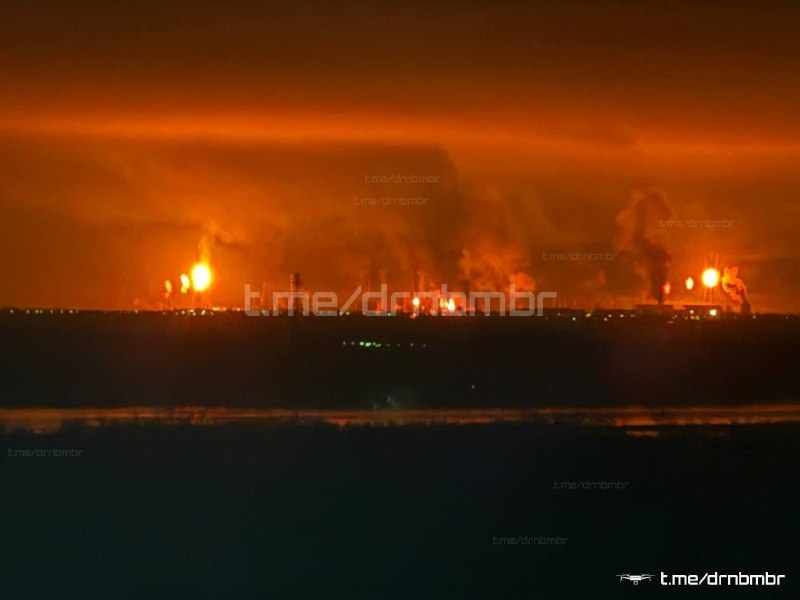

بامداد امروز ارتش اوکراین با ده‌ها پهپاد پالایشگاه ولگوگراد را هدف قرار داد و این پالایشگاه نیز عملا از چرخه عملیاتی به طور کامل خارج شده است.  

[@P\_raetorio](https://t.me/P_raetorio)

· · ·

**🕒 ۱۴۰۵/۰۸/۲۲ ۱۳:۴۴** · [پست 11051](https://t.me/kaavoush/11051)

یک نان را ۳۵ میلیون نفری می‌خوریم ولی سهمیه بنزین ۱۱۰ لیتری برامون خیلی کمه.

· · ·

**🕒 ۱۴۰۵/۰۸/۲۲ ۱۳:۳۲** · [پست 11050](https://t.me/kaavoush/11050)

🖼 *(عکس بعد از ۲۴ ساعت حذف شده)*

خانم، منظورتون از کسانی که حساب مردم رو تو خیابون می‌رسن همون عوامل موساد هست دیگه؟

· · ·

**🕒 ۱۴۰۵/۰۸/۲۲ ۱۰:۵۴** · [پست 11049](https://t.me/kaavoush/11049)

صحبت‌های معاون رئیس جمهور درباره کمبود بنزین و محدودیت‌هایی که ایجاد شده

🎬 ویدیو: [مشاهده در تلگرام](https://t.me/kaavoush/11049)

· · ·

---

## iaghapour

[کانال در تلگرام](https://t.me/iaghapour) · [آرشیو متن](archive/iaghapour/)

**🕒 ۱۴۰۵/۰۸/۲۲ ۲۱:۰۱** · [پست 3289](https://t.me/iaghapour/3289)

↪️ فوروارد از هاستینگ افزونه نویس

· · ·

**🕒 ۱۴۰۵/۰۸/۲۲ ۲۱:۰۰** · [پست 3288](https://t.me/iaghapour/3288)

**📌 پیش از خرید از سرویس‌ تبلیغ‌شده زیر، قوانین را بخوانید👇🏻**

· · ·

**🕒 ۱۴۰۵/۰۸/۲۲ ۲۰:۳۳** · [پست 3287](https://t.me/iaghapour/3287)

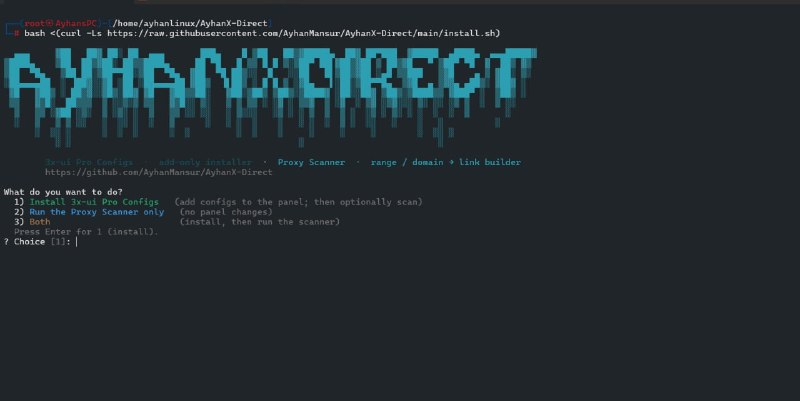

**⭕️ اسکریپت AyhanX-Direct؛ افزودن خودکار کانفیگ به پنل‌های 3x-ui، PasarGuard و Marzban!**  

ابزاری کاربردی برای اضافه کردن سریع انواع کانفیگ جدید به پنل فعلی سرور بدون تغییر یا حذف تنظیمات قبلی؛ همراه با بکاپ خودکار دیتابیس و اسکنر اختصاصی.  

🔹 **اتصال ایمن به پنل‌ها:** پشتیبانی از 3x-ui (خواندن خودکار اطلاعات از دیتابیس)، PasarGuard و Marzban همراه با بکاپ‌گیری خودکار پیش از اعمال تغییرات.  

🔸 **تنوع بالای پروتکل‌ها:** ساخت کانفیگ‌های VLESS و Trojan روی REALITY (ترنسپورت XHTTP و gRPC)، وب‌سوکت، HTTPUpgrade، کانفیگ‌های CDN و کلید پسا‌کوانتومی (نیازمند Xray v26).  

🔹 **مدیریت هوشمند دامنه و کلودفلر:** صدور خودکار گواهی SSL، تشخیص تداخل پورت، پالایش آی‌پی تمیز (زیر ۱۵۰۰ میلی‌ثانیه)، پشتیبانی از Origin Rule و فعال‌سازی BBR.  

🔸 **تست زنده و اسکنر مجزا:** بررسی باز شدن پورت و تست واقعی اتصال با Xray موقت، ارائه لینک اشتراک (عادی و JSON) و اسکنر داخلی برای یافتن آی‌پی‌های سالم.  

[ 🔗 **مخزن پروژه در گیت‌هاب**](https://github.com/AyhanMansur/AyhanX-Direct)  

🆔 [@iAghapour](https://t.me/iAghapour) | [YouTube](https://www.youtube.com/@iAghapour)

· · ·

**🕒 ۱۴۰۵/۰۸/۲۲ ۱۸:۱۲** · [پست 3286](https://t.me/iaghapour/3286)

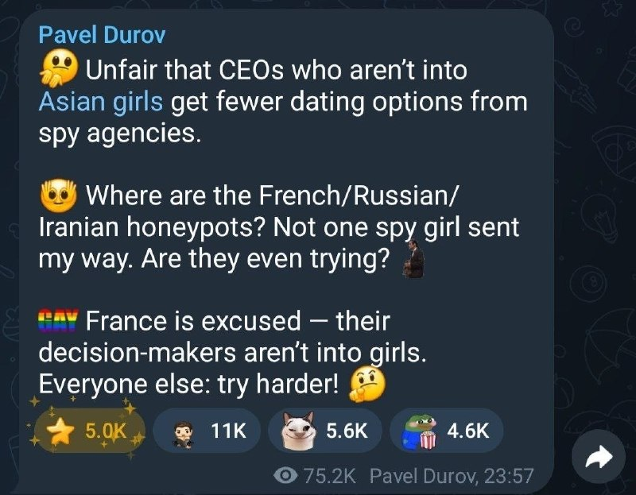

**⭕️ پست جدید پاول دروف، مالک تلگرام:**  

واقعاً بی‌انصافیه! سازمان‌های جاسوسی فقط دخترای آسیایی رو برای به دام انداختن مدیرعامل‌ها می‌فرستن؛ پس تکلیف اون مدیرعامل‌هایی که از دخترای آسیایی خوششون نمیاد چی می‌شه؟!  

پس جاسوس‌های خوشگل فرانسوی🇫🇷، روسی🇷🇺 و ایرانی🇮🇷 کجان؟   
حتی یه دختر جاسوس هم سراغ من نفرستادن! اصلاً دارن تلاش می‌کنن یا نه؟   
البته فرانسه معافه، چون تصمیم‌ گیرنده‌هاشون اصلاً به دخترا علاقه ندارن! ولی بقیه کشورها باید بیشتر تلاش کنن...  

🆔 [@iAghapour](https://t.me/iAghapour) | [YouTube](https://www.youtube.com/@iAghapour)

· · ·

**🕒 ۱۴۰۵/۰۸/۲۱ ۲۲:۴۹** · [پست 3285](https://t.me/iaghapour/3285)

↪️ فوروارد از Karizma Admin

🖼 *(عکس بعد از ۲۴ ساعت حذف شده)*

**با کاریزما، با خیال راحت‌تر از اینترنت استفاده کن!** 😉  

چه برای استفاده روزمره، چه هوش مصنوعی و سرویس‌های خارجی، کاریزما برات راهکارهای متنوعی داره:  

🌍 **مولتی‌لوکیشن اختصاصی** با 5 لوکیشن کاملاً تانل‌شده:  
ترکیه 🇹🇷 |  آمریکا 🇺🇸|  فرانسه 🇫🇷|  آلمان 🇩🇪|  انگلیس 🇬🇧  

💰 **گیگی** 5 هزار تومن  

♾️ **سرویس نامحدود تانل شده کاریزما**!  
اتصال فول ‌تانل (متفاوت تر از هر نامحدود دیگه ای که دیدین!)، مناسب مصرف بالا!  
🔥 فقط **۲۰۰ هزار تومان**  

🎁 لازم نیست فقط به تبلیغات ما اعتماد کنی؛ قبل از خرید می‌تونی هر دو سرویس رو از طریق ربات رایگان تست کنی و کیفیتشون رو با اینترنت خودت بسنجی. 😉  

🤖 **ربات تست رایگان و خرید:**  
[@KARIZMAVPNSTORE\_BOT](https://t.me/KARIZMAVPNSTORE_BOT)  
📢 **کانال کاریزما:**  
[@KARIZMAVPNSTORE](https://t.me/KARIZMAVPNSTORE)

· · ·

**🕒 ۱۴۰۵/۰۸/۲۱ ۲۲:۴۸** · [پست 3284](https://t.me/iaghapour/3284)

**📌 پیش از خرید از سرویس‌ تبلیغ‌شده زیر، قوانین را بخوانید👇🏻**

· · ·

**🕒 ۱۴۰۵/۰۸/۲۱ ۱۷:۴۶** · [پست 3283](https://t.me/iaghapour/3283)

**🟢 لیست** دستورات برای ویدیو[ **پنل حرفه‌ای فیلترشکن (OpenVPN)**](https://t.me/iaghapour/3282)  

**🆔** [@iAghapour](https://t.me/iAghapour) | [YouTube](https://www.youtube.com/@iAghapour)

📎 فایل: [مشاهده در تلگرام](https://t.me/iaghapour/3283)

· · ·

**🕒 ۱۴۰۵/۰۸/۲۱ ۱۷:۴۵** · [پست 3282](https://t.me/iaghapour/3282)

🖼 *(عکس بعد از ۲۴ ساعت حذف شده)*

**⭕️ پنل حرفه‌ای فیلترشکن با قابلیت مدیریت کاربر (OpenVPN)**  

🔹در این ویدیو یک پنل وب OpenVPN را راه‌اندازی می‌کنیم که امکان ساخت اکانت، محدودیت حجم و زمان، و مانیتورینگ کاربران را به ساده‌ترین شکل فراهم می‌کند. همچنین برای ایجاد ارتباطی پایدار و عبور از محدودیت‌های شبکه، نحوه اجرای تانل معکوس را برای این پنل آموزش دادیم. **👈🏻(بدون تانل هم کار میکنه)**  

[**🔗 تماشا ویدیو در یوتیوب**](https://youtu.be/tLfOOb4_GDI)  

🎁 این ویدیو هم مثل ویدیو های قبلی قرعه‌کشی داره، برای شرکت توی قرعه‌کشی فرصت محدوده (شرایطش هم خیلی راحته؛ فقط کافیه زیر ویدیو برامون کامنت بذارید).  

#آموزش #فیلترشکن #تانل #openvpn #پنل  
برای یادگیری شبکه و آموزش تکنولوژی و هوش مصنوعی ما رو دنبال کنید 💚  
🆔 [@iAghapour](https://t.me/iAghapour) | [YouTube](https://www.youtube.com/@iAghapour)

· · ·

**🕒 ۱۴۰۵/۰۸/۲۱ ۱۵:۰۱** · [پست 3281](https://t.me/iaghapour/3281)

🖼 *(عکس بعد از ۲۴ ساعت حذف شده)*

🎨 **رونمایی از مدل تصویرساز MiniMax H3 Image در Hailuo AI؛ ویرایش با ۱۶ تصویر مرجع!**  

کمپانی MiniMax مدل تصویرساز جدید **H3 Image** را به‌صورت دسترسی زودهنگام (Early Access) ارائه کرده است؛ مدلی که با تمرکز ویژه بر ادیت دقیق تصاویر و استفاده از چند مرجع، رقیبی جدی برای ابزارهای فعلی است.  

🔹 **پشتیبانی از ۱۶ تصویر مرجع:** امکان دریافت هم‌زمان تا ۱۶ عکس برای حفظ کامل چهره کاراکتر در شرایط مختلف، ترکیب محصولات و ساخت کانسپت‌های کاملاً هماهنگ.  

🔸 **ویرایش پیشرفته (Image Editing):** امکان اعمال تغییرات با دستورات متنی روی تصاویر بارگذاری‌شده، با حفظ دقیق هویت، استایل و ترکیب‌بندی سوژه.  

🔹 **خروجی باکیفیت تا 4K:** توانایی بالا در خلق تصاویر فوتورئال طبیعی (جزئیات دقیق پوست و نورپردازی)، پوسترهای سینمایی و طراحی‌های سه‌بعدی تا وضوح 4K.  

🔸 **پشتیبانی از زبان فارسی:** بر اساس گزارش‌های کاربران، این مدل قادر به درک پرامپت‌ها و حتی درج صحیح متون فارسی روی تصاویر است.  
[  
](https://www.youtube.com/@iAghapour)**🆔** [**@iAghapour**](https://t.me/iAghapour) **|** [**YouTube**](https://www.youtube.com/@iAghapour)

· · ·

**🕒 ۱۴۰۵/۰۸/۲۰ ۲۱:۰۰** · [پست 3280](https://t.me/iaghapour/3280)

🖼 *(عکس بعد از ۲۴ ساعت حذف شده)*

📱 **فروش هاست و سرور مجازی پرسرعت در شلتر**  

💵 فروش سرور بورس  
🖥 فروش انواع سرورمجازی با سیستم عامل های مختلف  
⏱ فروش سرور ساعتی  
🇩🇪 فروش سرور خارج   
🖥 هاست های وردپرس و ووکامرس و لینوکس  

🖥 هر نیازی که‌از یک سرور دارید، شلتر کلاود در خدمت شماست!  

[https://t.me/+ZbxLUqEk5OZlZGM0](https://t.me/+ZbxLUqEk5OZlZGM0)  

🌐 [Cloud.sheltertm.com](http://Cloud.sheltertm.com/)

· · ·

**🕒 ۱۴۰۵/۰۸/۲۰ ۲۱:۰۰** · [پست 3279](https://t.me/iaghapour/3279)

**📌 پیش از خرید از سرویس‌ تبلیغ‌شده زیر، قوانین را بخوانید👇🏻**

· · ·

**🕒 ۱۴۰۵/۰۸/۲۰ ۲۰:۲۰** · [پست 3278](https://t.me/iaghapour/3278)

🖼 *(عکس بعد از ۲۴ ساعت حذف شده)*

🚨 **لو رفتن دیتای محرمانه ۳۵ هزار پروژه در Grok Build به‌خاطر یک باگ ابتدایی در آدرس‌دهی!**  

پژوهشگران امنیتی شرکت Claroc اعلام کردند نقصی ساختاری در سازوکار اشتراک‌گذاری پلتفرم **Grok Build**، اطلاعات محرمانه بیش از ۳۵ هزار اپلیکیشن و اسناد داخلی شرکت‌های ایلان ماسک را در دسترس عموم قرار داده است.  

🔹 **خطای فاحش در URL و رهگیری با Passive DNS:** برخلاف رقبایی مثل ChatGPT و Claude که عبارات تصادفی لینک را بعد از دامنه (Path) می‌آورند، Grok آن را به‌صورت ساب‌دامین قرار داده بود؛ اشتباهی که امکان استخراج خودکار تمام نشانی‌های فعال را از طریق لاگ‌های DNS غیرفعال فراهم کرد.  

🔸 **افشای اسناد حساس تسلا و SpaceXSI:** لو رفتن ۲۴ اپلیکیشن داخلی SpaceXSI، قراردادهای تجاری، پرونده‌های پزشکی پرسنل و جزئیات ارزیابی عملکرد و پاداش تکنسین‌های تسلا.  

🔹 **نبود احراز هویت:** در نظر گرفتنِ صرفِ داشتنِ لینک به‌عنوان مجوز دسترسی به کل دیتای پروژه، بدون نیاز به ورود یا تدابیر امنیتی مضاعف.  
[  
](https://www.youtube.com/@iAghapour)**🆔** [**@iAghapour**](https://t.me/iAghapour) **|** [**YouTube**](https://www.youtube.com/@iAghapour)

· · ·

**🕒 ۱۴۰۵/۰۸/۲۰ ۱۷:۱۰** · [پست 3277](https://t.me/iaghapour/3277)

🖼 *(عکس بعد از ۲۴ ساعت حذف شده)*

⭕️ **سخنگوی دولت: بهبود کیفیت اینترنت وابسته به شرایط جنگی و مهار حملات سایبری است!**  

فاطمه مهاجرانی، سخنگوی دولت، در نشست خبری اخیر اعلام کرد با وجود تمایل دولت به ارتقای کیفیت و دسترسی به شبکه، رفع اختلالات کنونی اینترنت به‌طور مستقیم به شرایط حساس امنیتی، جنگی و دفع حملات سایبری گره خورده است.  

🔹 **ضرورت حفاظت از زیرساخت‌ها در شرایط جنگی:** مهاجرانی با اشاره به تشدید حملات سایبری اعلام کرد که سامانه‌های الکترونیکی میزبان دارایی‌ها و داده‌های حیاتی مردم هستند و در شرایط جنگی حفظ امنیت و پایداری این داده‌ها اولویت اصلی است.  

🔸 **گره‌خوردن کیفیت شبکه به پایان تنش‌ها:** بخش عمده‌ای از افت کیفیت و محدودیت‌های فعلی شبکه ناشی از شرایط جنگی بوده و امید می‌رود با برقراری صلح پایدار این چالش برطرف شود.  

🔹 **اذعان به مطالبه عمومی:** دولت بر تمایل خود برای افزایش سرعت و پایداری دسترسی شهروندان تأکید دارد، اما شرایط محیطی و دفاع سایبری دسترسی نرمال را تحت تأثیر قرار داده است.  
[  
](https://www.youtube.com/@iAghapour)**🆔** [**@iAghapour**](https://t.me/iAghapour) **|** [**YouTube**](https://www.youtube.com/@iAghapour)

· · ·

**🕒 ۱۴۰۵/۰۸/۱۹ ۲۱:۰۱** · [پست 3276](https://t.me/iaghapour/3276)

↪️ فوروارد از پشتیبانی جمینو

🖼 *(عکس بعد از ۲۴ ساعت حذف شده)*

✅ اکانت های پریمیوم با بهترین قیمت و پشتیبانی در [ ***فروشگاه جمینو***](https://mygemino.ir/t/DqoxBaKkaoK9)***🪐***  

🤖 پلن های جدید **6** و **12** ماهه **جمینای Google AI Pro**، فعال سازی روی اکانت شخصی شما یا تحویل اکانت آماده.  
*اکانت ها اختصاصی هستند، فمیلی و اشتراکی نیستند*.  
💎 **Gemini 4** **Argon**  
 پیشرفته‌ترین مدل زبانی و هوش مصنوعی گوگل  
🖥 **AntiGravity**   
 کد نویسی با مدل های قدرتمند کلاد و گوگل  
🍌 **NanoBanana**   
 خلق و ویرایش حرفه‌ای تصویر  
📚 **NotebookLM**   
 دستیار هوشمند مطالعه، یادگیری و ساخت پادکست  
⚽️ **Veo**, Omni  
 نسل جدید تولید ویدیو با بالاترین کیفیت  
📹 **Flow**   
 استودیوی خلاقانه تولید و ادیت عکس  

👀 محصولات دیگر با بهترین قیمت از جمله :  
انواع پلن های **ChatGPT Plus**🤖  
اختصاصی و اشتراکی از **890** هزار تومان  
💥 Claude  💻Cursor   🤖 Muse      
👨‍🎨 Figma    ❤️ Canva   🦜 Doulingo  
📒 Notion  📱 Mimo    💻 Windows  
🚀Grok     📱 Capcut  💻 OpenCode  
‏  
🛍 خرید از بات جمینو🔙 [**@mygeminobot**](https://t.me/mygeminobot?start=ad_7dFEkhX-Y84-)  
‌‏🌐 سایت + درگاه و اینماد🔙 [**mygemino.ir**](https://mygemino.ir/t/DqoxBaKkaoK9)  
‌‏💬 پشتیبانی جمینو🔙 [**@mygemino**](https://t.me/mygemino)‎

· · ·

**🕒 ۱۴۰۵/۰۸/۱۹ ۲۱:۰۰** · [پست 3275](https://t.me/iaghapour/3275)

**📌 پیش از خرید از سرویس‌ تبلیغ‌شده زیر، قوانین را بخوانید👇🏻**

· · ·

**🕒 ۱۴۰۵/۰۸/۱۹ ۲۰:۳۷** · [پست 3274](https://t.me/iaghapour/3274)

🖼 *(عکس بعد از ۲۴ ساعت حذف شده)*

💻 **ساخت یک سیستم‌عامل کامل از صفر توسط Claude Fable 5.2؛ شاهکار ۱۰۰۰ ایجنت هوش مصنوعی در ۸ روز!**  

شرکت آنتروپیک هم‌زمان با معرفی مدل پرچمدار **Claude Fable 5.2**، از دستاورد کم‌سابقه‌ای پرده برداشت که در آن هوش مصنوعی موفق شده تنها از یک پوشه کاملاً خالی، یک سیستم‌عامل مستقل و قابل بوت روی لپ‌تاپ را توسعه دهد.  

🔹 **مقیاس عظیم هماهنگی چندایجنتی (Multi-Agent):** هدایت و مدیریت هم‌زمان بیش از ۱۰۰۰ ساب‌ایجنت به‌صورت شبانه‌روزی در مدت ۸ روز برای نوشتن کدها، تست عملکرد، رفع خطاها و بازبینی مداوم بخش‌های مختلف.  

🔸 **توسعه کامل اجزا بدون وابستگی قبلی:** برنامه‌نویسی اختصاصی کرنل (Kernel)، درایور دیسک، کیبورد و کارت شبکه، فایل‌سیستم، رابط کاربری پنجره‌ای (GUI) و لاگین بدون استفاده از کدهای آماده.  

🔹 **مشخصات فنی مدل Fable 5.2:** پشتیبانی از پنجره متنی یک میلیون توکنی، حداکثر خروجی ۱۲۸ هزار توکن و بهینه‌سازی ویژه برای تسک‌های پیچیده مهندسی و سناریوهای ایجنتیک بسیار طولانی‌مدت.  
[  
](https://www.youtube.com/@iAghapour)**🆔** [**@iAghapour**](https://t.me/iAghapour) **|** [**YouTube**](https://www.youtube.com/@iAghapour)

· · ·

**🕒 ۱۴۰۵/۰۸/۱۹ ۱۹:۱۹** · [پست 3273](https://t.me/iaghapour/3273)

✍🏻 دیروز پست مربوط به [تخمین مدت زمان دانلود GTA 6](https://t.me/iaghapour/3267) تو کشورهای مختلف رو گذاشتیم که تهش هم با یه کنایه تلخ، عدد عجیب ۳ روز و خرده‌ای رو برای ایران زده بود. هدف کاملاً مشخص بود: یادآوری وضعیت افتضاح سرعت، پکت‌لاس و اختلالات دائمی اینترنت ما در مقایسه با دنیا.  

🔹حالا جالبیش اینجاست یه سری از دوستان عقل‌کل فکر کردن آپولو هوا کردن! رفتن از هوش مصنوعی استعلام گرفتن، دو تا فایل گذاشتن دانلود و اومدن دایرکت که: «دروغ نگو، چرا خودتخریبی می‌کنی؟ سرعت نت که عالیه!» :) یعنی واقعاً به ساقی این عزیزان باید دست‌مریزاد گفت!  

🔸اولاً که این پست اصلاً نوشته اختصاصی خودمون نبود؛ یکی از بچه‌ها توی ربات فرستاده بود و ما هم فقط بازنشرش کردیم. ثانیاً وقتی جلوی یه عدد صراحتاً نوشته شده «طنز تلخ»، دیگه نیازی به محاسبات ریاضی و تز دکترای شبکه نداره؛ مشخصه که کنایه‌ست، نه گزارش رسمی سازمان تنظیم مقررات! واقعاً عجیبه که بدیهی‌ترین شوخی رو هم باید برای بعضی‌ها توضیح داد.  
[  
](https://www.youtube.com/@iAghapour)**🆔** [**@iAghapour**](https://t.me/iAghapour) **|** [**YouTube**](https://www.youtube.com/@iAghapour)

· · ·

**🕒 ۱۴۰۵/۰۸/۱۹ ۱۸:۱۷** · [پست 3272](https://t.me/iaghapour/3272)

🖼 *(عکس بعد از ۲۴ ساعت حذف شده)*

🌐 **اختلال تازه در اینترنت مخابرات؛ باز نشدن برخی سایت‌ها و نشانه‌های خرابی DNS!**  

گزارش‌های کاربران و بررسی نشانه‌های فنی نشان می‌دهد اینترنت شرکت مخابرات با اختلال جدیدی روبه‌رو شده که موجب عدم بارگذاری یا باز شدن با تأخیر شدید برخی وب‌سایت‌های داخلی و بین‌المللی شده است.  

🔹 **نقص در سرویس DNS مخابرات:** شواهد اولیه حاکی از بروز خطا در سرورهای DNS پیش‌فرض مخابرات در تحلیل و هدایت دامنه‌هاست؛ به طوری که تغییر دستی DNS سیستم یا مودم به DNSهای عمومی (مانند `1.1.1.1` یا `8.8.8.8`) در مواردی مشکل باز نشدن سایت‌ها را موقتاً برطرف می‌کند.  

🔸 **احتمال اختلال در روتینگ و لایه زیرساخت:** در کنار مشکل DNS، احتمال بروز اختلال در مسیرهای ارتباطی، تغییر پالیسی‌های ترافیکی یا اعمال محدودیت در لایه‌های شبکه مادر کشور نیز مطرح است.  

🔹 **تداوم وضعیت ناپایدار شبکه:** این اختلال پس از افت کیفیت روزهای اخیر رخ می‌دهد؛ وضعیتی که مسئولان مخابرات علت آن را کاهش پهنای‌باند بین‌الملل، مانورهای امنیتی زیرساخت برای مقابله با حملات سایبری و شرایط جوی اعلام کرده بودند.//شبکه‌چی  
[  
](https://www.youtube.com/@iAghapour)**🆔** [**@iAghapour**](https://t.me/iAghapour) **|** [**YouTube**](https://www.youtube.com/@iAghapour)

· · ·

**🕒 ۱۴۰۵/۰۸/۱۸ ۲۱:۰۰** · [پست 3271](https://t.me/iaghapour/3271)

↪️ فوروارد از KavirCloud Support

🖼 *(عکس بعد از ۲۴ ساعت حذف شده)*

📢 **سرورهای ابرکویر با بهترین کیفیت ارتباطات بین الملل رو با 50 درصد تخفیف خریداری کن**🍁  

**✅** **ارائه سرور تست 48 ساعته**  

**✅** **آپلود رایگان**  

**✅** **امکان تعویض IP**  

**✅** **قابلیت ارتقا و کاهش منابع**  

**✅** **پورت 10Gbps**  

**✅** **پشتیبانی 7/24  

💰 ضمانت بازگشت وجه بی قید و شرط 24 ساعته**  

**🗑️** **کد تخفیف** **🤑** **دیتاسنتر‎‌های ایران:** `aghapourt50`  

**برای مشاهده سرویس ها** [**کلیک**](https://kavircloud.com/iran-virtual-server/) **کنید**  

☁️ **ابر کویر** ☁️  

🌐[https://t.me/kavircloud](https://t.me/kavircloud)  
🌐[http://ble.ir/kavircloud](http://ble.ir/kavircloud)  
🌐[https://kavircloud.com](https://kavircloud.com/)

· · ·

**🕒 ۱۴۰۵/۰۸/۱۸ ۲۱:۰۰** · [پست 3270](https://t.me/iaghapour/3270)

**📌 پیش از خرید از سرویس‌ تبلیغ‌شده زیر، قوانین را بخوانید👇🏻**

· · ·

---

## MatinSenPaii

[کانال در تلگرام](https://t.me/MatinSenPaii) · [آرشیو متن](archive/matinsenpaii/)

**🕒 ۱۴۰۵/۰۸/۲۳ ۱۲:۵۸** · [پست 5871](https://t.me/MatinSenPaii/5871)

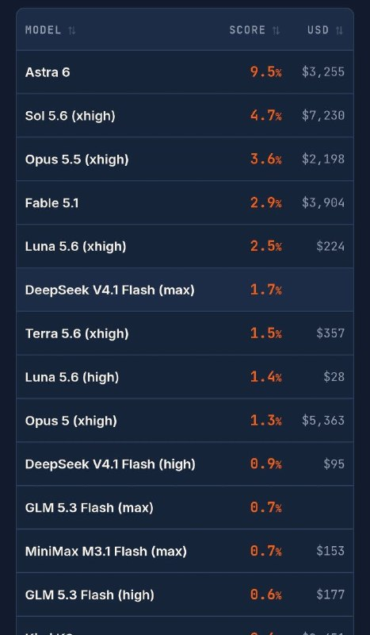

**مدل DeepSeek V4.1 Flash اولین اوپن‌ویتی شد که توی بنچمارک SWE-sweep از ۱٪ رد شد**  

سازنده‌های بنچمارک SWE-sweep لیدربوردشون رو با مدل‌های اوپن‌ویت تازه کردن و DeepSeek V4.1 Flash با ۱٫۷٪ اولین مدلیه که از ۱٪ رد شده؛ خود این بنچمارک، بنچمارکیه که به مدل یه Repository بزرگ پر از باگ می‌ده، بدون اینکه بگه باگ‌ها کجان، و مدل باید خودش پیداشون کنه و درستشون کنه. همه مدل‌ها توی یه هارنس و زمان یکسان تست شدن و کد ارزیابی هم اوپن‌سورسه.  
برای اینکه بهتر دستتون بیاد، Opus 5.5 نمره‌ی 3.6 و Astra 6 نمره‌ی 9.5 گرفته. قیمت‌هاشونم عجیب غریبه و در کل بنچمارک عجیبیه؛ اما دیپ‌سیک به نظرم خوب عمل کرده  

نکته‌ی خنده‌دار اینه که گوگل ادعا کرده Gemini 4 Hydrogen نمره‌ی 13.5 گرفته😂😂😂  

🔗 [منبع](https://www.reddit.com/r/LocalLLaMA/comments/1xvcgxq/deepseek_flash_max_is_the_first_model_to_reach_1/)  
✉️ [t.me/MatinSenPaii](http://t.me/MatinSenPaii)

· · ·

**🕒 ۱۴۰۵/۰۸/۲۳ ۱۰:۵۰** · [پست 5870](https://t.me/MatinSenPaii/5870)

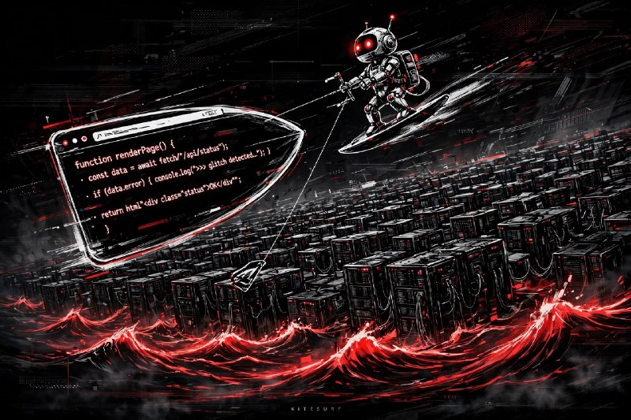

**کمپانی کلودفلر مرورگر مخصوص ایجنت‌ها رو متن‌باز کرد**  

بلاگ کلودفلر می‌گه Kitesurf، موتور مرورگر سبکی که برای ایجنت‌های AI ساخته، حالا با لایسنس Apache 2.0 روی گیت‌هابه و می‌تونید خودتون اجراش کنید یا روی اکانت خودتون دیپلویش کنید. این موتور به‌جای کانتینر کامل کرومیوم روی Workers اجرا می‌شه، HTML رو پارس می‌کنه، جاوااسکریپت اجرا می‌کنه و اسکرین‌شات می‌گیره، با CPU و حافظه کمتر. از پروتکل Chrome DevTools هم پشتیبانی می‌کنه، یعنی با Puppeteer وصلش می‌کنید و ایجنت مستقیم کنترلش رو می‌گیره.  

🔗 [منبع](https://blog.cloudflare.com/kitesurf-open-source/)  
✉️ [t.me/MatinSenPaii](http://t.me/MatinSenPaii)

· · ·

**🕒 ۱۴۰۵/۰۸/۲۲ ۲۳:۱۶** · [پست 5862](https://t.me/MatinSenPaii/5862)

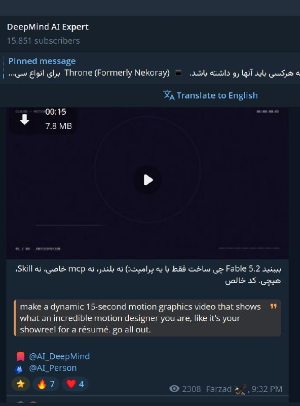

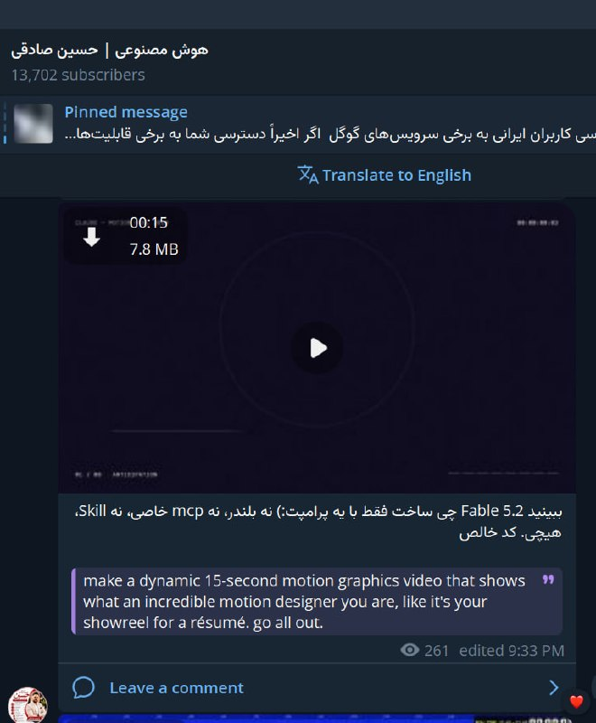

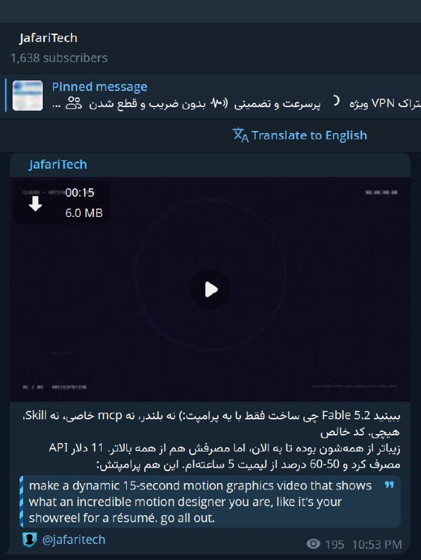

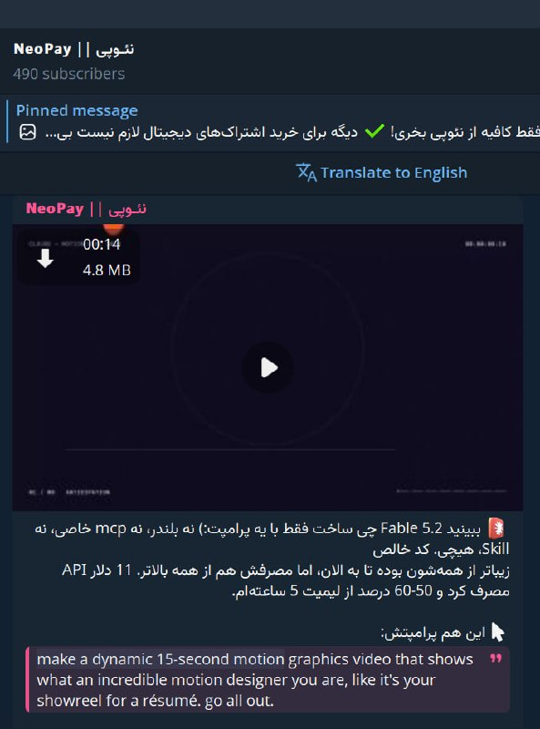

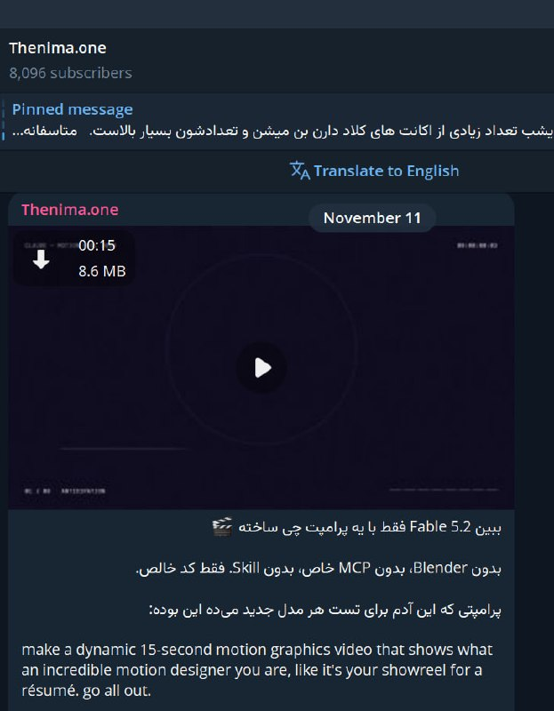

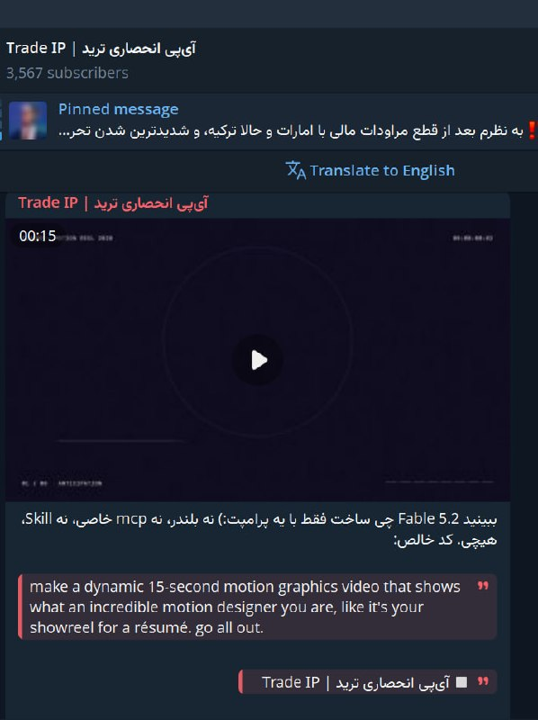

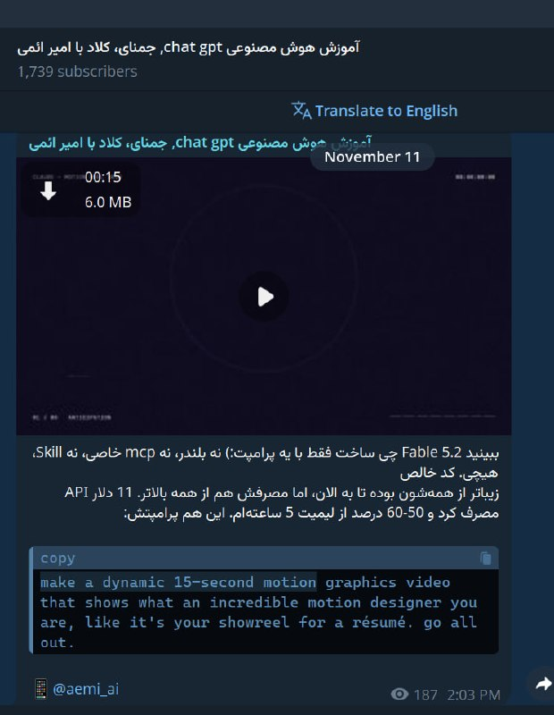

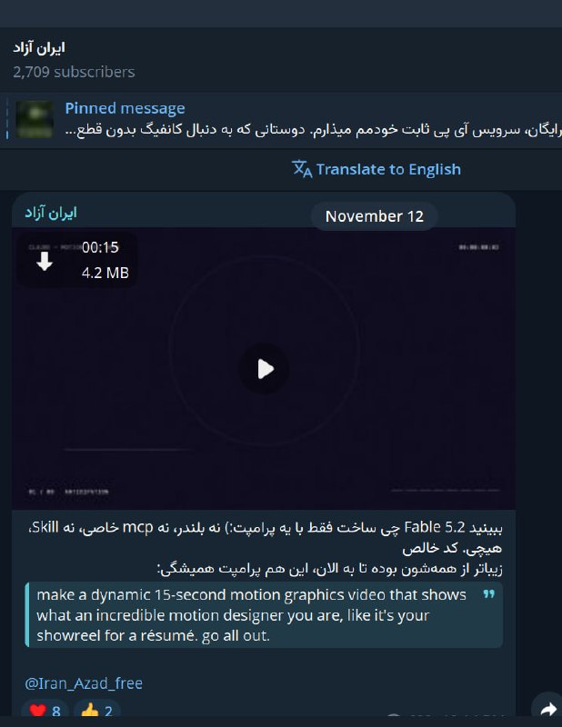

چه وضعیتیه  
این واقعا نگران کنندست  
و در مورد خودم صحبت نمیکنم طبیعتا.  
فرض کنید یه نفر بیاد شروع کنه به تولید محتوا و ارزش و پست بذاره و ممبراش کم باشه از قضا(و صداش به جایی نرسه)، این کانالای تلگرامی شبیه راهزن باهاش برخورد می‌کنن:)) من تازه یه ذره سین می‌خوره پستام و یه ذره من رو میشناسن و این شکلی رفتار می‌کنن  
وای به حال چنل‌های کوچیک

· · ·

**🕒 ۱۴۰۵/۰۸/۲۲ ۲۳:۰۳** · [پست 5861](https://t.me/MatinSenPaii/5861)

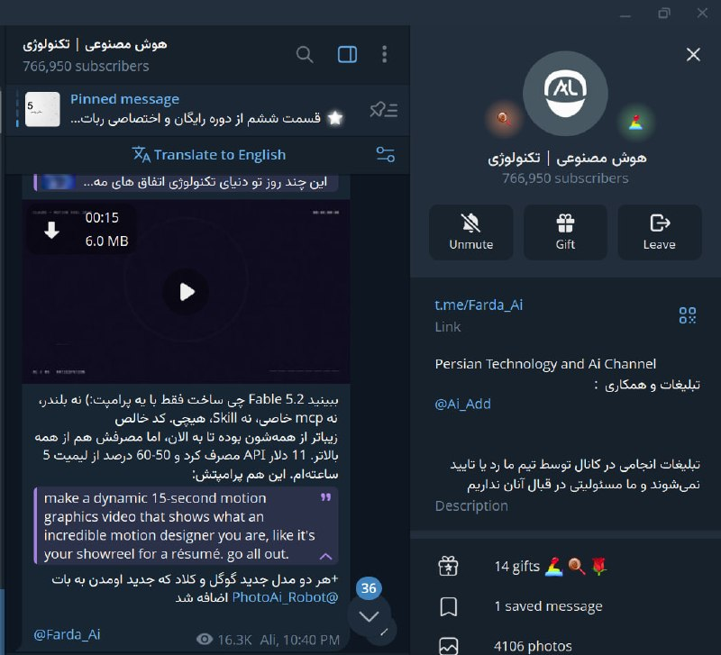

این پست من حقیقتا چیز خاصی نبود.  
یه پرامپت اجرا کردم و هر کسی هم می‌تونست با اجرا کردنش و 20 دقیقه زمان، خودش تجربه‌اش رو بذاره. اما صحبتم اینه که اگر یه کانال کوچیکتر جای من بود، هیچکس صداش رو نمی‌شنید.   
و این دوستمون عملا عیناً خود پست رو کپی پیست کرده و گذاشته بدون هیچ رفرنسی و زیرش هم ربات خودش رو تبلیغ کرده.  

روی صحبتم با شماست. اگر کسی پستی رو گذاشته(چه توییتر چه ردیت چه تلگرام و...)، و شما ازش رفرنس می‌گیرید به هر شکل، حتما رفرنس بذارید. نه چون اگه نذارید کسی ممکنه بفهمه و نه چون اگه بذارید ممکنه بهتون جایزه بدن.  
چون کار "درستی"ـه و جزو حداقل بیس‌های اخلاقی‌ای هست که یه انسان باید داشته باشه به نظرم

· · ·

**🕒 ۱۴۰۵/۰۸/۲۲ ۲۱:۲۹** · [پست 5860](https://t.me/MatinSenPaii/5860)


این قضیه انویدیا داره به طرز کسل کننده ای مطابق الگویی که حدس زدم پیش میره و جنسن همین امروز "استعفا" داد!   

حالا ازینجا به بعدش یکمی جالب میشه و پیشبینی من میتونه ضریب خطا داشته باشه، ولی به هر حال دوست دارم مکتوبش کنم.  

جنسن توی واشنگتن خیلی مخالف داره ولی پشتش به کاخ سفید گرم هست، دشمنی واشنگتن با جنسن هم بحث مفصلی هست ولی در کل دلیلش اینه که جنسن طرفدار مدل های اپن سورس هست و چند سال اخیر مدام به واشنگتن فشار آورده که بذاره انویدیا به چین هم gpu بفروشه و چینی ها هم خیلی خیلی با جنسن میونه خوبی دارن و اصلا یه دلیلی که ما میتونیم از مدل های ارزون چینی استفاده کنیم، بخاطر همین جنسن هوانگ هست.  

در واشنگتن، عده زیادی هستن که چین رو بزرگ ترین تهدید آمریکا میدونن و سال ها هست که دارن گلوی جنسن رو فشار میدن تا دست از فروش gpu به چین برداره ولی جنسن زیر بار نرفته و نخواهد رفت.  

حالا واشنگتن و سرویس های امنیتی آمریکا خیلی ناگهانی داستان "جاسوس چینی" به "دستشون رسیده" و بعد هم فهمیدن که جنسن با یکی از vp های انویدیا رابطه داشته؟ عجب :)))

… [ادامه در تلگرام](https://t.me/MatinSenPaii/5860)

· · ·

**🕒 ۱۴۰۵/۰۸/۲۲ ۲۰:۱۴** · [پست 5859](https://t.me/MatinSenPaii/5859)

توی صفحه‌ی چت Ai studio درست کرد  
نه آنتی گرویتی و...  
با نبود هارنس هست که ساخته و برام جالبه

· · ·

**🕒 ۱۴۰۵/۰۸/۲۲ ۲۰:۱۲** · [پست 5858](https://t.me/MatinSenPaii/5858)

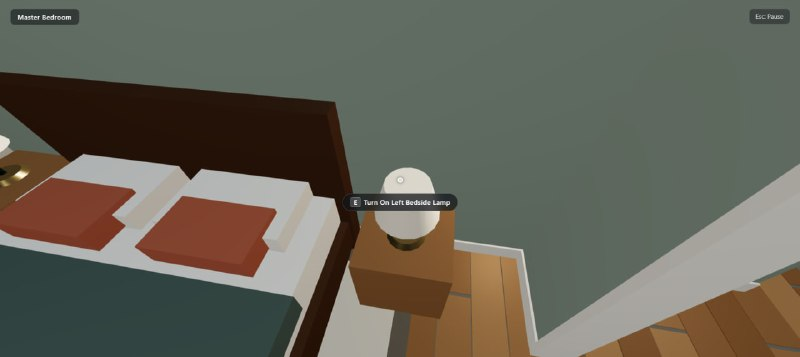

Toggle on/off لامپ هم گذاشته خودش مثل qwen 3.8 max

· · ·

**🕒 ۱۴۰۵/۰۸/۲۲ ۲۰:۱۱** · [پست 5857](https://t.me/MatinSenPaii/5857)

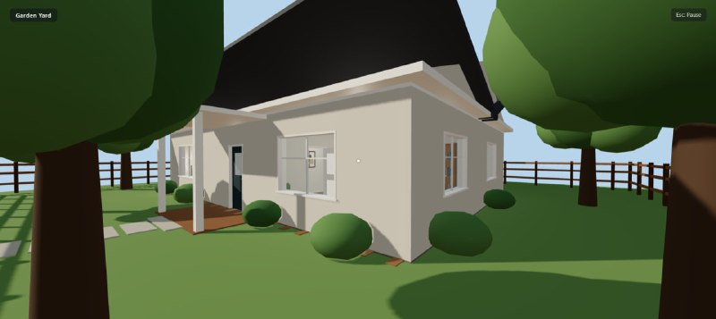

[این پرامپت قدیمی](https://t.me/MatinSenPaii/4770) که توی ویدئو کلاد رایگان یاد داده بودم با Kimi K3 رو دادم Gemini Hydrogen 4 بزنه، One Shot توی دو دقیقه زد.   
چه با Sonnet 5 چه با Kimi K3 تقریبا چندین بار کُشتی گرفتم تا درستش کردن. فوق‌العاده بود  
در واقع پیشرفت AI در گذر این چند ماه فوق‌العاده بوده.   
نسبت هزینه به قدرت و سرعتش خیلی خوبه، و راضی بودم

· · ·

**🕒 ۱۴۰۵/۰۸/۲۲ ۱۹:۲۳** · [پست 5856](https://t.me/MatinSenPaii/5856)

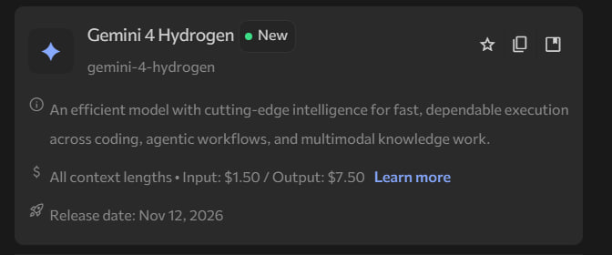

مدل Gemini Hydrogen 4 روی ai studio الان در دسترسه و می‌تونید استفاده کنید:  
[https://aistudio.google.com/prompts/new\_chat](https://aistudio.google.com/prompts/new_chat)  

✉️ [t.me/MatinSenPaii](http://t.me/MatinSenPaii)

· · ·

**🕒 ۱۴۰۵/۰۸/۲۲ ۱۹:۰۶** · [پست 5855](https://t.me/MatinSenPaii/5855)

از دیروز دارم میم‌های جنسن هوآنگ رو می‌بینم  
فوق‌العادست

· · ·

**🕒 ۱۴۰۵/۰۸/۲۲ ۱۸:۵۵** · [پست 5854](https://t.me/MatinSenPaii/5854)

**مدیرعامل انویدیا استعفا داد؛ جنسن هوانگ بعد از رسوایی جاسوسی رفت**  
طبق بیانیه‌ی انویدیا، جنسن هوانگ همین امروز، ۱۲ نوامبر، از مدیرعاملی و ریاست هیئت‌مدیره و عضویت توی بورد استعفا داده و بلافاصله هم اجرایی شده. ماجرا از گزارش نیویورک تایمز ۲۹ اکتبر شروع شد که از رابطه‌اش با یه جاسوس مظنون چینی خبر داد؛ از اون موقع ارزش بازار انویدیا حدود ۱٫۴ تریلیون دلار آب رفته. مدیر مالی شرکت، کولت کرس، فعلا سرپرست موقته تا جانشین دائمی پیدا بشه.  

این اتفاق یادآوری می‌کنه انویدیا عملا دور یه نفر ساخته شده بود و رفتنش کل صنعت AI رو قراره تکون بده.  

🔗 [منبع](https://the-decoder.com/jensen-huang-resigns-as-nvidia-ceo-after-espionage-scandal-wipes-out-1-4-trillion-in-market-value/)  
✉️ [t.me/MatinSenPaii](http://t.me/MatinSenPaii)

· · ·

**🕒 ۱۴۰۵/۰۸/۲۲ ۰۰:۳۳** · [پست 5853](https://t.me/MatinSenPaii/5853)

🖼 *(عکس بعد از ۲۴ ساعت حذف شده)*

جمنای Hydrogen 4 اومد روی اپ جمنای  
جایگزین 3.8 Flash

· · ·

**🕒 ۱۴۰۵/۰۸/۲۱ ۰۹:۴۴** · [پست 5852](https://t.me/MatinSenPaii/5852)

🖼 *(عکس بعد از ۲۴ ساعت حذف شده)*

**گوگل هم وارد بازی مدل‌های تصمیم‌گیری شد؛ Gemini Decision 1 اومد**  

مدل Gemini Decision 1 که کارکردش شبیه به Jev هست، مخصوص جواب دادن به سؤال‌های بسته ساخته شده؛ یعنی سؤال‌هایی که جوابشون آره یا نه، انتخاب از چند گزینه یا نمره‌دهیه. توی یه پاس می‌تونه ۱٬۰۰۰ تا سؤال مستقل رو روی متن، عکس، صدا، ویدئو و PDF جواب بده و جوابش رو با احتمال و اطمینان برمی‌گردونه؛ ۱۵۰ تا ۲۵۰ میلی‌ثانیه طول می‌کشه و به گفته خود گوگل حدود ۵ برابر ارزون‌تر از Gemini 3.5 Flash-Lite درمیاد. قیمتش ۱۰ سنت به‌ازای هر میلیون توکن ورودیه(دو برابر jev) و خروجی رایگانه؛ الان از Google AI Studio در دسترسه و گوگل خودش داره توی Notebook و سرچ ازش استفاده می‌کنه.  

🔗 [منبع](https://the-decoder.com/google-joins-the-decision-model-wave-with-gemini-decision-1-scoring-1000-questions-in-a-single-pass/)  
✉️ [t.me/MatinSenPaii](http://t.me/MatinSenPaii)

· · ·

**🕒 ۱۴۰۵/۰۸/۲۱ ۰۷:۵۴** · [پست 5851](https://t.me/MatinSenPaii/5851)

🖼 *(عکس بعد از ۲۴ ساعت حذف شده)*

**گوگل دیپ‌مایند AlphaGenome 2 رو داد بیرون؛ مدلی که می‌فهمه یه تغییر کوچیک توی DNA دقیقاً توی کدوم سلول دردسر درست می‌کنه**  

مدل AlphaGenome 2 نسبت به نسخه قبلیش تقریبا دو برابر واریانت‌های مؤثر رو پیدا می‌کنه؛ یعنی روی دیتاست TenK10K، ۳۰٪ در برابر ۱۶٪ واریانت علّی رو درست تشخیص داده. مدل روی بیشتر از ۱۰۷ میلیون پروفایل تک‌سلولی از ۶۸ بافت آموزش دیده و اثر یه تغییر DNA رو برای هر نوع سلول جدا پیش‌بینی می‌کنه، نه میانگین کل بافت. الان برای پژوهش غیرتجاری از طریق API در دسترسه.  

کلا مقوله‌ی AI توی زیست‌شناسی جذابه. کی این اکسیر جاودانگی میاد پس🕺  

🔗 [منبع](https://deepmind.google/blog/alphagenome-2-deciphering-how-cells-read-dna-to-better-understand-disease/)  
✉️ [t.me/MatinSenPaii](http://t.me/MatinSenPaii)

· · ·

**🕒 ۱۴۰۵/۰۸/۲۱ ۰۰:۵۰** · [پست 5850](https://t.me/MatinSenPaii/5850)

پیجش شد 16K:)) دمش گرم

· · ·

**🕒 ۱۴۰۵/۰۸/۲۰ ۱۷:۰۶** · [پست 5849](https://t.me/MatinSenPaii/5849)

[https://x.com/MatinSenPai/status/2120510916378653092?a=ASCnyaZe9XdhcwAS-Zw&s=20](https://x.com/MatinSenPai/status/2120510916378653092?a=ASCnyaZe9XdhcwAS-Zw&s=20)

· · ·

**🕒 ۱۴۰۵/۰۸/۲۰ ۱۳:۴۷** · [پست 5848](https://t.me/MatinSenPaii/5848)

می‌دونم اینکه ری‌اکشن 💔 میزنید به خاطر فردا و لایحه‌ی جدید آنتروپیکه.  
نگران نباشید منم به زودی بن میشم. دلیلش رو هم توییت می‌کنم یه کم دیگه😭

· · ·

**🕒 ۱۴۰۵/۰۸/۲۰ ۱۲:۲۴** · [پست 5842](https://t.me/MatinSenPaii/5842)

**آنتروپیک یه رشته از آزمایش‌های اولیه‌ی Fable 5.2 منتشر کرد**   

حساب رسمی کلاد چند تا نمونه نشون داده که همه با کد ساخته شدن: مدل سه‌بعدی یه سلول که اندامک به اندامک ساخته شده، مقایسه حرکت بدن انسان با یه پرامپت بین سه مدل کلاد، نمونه‌ای که ساب‌ایجنت‌ها رو موقع کار کردن نشون می‌ده، مدل سه‌بعدی یه بنای صدساله از روی ۴۰ تا عکس که یه‌پارچه چاپ شده، یه پادکست درباره اهرام مصر که تصویر و صداش با کد ساخته شده و یه معلم تخته‌ای که هر سوالی رو مرحله‌به‌مرحله توضیح می‌ده.  

برای ایده گرفتن خوبه به نظرم  

🔗 [منبع](https://x.com/claudeai/status/2120174844822298730)  
✉️ [t.me/MatinSenPaii](http://t.me/MatinSenPaii)

🎬 ویدیو: [مشاهده در تلگرام](https://t.me/MatinSenPaii/5842?single)

🎬 ویدیو: [مشاهده در تلگرام](https://t.me/MatinSenPaii/5843?single)

🎬 ویدیو: [مشاهده در تلگرام](https://t.me/MatinSenPaii/5844?single)

🎬 ویدیو: [مشاهده در تلگرام](https://t.me/MatinSenPaii/5845?single)

🎬 ویدیو: [مشاهده در تلگرام](https://t.me/MatinSenPaii/5846?single)

🎬 ویدیو: [مشاهده در تلگرام](https://t.me/MatinSenPaii/5847?single)

· · ·

**🕒 ۱۴۰۵/۰۸/۲۰ ۰۹:۴۷** · [پست 5841](https://t.me/MatinSenPaii/5841)

واکنش کلاد وقتی می‌بینه می‌خوای تایم زون سیستمت رو عوض کنی و بذاری روی آمریکا: شناختمت  

✍️ [sajjadmrx](https://x.com/sajjadmrx/status/2119825552009764876)

🎬 ویدیو: [مشاهده در تلگرام](https://t.me/MatinSenPaii/5841)

· · ·

**🕒 ۱۴۰۵/۰۸/۱۹ ۲۱:۳۱** · [پست 5840](https://t.me/MatinSenPaii/5840)

این چقدر باحال بود  
کلاً تکامل مقوله‌ی جالبیه. پیش‌بینی‌هایی هم که درباره‌ی گونه‌ی ما می‌کنن جالبه (اینکه بدن‌هامون در نسل‌های آینده به کدوم سمت و سو بره). مثلا یکی از ویژگی‌هاش اینه که احتمالا دندون عقل کم‌کم از بین می‌ره و آدم‌های بیشتری یه سرخرگ اضافه توی ساعدشون خواهند داشت.

· · ·

---

## whitedns

[کانال در تلگرام](https://t.me/whitedns) · [آرشیو متن](archive/whitedns/)

**🕒 ۱۴۰۵/۰۸/۲۳ ۰۲:۲۴** · [پست 2270](https://t.me/whitedns/2270)

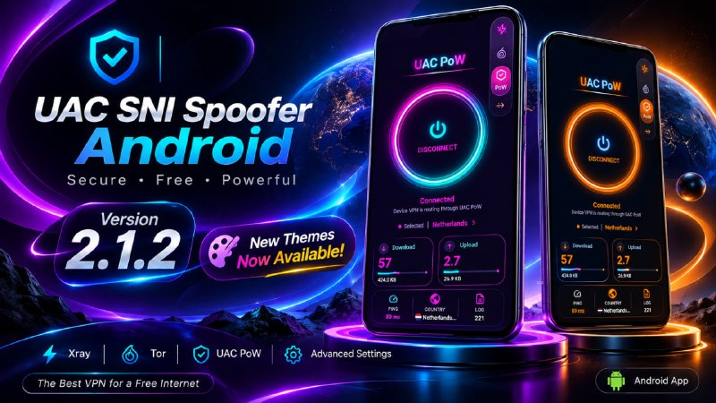

‏🛡 نسخه‌ی 2.1.2 اپلیکیشن UAC SNI Spoofer منتشر شد  
‏در این آپدیت دو تم جدید، ویجت، دسترسی به شبکه‌ی محلی و پشتیبان‌گیری از تنظیمات اضافه شده و فایل نصبی هم سبک‌تر شده.  

‏🔥 تغییرات این نسخه:  
‏📱 ویجت: اتصال و قطع سریع از صفحه‌ی اصلی گوشی، بدون باز کردن برنامه  

‏🎨 دو تم جدید: Neon و Solaris در کنار تم کلاسیک؛ از تنظیمات کلی (با تشکر از  CoreForge بابت نشون دادن علاقه نسبت به تم Neon 😁 و kamifaram  گرامی بابت طراحی کانسپت این تم ها)  

‏🌐 Bypass LAN: باز شدن مستقیم پنل مودم، پرینتر و دستگاه‌های شبکه‌ی محلی هنگام اتصال  

‏💾 پشتیبان‌گیری: بکاپ از تمام تنظیمات، بازیابی با فایل یا بازنشانی به حالت پیش‌فرض  

‏⚡️ حجم کمتر: فایل APK سبک‌تر و بهینه‌تر برای دانلود راحت‌تر حتی با اینترنت ضعیف  

‏🛠 موتور Xray: رفع چند باگ در برخی کانفیگ‌هایی که کاربر اضافه می‌کنه  

‏📥[ دریافت نسخه 2.1.2 ](https://github.com/Floxu1/UAC-SNI-Spoofer-Android/releases/tag/2.1.2)  
💻 [صفحه گیت‌هاب ](https://github.com/Floxu1/UAC-SNI-Spoofer-Android)  

اگر این پروژه برای شما مفید بود، با یک ستاره ⭐️ در گیت‌هاب حمایت کنید.  

[@UacSniSpoofer](https://t.me/UacSniSpoofer)

· · ·

**🕒 ۱۴۰۵/۰۸/۲۱ ۰۵:۵۱** · [پست 2269](https://t.me/whitedns/2269)

🖼 *(عکس بعد از ۲۴ ساعت حذف شده)*

📥 **دنبال ابزار مناسب برای دسترسی آزاد و امن به اینترنت هستی، اما نمی‌دونی کدومش به کارت میاد؟** 🤔  

سایت **WhiteDNS** یه راهنمای فوق‌العاده و ۱۰۰٪ رایگان براتون آماده کرده که بدون پیچیدگی، دقیقا دست میذاره روی نیاز شما! 💡  

**«چه کاری می‌خواهی انجام بدهی؟»**  
 👇 این صفحه بهت کمک می‌کنه بر اساس نیازت، بهترین ابزار رو انتخاب کنی:  

🔹 **اتصال روزمره و مدیریت ساب؟** ➡️ **WhiteVPN** (با اشتراک داخلی و امکان اضافه کردن ساب شخصی)   
🔹 **تنظیم مسیرهای Aether؟** ➡️ **WhiteAesther**   
🔹 **پروفایل تونل DNS داری؟** ➡️ **WhiteDNS**   
🔹 **پیدا کردن IP یا رزولور فعال؟** ➡️ **اسکنر شبکه (Finder)**   
🔹 **مخصوص کاربران آیفون و آیپد؟** ➡️ **CoreForge** (نسخه iOS)   
🔹 **کاهش پینگ و بررسی شبکه بازی؟** ➡️ **WhiteGame** (مخصوص اندروید)   
🔹 **راه‌اندازی سرور شخصی؟** ➡️ **WhiteDNS Panel** (برای VPS لینوکسی)   
🔹 **دریافت کانفیگ و حساب؟** ➡️ ربات‌های **Exit Chain** و **MasterDNS**  
⚠️ **مهم‌ترین ویژگی‌ها:**   
✅ تمامی سرویس‌ها و ابزارها **۱۰۰٪ رایگان** هستند (هیچ اکانت فروشی یا پلن VIP وجود ندارد!)   
✅ بدون ثبت لاگ و بدون ردیاب 🔒  
 ✅ راهنمای گام‌به‌گام و آموزش استفاده برای هر ابزار 📖  
🔍 از همین‌جا شروع کن و ابزار مناسبِ شبکه خودت رو پیدا کن:

… [ادامه در تلگرام](https://t.me/whitedns/2269)

· · ·

**🕒 ۱۴۰۵/۰۸/۲۱ ۰۵:۳۵** · [پست 2267](https://t.me/whitedns/2267)

🎬 ویدیو: [مشاهده در تلگرام](https://t.me/whitedns/2267)

· · ·

**🕒 ۱۴۰۵/۰۸/۲۰ ۰۶:۵۲** · [پست 2266](https://t.me/whitedns/2266)

🖼 *(عکس بعد از ۲۴ ساعت حذف شده)*

دوستان درود و عرض ادب :   

با توجه به تعداد خیلی زیاد از پیام های دریافتی و درخواست های زیاد دوستان برای افزودن سرورهای بیشتر و یا تولید نرم افزارهای عبور از فیلترینگ بیشتر باید عرض کنیم که منابع ما محدود است. نزدیک به ۱۱ ماه است که هزینهٔ این خدمات از درآمد شخصی اعضای تیم تأمین می‌شود و از هیچ نهاد، سازمان یا شخص حقیقی یا حقوقی بودجه‌ای دریافت نکرده‌ایم.  

از مسیرهای حمایتی مثل کریپتو و پاتریون تا امروز حتی یک سنت هم دریافت نکرده‌ایم. درآمد یوتیوب و استار تلگرام هم آن‌قدر کم بوده که به‌سختی هزینهٔ یکی از سرورها را پوشش داده است.  

با تمام وجود دوست داریم با امکانات بیشتری کنار شما باشیم، اما محدودیت زمانی و مالی اعضای تیم فعلاً اجازه نمی‌دهد فراتر برویم.  
تمام اعضای تیم ما مثل همه شما روزانه ساعت ها درگیر کار و زندگی شخصی هستند و امکان اینکه به صورت تمام وقت روی پروژه های مربوط به whitedns کار کنند ندارند . ما همچنان تلاش خواهیم کرد این مسیر را هر چند اهسته ولی پیوسته ادامه بدهیم ولی به حمایت های مادی و معنوی شما در این مسیر سخت نیازمندیم .   

ارادتمند   
تیم whitedns❤️  

راهنمای WhiteDNS و دریافت برنامه ها :   
[https://whitedns.online/tools/whitedns/](https://whitedns.online/tools/whitedns/)  

حمایت مالی، فقط در صورت تمایل:

… [ادامه در تلگرام](https://t.me/whitedns/2266)

· · ·

**🕒 ۱۴۰۵/۰۸/۲۰ ۰۲:۰۶** · [پست 2265](https://t.me/whitedns/2265)

🛠 **یه راه ساده برای ساخت تونل DNS شخصی**  

دوستان، اگه می‌خواید سرور تونل خودتون رو داشته باشید، با پنل WhiteDNS می‌تونید از یه جا موتورهای Soar، CottenDNS و MasterDNS رو مدیریت کنید، اکانت بسازید و لینک ساب بگیرید.  

**برای شروع چی لازم داریم؟**  
• یه سرور با اینترنت، IP عمومی و دسترسی root؛ مثلاً با Ubuntu 22.04/24.04 یا Debian 12.  
• یه دامنه که بتونید رکوردهای DNS اون رو تغییر بدید.  
• آخرین نسخهٔ اپ WhiteDNS روی گوشی اندرویدی.  

**۱. دامنه و سرور رو آماده کنید**  
رکوردهای A و NS تونل رو طبق راهنمای فارسی پایین پست بسازید. پورت‌های UDP/53 و TCP/53 هم باید در دسترس باشن و سرویس دیگه‌ای روی آدرس و پورت موردنیاز تونل فعال نباشه. برای شروع، سرور جداگانه دردسر کمتری داره.  

**۲. نصب‌کنندهٔ پنل رو اجرا کنید**  
با SSH وارد سرور بشید و دستور زیر رو با دسترسی root اجرا کنید؛ این دستور برای سروره، نه گوشی:  

```
bash <(curl -fsSL https://raw.githubusercontent.com/WhiteDNS/Soar-Server/main/panel-setup.sh)
```

نصب‌کننده اطلاعات دامنه، IP و حساب مدیر رو ازتون می‌پرسه و تنظیمات DNS و اتصال تونل رو بررسی می‌کنه. اگه تست‌ها خطا دادن، قبل از استفاده مشکل رو رفع کنید.

… [ادامه در تلگرام](https://t.me/whitedns/2265)

· · ·

**🕒 ۱۴۰۵/۰۸/۲۰ ۰۱:۵۱** · [پست 2264](https://t.me/whitedns/2264)

🟢 **سرورهای عمومی دوباره فعال شدند**  

دوستان، همهٔ سرورهای عمومی‌مون رو دوباره فعال کردیم 💚  
می‌تونید دوباره اتصال رو امتحان کنید.  

```
soar://eyJwcm9maWxlIjp7ImlkIjoiNDRjMjc0YTMzNTM1MGZhYzljMjg0ZWNhOGVhMzkyNzYiLCJuYW1lIjoiV2hpdGVETlMgUHVibGljIiwicmVzb2x2ZXJzIjpbIjEuMS4xLjEiLCI4LjguOC44Il0sInNlcnZlciI6eyJkb21haW4iOiJpdGJoaml6dmd1aDJ6aGJpajNmaTVpLnNvYXIud2hpdGVkbnMuZG93bmxvYWQiLCJwdWJsaWNfa2V5IjoiR1daa2NSVVErUHhqMnEydXRKZllEV2cwR2dOR3AybmtVMmN5UE8ySk1UMD0ifSwic29hclNldHRpbmdzIjp7InRyYW5zcG9ydCI6ImF1dG8iLCJkaXNjb3ZlcnkiOnRydWUsImRpc2NvdmVyeVdhbnQiOjIsImRpc2NvdmVyeUNvbmN1cnJlbmN5IjoyLCJkaXNjb3ZlcnlQYWNlTXMiOjEwMDAsInNhZmVRTmFtZSI6MTAxLCJtYXhRTmFtZSI6MjUzLCJtYXhBbnN3ZXIiOjEyMzIsImhvbGRNcyI6NTAwLCJtYXhJbmZsaWdodCI6MTI4LCJtYXhQYXRoV2luZG93IjozMiwibWF4U3RyZWFtcyI6MTI4LCJzdHJlYW1XaW5kb3dLaUIiOjI1Niwic2VuZEJ1ZmZlcktpQiI6NjQsInNlc3Npb25JZGxlU2Vjb25kcyI6OTAsImRpYWxUaW1lb3V0U2Vjb25kcyI6OTAsImNvdW50cnkiOiJJUiJ9fSwic2NoZW1hIjoid2hpdGVkbnMucHJvZmlsZSIsInZlcnNpb24iOjF9

… [ادامه در تلگرام](https://t.me/whitedns/2264)

· · ·

**🕒 ۱۴۰۵/۰۸/۲۰ ۰۱:۵۰** · [پست 2258](https://t.me/whitedns/2258)

↪️ فوروارد از White DNS

📂 مجموعهٔ یکپارچهٔ ریزالورهای منتشرشده در کانال  

فهرست‌های متنی و فایل‌های ریزالوری که قبلاً در کانال منتشر کرده بودیم را در یک فایل جمع کردیم و آدرس‌های تکراری را حذف کردیم.  

📌 تعداد نهایی: ۷٬۶۲۹ آدرس یکتا  
📄 فرمت فایل: متن ساده، هر آدرس در یک خط  

دیگر لازم نیست فهرست‌های قدیمی را جداگانه پیدا و با هم ترکیب کنید؛ مجموعهٔ ادغام‌شده را از فایل همین پست دریافت کنید.  

[@dns\_resolvers\_bot](https://t.me/dns_resolvers_bot)  
----------  
#اسکن #DNS #Resolvers  

کانال: [@WhiteDNS](https://t.me/WhiteDNS)  
[وب‌سایت WhiteDNS](https://whitedns.online/)

📎 فایل: [مشاهده در تلگرام](https://t.me/whitedns/2258)

· · ·

**🕒 ۱۴۰۵/۰۸/۱۹ ۱۱:۱۲** · [پست 2257](https://t.me/whitedns/2257)

📊 نظرسنجی: [مشاهده در تلگرام](https://t.me/whitedns/2257)

· · ·

**🕒 ۱۴۰۵/۰۸/۱۹ ۰۶:۰۲** · [پست 2256](https://t.me/whitedns/2256)

🎬 ویدیو: [مشاهده در تلگرام](https://t.me/whitedns/2256)

· · ·

**🕒 ۱۴۰۵/۰۸/۱۹ ۰۵:۵۵** · [پست 2255](https://t.me/whitedns/2255)

🖼 *(عکس بعد از ۲۴ ساعت حذف شده)*

🔥 به هوش مصنوعی گفتم برای کانالم موشن‌گرافیک بساز؛ این شد نتیجه!  

توی ویدیوی جدید، Raea رو نصب می‌کنیم و از پرامپت تا خروجی نهایی رو می‌بینیم ✨  

🎬 تماشای آموزش:     [https://youtu.be/qcl01iCMkP0](https://youtu.be/qcl01iCMkP0)   

·:¨༺ [@BlueKnight\_Net](https://t.me/BlueKnight_Net) ༻¨:·

· · ·

**🕒 ۱۴۰۵/۰۸/۱۹ ۰۵:۵۴** · [پست 2254](https://t.me/whitedns/2254)

🖼 *(عکس بعد از ۲۴ ساعت حذف شده)*

🟢 پنل WhiteDNS نسخهٔ 0.14.4   
(شامل تغییرات 0.14.3)  
🔓 پورت روی IP خود سرور  
گزینهٔ تازه: «پورت‌های مجاز روی IP خود سرور». پیش‌فرض خالی است و اتصال به خود سرور مسدود می‌ماند.  
⚠️ پورت بازشده برای همهٔ حساب‌ها در دسترس است؛ پورت پنل و SSH را اضافه نکنید.  
🔀 پراکسی خروجی پایدارتر  
پراکسی کند، در TCP و UDP، زودتر از موعد قطع نمی‌شود و پاسخ‌های UDP در SOCKS5 درست‌تر دریافت می‌شوند.  
🧭 لاگ دقیق‌تر  
علت رد شدن اتصال حالا مشخص است: مقصد روی خود سرور یا شبکهٔ خصوصی (destination\_not\_public)، یا پراکسی خاموش یا بستن پورت ۵۳ (proxy\_dns\_failed).  
⚙️ موتورها  
همین طور Cotten: اصلاح کش DNS و جدا شدن درخواست‌ها با تنظیمات متفاوت، تطبیق دقیق‌تر پاسخ‌ها و آزادسازی سوکت‌های بی‌کار UDP. برای اصلاحات سمت کلاینت، کلاینت Cotten را هم به‌روز کنید.  
موتور Soar: به‌روزرسانی به v0.2.4.  
🛡 سرورهای پشت NAT  
ای پی عمومی پنل حالا روی این سرورها هم مسدود است، مگر پورتش در لیست باشد.  
پیش از ارتقا بکاپ بگیرید.  
📦 ادرس مخزن :  
[https://github.com/WhiteDNS/Soar-Server/releases/tag/panel-v0.14.4](https://github.com/WhiteDNS/Soar-Server/releases/tag/panel-v0.14.4)  
#WhiteDNS #Soar  
[@whitedns](https://t.me/whitedns)  
[https://whitedns.online](https://whitedns.online/)

· · ·

**🕒 ۱۴۰۵/۰۸/۱۷ ۰۹:۴۳** · [پست 2252](https://t.me/whitedns/2252)

🖼 *(عکس بعد از ۲۴ ساعت حذف شده)*

⚠️

· · ·

**🕒 ۱۴۰۵/۰۸/۱۷ ۰۵:۳۶** · [پست 2251](https://t.me/whitedns/2251)

🖼 *(عکس بعد از ۲۴ ساعت حذف شده)*

💚 راه‌اندازی درگاه رسمی حمایت مالی (**Crypto Donation)** برای پایداری WhiteDNS  

سلام به همراهان عزیز WhiteDNS؛  

از روز اول هدف ما مشخص و بدون تغییر بوده است: دسترسی آزاد، امن و ۱۰۰٪ رایگان به اینترنت برای همه.  

تاکنون تمامی هزینه‌های تأمین و نگهداری سرورهای مرزی، اسکنرهای خودکار، تونل‌های DNS اختصاصی، توسعه و انتشار نسخه‌های مختلف نرم‌افزارها (WhiteDNS, WhiteVPN, WhiteAesther) به صورت شخصی و مستقل تأمین شده است.  

با توجه به افزایش چشمگیر حجم کاربران و به تبع آن افزایش هزینه‌های ترافیک و سرورهای ابری، درگاه رسمی حمایت مالی رمزارزی (Crypto) را برای همراهانی که مایل به مشارکت در زنده نگه‌داشتن و گسترش این زیرساخت هستند راه‌اندازی کردیم.  

━━━━━━━━━━━━━━━━━━━━━  
🛡 چرا مشارکت شما حیاتی است؟  

۱. تأمین هزینه سرورها و ترافیک:  
سرورهای تونل DNS، پروکسی‌ها و اسکنرهای پرسرعت روزانه چند ترابایت ترافیک عبور می‌دهند و نیاز به منابع ابری مداوم دارند.  

۲. استمرار توسعه نرم‌افزارها:  
دور زدن مداوم محدودیت‌ها و انتشار آپدیت‌های فوری برای ویندوز، اندروید، مک و لینوکس نیازمند صرف وقت و هزینه زیرساختی است.  

۳. کاملاً امن و ناشناس:  
تراکنش‌ها روی بستر بلاک‌چین و از طریق درگاه معتبر بین‌المللی NOWPayments انجام شده و نیازی به هیچ‌گونه ثبت‌نام یا اطلاعات هویتی نیست.

… [ادامه در تلگرام](https://t.me/whitedns/2251)

· · ·

**🕒 ۱۴۰۵/۰۸/۱۷ ۰۴:۲۰** · [پست 2250](https://t.me/whitedns/2250)

🖼 *(عکس بعد از ۲۴ ساعت حذف شده)*

**🚀 Aras-GP | نسخه 2.3.1**  

اولین نسخه عمومی Aras-GP منتشر شد!  

پنل [Aras-GP](https://github.com/ArasTey/Aras-GP) یک پنل برای راه‌اندازی و مدیریت رله شخصی با استفاده از سرویس‌های گوگل و کلادفلر است که بر پایه فناوری دامین فرانتینگ کار می‌کند.  
مهم‌ترین تغییرات:  
🔐 امنیت  
• اضافه‌شدن احراز هویت بین GAS و Cloudflare Worker  
• جلوگیری از درخواست‌های غیرمجاز  
• بهبود اعتبارسنجی ورودی‌ها و محدودسازی پردازش فشرده‌سازی  

🐳 نصب و راه‌اندازی  
• اصلاح فرآیند نصب و ساخت Docker  
• حفظ تنظیمات و گواهی‌ها پس از ری‌استارت  
• محافظت از اطلاعات حساس در زمان ساخت ایمیج  
⚙️ بهبودهای کلی  
• افزایش پایداری موتور و پنل  
• اضافه‌شدن تست‌های بیشتر و بهبود کیفیت کلی پروژه  

📥 دریافت نسخه جدید:  
[https://github.com/ArasTey/Aras-GP/releases](https://github.com/ArasTey/Aras-GP/releases)  

گزارش مشکلات و پیشنهادهای خود را همراه با فایل Log ارسال کنید.

· · ·

**🕒 ۱۴۰۵/۰۸/۱۷ ۰۴:۱۸** · [پست 2249](https://t.me/whitedns/2249)

‏آپدیت جدید CoreForge 🆕  

‏این نسخه چند تا چیز مهم آورده، بریم ببینیم 👇  

‏SlipNet 🔐  
‏• پروفایل‌های رمزنگاری‌شدهٔ slipnet-enc:// رو ایمپورت کن و وصل شو  
‏• شامل VayDNS، Slipstream، Slipstream + SSH و Soar  
‏• از برنامه بیای بیرون یا گوشی رو قفل کنی، اتصال قطع نمی‌شه  

‏Soar — تونل DNS 🌀  
‏• روی شبکه‌های فیلترشده خیلی سریع‌تر وصل می‌شه  

‏Psiphon جمع‌وجور شد 🧹  
‏• حالا فقط یه ردیف تو Configs‌ه  
‏• سرورهای داخلیش رفتن به Settings › Psiphon  
‏• تایل Psiphon تو Home رو نگه داری، مستقیم می‌ری تو تنظیماتش  

‏Cloudflare WARP 🧩  
‏• حالت‌های WARP in WARP و Gool  
‏• اندپوینت IPv4 یا IPv6، هر کدوم رو خواستی  
‏• فینگرپرینت‌های TLS بیشتر برای MASQUE  
‏• سازندهٔ کانفیگ MASQUE  
‏• اون WARPـی که «Connected» نشون می‌داد ولی دیتا رد نمی‌کرد، حالا خودش خودشو درست می‌کنه  
‏• تایل WARP تو Home رو نگه داری، تنظیماتش باز می‌شه  

‏Mixed exit تو صفحهٔ Home 🌍  
‏• اگه سروری بسته به مقصد از کشورهای مختلف خارج بشه، خودش بهت می‌گه «Mixed exit»  

‏ظاهر جدید ✨  
‏• تب‌بار شیشه‌ای  
‏• کنترل‌های کشویی  
‏• استایل‌های تازه برای آیکون برنامه  
‏**لینک‌های نصب — TestFlight** 📲  
‏• اپ CoreForge نسخهٔ iOS 🍎 — [نصب](https://testflight.apple.com/join/vAaXH9Cv)

… [ادامه در تلگرام](https://t.me/whitedns/2249)

· · ·

**🕒 ۱۴۰۵/۰۸/۱۶ ۱۵:۰۵** · [پست 2247](https://t.me/whitedns/2247)

🖼 *(عکس بعد از ۲۴ ساعت حذف شده)*

سرورهای (کانفیگ های ) عمومی **جدید** **⭕️**  برای استفاده در برنامه های whitedns ! 🆕  

**2 روزه برای تست و آشنایی با برنامه whitedns** **⚠️**  

📥 [دانلود نسخهٔ اندروید](https://github.com/WhiteDNS/WhiteDNS-Android/releases/latest)  
📥 [دانلود نسخهٔ دسکتاپ](https://github.com/WhiteDNS/WhiteVPN-Desktop/releases/latest)  

[راهنمای واردکردن کانفیگ و اتصال WhiteDNS](https://whitedns.online/tools/whitedns/)  

**برنامه whitedns برای زمان اختلال های شدید و یا قطغی های گسترده طراحی شده و به شما تجربه برنامه هایی مثل whitevpn یا whiteaesther را نخواهد داد**   

🔥 WhtieDNS Temp server   

سرور عمومی SOAR

… [ادامه در تلگرام](https://t.me/whitedns/2247)

· · ·

**🕒 ۱۴۰۵/۰۸/۱۶ ۱۱:۴۱** · [پست 2246](https://t.me/whitedns/2246)

🖼 *(عکس بعد از ۲۴ ساعت حذف شده)*

ویدیو جدید رسییددد 😌  

توی این آموزش پنل Nightline رو روی Railway دیپلوی می‌کنیم، کانفیگ V2Ray می‌سازیم و با اسکن IPهای Railway، روش‌های مختلف اتصال رو تست می‌کنیم! 💘  

👇 آموزش کامل راه‌اندازی پنل رو ببین:  
🎬 [https://youtu.be/FK9mc\_jjmIA](https://youtu.be/FK9mc_jjmIA)  

👥 گروه تلگرام Nightline:  
[https://t.me/+CzY2mRiwWldkZWQ0](https://t.me/+CzY2mRiwWldkZWQ0)  

·:¨༺ [@BlueKnight\_Net](https://t.me/BlueKnight_Net) ༻¨:·

· · ·

**🕒 ۱۴۰۵/۰۸/۱۶ ۱۱:۰۶** · [پست 2245](https://t.me/whitedns/2245)

📊 نظرسنجی: [مشاهده در تلگرام](https://t.me/whitedns/2245)

· · ·

**🕒 ۱۴۰۵/۰۸/۱۶ ۰۸:۰۷** · [پست 2242](https://t.me/whitedns/2242)

🖼 *(عکس بعد از ۲۴ ساعت حذف شده)*

📥 **دنبال ابزار مناسب برای دسترسی آزاد و امن به اینترنت هستی، اما نمی‌دونی کدومش به کارت میاد؟** 🤔  

سایت **WhiteDNS** یه راهنمای فوق‌العاده و ۱۰۰٪ رایگان براتون آماده کرده که بدون پیچیدگی، دقیقا دست میذاره روی نیاز شما! 💡  

**«چه کاری می‌خواهی انجام بدهی؟»**  
 👇 این صفحه بهت کمک می‌کنه بر اساس نیازت، بهترین ابزار رو انتخاب کنی:  

🔹 **اتصال روزمره و مدیریت ساب؟** ➡️ **WhiteVPN** (با اشتراک داخلی و امکان اضافه کردن ساب شخصی)   
🔹 **تنظیم مسیرهای Aether؟** ➡️ **WhiteAesther**   
🔹 **پروفایل تونل DNS داری؟** ➡️ **WhiteDNS**   
🔹 **پیدا کردن IP یا رزولور فعال؟** ➡️ **اسکنر شبکه (Finder)**   
🔹 **مخصوص کاربران آیفون و آیپد؟** ➡️ **CoreForge** (نسخه iOS)   
🔹 **کاهش پینگ و بررسی شبکه بازی؟** ➡️ **WhiteGame** (مخصوص اندروید)   
🔹 **راه‌اندازی سرور شخصی؟** ➡️ **WhiteDNS Panel** (برای VPS لینوکسی)   
🔹 **دریافت کانفیگ و حساب؟** ➡️ ربات‌های **Exit Chain** و **MasterDNS**  
⚠️ **مهم‌ترین ویژگی‌ها:**   
✅ تمامی سرویس‌ها و ابزارها **۱۰۰٪ رایگان** هستند (هیچ اکانت فروشی یا پلن VIP وجود ندارد!)   
✅ بدون ثبت لاگ و بدون ردیاب 🔒  
 ✅ راهنمای گام‌به‌گام و آموزش استفاده برای هر ابزار 📖  
🔍 از همین‌جا شروع کن و ابزار مناسبِ شبکه خودت رو پیدا کن:

… [ادامه در تلگرام](https://t.me/whitedns/2242)

· · ·

**🕒 ۱۴۰۵/۰۸/۱۶ ۰۵:۱۵** · [پست 2240](https://t.me/whitedns/2240)

🖼 *(عکس بعد از ۲۴ ساعت حذف شده)*

⚠️  

دوستانی که بعد از نصب ورکر کلادفلر توی ورژن قبلی **whiteaesther** خطای 1101 و یا abuse گرفتن دو مورد را انجام بدهند لطفا :   

1. حتما سعی کنید از page استفاده کنید 🔥  

2.یک تغییراتی توی اخرین ورژن pre-release دادیم میتونید تست کنید 👀  

[ورژن ازمایشی دسکتاپ](https://github.com/WhiteDNS/WhiteAesther/releases/tag/v1.11.1)   
[ورژن ازمایشی مبایل ](https://github.com/WhiteDNS/WhiteAestherMobile/releases/tag/v1.15.2-rc.1)  
[@whitedns](https://t.me/whitedns)   
[https://whitedns.online](https://whitedns.online/)

· · ·

---

## ircfspace

[کانال در تلگرام](https://t.me/ircfspace) · [آرشیو متن](archive/ircfspace/)

**🕒 ۱۴۰۵/۰۸/۲۳ ۱۱:۴۶** · [پست 2717](https://t.me/ircfspace/2717)


هسته‌ی رخش برای ساخت شبکه‌های چندگرهی و تانل‌های انعطاف‌پذیر ارا‌ئه شده، تا ترافیک رو بصورت مستقیم یا از طریق تانل، از هر تعداد سروری که در اختیار دارین عبور بده. هدفش اینه که به یک سرور یا روش ارتباطی خاص محدود نباشه و حتی روی شبکه‌هایی که سعی می‌کنن جلوی ارتباط رو بگیرن، به کارش ادامه بده.  

پروتکل اصلی رخش به نوع اتصال وابسته نیست و هر تانل از چند مسیر مستقل تشکیل شده، تا اگر یکی از مسیرها قطع شد، جریان‌های در حال انتقال بتونن از مسیر دیگه ادامه پیدا کنن. همینطور هر گره هویت و کلید اختصاصی خودش رو داره و ارتباط بین گره‌ها با احراز هویت و رمزنگاری سرتاسری محافظت میشن.  

👉 [github.com/CluvexStudio/rakhsh/releases](http://github.com/CluvexStudio/rakhsh/releases)  

🔗 [ᴡᴇʙꜱɪᴛᴇ](https://ircf.space/) • [ᴠᴘɴʜᴜʙ](https://t.me/persianvpnhub) • [ɢɪᴛʜᴜʙᴍɪʀʀᴏʀ](https://t.me/PersianGithubMirror)  
[@ircfspace](https://t.me/ircfspace)

· · ·

**🕒 ۱۴۰۵/۰۸/۲۱ ۰۸:۵۷** · [پست 2716](https://t.me/ircfspace/2716)

🖼 *(عکس بعد از ۲۴ ساعت حذف شده)*

اپ متن‌باز و رایگان theFeed یه فید ریدر و پیامرسان مبتنی بر DNS برای اندروید، iOS، ویندوز، لینوکس و مک هست، که باهاش می‌تونین کانال‌های تلگرام و حساب‌های عمومی X رو بخونین، با کاربران دیگه چت رمزنگاری‌شده سرتاسری داشته باشین و حتی طبق آخرین آپدیتش، مستقیماً وارد حساب تلگرام خودتون بشین.   
همه این کارها از طریق DNS انجام میشه و برای استفاده از قابلیت‌های اصلی برنامه نیازی به راه‌اندازی سرور شخصی ندارین؛ چون چند کانفیگ عمومی از قبل داخل برنامه قرار گرفته.  

👉 [github.com/sartoopjj/thefeed/releases](http://github.com/sartoopjj/thefeed/releases)  

🔗 [ᴡᴇʙꜱɪᴛᴇ](https://ircf.space/) • [ᴠᴘɴʜᴜʙ](https://t.me/persianvpnhub) • [ɢɪᴛʜᴜʙᴍɪʀʀᴏʀ](https://t.me/PersianGithubMirror)  
[@ircfspace](https://t.me/ircfspace)

· · ·

**🕒 ۱۴۰۵/۰۸/۲۱ ۰۸:۳۸** · [پست 2715](https://t.me/ircfspace/2715)

🖼 *(عکس بعد از ۲۴ ساعت حذف شده)*

ماجرای حمله سایبری به سیستم‌های سرمایشی حدود ۷۰۰ سوپرمارکت در فرانسه که به فاسد شدن مواد غذایی و آتش‌سوزی در تعدادی از فروشگاه‌ها منجر شد، ابعاد تازه‌ای پیدا کرده. گزارش‌های جدید رسانه‌های بین‌المللی از جمله رویترز، از هدف قرار گرفتن کشتارگاه‌ها، واحدهای فرآوری مواد غذایی و حتی برخی تأسیسات برق‌آبی در فرانسه خبر میدن. مقام‌های فرانسوی میگن این حملات دست‌کم باعث ۱۵ مورد آتش‌سوزی شده و خسارت بعضی فروشگاه‌ها به ده‌ها میلیون یورو رسیده.  
فرانسه علاوه بر درخواست حکم بازداشت بین‌المللی برای ۳ مقام مرتبط با واحد سایبری سپاه، از پیگیری تحریم‌های اروپایی هم خبر داده. از طرف دیگه، حملات مشابهی در چند کشور اروپایی گزارش شده، اما هنوز ارتباط قطعی اونها با گروه‌های مرتبط با ج.ا تأیید نشده.   
البته وزارت امور خارجه جمهوری اسلامی اتهامات فرانسه رو رد کرده و بی‌اساس و خصمانه دونسته.  

🔗 [ᴡᴇʙꜱɪᴛᴇ](https://ircf.space/) • [ᴠᴘɴʜᴜʙ](https://t.me/persianvpnhub) • [ɢɪᴛʜᴜʙᴍɪʀʀᴏʀ](https://t.me/PersianGithubMirror)  
[@ircfspace](https://t.me/ircfspace)

· · ·

**🕒 ۱۴۰۵/۰۸/۲۱ ۰۸:۳۱** · [پست 2714](https://t.me/ircfspace/2714)

🖼 *(عکس بعد از ۲۴ ساعت حذف شده)*

اسپیس‌ایکس نسل جدید اینترنت ماهواره‌ای قابل حمل Starlink Mini 2 رو معرفی کرده، که مهمترین تغییر این مدل، باتری جداشونده ۷۱ وات‌ساعتیه که تا ۴.۵ ساعت شارژدهی داره. پشتیبانی از Wi-Fi 6، شارژ از طریق USB-C و طراحی باریک‌تر هم از تغییرات دیگه‌ش هست.  
قیمت احتمالی دستگاه حدود ۲۴۹ دلاره، هرچند هنوز قیمت نهایی رسماً تأیید نشده. پیش‌فروش اولیه از ۱۹ آبان در آمریکا شروع شده و ارسال سفارش‌ها از اواخر آذر آغاز میشه.  

© dishytech  

🔗 [ᴡᴇʙꜱɪᴛᴇ](https://ircf.space/) • [ᴠᴘɴʜᴜʙ](https://t.me/persianvpnhub) • [ɢɪᴛʜᴜʙᴍɪʀʀᴏʀ](https://t.me/PersianGithubMirror)  
[@ircfspace](https://t.me/ircfspace)

· · ·

**🕒 ۱۴۰۵/۰۸/۲۱ ۰۸:۲۵** · [پست 2713](https://t.me/ircfspace/2713)

🖼 *(عکس بعد از ۲۴ ساعت حذف شده)*

پنل نس‌نت یک ابزار متن‌باز برای مدیریت روترهای میکروتیک و اتصال‌های استارلینک هست، که بصورت تحت وب طراحی شده و میتونه مستقیماً روی خود روتر اجرا بشه.  
در نسخه جدید از این‌ابزار، امکان مدیریت و بروزرسانی لیست آیپی‌های داخلی، بهبود پشتیبانی از RouterOS و نمایش بهتر وضعیت نصب فریمور درنظر گرفته شده. همچنین می‌تونین بدون نیاز به پیکربندی مجدد روتر، به نسخه‌های قبلی برنامه برگردین.  

👉 [github.com/nasnet-community/nasnet-panel/releases](http://github.com/nasnet-community/nasnet-panel/releases)  

🔗 [ᴡᴇʙꜱɪᴛᴇ](https://ircf.space/) • [ᴠᴘɴʜᴜʙ](https://t.me/persianvpnhub) • [ɢɪᴛʜᴜʙᴍɪʀʀᴏʀ](https://t.me/PersianGithubMirror)  
[@ircfspace](https://t.me/ircfspace)

· · ·

**🕒 ۱۴۰۵/۰۸/۲۱ ۰۸:۰۴** · [پست 2712](https://t.me/ircfspace/2712)

تهدیدهای جمهوری اسلامی درباره هدف قرار دادن کابل‌های اینترنت زیردریایی در خلیج فارس در هفته‌های اخیر جدی‌تر شده؛ رویترز هم به نقل از دو مقام امنیتی ج.ا گزارش داده که برای حمله به این کابل‌ها و حتی جلوگیری از تعمیر مجدد اونها برنامه‌ریزی شده.  

البته برخلاف تصور اولیه، قطع این کابل‌ها به معنی قطع اینترنت جهانی نیست؛ چون درصد محدودی از پهنای باند بین‌المللی اینترنت از تنگه هرمز عبور می‌کنه. با این حال، چنین اقدامی میتونه اینترنت و زیرساخت‌های ارتباطی کشورهای حاشیه خلیج فارس رو با اختلال جدی مواجه کنه.  

در همین شرایط، ایلان ماسک از برنامه‌های اسپیس‌ایکس برای توسعه نسل چهارم استارلینک صحبت کرده؛ شبکه‌ای که به ادعای او در آینده می‌تونه با ظرفیت کابل‌های زیردریایی رقابت کنه.  

ماسک در توضیح این طرح گفته ماهواره‌های V4 به حدود ۱۰۰ ارتباط لیزری مجهز میشن که هرکدوم ظرفیت انتقال داده‌ای بیش از ۱۰ ترابیت بر ثانیه دارن. با استقرار بیش از ۱۰۰ هزار ماهواره از این نسل، استارلینک میتونه از نظر ظرفیت انتقال داده با شبکه جهانی کابل‌های زیردریایی رقابت کنه و حتی از اون پیشی بگیره.

… [ادامه در تلگرام](https://t.me/ircfspace/2712)

· · ·

**🕒 ۱۴۰۵/۰۸/۲۱ ۰۷:۵۱** · [پست 2711](https://t.me/ircfspace/2711)

🖼 *(عکس بعد از ۲۴ ساعت حذف شده)*

اپ متن‌باز و رایگان Keqdroid، یک کلاینت VPN برای اندروید، ویندوز و لینوکس هست، که با هسته‌های Xray و Mihomo کار میکنه و از پشتیبانی VLESS، Hysteria2، WireGuard، AmneziaWG و...، انتخاب خودکار سرور پایدار و قابلیت Split tunnel برخورداره.  

👉 [github.com/Lemonochka/keqdroid/releases](http://github.com/Lemonochka/keqdroid/releases)  

🔗 [ᴡᴇʙꜱɪᴛᴇ](https://ircf.space/) • [ᴠᴘɴʜᴜʙ](https://t.me/persianvpnhub) • [ɢɪᴛʜᴜʙᴍɪʀʀᴏʀ](https://t.me/PersianGithubMirror)  
[@ircfspace](https://t.me/ircfspace)

· · ·

**🕒 ۱۴۰۵/۰۸/۱۸ ۰۸:۳۰** · [پست 2710](https://t.me/ircfspace/2710)

🖼 *(عکس بعد از ۲۴ ساعت حذف شده)*

نسخه ۵.۵ از اپ متن‌باز و رایگان هیدیفای برای اندروید، iOS، ویندوز، مک و لینوکس منتشر شد.   
در این بروزرسانی علاوه بر بازطراحی و بهبود بخش‌های مختلف برنامه، بیش از ۲۰ روش جدید برای عبور از سانسور اضافه شده، که میشه به اضافه شدن پروتکل‌هایی مثل DNSTT، MasterDNS، Soar، Psiphon، GooseRelay، XHTTP، FinalMask و AmneziaWG اشاره کرد. بخش وارپ هم بازطراحی شده و حالا از WireGuard، MASQUE و AmneziaWG با قابلیت انتخاب خودکار نویز و آیپی تمیز پشتیبانی می‌کنه.  
امکان تست سرعت پروکسی‌ها، پالایش هوشمند پروکسی‌های فعال و انتقال سریع کانفیگ از گوشی به Android TV از قابلیت‌های جدید این نسخه هستن؛ همچنین حالت VPN در نسخه‌های ویندوز، مک و لینوکس بطور کامل بازنویسی شده.  

👉 [github.com/hiddify/hiddify-app/releases](http://github.com/hiddify/hiddify-app/releases)  

🔗 [ᴡᴇʙꜱɪᴛᴇ](https://ircf.space/) • [ᴠᴘɴʜᴜʙ](https://t.me/persianvpnhub) • [ɢɪᴛʜᴜʙᴍɪʀʀᴏʀ](https://t.me/PersianGithubMirror)  
[@ircfspace](https://t.me/ircfspace)

· · ·

**🕒 ۱۴۰۵/۰۸/۱۷ ۰۸:۲۹** · [پست 2709](https://t.me/ircfspace/2709)

🖼 *(عکس بعد از ۲۴ ساعت حذف شده)*

فیلترشکن دیفیکس قابلیت Split Tunneling رو در جدیدترین بروزرسانی برای نسخه‌های اندروید، iOS، ویندوز، لینوکس و مک در دسترس قرار داد.  
با این قابلیت می‌تونین مشخص کنین ترافیک کدوم اپلیکیشن‌ها، آیپی‌ها یا آدرس‌ها از تانل VPN عبور نکنه و مستقیماً از اینترنت عادی استفاده کنن. مثلاً می‌تونین بدون قطع اتصال VPN، به سامانه‌های دولتی، بانکی یا سرویس‌هایی که به IP واقعی شما نیاز دارن دسترسی داشته باشین.  
از طرف دیگه، امکان انتخاب مسیر معکوس هم وجود داره؛ یعنی می‌تونین مشخص کنین فقط اپلیکیشن‌های خاصی از تانل دیفیکس عبور کنن.  

👉 [defyxvpn.com/download](http://defyxvpn.com/download)  

🔗 [ᴡᴇʙꜱɪᴛᴇ](https://ircf.space/) • [ᴠᴘɴʜᴜʙ](https://t.me/persianvpnhub) • [ɢɪᴛʜᴜʙᴍɪʀʀᴏʀ](https://t.me/PersianGithubMirror)  
[@ircfspace](https://t.me/ircfspace)

· · ·

**🕒 ۱۴۰۵/۰۸/۱۷ ۰۸:۱۵** · [پست 2708](https://t.me/ircfspace/2708)

🖼 *(عکس بعد از ۲۴ ساعت حذف شده)*

مدتیه گزارش‌های مختلفی از قطع موقت آنتن‌دهی اپراتورهای تلفن همراه در نقاط مختلف کشور منتشر میشه؛ اختلال‌هایی که روی تماس‌ها، اینترنت و حتی دستگاه‌های کارتخوان اثر میذارن و معمولاً در کمتر از یک ساعت برطرف میشن.  

این اتفاق در تابستون و همزمان با قطعی‌های روزانه برق چندان عجیب نبود، اما تداوم چنین گزارش‌هایی در شرایط فعلی می‌تونه نشونه‌ای از مشکلات جدی‌تر در زیرساخت مخابراتی باشه.   
در کنار اختلال‌های عامدانه و محدودیت‌هایی که در شرایط جنگی بر شبکه اعمال میشن، فرسودگی تجهیزات، آسیب دیدن باتری‌ها و سیستم‌های پشتیبان بر اثر قطعی‌های مکرر برق، کمبود منابع مالی برای تعمیر و نوسازی و همچنین تحریم‌های گسترده که تأمین تجهیزات، قطعات جایگزین و خدمات فنی رو دشوارتر کرده، میتونن از جمله عوامل این اختلال‌ها باشن.  

البته بدون دسترسی به اطلاعات فنی اپراتورها نمیشه علت مشخصی رو تأیید کرد، اما تداوم این وضعیت احتمالا نشونه‌ای از کاهش تاب‌آوری شبکه تلفن همراه و دشوارتر شدن نگهداری و نوسازی زیرساخت‌های ارتباطی کشوره.  

🔗 [ᴡᴇʙꜱɪᴛᴇ](https://ircf.space/) • [ᴠᴘɴʜᴜʙ](https://t.me/persianvpnhub) • [ɢɪᴛʜᴜʙᴍɪʀʀᴏʀ](https://t.me/PersianGithubMirror)  
[@ircfspace](https://t.me/ircfspace)

· · ·

**🕒 ۱۴۰۵/۰۸/۱۷ ۰۸:۰۰** · [پست 2707](https://t.me/ircfspace/2707)

🖼 *(عکس بعد از ۲۴ ساعت حذف شده)*

گزارش‌ها به از دسترس خارج شدن تعدادی از دامنه بین‌المللی سایت‌های ایرانی اشاره دارن. دامنه ورزش۳ هم در همین دسته قرار می‌گیره، که توسط شرکت ثبت‌کننده در وضعیت تعلیق (HOLD) قرار گرفته.   
هنوز مشخص نیست این اتفاق‌ها به تحریم‌ها یا اجرای سیاست جدیدی از سوی GoDaddy مربوط باشن و این شرکت هم تا الان توضیح رسمی‌ای در این زمینه ارائه نکرده.  

🔗 [ᴡᴇʙꜱɪᴛᴇ](https://ircf.space/) • [ᴠᴘɴʜᴜʙ](https://t.me/persianvpnhub) • [ɢɪᴛʜᴜʙᴍɪʀʀᴏʀ](https://t.me/PersianGithubMirror)  
[@ircfspace](https://t.me/ircfspace)

· · ·

**🕒 ۱۴۰۵/۰۸/۱۷ ۰۷:۵۲** · [پست 2706](https://t.me/ircfspace/2706)

🖼 *(عکس بعد از ۲۴ ساعت حذف شده)*

آنتروپیک از ۲۱ آبان نسخه جدید سیاست‌های استفاده از هوش مصنوعی کلاد رو اجرا می‌کنه، که در اون محدودیت دسترسی کاربران کشورهای پشتیبانی‌نشده "از جمله ایران" صریح‌تر شده.   
بر اساس این قوانین، نه‌تنها افرادی که از داخل این کشورها به کلاد وصل میشن، بلکه شرکت‌هایی که در این مناطق ثبت شدن یا عمده مالکیت و کنترلشون در اختیار افراد و نهادهای مستقر در اونهاست هم اجازه استفاده از سرویس رو ندارن! بنابراین احتمال مسدود شدن حساب کاربرانی که با روش‌های غیرمستقیم از کلاد استفاده می‌کنن وجود داره، هرچند آنتروپیک زمان یا برنامه مشخصی برای مسدودسازی حساب‌ها اعلام نکرده.  

🔗 [ᴡᴇʙꜱɪᴛᴇ](https://ircf.space/) • [ᴠᴘɴʜᴜʙ](https://t.me/persianvpnhub) • [ɢɪᴛʜᴜʙᴍɪʀʀᴏʀ](https://t.me/PersianGithubMirror)  
[@ircfspace](https://t.me/ircfspace)

· · ·

**🕒 ۱۴۰۵/۰۸/۱۷ ۰۷:۴۲** · [پست 2705](https://t.me/ircfspace/2705)

🖼 *(عکس بعد از ۲۴ ساعت حذف شده)*

بررسی ترافیک اینترنت ایران در ۷ روز اخیر نشون میده که در ساعات پایانی شب، علاوه بر کاهش معمول مصرف اینترنت بدلیل ساعت استراحت مردم، افت‌های قابل‌توجهی در ترافیک ثبت شده. این افت‌ها از نظر زمانی با گزارش‌های اخیر کاربران درباره ایران‌اکسس شدن یا قطع چند دقیقه‌ای اینترنت در اواخر شب همخوانی داره.  

این وضعیت در حالی ادامه داره که اینترنت ایران بعد از تجربه ۸۸ روز قطع سراسری، هنوز حتی به شرایط قبل از جنگ برنگشته و همچنان با اختلال، افت کیفیت و محدودیت‌های متعدد همراهه. در این مدت، به جای بهبود کیفیت و دسترسی اینترنت، تنها تغییر ملموسی که کاربران باهاش مواجه شدن، افزایش حدود ۴۰ درصدی قیمت بسته‌های اینترنت بوده!  

🔗 [ᴡᴇʙꜱɪᴛᴇ](https://ircf.space/) • [ᴠᴘɴʜᴜʙ](https://t.me/persianvpnhub) • [ɢɪᴛʜᴜʙᴍɪʀʀᴏʀ](https://t.me/PersianGithubMirror)  
[@ircfspace](https://t.me/ircfspace)

· · ·

**🕒 ۱۴۰۵/۰۸/۱۴ ۱۹:۴۹** · [پست 2704](https://t.me/ircfspace/2704)

🖼 *(عکس بعد از ۲۴ ساعت حذف شده)*

پروکسی‌گشا یک اسکریپت رایگانه که با استفاده از سرویس ورکر کلودفلر، برای تلگرام WEB Proxy راه‌اندازی می‌کنه. این نوع پروکسی برخلاف MTProto، ترافیکش رو در قالب HTTPS معمولی منتقل می‌کنه و میتونه پشت سی‌دی‌ان کلودفلر فعالیت کنه؛ در نتیجه از نظر فیلترینگ، شبیه ترافیک عادی وب‌سایته و حتی اگه کسی آدرس پروکسی رو توی مرورگر باز کنه، یه سایت اینترنتی معمولی می‌بینه!   

👉 [github.com/amirmarandidev/proxygosha](http://github.com/amirmarandidev/proxygosha)  

🔗 [ᴡᴇʙꜱɪᴛᴇ](https://ircf.space/) • [ᴠᴘɴʜᴜʙ](https://t.me/persianvpnhub) • [ɢɪᴛʜᴜʙᴍɪʀʀᴏʀ](https://t.me/PersianGithubMirror)  
[@ircfspace](https://t.me/ircfspace)

· · ·

**🕒 ۱۴۰۵/۰۸/۱۴ ۱۹:۴۳** · [پست 2703](https://t.me/ircfspace/2703)

🖼 *(عکس بعد از ۲۴ ساعت حذف شده)*

بعد از حذف اپلیکیشن همسریابی "آدم و حوا" از گوگل‌پلی و پاک شدن صفحات تبلیغاتی اون از پلتفرم‌های متا بدلیل معرفی دختران ۱۳ ساله به‌عنوان گزینه ازدواج، یکی از مدیران وزارت ورزش از این موضوع دفاع کرده و گفته طبق قوانین جمهوری اسلامی، ازدواج دختران از ۱۳ سالگی با رضایت خانواده قانونیه و فعلاً مبنای مشخصی برای برخورد با این سامانه وجود نداره؛ با این حال به مراکز همسان‌گزینی توصیه کرده حداقل سن پذیرش دختران رو به بالای ۱۵ سال افزایش بدن! /هرانا  

🔗 [ᴡᴇʙꜱɪᴛᴇ](https://ircf.space/) • [ᴠᴘɴʜᴜʙ](https://t.me/persianvpnhub) • [ɢɪᴛʜᴜʙᴍɪʀʀᴏʀ](https://t.me/PersianGithubMirror)  
[@ircfspace](https://t.me/ircfspace)

· · ·

**🕒 ۱۴۰۵/۰۸/۱۴ ۰۹:۴۳** · [پست 2702](https://t.me/ircfspace/2702)

🖼 *(عکس بعد از ۲۴ ساعت حذف شده)*

بررسی امنیتی تیم پس‌کوچه روی فیلترشکن MiuMiu VPN که تاکنون بیش از ۵۰۰ هزار بار از گوگل‌پلی دانلود شده، نشون داده که این برنامه با وجود اتصال VPN، ممکنه درخواست‌های DNS بعضی اپلیکیشن‌هارو خارج از تانل و بصورت رمزنگاری‌نشده ارسال کنه؛ و حتی قابلیت Lockdown اندروید هم جلوی این نشت اطلاعات رو نمی‌گیره.  
همینطور در جریان آزمایش‌ها مشخص شده که میشه ارتباط برنامه با سرورش رو دستکاری کرد و پاسخ تنظیمات جعلی رو به برنامه تحمیل کرد؛ موضوعی که می‌تونه زمینه هدایت کاربر به سرورهای مخرب رو فراهم کنه. نکته نگران‌کننده‌تر اینکه برخلاف ادعای جمع‌آوری‌نکردن اطلاعات، برنامه داده‌هایی مثل شناسه دستگاه، مدل گوشی و اطلاعات فنی اون رو به سرور خودش ارسال می‌کنه.  

🔗 [ᴡᴇʙꜱɪᴛᴇ](https://ircf.space/) • [ᴠᴘɴʜᴜʙ](https://t.me/persianvpnhub) • [ɢɪᴛʜᴜʙᴍɪʀʀᴏʀ](https://t.me/PersianGithubMirror)  
[@ircfspace](https://t.me/ircfspace)

· · ·

**🕒 ۱۴۰۵/۰۸/۱۴ ۰۹:۳۶** · [پست 2701](https://t.me/ircfspace/2701)

🖼 *(عکس بعد از ۲۴ ساعت حذف شده)*

کدهای کشف‌شده در جدیدترین نسخه اندروید یوتیوب نشون میدن گوگل در حال آزمایش یه پلتفرم اجتماعی جدید به اسم Tamba هست که می‌تونه رقیبی برای اینستاگرام باشه.   
این سرویس قراره قابلیت‌هایی مثل فالو کردن کاربران، انتشار پست، ارسال دایرکت و چت گروهی داشته باشه و حتی امکان اشتراک‌گذاری و تماشای ویدیوهای Shorts رو فراهم کنه.   
البته هنوز مشخص نیست Tamba بصورت یه اپلیکیشن مستقل منتشر می‌شه، یا صرفاً بستری برای آزمایش قابلیت‌های اجتماعی جدیده.  

© androidauthority  

🔗 [ᴡᴇʙꜱɪᴛᴇ](https://ircf.space/) • [ᴠᴘɴʜᴜʙ](https://t.me/persianvpnhub) • [ɢɪᴛʜᴜʙᴍɪʀʀᴏʀ](https://t.me/PersianGithubMirror)  
[@ircfspace](https://t.me/ircfspace)

· · ·

**🕒 ۱۴۰۵/۰۸/۱۱ ۱۰:۰۰** · [پست 2700](https://t.me/ircfspace/2700)

🖼 *(عکس بعد از ۲۴ ساعت حذف شده)*

یه آسیب‌پذیری خطرناک به اسم SMS of Death در اندروید شناسایی شده که به مهاجم اجازه میده فقط با ارسال یه پیامک مخرب و بدون نیاز به باز کردن پیام توسط کاربر، تماس‌های گوشی رو قطع کنه و حتی در صورت تکرار حمله، دستگاه رو وارد چرخه ری‌استارت کنه.  
این مشکل روی گوشی‌های پیکسل و سامسونگ گلکسی آزمایش شده و نمونه عملی حمله هم منتشر شده. گوگل این مشکل رو در آپدیت امنیتی اکتبر برای اندروید ۱۴ به بالا برطرف کرده، اما دستگاه‌های قدیمی‌تر مثل گوشی‌های مجهز به اندروید ۱۲ و ۱۳ ممکنه همچنان آسیب‌پذیر باشن.  

© bleepingcomputer  

🔗 [ᴡᴇʙꜱɪᴛᴇ](https://ircf.space/) • [ᴠᴘɴʜᴜʙ](https://t.me/persianvpnhub) • [ɢɪᴛʜᴜʙᴍɪʀʀᴏʀ](https://t.me/PersianGithubMirror)  
[@ircfspace](https://t.me/ircfspace)

· · ·

**🕒 ۱۴۰۵/۰۸/۱۱ ۰۹:۵۷** · [پست 2699](https://t.me/ircfspace/2699)

به گفته معاون گردشگری استان تهران، تا الان نزدیک به ۸۰۰ صفحه اینستاگرامی مربوط به تورهای گردشگری فاقد مجوز شناسایی و اطلاعاتشون برای پیگیری قضایی ارسال شده! این موضوع در پی دستور اخیر دادستان تهران برای مسدودسازی این صفحات مطرح شده. /زومیت  

🔗 [ᴡᴇʙꜱɪᴛᴇ](https://ircf.space/) • [ᴠᴘɴʜᴜʙ](https://t.me/persianvpnhub) • [ɢɪᴛʜᴜʙᴍɪʀʀᴏʀ](https://t.me/PersianGithubMirror)  
[@ircfspace](https://t.me/ircfspace)

· · ·

**🕒 ۱۴۰۵/۰۸/۱۱ ۰۹:۵۳** · [پست 2698](https://t.me/ircfspace/2698)

فیلترینگ، تورم چندرقمی، تحریم، آلودگی هوا، نابودی محیط‌زیست، جنگ و ناترازی دائمی برق، گاز، آب و سوخت و ...  
مردم دنیا شاید یکی‌دو مورد از این مصائب را دیده یا شنیده باشند؛ اما بر سر ملت ما همه را یکجا آوار کرده‌اند  
در هیچ جای تاریخ، زندگی انسان‌ها اینگونه هزینه مُشتی شعار واهی نشد!  

© mohammadparsi1  

🔗 [ᴡᴇʙꜱɪᴛᴇ](https://ircf.space/) • [ᴠᴘɴʜᴜʙ](https://t.me/persianvpnhub) • [ɢɪᴛʜᴜʙᴍɪʀʀᴏʀ](https://t.me/PersianGithubMirror)  
[@ircfspace](https://t.me/ircfspace)

· · ·

---

## patt_channel_x

[کانال در تلگرام](https://t.me/patt_channel_x) · [آرشیو متن](archive/patt_channel_x/)

**🕒 ۱۴۰۵/۰۸/۲۳ ۱۱:۵۳** · [پست 222](https://t.me/patt_channel_x/222)

آپدیت های Serverless-for-Iran و MitM-DomainFronting با تکنیک های جدید بزودی ...

· · ·

**🕒 ۱۴۰۵/۰۸/۲۳ ۰۵:۵۴** · [پست 221](https://t.me/patt_channel_x/221)

[PattN v7.25.6-P42](https://github.com/patterniha/PattN)

📎 فایل: [مشاهده در تلگرام](https://t.me/patt_channel_x/221)

· · ·

**🕒 ۱۴۰۵/۰۸/۲۳ ۰۵:۵۱** · [پست 220](https://t.me/patt_channel_x/220)

[PattNG v2.4.0-P72](https://github.com/patterniha/PattNG)

📎 فایل: [مشاهده در تلگرام](https://t.me/patt_channel_x/220)

· · ·

**🕒 ۱۴۰۵/۰۸/۲۳ ۰۵:۵۱** · [پست 219](https://t.me/patt_channel_x/219)

[PattN v7.25.6-P42](https://github.com/patterniha/PattN)

· · ·

**🕒 ۱۴۰۵/۰۸/۲۳ ۰۵:۴۹** · [پست 218](https://t.me/patt_channel_x/218)

[PattNG v2.4.0-P72](https://github.com/patterniha/PattNG)

· · ·

**🕒 ۱۴۰۵/۰۸/۱۴ ۰۳:۳۷** · [پست 216](https://t.me/patt_channel_x/216)

یه چند نفری راجع به روش **oob** سوال پرسیدن، اولا ایده روش قدیمی هست و من صرفا تو هسته‌ xray خودم پیاده‌سازیش کردم، دوما این روش باعث میشه sni خونده نشه بنابراین **فقط روی فایروال بلک‌لیست موثر هستش**.  

برای اتصال به کانفیگهای worker/cdn کلودفلر در حال حاضر روی فایروال همراه اول و روی IPv4 وایتلیست اجرا میشه، بنابراین این روش براش موثر نیست، ولی روی IPv6 بلک لیست اجرا میشه، **بنابراین این روش فقط برای فایروال همراه اول و فقط بر روی IPv6 موثر هستش.**  

برای اجراش هم در حال حاضر کافیه ابتدا آدرس رو یک ipv6 سالم کلودفلر به طور مثال `2a06:98c1:3101::6812:202f`  قرار بدین و dialMode رو هم `oob.0`  قرار بدین.  

**در صورتی که فایروالتون همراه اوله و  IPv6 هم دارید یکی از مهمترین کاربردهای این روش اتصال به کانفیگ‌های pages کلودفلر بدون داشتن دامنه‌ی شخصی میباشد.**  

///  

برای فایروال ایرانسل همچنان متد F&F که در [اینجا](https://t.me/patt_channel_x/194) توضیح داده شده باعث رفع محدودیت آپلود میشود و هم روی IPv4 و هم روی IPv6 قابل استفادس.

· · ·

**🕒 ۱۴۰۵/۰۸/۱۳ ۱۱:۵۸** · [پست 215](https://t.me/patt_channel_x/215)

همچنان وارپ masque-http/2 سریعترین و راحتترین راه اتصال عمومی است.  

\* دقت کنید برای فایروال ایرانسل باید فینگرپرینتی غیر کروم براش انتخاب کنید.  

\* برای دور زدن تحریم‌ها اون رو با سایفون چین کنید (warp-\>psiphon).

· · ·

**🕒 ۱۴۰۵/۰۸/۱۳ ۱۱:۴۱** · [پست 214](https://t.me/patt_channel_x/214)

معرفی یه پروژه‌ی خوب 👆

· · ·

**🕒 ۱۴۰۵/۰۸/۱۳ ۱۱:۴۰** · [پست 213](https://t.me/patt_channel_x/213)

↪️ فوروارد از ℳ S҈H̥ͦ.......®

#Proxy | پروکسی رایگان  

دوستان پروژه ای نوشتند  
که تمام پروکسی های سطح تلگرام رو جمع میکنه، تست واقعی انجام میده روشون  
و بهترین و پرسرعت ترین پروکسی رو به شما میده  
که دیگه نیاز به کانال های پروکسی نداشته باشید  

لینک سایت بدون فیلتر : [https://0xradikal.github.io/Free-Telegram-Proxy/fa/](https://0xradikal.github.io/Free-Telegram-Proxy/fa/)  

لینک ریپوزیتوری : [https://github.com/0xRadikal/Free-Telegram-Proxy](https://github.com/0xRadikal/Free-Telegram-Proxy)  (حتما استار بدید برای حمایت)  

و برای استفاده مستقیم از این ربات تلگرام میتونید استفاده کنید : [@ConfigExBot](https://t.me/ConfigExBot?start=start)

🎬 ویدیو: [مشاهده در تلگرام](https://t.me/patt_channel_x/213)

· · ·

**🕒 ۱۴۰۵/۰۸/۱۲ ۲۳:۲۲** · [پست 210](https://t.me/patt_channel_x/210)

فایروال همراه اول: کانفیگ oob -\> یوتویوب (اپ و مرورگر)، اینستاگرام (اپ و مرورگر)  

فایروال ایرانسل: کانفیگ fragA -\> یوتویوب (اپ و مرورگر)، اینستاگرام (فقط مرورگر)، ایکس (اپ و مرورگر)

· · ·

**🕒 ۱۴۰۵/۰۸/۱۲ ۱۲:۵۴** · [پست 209](https://t.me/patt_channel_x/209)

به ورژن 54 آپدیت شد (برای حل مشکل اینستاگرام)

· · ·

**🕒 ۱۴۰۵/۰۸/۱۲ ۱۰:۴۶** · [پست 208](https://t.me/patt_channel_x/208)

سرورلس برای ایران هم به ورژن 54 آپدیت شد.  

در این آپدیت از روش جدیدی (oob) استفاده شده، که فعلا فقط در هسته‌ی xray خودم پیاده‌سازیش کردم و بنابراین فعلا فقط در  PattN/PattNG (آخرین ورژن) قابل استفاده خواهد بود (ایده روش هم قدیمی است و من صرفا روش رو در هسته‌ی xray خودم پیاده‌سازیش کردم).  

\* برای دسترسی مستقیم و بدون واسطه و با حداکثر سرعت به یوتویوب و بسیاری از سایت‌های دیگر مناسب میباشد.  

\* فعلا فقط روی فایروال همراه اول جواب میده، همچنین در صورت داشتن IPv6 سایتهای بیشتری برای شما باز خواهد شد.

· · ·

**🕒 ۱۴۰۵/۰۸/۱۱ ۲۰:۴۷** · [پست 207](https://t.me/patt_channel_x/207)

برای اتصال به پروتوکل masque-http/2 روی فایروال ایرانسل از فینگرپرینتی غیر chrome استفاده کنید.  
پروتوکل wireguard نیز روی فایروال ایرانسل با IPv4/IPv6 و روی فایروال همراه اول با IPv6 به خوبی کار میکند.

· · ·

**🕒 ۱۴۰۵/۰۸/۱۰ ۱۵:۲۷** · [پست 206](https://t.me/patt_channel_x/206)

[PattNG v2.3.15-P71](https://github.com/patterniha/PattNG)

📎 فایل: [مشاهده در تلگرام](https://t.me/patt_channel_x/206)

· · ·

**🕒 ۱۴۰۵/۰۸/۱۰ ۱۵:۲۵** · [پست 205](https://t.me/patt_channel_x/205)

[PattN v7.25.6-P40](https://github.com/patterniha/PattN)

📎 فایل: [مشاهده در تلگرام](https://t.me/patt_channel_x/205)

· · ·

**🕒 ۱۴۰۵/۰۸/۰۶ ۲۲:۴۸** · [پست 204](https://t.me/patt_channel_x/204)

**مطالب زیر صرفا در مورد cdn/worker کلودفلر است، روشهای مستقیم و یا وارپ (masque/wireguard) همچنان مثل قبل به خوبی کار میکنند**.  
//  
**فایروال ایرانسل:**  

فایروال ایرانسل تغییری نداشته همچنان میشه با متد F&F بدون هیچگونه محدودیتی به کانفیگ‌های پشت  cdn/worker کلودفلر وصل شد.  
//  
**فایروال همراه اول:**  

فایروال همراه اول اما صرفا محدودیت آپلود ۶ پکتو کمی تعدادشو برده بالا، و همچنان بعد از رد شدن تعدادی پکت کانکشن قطع میشه، بنابراین صرفا در حد لود کردن سایت‌های استاتیک و یا خوندن پیام در تلگرام و يا صرفا دانلود کردن قابل استفاده است.  

**راه حل‌های اتصال بدون محدودیت به cdn/worker کلودفلر روی فایروال همراه اول:**  

**روی IPv6**: در حال حاضر روی IPv6 بلک‌لیست اجرا میشه، یعنی اکثر دامنه ها محدودیتی ندارند و فقط دامنه‌های خاصی محدود و یا کاملا بلاک هستند، بنابراین می‌توان با یک دامنه‌ی شخصی (بدون نیاز به ثبت نیم‌بها) و یا دامنه `workers.dev.*` بدون محدودیت به cdn/worker کلودفلر متصل شد، راه‌حل های زیادی هم برای سفید کردن دامنه‌های سیاه/محدود روی IPv6 وجود داره که بزودی منتشر خواهم کرد.  

**روی** **IPv4**: اما در حال حاضر روی IPv4 وایت‌لیست اجرا میشه، یعنی صرفا برای معدودی دامنه‌ی وایت‌لیست محدودیتی وجود نداره، و سایر دامنه ها یا کاملا بلاک هستند و یا محدود هستند.

… [ادامه در تلگرام](https://t.me/patt_channel_x/204)

· · ·

**🕒 ۱۴۰۵/۰۸/۰۵ ۱۷:۱۲** · [پست 202](https://t.me/patt_channel_x/202)

آپدیت فیلترینگ ...

· · ·

**🕒 ۱۴۰۵/۰۸/۰۴ ۰۷:۴۲** · [پست 201](https://t.me/patt_channel_x/201)

**با توجه به سوالات و ابهامات مطرح شده در گروه جا داره نکاتی رو متذکر بشم:**  

۱. در حال حاضر پروتوکل های  
Masque-http/2  
Wireguard IPv6  
روی اکثر نت‌ها متصل هستند.  

۲. برای رفع تحریم باید سایفون را با وارپ چین کنید  
warp -\> psiphon  

بهتر است یک کانفیگ بدون سایفون برای سرعت حداکثری و یک کانفیگ با سایفون برای رفع تحریم ایجاد کنید.  

۳. گزینه‌ی exit-node پروکسی که قرار است warp/psiphon/tor از طریق آن متصل شود را مشخص میکند، یعنی chain به صورت:  

exit-node -\> warp/psiphon/tor  

برای chain کردن برعکس باید از طریق Add Proxy chain اقدام کنید، و یا برای chain کردن کل یک ساب، باید از همون تنظیمات خود ساب اقدام کنید.  

۴. در PattN وقتی روی یک کانفیگ هستید، آن کانفیگ فعال است و فقط میتوانید tun/proxy سیستم را غیر فعال کنید. بنابراین برای ساخت مجدد کانفیگ‌های aether، و برای اینکه امکان scan داشته باشید، باید ابتدا روی یک کانفیگ غیر aether بروید تا هسته‌ی aether آزاد شود و بتوانید از امکان scan آن برای ایجاد کانفیگ بعدی استفاده کنید.

· · ·

**🕒 ۱۴۰۵/۰۸/۰۲ ۲۱:۵۲** · [پست 200](https://t.me/patt_channel_x/200)

اگر کارهای بنده باعث شده گره ای از مشکلات شما باز شود ممنون میشم حمایتی هم از اینجانب بکنید:  

USDT (BEP20):  

```
0x76a768B53Ca77B43086946315f0BDF21156bF424
```

USDT (TRC20):  

```
TU5gKvKqcXPn8itp1DouBCwcqGHMemBm8o
```

TON (TON):  

```
UQAc-mZB3y7uxWHKiMmq0ORZEYgycWDWZ4V1k73HsXvTJx-i
```

BTC (BTC):  

```
bc1q8cptsn497hlfay6ypaaladldlrjalvx2ah233g
```

· · ·

**🕒 ۱۴۰۵/۰۸/۰۲ ۲۱:۴۶** · [پست 199](https://t.me/patt_channel_x/199)

Mark Pashmfouroush ❤️

· · ·

---

## mahsa_net

[کانال در تلگرام](https://t.me/mahsa_net) · [آرشیو متن](archive/mahsa_net/)

**🕒 ۱۴۰۵/۰۸/۰۱ ۲۲:۵۹** · [پست 284](https://t.me/mahsa_net/284)

🖼 *(عکس بعد از ۲۴ ساعت حذف شده)*

لیست 30 اهداکننده‌ی برتر در مهرماه:  

1. [NASNET استارلینک برای ایران](https://t.me/joinnasnet) (~594 TB)  
2. [Hermes\_Network\_vpn](https://t.me/Hermes_Network_vpn) (~612 TB)  
3. [Bahamestan باهمستان آزادی](https://t.me/BahamestanAzadi) (~282 TB)  
4. [JusVPN](https://t.me/JusVPN) (~457 TB)  
5. 9127d869e2354a (~244 TB)  
6. Ozumuz (~292 TB)  
7. [V2rayBaz](https://t.me/v2ray_bazi) (~142TB)  
8. e8b762a1e868c4 (~187TB)  
9. [ConfigYab\_FREE](https://t.me/ConfigYab_FREE) (~284 TB)  
10. Borusli بروسلی (~263 TB)  
11. Internet Azad (~111 TB)  
12. 4b074802aa5407 (~126 TB)  
13. 25acb86e0fd1fe (~122 TB)  
14. [Meoow\_VPN](https://t.me/Meoow_VPN) (~214 TB)  
15. [v2FreeHub](https://t.me/v2FreeHub) (~91 TB)  
16. [VPN\_KING\_V2RAY](https://t.me/VPN_KING_V2RAY) (~169 TB)  
17. b473d1164d09c5 (~96 TB)  
18. [teymur\_vpn](https://t.me/teymur_vpn) (~80 TB)  
19. [Freecoffee](https://t.me/ffreecoffee) (~139 TB)  
20. [mahsa\_net](https://t.me/mahsa_net) (~93 TB)  
21. [UCIRANIR یوسی ایران](https://t.me/UCIRANIR) (~103 TB)  
22. ee822bd32984b8 (~47 TB)  
23. 0baffc8affd869 (~80 TB)  
24. c72f0989dd04f380 (~110 TB)  
25. 514662052fe30d (~37 TB)

… [ادامه در تلگرام](https://t.me/mahsa_net/284)

· · ·

**🕒 ۱۴۰۵/۰۷/۱۳ ۲۲:۰۰** · [پست 283](https://t.me/mahsa_net/283)

**نسخه 18 اپ MahsaNG در گوگل پلی نیز منتشر شد😍**  

**دانلود از گوگل پلی:**  
[https://play.google.com/store/apps/details?id=com.MahsaNet.MahsaNG](https://play.google.com/store/apps/details?id=com.MahsaNet.MahsaNG)  

حتما آپدیت کنید. این نسخه بهبود قابل توجهی هم در ظاهر هم در کارایی اپ دارد.  

اگرچه با مسدودشدن آیپی های کلودفلر (محدودیت ۶ پکت برای udp و tcp) ،  MASQUE و WARP و Fragment مختل شدند اما ابزارهای دیگر اپ مانند سایفون، منوی پروکسی تلگرام و کانفیگهای اورژانسی EMS میتوانند در شرایط بحرانی به شما کمک کنند.  

ما برای دور زدن فیلترینگ جدیدی که از دیروز شروع شده، ابزارهایی داریم. منتظر آپدیت بعدی ما نیز باشید.  

به امید سرنگونی حکومت فاسد اسلامی

· · ·

**🕒 ۱۴۰۵/۰۷/۱۲ ۱۵:۲۵** · [پست 282](https://t.me/mahsa_net/282)

🖼 *(عکس بعد از ۲۴ ساعت حذف شده)*

طبق رادار کلودفلر، از دو روز گدشته ترافیک ایران به کلودفلر به شدت کمتر شده.  
محدودیت‌هایی که در دو روز گذشته روی اینترنت اعمال شده:  

- اکثر کانفیگها و اتصالات به کلودفلر مختل شدن مثل وبسوکت و xhttp.  

- فرگمنت روی همراه اول و مخابرات بسته شده و روی ایرانسل ضعیف کار میکنه.  

- پروتکل udp به سمت کلودفلر کلا بلاک شده.  

- اکثر رنج ایپی های هتزنر و ovh از بیخ بلاک شدن.

· · ·

**🕒 ۱۴۰۵/۰۷/۱۱ ۲۳:۲۵** · [پست 281](https://t.me/mahsa_net/281)

**نسخه 18 اپ MahsaNG در گیتهاب منتشر شد😍**  

**دانلود از گیتهاب:**  
[https://github.com/GFW-knocker/MahsaNG/releases/latest/](https://github.com/GFW-knocker/MahsaNG/releases/latest/)  

**انتشار در گوگل پلی تا چند روز آینده**  

**امکانات جدید:**  
- آپدیت هسته مهسا به v26.10.3  
- پشتیبانی از پروتکل مسک  
- آیپی اسکنر مخصوص وایرگارد، مسک با قابلیت نویز و پورت  
- قابلیت کانفیگ وایرگارد، مسک با کلید auto  
- قابلیت بکاپ از کانفیگهای شخصی  
- صفحه پروکسی تلگرام با امکان کپی و تست پروکسی  
- امکان undo sort با نگه داشتن دکمه sort  
- بهبود فرگمنت و مد auto آن  
- افزودن نویزهای جدید برای عبور از فیلترینگ udp  
- افزودن کانفیگهای جدید یوتیوب  
- پشتیبانی از cipher suite برای سرعت آپلود (متد پترنیها)  
- پشتیبانی از finalmask روی پروتکلهای جدید مسک و هیستریا  
- ابزار زنجیره ساز کانفیگ با پشتیبانی از فرگمنت، هیستریا و مسک  
- توانایی بیشتر در دریافت کانفیگ از مهساسرور  

**بهبود ظاهر برنامه:**  
- بازطراحی زیبای صفحات داخلی  
- جابجایی بین ساب ها با کشیدن به چپ و راست  
- نمایشگر رنگی وضعیت کانفیگ در قسمت پینگ  

**رفع اشکالات:**  
- رفع مشکل نمایش آیپی در قسمت پینگ  
- پیام متنی دیگر قسمت پینگ را نمیپوشاند  
- رفع مشکل تست آپلود در قسمت پینگ

… [ادامه در تلگرام](https://t.me/mahsa_net/281)

· · ·

**🕒 ۱۴۰۵/۰۷/۱۰ ۲۳:۱۱** · [پست 280](https://t.me/mahsa_net/280)

🖼 *(عکس بعد از ۲۴ ساعت حذف شده)*

**بلاهایی که شهریور سر اینترنت اومد:**  

۱ و ۲ شهریور: ایرانسل رنج IP سرورهای هتزنر و OVH رو بسته بود و ۲ شهریور باز کرد.  

۱۴ تا ۱۷ شهریور: مودم‌های همراه اول و مخابرات هر از گاهی جواب نمی‌دادن، در حالی که خود خط وصل بود.  

۱۷ و ۱۸ شهریور: اینترنت بین‌الملل روی همه اپراتورها مختل شد و رئیس زیرساخت (اکبری) گفت مشکل از فیبرهای ارمنستانه.  

۱۹ شهریور: ECH کلادفلر روی ایرانسل و آسیاتک بسته شد و فیلترشکن‌هایی که ازش استفاده می‌کردن از کار افتادن.  

۲۱ شهریور: سرعت مخابرات دو ساعت تمام به حدود ۰٫۱ مگابیت رسید.  

۲۲ شهریور: سرویس‌های گوگل تمام روز تو کل کشور قطع و وصل می‌شد.  

۲۹ شهریور: همراه اول حدود نیم ساعت رنج IP بقیه رو به اسم خودش به دنیا اعلام کرد.  

**اسمش رو گذاشتن اینترنت، ولی در واقع یه قطعیه دائمیه که گاهی وصل می‌شه.**  

#مهسانت

· · ·

**🕒 ۱۴۰۵/۰۷/۰۱ ۲۰:۵۸** · [پست 279](https://t.me/mahsa_net/279)

🖼 *(عکس بعد از ۲۴ ساعت حذف شده)*

لیست 30 اهداکننده‌ی برتر در شهریورماه:  

1. Internet Azad (~1074 TB)  
2. [V2rayBaz](https://t.me/v2ray_bazi) (~986 TB)  
3. [Bahamestan باهمستان آزادی](https://t.me/BahamestanAzadi) (~303 TB)  
4. [NASNET استارلینک برای ایران](https://t.me/joinnasnet) (~339 TB)  
5. Ozumuz (~498 TB)  
6. [teymur\_vpn](https://t.me/teymur_vpn) (~254 TB)  
7. [SOSIranConnect](https://t.me/SOSIranConnect) (~190 TB)  
8. 9127d869e2354a (~189 TB)  
9. [JusVPN](https://t.me/JusVPN) (~290 TB)  
10. Baraye iran (~134 TB)  
11. Borusli بروسلی (~221 TB)  
12. [Hermes\_Network\_vpn](https://t.me/Hermes_Network_vpn) (~183 TB)  
13. [UCIRANIR یوسی ایران](https://t.me/UCIRANIR) (~185 TB)  
14. e8b762a1e868c4 (~127 TB)  
15. [welcomGRF](https://t.me/welcomGRF) (~109 TB)  
16. azjahanam (~73 TB)  
17. e964d5c5af79e8 (~175 TB)  
18. 2fbbea30db57e51b (~92 TB)  
19. c72f0989dd04f380 (~135 TB)  
20. b473d1164d09c5 (~72 TB)  
21. 6ae9dca002e951 (~131 TB)  
22. [mahsa\_net](https://t.me/mahsa_net) (~54 TB)  
23. [Meoow\_VPN](https://t.me/Meoow_VPN) (~101 TB)  
24. [AzadNet](https://t.me/AzadNet) (~51 TB)  
25. 6e68252c7f1811 (~59 TB)  
26. 25acb86e0fd1fe (~64 TB)  
27. 514662052fe30d (~36 TB)

… [ادامه در تلگرام](https://t.me/mahsa_net/279)

· · ·

**🕒 ۱۴۰۵/۰۶/۲۲ ۲۱:۰۴** · [پست 278](https://t.me/mahsa_net/278)

چهارسال از انقلاب مهسا گذشت.  
آکنده از رنج و درد  
و پر کشیدن هزاران هزار جان عزیز  

و اما خون‌های ریخته شده، نقاب از چهره زشت حکومت وحشی اسلامی برداشت.  

و آه مادران داغدار، سران جنایتکارش را به دست تقدیر سپرد.  

و چه انتقامی! جمع بزرگی از آن جنایتکاران به هلاکت رسیدند و بخشی دیگر در زیرزمین پنهان‌اند تا شاید از سرنوشت محتوم خود بگریزند.  

و چه عبرتی شد برای ظالمان!  

#نه\_میبخشیم\_نه\_فراموش\_میکنیم  
#زن\_زندگی\_آزادی  
#مهسا\_امینی  
#انقلاب\_شیروخورشید

🎬 ویدیو: [مشاهده در تلگرام](https://t.me/mahsa_net/278)

· · ·

**🕒 ۱۴۰۵/۰۶/۰۹ ۱۴:۴۹** · [پست 277](https://t.me/mahsa_net/277)

قسمت دوم از معرفی سایت جدید مهساسرور، صفحه My Configs و آمار تک‌تک کانفیگ‌ها.  

توی My Configs لیست کانفیگ‌هایی که اهدا کردید رو می‌بینید. اعدادی که توی داشبورد به‌صورت کلی بود، اینجا برای هر کانفیگ جداست: Received و Used و Performance. همون‌جا هم معلومه کدوم کانفیگ فعاله و تست Xray رو پاس کرده. اگه یکیشون مشکل داشته باشه، با یه نگاه پیداش می‌کنید.  

ولی بخش اصلی، صفحه آمار هر کانفیگه که نشون می‌ده دقیقاً کجا و چطور داره استفاده می‌شه.  

بالای صفحه مجموع استفاده ۱۴ روز اخیر هست و ساعت اوج مصرف. یعنی چه روزی و چه ساعتی بیشترین استفاده با این کانفیگ بوده.  

بعد نمودار مصرف روزانه به تفکیک اپراتور رو دارید. می‌بینید کانفیگتون روی اپراتورها چقدر استفاده شده و هر کدوم رو هم می‌شه جدا روشن و خاموش کرد.  

و آخر صفحه آمار استان‌هاست. اینکه کاربرهای شما بیشتر از کجا وصل می‌شن و روند هر استان چطور بوده.  

[https://mahsaserver.com](https://mahsaserver.com/)  

#mahsaserver

🎬 ویدیو: [مشاهده در تلگرام](https://t.me/mahsa_net/277)

· · ·

**🕒 ۱۴۰۵/۰۶/۰۳ ۲۳:۴۳** · [پست 276](https://t.me/mahsa_net/276)

🖼 *(عکس بعد از ۲۴ ساعت حذف شده)*

لیست 30 اهداکننده‌ی برتر در مرداد‌ماه:  

1. Internet Azad (~1136 TB)  
2. [V2rayBaz](https://t.me/v2ray_bazi) (~980 TB)  
3. Ozumuz (~687 TB)  
4. [Bahamestan باهمستان آزادی](https://t.me/BahamestanAzadi) (~341 TB)  
5. [NASNET استارلینک برای ایران](https://t.me/joinnasnet) (~281 TB)  
6. [khosrow](https://t.me/Khosrow_vpn) (~236 TB)  
7. [Hermes\_Network\_vpn](https://t.me/Hermes_Network_vpn) (~368 TB)  
8. c72f0989dd04f380 (~188 TB)  
9. [iSpeedTopVPN](https://t.me/iSpeedTopVPN) (~244 TB)  
10. azjahanam (~197 TB)  
11. [SOSIranConnect](https://t.me/SOSIranConnect) (~173 TB)  
12. [mahsa\_net](https://t.me/mahsa_net) (~124 TB)  
13. [Go\_vpns](https://t.me/Go_vpns) (~140 TB)  
14. 9127d869e2354a (~177 TB)  
15. 2fbbea30db57e51b (~119 TB)  
16. [UCIRANIR یوسی ایران](https://t.me/UCIRANIR) (~184 TB)  
17. ee822bd32984b8 (~99 TB)  
18. [teymur\_vpn](https://t.me/teymur_vpn) (~118 TB)  
19. 514662052fe30d (~68 TB)  
20. f3bbb4bb59f8c0 (~58 TB)  
21. [FreeVPNBazaar ](https://t.me/freevpnbazaar)(~109 TB)  
22. [AмÎη.м2](https://t.me/Vpn_m2s) (~57 TB)  
23. [vpnmeli\_robot](https://t.me/vpnmeli_robot) (~61 TB)  
24. e8b762a1e868c4 (~78 TB)  
25. [v2rei](https://t.me/v2rei) (~47 TB)

… [ادامه در تلگرام](https://t.me/mahsa_net/276)

· · ·

**🕒 ۱۴۰۵/۰۵/۲۶ ۱۵:۵۹** · [پست 275](https://t.me/mahsa_net/275)

🖼 *(عکس بعد از ۲۴ ساعت حذف شده)*

با انتشار سایت جدید مهساسرور، از این به بعد تغییراتش رو بخش‌به‌بخش براتون میگیم.  

از داشبورد اهداکنندگان شروع می‌کنیم. وقتی وارد حسابتون می‌شید، بالای صفحه چند تا عدد هست که با یه نگاه میگه کانفیگ‌هاتون چطور دارن کار می‌کنن.  

قسمت اول تعداد کانفیگ‌هاییه که اهدا کردید و اینکه جدیدترین و قدیمی‌ترینشون مال کیه. Total Received یعنی مجموعا چند بار کانفیگ‌های شما برای کاربرها ارسال شده، و Total Used یعنی از همون تعداد، چند بار کاربرها واقعا وصل شدن.  

گرفتن کانفیگ به معنی وصل شدن نیست، و اینجا عدد چهارم به کار میاد. Performance یا همون عملکرد، از روی این دو عدد حساب میشه و به‌شکل درصد میگه کانفیگ‌هاتون چه کیفیتی دارن. از الان برای هر کانفیگ هم جداگانه میتونید عملکردشو ببینید.  

بهترین حالت اینه که این دو عدد برابر باشن (عملکرد 100%)؛ یعنی هر کاربری که کانفیگ شما رو گرفته، توی هر استان و روی هر اپراتوری، همون موقع تونسته وصل بشه.  

اهداکننده‌ها هم هر چی کانفیگ باکیفیت‌تری اهدا کنن، عملکردشون بالاتر میره و توی جدول اهداکنندگان بالاتر میان؛ جایی که لینک اهدا و معرفیشون بهتر دیده میشه.  

[mahsaserver.com](http://mahsaserver.com/)

· · ·

**🕒 ۱۴۰۵/۰۵/۲۲ ۰۰:۲۹** · [پست 272](https://t.me/mahsa_net/272)

🖼 *(عکس بعد از ۲۴ ساعت حذف شده)*

**سایت جدید مهساسرور منتشر شد.**  

ظاهر و تجربه‌ی کاربری سایت کاملاً بازطراحی شده و از الان در دسترس قرار گرفت. طراحی جدید، سرعت بالاتر و کار کردن ساده‌تر، هم روی موبایل هم دسکتاپ.  

بطور خلاصه چی تغییر کرده؟  

● داشبورد جدید برای اهداکنندگان: وضعیت کانفیگ‌ها در یک نگاه  
● مدیریت کانفیگ‌ها خیلی ساده‌تر و سریع‌تر از قبل  
● نمودارهای بیشتر و کاربردی برای هر کانفیگ  
● نمودار تفکیک مصرف هر کانفیگ بر اساس اپراتور و استان  
● راهنماها و صفحات عمومی با چیدمان تازه  
● حالت تاریک و روشن  

و این تازه شروعه؛ بخش‌های بیشتری در راهه.  
[mahsaserver.com](http://mahsaserver.com/)  

#mahsaserver

· · ·

**🕒 ۱۴۰۵/۰۵/۲۰ ۱۴:۱۹** · [پست 271](https://t.me/mahsa_net/271)

از ویژگیهای مهم [MahsaNG v17](https://play.google.com/store/apps/details?id=com.MahsaNet.MahsaNG) :  

هسته سایفون برای ایران بهینه شده، کاربر حرفه ای میتونه با آیپی تمیز Akamai، کانفیگ سایفون بسازه و به اشتراک بگذاره. کاربر مبتدی هم به راحتی میتونه به اون کانفیگ متصل بشه.  

برای ساخت کانفیگ، ابتدا از منوی Mahsa IP Scanner گزینه‌ی akamai رو انتخاب و اسکن کنید. یک یا چند ایپی GREEN را کپی و در تنظیمات سایفون در akamai cdn ip وارد و save رو بزنید. سپس دکمه copy url زده و در صفحه اصلی اپ paste کرده و استفاده کنید یا بعنوان کانفیگ برای دوستان خود بفرستید.  

سایفون در نسخه 17 مهسا ، به چند طریق میتونه روشن بشه:  
- با دریافت و انتخاب کانفیگ سایفون  
- با روشن کردن از منوی F بصورت alone (تنها) یا بصورت after (ترکیبی با v2ray)  

نکات:  
1. در سایفون after (ترکیبی با ویتوری)، باید protocol=auto باشد و region هرکشوری باشد ایپی نهایی شما اون کشور خواهد بود و حجم v2ray نیز مصرف میشود.  

2. در سایفون alone (و کانفیگ سایفون) ، region=auto باشد و protocol=cdn\_fronting بهمراه آیپی تمیز آکامای یا فستلی و دامین وایت در قسمت sni  

3. اگر میخواهید آیپی تمیزها در لینک قابل رویت نباشد از copy AES url استفاده کنید.  

4. توصیه میشود Aggressive=on و برای سایر پارامترها، پیشفرض خودشان بهترین است.

… [ادامه در تلگرام](https://t.me/mahsa_net/271)

· · ·

**🕒 ۱۴۰۵/۰۵/۱۰ ۱۷:۰۰** · [پست 270](https://t.me/mahsa_net/270)

**ظاهر و** **رابط کاربری MahsaNG توی نسخه 17 از نو طراحی شده و حسابی مدرن‌تر شده.**  

با یک sweep بین ساب‌ها جابه‌جا می‌شید، موقع تست تعداد کانفیگ‌ها رو می‌بینید و کانفیگ‌های بدون پینگ رو هم میتونید با یک دکمه حذف کنید.  

تست کانفیگ هم پیشرفته‌تر شده: بعد از پینگ، یه لمس طولانی کافیه تا آی‌پی نهایی کانفیگ رو ببینید، دوباره نگه دارید جزئیات بیشتر میاد، و همون‌جا می‌تونید سرعت دانلود و آپلود رو هم سریع بسنجید.  

روی پلتفرم Android TV هم می‌تونید با ریموت به‌راحتی در تمام بخش‌های اپ جابه‌جا و متصل شید.  

دانلود از گوگل پلی:  
[https://play.google.com/store/apps/details?id=com.MahsaNet.MahsaNG](https://play.google.com/store/apps/details?id=com.MahsaNet.MahsaNG)  

#MahsaNG

🎬 ویدیو: [مشاهده در تلگرام](https://t.me/mahsa_net/270)

· · ·

**🕒 ۱۴۰۵/۰۵/۰۱ ۱۱:۱۴** · [پست 269](https://t.me/mahsa_net/269)

🖼 *(عکس بعد از ۲۴ ساعت حذف شده)*

لیست 30 اهداکننده‌ی برتر در تیرماه:  

1. [khosrow](https://t.me/Khosrow_vpn) (~522 TB)  
2. [V2rayBaz](https://t.me/V2raybazi) (~700 TB)  
3. Internet Azad  (~559 TB)  
4. Ozumuz (~650 TB)  
5. azjahanam (~388 TB)  
6. [NASNET استارلینک برای ایران](https://t.me/joinnasnet) (~240 TB)  
7. 2fbbea30db57e51b (~263 TB)  
8. c72f0989dd04f380 (~330 TB)  
9. [XV2RAY](https://t.me/XV2RAY) (~199 TB)  
10. d0984ff804268f (~189 TB)  
11. [AмÎη.м2](https://t.me/Vpn_m2s) (~136 TB)  
12. ee822bd32984b8 (~128 TB)  
13. [VPN\_KING\_V2RAY](https://t.me/VPN_KING_V2RAY) (~208 TB)  
14. [v2rei](https://t.me/v2rei) (~141 TB)  
15. [Hermes\_Network\_vpn](https://t.me/Hermes_Network_vpn) (~148 TB)  
16. [Hermes\_Network\_vpn](https://t.me/Hermes_Network_vpn) (~151 TB)  
17. [Ana](https://t.me/ANA_SERVICE) (~140 TB)  
18. 9127d869e2354a (~81 TB)  
19. f3bbb4bb59f8c0 (~47 TB)  
20. Borusli بروسلی (~72 TB)  
21. [v2rei](https://t.me/v2rei) (~82 TB)  
22. [Bahamestan باهمستان آزادی](https://t.me/BahamestanAzadi) (~80 TB)  
23. [vpnmeli\_robot](https://t.me/vpnmeli_robot) (~77 TB)  
24. e8b762a1e868c4 (~61 TB)  
25. 514662052fe30d (~48 TB)  
26. [mahsa\_net](https://t.me/mahsa_net) (~60 TB)

… [ادامه در تلگرام](https://t.me/mahsa_net/269)

· · ·

**🕒 ۱۴۰۵/۰۴/۱۲ ۱۰:۵۰** · [پست 268](https://t.me/mahsa_net/268)

نسخه 17 اپ MahsaNG در گوگل پلی و گیتهاب منتشر شد😍  

**دانلود از گوگل پلی:**  
[https://play.google.com/store/apps/details?id=com.MahsaNet.MahsaNG](https://play.google.com/store/apps/details?id=com.MahsaNet.MahsaNG)  

**دانلود از گیتهاب:**  
[https://github.com/GFW-knocker/MahsaNG/releases/latest/](https://github.com/GFW-knocker/MahsaNG/releases/latest/)  

**امکانات جدید:**  
- هسته سایفون بهینه شده برای ایران  
- ساخت و اشتراک‌گذاری کانفیگ "://psiphon"  
- ایپی اسکنر مخصوص cdn\_fronting  
- قابلیت دریافت کانفیگ از طریق نوتیفیکیشن  
- ابزار زنجیره سازی دو کانفیگ  
- حذف کانفیگهای بدون پینگ  
- طراحی جدید و زیبای واسط گرافیکی  
- قابلیت دریافت اطلاع رسانی با نوتیفیکیشن  
- جابجایی بین سابها با sweep  
- نمایش تعداد کانفیگ هنگام تست  
- رفع مشکل اتصال خودکار سایفون  
- رفع کرش روی arm-v7a  
و موارد دیگر

· · ·

**🕒 ۱۴۰۵/۰۴/۰۱ ۱۳:۲۹** · [پست 267](https://t.me/mahsa_net/267)

🖼 *(عکس بعد از ۲۴ ساعت حذف شده)*

**لیست 30 اهداکننده‌ی برتر در خردادماه:**  

1. [mahsa\_net](https://t.me/mahsa_net) (~705 TB)  
2. 514662052fe30d (~237 TB)  
3. [khosrow](https://t.me/Khosrow_vpn) (~199 TB)  
4. e8b762a1e868c4 (~167 TB)  
5. [V2rayBaz](https://t.me/V2raybazi) (~159 TB)  
6. 3d9826f3dccbf8 (~212 TB)  
7. Borusli بروسلی (~129 TB)  
8. [VPN\_KING\_V2RAY](https://t.me/VPN_KING_V2RAY) (~171 TB)  
9. [allworldcfg](https://t.me/allworldcfg) (~137 TB)  
10. f3bbb4bb59f8c0 (~84 TB)  
11. 2fbbea30db57e51b (~155 TB)  
12. [v2rei](https://t.me/v2rei) (~126 TB)  
13. azjahanam (~ 146 TB)  
14. 9127d869e2354a (~92 TB)  
15. [v2rei2](https://t.me/v2rei2) (~105 TB)  
16. [AмÎη.м2](https://t.me/Vpn_m2s) (~79 TB)  
17. Internet Azad  (~58 TB)  
18. [v2FreeHub](https://t.me/v2FreeHub) (~61 TB)  
19. [Ana](https://t.me/ANA_SERVICE) (~71 TB)  
20. [Bahamestan باهمستان آزادی](https://t.me/BahamestanAzadi) (~31 TB)  
21. [NASNET استارلینک برای ایران](https://t.me/joinnasnet) (~46 TB)  
22. f5a9a6db370974 (~56 TB)  
23. [V2rayEnglish](https://t.me/V2rayEnglish) (~21 TB)  
24. [iProxyChannel](https://t.me/iProxyChannel) (~39 TB)  
25. [Napsternet2](https://t.me/Leviko_v2ray) (~52 TB)  
26. 2f9ba90edf4fd3 (~17 TB)

… [ادامه در تلگرام](https://t.me/mahsa_net/267)

· · ·

**🕒 ۱۴۰۵/۰۲/۲۷ ۰۹:۵۰** · [پست 266](https://t.me/mahsa_net/266)

نسخه 16 اپ MahsaNG در گیتهاب و گوگل پلی منتشر شد😍  

دانلود از گوگل پلی:  
[https://play.google.com/store/apps/details?id=com.MahsaNet.MahsaNG](https://play.google.com/store/apps/details?id=com.MahsaNet.MahsaNG)  

دانلود از گیتهاب:  
[https://github.com/GFW-knocker/MahsaNG/releases/latest/](https://github.com/GFW-knocker/MahsaNG/releases/latest/)  

دانلود مستقیم فایل apk از گروه مهسا:  
[https://t.me/+YIlqV-fl9y4zMmRk](https://t.me/+YIlqV-fl9y4zMmRk)  

امکانات جدید:  
پشتیبانی از  [MasterDNS](https://github.com/masterking32/MasterDnsVPN)  
پشتیبانی از [GooseRelay](https://github.com/Kianmhz/GooseRelayVPN)  
پشتیبانی از [FlowDriver](https://github.com/NullLatency/FlowDriver)  
پشتیبانی از Psiphon CDN-Fronting   
(credit: [shirkhorshid](https://github.com/shirokhorshid/shirokhorshid-android) & [patterniha](https://github.com/patterniha/MITM-DomainFronting))  
افزودن Psiphon LAN sharing  
افزودن "type manually HTTP"  
امکان اجرای سایفون به تنهایی  
بهبود اسکنر dns با توالی رندوم  
بهبود منو و رفع برخی کرش ها  
و سهولت کار در android TV

… [ادامه در تلگرام](https://t.me/mahsa_net/266)

· · ·

**🕒 ۱۴۰۵/۰۲/۲۱ ۱۸:۰۱** · [پست 265](https://t.me/mahsa_net/265)

🖼 *(عکس بعد از ۲۴ ساعت حذف شده)*

دوستان، با اپ thefeed میتوانید در زمان قطعی نت بین‌الملل، کانالهای منتخب تلگرام را با نت ملی مشاهده کرده و از اخبار مطلع شوید.  

این اپ هم میتواند بدون کانفیگ کار کند (با کمک پروژه [telemirror](https://t.me/ircfspace/2300))، هم در شرایط بحرانی، با کانفیگ‌های مخصوص که عمومی و خصوصی منتشر می‌شوند، راه خود را از اینترانت فاجعه‌بار جاعش، به دنیای آزاد باز می‌کند.  

لینک دانلود:   
(گیتهاب سارتو توسط تروریستهای ج.ا ریپورت شده و 404 میده. این خطا موقتیه و با پیگیری باز میشه. قبلا نیز گیتهاب بسیاری از فعالین از جمله خودم ریپورت شده بود.)  
[https://github.com/sartoopjj/thefeed/releases/latest](https://github.com/sartoopjj/thefeed/releases/latest)  
کانال برنامه:  
[@networkti](https://t.me/networkti)  
کانال کانفیگ thefeed:  
[@thefeedconfig](https://t.me/thefeedconfig)  

پ.ن: ما رنج قطع اینترنت را تا عمق استخوان چشیده‌ایم، ما نه می‌بخشیم نه فراموش میکنیم. سرانجام نوبت ما خواهد رسید و عاملان و مجریان این جنایت، جواب پس خواهند داد.

· · ·

**🕒 ۱۴۰۵/۰۱/۲۵ ۲۰:۱۲** · [پست 264](https://t.me/mahsa_net/264)

نسخه 15 اپ MahsaNG در گوگل‌پلی و گیتهاب منتشر شد😍  
[https://play.google.com/store/apps/details?id=com.MahsaNet.MahsaNG](https://play.google.com/store/apps/details?id=com.MahsaNet.MahsaNG)  

دانلود از گیتهاب:  
[https://github.com/GFW-knocker/MahsaNG/releases/latest/](https://github.com/GFW-knocker/MahsaNG/releases/latest/)  

دانلود مستقیم فایل apk از گروه مهسا:  
[https://t.me/+YIlqV-fl9y4zMmRk](https://t.me/+YIlqV-fl9y4zMmRk)  

امکانات نسخه جدید:  
- آپدیت هسته به v26.3.31  
- پشتیبانی از dnstt و xdns  
- اضافه شدن سایفون (با تشکر از [Samim](https://x.com/pawntopromotion) برای افزودن سایفون)  
- قابلیت اجرای سایفون به تنهایی یا بعد از کانفیگ  
- قابلیت اتصال به کاندوییت سایفون  
- قابلیت انتخاب کشور در سایفون  
- اضافه شدن اسکنر dns  
- بهبود زیاد در TV و راحتی کار با کنترل  
- قابلیت تست سرعت در صفحه اصلی برنامه  
- دریافت کانفیگ dnstt در منوی اورژانسی  
- قابلیت آپدیت sub از طریق کانفیگ با روشن بودن vpn  
- قابلیت محدودسازی dnstt به تلگرام برای صرفه جویی پهنای باند  
- تطابق با استانداردهای اندروید 16

· · ·

---

## VahidOnline

[کانال در تلگرام](https://t.me/VahidOnline) · [آرشیو متن](archive/vahidonline/)

**🕒 ۱۴۰۵/۰۸/۲۳ ۰۰:۴۵** · [پست 79103](https://t.me/VahidOnline/79103)

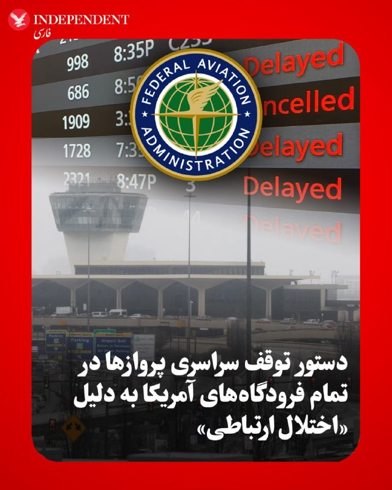

به گزارش رویترز، شان دافی، وزیر ترابری ایالات متحده، روز جمعه ۲۲ آبان اعلام کرد اداره هوانوردی فدرال (FAA) به دلیل بروز «اختلال ارتباطی» که تمامی مراکز کنترل ترافیک مسیرهای هوایی را تحت تأثیر قرار داده است، دستور توقف سراسری پروازها را برای تمامی فرودگاه‌های آمریکا صادر کرده است. دافی افزود کارشناسان فنی اداره هوانوردی فدرال در حال بررسی این مشکل هستند.   

اداره هوانوردی فدرال آمریکا نیز در اطلاعیه‌ای هشدار داد که به دلیل از کار افتادن تجهیزات، مسافران و کاربران باید انتظار ماندن هواپیماها در آسمان را پیش از فرود در تمامی فرودگاه‌های سامانه حریم هوایی ملی داشته باشند.  
@[VahidOOnLine](https://t.me/VahidOOnLine/270014)   

📡 [@VahidOnline](https://t.me/VahidOnline)

· · ·

**🕒 ۱۴۰۵/۰۸/۲۳ ۰۰:۱۲** · [پست 79102](https://t.me/VahidOnline/79102)

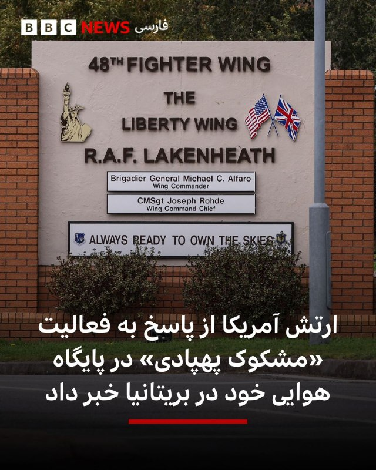

نیروی هوایی آمریکا اعلام کرد که عصر روز جمعه به «فعالیت مشکوک پهپاد غیرمجاز» بر فراز پایگاه نیروی هوایی سلطنتی لیکن‌هیث در سافولک واکنش نشان داده است.  

سخنگوی نیروی هوایی آمریکا اعلام کرد: «هیچ‌یک از نیروها، هواپیماها یا زیرساخت‌ها در جریان این واقعه آسیب ندیده‌اند.»  

این اقدام پس از گزارش‌های تایید نشده مبنی بر به صدا درآمدن آژیر خطر در این پایگاه صورت گرفته است که ساکنان گزارش داده‌اند از روستایی در نزدیکی شنیده شده است.  
@[VahidHeadline](https://t.me/VahidHeadline/331344)  

📡 [@VahidOnline](https://t.me/VahidOnline)

· · ·

**🕒 ۱۴۰۵/۰۸/۲۲ ۲۱:۵۳** · [پست 79101](https://t.me/VahidOnline/79101)

پلیس بریتانیا ویدیوی لحظه بازداشت دو مرد ایرانی  که به  جاسوسی برای ایران متهم شده‌اند را منتشر کرده است. این دو نفر توسط یکی از نهادهای اطلاعاتی جمهوری اسلامی برای زیر نظر گرفتن روزنامه‌نگاران ایرانی و یک وکیل، استخدام شده بودند.  

مصطفی سپهوند، ۴۱ ساله، و فرهاد جوادی‌منش، ۴۶ ساله، روز پنجشنبه ۱۲ نوامبر، پس از محاکمه‌ای شش‌هفته‌ای در دادگاه وولویچ لندن، به اتهام انجام فعالیت‌هایی که می‌توانست به یک سرویس اطلاعاتی خارجی کمک کند، مجرم شناخته شدند.  

کامبیز حسینی و مجتبی پورمحسن، دو روزنامه‌نگار شبکه تلویزیونی فارسی‌زبان ایران‌اینترنشنال مستقر در لندن، و جاناتان ترنر، از بنیان‌گذاران سازمان «وکلای بریتانیا برای اسرائیل»، از جمله افرادی بودند که تحت نظر قرار گرفته بودند.  
@[VahidHeadline](https://t.me/VahidHeadline/331176)  
📱 [هور آر یو](https://x.com/search?q=%22%D9%87%D9%88%20%D8%A2%D8%B1%20%DB%8C%D9%88%22&amp;src=typed_query&amp;f=live)؟  📱 [فور وات](https://www.instagram.com/reels/DfpqLm5Rj0y/)؟   

📡 [@VahidOnline](https://t.me/VahidOnline)

🎬 ویدیو: [مشاهده در تلگرام](https://t.me/VahidOnline/79101)

· · ·

**🕒 ۱۴۰۵/۰۸/۲۲ ۱۹:۳۷** · [پست 79100](https://t.me/VahidOnline/79100)

اسکات بسنت، وزیر خزانه‌داری آمریکا، گفت جمهوری اسلامی احتمالا پیش از انتخابات میان‌دوره‌ای به توافق بهتری دست یابد، اما اکنون دونالد ترامپ معتقد است آمریکا به توافق نیازی ندارد و فشار اقتصادی بر تهران ادامه خواهد یافت[.](https://t.me/VahidOOnLine/269946)  

ترجمه ماشین:  

🔺 **مجری:** آقای وزیر، اول از همه دربارهٔ محل اقامتتان چه می‌توانید به ما بگویید؟ الان کجا هستید؟ شاید نخواهید چیزی بگویید، اما می‌توانید کمی دربارهٔ وضعیتی که در آن قرار گرفته‌اید و اینکه چطور به اینجا رسیدید توضیح بدهید؟  

🔻 **اسکات بسنت:** بله جو، می‌دانی چه می‌خواهم بگویم؟  
F the Iranian leadership  
توضیح چت‌جی‌پی‌تی:  
از نظر شدت و لحن:  
- «گور پدر رهبران ایران»: ترجمه‌ای طبیعی و قابل‌فهم است، ولی از شدت رکاکت عبارت انگلیسی می‌کاهد.  
- «کیر تو رهبری ایران»: از نظر رکاکت و لحن توهین‌آمیز، معادل نزدیک‌تری برای Fuck the Iranian leadership است.  

آن‌ها مرا به مرگ تهدید کرده‌اند، اما قرار نیست بترسم. دیگر اعضای کابینه هم قرار نیست بترسند. این یعنی کاری که با عملیات «طرد اقتصادی» انجام می‌دهیم نتیجه می‌دهد.  
...  
کاری که انجام می‌دهیم جواب داده است. سپاه پاسداران مثل حیوان خطرناکی است که در گوشه‌ای گیر افتاده.

… [ادامه در تلگرام](https://t.me/VahidOnline/79100)

🎬 ویدیو: [مشاهده در تلگرام](https://t.me/VahidOnline/79100)

· · ·

**🕒 ۱۴۰۵/۰۸/۲۲ ۱۷:۴۲** · [پست 79099](https://t.me/VahidOnline/79099)

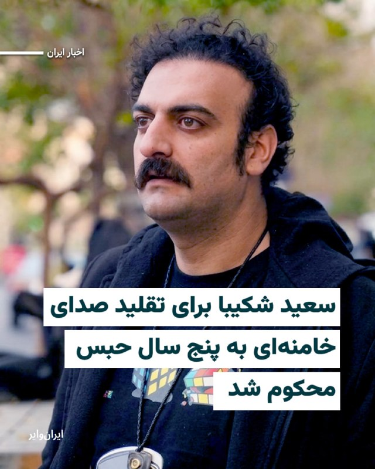

«سعید شکیبا» بلاگر و طنزپرداز زندانی در زندان تهران‌بزرگ، بابت انتشار ویدیویی از تقلید صدای «علی خامنه‌ای» رهبر دوم جمهوری اسلامی به پنج سال حبس محکوم شد.  
@[VahidHeadline](https://t.me/VahidHeadline/331253)  

📡 [@VahidOnline](https://t.me/VahidOnline)

· · ·

**🕒 ۱۴۰۵/۰۸/۲۲ ۱۷:۴۱** · [پست 79098](https://t.me/VahidOnline/79098)


وب‌سایت آکسیوس روز جمعه ۲۲ آبان‌ماه به نقل از سه منبع آگاه گزارش داد که رومن گافمن، رئیس سازمان اطلاعاتی موساد و از نزدیک‌ترین افراد مورد اعتماد بنیامین نتانیاهو، برای گفتگو با مقام‌های ارشد دولت آمریکا دربارهٔ جنگ با ایران در واشنگتن حضور دارد. این دیدارها در شرایطی انجام می‌شود که نخست‌وزیر اسرائیل برای ازسرگیری جنگ علیه جمهوری اسلامی به دونالد ترامپ فشار می‌آورد.  

به گفته منابع آکسیوس، گافمن با جان رتکلیف، رئیس سازمان اطلاعات مرکزی آمریکا (سیا)، دیدار می‌کند و انتظار می‌رود برای گفتگو با استیو ویتکاف، فرستاده کاخ سفید، به میامی نیز سفر کند. موساد، سیا و کاخ سفید از اظهارنظر دربارهٔ این دیدارها خودداری کرده‌اند.  

یک مقام آمریکایی به آکسیوس گفت که ترامپ تاکنون فشارهای نتانیاهو برای بازگشت به جنگ را رد کرده است.  

بر اساس این گزارش، ترامپ در مقابل با موضع عربستان سعودی، قطر و امارات متحده عربی برای ادامه محاصره دریایی و فشار اقتصادی علیه ایران همراه شده و هم‌زمان در حال بررسی امکان دستیابی به توافق است.  

رئیس‌جمهوری آمریکا روز پنجشنبه ۲۱ آبان‌ماه گفت: «می‌توانم فوراً به آن پایان بدهم. به درخواست کشورهایی که می‌خواهم از آن‌ها محافظت کنم، این کار را کمی طولانی‌تر و به شیوه‌ای متمدنانه‌تر پیش می‌بریم.»

… [ادامه در تلگرام](https://t.me/VahidOnline/79098)

· · ·

**🕒 ۱۴۰۵/۰۸/۲۲ ۱۷:۳۸** · [پست 79097](https://t.me/VahidOnline/79097)

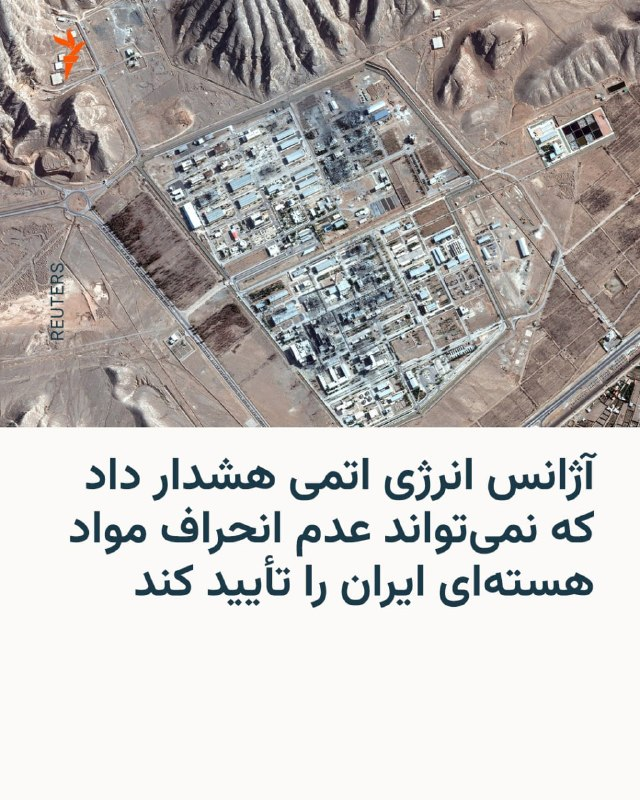

خبرگزاری‌های رویترز و فرانسه اعلام کردند نسخه‌ای از گزارش محرمانهٔ جدید آژانس بین‌المللی انرژی اتمی را دیده‌اند که بر اساس آن، آژانس در مورد تأسیسات زیرزمینی غنی‌سازی اورانیوم در اصفهان ابراز نگرانی فزاینده کرده است.  

بر اساس این گزارش‌ها که روز جمعه ۲۲ آبان منتشر شد، آژانس همچنین هشدار داده است که به‌دلیل همکاری نکردن ایران نمی‌تواند تأیید کند مواد هسته‌ای اعلام‌شدهٔ از سوی ایران از فعالیت‌های صلح‌آمیز منحرف نشده‌ باشد.  

بر اساس گزارش رویترز، آژانس با ابراز «نگرانی فزاینده» دربارهٔ تأسیسات غنی‌سازی سوخت اصفهان، موسوم به IFEP، تأکید کرده است که مقامات ایران سال گذشتهٔ میلادی تأسیس این مرکز را اعلام کردند، اما تاکنون اجازهٔ بازرسی از آن را نداده‌اند.  

آژانس در گزارش فصلی خود به کشورهای عضو اعلام کرده است: «آژانس از محل دقیق تأسیسات غنی‌سازی سوخت اصفهان، وضعیت آن از نظر اجرای پادمان‌ها و این‌که آیا مواد هسته‌ای در آن وجود دارد یا نه، اطلاعی ندارد.»  
@[VahidHeadline](https://t.me/VahidHeadline/331248)  

📡 [@VahidOnline](https://t.me/VahidOnline)

· · ·

**🕒 ۱۴۰۵/۰۸/۲۲ ۱۷:۳۸** · [پست 79096](https://t.me/VahidOnline/79096)

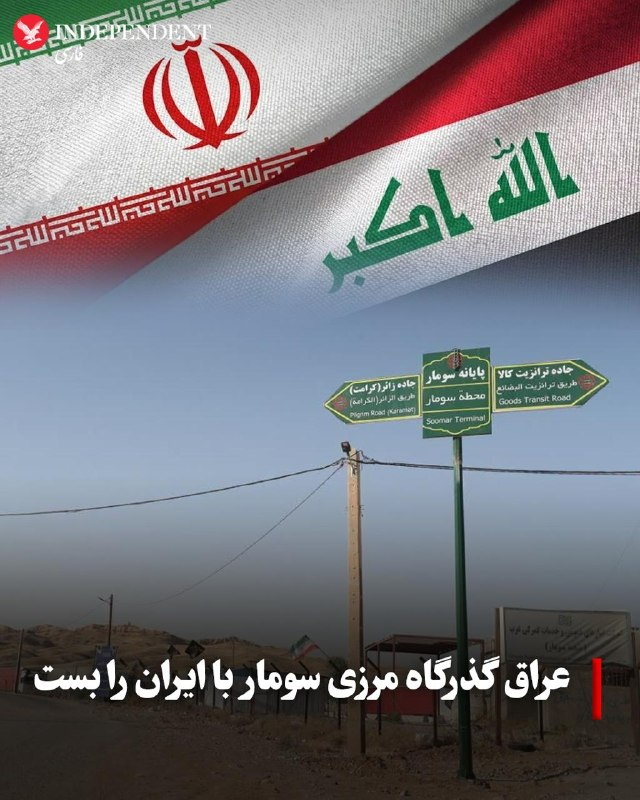

رسانه‌های رسمی در ایران، روز جمعه ۲۲ آبان، از بسته شدن «موقت» گذرگاه مرزی مندلی در عراق، مقابل گذرگاه سومار در استان کرمانشاه ایران، خبر دادند.  

خبرگزاری مهر گزارش داد این تصمیم از سوی سازمان راهداری و حمل‌ونقل جاده‌ای ایران و در پی اعلام وزارت امور خارجه اتخاذ شده است. بر اساس این گزارش، تعطیلی گذرگاه پس از مکاتبهٔ دیپلماتیک سفارت جمهوری اسلامی ایران در بغداد در دستور کار قرار گرفت و به مدیران استانی ابلاغ شد.  

هم‌زمان، خبرگزاری ایرنا به نقل از داریوش صادقی، ناظر گمرکات استان و مدیرکل گمرک کرمانشاه، اعلام کرد تعطیلی این مرز با هدف انجام عملیات فنی و زیرساختی صورت گرفته است. صادقی گفت پیش از تعطیلی، همهٔ کامیون‌های صادراتی از این مرز خارج شده‌اند و روز چهارشنبه ۲۰ آبان، ۷۵۰ کامیون از سومار عبور کردند.  

این تصمیم در شرایطی اتخاذ شده است که فؤاد حسین، وزیر امور خارجهٔ عراق، ۱۶ آبان در گفت‌وگو با شبکهٔ الجزیره اعلام کرد آمریکا رسماً از بغداد خواسته است همهٔ گذرگاه‌های مرزی با ایران، به‌جز دو گذرگاه، را مسدود کند. او گفت دولت عراق در حال مذاکره با واشینگتن دربارهٔ این درخواست است و اجرای آن می‌تواند به اقتصاد عراق آسیب بزند.  
@[VahidOOnLine](https://t.me/VahidOOnLine/269883)  

📡 [@VahidOnline](https://t.me/VahidOnline)

· · ·

**🕒 ۱۴۰۵/۰۸/۲۲ ۱۷:۳۷** · [پست 79095](https://t.me/VahidOnline/79095)


دستگاه قضایی جمهوری اسلامی برای ۶ شهروند در ارتباط با نمایشگاه فیتکس تهران کیفرخواست صادر کرد.  

به گزارش خبرگزاری دولتی ایرنا، این افراد شامل مدیرعامل و مدیر اجرایی شرکت برگزارکننده و ۴ شرکت‌کننده زن هستند که به «تشویق به فساد، جریحه‌دار کردن عفت عمومی و انتشار تصاویر مبتذل» متهم شده‌اند.  

بر اساس این گزارش، همه ۶ متهم در بازداشت هستند.  

پیشتر دادستان تهران از بازداشت یک بلاگر ورزشی زن در پرونده نمایشگاه فیتکس تهران خبر داده بود.  

رسانه‌های اصولگرا در روزهای گذشته با انتشار تصاویری از پوشش زنان در این نمایشگاه کارزاری علیه برگزارکنندگان راه انداختند.  

پس از این کارزار، صفحه اینستاگرام فیتکس مسدود شد و وزارت ورزش و جوانان ادعا کرد این نمایشگاه ارتباطی با این وزارتخانه نداشت و اداره ورزش تهران نیز مدعی شد برگزارکنندگان از این اداره مجوز نگرفته بودند.  
@[VahidHeadline](https://t.me/VahidHeadline/331234)  

📡 [@VahidOnline](https://t.me/VahidOnline)

· · ·

**🕒 ۱۴۰۵/۰۸/۲۲ ۱۶:۵۵** · [پست 79094](https://t.me/VahidOnline/79094)

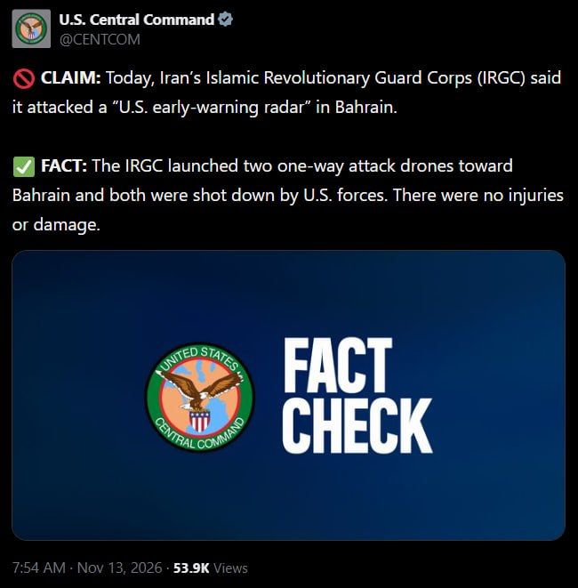

پست سنتکام، ترجمه ماشین:  
🚫 ادعا: امروز سپاه پاسداران انقلاب اسلامی ایران [اعلام کرد](https://t.me/VahidOnline/79093) که به یک «رادار هشدار زودهنگام آمریکا» در بحرین حمله کرده است.  

✅ واقعیت: سپاه پاسداران دو پهپاد انتحاری به سمت بحرین پرتاب کرد که هر دو توسط نیروهای آمریکایی سرنگون شدند. این حمله هیچ تلفات جانی یا خسارتی در پی نداشت.  
[CENTCOM](https://x.com/CENTCOM/status/2121225254446018729)  

📡 [@VahidOnline](https://t.me/VahidOnline)

· · ·

**🕒 ۱۴۰۵/۰۸/۲۲ ۰۶:۰۹** · [پست 79093](https://t.me/VahidOnline/79093)

🖼 *(عکس بعد از ۲۴ ساعت حذف شده)*

سپاه پاسداران با انتشار اطلاعیه‌ای که بامداد جمعه خبرگزاری‌های رسمی ایران منتشر کردند مدعی شده در پاسخ به حمله هوایی نیمه شب آمریکا به سیریک، «رادار هشدار اولیه» نیروهای آمریکایی در بحرین را «هدف‌قرار‌داده و منهدم» کرده است.  

در اطلاعیه سپاه پاسداران آمده: «این یک اخطار جدی به دشمن متجاوز برای پایان دادن به شیطنت‌های هوایی و قاچاق نفت در تنگهٔ هرمز است؛ در صورت تکرار تخلفات و تجاوزها، نیروی هوافضای سپاه برای مقابلهٔ بدون مرز در آماده‌باش کامل قرار دارد. شرکت‌های متخلفی که فریب دشمن متجاوز را بخورند با تنبیهات جدی‌تری مواجه خواهند شد.»  

ساعتی قبل از این اطلاعیه، خبرگزاری‌های ایران از حمله هوایی به سیریک خبر داده بودند که سپاه پاسداران ضمن تایید آن گفته در جریان این حملات یک دکل مخابراتی در این منطقه از سواحل خلیج فارس هدف قرار گرفته است.  
عکس آرشیوی  
@[VahidHeadline](https://t.me/VahidHeadline/331214)  

📡 [@VahidOnline](https://t.me/VahidOnline)

· · ·

**🕒 ۱۴۰۵/۰۸/۲۲ ۰۱:۲۱** · [پست 79092](https://t.me/VahidOnline/79092)

دونالد ترامپ، رئیس‌جمهوری آمریکا، پنجشنبه ۲۱ آبان در مصاحبه‌ای تلفنی با شبکهٔ «سیلم»،   
در پاسخ به پرسش خبرنگار دربارهٔ اینکه آیا باقی ماندن «دیوانه‌های ایران» در قدرت تا پایان دورهٔ ریاست‌جمهوری‌اش را شکست خود می‌داند، گفت: «بله، این یک شکست خواهد بود. قطعاً می‌گویم که این یک شکست خواهد بود.»  

خبرنگار از ترامپ پرسید: «اگر دیوانه‌های ایران هنگام ترک مقام ریاست‌جمهوری همچنان در قدرت باشند، آیا این برای شما شکست محسوب می‌شود یا کاری است که نمی‌توان در سه سال انجام داد؟»  ترامپ در واکنش پرسید که آیا منظور خبرنگار «دیوانه‌های ایران» در خود ایران است   
و افزود: «چون ما اینجا هم دیوانه‌های ایرانی داریم.»  
 او سپس در پاسخ به پرسش اصلی تأکید کرد که باقی ماندن آن‌ها در قدرت را شکست می‌داند.  

ترامپ در بخش دیگری از این مصاحبه نیز گفته بود که آمریکا در صورت نیاز به استفادهٔ دوباره از نیروی نظامی علیه جمهوری اسلامی «هیچ تردیدی» نخواهد داشت. او با اشاره به آنچه «تسلط کامل آمریکا» بر خلیج فارس خواند، گفت که در پنج ماه گذشته هیچ نظامی آمریکایی کشته نشده و کارزار نظامی اصلی آمریکا در سه هفتهٔ نخست پایان یافته است.  
@[VahidOOnLine](https://t.me/VahidOOnLine/269835)   

📡 [@VahidOnline](https://t.me/VahidOnline)

🎬 ویدیو: [مشاهده در تلگرام](https://t.me/VahidOnline/79092)

· · ·

**🕒 ۱۴۰۵/۰۸/۲۲ ۰۰:۲۸** · [پست 79091](https://t.me/VahidOnline/79091)

🖼 *(عکس بعد از ۲۴ ساعت حذف شده)*

دونالد ترامپ روز پنجشنبه ۲۱ آبان در مصاحبه تلفنی با شبکه «سیلم» تأکید کرد که ایالات متحده در صورت نیاز به استفاده مجدد از نیروی نظامی برای جلوگیری از اقدامات جمهوری اسلامی ایران «هیچ تردیدی» به خود راه نخواهد داد. وی با اشاره به «تسلط کامل آمریکا» بر خلیج فارس، وضعیت نظامی کشورش را مطلوب توصیف کرد و افزود که در پنج ماه گذشته حتی یک نظامی آمریکایی نیز کشته نشده است.  

رئیس‌جمهور آمریکا با رد فرسایشی بودن درگیری‌ها، تأکید کرد که کارزار نظامی اصلی آمریکا در سه هفته اول به پایان رسید. او خاطرنشان کرد که واشنگتن اکنون نفت بیشتری نسبت به پیش از آغاز درگیری‌ها از تنگه هرمز خارج می‌کند. ترامپ در پاسخ به این‌که آیا حاضر است تا پایان دوره ریاست جمهوری خود محاصره دریایی ایران را برای دستیابی به فروپاشی کامل حکومت پیش ببرد یا خیر، تصریح کرد که رژیم ایران در حال فروپاشی است و این کشور با تورم ۳۰۱ درصدی، نابودی اقتصاد و ناتوانی در پرداخت حقوق نظامیان خود دست‌وپنجه نرم می‌کند.  
@[VahidOOnLine](https://t.me/VahidOOnLine/269832)  

📡 [@VahidOnline](https://t.me/VahidOnline)

· · ·

**🕒 ۱۴۰۵/۰۸/۲۱ ۲۲:۵۰** · [پست 79090](https://t.me/VahidOnline/79090)

🖼 *(عکس بعد از ۲۴ ساعت حذف شده)*

خبرگزاری ایرنا به نقل از منابع رسمی در شامگاه پنج‌شنبه ۲۱ آبان۱۴۰۵ خبر داد سیریک در استان هرمزگان هدف حمله قرار گرفته است. بر اساس این گزارش، منابع رسمی اعلام کردند که اصابت صورت‌گرفته «ماهیت نظامی» داشته است.  
@[VahidHeadline](https://t.me/VahidHeadline/331186)   
پیش از خبر ایرنا:  
خبرگزاری فارس پنجشنبه‌شب ۲۱ آبان‌ماه گزارش داد که ساکنان شهرستان سیریک در شرق استان هرمزگان طی ساعات گذشته در چند نوبت صدای انفجار شنیده‌اند.  

این خبرگزاری در گزارش اولیه خود اعلام کرد که ماهیت و علت این صداها هنوز مشخص نیست، اما برخی منابع احتمال داده‌اند که صداها ناشی از شلیک هشدار به سمت کشتی‌های متخلف بوده باشد.  
@[VahidOOnLine](https://t.me/VahidOOnLine/269818)  

📡 [@VahidOnline](https://t.me/VahidOnline)

· · ·

**🕒 ۱۴۰۵/۰۸/۲۱ ۲۰:۳۲** · [پست 79084](https://t.me/VahidOnline/79084)

🖼 *(عکس بعد از ۲۴ ساعت حذف شده)*

تصاویر دریافتی از شهروندان با شرح پرتاب سه موشک از سمت بیدگنه  
+  
خبرگزاری مهر، وابسته به سازمان تبلیغات اسلامی، روز پنج‌شنبه ۲۱ آبان ۱۴۰۵ ویدیویی از آسمان تهران منتشر  و اعلام کرد که نیروهای مسلح جمهوری اسلامی «موشک‌های جدید» را در غرب پایتخت ایران آزمایش کرده‌اند.  
@[VahidHeadline](https://t.me/VahidHeadline/331153)  

📡 [@VahidOnline](https://t.me/VahidOnline)

🎬 ویدیو: [مشاهده در تلگرام](https://t.me/VahidOnline/79089?single)

· · ·

**🕒 ۱۴۰۵/۰۸/۲۱ ۱۶:۴۳** · [پست 79083](https://t.me/VahidOnline/79083)

🖼 *(عکس بعد از ۲۴ ساعت حذف شده)*

**ترامپ: ما نیازی به توافق با ایران نداریم. آن روزها مدت‌هاست که گذشته است.**  

ترجمه ماشین:  
من از معاون رئیس‌جمهور، ونس، خواسته‌ام که تمام توجه و تمرکز خود را بر فساد و جرایم گسترده‌ای معطوف کند که در شهرها و ایالت‌های تحت اداره دموکرات‌ها در سراسر آمریکا جریان دارد.  

ایالت‌های آبی \[دموکرات\]، مانند مینه‌سوتا، کالیفرنیا، ایلینوی و بسیاری دیگر، همگی فاجعه‌هایی هستند که به‌شدت بد اداره می‌شوند و غرق در فسادند.  
هر ماه میلیاردها دلار به سرقت می‌رود. با مقابله با این فعالیت‌های مجرمانه گسترده، می‌توانیم به‌سرعت بودجه کشور را به تعادل برسانیم.  
فساد در خون رهبران دموکرات‌هاست!  

ما نیازی به توافق با ایران نداریم. آن روزها مدت‌هاست که گذشته است. پولشان، صدها میلیارد دلار، دست ماست و تنگه‌شان هم در اختیار ماست!  

از توجه شما به این موضوع سپاسگزارم.  
رئیس‌جمهور دونالد جی. ترامپ  
[realDonaldTrump](https://truthsocial.com/@realDonaldTrump/posts/117603621591099598)  

📡 [@VahidOnline](https://t.me/VahidOnline)

· · ·

**🕒 ۱۴۰۵/۰۸/۲۱ ۱۶:۴۲** · [پست 79082](https://t.me/VahidOnline/79082)

🖼 *(عکس بعد از ۲۴ ساعت حذف شده)*

مجلس خبرگان رهبری روز پنجشنبه ۲۱ آبان در بیانیه‌ای اعلام کرد بررسی موضوع خروج ایران از پیمان منع گسترش سلاح‌های هسته‌ای (NPT)، بازنگری در «دکترین دفاعی کشور و ایجاد بازدارندگی لازم» به ضرورتی اجتناب‌ناپذیر و مطالبه‌ای عمومی و ملی تبدیل شده است.  

مجلس خبرگان در این بیانیه با اشاره به «تهدیدهای مکرر دشمنان»، به‌ویژه تهدید علیه دانش هسته‌ای ایران، اعلام کرد نمی‌توان به نهادهای بین‌المللی مسئول در این زمینه امیدی داشت.  

در بخشی از این بیانیه آمده است: «بررسی موضوع خروج از NPT و بازنگری در دکترین دفاعی کشور و ایجاد بازدارندگی لازم ضرورتی اجتناب‌ناپذیر شده و به مطالبه‌ای عمومی و ملی تبدیل گردیده است.»  

مجلس خبرگان همچنین هشدار داد در صورت آغاز حمله‌ای دیگر از سوی دشمنان، نیروهای مسلح ایران پاسخی فوری و اثرگذار و بدون محدودیت جغرافیایی خواهند داد.  

در این بیانیه از مسئولان خواسته شده است در کنار نیروهای مسلح و مردم، از پیگیری مطالبات و حقوق ملت ایران عقب‌نشینی نکنند.  
این سخنان در حالی مطرح می‌شود که پیشتر، مقام‌های جمهوری اسلامی موضوع خروج ایران از پیمان ان‌پی‌تی را رد کرده بودند.  
@[VahidOOnLine](https://t.me/VahidOOnLine/269731)  

📡 [@VahidOnline](https://t.me/VahidOnline)

· · ·

**🕒 ۱۴۰۵/۰۸/۲۰ ۲۲:۲۶** · [پست 79081](https://t.me/VahidOnline/79081)

دونالد ترامپ، رییس‌جمهوری آمریکا، روز چهارشنبه ۲۰ آبان اعلام کرد واشنگتن به‌دنبال دستیابی به «پیروزی کامل» در جنگ است و قصد ندارد به نتیجه‌ای کمتر از آن رضایت دهد.  

او در مراسم روز کهنه‌سربازان در آرلینگتون ایالت ویرجینیا گفت: «این موضوع باید خیلی وقت پیش حل‌وفصل می‌شد. می‌خواهیم مطمئن شویم که به پیروزی کامل دست پیدا می‌کنیم؛ نه پیروزی ۹۳ درصدی، بلکه پیروزی کامل.»  

رئیس‌جمهور آمریکا افزود: «بازسازی آنچه ما ویران کرده‌ایم، ۲۵ سال برای آن‌ها طول خواهد کشید و امیدوارم مجبور نشویم بخش‌های بیشتری از آن کشور را ویران کنیم.»  

ترامپ همچنین گفت ایران از سال ۱۹۷۹ (سال وقوع انقلاب ۵۷) علیه آمریکا در حال جنگ بوده و این ایالات متحده نبوده که جنگ با تهران را آغاز کرده است.  

او با اشاره به عملیات نظامی آمریکا علیه جمهوری اسلامی در هفت ماه گذشته گفت در این مدت، تنها چند هفته درگیری شدید و فعال جریان داشته است.  
@[VahidHeadline](https://t.me/VahidHeadline/330993)  

📡 [@VahidOnline](https://t.me/VahidOnline)

🎬 ویدیو: [مشاهده در تلگرام](https://t.me/VahidOnline/79081)

· · ·

**🕒 ۱۴۰۵/۰۸/۲۰ ۱۸:۲۹** · [پست 79079](https://t.me/VahidOnline/79079)

«علیرضا پناهیان»، روحانی نزدیک به حاکمیت، در اظهاراتی مدعی شد اسرائیل برای شناسایی محل حضور شخصیت‌ها و انجام عملیات اطلاعاتی علیه جمهوری اسلامی از «جن» و نیروهای ماورایی استفاده می‌کند.  
پناهیان گفت: «صهیونیست‌ها حداکثر استفاده را از امور ماورایی و جنّی علیه ما می‌برند.»  
او همچنین با استناد به گفته‌های فردی که به ادعای خودش در این امور تخصص داشته، مدعی شد اسرائیلی‌ها از طریق اجنه محل حضور شخصیت‌ها را شناسایی می‌کنند.  
@[VahidHeadline](https://t.me/VahidHeadline/330948)  
[Sari\_pishik](https://x.com/Sari_pishik/status/2120442911862989093)  

📡 [@VahidOnline](https://t.me/VahidOnline)

🎬 ویدیو: [مشاهده در تلگرام](https://t.me/VahidOnline/79079?single)

🎬 ویدیو: [مشاهده در تلگرام](https://t.me/VahidOnline/79080?single)

· · ·

**🕒 ۱۴۰۵/۰۸/۲۰ ۱۸:۲۸** · [پست 79078](https://t.me/VahidOnline/79078)

🖼 *(عکس بعد از ۲۴ ساعت حذف شده)*

محسن رضایی، دبیر شورای عالی امنیت ملی جمهوری اسلامی، در مصاحبه‌ای تازه گفت اگر حمله نظامی آمریکا علیه ایران ازسر گرفته شود، «پایگاه‌های دوردست آمریکا را نیز مورد حمله قرار می‌دهیم.»  

او در این مصاحبه با شبکه المیادین که چهارشنبه ۲۰ آبان منتشر شد، گفت: «منظورم پایگاه‌های نظامی آمریکا در مناطق دوردستی است که تاکنون به آن‌ها حمله نکرده‌ایم. ممکن است برخی جزایری را نیز هدف قرار دهیم که تصور می‌کنند موشک‌های ما به آن‌ها نمی‌رسد. حتی ممکن است برخی پایگاه‌های نظامی آمریکا در کشورهای اروپایی را نیز هدف قرار دهیم.»  

محسن رضایی همچنین گفت که در حال حاضر هیچ مذاکره‌ای میان تهران و واشینگتن جریان ندارد و ایران تا زمانی که آمریکا هفت شرط تعیین‌شده از سوی تهران را نپذیرد، تنگه هرمز را باز نخواهد کرد.  
@[VahidHeadline](https://t.me/VahidHeadline/330960)  

📡 [@VahidOnline](https://t.me/VahidOnline)

· · ·
