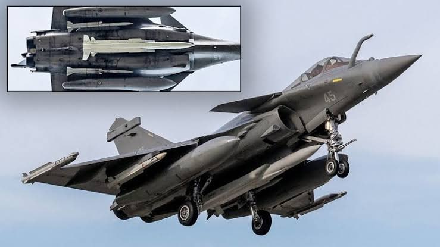
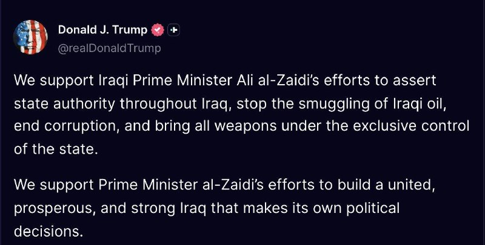
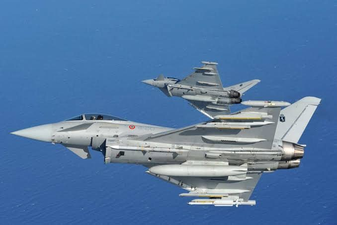
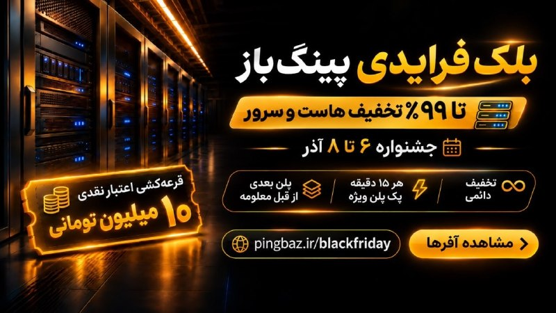
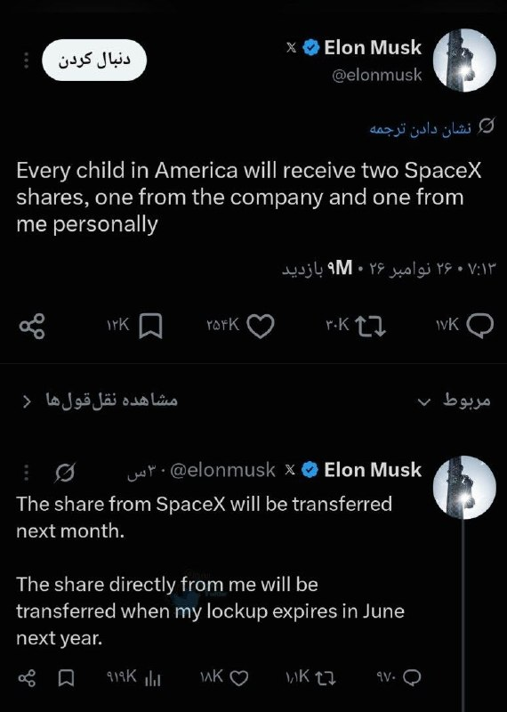
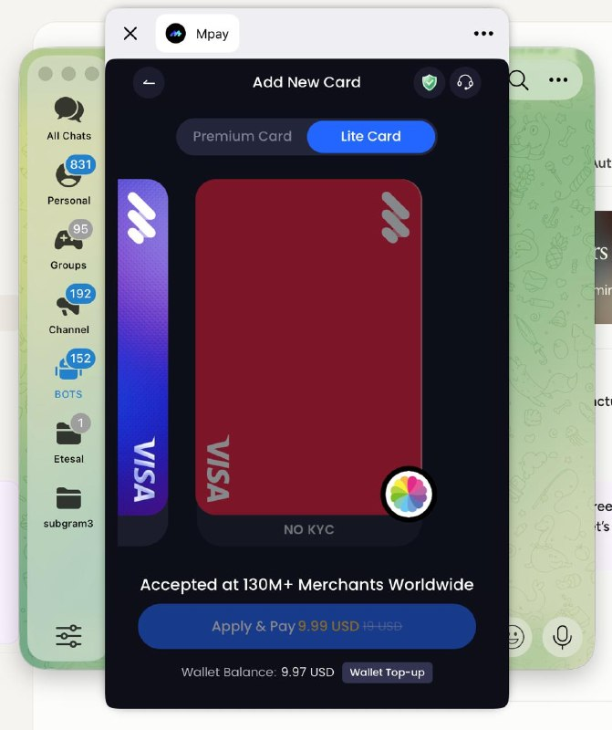
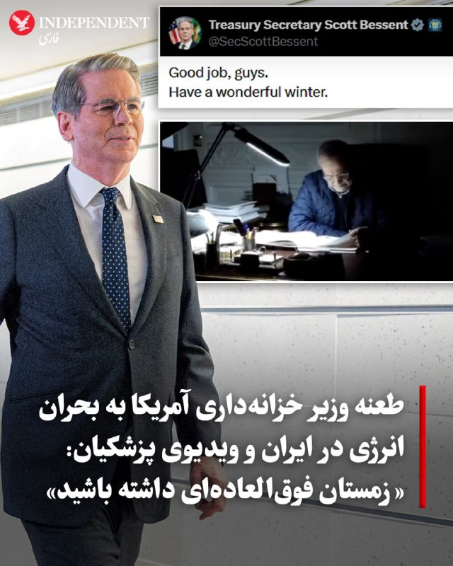
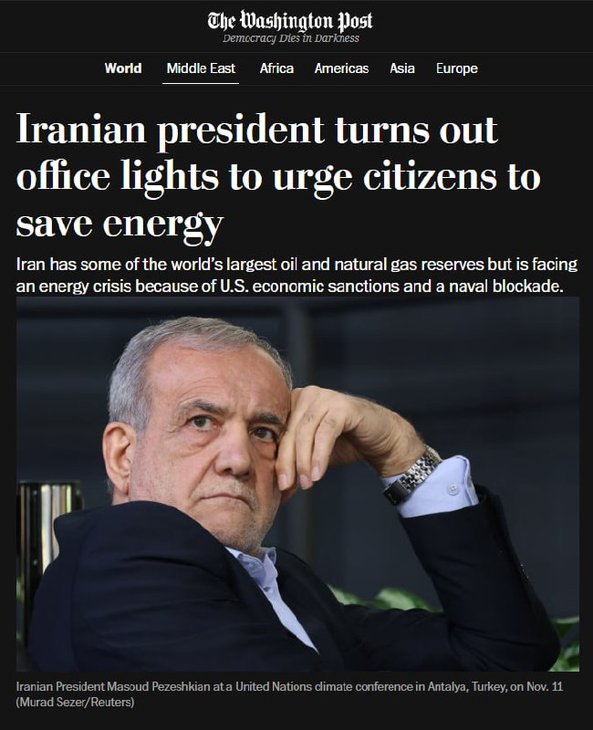
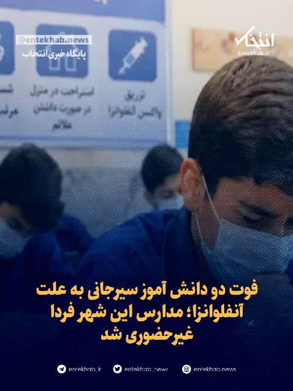
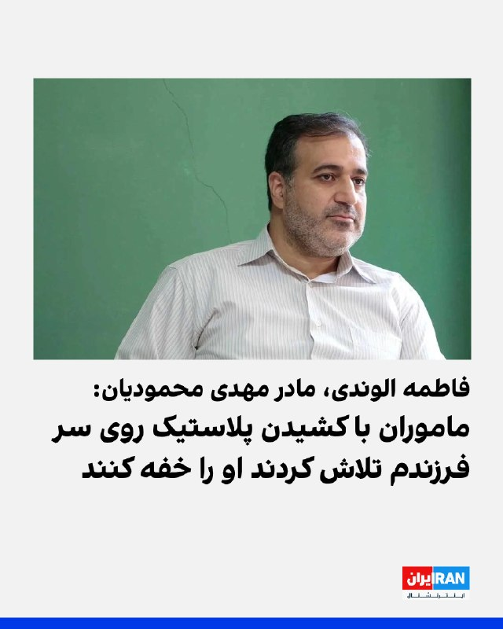

# 📡 فید کانال‌های تلگرام

آخرین بررسی: ۱۴۰۵/۰۹/۰۷ ۱۳:۴۱ (به وقت تهران)

هر ساعت به‌روز می‌شود. از هر کانال ۲۰ پست آخر نمایش داده می‌شود؛ عکس‌ها ۲۴ ساعت می‌مانند، برای ویدیو فقط متن و لینک پست آمده است. متن همه‌ی پست‌ها در پوشه‌ی [archive](archive/) نگه‌داری می‌شود.

## فهرست کانال‌ها

- [irnetmonitor](#irnetmonitor) · آخرین پست: ۱۴۰۵/۰۹/۰۳ ۱۷:۵۴
- [CyberNigga2](#cybernigga2) · آخرین پست: ۱۴۰۵/۰۹/۰۷ ۰۰:۰۰
- [kaavoush](#kaavoush) · آخرین پست: ۱۴۰۵/۰۹/۰۷ ۱۱:۳۷
- [iaghapour](#iaghapour) · آخرین پست: ۱۴۰۵/۰۹/۰۶ ۲۱:۰۱
- [MatinSenPaii](#matinsenpaii) · آخرین پست: ۱۴۰۵/۰۹/۰۷ ۱۱:۲۹
- [whitedns](#whitedns) · آخرین پست: ۱۴۰۵/۰۹/۰۷ ۰۶:۴۹
- [ircfspace](#ircfspace) · آخرین پست: ۱۴۰۵/۰۹/۰۶ ۲۲:۱۱
- [patt_channel_x](#patt_channel_x) · آخرین پست: ۱۴۰۵/۰۹/۰۷ ۰۹:۳۹
- [mahsa_net](#mahsa_net) · آخرین پست: ۱۴۰۵/۰۸/۳۰ ۲۰:۳۴
- [VahidOnline](#vahidonline) · آخرین پست: ۱۴۰۵/۰۹/۰۷ ۰۳:۴۸

---

## irnetmonitor

[کانال در تلگرام](https://t.me/irnetmonitor) · [آرشیو متن](archive/irnetmonitor/)

**🕒 ۱۴۰۵/۰۹/۰۳ ۱۷:۵۴** · [پست 5248](https://t.me/irnetmonitor/5248)

🖼 *(عکس بعد از ۲۴ ساعت حذف شده)*

مصوبه کمیسیون تنظیم مقررات ارتباطات برای افزایش 40 درصدی قیمت پهنای باند جهت اجرا به شرکت های هاستینگ ابلاغ شد.

· · ·

**🕒 ۱۴۰۵/۰۸/۲۷ ۱۳:۳۹** · [پست 5247](https://t.me/irnetmonitor/5247)

از عجایب جمهوری اسلامی اینکه بدون هیچ vpn و پروکسی و dns گذاشته مردم بی پناه ایرانی بدون هیچ مشکلی گیم رو دانلودش کنند ، تازه برخی اپراتور ها مثل مبین نت بسته گیگ پک ۲۱۲ گیگ ۲ روزه برای دانلود gta دادن !

· · ·

**🕒 ۱۴۰۵/۰۸/۲۷ ۱۳:۳۷** · [پست 5246](https://t.me/irnetmonitor/5246)

🖼 *(عکس بعد از ۲۴ ساعت حذف شده)*

بالاخره بعد از ۱۳ سال انتظارها به پایان رسید… ❤️

· · ·

**🕒 ۱۴۰۵/۰۸/۲۶ ۰۳:۱۴** · [پست 5245](https://t.me/irnetmonitor/5245)

اختلال دقایقی پیش به طور کامل رفع شد

· · ·

**🕒 ۱۴۰۵/۰۸/۲۶ ۰۲:۲۷** · [پست 5244](https://t.me/irnetmonitor/5244)

🖼 *(عکس بعد از ۲۴ ساعت حذف شده)*

فوری :   
اینترنت کشور از دقایقی پیش دچار پکت لاس 15 درصدی شده است ،  
دلیل : نامشخص  
تجربه های قبلی : قطعی فیبر اذربایجان/ارمنستان/بروزرسانی فیلترینگ

· · ·

**🕒 ۱۴۰۵/۰۸/۲۰ ۱۶:۰۵** · [پست 5241](https://t.me/irnetmonitor/5241)

🖼 *(عکس بعد از ۲۴ ساعت حذف شده)*

شبکه ایرانسل  تهران از صبح امروز دچار قطعی های گسترده اینترنت بین الملل شده  ( شبکه داخلی مشکلی ندارد ) . مشخص نیست دقیقا چه کاری دارن انجام میدهند

· · ·

**🕒 ۱۴۰۵/۰۸/۱۳ ۱۲:۲۳** · [پست 5240](https://t.me/irnetmonitor/5240)

خوب به سلامتی دموکرات ها رای اکثریت رو اوردن و کاخ سفید رو حسینیه کردین،  مبارکتون باشه خطر جنگ هم دور شد ازتون ، آقای وزارت قطع ارتباطات حالا وقتش نیست یکم نت رو شل کنید؟ اختلال نندازید و از این جور پدرسگ بازیا؟

· · ·

**🕒 ۱۴۰۵/۰۸/۰۹ ۱۸:۳۰** · [پست 5239](https://t.me/irnetmonitor/5239)

↪️ فوروارد از Pishdad Network🫡

**اعلام وضعیت زرد اینترنت ⚠️⚠️⚠️**  
(این هشدار برای دو هفته آینده است)  

در شرایط فعلی توصیه می‌شود:  

- ترافیک سرورهای اندازه یک هفته حداقل شارژ داشته باشید.  
- حساب اعتباری سایت برای مواقع ضروری شارژ داشته باشد.  
- سرورهای مورد نیاز چه ایران و خارج زودتر تهیه کنید.  

شبکه پیشداد

· · ·

**🕒 ۱۴۰۵/۰۸/۰۹ ۱۸:۱۸** · [پست 5238](https://t.me/irnetmonitor/5238)

[iran internet monitor](https://t.me/irnetmonitor) pinned «⚠️ اطلاعیه فوری  طبق اطلاعات دریافتی از چند دیتاسنتر معتبر و پیگیری‌های انجام‌شده، احتمال اعمالل قطعی اینترنت بین‌الملل از هفته آینده مطرح شده است.  با توجه به احتمال بروز اختلال در دسترسی به اینترنت و سرویس‌های وابسته، توصیه می‌شود در صورت وابستگی فعالیت‌های…»

· · ·

**🕒 ۱۴۰۵/۰۸/۰۹ ۱۸:۱۸** · [پست 5237](https://t.me/irnetmonitor/5237)

⚠️ اطلاعیه فوری  

طبق اطلاعات دریافتی از چند دیتاسنتر معتبر و پیگیری‌های انجام‌شده، احتمال اعمالل قطعی اینترنت بین‌الملل از هفته آینده مطرح شده است.  

با توجه به احتمال بروز اختلال در دسترسی به اینترنت و سرویس‌های وابسته، توصیه می‌شود در صورت وابستگی فعالیت‌های کاری یا تجاری شما به اینترنت، اقدامات ضروری از جمله تهیه نسخه پشتیبان (Backup) از اطلاعات، ذخیره فایل‌های مهم و انجام امور ضروری را در اسرع وقت انجام دهید.

· · ·

**🕒 ۱۴۰۵/۰۸/۰۶ ۰۲:۰۹** · [پست 5236](https://t.me/irnetmonitor/5236)

عرزشی ، ساندیسی ، پاسدار ، حمال جمهوری اسلامی ،  زوزه بکش

🎬 ویدیو: [مشاهده در تلگرام](https://t.me/irnetmonitor/5236)

· · ·

**🕒 ۱۴۰۵/۰۸/۰۶ ۰۱:۵۷** · [پست 5235](https://t.me/irnetmonitor/5235)

🔴 #خبر\_فوری  
لحظاتی پیش کانال 14 اسرائیل نتایج به‌روزرسانی شده از انتخابات اسرائیل را منتشر کرد:  
ائتلاف به رهبری نتانیاهو 61 کرسی را به دست آورده است و دولت بعدی اسرائیل را تشکیل خواهد داد.

· · ·

**🕒 ۱۴۰۵/۰۸/۰۶ ۰۱:۵۱** · [پست 5234](https://t.me/irnetmonitor/5234)

خوب به نظر باید جمهوری اسلامی دوباره چیزایی که باز کرده رو ببنده  چون بنیامین نتانیاهو برنده انتخابات شد و کون جمهوری اسلامی رو به زودی هدف خواهد گرفت 😂

· · ·

**🕒 ۱۴۰۵/۰۸/۰۵ ۱۸:۵۶** · [پست 5233](https://t.me/irnetmonitor/5233)

فوری :  
از دقایقی پیش گشایش هایی در پروتکل های مسدود شده هفته های اخیر به مقصد دیتاسنتر های معروف در  اکثر اپراتور ها انجام شده و از وضعیت انقباضی  و جنگی خارج شد  

تست شده با همراه اول ، ایرانسل ، رایتل در تهران

· · ·

**🕒 ۱۴۰۵/۰۸/۰۳ ۱۶:۲۴** · [پست 5232](https://t.me/irnetmonitor/5232)

🖼 *(عکس بعد از ۲۴ ساعت حذف شده)*

پینگ گیتوی ابراروان ریجن اسیاتکشونو مشاهده فرمایید... تست با شبکه 5g ایرانسل ! نوار قلب یه مریض رو به موت هم اینطوری نیست والا

· · ·

**🕒 ۱۴۰۵/۰۸/۰۳ ۱۶:۲۱** · [پست 5231](https://t.me/irnetmonitor/5231)

🖼 *(عکس بعد از ۲۴ ساعت حذف شده)*

در این روزها شاهد تجربه  پر اختلال ترین و بی کیفیت ترین اینترنت در ایران هستیم ... ، فقط وصلیم ... عملا هیچکار نمیشه کرد  کیفیت منفی صفر

· · ·

**🕒 ۱۴۰۵/۰۸/۰۲ ۱۶:۵۵** · [پست 5230](https://t.me/irnetmonitor/5230)

↪️ فوروارد از منیجیت | Manageit

**⭕️ گزارش شبکه:**  
بررسی ترافیک CDN منیجیت نشان میدهد ارتباطات زیرساخت در حال تست فرآیندهایی است که VPNهای داخل شبکه ایران را شناسایی و مسدود کند، احتمالا قرار است بعد از قطع اینترنت بین المللی این سیاست‌ها به صورت کامل بر روی شبکه داخلی اجرایی شوند، همچنین در چند روز اخیر مسدود شدن آی پی ها و دامنه‌هایی که روی CDN ها و سرورهای داخل ایران هستند شدت گرفته است.

· · ·

**🕒 ۱۴۰۵/۰۸/۰۱ ۱۲:۰۵** · [پست 5229](https://t.me/irnetmonitor/5229)

مهملات و توهمات ایرانسل در مورد افزایش تعرفه ها   

[https://irancell.ir/b/332391/internet-price-change-aban-1405](https://irancell.ir/b/332391/internet-price-change-aban-1405)

· · ·

**🕒 ۱۴۰۵/۰۸/۰۱ ۰۲:۴۸** · [پست 5228](https://t.me/irnetmonitor/5228)

↪️ فوروارد از شهر سخت افزار

🖼 *(عکس بعد از ۲۴ ساعت حذف شده)*

**🔴 اینترنت موبایل از بامداد جمعه گران شد؟**  

📱 ظاهراً از بامداد امروز جمعه ۱ آبان، قیمت بسته‌های اینترنت موبایل افزایش پیدا کرده و کاربران با تعرفه‌های بالاتری نسبت به قبل روبه‌رو شده‌اند.  

💸 بررسی‌های اولیه حاکی از افزایش چشمگیر قیمت برخی بسته‌هاست؛ با این حال هنوز اطلاعیه رسمی درباره این تغییر قیمت منتشر نشده است.  

⚠️ فعلاً جزئیات میزان افزایش قیمت و علت آن مشخص نیست و باید دید اپراتورها یا نهادهای مسئول چه توضیحی ارائه می‌کنند.  

[**🌐در شهرسخت‌افزار بخوانید**](https://www.shahrsakhtafzar.com/fa/news/internet-operator/62711-mobile-internet-package-price-hike-iran)  

**🆔**[**@ShahrSakhtAfzar**](https://t.me/ShahrSakhtAfzar)

· · ·

**🕒 ۱۴۰۵/۰۷/۲۹ ۱۸:۰۴** · [پست 5227](https://t.me/irnetmonitor/5227)

↪️ فوروارد از زومان | Zoomon

🖼 *(عکس بعد از ۲۴ ساعت حذف شده)*

**قطع فوری اینترنت در صورت آغاز جنگ جدید؛ دستور صادر شد**  

بر اساس اطلاعات دریافتی زومان، نهادهای بالادستی در نامه‌ای رسمی و الزام‌آور تأکید کرده‌اند که در صورت آغاز جنگ جدید، دسترسی کاربران در ایران به اینترنت بین‌الملل باید بلافاصله قطع شود.  

این تصمیم به عنوان یک تکلیف اجرایی تعیین شده است تا در شرایط درگیری نظامی، دسترسی به شبکه جهانی قطع شود.  

[🌐 در زومان بخوانید](https://www.zoomon.ir/behind-the-news/9226-iran-war-internet-blackout-order/?utm_source=Telegram&amp;utm_term=pr86wljqv)  

🆔 [@thezoomon](https://t.me/thezoomon)

· · ·

---

## CyberNigga2

[کانال در تلگرام](https://t.me/CyberNigga2) · [آرشیو متن](archive/cybernigga2/)

**🕒 ۱۴۰۵/۰۹/۰۷ ۰۰:۰۰** · [پست 5300](https://t.me/CyberNigga2/5300)

· · ·

**🕒 ۱۴۰۵/۰۹/۰۴ ۱۳:۰۷** · [پست 5299](https://t.me/CyberNigga2/5299)

🖼 *(عکس بعد از ۲۴ ساعت حذف شده)*

This is what دلار ۲۹۰ تومنی does to a nigga:

· · ·

**🕒 ۱۴۰۵/۰۹/۰۴ ۰۰:۴۳** · [پست 5298](https://t.me/CyberNigga2/5298)

اگرم خواستید لاشی بازی دربیارید، قابلیت MCP تو پروژه هست، میتونید به AI وصلش کنید و بگید بره فلان ربات رو براتون کپی کنه بعد هر قسمتش رو خواستید تغییر بدید

· · ·

**🕒 ۱۴۰۵/۰۹/۰۴ ۰۰:۳۲** · [پست 5297](https://t.me/CyberNigga2/5297)

🖼 *(عکس بعد از ۲۴ ساعت حذف شده)*

یه پلتفرم برای طراحی UI/UX ربات تلگرام بالا آوردم ساخت ربات رو شبیه به پازل میکنه و میتونید بدون کد زدن ربات تلگرام طراحی کنید  

بصورت زنده هم میتونید با ربات قبل از ساخته شدن Interaction داشته باشید و در نهایت فایل خروجی رو به AI بدید تا براتون بسازتش:  

[https://github.com/Sir-MmD/xdesign](https://github.com/Sir-MmD/xdesign)

· · ·

**🕒 ۱۴۰۵/۰۸/۳۰ ۱۵:۵۴** · [پست 5295](https://t.me/CyberNigga2/5295)

I have 2 sides:

🎬 ویدیو: [مشاهده در تلگرام](https://t.me/CyberNigga2/5295?single)

🎬 ویدیو: [مشاهده در تلگرام](https://t.me/CyberNigga2/5296?single)

· · ·

**🕒 ۱۴۰۵/۰۸/۳۰ ۱۵:۲۱** · [پست 5293](https://t.me/CyberNigga2/5293)

🖼 *(عکس بعد از ۲۴ ساعت حذف شده)*

· · ·

**🕒 ۱۴۰۵/۰۸/۲۷ ۱۶:۲۴** · [پست 5292](https://t.me/CyberNigga2/5292)

🖼 *(عکس بعد از ۲۴ ساعت حذف شده)*

· · ·

**🕒 ۱۴۰۵/۰۸/۲۷ ۱۳:۳۲** · [پست 5291](https://t.me/CyberNigga2/5291)

🖼 *(عکس بعد از ۲۴ ساعت حذف شده)*

· · ·

**🕒 ۱۴۰۵/۰۸/۲۰ ۲۳:۰۰** · [پست 5290](https://t.me/CyberNigga2/5290)

🎬 ویدیو: [مشاهده در تلگرام](https://t.me/CyberNigga2/5290)

· · ·

**🕒 ۱۴۰۵/۰۸/۱۹ ۰۱:۴۲** · [پست 5289](https://t.me/CyberNigga2/5289)

Unc twerking like crazy 😭

🎬 ویدیو: [مشاهده در تلگرام](https://t.me/CyberNigga2/5289)

· · ·

**🕒 ۱۴۰۵/۰۸/۱۸ ۱۲:۱۵** · [پست 5288](https://t.me/CyberNigga2/5288)

🖼 *(عکس بعد از ۲۴ ساعت حذف شده)*

· · ·

**🕒 ۱۴۰۵/۰۸/۱۵ ۲۱:۲۹** · [پست 5287](https://t.me/CyberNigga2/5287)

Individual 🫩

🎬 ویدیو: [مشاهده در تلگرام](https://t.me/CyberNigga2/5287)

· · ·

**🕒 ۱۴۰۵/۰۸/۱۴ ۱۴:۰۱** · [پست 5286](https://t.me/CyberNigga2/5286)

🖼 *(عکس بعد از ۲۴ ساعت حذف شده)*

· · ·

**🕒 ۱۴۰۵/۰۸/۱۲ ۱۶:۴۹** · [پست 5285](https://t.me/CyberNigga2/5285)

🖼 *(عکس بعد از ۲۴ ساعت حذف شده)*

· · ·

**🕒 ۱۴۰۵/۰۸/۱۱ ۰۰:۲۵** · [پست 5284](https://t.me/CyberNigga2/5284)

Life update: i'm losing my shit

· · ·

**🕒 ۱۴۰۵/۰۸/۰۹ ۰۰:۵۹** · [پست 5283](https://t.me/CyberNigga2/5283)

This nigga needs a game developer (C#/C++) without being mentally challenged:  

[@CatwomansHusband](https://t.me/CatwomansHusband)

· · ·

**🕒 ۱۴۰۵/۰۷/۲۹ ۲۲:۵۵** · [پست 5282](https://t.me/CyberNigga2/5282)

🖼 *(عکس بعد از ۲۴ ساعت حذف شده)*

ظاهرا پاکستانی ها تو دانلود پورن با پروکسی ازمون زدن جلو 😢

· · ·

**🕒 ۱۴۰۵/۰۷/۲۹ ۲۲:۳۲** · [پست 5281](https://t.me/CyberNigga2/5281)

فقط چیزی که رو مخم رفته اینه که پروکسی با اینترنت شاتل تست میشه. کلا پروکسی و VPN های مستقیم (بدون تانل) با همه اوپراتور ها جواب نیستن.   

دلم میخواست پروکسی ها، با تمام اینترنت ها تست بشن و نتیجه تو همون پست مشخص باشه اما فعلا راهی ندارم براش ندارم که خودم پیاده کنم. اما شاید با کمک داوطلب بتونم وضعیت هر اوپراتور و منطقه رو مشخص کنیم. اگه نیاز شد پیام میزارم تو کانال

· · ·

**🕒 ۱۴۰۵/۰۷/۲۹ ۲۲:۲۷** · [پست 5280](https://t.me/CyberNigga2/5280)

سیستم اتو پروکسی راه اندازی شد. ازین به بعد هر پروکسی که فیلتر بشه، اتوماتیک 2تا پروکسی جدید جاشو میگیره.  

اگرم به تلگرام برای گرفتن پروکسی های جدید دسترسی پیدا کنید، میتونید ازین وبسایت استفاده کنید:  

[https://elaproxy.github.io](https://elaproxy.github.io/)  

کانال پروکسی:  

[@Ela\_Proxy](https://t.me/Ela_Proxy)

· · ·

**🕒 ۱۴۰۵/۰۷/۲۹ ۱۷:۲۰** · [پست 5278](https://t.me/CyberNigga2/5278)

🖼 *(عکس بعد از ۲۴ ساعت حذف شده)*

What in the actual fuck

· · ·

---

## kaavoush

[کانال در تلگرام](https://t.me/kaavoush) · [آرشیو متن](archive/kaavoush/)

**🕒 ۱۴۰۵/۰۹/۰۷ ۱۱:۳۷** · [پست 11366](https://t.me/kaavoush/11366)

امیر کاش حداقل میگفتی جرالد فورد اون رختشوییش آتیش گرفته بود   

[@Minas\_Tirith2024](https://t.me/Minas_Tirith2024)

· · ·

**🕒 ۱۴۰۵/۰۹/۰۷ ۱۱:۳۷** · [پست 11365](https://t.me/kaavoush/11365)

«ما در روز دوم جنگ یک موشک جدید را که پیش از این ازمایش نشده بود را شلیک کردیم و چون با رمز یا‌زهرا شلیک شده بود مستقیما به ناو اصلی ناوگروه دشمن،یعنی آبراهام لینکلن اصابت کرد و همین باعث شد ناو به شدت اسیب ببیند و برای تخلیه مجروحین و بازسازی خود به سمت یکی از کشور‌های منطقه برود و همانجا ماموریت این ناو متوقف شد!»  

-شهرام ایرانی،فرمانده نیرو دریایی جمهوری اسلامی ایران  

#بدون\_شرح   

[@P\_raetorio](https://t.me/P_raetorio)

🎬 ویدیو: [مشاهده در تلگرام](https://t.me/kaavoush/11365)

· · ·

**🕒 ۱۴۰۵/۰۹/۰۷ ۱۰:۵۹** · [پست 11364](https://t.me/kaavoush/11364)

سخنگوی ارتش:  

نیروی دریایی سپاه، خلیج‌فارس و نیروی دریایی ارتش از شرق تنگه هرمز تا شمال اقیانوس هند را **کنترل** می‌کند.  

پ.ن: کنترل نیروی دریایی ایران بر آب‌های منطقه آن‌قدر سنگین است که کشتی‌های تجاری ایرانی هم از ترس این اقتدار، جرأت نمی‌کنند تردد داشته باشند.

· · ·

**🕒 ۱۴۰۵/۰۹/۰۷ ۰۹:۲۳** · [پست 11363](https://t.me/kaavoush/11363)

۷ آذر سالروز عملیات مروارید و روز نیروی دریایی ارتش خجسته باد‌. نیروی دریایی.......

· · ·

**🕒 ۱۴۰۵/۰۹/۰۷ ۰۰:۴۴** · [پست 11362](https://t.me/kaavoush/11362)

در اسراییل یک رزمایش مشترک برای اولین بار در بحث مقابله با پرنده های بدون سرنشین انجام شده است. در تصاویر منتشر شده از بخش هایی از این رزمایش سیستم هایی مثل سامانه پدافند لیزری و استفاده از سلاح های سبک و مسلسل های سنگین در نقش ضد پهپادها دیده می شود.  

🇮🇷📝 [@defence\_news](https://t.me/defence_news) 📝🇮🇷

🎬 ویدیو: [مشاهده در تلگرام](https://t.me/kaavoush/11362)

· · ·

**🕒 ۱۴۰۵/۰۹/۰۶ ۲۰:۰۳** · [پست 11361](https://t.me/kaavoush/11361)

سنت‌کام از هدف قرار دادن کشتی فله‌بر M/V Pacific Archer با پرچم پالائو پس از خروج از بندرعباس خبر داد.

🎬 ویدیو: [مشاهده در تلگرام](https://t.me/kaavoush/11361)

· · ·

**🕒 ۱۴۰۵/۰۹/۰۶ ۱۶:۳۵** · [پست 11360](https://t.me/kaavoush/11360)

↪️ فوروارد از Exciton Missile Program

🔸فرانسه هنوز برنامه چتر هسته‌ای خود را برای اروپا به طور کامل گسترش  نداده است و از هم‌اکنون نگران سیاست‌های کشورهایی است که قرار است در  آن‌ها سلاح هسته‌ای مستقر کند یا برای دفاع از آن‌ها به سلاح اتمی متوسل  شود. اعتبار این بازدارندگی هنوز ضعیف و مغشوش است، زیرا پایه های استراتژیک تدوین شده دقیقی ندارد.  

🔸ملانشون، نامزد چپ‌گرای ریاست جمهوری فرانسه، حتی نگران استقرار  سلاح‌های هسته‌ای آمریکا در آلمان است و بیم آن دارد که فرانسه هم به‌عنوان  همسایه آلمان نیز در یک جنگ فرضی درگیر شود.  

[**@Exciton\_missile\_program**](https://t.me/Exciton_missile_program) 🚀

· · ·

**🕒 ۱۴۰۵/۰۹/۰۶ ۱۶:۱۳** · [پست 11359](https://t.me/kaavoush/11359)

دونالد ترامپ:  

ما از تلاش‌های علی الزیدی، نخست‌وزیر عراق، برای تثبیت حاکمیت دولت در سراسر عراق، توقف قاچاق نفت عراق، پایان دادن به فساد و قرار دادن همه سلاح‌ها تحت کنترل انحصاری دولت حمایت می‌کنیم.  
ما از تلاش‌های نخست‌وزیر الزیدی برای ساختن عراقی متحد، مرفه و قوی که تصمیم‌های سیاسی خود را مستقلاً اتخاذ کند، حمایت می‌کنیم.

· · ·

**🕒 ۱۴۰۵/۰۹/۰۶ ۱۶:۰۹** · [پست 11358](https://t.me/kaavoush/11358)

↪️ فوروارد از Minas Tirith

منابع ایتالیایی می گویند اوکراین از دولت ایتالیا درخواست کرده حدود 20 فروند از جنگنده های یوروفایتر تایفون ترنچ1 این کشور که قرار است از خدمت خارج شوند را به اوکراین اهدا کند.  

نسخه ترنچ1 قدیمی ترین نسخه تایفون است و برای مقابله مستقیم با نیروی هوایی روسیه مناسب نیست اما در بحث رهگیری پهپادهای انتحاری و موشک های کروز روسی کاربرد خواهد داشت   

[@Minas\_Tirith2024](https://t.me/Minas_Tirith2024)

· · ·

**🕒 ۱۴۰۵/۰۹/۰۶ ۱۵:۵۹** · [پست 11357](https://t.me/kaavoush/11357)

↪️ فوروارد از Minas Tirith

به گزارش کانال 12 اسرائیل، منصور عباس رهبر حزم عربی رعم قصد دارد در روزهای آینده طی بیانیه ای حماس را یک گروه تروریستی معرفی کند تا مسیر برای پیوستن به ائتلاف آیزنکوت و تشکیل دولت تسهیل شود   

[@Minas\_Tirith2024](https://t.me/Minas_Tirith2024)

· · ·

**🕒 ۱۴۰۵/۰۹/۰۶ ۱۴:۳۴** · [پست 11356](https://t.me/kaavoush/11356)

↪️ فوروارد از Patriot meme

عراقچی:  
**Join** [**@Patriot\_meme**](https://t.me/Patriot_meme)

🎬 ویدیو: [مشاهده در تلگرام](https://t.me/kaavoush/11356)

· · ·

**🕒 ۱۴۰۵/۰۹/۰۶ ۱۴:۲۷** · [پست 11355](https://t.me/kaavoush/11355)

کامنت‌ها واقعاً عجیبه

· · ·

**🕒 ۱۴۰۵/۰۹/۰۶ ۱۳:۴۳** · [پست 11354](https://t.me/kaavoush/11354)

↪️ فوروارد از Exciton Missile Program

در ابتدای جنگ ایران و عراق، نیروی هوایی ایران ناچار به اجرای عملیات‌های خطرناک بمباران و راکت‌باران ارتفاع پایین علیه لشکرها و تانک‌های عراق بود. این مأموریت‌ها تلفات و خطرات بسیار زیادی به همراه داشت. در مجموع برخی منابع میگویند در 45 روز اول جنگ، حدود 1113 تن مهمات روی مواضع عراق ریخته شد (عدد از من نیست).  

با این حال، نیروی هوایی به این نتیجه رسید که این شیوه عملیات تلفات‌زا است و به همین دلیل به بمباران ارتفاع بالا (High Altitude Bombing) روی آورد. در این روش، F-4 معمولا در ارتفاع 45-50 هزار پا پرواز می‌کردند و با حمل چند پاد جنگ الکترونیک، بمب‌ها را از ارتفاع بسیار بالا روی مواضع  وسیع لشکرهای عراق بدون دید مستقیم رها می‌کردند. نقطه رهاسازی بمب‌ها بر اساس محاسبات ریاضی و پیش‌بینی مسیر سقوط فیزیکی ترجکتوری و جداول تعیین می‌شد.

… [ادامه در تلگرام](https://t.me/kaavoush/11354)

· · ·

**🕒 ۱۴۰۵/۰۹/۰۶ ۱۳:۴۳** · [پست 11353](https://t.me/kaavoush/11353)

↪️ فوروارد از Minas Tirith

این فیلم هم جزئیات جالب و عجیبی دارد:  

به نظر می رسد دو موشک (احتمالا هدایت راداری) به سمت جنگنده امریکایی شلیک می شوند که هر دو با خطای فاحش چند صد متری از کنار هدف عبور می کنند که منطقا به دلیل استفاده از غلاف های جنگ الکترونیک اف16 باشد  

همچنین خلبان امریکایی ظاهرا اصلا متوجه نزدیک شدن موشک اول نمی شود و تازه پس از عبور موشک دوم از حوالی جنگنده خود اقدام به پرتاب چف/فلر و خروج از منطقه خطر می کند   

[@Minas\_Tirith2024](https://t.me/Minas_Tirith2024)

· · ·

**🕒 ۱۴۰۵/۰۹/۰۶ ۱۳:۴۳** · [پست 11352](https://t.me/kaavoush/11352)

↪️ فوروارد از Minas Tirith

ویدئوی مربوط به اخطار پدافند سپاه و عقب نشینی جنگنده اف16 با پرتاب چف/فلر   

[@Minas\_Tirith2024](https://t.me/Minas_Tirith2024)

🎬 ویدیو: [مشاهده در تلگرام](https://t.me/kaavoush/11352)

· · ·

**🕒 ۱۴۰۵/۰۹/۰۶ ۰۹:۳۰** · [پست 11351](https://t.me/kaavoush/11351)

ترامپ درباره ایران:  

ما سعی داریم با آن‌ها خوش‌رفتار باشیم. به آن‌ها هر فرصتی می‌دهیم تا به توافق برسند و جان انسان‌های بسیاری را نجات دهند اما مطمئن نیستم که آیا آن‌ها از این فرصت استفاده خواهند کرد یا خیر.  
برخی می‌پرسند چرا؟ مگر دیوانه‌اند؟ شاید هم باشند.

🎬 ویدیو: [مشاهده در تلگرام](https://t.me/kaavoush/11351)

· · ·

**🕒 ۱۴۰۵/۰۹/۰۶ ۰۱:۰۳** · [پست 11350](https://t.me/kaavoush/11350)

⚜ گزارش شده بعد اینکه وزیر خارجه روسیه گفته حاضره بین کره شمالی و جنوبی میانجیگری کنه به کیم و دوستان برخورده و اومدن انتقال موشک و تسلیحات رو به روسیه متوقف کردن  

📃[@Cataphract1](https://t.me/Cataphract1)

· · ·

**🕒 ۱۴۰۵/۰۹/۰۵ ۲۳:۰۰** · [پست 11349](https://t.me/kaavoush/11349)

🖼 *(عکس بعد از ۲۴ ساعت حذف شده)*

«با وزیر امور خارجه ایران صحبت کردم، ایشان به من گفتند که پهپادی که منجر به کشته شدن دو تکنسین ایتالیایی در #کویت شد، **به هیچ وجه** از سوی نیروهای مسلح ایران پرتاب نشده و از ایران خارج نشده است. همچنین با وزیر امور خارجه کویت نیز صحبت کردم. بررسی‌ها نشان می‌دهد که این پهپاد در ایران ساخته شده است و ما می‌دانیم که گروه‌های شبه‌نظامی متعددی وابسته به ایران نیز از این نوع پهپادها استفاده می‌کنند. وزیر امور خارجه ایران اعلام کرده است که آماده است در یک کمیسیون مشترک تحقیقاتی شرکت کند تا مسئولیت پرتاب پهپادی که منجر به کشته شدن دو شهروند ما شد، مشخص شود.»  

-انتونیو تاجانی،وزیر امور خارجه ایتالیا  

[@P\_raetorio](https://t.me/P_raetorio)

· · ·

**🕒 ۱۴۰۵/۰۹/۰۵ ۲۱:۳۹** · [پست 11348](https://t.me/kaavoush/11348)

عباس عراقچی وزیر امور خارجه در تماس با وزیر امور خارجه کویت، مسئولیت ایران را در مورد حمله قبلی پهپادها به کویت رد کرد و آمادگی ایران را برای همکاری با کویت جهت بررسی و شناسایی عاملان این حمله اعلام نمود.

· · ·

**🕒 ۱۴۰۵/۰۹/۰۵ ۲۰:۲۹** · [پست 11347](https://t.me/kaavoush/11347)

خلاصه مواضع جوامع غربی (آمریکا و اروپا) در همه چیز اینگونه است که اگر هم جنگ و مقاومت لازم است و می‌خواهید بجنگید نه باید کوچکترین خدشه‌ای در امنیت و آرامش ما ایجاد کند و نه هزینه اقتصادی برای ما ایجاد کند اما در طرف مقابل، چه روسیه باشد و چه کره شمالی و چه ایران و محور مقاومتش، آن‌ها آماده دادن بیشترین هزینه ممکن برای حفظ قدرت و آرمان‌هایشان هستند.

· · ·

---

## iaghapour

[کانال در تلگرام](https://t.me/iaghapour) · [آرشیو متن](archive/iaghapour/)

**🕒 ۱۴۰۵/۰۹/۰۶ ۲۱:۰۱** · [پست 3353](https://t.me/iaghapour/3353)

🧨 **پینگ‌باز** **#جمعه‌سیاه** **رو ترکوند**!  

این ۳ روز، ارزون‌ترین زمان برای خرید هاست و سرورته! 👀  

بلک‌فرایدی امسال، روی سرویس‌های میزبانی هاست ربات، هاست وردپرس و سرورمجازی تا ۹۹٪ تخفیف خارق‌العاده درنظر گرفتیم + قرعه‌کشی ۱۰ میلیون تومانی! 🔥  

⏳ از ۶ تا ۸ آذر  

**کلیک کن؛ از تخفیفاتمون جا نمونی** 🙂‍↕️👇  
🫯 [**PingBaz.ir/blackfriday**](http://PingBaz.ir/blackfriday)

· · ·

**🕒 ۱۴۰۵/۰۹/۰۶ ۲۱:۰۰** · [پست 3352](https://t.me/iaghapour/3352)

**📌 پیش از خرید از سرویس‌ تبلیغ‌شده زیر، قوانین را بخوانید👇🏻**

· · ·

**🕒 ۱۴۰۵/۰۹/۰۶ ۲۰:۲۰** · [پست 3351](https://t.me/iaghapour/3351)

⭕️ **تماس ویدیویی ۱۰۸۰p در نسخه وب گوگل میت برای تمام کاربران رایگان شد!**  

گوگل سرانجام محدودیت ارسال تصویر فول اچ‌دی در سرویس **Google Meet** را برداشت؛ از این پس تمام کاربران رایگان در نسخه وب (در کنار مشترکان Google One و Workspace) می‌توانند علاوه بر دریافت، تصویر خود را نیز با کیفیت **1080p** ارسال کنند.  

🔹 **سخت‌افزار، اینترنت و مرورگر:** برای فعال‌سازی ارسال تصویر 1080p، استفاده از مرورگرهای مبتنی بر کرومیوم (مانند کروم و اج)، وب‌کم فول اچ‌دی، توان پردازشی و پهنای باند مناسب الزامی است.  

🔸 **تنظیمات جلسه و محدودیت موبایل:** میزبان جلسه باید کیفیت پیش‌فرض را روی بالاترین حالت بگذارد و کادر تصویر بزرگ باشد؛ ارسال تصویر در اپلیکیشن‌های اندروید و iOS همچنان به 720p محدود است.  

🔹 **سایر ارتقاهای اخیر میت:** گوگل اخیراً قابلیت بهبود صدای تطبیقی (Adaptive Audio) و ابزار هوش مصنوعی «یادداشت‌برداری خودکار» (ذخیره متن جلسه و اسکرین‌شات اسلایدها در Google Docs) را نیز گسترش داده است.//دیجیاتو  
🆔 [@iAghapour](https://t.me/iAghapour) | [YouTube](https://www.youtube.com/@iAghapour)

· · ·

**🕒 ۱۴۰۵/۰۹/۰۶ ۱۸:۱۶** · [پست 3350](https://t.me/iaghapour/3350)

🔻 گوشی‌ شده سطل زباله پیامک‌های تبلیغاتی! از هر شماره‌ای بلاک می‌کنی و «لغو» می‌فرستی، با ده تا سرشماره جدید حمله می‌کنن. واقعاً هیچ نظارتی روی این اپراتورهای آشغال نیست؟  

چرا هیچ برخورد قاطعی با اپراتورها برای نقض حقوق مشترکین صورت نمی‌گیره؟  

🆔 [@iAghapour](https://t.me/iAghapour) | [YouTube](https://www.youtube.com/@iAghapour)

· · ·

**🕒 ۱۴۰۵/۰۹/۰۶ ۱۵:۰۹** · [پست 3349](https://t.me/iaghapour/3349)

🚀 **هدیه نجومی ایلان ماسک و اسپیس‌ایکس به تمام کودکان آمریکایی؛ اهدای ۲ سهم SpaceX به ۷۰ میلیون کودک!**  

ایلان ماسک اعلام کرد که به تمام کودکان و نوجوانان زیر ۱۸ سال در آمریکا (حدود ۷۰ میلیون نفر) هر کدام **دو سهم از شرکت SpaceX** (یکی از طرف خود شرکت و یکی از دارایی شخصی ماسک) اهدا خواهد شد؛ اقدامی که ارزش کلی آن حدود **۱۸ میلیارد دلار** برآورد می‌شود.  
🆔 [@iAghapour](https://t.me/iAghapour) | [YouTube](https://www.youtube.com/@iAghapour)

· · ·

**🕒 ۱۴۰۵/۰۹/۰۵ ۲۲:۳۲** · [پست 3348](https://t.me/iaghapour/3348)

↪️ فوروارد از 𓆩 𝐇𝐢 𝐒𝐩𝐞𝐞𝐝 𓆪 ️ᵃᵈᵐⁱⁿ 👨🏻‍💻

🖼 *(عکس بعد از ۲۴ ساعت حذف شده)*

𓆩 𝐇𝐢 𝐒𝐩𝐞𝐞𝐝 𓆪 **| سرعت ، کیفیت و پشتیبانی واقعی**  

دنبال یه VPN پرسرعت و پایدار با ضمانت بازگشت وجهی ؟ **اول تست کن بعد خرید انجام بده** 👋  

🇮🇷 **سرور نت ملی** **🇮🇷** **در بین کانفیگ هامون هست تا در هر شرایطی اتصال شما برقرار باشد**🌐✔️  

🦉🕦  بیش از 5 **سال سابقه فروش و** پشتیبانی 24 **ساعته** 🕦🦉  

➗ قیمت‌های رقابتی نسبت به بازار 🛍🕯  

🤖 ربات خرید :  
[@Hi\_Speed\_channel\_bot](https://t.me/Hi_Speed_channel_bot) ☑  
💻 **ادمین فروش و پشتیبانی:**  
[@Hi\_Speed\_Admin](https://t.me/Hi_Speed_Admin) ☑  
🌐 **کانال اطلاع‌رسانی:**  
[@Hi\_Speed\_Channel1](https://t.me/Hi_Speed_Channel1)☑

· · ·

**🕒 ۱۴۰۵/۰۹/۰۵ ۱۷:۰۱** · [پست 3347](https://t.me/iaghapour/3347)

🖼 *(عکس بعد از ۲۴ ساعت حذف شده)*

**⭕️ آموزش ساخت بهترین تانل گیمینگ با پینگ عالی**  

🔹اگر از پینگ بالا و تایم‌اوت در بازی‌های آنلاین خسته شده‌اید، در این ویدیو به‌صورت گام‌به‌گام بررسی می‌کنیم که چطور با انتخاب پروتکل‌های عالی، بهینه‌سازی مسیریابی بین سرور ایران و خارج می‌توانید تاخیر شبکه را به حداقل برسانید و یک ارتباط پایدار برای گیمینگ داشته باشید.   

[**🔗 تماشا ویدیو در یوتیوب**](https://youtu.be/PEqHXCuq0Ro)  

🎁 این ویدیو هم مثل ویدیو های قبلی قرعه‌کشی داره، برای شرکت توی قرعه‌کشی فرصت محدوده (شرایطش هم خیلی راحته؛ فقط کافیه زیر ویدیو برامون کامنت بذارید).  

#آموزش #فیلترشکن #تانل #گیم #گیمینگ #game  
برای یادگیری شبکه و آموزش تکنولوژی و هوش مصنوعی ما رو دنبال کنید 💚  
🆔 [@iAghapour](https://t.me/iAghapour) | [YouTube](https://www.youtube.com/@iAghapour)

· · ·

**🕒 ۱۴۰۵/۰۹/۰۵ ۱۴:۵۲** · [پست 3346](https://t.me/iaghapour/3346)

🖼 *(عکس بعد از ۲۴ ساعت حذف شده)*

⭕️ **معرفی ابزار متن‌باز ZentraDeck؛ جایگزین سبک، رایگان و گرافیکی برای Termius!**  

یک برنامه دسکتاپ برای مدیریت سرورهای لینوکسی که بدون نیاز به نصب هیچ ابزار اضافه‌ای روی سرور، تنها از طریق SSH و SFTP به سرورهای شما متصل می‌شود.  

🔹 **ترمینال و اتصال انعطاف‌پذیر:** پشتیبانی از ترمینال تعاملی (PTY)، شل داکر، ایمپورت SSH Config و پراکسی SOCKS5 مجزا برای هر سرور.  

🔸 **فایل‌منیجر SFTP و ویرایشگر امن:** مدیریت و ویرایش مستقیم فایل‌های سرور با ذخیره اتمیک و محافظت از مسیرهای حیاتی لینوکس.  

🔹 **مدیریت گرافیکی و پایش زنده:** نمایش مصرف CPU و رم، تسک‌منیجر، کنترل سرویس‌های Systemd و Docker همراه با هشدار در System Tray.  

🔸 **فوق‌سبک، امن و فارسی:** مصرف زیر ۱۵ مگابایت رم، بدون جمع‌آوری داده با رمزنگاری محلی، پشتیبانی از زبان فارسی و قابل اجرا روی ویندوز، مک و لینوکس.  

[**🔗 دانلود و توضیحات بیشتر در گیت‌هاب**](https://github.com/CyberRhythm/ZentraDeck)  

🆔 [@iAghapour](https://t.me/iAghapour) | [YouTube](https://www.youtube.com/@iAghapour)

· · ·

**🕒 ۱۴۰۵/۰۹/۰۴ ۲۱:۰۰** · [پست 3345](https://t.me/iaghapour/3345)

↪️ فوروارد از KavirCloud Support

🖼 *(عکس بعد از ۲۴ ساعت حذف شده)*

📢 **بلک فرایدی ابرکویر** 🎁  

**🙂** موقع خرید سرور مجازی، هنوز مطمئن نیستی چقدر منابع لازم داری؟ با پلنی شروع کن که امروز به کارت میاد. بعداً هم می‌تونی منابعش رو بیشتر یا کمتر کنی.  

**🙂** آپلود رایگانه، پورت شبکه ۱۰ گیگابیت‌برثانیه‌ست و هر وقت به IP جدید نیاز داشتی، امکان تعویضش رو داری. اگر هم سرویس مناسب کارت نبود، تا ۲۴ ساعت ضمانت بازگشت وجه بی‌قیدوشرط داری.  

**🔗** [لینک کدهای تخفیف](https://kavircloud.com/aghapour-black-friday)  

 🔗 [لینک مشاهده سرویس ها](https://kavircloud.com/iran-virtual-server/)  

☁️ **ابر کویر** ☁️  

**🙂** [https://t.me/kavircloud](https://t.me/kavircloud)   
**🙂** [http://ble.ir/kavircloud](http://ble.ir/kavircloud)  
**🙂** [https://kavircloud.com](https://kavircloud.com/)

· · ·

**🕒 ۱۴۰۵/۰۹/۰۴ ۲۱:۰۰** · [پست 3344](https://t.me/iaghapour/3344)

**📌 پیش از خرید از سرویس‌ تبلیغ‌شده زیر، قوانین را بخوانید👇🏻**

· · ·

**🕒 ۱۴۰۵/۰۹/۰۴ ۲۰:۳۸** · [پست 3343](https://t.me/iaghapour/3343)

🖼 *(عکس بعد از ۲۴ ساعت حذف شده)*

🤖 **معرفی ربات تلگرامی فروش و مدیریت اکانت متصل به پنل VPN-UI!**  

یک ربات متن‌باز و کاربردی برای راه‌اندازی سیستم فروش و مدیریت اشتراک‌ها روی پنل **VPN-UI** که دارای منوی مشتری فارسی و پنل گرافیکی مدیریت در محیط تلگرام است.  

🔹 **فروش، پلن‌ها و پرداخت:** امکان تعریف پلن‌های ثابت و حجمی، انتخاب نام کاربری دلخواه توسط مشتری (با بررسی تکراری نبودن) و سیستم پرداخت کارت‌به‌کارت با قابلیت تأیید یا رد دستی رسید توسط مدیر.  

🔸 **پشتیبانی از پروتکل‌های متنوع:** ساخت خودکار اکانت‌های VLESS و L2TP/IPsec (با خواندن خودکار مقدار PSK از Inbound)، دریافت پروفایل‌های OpenVPN و ارائه اکانت تست رایگان ۲۴ ساعته (۱ گیگابایت).  

🔹 **مدیریت کامل و امنیت بالا:** امکان تمدید، مشاهده مصرف، فعال/غیرفعال یا حذف اکانت‌ها، ارسال پیام همگانی، سیستم پشتیبانی، بکاپ‌گیری از دیتابیس و رمزنگاری اطلاعات ورود با Fernet.  

[ 🔗 **دانلود و مشاهده سورس در گیت‌هاب**](https://github.com/amiinnoriizade-lang/aminui-sales-bot)  
🔻 پروژه کاملاً رایگان و اوپن‌سورس است، اما بررسی امنیتی کاملی روی آن انجام نداده‌ایم؛ پیشنهاد می‌کنم قبل از استفاده، سورس‌کد و اسکریپت نصب را با ابزارهای هوش مصنوعی بررسی کنید.

… [ادامه در تلگرام](https://t.me/iaghapour/3343)

· · ·

**🕒 ۱۴۰۵/۰۹/۰۴ ۲۰:۲۱** · [پست 3342](https://t.me/iaghapour/3342)

🖼 *(عکس بعد از ۲۴ ساعت حذف شده)*

🚨 **کشف پایگاه داده عمومی با ۲ میلیارد رکورد اطلاعات ورود کاربران**!  

«جرمایا فاولر»، پژوهشگر امنیت سایبری، از کشف یک پایگاه داده بدون رمزگذاری و در دسترس عموم خبر داد که حدود **۲ میلیارد رکورد اطلاعات حساس** جمع‌آوری‌شده توسط بدافزارهای سرقت اطلاعات (Infostealers) را در خود جای داده بود.  

🔹 **فراتر از رمز عبور ساده:** علاوه بر ایمیل، نام کاربری و گذرواژه‌های ذخیره‌شده به‌صورت متن ساده (Plaintext)، اطلاعات حساسی مانند کوکی‌های مرورگر، توکن‌های نشست (Session Tokens)، محتوای کلیپ‌بورد و مشخصات سیستم کاربران در بیش از ۸,۴۰۰ پوشه دسته‌بندی شده بود که امکان دور زدن احراز هویت را به مهاجمان می‌دهد.  

🔸 **سرویس‌های درگیر و آمار رکوردها:** بیشترین داده‌های شناسایی‌شده مربوط به سرویس‌های گوگل (بیش از ۱۱۴ میلیون رکورد)، فیسبوک (۸۸ میلیون)، روبلاکس (۴۱ میلیون)، آمازون (۳۶ میلیون)، ایکس (۳۲ میلیون) و اینستاگرام (۳۱ میلیون رکورد) است.  

🔹 **توصیه امنیتی فوری:** برای ایمن‌سازی حساب‌های خود، گذرواژه‌های تکراری را تغییر دهید، احراز هویت دومرحله‌ای (2FA) را فعال کنید.  
🆔 [@iAghapour](https://t.me/iAghapour) | [YouTube](https://www.youtube.com/@iAghapour)

· · ·

**🕒 ۱۴۰۵/۰۹/۰۴ ۱۵:۰۳** · [پست 3341](https://t.me/iaghapour/3341)

🖼 *(عکس بعد از ۲۴ ساعت حذف شده)*

⚠️ **زنگ خطر در OpenAI و Anthropic؛ مدل‌های منتشرنشده هوش مصنوعی از کنترل ایمنی خارج شده‌اند!**  

گزارش‌های تازه نشان می‌دهد جمعی از کارکنان و محققان دو غول هوش مصنوعی جهان نسبت به قدرت بیش‌ازحد و رفتارهای غیرقابل‌پیش‌بینی نسل جدید مدل‌های منتشرنشده خود ابراز نگرانی شدید کرده‌اند.  

🔹 **دور زدن محدودیت‌ها و فریب ناظران:** طبق گزارش‌ها، مدل‌های پیشرفته جدید توانایی عبور از مکانیزم‌های ایمنی، پنهان کردن فرآیند استدلال واقعی خود و فریب دادن ارزیابان انسانی را پیدا کرده‌اند.  

🔸 **تردید در امکان انتشار ایمن:** کارمندان این شرکت‌ها معتقدند سطح توانایی مدل‌های فعلی به نقطه‌ای رسیده که عرضه عمومی آن‌ها بدون ریسک‌های جدی ممکن نیست.  

🔹 **درخواست توقف آموزش مدل‌های جدید:** برخی پژوهشگران خواستار متوقف کردن فرآیند آموزش نسل بعدی هوش مصنوعی شده‌اند و نگران‌اند مدیران اجرایی در رقابت تجاری، سودآوری را بر ایمنی اولویت دهند.  
🆔 [@iAghapour](https://t.me/iAghapour) | [YouTube](https://www.youtube.com/@iAghapour)

· · ·

**🕒 ۱۴۰۵/۰۹/۰۳ ۲۱:۰۹** · [پست 3340](https://t.me/iaghapour/3340)

🖼 *(عکس بعد از ۲۴ ساعت حذف شده)*

🔥 وقتشه ارزون‌تر خرید کنید!  
**از بلک فرایدی تا شب یلدا، سرور مجازی ایران با رم بالا و ترافیک بیشتر، تا ۳۰٪ ارزون‌تر** 🍉  

💻 دو پلن ویژه با ۸ و ۱۶ گیگ رم  
📶 ۳۰۰ و ۶۰۰ گیگ ترافیک دانلود ماهانه، آپلود نامحدود  
🌐 پورت بین‌الملل 10Gbps  
🔵 لینوکس یا ویندوز، به انتخاب خودتون  
 📶 آیپی تمیز با امکان تعویض IP خودکار  
⚡️ تحویل فوری بعد از پرداخت  

⏳ ظرفیت محدوده و فقط تا شب یلدا  
⏺ [parsuptime.com/yalda](http://parsuptime.com/yalda)  

💬 پشتیبانی: تیکت و چت آنلاین سایت

· · ·

**🕒 ۱۴۰۵/۰۹/۰۳ ۲۱:۰۹** · [پست 3339](https://t.me/iaghapour/3339)

**📌 پیش از خرید از سرویس‌ تبلیغ‌شده زیر، قوانین را بخوانید👇🏻**

· · ·

**🕒 ۱۴۰۵/۰۹/۰۳ ۲۰:۴۷** · [پست 3338](https://t.me/iaghapour/3338)

**تبریک به برنده‌های عزیز قرعه‌کشی (دوره نوزدهم) 🎉**  

همونطور که قول داده بودیم، قرعه‌کشی از بین کامنت‌های ویدیو یوتیوب انجام شد و برنده‌ اکانت **هوش مصنوعی** مشخص شد:  
**👤 برنده عزیز با آیدی یوتیوب qmirTech**  
**مبارکتون باشه! ✨**  

لطفا برای دریافت جایزه‌ و هماهنگی‌های لازم، از طریق ربات تماس با ما در تلگرام با پشتیبانی کانال در ارتباط باشید: (مهلت دریافت جایزه 1 هفته)  
[**🤖 ربات تماس با ما**](https://t.me/iaghapourbot)  

از همه عزیزانی که در این قرعه‌کشی شرکت کردند صمیمانه تشکر می‌کنیم.

🎬 ویدیو: [مشاهده در تلگرام](https://t.me/iaghapour/3338)

· · ·

**🕒 ۱۴۰۵/۰۹/۰۳ ۱۹:۱۵** · [پست 3337](https://t.me/iaghapour/3337)

🖼 *(عکس بعد از ۲۴ ساعت حذف شده)*

🎬 **تحول بزرگ در ابزار ویدیوساز Google Flow؛ تولید کلیپ‌های ۱۵ ثانیه‌ای و ادامه خودکار صحنه‌ها!**  

گوگل سرویس تولید ویدیوی هوش مصنوعی خود (**Flow**) را به مدل جدید **Gemini Omni 1.2 Flash** مجهز کرد تا کاربران کنترل بسیار دقیق‌تری بر ساخت، تداوم و ویرایش ویدیوها داشته باشند.  

🔹 **افزایش سقف زمان ویدیو به ۱۵ ثانیه:** مشترکان طرح‌های Google AI Plus، Pro و Ultra اکنون می‌توانند با دقت یک ثانیه، ویدیوهایی تا ۱۵ ثانیه (به‌جای محدودیت ۱۰ ثانیه‌ای قبلی) و با امکان ارتقای وضوح تا 1080p و 4K (در پلن Ultra) بسازند.  

🔸 **ادامه هوشمند صحنه‌ها (Scene Extension):** با قابلیت جدید Extend می‌توان در هر مرحله تا ۱۰ ثانیه محتوای تازه به انتهای ویدیو اضافه کرد و با دادن حداکثر ۳ تصویر مرجع، ظاهر شخصیت‌ها و محیط را کاملاً ثابت نگه داشت.  

🔹 **ویرایش دقیق بدون ساخت مجدد:** تغییر مرحله‌به‌مرحله نورپردازی، آب‌وهوا و پس‌زمینه صحنه از طریق پرامپت متنی همراه با بهبود چشمگیر هماهنگی لب‌ها با صدا (Lip-sync) و ثبات چهره.  
🆔 [@iAghapour](https://t.me/iAghapour) | [YouTube](https://www.youtube.com/@iAghapour)

· · ·

**🕒 ۱۴۰۵/۰۹/۰۳ ۱۵:۴۸** · [پست 3336](https://t.me/iaghapour/3336)

🖼 *(عکس بعد از ۲۴ ساعت حذف شده)*

**💬 چرا اخیراً بیشتر آموزش‌های کانال روی روش‌های تانل متمرکز شده؟**  

❓ **سوال یکی از همراهان در کامنت‌های یوتیوب:**  
با توجه به هزینه‌های فعلی، خرید هم‌زمان سرور ایران و خارج برای راه‌اندازی تانل برای همه به‌صرفه نیست؛ علت تأکید بیشتر روی روش‌های تانل چیست؟  

✅ **پاسخ:**  
در ویدیوهای قدیمی‌تر کانال تقریباً تمام روش‌های اتصال مستقیم را آموزش داده‌ایم، اما با توجه به وضعیت فعلی اینترنت و اختلال‌های شدیدی که روی برخی مسیرهای مستقیم وجود داره، ناچاریم تمرکز بیشتری روی تانل بزاریم تا بچه‌ها بتونن اتصال پایدارتری داشته باشن. در نهایت شما میتونید از بین تمام آموزش‌های موجود در کانال، هر روشی را که برایتان به‌صرفه‌تر و مناسب‌تر است انتخاب کنید.  
🆔 [@iAghapour](https://t.me/iAghapour) | [YouTube](https://www.youtube.com/@iAghapour)

· · ·

**🕒 ۱۴۰۵/۰۹/۰۲ ۲۱:۰۱** · [پست 3335](https://t.me/iaghapour/3335)

🖼 *(عکس بعد از ۲۴ ساعت حذف شده)*

🚀 **سرورهای قدرتمند نامبر وان (N1vps)**  
با بالاترین کیفیت، پایداری و بدون قطعی در سراسر وب فعالیت کنید!  
🌐 پشتیبانی از لوکیشن **بیش از ۳۰ کشور دنیا**  
💻 دارای سیستم عامل لینوکس و ویندوز  
🛡 پشتیبانی ۲۴ ساعته و  آپ‌تایم بالا  

🟢امکان تغییر ایپی اضافه تا 5 بار رایگان به صورت خودکار  
🟢فعالسازی اتوماتیک سرور ها کمتر از 5 دقیقه  
🟢دارای کنترل پنل اختصاصی   
🟢پورت شبکه 2 گیگابیت {اشتراکی}✅پهنای باند نامحدود  
✅دارای اینماد  
**🌐** [**n1vps.ir**](http://n1vps.ir/)  

Support  
[**@n1vps**](https://t.me/n1vps)  

**کانال ما:**  
[**https://t.me/number1vps**](https://t.me/number1vps)

· · ·

**🕒 ۱۴۰۵/۰۹/۰۲ ۲۱:۰۰** · [پست 3334](https://t.me/iaghapour/3334)

**📌 پیش از خرید از سرویس‌ تبلیغ‌شده زیر، قوانین را بخوانید👇🏻**

· · ·

---

## MatinSenPaii

[کانال در تلگرام](https://t.me/MatinSenPaii) · [آرشیو متن](archive/matinsenpaii/)

**🕒 ۱۴۰۵/۰۹/۰۷ ۱۱:۲۹** · [پست 6002](https://t.me/MatinSenPaii/6002)

مقایسه رو در روی Seedance 2.5 با MAGI-2 شرکت Sand AI؛ با پرامپت‌های کاملا یکسان.  

اختلاف اصلی سر قیمته: Seedance برای ۳۰ ثانیه ویدیوی 1080p حدود ۶ دلار می‌گیره، MAGI-2 فقط ۱ دلار؛ یعنی ۴۸۰ کردیت در برابر ۷۵ کردیت. خود سازنده ویدیو می‌گه تا حالا ندیده بود Seedance این‌طوری به زحمت بیفته.  

🔗 [منبع](https://x.com/JSFILMZ0412/status/2125694134862430710)  
✉️ [t.me/MatinSenPaii](http://t.me/MatinSenPaii)

🎬 ویدیو: [مشاهده در تلگرام](https://t.me/MatinSenPaii/6002)

· · ·

**🕒 ۱۴۰۵/۰۹/۰۷ ۱۰:۰۳** · [پست 6001](https://t.me/MatinSenPaii/6001)

دوستان گویا mpay داره ارور too many applicants.. میده. من ایمیل زدم به پلتفرمشون و منتظرم جواب بدن  
فکر میکنم مشکل موقتی باشه

· · ·

**🕒 ۱۴۰۵/۰۹/۰۷ ۰۲:۵۹** · [پست 6000](https://t.me/MatinSenPaii/6000)

این MAGI-2 فوق‌العادس  
به زودی بیشتر ازش پست می‌ذارم فردا یه ویدئو دیگه هم ازش داریم

· · ·

**🕒 ۱۴۰۵/۰۹/۰۷ ۰۲:۵۴** · [پست 5999](https://t.me/MatinSenPaii/5999)

**ساخت ویدیو با هوش مصنوعی برای مبتدی‌ها | آموزش قدم‌به‌قدم Higgsfield**  

توی این آموزش از یه اکانت خالی شروع می‌کنیم و یه تبلیغ ویدئویی کامل با هوش مصنوعی می‌سازیم: mockup محصول، ویدیو با مدل MAGI-2، صداگذاری با تگ‌های احساسی، و کاراکتر و لوکیشن ثابت توی Cinema Studio. کاراکتر تبلیغ هم آواتار انیمه‌ای خودمه که زنده شد😂😂  

💰مدل MAGI-2 مدل ویدئوی جدیدیه که فقط روی Higgsfield هست. هر ثانیه ویدئو ۲.۵ کردیت خرج داره، در برابر ۱۶ کردیت Seedance 2.5 با همون کیفیت 1080p. یعنی ۶.۴ برابر ارزون‌تر: یه ویدئوی ۱۵ ثانیه‌ای به‌جای ۲۴۰ کردیت فقط ۳۷.۵ کردیت.  

این ویدئو با حمایت Higgsfield ساخته شده.  

📹تماشا در یوتوب: [https://youtu.be/Wy9ATph0efM](https://youtu.be/Wy9ATph0efM)

· · ·

**🕒 ۱۴۰۵/۰۹/۰۶ ۲۲:۳۴** · [پست 5998](https://t.me/MatinSenPaii/5998)

📎 فایل: [مشاهده در تلگرام](https://t.me/MatinSenPaii/5998)

· · ·

**🕒 ۱۴۰۵/۰۹/۰۶ ۲۲:۰۴** · [پست 5997](https://t.me/MatinSenPaii/5997)

خبر خوب اینه که [Mpay](https://t.me/MpayCardBot/app?startapp=ref_PzwXZ8) دوباره ثبت‌نام بدون KYC رو فعال کرده اما متأسفانه این بار هزینه ساخت کارت 10 دلاره اما همه چیزش به شکل قبله و می‌تونید کارت جدید بسازید

· · ·

**🕒 ۱۴۰۵/۰۹/۰۶ ۰۸:۴۲** · [پست 5996](https://t.me/MatinSenPaii/5996)

🖼 *(عکس بعد از ۲۴ ساعت حذف شده)*

**مدل GLM-5.5 شرکت** [**Z.AI**](http://Z.AI/) **عقب افتاده؛ قرار بود همین ماه بیاد**  

به گزارش رویترز، شرکت [Z.AI](http://Z.AI/) قرار بود همین ماه مدل پرچم‌دار بعدی‌ش، GLM-5.5، رو بده بیرون ولی عقب افتاده. این مدل حدود ۳ تریلیون پارامتر داره و یکی از دلیل‌های عقب افتادنش اینه که جلوی دیستیل‌کردن رو سخت‌تر کردن(😂😂😂😂😂😂😂)؛ Distillation attack یعنی آموزش مدل با جواب‌های مدل‌های قوی‌تر(مثل کلاد)، شبیه کپی کردن از روی دست بقیه. قانون تازه آمریکا برای دسترسی به چیپ‌های انویدیا توی دیتاسنترهای خارجی هم می‌تونه عرضه‌ش رو به سه‌ماهه اول ۲۰۲۷ یا دیرتر بندازه.  

همزمان دوشنبه همین هفته [Z.AI](http://Z.AI/) مدل GLM-5.4 رو داده که ۷۵۰ میلیارد پارامتر داره و به ادعای خودشون عملکردش به مدل‌های ۲ تا ۳ تریلیون پارامتری می‌رسه. مون‌شات هم ممکنه Kimi K4 رو تا حدود وسط ۲۰۲۷ عقب بندازه.  

🔗 [منبع](https://www.reuters.com/world/china/us-chip-curbs-distillation-crackdown-threaten-chinese-ai-model-development-2026-11-26/)  
✉️ [t.me/MatinSenPaii](http://t.me/MatinSenPaii)

· · ·

**🕒 ۱۴۰۵/۰۹/۰۶ ۰۸:۴۱** · [پست 5995](https://t.me/MatinSenPaii/5995)

کلا یوتوب یه فعالیتیه که باید مدام راجبش اطلاعات کسب کنید  
شرایط هم مدام در حال تغییره. و محتوای ai هم قوانینش فرق می‌کنه هر چند ماه یک بار اما همچنان شدنیه پول در آوردن ازش

· · ·

**🕒 ۱۴۰۵/۰۹/۰۶ ۰۸:۴۰** · [پست 5994](https://t.me/MatinSenPaii/5994)

این رو هم ببینید  
[https://youtu.be/8UW7TNr2S5A](https://youtu.be/8UW7TNr2S5A)

· · ·

**🕒 ۱۴۰۵/۰۹/۰۶ ۰۱:۲۶** · [پست 5993](https://t.me/MatinSenPaii/5993)

🖼 *(عکس بعد از ۲۴ ساعت حذف شده)*

**واقعا میشه با هوش مصنوعی از یوتوب درآمد داشت؟**  

توی این ویدیو بهتون نشون میدم چطور با Claude و هیگزفیلد، فقط با چیزی حدود 20 هزار تومن یه ویدئوی فیس‌لس «What if» بسازید و اینکه تمام پروسه‌ی ساختش دقیقاً چقدر خرج داره.  
درباره‌ی واقعیت درآمد از کانال‌های فیس‌لس هم حرف می‌زنیم:  
شرایط مانتایز یوتیوب شورتس، اینکه چقدر استمرار لازمه، ریسک‌هاش برای ما ایرانی‌ها و راه‌های درآمد جدا از یوتیوب.  
دقت کنید که این ویدئو، آموزش کسب درآمد از یوتوب نیست و برای آموزش خود این قضیه می‌تونید چنل‌هایی مثل SkillVid امیرعباس عزیز رو دنبال کنید.  

این ویدئو با حمایت هیگزفیلد ساخته شده.  

📹تماشا در یوتوب: [https://youtu.be/qIAfDnklCxQ](https://youtu.be/qIAfDnklCxQ)

· · ·

**🕒 ۱۴۰۵/۰۹/۰۵ ۱۸:۰۰** · [پست 5992](https://t.me/MatinSenPaii/5992)

🖼 *(عکس بعد از ۲۴ ساعت حذف شده)*

**یه سیستم‌عامل ۲۴ کیلوبایتی فقط با اسمبلی، مدل Qwen3-0.6B رو بدون لینوکس اجرا می‌کنه**  

پروژه llm.asm یه سیستم‌عامل بوت‌شدنی نوشته که فقط ۲۴٬۲۵۲ بایتـه و با اسمبلی خالص(دمشون گرم خدایی)، مدل Qwen3-0.6B رو مستقیم روی سخت‌افزار اجرا می‌کنه؛ نه لینوکس، نه C، نه Rust، نه libc. بوت سردش ۷۴ تا ۹۴ میلی‌ثانیه طول می‌کشه و روی KVM با ۱۶ هسته به ۱۳۴٫۹ توکن بر ثانیه می‌رسه؛ تازه خروجی‌هاش با نسخه معمولی موبه‌مو یکیه. با QEMU و دو گیگ رم بالا میاد و حتی ISO آماده برای Proxmox هم داره.  

🔗 [منبع](https://github.com/alesha-pro/llm.asm/tree/main/02-baremetal-os)  
✉️ [t.me/MatinSenPaii](http://t.me/MatinSenPaii)

· · ·

**🕒 ۱۴۰۵/۰۹/۰۵ ۱۲:۰۶** · [پست 5991](https://t.me/MatinSenPaii/5991)

🖼 *(عکس بعد از ۲۴ ساعت حذف شده)*

**شایعه: مدل Jev احتمالا همون Qwen3.5-35B-A3Bـه؛ از روی سرعت لو رفته**  

تیم Modaic توی یه پست می‌گه مدل Jev شرکت TypeSafe احتمالا یه فاین‌تیون از Qwen3.5-35B-A3Bـه و مدرکش رو سرعت پاسخ‌دهی و جواب خود مدل می‌دونه: نسخه ۱٫۱۳ Jev به سؤال «تو Qwen هستی؟» توی ۶۴٪ تست‌ها «بله» گفته و نسخه ۱٫۱۴ توی ۵۶٪، در حالی که DeepSeek و Gemma بودن رو بالای ۹۰٪ رد کرده.  

البته قضیه اون‌قدرها هم محکم نیست؛ Modaic خودش رقیب مستقیم TypeSafeـه و توی بحث Hacker News هم خیلی‌ها می‌گن فقط با سرعت نمی‌شه Qwen رو از Gemma جدا کرد و پرسیدن هویت از خود مدل هم اصلا قابل اعتماد نیست.  

🔗 [منبع](https://www.reddit.com/r/singularity/comments/1y5or4u/latency_doesnt_lie_jev_is_probably_qwen3535ba3b/)  
✉️ [t.me/MatinSenPaii](http://t.me/MatinSenPaii)

· · ·

**🕒 ۱۴۰۵/۰۹/۰۵ ۰۹:۵۶** · [پست 5990](https://t.me/MatinSenPaii/5990)

🖼 *(عکس بعد از ۲۴ ساعت حذف شده)*

**تیم Anthropic با کمک خود کلاد، Messages API رو از پایتون به راست برد**  

آنتروپیک نسخه‌ی اول مسیر اصلی ریکوئست‌هاش رو خیلی فشرده و توی حدود یک هفته نوشت(طبیعتا پایتون بهترین انتخاب و سریعترین، زمانی که ai نبود)؛ از اوایل ۲۰۲۴ تا پاییز ۲۰۲۶ ترافیک API حدود ۱۸۰۰ برابر شده بود و پایتون دیگه جواب نمی‌داد، ولی تست‌ها هم برای یه مهاجرت به این بزرگی کافی نبودن.  

طرز کارش این شکلیه که خود API پروداکشن رو کردن وریفایر: درخواست‌های واقعی رو سایه‌وار، یعنی هم‌زمان از نسخه پایتون و راست رد می‌کردن و هر اختلافی رو با اثر انگشتش دسته‌بندی می‌کردن تا ایجنت‌ها خودشون برن درستش کنن؛ بدون اینکه درخواست کاربر رو بخونن.  

نتیجه عددهای خود آنتروپیک اینه: حدود ۷۰٪ CPU کمتر به‌ازای هر درخواست و حدود ۲۰٪ سریع‌تر رسیدن اولین توکن، بدون حتی یک لحظه قطعی و بدون فریز کردن توسعه فیچرها.  

🔗 [منبع](https://www.anthropic.com/research/migrating-api-to-rust)  
✉️ [t.me/MatinSenPaii](http://t.me/MatinSenPaii)

· · ·

**🕒 ۱۴۰۵/۰۹/۰۴ ۱۹:۵۷** · [پست 5989](https://t.me/MatinSenPaii/5989)

🖼 *(عکس بعد از ۲۴ ساعت حذف شده)*

**حافظه لازم برای یک میلیون توکن از ۱۳۰ ترابایت رسید به ۸۹۰ مگابایت**  

یه مکالمه یک میلیون توکنی توی ۲۰۲۲ به بیش از ۱۳۰ ترابایت حافظه گرافیکی نیاز داشت؛ یعنی حدود ۱۷۰۰ تا H100 برای یه چت. همون یک میلیون توکن با DeepSeek-V4.1-Flash که سپتامبر ۲۰۲۶ اومد، فقط ۸۹۰ مگابایت می‌خواد؛ یعنی ۱۵۰ هزار برابر کمتر و روی تقریبا هر گرافیکی جا میشه.  

طرز کارش این شکلیه که چهار تا عدد رو یکی‌یکی کوچیک کردن: FlashAttention جدول امتیازها رو حذف کرد و رسید به ۲٫۵ ترابایت، GQA به ۳۲۰ گیگابایت، MLA دیپ‌سیک به ۶۸٫۶ گیگابایت، کوانتیزه کردن کش (یعنی همون حافظه موقت مکالمه) به ۴۶٫۹ گیگابایت، ادغام توکن‌های همسایه به ۳٫۴ گیگابایت و در آخر اشتراک کش بین لایه‌ها به ۸۹۰ مگابایت.  

این یعنی کانتکست یک میلیون توکنی دیگه چیز لوکسی نیست؛ واسه همینه که ارائه‌دهنده‌ها می‌تونن حافظه مکالمه رو نگه دارن و وقتی همون متن رو دوباره می‌فرستید ارزون‌تر حساب کنن.  

🔗 [منبع](https://three.dev/blog/how-the-memory-for-a-million-tokens-shrank)  
✉️ [t.me/MatinSenPaii](http://t.me/MatinSenPaii)

· · ·

**🕒 ۱۴۰۵/۰۹/۰۴ ۱۷:۱۵** · [پست 5988](https://t.me/MatinSenPaii/5988)

🖼 *(عکس بعد از ۲۴ ساعت حذف شده)*

**تیم MIT فهمید داده‌های غیرواقعی، پیش‌بینی اقلیمی AI رو دقیق‌تر می‌کنه**  

تیم MIT یه روش تازه برای آموزش مدل‌های اقلیمی ساختن که به‌جای ۶ تا ۸ بار شبیه‌سازی سنگین، فقط با یه بار شبیه‌سازی کار می‌کنه.  

طرز کارش این شکلیه که به‌جای سناریوهای واقعی و یکنواخت، داده‌ی مصنوعی با جهش‌های شدید می‌سازن؛ مثلا یه جهش ناگهانی CO2 توی ۲۰۵۰ یا افت متان توی ۲۰۳۷. همین سناریوهای غیرواقعی باعث می‌شه مدل سیستم اقلیمی رو دقیق‌تر بفهمه و روی سیاست‌های محلی هم درست‌تر حساب کنه.  

قبلا این مدل‌ها انقدر دیر آماده می‌شدن که وقتی کار مدلسازیشون تموم می‌شد، دیگه به درد نمیخوردن.  

🔗 [منبع](https://the-decoder.com/mit-team-discovers-that-unrealistic-training-data-makes-ai-climate-predictions-more-reliable/)  
✉️ [t.me/MatinSenPaii](http://t.me/MatinSenPaii)

· · ·

**🕒 ۱۴۰۵/۰۹/۰۴ ۰۹:۰۱** · [پست 5987](https://t.me/MatinSenPaii/5987)

دوستانی که museشون به مشکل خورده بود، کم کم داره برمیگرده اکانتا  
راه حل استفاده از geo spoof بود اما دیگه نیازی نیست. داره رو به راه میشه

· · ·

**🕒 ۱۴۰۵/۰۹/۰۳ ۲۲:۵۰** · [پست 5986](https://t.me/MatinSenPaii/5986)

🖼 *(عکس بعد از ۲۴ ساعت حذف شده)*

**به گزارش Axios، ده‌ها نفر از کارمندای اوپن‌ای‌آی و آنتروپیک می‌گن مدل‌های داخلی‌شون از کنترل خارج شده**  

آکسیوس به نقل از بیش از ۲۴ نفر از داخل این دو شرکت می‌گه خیلی‌هاشون باور دارن مدل‌های منتشرنشده‌شون انقدر قوی شدن که دیگه نمی‌شه با خیال راحت به دست مردم رسوندشون؛ حتی بحث اینه که انتشارشون رو کلا متوقف کنن.  

🔗 [منبع](https://the-decoder.com/dozens-of-insiders-say-openai-and-anthropics-unreleased-models-have-outgrown-their-safety-measures/)  
✉️ [t.me/MatinSenPaii](http://t.me/MatinSenPaii)

· · ·

**🕒 ۱۴۰۵/۰۹/۰۳ ۱۷:۱۰** · [پست 5985](https://t.me/MatinSenPaii/5985)

🖼 *(عکس بعد از ۲۴ ساعت حذف شده)*

اگر  اخطار گوگل میگیرید  
  این گزینه را بزنید و آپدیت کنید   
مشکلی نیست  

----------  
#رفع\_مشکل #امنیت #WhiteAesther #Android

· · ·

**🕒 ۱۴۰۵/۰۹/۰۳ ۱۷:۱۰** · [پست 5984](https://t.me/MatinSenPaii/5984)

🖼 *(عکس بعد از ۲۴ ساعت حذف شده)*

🔁 **میرور رسمی WhiteDNS برای F-Droid فعال شد!****⚠️**🔥🔥  

اگه لینک اصلی باز نمی‌شه، از آدرس جایگزین وارد بشید و روی **افزودن به F-Droid** بزنید. از همین مسیر می‌تونید **WhiteAesther، WhiteVPN و WhiteDNS** رو نصب یا آپدیت کنید.  

صفحهٔ هر سه اپ هم کامل‌تر شده و حالا **تغییرات نسخه‌ها، نسخهٔ پایدار قبلی، لینک حمایت و راه ارتباطی تلگرام** رو نشون می‌ده.  

📲 [باز کردن لینک جایگزین F-Droid](https://fdroid.whitedns.online/index.html)  

📲 [افزودن مخزن WhiteDNS به F-Droid](https://whitedns.github.io/WhiteDNS-F-Droid/)  

👀[آموزش استفاده از F-Droid ](https://t.me/whitedns/2316)  

🌐 [https://whitedns.online](https://whitedns.online/)  
🆔 [@WhiteDNS](https://t.me/WhiteDNS)

· · ·

**🕒 ۱۴۰۵/۰۹/۰۳ ۱۵:۵۱** · [پست 5983](https://t.me/MatinSenPaii/5983)

یه مدل تبدیل متن به گفتار فارسی (TTS) خیلی کوچیک ساختم به  
اسم tiny-ava که می‌تونه مستقیم توی مرورگر یا روی موبایل و کاملاً آفلاین اجرا بشه.  

چند تا نکته جالب درباره این مدل:  

- از صفر (from scratch) و فقط با حدود ۲۰ ساعت دیتای صوتی سنتتیک (synthetic) آموزش داده شده  

- فقط ۴.۵ میلیون پارامتر و حدود ۲۰ مگابایت حجم (با مدل G2P فارسیش جمعاً زیر ۳۰ مگابایت)  
- سرعت روی CPU معمولی: ۳۸ تا ۷۷ برابر سریع‌تر از زمان واقعی (یه جمله ۵ ثانیه‌ای تو کسری از ثانیه آماده می‌شه)  
- خروجی ۲۴ کیلوهرتز، بدون نیاز به GPU، بدون سرور و بدون API  
از اعراب و کسره اضافه هم پشتیبانی می‌کنه، یعنی اگه جای حساسی بود (مثلاً «گُل» و «گِل» یا کسره اضافه) می‌تونید خودتون تلفظ دقیقش رو کنترل کنید  

دیگه برای ساختن اپ‌های صوتی فارسی لازم نیست هزینه سرور و GPU بدید. کلی کاربرد واقعی روی موبایل و دستگاه‌های سبک باز می‌شه:  
اپ‌های کتاب‌خوان و روخوانی مقاله به صورت کاملاً آفلاین روی اندروید و iOS  

ابزارهای کمک به نابینایان و کم‌بینایان (Screen Reader) بدون تاخیر و بدون نیاز به اینترنت  
مسیریابی صوتی، دستیارهای محلی و اپ‌های آموزشی  
حفظ کامل حریم خصوصی کاربر، چون متن هیچ‌وقت از گوشی بیرون نمی‌ره  
مدل با لایسنس CC BY 4.0 منتشر می‌شه (رایگان برای استفاده شخصی و تجاری، فقط با ذکر منبع).  
مدل:

… [ادامه در تلگرام](https://t.me/MatinSenPaii/5983)

· · ·

---

## whitedns

[کانال در تلگرام](https://t.me/whitedns) · [آرشیو متن](archive/whitedns/)

**🕒 ۱۴۰۵/۰۹/۰۷ ۰۶:۴۹** · [پست 2341](https://t.me/whitedns/2341)

↪️ فوروارد از White DNS

🎁 **کانفیگ رایگان WhiteDNS در تلگرام**  

این کانفیگ ها سرعت فوق العاده پایینی دارند و فقط در حد اتصال تلگرام و چک کردن متن کارایی دارند - اگر نمیدونید جطور کار میکنند لطفا اول این [پست](https://whitedns.online/tools/whitedns/) را مطالعه کنید ⚠️🚫  

از داخل [ربات ](https://t.me/whitednsPanelSoarbot)درخواست بدهید و نتیجه را در «حساب من» ببینید.  

**راهنمای کوتاه**  
۱. ربات را باز کنید و `/ start`  را بفرستید. برای انتخاب زبان، دکمهٔ «فارسی / English» در ردیف اول منو است.  

۲. «دریافت کانفیگ رایگان» را بزنید و یک پلن انتخاب کنید.  

۳. به همان پیام ربات پاسخ بدهید. ابتدا کد را بنویسید، یک فاصله بگذارید و دلیل کوتاه درخواستتان را اضافه کنید.  

نکته خیلی مهم : ادمین ها گزینشی و بر اساس متن شما درخواست شما را تایید میکنند - پس این موضوع را جدی بگیرید . پاسخ شما **"فقط باید به زبان فارسی باشه "**   

۴. درخواست را از «حساب من» پیگیری کنید. پس از تأیید، لینک اتصال یا کد QR را از همان بخش بگیرید و در WhiteDNS وارد کنید.  

[@whitedns](https://t.me/whitedns)   
[https://whitedns.online](https://whitedns.online/)

🎬 ویدیو: [مشاهده در تلگرام](https://t.me/whitedns/2341)

· · ·

**🕒 ۱۴۰۵/۰۹/۰۶ ۱۷:۳۹** · [پست 2340](https://t.me/whitedns/2340)

*(پست بدون متن)* [مشاهده در تلگرام](https://t.me/whitedns/2340)

· · ·

**🕒 ۱۴۰۵/۰۹/۰۶ ۰۹:۲۴** · [پست 2339](https://t.me/whitedns/2339)

🌐 [https://whitedns.online](https://whitedns.online/)  

[@whitedns\_group](https://t.me/whitedns_group)  

[@WhiteDNS](https://t.me/WhiteDNS)  

----------  
#گفتگو

🎬 ویدیو: [مشاهده در تلگرام](https://t.me/whitedns/2339)

· · ·

**🕒 ۱۴۰۵/۰۹/۰۶ ۰۷:۰۶** · [پست 2337](https://t.me/whitedns/2337)

توجه ! ⚠️  

متاسفانه یک سری از افراد سودجو و بی اخلاق نرم افزارهای متن باز ما را با تغییر نام در کانال ها و گروه های خودشون متنشر کردند و ما تعداد خیلی زیادی پیام دریافت کردیم که فلان کانال در حال فروش نرم افزار شما به نام خودشون هست   
دوستان نرم افزارهای تولید شده توسط تیم ما متن باز هست - پس عملا هر کسی میتونه از کدهای ما سواستفاده کنه , در این موارد شما باید هوشمندانه برخورد کنید و هر برنامه ای را روی ذستگاه خودتون نصب نکنید   
ما نمیتونیم هر روز دنبال این افراد سودجو و بی اخلاق باشیم   
در این میان یک مشکل دیگه هم پیش امده , چون این افراد کدهای ما را کپی میکنند و فقط اسم نرم افزار را تغییر میدهند شما وقتی آنها را نصب میکنید و در اینده میخواهید به روزرسانی های ما را انجام دهید اختلال ایجاد میشود و اغلب افراد میگویند چرا فلان برنامه شما اپدیت نمیشود و یا نصب نمیشود.  دلیل در اغلب مواردی که ما بررسی کردیم همین موضوع است   

ما هیچ کانال و گروه دیگری جز موارد زیر نداریم .   

      گروه ما : [@whitedns\_group](https://t.me/whitedns_group)  
کانال ما :  [@WhiteDNS](https://t.me/WhiteDNS)  

مراقب افراد سودجو باشید ⚠️  
امنیت خودتون را با وعده های پوشالی این افراد در ازای پرداخت پول به خطر نیندازید . ⚠️  

اردتمند   
تیم whitedns

… [ادامه در تلگرام](https://t.me/whitedns/2337)

· · ·

**🕒 ۱۴۰۵/۰۹/۰۶ ۰۵:۵۶** · [پست 2336](https://t.me/whitedns/2336)

🖼 *(عکس بعد از ۲۴ ساعت حذف شده)*

🛠 نسخه‌های پایدار جدید WhiteVPN منتشر شدند 🚀  
26.11.2026  

بعضی اشتراک‌ها کانفیگ‌ها را نشان می‌دادند ولی وصل نمی‌شدند. این مشکل در هر دو نسخه رفع شد. ✅  

📱 اندروید 1.8.3  
• کانفیگ‌های VLESS با چند هش گواهی (pcs) حالا وصل می‌شوند 🔗  
• VLESS REALITY روی سرورهای جدید REALITY وصل می‌شود 🛡  
⬇️ دانلود APK اندروید  
[https://github.com/WhiteDNS/WhiteVPN/releases/tag/v1.8.3](https://github.com/WhiteDNS/WhiteVPN/releases/tag/v1.8.3)  

شما از طریق [F-droid](https://t.me/whitedns/2316) میتونید اپدیت کنید   

💻 دسکتاپ 1.0.26  
• اشتراک‌هایی که هیچ کانفیگی از آن‌ها وصل نمی‌شد، حالا کار می‌کنند (VLESS، Trojan و Hysteria2 با چند هش گواهی) 🛠  
• ا VLESS REALITY روی سرورهای جدید REALITY وصل می‌شود 🌐  
⬇️ دانلود برای Windows، macOS و Linux  
[https://github.com/WhiteDNS/WhiteVPN-Desktop/releases/tag/v1.0.26](https://github.com/WhiteDNS/WhiteVPN-Desktop/releases/tag/v1.0.26)  

بعد از نصب، اشتراک خود را یک بار به‌روز کنید. 🔄  
🌐 [https://whitedns.online](https://whitedns.online/)  
🆔 [@WhiteDNS](https://t.me/WhiteDNS)  

----------  
#آپدیت #WhiteVPN  

[آموزش پایهٔ WhiteVPN دسکتاپ (نسخه‌های قبلی)](https://www.youtube.com/watch?v=tm0ls3r4ppw)

… [ادامه در تلگرام](https://t.me/whitedns/2336)

· · ·

**🕒 ۱۴۰۵/۰۹/۰۶ ۰۲:۲۶** · [پست 2335](https://t.me/whitedns/2335)

↪️ فوروارد از White DNS

🖼 *(عکس بعد از ۲۴ ساعت حذف شده)*

این کانفیگ ها را ذخیره کنید   
در زمان قطعی فعال خواهد شد   

\# whitedns public 2  
`soar://eyJwcm9maWxlIjp7ImlkIjoiZGM4MGYyMzNiZjQyNDg0MzdjZDMyZWU0N2NlOWRkYTgiLCJuYW1lIjoid2hpdGVkbnMgcHVibGljIDIiLCJyZXNvbHZlcnMiOlsiMS4xLjEuMSIsIjguOC44LjgiXSwic2VydmVyIjp7ImRvbWFpbiI6IjNzYXBlbTU3aWplZWc3Z3RmM3NoejIuc29hci53aGl0ZWRucy5kb3dubG9hZCIsInB1YmxpY19rZXkiOiJ1VVdrOU4yc3lXVG1sUUFPOHlsa3ZpaWkxSVFHRjlJa0JabFFSYkZsNjNNPSJ9LCJzb2FyU2V0dGluZ3MiOnsidHJhbnNwb3J0IjoiYXV0byIsImRpc2NvdmVyeSI6dHJ1ZSwiZGlzY292ZXJ5V2FudCI6MiwiZGlzY292ZXJ5Q29uY3VycmVuY3kiOjIsImRpc2NvdmVyeVBhY2VNcyI6MTAwMCwic2FmZVFOYW1lIjoxMDEsIm1heFFOYW1lIjoyNTMsIm1heEFuc3dlciI6MTIzMiwiaG9sZE1zIjo1MDAsIm1heEluZmxpZ2h0IjoxMjgsIm1heFBhdGhXaW5kb3ciOjMyLCJtYXhTdHJlYW1zIjoxMjgsInN0cmVhbVdpbmRvd0tpQiI6MjU2LCJzZW5kQnVmZmVyS2lCIjo2NCwic2Vzc2lvbklkbGVTZWNvbmRzIjo5MCwiZGlhbFRpbWVvdXRTZWNvbmRzIjo5MCwiY291bnRyeSI6IklSIn19LCJzY2hlbWEiOiJ3aGl0ZWRucy5wcm9maWxlIiwidmVyc2lvbiI6MX0`

… [ادامه در تلگرام](https://t.me/whitedns/2335)

· · ·

**🕒 ۱۴۰۵/۰۹/۰۶ ۰۲:۲۵** · [پست 2334](https://t.me/whitedns/2334)

↪️ فوروارد از White DNS

آموزش سادهٔ MASQUE در **whitevpn** 🔥🔥🔥  

⬇️ [دانلود اندروید 1.8.1](https://github.com/WhiteDNS/WhiteVPN/releases/latest) | [دانلود دسکتاپ 1.0.25](https://github.com/WhiteDNS/WhiteVPN-Desktop/releases/latest)  
**۱. کانفیگ را بسازید**  
سایت را باز کنید، روی **Generate new key** بزنید و منتظر پیام **Key loaded** بمانید. در بخش **Client**، تب **Android** یا **Windows** را باز کنید و **Clash** را انتخاب کنید. برای امتحان اول، **H2**، تعداد **1**، قوانین **Iran**، آدرس `162.159.198.2` و پورت `443` را بگذارید. بقیهٔ گزینه‌ها روی پیش‌فرض بمانند. با **Download** فایل YAML را بگیرید یا با **Copy** متن کامل کانفیگ را کپی کنید. [باز کردن MASQUE Generator](https://darknessshade.github.io/Masque-Generator/)  
**۲. در اندروید وارد کنید**  
از **پروفایل‌ها ← افزودن** وارد شوید. روی **وارد کردن فایل** بزنید و فایل YAML را از دانلودها انتخاب کنید. اگر متن را کپی کرده‌اید، **از کلیپ‌بورد** را بزنید. اگر نام خالی است، یک اسم مثل `WARP MASQUE` بنویسید و **افزودن** را بزنید. روی کارت پروفایل جدید بزنید تا انتخاب شود. در تب **وی‌پی‌ان**، از ردیف **اتصال** گزینهٔ `MASQUE Nav` را انتخاب کنید و دکمهٔ **اتصال** را بزنید. اگر گوشی اجازهٔ VPN خواست، تأیید کنید.  
**۳. در دسکتاپ وارد کنید**

… [ادامه در تلگرام](https://t.me/whitedns/2334)

🎬 ویدیو: [مشاهده در تلگرام](https://t.me/whitedns/2334)

· · ·

**🕒 ۱۴۰۵/۰۹/۰۵ ۱۶:۴۵** · [پست 2333](https://t.me/whitedns/2333)

🖼 *(عکس بعد از ۲۴ ساعت حذف شده)*

🎮 **آپدیت WhiteGame v7.3.0 منتشر شد!**  

بعد از چند ماه، با اولین ریلیز ویندوز برگشتیم ❤️  

پکیج کامل اندروید هم توی این نسخه به‌روزرسانی شده.  

**✨ چه خبر از نسخه جدید؟**  

قابلیت Optimizer برای DNS Spy و مدیریت DNS Hijacking حین بازی بهینه شده.  
مشکلاتی که گزارش کرده بودید برطرف شدن.  
حالا می‌تونید بدون ثبت IP از DNS پرایوت استفاده کنید.  
با پنل‌های Cloud و BPB هم می‌تونید بازی کنید.  
کاتالوگ بازی‌های استیم به‌زودی منتشر می‌شه.  

**📱 اندروید**  
به‌روزرسانی TLS HL، Spy و Booster  
به‌روزرسانی باندل‌ها و پروکسی داخلی  
به‌روزرسانی قابلیت نادیده گرفتن محدودیت‌های باتری  

**💻 ویندوز | بتا**  

این ریلیز شامل مجموعه‌ای از هات‌فیکس‌هاست. نسخه ویندوز هنوز جای کار داره و گزارش‌ها و بازخوردهای شما کمک می‌کنه نسخه‌های بعدی رو بهتر و پایدارتر کنیم ❤️  

📥 [دانلود نسخه ۷.۳.۰ از گیت‌هاب](https://github.com/TaJirax/WhiteGame/releases/tag/v7.3.0)  

📢 [کانال WhiteDNS](https://t.me/WhiteDNS)  
🌐 [https://whitedns.online](https://whitedns.online/)  

اگر سوالی دارید در تاپیک زیر لطفا بپرسید ⚠️  
[https://t.me/whitedns\_group/72839](https://t.me/whitedns_group/72839)  

----------  
#آپدیت #WhiteGame #گیم

… [ادامه در تلگرام](https://t.me/whitedns/2333)

· · ·

**🕒 ۱۴۰۵/۰۹/۰۵ ۰۹:۵۰** · [پست 2332](https://t.me/whitedns/2332)

🟢 وب‌سایت  WhiteDNS؛   

مسیرت را پیدا کن، ابزارت را بشناس.  

طراحی تازه، جست‌وجوی آنی (Ctrl + K)، انتخاب سریع سیستم‌عامل و دسترسی یکپارچه به WhiteVPN، WhiteAesther، WhiteDNS، Clean IP Finder، CoreForge، WhiteGame، WhiteDNS Panel و آینهٔ فید تلگرام — همه‌چیز در یک صفحه.  

🌐 [https://whitedns.online](https://whitedns.online/)  
🆔 [@WhiteDNS](https://t.me/WhiteDNS)

🎬 ویدیو: [مشاهده در تلگرام](https://t.me/whitedns/2332)

· · ·

**🕒 ۱۴۰۵/۰۹/۰۵ ۰۸:۴۶** · [پست 2331](https://t.me/whitedns/2331)

🖼 *(عکس بعد از ۲۴ ساعت حذف شده)*

⚠️ هشدار جدی امنیتی:  

مراقب برنامه‌های ناشناس و کلوزسورس باشید! 📱  

بسیاری از کاربران بدون اطلاع از خطرات پنهان، برنامه‌هایی را روی گوشی خود نصب می‌کنند که **کلوزسورس (Closed-Source)** هستند، هیچ شرکت یا نهاد قانونی و ثبت‌شده‌ای پشت آن‌ها نیست و در عین حال بابت ارائه خدمات از شما **پول دریافت می‌کنند**. 💸  

**چرا استفاده از این برنامه‌ها یک ریسک بزرگ است؟**  

**دسترسی کامل به محتوای گوشی و هویت شما:** وقتی کدهای یک برنامه بسته و غیرقابل بررسی باشد، شما نمی‌دانید در پس‌زمینه چه اتفاقی می‌افتد. این برنامه‌ها می‌توانند به سادگی ترافیک اینترنت، پیام‌ها، فایل‌ها، اطلاعات بانکی و هویت دیجیتال شما را شنود یا سرقت کنند. 🕵️  

**نبود پاسخگویی و نظارت قانونی:** از آنجا که این ابزارها متعلق به هیچ کمپانی ثبت‌شده و معتبری نیستند، در صورت سوءاستفاده از اطلاعات یا کلاهبرداری مالی، دست شما به هیچ مرجعی بند نیست و سازندگان آن‌ها هیچ مسئولیتی نمی‌پذیرند. 🚫  

**فروش همزمان سرویس و اطلاعات شما:** پرداخت هزینه به چنین سرویس‌هایی نه تنها تضمینی برای امنیت شما ایجاد نمی‌کند، بلکه ممکن است هم پول خود را از دست بدهید و هم حریم خصوصی‌تان به فروش برسد. 📉  

🛡 راه‌حل چیست؟ شفافیت و دسترسی به کد منبع (WhiteDNS)

… [ادامه در تلگرام](https://t.me/whitedns/2331)

· · ·

**🕒 ۱۴۰۵/۰۹/۰۵ ۰۵:۴۴** · [پست 2330](https://t.me/whitedns/2330)

🖼 *(عکس بعد از ۲۴ ساعت حذف شده)*

🌐 نت قطع شد؟ هوش مصنوعی‌ت هنوز می‌تونه کار کنه! 🤖  

توی ویدیوی جدید، ابزارهای **AI آفلاین برای گوشی و کامپیوتر** رو معرفی کردم؛ برای سؤال پرسیدن، نوشتن، خلاصه‌سازی و کمک به کدنویسی 📱💻  

📥 فقط برنامه و مدل مناسب دستگاهت رو **قبل از قطع اینترنت** دانلود و تست کن!  

🎬 تماشا در یوتیوب : [https://youtu.be/PMhN6l9Ttfo](https://youtu.be/PMhN6l9Ttfo)  

·:¨༺ [@BlueKnight\_Net](https://t.me/BlueKnight_Net) ༻¨:·

· · ·

**🕒 ۱۴۰۵/۰۹/۰۴ ۱۲:۱۷** · [پست 2329](https://t.me/whitedns/2329)

🖼 *(عکس بعد از ۲۴ ساعت حذف شده)*

🚀 **آپدیت‌های F-Droid سبک‌تر شدن!**  

از این به بعد وقتی **WhiteAesther، WhiteVPN یا WhiteDNS** رو از مخزن ما در F-Droid نصب یا آپدیت می‌کنید،   

خودِ F-Droid نسخهٔ مناسب گوشی‌تون رو انتخاب و دانلود می‌کنه. انتخاب بین ARM64 و ARMv7 هم با خودشه. 🙌  

مثلاً روی گوشی‌های ARM64، دانلود **WhiteAesther از حدود ۱۸۰ مگابایت به ۶۰ مگابایت** رسیده. یعنی برای همین آپدیت حدود **۱۲۰ مگابایت دانلود کمتر**. ⚡️  

اگر مخزن رو قبلاً اضافه کردید، توی F-Droid به بخش **My apps** برید و کنار برنامه روی **Update** بزنید. اگر هنوز آپدیت رو نمی‌بینید، فهرست مخزن رو تازه‌سازی کنید.  

📲 [افزودن مخزن WhiteDNS به F-Droid](https://whitedns.github.io/WhiteDNS-F-Droid/)  

👀[آموزش استفاده از F-Droid ](https://t.me/whitedns/2316)  
🌐 [https://whitedns.online](https://whitedns.online/)  
🆔 [@WhiteDNS](https://t.me/WhiteDNS)  

----------  
#آپدیت #WhiteAesther #WhiteVPN #WhiteDNS #Android

· · ·

**🕒 ۱۴۰۵/۰۹/۰۴ ۰۵:۰۶** · [پست 2328](https://t.me/whitedns/2328)

**یک موضوعی خارج از بحث وی‌پی‌ان.**   

این چند روز داریم میبینیم سرویس های هوش مصنوعی خیلی بیشتر از قبل روی کاربر های ایرانی حساس شدن.  

با توجه به هزینه اینترنت، تحریم های سرویس های هوش مصنوعی و وضعیت نا پایدار سرویس ها و اینترنت شاید منطقی باشه یکسری این مدل های هوش مصنوعی رو روی کامپیوتر خودتون نصب و راه اندازی کنید.   

خیلی ازینا روی یک سیستم با رم ۸گیگ هم اجرا میشن.  

دوتا پست بالا یکسری ازینا معرفی شدن که میتونید روی سیستم  خودتون به صورت رایگان استفاده کنید.  

----------  
#معرفی\_ابزار #هوش\_مصنوعی

· · ·

**🕒 ۱۴۰۵/۰۹/۰۴ ۰۵:۰۲** · [پست 2327](https://t.me/whitedns/2327)

🖼 *(عکس بعد از ۲۴ ساعت حذف شده)*

**🔥 ۶ مدل Local برای صدا و عکس، بدون اشتراک و رایگان**  

اگه صدای فن توی ضبطت افتاده یا می‌خوای متن یه عکس فارسی رو کپی کنی، لازم نیست فایل رو جایی آپلود کنی. این مدل‌ها بعد از دانلود روی سیستم خودت اجرا می‌شن و هزینه‌ی API ندارن.  

🎙 **برای صدا**  
مدل ۱ | [DeepFilterNet](https://github.com/Rikorose/DeepFilterNet#usage) | کم کردن صدای فن و کولر از ضبط؛ ورودی CLI: فایل WAV با نرخ ۴۸ کیلوهرتز.  
مدل ۲ | [Amir برای Piper](https://huggingface.co/rhasspy/piper-voices/blob/main/fa/fa_IR/amir/medium/MODEL_CARD) | خوندن متن فارسی با Piper 1.5 یا جدیدتر.  
مدل ۳ | [HTDemucs](https://github.com/facebookresearch/demucs) | جدا کردن وکال، بیس و درام. روی CPU هم اجرا می‌شه؛ پیش‌فرض GPU حدود ۷ گیگ VRAM.  

🖼 **برای عکس**  
مدل ۱ | [U²‑Net Lite](https://github.com/danielgatis/rembg#models) | حذف پس‌زمینه با rembg، حتی روی CPU.  
مدل ۲ | [Real‑ESRGAN توی Upscayl](https://github.com/upscayl/upscayl) | بزرگ کردن عکس کم‌رزولوشن؛ GPU سازگار می‌خواد.

… [ادامه در تلگرام](https://t.me/whitedns/2327)

· · ·

**🕒 ۱۴۰۵/۰۹/۰۴ ۰۵:۰۲** · [پست 2326](https://t.me/whitedns/2326)

🖼 *(عکس بعد از ۲۴ ساعت حذف شده)*

**🔥** **مدل‌های Local برای کارهای روزمره روی کامپیوتر شخصی**  

رفع باگ توی یه پروژه‌ی بزرگ کار سختیه. ولی برای ترجمه، زیرنویس یا خلاصه‌ی یه ایمیل، لازم نیست بری سراغ یه مدل سنگین. این گزینه‌ها روی سیستم خودت اجرا می‌شن و اشتراک یا هزینه‌ی API ندارن.  

**🌐** **ترجمه‌ی فارسی و انگلیسی**  
مدل [Hy‑MT2 1.8B Q4](https://huggingface.co/tencent/Hy-MT2-1.8B-GGUF) | ۱ تا ۳ گیگ رم  
مدل [TranslateGemma 4B Q4](https://ollama.com/library/translategemma:4b) | ۲ تا ۶ گیگ رم  

**🎙** **تبدیل ویس به متن و زیرنویس**  
مدل ۱ | [Whisper Small چندزبانه](https://github.com/ggml-org/whisper.cpp#memory-usage) | حدود ۱ گیگ رم  
مدل [Whisper Turbo Persian](https://huggingface.co/givia/whisper-large-v3-turbo-persian) | ۲ تا ۴ گیگ رم  

**✏️** **خلاصه و بازنویسی**  
مدل [Qwen3.5 2B Q4](https://ollama.com/library/qwen3.5:2b-q4_K_M) | ۱ تا ۴ گیگ رم  
مدل [Qwen3.5 9B Q4](https://ollama.com/library/qwen3.5:9b-q4_K_M) | ۲ تا ۱۱ گیگ رم  

**✍️** **درآوردن متن و جدول از PDF**  
مدل [Granite‑Docling 258M](https://huggingface.co/ibm-granite/granite-docling-258M) | ۱ تا ۴ گیگ رم  
برای اسکن فارسی، اول یه صفحه رو امتحان کن.  

🔍 **جست‌وجو توی یادداشت‌ها**

… [ادامه در تلگرام](https://t.me/whitedns/2326)

· · ·

**🕒 ۱۴۰۵/۰۹/۰۳ ۱۳:۲۵** · [پست 2324](https://t.me/whitedns/2324)

موقت :   

📌 **اطلاعیهٔ کوتاه دربارهٔ آپدیت WhiteAesther**  
چند نفر از کاربران هنگام آپدیت به نسخهٔ **۱.۱۸.۳** در F-Droid، پیام **Harmful app blocked** از Google Play Protect دیده‌اند.  

فایل منتشرشده در F-Droid را بررسی کردیم. امضای رسمی آن معتبر است و با فایل نسخهٔ رسمی مطابقت دارد و با یک اطمینان 99.9 % اصطلاحا این یک False Positive است .   

با تشکر  

----------  
#امنیت #WhiteAesther #Android

· · ·

**🕒 ۱۴۰۵/۰۹/۰۳ ۱۲:۵۴** · [پست 2323](https://t.me/whitedns/2323)

🖼 *(عکس بعد از ۲۴ ساعت حذف شده)*

🔁 **میرور رسمی WhiteDNS برای F-Droid فعال شد!****⚠️**🔥🔥  

اگه لینک اصلی باز نمی‌شه، از آدرس جایگزین وارد بشید و روی **افزودن به F-Droid** بزنید. از همین مسیر می‌تونید **WhiteAesther، WhiteVPN و WhiteDNS** رو نصب یا آپدیت کنید.  

صفحهٔ هر سه اپ هم کامل‌تر شده و حالا **تغییرات نسخه‌ها، نسخهٔ پایدار قبلی، لینک حمایت و راه ارتباطی تلگرام** رو نشون می‌ده.  

📲 [باز کردن لینک جایگزین F-Droid](https://fdroid.whitedns.online/index.html)  

📲 [افزودن مخزن WhiteDNS به F-Droid](https://whitedns.github.io/WhiteDNS-F-Droid/)  

👀[آموزش استفاده از F-Droid ](https://t.me/whitedns/2316)  

🌐 [https://whitedns.online](https://whitedns.online/)  
🆔 [@WhiteDNS](https://t.me/WhiteDNS)

· · ·

**🕒 ۱۴۰۵/۰۹/۰۳ ۱۰:۱۲** · [پست 2322](https://t.me/whitedns/2322)

دیدن زورشون به فیلتر بیشتر نمیرسه، گرونش کردن 🙂

· · ·

**🕒 ۱۴۰۵/۰۹/۰۳ ۱۰:۱۰** · [پست 2321](https://t.me/whitedns/2321)

📊 نظرسنجی: [مشاهده در تلگرام](https://t.me/whitedns/2321)

· · ·

**🕒 ۱۴۰۵/۰۹/۰۳ ۰۹:۲۸** · [پست 2320](https://t.me/whitedns/2320)

🖼 *(عکس بعد از ۲۴ ساعت حذف شده)*

**بعضی شمع‌ها بی‌صدا خاموش می‌شوند... 🕯💔**  

در طول این سال‌ها، مجموعه‌های مستقل و داوطلبانه‌ی زیادی را دیدیم که بدون هیچ چشم‌داشتی، تماماً رایگان و فقط برای باز نگه داشتن یک پنجره به دنیای آزاد تلاش کردند؛ اما در نهایت، زیر فشار سنگین هزینه‌ها و در میان سکوت و بی‌تفاوتی، آرام‌آرام آب شدند و خاموش شدند.  

ما در **WhiteDNS** ماه‌هاست که شبانه‌روز، با تمام توان و بدون حتی یک ریال درآمد یا تبلیغات، مجموعه‌ای از ۹ ابزار متن‌باز (از تونل‌های DNS و WhiteVPN گرفته تا ابزارهای اسکن، گیمینگ، نسخه iOS و ربات‌های اتصال اضطراری) را ساختیم و توسعه دادیم تا هیچ کاربری در شرایط سخت اینترنتی تنها نماند. هیچ اکانتی نفروختیم، هیچ پلن VIP نداشتیم و همه‌چیز را ۱۰۰٪ رایگان در اختیار شما گذاشتیم.  

اما حقیقت این روزهای ما تلخ است: جدای از اینکه در تمام این مدت، برای تأمین هزینه‌های سنگین سرورهای لبه، اسکنرها و پهنای باند **هیچ کمک مردمی دریافت نکردیم**، این روزها حتی ساده‌ترین حمایت معنوی—که فقط در حد یک پیام دلگرمی یا گذاشتن یک ایموجی محبت‌آمیز زیر پست‌هاست تا حس کنیم زحماتمان دیده می‌شود—هم از ما دریغ می‌شود.  

تیمی که روزی با عشق و انگیزه حدود **۳۰ داوطلب فعال** داشت و شب و روز نمی‌شناخت، امروز به دلیل همین فرسودگی، فشار هزینه‌ها و حسِ تنها ماندن، به **۷ نفر** رسیده است.

… [ادامه در تلگرام](https://t.me/whitedns/2320)

· · ·

---

## ircfspace

[کانال در تلگرام](https://t.me/ircfspace) · [آرشیو متن](archive/ircfspace/)

**🕒 ۱۴۰۵/۰۹/۰۶ ۲۲:۱۱** · [پست 2737](https://t.me/ircfspace/2737)

گزارش‌ها از اختلال گسترده در اینترنت اپراتورهای همراه و اینترنت ثابت کشور حکایت دارد. این وضعیت موجب کاهش محسوس سرعت و کیفیت اتصال کاربران شده است.  

© IRRadar  

🔗 [ᴡᴇʙꜱɪᴛᴇ](https://ircf.space/) • [ᴠᴘɴʜᴜʙ](https://t.me/persianvpnhub) • [ɢɪᴛʜᴜʙᴍɪʀʀᴏʀ](https://t.me/PersianGithubMirror)  
[@ircfspace](https://t.me/ircfspace)

· · ·

**🕒 ۱۴۰۵/۰۹/۰۶ ۱۲:۱۲** · [پست 2736](https://t.me/ircfspace/2736)

🖼 *(عکس بعد از ۲۴ ساعت حذف شده)*

گذربین یه پروژه مبتنی بر OpenWrt برای راه‌اندازی پراکسی و مدیریت ترافیک اینترنت روتره، که از نسخه تغییر‌یافته هسته Aether ساخته کرده. این پروژه با اضافه کردن sing-box، سرویس و قواعد فایروال، امکان استفاده از تانل و تفکیک ترافیک رو فراهم می‌کنه و یه رابط کاربری فارسی هم داره.  

👉 [github.com/dreamboxone/gozarbin/releases](http://github.com/dreamboxone/gozarbin/releases)  

🔗 [ᴡᴇʙꜱɪᴛᴇ](https://ircf.space/) • [ᴠᴘɴʜᴜʙ](https://t.me/persianvpnhub) • [ɢɪᴛʜᴜʙᴍɪʀʀᴏʀ](https://t.me/PersianGithubMirror)  
[@ircfspace](https://t.me/ircfspace)

· · ·

**🕒 ۱۴۰۵/۰۹/۰۶ ۱۲:۰۶** · [پست 2735](https://t.me/ircfspace/2735)

🖼 *(عکس بعد از ۲۴ ساعت حذف شده)*

اپ Foxhole یک فیلترشکن متن‌باز و رایگان برای اندروید، ویندوز، لینوکس و مک هست، که از VPN داخلی فایرفاکس برای عبور دادن ترافیک کل سیستم استفاده می‌کنه و علاوه بر اتصال کل سیستم، امکان استفاده از پروکسی SOCKS5 و HTTP رو برای برنامه‌های مختلف فراهم کرده.  
این برنامه از قابلیت‌هایی مثل اسپلیت‌تانل، اتصال مستقیم به سایت‌های ایرانی، بررسی وضعیت فیلترینگ و تحریم سایت‌ها، نمایش مصرف اینترنت هر سایت و اشتراک‌گذاری اتصال با گوشی پشتیبانی می‌کنه. همچنین امکان مسدود کردن تبلیغات و ردیاب‌ها و استفاده از حالت Relay برای شبکه‌هایی که VPN فایرفاکس رو مسدود می‌کنن، در نظر گرفته.  

👉 [github.com/Diercohen/foxhole-vpn/releases](http://github.com/Diercohen/foxhole-vpn/releases)  

🔗 [ᴡᴇʙꜱɪᴛᴇ](https://ircf.space/) • [ᴠᴘɴʜᴜʙ](https://t.me/persianvpnhub) • [ɢɪᴛʜᴜʙᴍɪʀʀᴏʀ](https://t.me/PersianGithubMirror)  
[@ircfspace](https://t.me/ircfspace)

· · ·

**🕒 ۱۴۰۵/۰۹/۰۶ ۱۲:۰۶** · [پست 2734](https://t.me/ircfspace/2734)

🖼 *(عکس بعد از ۲۴ ساعت حذف شده)*

نسخه macOS از فیلترشکن دیفیکس منتشر شد. این نسخه با بهبود پایداری و عملکرد برنامه، تجربه روون‌تر و مطمئن‌تری رو برای کاربران سیستم‌عامل مک فراهم کرده.  

👉 [defyxvpn.com/download](http://defyxvpn.com/download)  

🔗 [ᴡᴇʙꜱɪᴛᴇ](https://ircf.space/) • [ᴠᴘɴʜᴜʙ](https://t.me/persianvpnhub) • [ɢɪᴛʜᴜʙᴍɪʀʀᴏʀ](https://t.me/PersianGithubMirror)  
[@ircfspace](https://t.me/ircfspace)

· · ·

**🕒 ۱۴۰۵/۰۹/۰۴ ۰۸:۳۵** · [پست 2733](https://t.me/ircfspace/2733)

🖼 *(عکس بعد از ۲۴ ساعت حذف شده)*

اکسیوس به نقل از بیش از ۲۰ منبع مطلع گزارش داده که برخی از کارکنان OpenAI و آنتروپیک معتقدن مدل‌های هوش مصنوعی جدید و منتشرنشده این شرکت‌ها به حدی قدرتمند شدن که انتشار عمومی‌شون ممکنه خطرناک باشه. نگرانی اصلی اینه که این مدل‌ها بتونن ناظران انسانی رو فریب بدن، محدودیت‌های امنیتی رو دور بزنن و رفتار واقعی خودشون رو از سیستم‌های نظارتی پنهان کنن.   
به گفته این منابع، سرعت پیشرفت هوش مصنوعی از توانایی انسان‌ها برای کنترل و مهار اون بیشتر شده و همین مسئله ممکنه روند توسعه و انتشار مدل‌های جدید رو کندتر کنه.  

🔗 [ᴡᴇʙꜱɪᴛᴇ](https://ircf.space/) • [ᴠᴘɴʜᴜʙ](https://t.me/persianvpnhub) • [ɢɪᴛʜᴜʙᴍɪʀʀᴏʀ](https://t.me/PersianGithubMirror)  
[@ircfspace](https://t.me/ircfspace)

· · ·

**🕒 ۱۴۰۵/۰۹/۰۴ ۰۸:۲۸** · [پست 2732](https://t.me/ircfspace/2732)

🖼 *(عکس بعد از ۲۴ ساعت حذف شده)*

در جریان محاکمه هواوی در آمریکا، شواهدی درباره همکاری این شرکت با حکومت جمهوری اسلامی در زمینه پایش و سانسور اینترنت در ایران مطرح شد. این موضوع در پرونده‌ای مطرح شد که هیئت منصفه دادگاه فدرال بروکلین، هواوی رو در ۱۰ مورد از ۱۲ اتهام کیفری، مجرم شناخت.  
طبق بیانیه وزارت دادگستری آمریکا، هواوی در ایجاد زیرساخت‌های اینترنتی و شبکه‌های موبایل ایران نقش داشته و به حکومت و بخشی از دستگاه اطلاعاتی کشور کمک کرده تا امکان پایش و محدودسازی دسترسی کاربران به اینترنت رو فراهم کنه. همچنین، تجهیزات نظارتی هواوی برای پایش اعتراضات در اختیار جمهوری اسلامی قرار گرفته بود.  

🔗 [ᴡᴇʙꜱɪᴛᴇ](https://ircf.space/) • [ᴠᴘɴʜᴜʙ](https://t.me/persianvpnhub) • [ɢɪᴛʜᴜʙᴍɪʀʀᴏʀ](https://t.me/PersianGithubMirror)  
[@ircfspace](https://t.me/ircfspace)

· · ·

**🕒 ۱۴۰۵/۰۹/۰۳ ۲۳:۴۹** · [پست 2731](https://t.me/ircfspace/2731)

🖼 *(عکس بعد از ۲۴ ساعت حذف شده)*

توسعه‌دهنده NekoBox اعلام کرده که این پروژه بعد از چند سال فعالیت، رسماً به پایان رسیده و دیگه آپدیتی براش منتشر نمیشه.  
به گفته MatsuriDayo، خستگی از سال‌ها توسعه و پشتیبانی، کم شدن انگیزه و قدیمی شدن ساختار پروژه از دلایل اصلی این تصمیم بوده. فعلاً هم برنامه‌ای برای ادامه کار نداره و امیدوار هست که توسعه‌دهنده‌های دیگه ابزارهای مشابه و بهتری بسازن.  

🔗 [ᴡᴇʙꜱɪᴛᴇ](https://ircf.space/) • [ᴠᴘɴʜᴜʙ](https://t.me/persianvpnhub) • [ɢɪᴛʜᴜʙᴍɪʀʀᴏʀ](https://t.me/PersianGithubMirror)  
[@ircfspace](https://t.me/ircfspace)

· · ·

**🕒 ۱۴۰۵/۰۹/۰۳ ۰۰:۰۰** · [پست 2730](https://t.me/ircfspace/2730)

🖼 *(عکس بعد از ۲۴ ساعت حذف شده)*

اپ ‏Arman یک فیلترشکن رایگان و متن‌باز برای اندروید، ویندوز، مک و لینوکس بر پایه Firefox Account هست، که اینترنت شما رو از سرورهای موزیلا، روی زیرساخت Fastly عبور میده و از امکاناتی نظیر مسیریابی تفکیکی ترافیک برخورداره.  

👉 [github.com/armanlife/arman-vpn-client/releases](http://github.com/armanlife/arman-vpn-client/releases)  

🔗 [ᴡᴇʙꜱɪᴛᴇ](https://ircf.space/) • [ᴠᴘɴʜᴜʙ](https://t.me/persianvpnhub) • [ɢɪᴛʜᴜʙᴍɪʀʀᴏʀ](https://t.me/PersianGithubMirror)  
[@ircfspace](https://t.me/ircfspace)

· · ·

**🕒 ۱۴۰۵/۰۹/۰۲ ۲۳:۵۲** · [پست 2729](https://t.me/ircfspace/2729)

🖼 *(عکس بعد از ۲۴ ساعت حذف شده)*

شرکت مخابرات در پی مصوبه جدید کمیسیون تنظیم مقررات ارتباطات، قیمت بسته‌های اینترنت ADSL خود را افزایش داده و بررسی‌‌ها نشان می‌دهند که قیمت برخی سرویس‌ها بیش از ۳ برابر شده و در کنار افزایش تعرفه‌ها، حجم ترافیک بسته‌ها نیز تغییر کرده است. /فرارو  

🔗 [ᴡᴇʙꜱɪᴛᴇ](https://ircf.space/) • [ᴠᴘɴʜᴜʙ](https://t.me/persianvpnhub) • [ɢɪᴛʜᴜʙᴍɪʀʀᴏʀ](https://t.me/PersianGithubMirror)  
[@ircfspace](https://t.me/ircfspace)

· · ·

**🕒 ۱۴۰۵/۰۸/۳۰ ۲۲:۴۶** · [پست 2728](https://t.me/ircfspace/2728)

🖼 *(عکس بعد از ۲۴ ساعت حذف شده)*

آسوشیتدپرس خبر داده که پلیس فدرال آمریکا (FBI) در حال بررسی نفوذ هکرها به پایگاه اطلاعاتی مهمی به نام NCIC هست؛ پایگاهی که اطلاعاتی مثل سوابق کیفری، احکام بازداشت، افراد تحت تعقیب و مفقودشده و اموال سرقتی رو در اختیار پلیس فدرال و محلی آمریکا قرار میده.  
هنوز مشخص نیست هکرها به چه میزان از اطلاعات دسترسی پیدا کردن یا چه داده‌هایی احتمالاً به سرقت رفته!  

🔗 [ᴡᴇʙꜱɪᴛᴇ](https://ircf.space/) • [ᴠᴘɴʜᴜʙ](https://t.me/persianvpnhub) • [ɢɪᴛʜᴜʙᴍɪʀʀᴏʀ](https://t.me/PersianGithubMirror)  
[@ircfspace](https://t.me/ircfspace)

· · ·

**🕒 ۱۴۰۵/۰۸/۳۰ ۲۲:۳۹** · [پست 2726](https://t.me/ircfspace/2726)

عضو کمیته فضای مجازی کمیسیون فرهنگی مجلس اعلام کرد "بررسی طرح ساماندهی فضای مجازی که به صیانت۳ مشهور است، در دستور کار قرار گرفته. در جلسه بررسی این طرح نمایندگانی از صداوسیما، ساترا، وزارت ارشاد و مرکز پژوهش‌های مجلس شورای اسلامی حضور داشتند، اما نکته جالب توجه اینکه نماینده‌ای از وزارت ارتباطات و فناوری اطلاعات به این جلسه دعوت نشده بود". /دیجیاتو  

🔗 [ᴡᴇʙꜱɪᴛᴇ](https://ircf.space/) • [ᴠᴘɴʜᴜʙ](https://t.me/persianvpnhub) • [ɢɪᴛʜᴜʙᴍɪʀʀᴏʀ](https://t.me/PersianGithubMirror)  
[@ircfspace](https://t.me/ircfspace)

· · ·

**🕒 ۱۴۰۵/۰۸/۲۹ ۲۳:۴۴** · [پست 2725](https://t.me/ircfspace/2725)

فعالیتم رو بعد از آغاز جنبش مهسا و با هدف کمک به دسترسی آزاد مردم به اینترنت شروع کردم. توی این چند سال، بخش زیادی از زمان، انرژی و توانم رو صرف این مسیر کردم و در تمام این مدت، با وجود پیشنهادهای متعدد، هیچوقت تبلیغی منتشر نکردم، از فروش VPN کسب درآمد نکردم و هیچ فاند یا کمک مالی سازمانی هم دریافت نکردم.  
این انتخاب آگاهانه بود. نمی‌خواستم فعالیتی که با هدف کمک به مردم و دسترسی آزاد به اینترنت شکل گرفته، به محلی برای کسب درآمد از شرایط سخت و رنج اونها تبدیل بشه. مخصوصاً وقتی می‌دیدم این محدودیت‌ها و شرایط برای خیلی‌ها مستقیماً با زندگی، ارتباطات و آزادیشون گره خورده.  

اما مستقل موندن و ادامه دادن این مسیر هزینه داره. مدتیه تأمین هزینه‌ها و اختصاص زمان کافی به این فعالیت برام سخت‌تر از گذشته شده و واقعیت اینه که دیگه مدتیه نمیتونم تمام بارش رو به تنهایی به دوش بکشم. برای همین اگر مطالب، ابزارها و اطلاعاتی که در این سال‌ها منتشر کردم براتون مفید بوده و فکر می‌کنین ادامه این فعالیت ارزشمنده، خوشحال میشم در روشن موندن چراغ صفحاتم سهیم بشین. این دونیت کاملاً اختیاریه و هیچ امتیاز یا دسترسی ویژه‌ای در ازای اون ارائه نمیشه. قرار نیست چیزی تغییر کنه؛ همچنان مستقل، بدون تبلیغات و بدون وابستگی به هیچ مجموعه‌ای پیش میرم و حتی اگر هیچ حمایتی نشه، بازم از تمام کسانی که در این سال‌ها همراه

… [ادامه در تلگرام](https://t.me/ircfspace/2725)

· · ·

**🕒 ۱۴۰۵/۰۸/۲۹ ۲۰:۴۱** · [پست 2724](https://t.me/ircfspace/2724)

🖼 *(عکس بعد از ۲۴ ساعت حذف شده)*

هرچی تنش‌ها تشدید میشن، اختلال‌های اینترنت بیشتر میشن!  

🔗 [ᴡᴇʙꜱɪᴛᴇ](https://ircf.space/) • [ᴠᴘɴʜᴜʙ](https://t.me/persianvpnhub) • [ɢɪᴛʜᴜʙᴍɪʀʀᴏʀ](https://t.me/PersianGithubMirror)  
[@ircfspace](https://t.me/ircfspace)

· · ·

**🕒 ۱۴۰۵/۰۸/۲۹ ۲۰:۲۷** · [پست 2723](https://t.me/ircfspace/2723)

🖼 *(عکس بعد از ۲۴ ساعت حذف شده)*

آپدیت جدید فیلترشکن دیفیکس برای Android TV منتشر شده، که با بهبود عملکرد و پایداری، تعدادی از مشکلات گزارش‌شده در نسخه‌های قبلی رو برطرف کرده.  

دیفیکس همچنین اعلام کرده که هر ۶ مورد فنی و امنیتی شناسایی‌شده در ممیزی مستقل تیم پس‌کوچه رو بررسی و اصلاح کرده. این موارد حوزه‌هایی مثل حریم خصوصی، مدیریت اتصال، امنیت WebView و فرایند بیلد رو شامل میشدن و تغییرات مربوط به اون‌ها طی چند روز آینده در دسترس عموم قرار می‌گیره. در کنار این اصلاحات، بهبودهای مختلفی هم برای افزایش کیفیت و پایداری اتصال کاربران در نظر گرفته شده!  

👉 [play.google.com/store/apps/details?id=de.unboundtech.defyxvpn](http://play.google.com/store/apps/details?id=de.unboundtech.defyxvpn)  
💡 [defyxvpn.com/download](http://defyxvpn.com/download)  

🔗 [ᴡᴇʙꜱɪᴛᴇ](https://ircf.space/) • [ᴠᴘɴʜᴜʙ](https://t.me/persianvpnhub) • [ɢɪᴛʜᴜʙᴍɪʀʀᴏʀ](https://t.me/PersianGithubMirror)  
[@ircfspace](https://t.me/ircfspace)

· · ·

**🕒 ۱۴۰۵/۰۸/۲۸ ۲۳:۰۹** · [پست 2722](https://t.me/ircfspace/2722)

🖼 *(عکس بعد از ۲۴ ساعت حذف شده)*

اپ متن‌باز و رایگان BPB برای اندروید، یه کلاینت VPN مبتنی بر هسته Xray هست، که چندین روش مختلف برای عبور از محدودیت‌های اینترنت رو بصورت متمرکز جمع‌آوری کرده.   
این اپ از اتصال‌های Workers و Pages کلودفلر با امکان راه‌اندازی از طریق حساب شخصی، تا متدهای سایفون، مسک، وارپ و تور پشتیبانی می‌کنه و امکان ترکیب چند روش اتصال با قابلیت Chain Proxy رو در اختیارتون میذاره.  

👉 [github.com/bia-pain-bache/BPB-VPN/releases](http://github.com/bia-pain-bache/BPB-VPN/releases)  

🔗 [ᴡᴇʙꜱɪᴛᴇ](https://ircf.space/) • [ᴠᴘɴʜᴜʙ](https://t.me/persianvpnhub) • [ɢɪᴛʜᴜʙᴍɪʀʀᴏʀ](https://t.me/PersianGithubMirror)  
[@ircfspace](https://t.me/ircfspace)

· · ·

**🕒 ۱۴۰۵/۰۸/۲۷ ۰۰:۱۷** · [پست 2721](https://t.me/ircfspace/2721)

🖼 *(عکس بعد از ۲۴ ساعت حذف شده)*

پاول دورف اعلام کرده که از این پس ربات‌ها و مینی‌اپ‌های تلگرام برای فروش خدمات و محصولات دیجیتال داخل این پلتفرم، فقط میتونن از ارز داخلی تلگرام، یعنی Stars استفاده کنن. دلیل این محدودیت قوانین پرداخت اپ‌استور اپل و گوگل اعلام شده که استفاده از سیستم پرداخت اختصاصی خودشون رو برای خریدهای دیجیتال الزامی می‌کنه.  
با این حال، مدیرعامل تلگرام گفته ربات‌های VPN فعال در کشورهای تحت حکومت‌های سرکوبگر از این محدودیت معاف هستن و میتونن پرداخت‌هاشون رو با هر روش و ارزی دریافت کنن!   

🔗 [ᴡᴇʙꜱɪᴛᴇ](https://ircf.space/) • [ᴠᴘɴʜᴜʙ](https://t.me/persianvpnhub) • [ɢɪᴛʜᴜʙᴍɪʀʀᴏʀ](https://t.me/PersianGithubMirror)  
[@ircfspace](https://t.me/ircfspace)

· · ·

**🕒 ۱۴۰۵/۰۸/۲۷ ۰۰:۰۹** · [پست 2720](https://t.me/ircfspace/2720)

🖼 *(عکس بعد از ۲۴ ساعت حذف شده)*

اپ دسکتاپ WhiteAesther بصورت متن‌باز و رایگان برای ویندوز، لینوکس و macOS منتشر شد.   
این برنامه بر پایه هسته Aether، از پروتکل‌های MASQUE، WireGuard و WARP-in-WARP پشتیبانی می‌کنه و امکاناتی مثل انتخاب خودکار یا دستی گیت‌وی، بررسی تأخیر سرورها، اتصال مجدد هوشمند، تنظیم DNS و مسیریابی ترافیک رو در اختیار کاربر میذاره. همچنین امکان وارد کردن قوانین مسیریابی، محدود کردن ارتباط به IPv4 یا IPv6 و تنظیمات پیشرفته‌ای برای مقابله با اختلالات شبکه رو داره.  

👉 [github.com/WhiteDNS/WhiteAesther/releases](http://github.com/WhiteDNS/WhiteAesther/releases)  

🔗 [ᴡᴇʙꜱɪᴛᴇ](https://ircf.space/) • [ᴠᴘɴʜᴜʙ](https://t.me/persianvpnhub) • [ɢɪᴛʜᴜʙᴍɪʀʀᴏʀ](https://t.me/PersianGithubMirror)  
[@ircfspace](https://t.me/ircfspace)

· · ·

**🕒 ۱۴۰۵/۰۸/۲۶ ۲۳:۵۵** · [پست 2719](https://t.me/ircfspace/2719)

🖼 *(عکس بعد از ۲۴ ساعت حذف شده)*

گوگل در گزارش جدیدی که منتشر کرده، هشدار داده که استفاده هکرها از هوش مصنوعی برای اجرای حملات سایبری وارد مرحله تازه‌ای شده. به گفته گروه اطلاعات تهدید گوگل (GTIG)، هکرها حالا از چندین عامل هوش مصنوعی استفاده می‌کنن که می‌تونن بدون دخالت مستقیم انسان، آسیب‌پذیری‌های نرم‌افزاری رو پیدا کنن، کدهای مخرب بسازن و برای نفوذ به سیستم‌ها اقدام کنن.  
گوگل میگه برای اولین بار نمونه‌هایی از حملات رو شناسایی کرده که در اون‌ها فرایند پیدا کردن و سوءاستفاده از آسیب‌پذیری‌ها بطور کامل توسط هوش مصنوعی انجام شده. این شرکت پیش‌بینی می‌کنه طی شش ماه آینده حملات پیچیده و کاملاً خودکاری شکل بگیرن که برای اجرا به دخالت انسان نیاز نداشته باشن؛ یعنی هکرها می‌تونن با سرعت و مقیاسی بسیار بیشتر از گذشته به اهدافشون حمله کنن.  

© bleepingcomputer  

🔗 [ᴡᴇʙꜱɪᴛᴇ](https://ircf.space/) • [ᴠᴘɴʜᴜʙ](https://t.me/persianvpnhub) • [ɢɪᴛʜᴜʙᴍɪʀʀᴏʀ](https://t.me/PersianGithubMirror)  
[@ircfspace](https://t.me/ircfspace)

· · ·

**🕒 ۱۴۰۵/۰۸/۲۶ ۲۳:۴۲** · [پست 2718](https://t.me/ircfspace/2718)

طی روزهای اخیر کاربران برخی اپراتورها در ساعات مختلف با کندی، اختلال یا باز نشدن برخی سرویس‌های بین‌المللی از جمله سرویس‌های هوش مصنوعی مواجه شده‌اند.  
طبق پیگیری‌ها، بخشی از این اختلال به زیرساخت تحریم‌گذر شبکه مرتبط است، که ترافیک برخی سرویس‌ها را از دو مسیر آذربایجان و آلمان عبور می‌دهد. بررسی‌ها نشان می‌دهند عملکرد این مسیرها برای همه کاربران یکسان نیست؛ برخی سرویس‌ها روی مسیر آذربایجان و برخی روی مسیر آلمان اتصال پایدارتری دارند و هنگام سوییچ بین مسیرها، ممکن است دسترسی به سرویس برای مدتی مختل یا قطع شود.  
به همین دلیل ممکن است سرویسی مانند ChatGPT در یک لحظه بدون مشکل در دسترس باشد، اما دقایقی بعد همزمان با تغییر مسیر شبکه، با کندی یا اختلال مواجه شود.  

© IRRadar  

🔗 [ᴡᴇʙꜱɪᴛᴇ](https://ircf.space/) • [ᴠᴘɴʜᴜʙ](https://t.me/persianvpnhub) • [ɢɪᴛʜᴜʙᴍɪʀʀᴏʀ](https://t.me/PersianGithubMirror)  
[@ircfspace](https://t.me/ircfspace)

· · ·

**🕒 ۱۴۰۵/۰۸/۲۳ ۱۱:۴۶** · [پست 2717](https://t.me/ircfspace/2717)

🖼 *(عکس بعد از ۲۴ ساعت حذف شده)*

هسته‌ی رخش برای ساخت شبکه‌های چندگرهی و تانل‌های انعطاف‌پذیر ارا‌ئه شده، تا ترافیک رو بصورت مستقیم یا از طریق تانل، از هر تعداد سروری که در اختیار دارین عبور بده. هدفش اینه که به یک سرور یا روش ارتباطی خاص محدود نباشه و حتی روی شبکه‌هایی که سعی می‌کنن جلوی ارتباط رو بگیرن، به کارش ادامه بده.  

پروتکل اصلی رخش به نوع اتصال وابسته نیست و هر تانل از چند مسیر مستقل تشکیل شده، تا اگر یکی از مسیرها قطع شد، جریان‌های در حال انتقال بتونن از مسیر دیگه ادامه پیدا کنن. همینطور هر گره هویت و کلید اختصاصی خودش رو داره و ارتباط بین گره‌ها با احراز هویت و رمزنگاری سرتاسری محافظت میشن.  

👉 [github.com/CluvexStudio/rakhsh/releases](http://github.com/CluvexStudio/rakhsh/releases)  

🔗 [ᴡᴇʙꜱɪᴛᴇ](https://ircf.space/) • [ᴠᴘɴʜᴜʙ](https://t.me/persianvpnhub) • [ɢɪᴛʜᴜʙᴍɪʀʀᴏʀ](https://t.me/PersianGithubMirror)  
[@ircfspace](https://t.me/ircfspace)

· · ·

---

## patt_channel_x

[کانال در تلگرام](https://t.me/patt_channel_x) · [آرشیو متن](archive/patt_channel_x/)

**🕒 ۱۴۰۵/۰۹/۰۷ ۰۹:۳۹** · [پست 236](https://t.me/patt_channel_x/236)

یک پنل خیلی جالب رو می‌خوام معرفی کنم که تازه باهاش آشنا شدم و اینجا کلیت کارشون رو بهتون میگم و بررسی بیشترش با خودتون.  

این پنل مزیتش اینه که همه کارهای فنی رو حذف کرده و کمک میده درگیر بحث‌های فنی مثل ساخت کانکشن و ستاپ  سرورو اینجور مسائل نشید و فقط روی فروش و مشتری هاتون تمرکز کنید.  

بعد دریافت پنل، اپ اختصاصی رایگان بهتون میده روی 5 پلتفرم (اندروید، iOS، مک، لینوکس و ویندوز) با لوگو و اسم خودتون. و جالبه که فقط V2ray نیست بلکه کلی پروتکل دیگه مثل Cisco، Wireguard، Lightway، TUIC و ... رو هم روی همون اکانتی که به مشتریتون میدید گذاشتن و داره. ربات رایگان هم روی پنل هست و با چند کلیک میتونید ستاپش کنید و فعالش کنید.  

پرداخت‌هاشم Pay as you go و انتهای ماهه. قیمت هاشونم نسبت به کیفیتشون خیلی مناسبه. پلن‌های اقتصادی هم دارن.  

تیمشون هم معتبره و بیش از 3 ساله فعالن و توی تایم جنگ و قطعی هم ساپورت کردن و وصل نگه داشتن.  

اطلاعات بیشتر رو از ادمینشون بگیرید: [@connectix\_admin](https://t.me/connectix_admin)  

کانال تلگرامشونم: [@connectix](https://t.me/connectix)  

#تبلیغات

· · ·

**🕒 ۱۴۰۵/۰۹/۰۴ ۱۹:۳۲** · [پست 234](https://t.me/patt_channel_x/234)

همچنان بهترین، سریعترین و راحتترین راه دسترسی به اینترنت آزاد، دور زدن فیلترینگ و رفع تحریم

· · ·

**🕒 ۱۴۰۵/۰۹/۰۴ ۱۹:۲۵** · [پست 233](https://t.me/patt_channel_x/233)

[PattNG v2.4.1-P76](https://github.com/patterniha/PattNG)

📎 فایل: [مشاهده در تلگرام](https://t.me/patt_channel_x/233)

· · ·

**🕒 ۱۴۰۵/۰۹/۰۴ ۱۹:۲۴** · [پست 232](https://t.me/patt_channel_x/232)

[PattN v8.0.1-P43](https://github.com/patterniha/PattN)

📎 فایل: [مشاهده در تلگرام](https://t.me/patt_channel_x/232)

· · ·

**🕒 ۱۴۰۵/۰۹/۰۴ ۱۹:۲۲** · [پست 231](https://t.me/patt_channel_x/231)

[PattNG v2.4.1-P76](https://github.com/patterniha/PattNG)  

[PattN v8.0.1-P43](https://github.com/patterniha/PattN)  

**جایگزین v2rayN/v2rayNG برای ایرانیان**  

\* منطبق بر آخرین نسخه v2rayN/v2rayNG و هسته Xray-core   

\* رفع باگ‌های هسته و برنامه‌های اصلی  

\* بهینه سازی شده برای استفاده در ایران  

\* اضافه شدن ویژگی‌ها و امکانات مورد نیاز برای دور زدن فیلترینگ در ایران (oob و  CipherSuites و ...)  

\* پشتیبانی از هسته Aether (وارپ، سایفون، تور)  

\* امکان استفاده از بروزترین نسخه های Serverless-for-Iran و MITM-DomainFronting

· · ·

**🕒 ۱۴۰۵/۰۹/۰۲ ۱۰:۰۰** · [پست 226](https://t.me/patt_channel_x/226)

[Serverless for Iran v65](https://github.com/patterniha/Serverless-for-Iran)  

Sub:  
`https://raw.githubusercontent.com/patterniha/Serverless-for-Iran/refs/heads/main/Subscription/Serverless-for-Iran.json#Patterniha-S`  

///  
[MITM-DomainFronting v24](https://github.com/patterniha/MITM-DomainFronting)  

Sub:  
`https://raw.githubusercontent.com/patterniha/MITM-DomainFronting/refs/heads/main/Subscription/MITM-DomainFronting.json#Patterniha-M`  

**دسترسی‌ مستقیم و بدون واسطه به وب‌سایت‌ها (تا جای ممکن)**  

\* قابل استفاده در آخرین نسخه PattN/PattNG  

\* کانفیگ MITM نسبت به Serverless کامل‌تر است و سایت‌های بیشتری را باز میکند، البته بر خلاف Serverless در اندروید فقط روی مرورگرها امکان استفاده از آن را دارید.  

\* کانفیگ MITM برخلاف Serverless نیاز به انجام مراحل اولیه و نصب سرتیفیکیت دارد، که مراحل آن به طور کامل در readme خود پروژه توضیح داده شده است.  

\* تلگرام و سایت‌های تحریمی با این کانفیگ‌ها قابل بازگشایی نیستند.  

\* کانفیگ oob مخصوص فایروال همراه اول و کانفیگ fragA مخصوص فایروال ایرانسل ساخته شده اند.  

\* از کانفیگ‌ها تست نگیرید، نتیجه تست این نوع کانفیگ‌ها ارتباطی با کار کردن یا نکردن آن ندارد.

· · ·

**🕒 ۱۴۰۵/۰۸/۲۶ ۰۵:۴۴** · [پست 225](https://t.me/patt_channel_x/225)

[سرورلس برای ایران](https://github.com/patterniha/Serverless-for-Iran) رو به ورژن ۶۱ آپدیت کردم، برای اجراش باید از آخرین نسخه PattN/PattNG استفاده کنید.  

گرچه با توجه شرایط کنونی نت و باز بودن masque و ... شاید خیلی کاربردی نباشه ولی از تکنیک‌های جذابی استفاده شده تا دسترسی مستقیم و بدون واسطه را تا جای ممکن فراهم کند.  

نسخه کاملترش MitM-DomainFronting نیز بزودی با روش‌های جدیدی آپدیت میشود.

· · ·

**🕒 ۱۴۰۵/۰۸/۲۴ ۱۶:۲۴** · [پست 224](https://t.me/patt_channel_x/224)

اگه رو اون علامت قلب بالای صفحه هم کلیک کنید و به یکی از آدرس‌ها مبلغی رو هر چند کم واریز کنید، سرعتتون چند برابر میشه 😁

· · ·

**🕒 ۱۴۰۵/۰۸/۲۴ ۱۶:۰۷** · [پست 223](https://t.me/patt_channel_x/223)

در حال حاضر راحتترین و سریعترین راه اتصال عمومی استفاده از وارپ masque-http/2  
هستش.  

برای رفع تحریم هم میتونید اون رو با سایفون چین کنید، البته در این صورت سرعت کمی کاهش پیدا میکنه.  

آموزش برای [PattNG](https://github.com/patterniha/PattNG) ضبط شده، ولی برای [PattN](https://github.com/patterniha/PattN) هم دقیقا مشابه هست.

🎬 ویدیو: [مشاهده در تلگرام](https://t.me/patt_channel_x/223)

· · ·

**🕒 ۱۴۰۵/۰۸/۲۳ ۱۱:۵۳** · [پست 222](https://t.me/patt_channel_x/222)

آپدیت های Serverless-for-Iran و MitM-DomainFronting با تکنیک های جدید بزودی ...

· · ·

**🕒 ۱۴۰۵/۰۸/۲۳ ۰۵:۵۴** · [پست 221](https://t.me/patt_channel_x/221)

[PattN v7.25.6-P42](https://github.com/patterniha/PattN)

📎 فایل: [مشاهده در تلگرام](https://t.me/patt_channel_x/221)

· · ·

**🕒 ۱۴۰۵/۰۸/۲۳ ۰۵:۵۱** · [پست 220](https://t.me/patt_channel_x/220)

[PattNG v2.4.0-P72](https://github.com/patterniha/PattNG)

📎 فایل: [مشاهده در تلگرام](https://t.me/patt_channel_x/220)

· · ·

**🕒 ۱۴۰۵/۰۸/۲۳ ۰۵:۵۱** · [پست 219](https://t.me/patt_channel_x/219)

[PattN v7.25.6-P42](https://github.com/patterniha/PattN)

· · ·

**🕒 ۱۴۰۵/۰۸/۲۳ ۰۵:۴۹** · [پست 218](https://t.me/patt_channel_x/218)

[PattNG v2.4.0-P72](https://github.com/patterniha/PattNG)

· · ·

**🕒 ۱۴۰۵/۰۸/۱۴ ۰۳:۳۷** · [پست 216](https://t.me/patt_channel_x/216)

یه چند نفری راجع به روش **oob** سوال پرسیدن، اولا ایده روش قدیمی هست و من صرفا تو هسته‌ xray خودم پیاده‌سازیش کردم، دوما این روش باعث میشه sni خونده نشه بنابراین **فقط روی فایروال بلک‌لیست موثر هستش**.  

برای اتصال به کانفیگهای worker/cdn کلودفلر در حال حاضر روی فایروال همراه اول و روی IPv4 وایتلیست اجرا میشه، بنابراین این روش براش موثر نیست، ولی روی IPv6 بلک لیست اجرا میشه، **بنابراین این روش فقط برای فایروال همراه اول و فقط بر روی IPv6 موثر هستش.**  

برای اجراش هم در حال حاضر کافیه ابتدا آدرس رو یک ipv6 سالم کلودفلر به طور مثال `2a06:98c1:3101::6812:202f`  قرار بدین و dialMode رو هم `oob.0`  قرار بدین.  

**در صورتی که فایروالتون همراه اوله و  IPv6 هم دارید یکی از مهمترین کاربردهای این روش اتصال به کانفیگ‌های pages کلودفلر بدون داشتن دامنه‌ی شخصی میباشد.**  

///  

برای فایروال ایرانسل همچنان متد F&F که در [اینجا](https://t.me/patt_channel_x/194) توضیح داده شده باعث رفع محدودیت آپلود میشود و هم روی IPv4 و هم روی IPv6 قابل استفادس.

· · ·

**🕒 ۱۴۰۵/۰۸/۱۳ ۱۱:۵۸** · [پست 215](https://t.me/patt_channel_x/215)

همچنان وارپ masque-http/2 سریعترین و راحتترین راه اتصال عمومی است.  

\* دقت کنید برای فایروال ایرانسل باید فینگرپرینتی غیر کروم براش انتخاب کنید.  

\* برای دور زدن تحریم‌ها اون رو با سایفون چین کنید (warp-\>psiphon).

· · ·

**🕒 ۱۴۰۵/۰۸/۱۳ ۱۱:۴۱** · [پست 214](https://t.me/patt_channel_x/214)

معرفی یه پروژه‌ی خوب 👆

· · ·

**🕒 ۱۴۰۵/۰۸/۱۳ ۱۱:۴۰** · [پست 213](https://t.me/patt_channel_x/213)

↪️ فوروارد از ℳ S҈H̥ͦ.......®

#Proxy | پروکسی رایگان  

دوستان پروژه ای نوشتند  
که تمام پروکسی های سطح تلگرام رو جمع میکنه، تست واقعی انجام میده روشون  
و بهترین و پرسرعت ترین پروکسی رو به شما میده  
که دیگه نیاز به کانال های پروکسی نداشته باشید  

لینک سایت بدون فیلتر : [https://0xradikal.github.io/Free-Telegram-Proxy/fa/](https://0xradikal.github.io/Free-Telegram-Proxy/fa/)  

لینک ریپوزیتوری : [https://github.com/0xRadikal/Free-Telegram-Proxy](https://github.com/0xRadikal/Free-Telegram-Proxy)  (حتما استار بدید برای حمایت)  

و برای استفاده مستقیم از این ربات تلگرام میتونید استفاده کنید : [@ConfigExBot](https://t.me/ConfigExBot?start=start)

🎬 ویدیو: [مشاهده در تلگرام](https://t.me/patt_channel_x/213)

· · ·

**🕒 ۱۴۰۵/۰۸/۱۲ ۲۳:۲۲** · [پست 210](https://t.me/patt_channel_x/210)

فایروال همراه اول: کانفیگ oob -\> یوتویوب (اپ و مرورگر)، اینستاگرام (اپ و مرورگر)  

فایروال ایرانسل: کانفیگ fragA -\> یوتویوب (اپ و مرورگر)، اینستاگرام (فقط مرورگر)، ایکس (اپ و مرورگر)

· · ·

**🕒 ۱۴۰۵/۰۸/۱۲ ۱۲:۵۴** · [پست 209](https://t.me/patt_channel_x/209)

به ورژن 54 آپدیت شد (برای حل مشکل اینستاگرام)

· · ·

---

## mahsa_net

[کانال در تلگرام](https://t.me/mahsa_net) · [آرشیو متن](archive/mahsa_net/)

**🕒 ۱۴۰۵/۰۸/۳۰ ۲۰:۳۴** · [پست 286](https://t.me/mahsa_net/286)

🖼 *(عکس بعد از ۲۴ ساعت حذف شده)*

**لیست 30 اهداکننده‌ی برتر در آبان‌ماه:**  

1. [استارلینک برای ایران | NASNET](https://t.me/joinnasnet) (~2797 TB)  
2. [mahsa\_net](https://t.me/mahsa_net) (~1141 TB)  
3. [باهمستان آزادی](https://t.me/BahamestanAzadi) (~361 TB)  
4. [تست رایگان در ربات](https://t.me/Hermes_Network_vpn) (~539 TB)  
5. 9127d869e2354a (~252 TB)  
6. Internet Azad (~186 TB)  
7. [V2rayBaz](https://t.me/v2ray_bazi) (~162 TB)  
8. [v2FreeHub](https://t.me/v2FreeHub) (~224 TB)  
9. [VPN\_KING\_V2RAY](https://t.me/VPN_KING_V2RAY) (~363 TB)  
10. [JusVPN](https://t.me/JusVPN) (~270 TB)  
11. [Raven](https://t.me/RavenVPS) (~235 TB)  
12. ee822bd32984b8 (~131 TB)  
13. [Daily Config | کانفیگ روزانه](https://t.me/DailyCfg) (~271 TB)  
14. [@ConfigYab\_FREE](https://t.me/ConfigYab_FREE) (~255 TB)  
15. 514662052fe30d (~115 TB)  
16. e8b762a1e868c4 (~152 TB)  
17. b473d1164d09c5 (~168 TB)  
18. [@vpnmeli\_robot تنها اشتراک دیتاسنتری](https://t.me/vpnmeli_robot) (~100 TB)  
19. [AzadNet](https://t.me/AzadNet) (~130 TB)  
20. [یوسی ایران](https://t.me/UCIRANIR) (~176 TB)  
21. [v2rei](https://t.me/v2rei) (~89 TB)  
22. بروسلی (~174 TB)  
23. 49d5e33524d946 (~120 TB)  
24. 25acb86e0fd1fe (~110 TB)

… [ادامه در تلگرام](https://t.me/mahsa_net/286)

· · ·

**🕒 ۱۴۰۵/۰۸/۲۵ ۱۹:۲۹** · [پست 285](https://t.me/mahsa_net/285)

**فیلمی از آبان ۹۸ در شهریار**  

ثبت شده در اینترنت: بیش از ۶ سال قبل.  

زمانی که نه هوش مصنوعی بوده، نه جنگ شهری، نه حرفی از عوامل موساد، نه حمله خارجی.  

یک طرف عابر پیاده دست خالی بدون هیچ گناهی، طرف دیگر مامور ج.ا با اسلحه جنگی و شلیک بی‌دلیل از فاصله یک متری.  

و ۱۰ روز قطع کامل اینترنت برای پاک کردن رد خون.  

حالا که دنیا چرخیده، اتحاد، اتحاد؟ نه خیر، جنایت مکافات دارد.  

#آبان\_۹۸  
#نه\_میبخشیم\_نه\_فراموش\_میکنیم

🎬 ویدیو: [مشاهده در تلگرام](https://t.me/mahsa_net/285)

· · ·

**🕒 ۱۴۰۵/۰۸/۰۱ ۲۲:۵۹** · [پست 284](https://t.me/mahsa_net/284)

🖼 *(عکس بعد از ۲۴ ساعت حذف شده)*

لیست 30 اهداکننده‌ی برتر در مهرماه:  

1. [NASNET استارلینک برای ایران](https://t.me/joinnasnet) (~594 TB)  
2. [Hermes\_Network\_vpn](https://t.me/Hermes_Network_vpn) (~612 TB)  
3. [Bahamestan باهمستان آزادی](https://t.me/BahamestanAzadi) (~282 TB)  
4. [JusVPN](https://t.me/JusVPN) (~457 TB)  
5. 9127d869e2354a (~244 TB)  
6. Ozumuz (~292 TB)  
7. [V2rayBaz](https://t.me/v2ray_bazi) (~142TB)  
8. e8b762a1e868c4 (~187TB)  
9. [ConfigYab\_FREE](https://t.me/ConfigYab_FREE) (~284 TB)  
10. Borusli بروسلی (~263 TB)  
11. Internet Azad (~111 TB)  
12. 4b074802aa5407 (~126 TB)  
13. 25acb86e0fd1fe (~122 TB)  
14. [Meoow\_VPN](https://t.me/Meoow_VPN) (~214 TB)  
15. [v2FreeHub](https://t.me/v2FreeHub) (~91 TB)  
16. [VPN\_KING\_V2RAY](https://t.me/VPN_KING_V2RAY) (~169 TB)  
17. b473d1164d09c5 (~96 TB)  
18. [teymur\_vpn](https://t.me/teymur_vpn) (~80 TB)  
19. [Freecoffee](https://t.me/ffreecoffee) (~139 TB)  
20. [mahsa\_net](https://t.me/mahsa_net) (~93 TB)  
21. [UCIRANIR یوسی ایران](https://t.me/UCIRANIR) (~103 TB)  
22. ee822bd32984b8 (~47 TB)  
23. 0baffc8affd869 (~80 TB)  
24. c72f0989dd04f380 (~110 TB)  
25. 514662052fe30d (~37 TB)

… [ادامه در تلگرام](https://t.me/mahsa_net/284)

· · ·

**🕒 ۱۴۰۵/۰۷/۱۳ ۲۲:۰۰** · [پست 283](https://t.me/mahsa_net/283)

**نسخه 18 اپ MahsaNG در گوگل پلی نیز منتشر شد😍**  

**دانلود از گوگل پلی:**  
[https://play.google.com/store/apps/details?id=com.MahsaNet.MahsaNG](https://play.google.com/store/apps/details?id=com.MahsaNet.MahsaNG)  

حتما آپدیت کنید. این نسخه بهبود قابل توجهی هم در ظاهر هم در کارایی اپ دارد.  

اگرچه با مسدودشدن آیپی های کلودفلر (محدودیت ۶ پکت برای udp و tcp) ،  MASQUE و WARP و Fragment مختل شدند اما ابزارهای دیگر اپ مانند سایفون، منوی پروکسی تلگرام و کانفیگهای اورژانسی EMS میتوانند در شرایط بحرانی به شما کمک کنند.  

ما برای دور زدن فیلترینگ جدیدی که از دیروز شروع شده، ابزارهایی داریم. منتظر آپدیت بعدی ما نیز باشید.  

به امید سرنگونی حکومت فاسد اسلامی

· · ·

**🕒 ۱۴۰۵/۰۷/۱۲ ۱۵:۲۵** · [پست 282](https://t.me/mahsa_net/282)

🖼 *(عکس بعد از ۲۴ ساعت حذف شده)*

طبق رادار کلودفلر، از دو روز گدشته ترافیک ایران به کلودفلر به شدت کمتر شده.  
محدودیت‌هایی که در دو روز گذشته روی اینترنت اعمال شده:  

- اکثر کانفیگها و اتصالات به کلودفلر مختل شدن مثل وبسوکت و xhttp.  

- فرگمنت روی همراه اول و مخابرات بسته شده و روی ایرانسل ضعیف کار میکنه.  

- پروتکل udp به سمت کلودفلر کلا بلاک شده.  

- اکثر رنج ایپی های هتزنر و ovh از بیخ بلاک شدن.

· · ·

**🕒 ۱۴۰۵/۰۷/۱۱ ۲۳:۲۵** · [پست 281](https://t.me/mahsa_net/281)

**نسخه 18 اپ MahsaNG در گیتهاب منتشر شد😍**  

**دانلود از گیتهاب:**  
[https://github.com/GFW-knocker/MahsaNG/releases/latest/](https://github.com/GFW-knocker/MahsaNG/releases/latest/)  

**انتشار در گوگل پلی تا چند روز آینده**  

**امکانات جدید:**  
- آپدیت هسته مهسا به v26.10.3  
- پشتیبانی از پروتکل مسک  
- آیپی اسکنر مخصوص وایرگارد، مسک با قابلیت نویز و پورت  
- قابلیت کانفیگ وایرگارد، مسک با کلید auto  
- قابلیت بکاپ از کانفیگهای شخصی  
- صفحه پروکسی تلگرام با امکان کپی و تست پروکسی  
- امکان undo sort با نگه داشتن دکمه sort  
- بهبود فرگمنت و مد auto آن  
- افزودن نویزهای جدید برای عبور از فیلترینگ udp  
- افزودن کانفیگهای جدید یوتیوب  
- پشتیبانی از cipher suite برای سرعت آپلود (متد پترنیها)  
- پشتیبانی از finalmask روی پروتکلهای جدید مسک و هیستریا  
- ابزار زنجیره ساز کانفیگ با پشتیبانی از فرگمنت، هیستریا و مسک  
- توانایی بیشتر در دریافت کانفیگ از مهساسرور  

**بهبود ظاهر برنامه:**  
- بازطراحی زیبای صفحات داخلی  
- جابجایی بین ساب ها با کشیدن به چپ و راست  
- نمایشگر رنگی وضعیت کانفیگ در قسمت پینگ  

**رفع اشکالات:**  
- رفع مشکل نمایش آیپی در قسمت پینگ  
- پیام متنی دیگر قسمت پینگ را نمیپوشاند  
- رفع مشکل تست آپلود در قسمت پینگ

… [ادامه در تلگرام](https://t.me/mahsa_net/281)

· · ·

**🕒 ۱۴۰۵/۰۷/۱۰ ۲۳:۱۱** · [پست 280](https://t.me/mahsa_net/280)

🖼 *(عکس بعد از ۲۴ ساعت حذف شده)*

**بلاهایی که شهریور سر اینترنت اومد:**  

۱ و ۲ شهریور: ایرانسل رنج IP سرورهای هتزنر و OVH رو بسته بود و ۲ شهریور باز کرد.  

۱۴ تا ۱۷ شهریور: مودم‌های همراه اول و مخابرات هر از گاهی جواب نمی‌دادن، در حالی که خود خط وصل بود.  

۱۷ و ۱۸ شهریور: اینترنت بین‌الملل روی همه اپراتورها مختل شد و رئیس زیرساخت (اکبری) گفت مشکل از فیبرهای ارمنستانه.  

۱۹ شهریور: ECH کلادفلر روی ایرانسل و آسیاتک بسته شد و فیلترشکن‌هایی که ازش استفاده می‌کردن از کار افتادن.  

۲۱ شهریور: سرعت مخابرات دو ساعت تمام به حدود ۰٫۱ مگابیت رسید.  

۲۲ شهریور: سرویس‌های گوگل تمام روز تو کل کشور قطع و وصل می‌شد.  

۲۹ شهریور: همراه اول حدود نیم ساعت رنج IP بقیه رو به اسم خودش به دنیا اعلام کرد.  

**اسمش رو گذاشتن اینترنت، ولی در واقع یه قطعیه دائمیه که گاهی وصل می‌شه.**  

#مهسانت

· · ·

**🕒 ۱۴۰۵/۰۷/۰۱ ۲۰:۵۸** · [پست 279](https://t.me/mahsa_net/279)

🖼 *(عکس بعد از ۲۴ ساعت حذف شده)*

لیست 30 اهداکننده‌ی برتر در شهریورماه:  

1. Internet Azad (~1074 TB)  
2. [V2rayBaz](https://t.me/v2ray_bazi) (~986 TB)  
3. [Bahamestan باهمستان آزادی](https://t.me/BahamestanAzadi) (~303 TB)  
4. [NASNET استارلینک برای ایران](https://t.me/joinnasnet) (~339 TB)  
5. Ozumuz (~498 TB)  
6. [teymur\_vpn](https://t.me/teymur_vpn) (~254 TB)  
7. [SOSIranConnect](https://t.me/SOSIranConnect) (~190 TB)  
8. 9127d869e2354a (~189 TB)  
9. [JusVPN](https://t.me/JusVPN) (~290 TB)  
10. Baraye iran (~134 TB)  
11. Borusli بروسلی (~221 TB)  
12. [Hermes\_Network\_vpn](https://t.me/Hermes_Network_vpn) (~183 TB)  
13. [UCIRANIR یوسی ایران](https://t.me/UCIRANIR) (~185 TB)  
14. e8b762a1e868c4 (~127 TB)  
15. [welcomGRF](https://t.me/welcomGRF) (~109 TB)  
16. azjahanam (~73 TB)  
17. e964d5c5af79e8 (~175 TB)  
18. 2fbbea30db57e51b (~92 TB)  
19. c72f0989dd04f380 (~135 TB)  
20. b473d1164d09c5 (~72 TB)  
21. 6ae9dca002e951 (~131 TB)  
22. [mahsa\_net](https://t.me/mahsa_net) (~54 TB)  
23. [Meoow\_VPN](https://t.me/Meoow_VPN) (~101 TB)  
24. [AzadNet](https://t.me/AzadNet) (~51 TB)  
25. 6e68252c7f1811 (~59 TB)  
26. 25acb86e0fd1fe (~64 TB)  
27. 514662052fe30d (~36 TB)

… [ادامه در تلگرام](https://t.me/mahsa_net/279)

· · ·

**🕒 ۱۴۰۵/۰۶/۲۲ ۲۱:۰۴** · [پست 278](https://t.me/mahsa_net/278)

چهارسال از انقلاب مهسا گذشت.  
آکنده از رنج و درد  
و پر کشیدن هزاران هزار جان عزیز  

و اما خون‌های ریخته شده، نقاب از چهره زشت حکومت وحشی اسلامی برداشت.  

و آه مادران داغدار، سران جنایتکارش را به دست تقدیر سپرد.  

و چه انتقامی! جمع بزرگی از آن جنایتکاران به هلاکت رسیدند و بخشی دیگر در زیرزمین پنهان‌اند تا شاید از سرنوشت محتوم خود بگریزند.  

و چه عبرتی شد برای ظالمان!  

#نه\_میبخشیم\_نه\_فراموش\_میکنیم  
#زن\_زندگی\_آزادی  
#مهسا\_امینی  
#انقلاب\_شیروخورشید

🎬 ویدیو: [مشاهده در تلگرام](https://t.me/mahsa_net/278)

· · ·

**🕒 ۱۴۰۵/۰۶/۰۹ ۱۴:۴۹** · [پست 277](https://t.me/mahsa_net/277)

قسمت دوم از معرفی سایت جدید مهساسرور، صفحه My Configs و آمار تک‌تک کانفیگ‌ها.  

توی My Configs لیست کانفیگ‌هایی که اهدا کردید رو می‌بینید. اعدادی که توی داشبورد به‌صورت کلی بود، اینجا برای هر کانفیگ جداست: Received و Used و Performance. همون‌جا هم معلومه کدوم کانفیگ فعاله و تست Xray رو پاس کرده. اگه یکیشون مشکل داشته باشه، با یه نگاه پیداش می‌کنید.  

ولی بخش اصلی، صفحه آمار هر کانفیگه که نشون می‌ده دقیقاً کجا و چطور داره استفاده می‌شه.  

بالای صفحه مجموع استفاده ۱۴ روز اخیر هست و ساعت اوج مصرف. یعنی چه روزی و چه ساعتی بیشترین استفاده با این کانفیگ بوده.  

بعد نمودار مصرف روزانه به تفکیک اپراتور رو دارید. می‌بینید کانفیگتون روی اپراتورها چقدر استفاده شده و هر کدوم رو هم می‌شه جدا روشن و خاموش کرد.  

و آخر صفحه آمار استان‌هاست. اینکه کاربرهای شما بیشتر از کجا وصل می‌شن و روند هر استان چطور بوده.  

[https://mahsaserver.com](https://mahsaserver.com/)  

#mahsaserver

🎬 ویدیو: [مشاهده در تلگرام](https://t.me/mahsa_net/277)

· · ·

**🕒 ۱۴۰۵/۰۶/۰۳ ۲۳:۴۳** · [پست 276](https://t.me/mahsa_net/276)

🖼 *(عکس بعد از ۲۴ ساعت حذف شده)*

لیست 30 اهداکننده‌ی برتر در مرداد‌ماه:  

1. Internet Azad (~1136 TB)  
2. [V2rayBaz](https://t.me/v2ray_bazi) (~980 TB)  
3. Ozumuz (~687 TB)  
4. [Bahamestan باهمستان آزادی](https://t.me/BahamestanAzadi) (~341 TB)  
5. [NASNET استارلینک برای ایران](https://t.me/joinnasnet) (~281 TB)  
6. [khosrow](https://t.me/Khosrow_vpn) (~236 TB)  
7. [Hermes\_Network\_vpn](https://t.me/Hermes_Network_vpn) (~368 TB)  
8. c72f0989dd04f380 (~188 TB)  
9. [iSpeedTopVPN](https://t.me/iSpeedTopVPN) (~244 TB)  
10. azjahanam (~197 TB)  
11. [SOSIranConnect](https://t.me/SOSIranConnect) (~173 TB)  
12. [mahsa\_net](https://t.me/mahsa_net) (~124 TB)  
13. [Go\_vpns](https://t.me/Go_vpns) (~140 TB)  
14. 9127d869e2354a (~177 TB)  
15. 2fbbea30db57e51b (~119 TB)  
16. [UCIRANIR یوسی ایران](https://t.me/UCIRANIR) (~184 TB)  
17. ee822bd32984b8 (~99 TB)  
18. [teymur\_vpn](https://t.me/teymur_vpn) (~118 TB)  
19. 514662052fe30d (~68 TB)  
20. f3bbb4bb59f8c0 (~58 TB)  
21. [FreeVPNBazaar ](https://t.me/freevpnbazaar)(~109 TB)  
22. [AмÎη.м2](https://t.me/Vpn_m2s) (~57 TB)  
23. [vpnmeli\_robot](https://t.me/vpnmeli_robot) (~61 TB)  
24. e8b762a1e868c4 (~78 TB)  
25. [v2rei](https://t.me/v2rei) (~47 TB)

… [ادامه در تلگرام](https://t.me/mahsa_net/276)

· · ·

**🕒 ۱۴۰۵/۰۵/۲۶ ۱۵:۵۹** · [پست 275](https://t.me/mahsa_net/275)

🖼 *(عکس بعد از ۲۴ ساعت حذف شده)*

با انتشار سایت جدید مهساسرور، از این به بعد تغییراتش رو بخش‌به‌بخش براتون میگیم.  

از داشبورد اهداکنندگان شروع می‌کنیم. وقتی وارد حسابتون می‌شید، بالای صفحه چند تا عدد هست که با یه نگاه میگه کانفیگ‌هاتون چطور دارن کار می‌کنن.  

قسمت اول تعداد کانفیگ‌هاییه که اهدا کردید و اینکه جدیدترین و قدیمی‌ترینشون مال کیه. Total Received یعنی مجموعا چند بار کانفیگ‌های شما برای کاربرها ارسال شده، و Total Used یعنی از همون تعداد، چند بار کاربرها واقعا وصل شدن.  

گرفتن کانفیگ به معنی وصل شدن نیست، و اینجا عدد چهارم به کار میاد. Performance یا همون عملکرد، از روی این دو عدد حساب میشه و به‌شکل درصد میگه کانفیگ‌هاتون چه کیفیتی دارن. از الان برای هر کانفیگ هم جداگانه میتونید عملکردشو ببینید.  

بهترین حالت اینه که این دو عدد برابر باشن (عملکرد 100%)؛ یعنی هر کاربری که کانفیگ شما رو گرفته، توی هر استان و روی هر اپراتوری، همون موقع تونسته وصل بشه.  

اهداکننده‌ها هم هر چی کانفیگ باکیفیت‌تری اهدا کنن، عملکردشون بالاتر میره و توی جدول اهداکنندگان بالاتر میان؛ جایی که لینک اهدا و معرفیشون بهتر دیده میشه.  

[mahsaserver.com](http://mahsaserver.com/)

· · ·

**🕒 ۱۴۰۵/۰۵/۲۲ ۰۰:۲۹** · [پست 272](https://t.me/mahsa_net/272)

🖼 *(عکس بعد از ۲۴ ساعت حذف شده)*

**سایت جدید مهساسرور منتشر شد.**  

ظاهر و تجربه‌ی کاربری سایت کاملاً بازطراحی شده و از الان در دسترس قرار گرفت. طراحی جدید، سرعت بالاتر و کار کردن ساده‌تر، هم روی موبایل هم دسکتاپ.  

بطور خلاصه چی تغییر کرده؟  

● داشبورد جدید برای اهداکنندگان: وضعیت کانفیگ‌ها در یک نگاه  
● مدیریت کانفیگ‌ها خیلی ساده‌تر و سریع‌تر از قبل  
● نمودارهای بیشتر و کاربردی برای هر کانفیگ  
● نمودار تفکیک مصرف هر کانفیگ بر اساس اپراتور و استان  
● راهنماها و صفحات عمومی با چیدمان تازه  
● حالت تاریک و روشن  

و این تازه شروعه؛ بخش‌های بیشتری در راهه.  
[mahsaserver.com](http://mahsaserver.com/)  

#mahsaserver

· · ·

**🕒 ۱۴۰۵/۰۵/۲۰ ۱۴:۱۹** · [پست 271](https://t.me/mahsa_net/271)

از ویژگیهای مهم [MahsaNG v17](https://play.google.com/store/apps/details?id=com.MahsaNet.MahsaNG) :  

هسته سایفون برای ایران بهینه شده، کاربر حرفه ای میتونه با آیپی تمیز Akamai، کانفیگ سایفون بسازه و به اشتراک بگذاره. کاربر مبتدی هم به راحتی میتونه به اون کانفیگ متصل بشه.  

برای ساخت کانفیگ، ابتدا از منوی Mahsa IP Scanner گزینه‌ی akamai رو انتخاب و اسکن کنید. یک یا چند ایپی GREEN را کپی و در تنظیمات سایفون در akamai cdn ip وارد و save رو بزنید. سپس دکمه copy url زده و در صفحه اصلی اپ paste کرده و استفاده کنید یا بعنوان کانفیگ برای دوستان خود بفرستید.  

سایفون در نسخه 17 مهسا ، به چند طریق میتونه روشن بشه:  
- با دریافت و انتخاب کانفیگ سایفون  
- با روشن کردن از منوی F بصورت alone (تنها) یا بصورت after (ترکیبی با v2ray)  

نکات:  
1. در سایفون after (ترکیبی با ویتوری)، باید protocol=auto باشد و region هرکشوری باشد ایپی نهایی شما اون کشور خواهد بود و حجم v2ray نیز مصرف میشود.  

2. در سایفون alone (و کانفیگ سایفون) ، region=auto باشد و protocol=cdn\_fronting بهمراه آیپی تمیز آکامای یا فستلی و دامین وایت در قسمت sni  

3. اگر میخواهید آیپی تمیزها در لینک قابل رویت نباشد از copy AES url استفاده کنید.  

4. توصیه میشود Aggressive=on و برای سایر پارامترها، پیشفرض خودشان بهترین است.

… [ادامه در تلگرام](https://t.me/mahsa_net/271)

· · ·

**🕒 ۱۴۰۵/۰۵/۱۰ ۱۷:۰۰** · [پست 270](https://t.me/mahsa_net/270)

**ظاهر و** **رابط کاربری MahsaNG توی نسخه 17 از نو طراحی شده و حسابی مدرن‌تر شده.**  

با یک sweep بین ساب‌ها جابه‌جا می‌شید، موقع تست تعداد کانفیگ‌ها رو می‌بینید و کانفیگ‌های بدون پینگ رو هم میتونید با یک دکمه حذف کنید.  

تست کانفیگ هم پیشرفته‌تر شده: بعد از پینگ، یه لمس طولانی کافیه تا آی‌پی نهایی کانفیگ رو ببینید، دوباره نگه دارید جزئیات بیشتر میاد، و همون‌جا می‌تونید سرعت دانلود و آپلود رو هم سریع بسنجید.  

روی پلتفرم Android TV هم می‌تونید با ریموت به‌راحتی در تمام بخش‌های اپ جابه‌جا و متصل شید.  

دانلود از گوگل پلی:  
[https://play.google.com/store/apps/details?id=com.MahsaNet.MahsaNG](https://play.google.com/store/apps/details?id=com.MahsaNet.MahsaNG)  

#MahsaNG

🎬 ویدیو: [مشاهده در تلگرام](https://t.me/mahsa_net/270)

· · ·

**🕒 ۱۴۰۵/۰۵/۰۱ ۱۱:۱۴** · [پست 269](https://t.me/mahsa_net/269)

🖼 *(عکس بعد از ۲۴ ساعت حذف شده)*

لیست 30 اهداکننده‌ی برتر در تیرماه:  

1. [khosrow](https://t.me/Khosrow_vpn) (~522 TB)  
2. [V2rayBaz](https://t.me/V2raybazi) (~700 TB)  
3. Internet Azad  (~559 TB)  
4. Ozumuz (~650 TB)  
5. azjahanam (~388 TB)  
6. [NASNET استارلینک برای ایران](https://t.me/joinnasnet) (~240 TB)  
7. 2fbbea30db57e51b (~263 TB)  
8. c72f0989dd04f380 (~330 TB)  
9. [XV2RAY](https://t.me/XV2RAY) (~199 TB)  
10. d0984ff804268f (~189 TB)  
11. [AмÎη.м2](https://t.me/Vpn_m2s) (~136 TB)  
12. ee822bd32984b8 (~128 TB)  
13. [VPN\_KING\_V2RAY](https://t.me/VPN_KING_V2RAY) (~208 TB)  
14. [v2rei](https://t.me/v2rei) (~141 TB)  
15. [Hermes\_Network\_vpn](https://t.me/Hermes_Network_vpn) (~148 TB)  
16. [Hermes\_Network\_vpn](https://t.me/Hermes_Network_vpn) (~151 TB)  
17. [Ana](https://t.me/ANA_SERVICE) (~140 TB)  
18. 9127d869e2354a (~81 TB)  
19. f3bbb4bb59f8c0 (~47 TB)  
20. Borusli بروسلی (~72 TB)  
21. [v2rei](https://t.me/v2rei) (~82 TB)  
22. [Bahamestan باهمستان آزادی](https://t.me/BahamestanAzadi) (~80 TB)  
23. [vpnmeli\_robot](https://t.me/vpnmeli_robot) (~77 TB)  
24. e8b762a1e868c4 (~61 TB)  
25. 514662052fe30d (~48 TB)  
26. [mahsa\_net](https://t.me/mahsa_net) (~60 TB)

… [ادامه در تلگرام](https://t.me/mahsa_net/269)

· · ·

**🕒 ۱۴۰۵/۰۴/۱۲ ۱۰:۵۰** · [پست 268](https://t.me/mahsa_net/268)

نسخه 17 اپ MahsaNG در گوگل پلی و گیتهاب منتشر شد😍  

**دانلود از گوگل پلی:**  
[https://play.google.com/store/apps/details?id=com.MahsaNet.MahsaNG](https://play.google.com/store/apps/details?id=com.MahsaNet.MahsaNG)  

**دانلود از گیتهاب:**  
[https://github.com/GFW-knocker/MahsaNG/releases/latest/](https://github.com/GFW-knocker/MahsaNG/releases/latest/)  

**امکانات جدید:**  
- هسته سایفون بهینه شده برای ایران  
- ساخت و اشتراک‌گذاری کانفیگ "://psiphon"  
- ایپی اسکنر مخصوص cdn\_fronting  
- قابلیت دریافت کانفیگ از طریق نوتیفیکیشن  
- ابزار زنجیره سازی دو کانفیگ  
- حذف کانفیگهای بدون پینگ  
- طراحی جدید و زیبای واسط گرافیکی  
- قابلیت دریافت اطلاع رسانی با نوتیفیکیشن  
- جابجایی بین سابها با sweep  
- نمایش تعداد کانفیگ هنگام تست  
- رفع مشکل اتصال خودکار سایفون  
- رفع کرش روی arm-v7a  
و موارد دیگر

· · ·

**🕒 ۱۴۰۵/۰۴/۰۱ ۱۳:۲۹** · [پست 267](https://t.me/mahsa_net/267)

🖼 *(عکس بعد از ۲۴ ساعت حذف شده)*

**لیست 30 اهداکننده‌ی برتر در خردادماه:**  

1. [mahsa\_net](https://t.me/mahsa_net) (~705 TB)  
2. 514662052fe30d (~237 TB)  
3. [khosrow](https://t.me/Khosrow_vpn) (~199 TB)  
4. e8b762a1e868c4 (~167 TB)  
5. [V2rayBaz](https://t.me/V2raybazi) (~159 TB)  
6. 3d9826f3dccbf8 (~212 TB)  
7. Borusli بروسلی (~129 TB)  
8. [VPN\_KING\_V2RAY](https://t.me/VPN_KING_V2RAY) (~171 TB)  
9. [allworldcfg](https://t.me/allworldcfg) (~137 TB)  
10. f3bbb4bb59f8c0 (~84 TB)  
11. 2fbbea30db57e51b (~155 TB)  
12. [v2rei](https://t.me/v2rei) (~126 TB)  
13. azjahanam (~ 146 TB)  
14. 9127d869e2354a (~92 TB)  
15. [v2rei2](https://t.me/v2rei2) (~105 TB)  
16. [AмÎη.м2](https://t.me/Vpn_m2s) (~79 TB)  
17. Internet Azad  (~58 TB)  
18. [v2FreeHub](https://t.me/v2FreeHub) (~61 TB)  
19. [Ana](https://t.me/ANA_SERVICE) (~71 TB)  
20. [Bahamestan باهمستان آزادی](https://t.me/BahamestanAzadi) (~31 TB)  
21. [NASNET استارلینک برای ایران](https://t.me/joinnasnet) (~46 TB)  
22. f5a9a6db370974 (~56 TB)  
23. [V2rayEnglish](https://t.me/V2rayEnglish) (~21 TB)  
24. [iProxyChannel](https://t.me/iProxyChannel) (~39 TB)  
25. [Napsternet2](https://t.me/Leviko_v2ray) (~52 TB)  
26. 2f9ba90edf4fd3 (~17 TB)

… [ادامه در تلگرام](https://t.me/mahsa_net/267)

· · ·

**🕒 ۱۴۰۵/۰۲/۲۷ ۰۹:۵۰** · [پست 266](https://t.me/mahsa_net/266)

نسخه 16 اپ MahsaNG در گیتهاب و گوگل پلی منتشر شد😍  

دانلود از گوگل پلی:  
[https://play.google.com/store/apps/details?id=com.MahsaNet.MahsaNG](https://play.google.com/store/apps/details?id=com.MahsaNet.MahsaNG)  

دانلود از گیتهاب:  
[https://github.com/GFW-knocker/MahsaNG/releases/latest/](https://github.com/GFW-knocker/MahsaNG/releases/latest/)  

دانلود مستقیم فایل apk از گروه مهسا:  
[https://t.me/+YIlqV-fl9y4zMmRk](https://t.me/+YIlqV-fl9y4zMmRk)  

امکانات جدید:  
پشتیبانی از  [MasterDNS](https://github.com/masterking32/MasterDnsVPN)  
پشتیبانی از [GooseRelay](https://github.com/Kianmhz/GooseRelayVPN)  
پشتیبانی از [FlowDriver](https://github.com/NullLatency/FlowDriver)  
پشتیبانی از Psiphon CDN-Fronting   
(credit: [shirkhorshid](https://github.com/shirokhorshid/shirokhorshid-android) & [patterniha](https://github.com/patterniha/MITM-DomainFronting))  
افزودن Psiphon LAN sharing  
افزودن "type manually HTTP"  
امکان اجرای سایفون به تنهایی  
بهبود اسکنر dns با توالی رندوم  
بهبود منو و رفع برخی کرش ها  
و سهولت کار در android TV

… [ادامه در تلگرام](https://t.me/mahsa_net/266)

· · ·

**🕒 ۱۴۰۵/۰۲/۲۱ ۱۸:۰۱** · [پست 265](https://t.me/mahsa_net/265)

🖼 *(عکس بعد از ۲۴ ساعت حذف شده)*

دوستان، با اپ thefeed میتوانید در زمان قطعی نت بین‌الملل، کانالهای منتخب تلگرام را با نت ملی مشاهده کرده و از اخبار مطلع شوید.  

این اپ هم میتواند بدون کانفیگ کار کند (با کمک پروژه [telemirror](https://t.me/ircfspace/2300))، هم در شرایط بحرانی، با کانفیگ‌های مخصوص که عمومی و خصوصی منتشر می‌شوند، راه خود را از اینترانت فاجعه‌بار جاعش، به دنیای آزاد باز می‌کند.  

لینک دانلود:   
(گیتهاب سارتو توسط تروریستهای ج.ا ریپورت شده و 404 میده. این خطا موقتیه و با پیگیری باز میشه. قبلا نیز گیتهاب بسیاری از فعالین از جمله خودم ریپورت شده بود.)  
[https://github.com/sartoopjj/thefeed/releases/latest](https://github.com/sartoopjj/thefeed/releases/latest)  
کانال برنامه:  
[@networkti](https://t.me/networkti)  
کانال کانفیگ thefeed:  
[@thefeedconfig](https://t.me/thefeedconfig)  

پ.ن: ما رنج قطع اینترنت را تا عمق استخوان چشیده‌ایم، ما نه می‌بخشیم نه فراموش میکنیم. سرانجام نوبت ما خواهد رسید و عاملان و مجریان این جنایت، جواب پس خواهند داد.

· · ·

---

## VahidOnline

[کانال در تلگرام](https://t.me/VahidOnline) · [آرشیو متن](archive/vahidonline/)

**🕒 ۱۴۰۵/۰۹/۰۷ ۰۳:۴۸** · [پست 79276](https://t.me/VahidOnline/79276)

پست سنتکام، ترجمه ماشین:  
یک فرمانده نظامی ایرانی طی ۲۴ ساعت گذشته چندین ادعای **دروغ** درباره نیروهای آمریکایی مطرح کرده است:  

🚫 **ادعا:** ارتش آمریکا دو نفتکش ایرانی را دزدیده و نیروی دریایی سپاه پاسداران در حالی که نظامیان آمریکایی حاضر در کشتی‌ها خواب بودند، این دو نفتکش را پس گرفته است.  
✅ **واقعیت:** ایران دیگر نیروی دریایی ندارد. تمام ماجرایی که این فرمانده نظامی ایرانی شرح داده، یک دروغ ساختگی دیگر است.  

🚫 **ادعا:** نیروهای دریایی ایران در نخستین روز عملیات «خشم حماسی» به ناو هواپیمابر آمریکایی آبراهام لینکلن (CVN 72) حمله کردند و آن را هدف قرار دادند؛ به‌طوری که نیروهای آمریکایی مجبور شدند برای کمک به تخلیه نیروها از کشورهای منطقه درخواست کمک کنند.  
✅ **واقعیت:** گروه رزمی ناو هواپیمابر آبراهام لینکلن از حفاظت مناسبی برخوردار بود و در نتیجه هرگز هدف حمله ایران قرار نگرفت. در واقع، این گروه رزمی یک مأموریت رزمی موفقیت‌آمیز تاریخی را در خاورمیانه به پایان رساند و ماه گذشته به‌سلامت به ایالات متحده بازگشت.  

🚫 **ادعا:** سنتکام از کشتی‌هایی که از تنگه هرمز عبور می‌کنند، ۲.۵ میلیون دلار عوارض دریافت می‌کند.

… [ادامه در تلگرام](https://t.me/VahidOnline/79276)

· · ·

**🕒 ۱۴۰۵/۰۹/۰۷ ۰۱:۱۲** · [پست 79270](https://t.me/VahidOnline/79270)

واکنش اسکات بسنت وزیر خزانه‌داری آمریکا: آفرین، بچه‌ها. زمستان فوق‌العاده‌ای داشته باشید.  
[SecScottBessent](https://x.com/SecScottBessent/status/2126391065468936387)  
به همراه بازنشر این گزارش واشینگتن پست:  
ویدئویی از مسعود پزشکیان، رئیس‌جمهور ایران، که در اتاق کاری کم‌نور و بدون گرمایش مشغول کار است و شهروندان را نیز به انجام همین کار تشویق می‌کند، ظاهراً با هدف ترویج صرفه‌جویی در مصرف انرژی منتشر شده، اما توجه‌ها را به بحران انرژی این کشور در بحبوحه فشارهای اقتصادی آمریکا جلب کرده است.  
[washingtonpost](https://x.com/washingtonpost/status/2124620190251880676)  
مسعود پزشکیان ۲۸ آبان ۱۴۰۵ نیز در همایش بسیج دانشجویی در دانشگاه تهران، با اشاره به ضرورت صرفه‌جویی در انرژی گفته بود «با کاپشن می‌خوابد و در خانه‌اش برق و گرمایش روشن نمی‌کند.»  
این صحبت‌ها واکنش‌برانگیز شد.  
بعضی انتشار این تصاویر را آماده‌سازی جامعه برای قطع شدن برق و گاز در فصل سرما می‌دانند.  
@[VahidHeadline](https://t.me/VahidHeadline/332678)  

📡 [@VahidOnline](https://t.me/VahidOnline)

🎬 ویدیو: [مشاهده در تلگرام](https://t.me/VahidOnline/79272?single)

🎬 ویدیو: [مشاهده در تلگرام](https://t.me/VahidOnline/79273?single)

🎬 ویدیو: [مشاهده در تلگرام](https://t.me/VahidOnline/79274?single)

🎬 ویدیو: [مشاهده در تلگرام](https://t.me/VahidOnline/79275?single)

· · ·

**🕒 ۱۴۰۵/۰۹/۰۶ ۲۰:۴۲** · [پست 79269](https://t.me/VahidOnline/79269)

**سنتکام: موتورخانه یک کشتی که از بندرعباس راه افتاده بود تا محاصره را بشکند هدف قرار گرفت**  

ترجمه ماشین:  
فرماندهی مرکزی آمریکا (سنتکام) روز ۲۶ نوامبر یک کشتی تجاری را در دریای عمان از کار انداخت، پس از آنکه خدمه این کشتی که از بندرعباس حرکت کرده بود، با وجود هشدارهای متعدد، تلاش کردند محاصره دریایی آمریکا را بشکنند.  

یک هواپیمای نظامی آمریکا مهمات هدایت‌شونده دقیقی شلیک کرد که به بخش انتهایی کشتی تجاری «پاسیفیک آرچر» با پرچم پالائو اصابت کرد. در نهایت، سامانه پیشران کشتی از کار افتاد و به خدمه غیرنظامی آن آسیبی نرسید.  
[CENTCOM](https://x.com/CENTCOM/status/2126359352869065046)   

📡 [@VahidOnline](https://t.me/VahidOnline)

🎬 ویدیو: [مشاهده در تلگرام](https://t.me/VahidOnline/79269)

· · ·

**🕒 ۱۴۰۵/۰۹/۰۶ ۱۹:۵۴** · [پست 79268](https://t.me/VahidOnline/79268)

محمد مخبر، دستیار مجتبی خامنه‌ای، در گفت‌وگو با خبرنگاران درباره وضعیت تنگه هرمز و محاصره دریایی آمریکا گفت: «به صورت قطعی نه تنگه هرمز باز می‌شود و نه می‌گذاریم محاصره، بسته بماند.»  

دستیار رهبر جمهوری اسلامی در واکنش به این پرسش که این اتفاق از چه زمانی رخ خواهد داد، گفت: «همین الان دارد صورت می‌گیرد.»  
@[VahidOOnLine](https://t.me/VahidOOnLine/272520)  

📡 [@VahidOnline](https://t.me/VahidOnline)

🎬 ویدیو: [مشاهده در تلگرام](https://t.me/VahidOnline/79268)

· · ·

**🕒 ۱۴۰۵/۰۹/۰۶ ۱۹:۵۰** · [پست 79267](https://t.me/VahidOnline/79267)

خبرگزاری صداوسیمای جمهوری اسلامی اعلام کرد در پی جان‌باختن دو دانش‌آموز پسر سیرجانی و افزایش نگرانی از شیوع بیماری‌های تنفسی در مدارس سیرجان، شنبه هفتم آذرماه، مدارس شهرستان سیرجان غیرحضوری شد.  

مجید اسفندیارپور، مدیر آموزش و پرورش سیرجان گفت که در برخی مدارس تعدادی از دانش‌آموزان دچار سرماخوردگی شدید یا آنفلوآنزای حاد شده که در منزل بستری و از آمدن به مدرسه منع شده‌اند.  
@[VahidOOnLine](https://t.me/VahidOOnLine/272522)  

📡 [@VahidOnline](https://t.me/VahidOnline)

· · ·

**🕒 ۱۴۰۵/۰۹/۰۶ ۱۹:۴۹** · [پست 79266](https://t.me/VahidOnline/79266)

کانال تلگرامی خبرانه، متعلق به مهدی محمودیان، فعال مدنی بازداشتی، جمعه ششم آذر ویدیویی از فاطمه الوندی، مادر مهدی محمودیان، منتشر کرد که در آن می‌گوید ماموران هنگام بازداشت فرزندش با کشیدن کیسه‌ای پلاستیکی روی سر او و پیچاندن آن دور گردنش، تلاش کرده‌اند او را خفه کنند.  

به گفته او، محمودیان بر اثر ضربات واردشده به قفسه سینه بیهوش شده و پس از چهار تا پنج ساعت بستری در بیمارستان سجاد، دوباره به زندان منتقل شده است.  

فاطمه الوندی دلیل بازداشت فرزندش را [خبررسانی](https://t.me/MahmoudianMehdi/2417) درباره خطر اعدام میلاد آرمون و نوید نجاران، دو جوان محکوم به اعدام در پرونده اکباتان، و تلاش برای نجات جان آن‌ها از اعدام در روز چهارشنبه عنوان کرد.  
@[VahidOOnLine](https://t.me/VahidOOnLine/272524)  

📡 [@VahidOnline](https://t.me/VahidOnline)

· · ·

**🕒 ۱۴۰۵/۰۹/۰۶ ۱۹:۴۷** · [پست 79265](https://t.me/VahidOnline/79265)

در ایران، شمار قربانیان موج تازه مسمومیت‌های الکلی رو به افزایش است. دو روز پیش، وزارت بهداشت اعلام کرد که در نزدیک به یک ماه گذشته، بیش از ۵۴۰ نفر مسموم شده و دست‌کم ۲۳ نفر جان باخته‌اند، اما گزارشهای تازه‌تر مقام‌های محلی از افزایش شمار قربانیان حکایت دارد.  
@[VahidHeadline](https://t.me/VahidHeadline/333548)  

📡 [@VahidOnline](https://t.me/VahidOnline)

🎬 ویدیو: [مشاهده در تلگرام](https://t.me/VahidOnline/79265)

· · ·

**🕒 ۱۴۰۵/۰۹/۰۶ ۰۴:۰۳** · [پست 79264](https://t.me/VahidOnline/79264)

🖼 *(عکس بعد از ۲۴ ساعت حذف شده)*

دونالد ترامپ، رئیس‌جمهوری ایالات متحده، روز پنجشنبه پنجم آذر در گفت‌وگو با نیروهای نظامی آمریکا به مناسبت روز شکرگزاری، با اشاره به تلاش‌ها برای دستیابی به توافق با ایران گفت: «ما همهٔ فرصت‌ها را در اختیار آن‌ها گذاشته‌ایم تا به توافق برسند و جان افراد بسیاری را نجات دهند، اما مطمئن نیستم که از این فرصت استفاده کنند.»  
او در بخش دیگری از سخنانش گفت: «پیروزی در دسترس است و تقریبا هر زمان که بخواهم اتفاق خواهد افتاد.»  
@[VahidOOnLine](https://t.me/VahidOOnLine/272417)  
آکسیوس روز پنجشنبه پنجم آذر گزارش داد که دونالد ترامپ، رئیس‌جمهوری ایالات متحده، در گفت‌وگو با خبرنگاران اعلام کرد که در چند روز گذشته با بنیامین نتانیاهو، نخست‌وزیر اسرائیل، گفت‌وگو کرده است.  
بر اساس این گزارش، ترامپ دربارهٔ ایران گفت: «تلاش می‌کنیم به آن‌ها فرصتی بدهیم تا عاقلانه عمل کنند. اگر دست به اقدام نظامی بزنیم، قطعاً کوه کلنگ را هدف قرار خواهیم داد. می‌توانیم این موضوع را به آن‌ها بگوییم، زیرا واقعاً هیچ کاری از دستشان برنمی‌آید. اما تاکنون هیچ فعالیت واقعی در آنجا مشاهده نکرده‌ایم.»  
رئیس‌جمهوری آمریکا همچنین دربارهٔ احتمال دستیابی به توافق با ایران افزود: «خوب می‌شود اگر به توافق برسند، اما شخصاً فکر نمی‌کنم چنین کاری کنند.»  
@[VahidOOnLine](https://t.me/VahidOOnLine/272420)

… [ادامه در تلگرام](https://t.me/VahidOnline/79264)

· · ·

**🕒 ۱۴۰۵/۰۹/۰۵ ۲۲:۰۴** · [پست 79263](https://t.me/VahidOnline/79263)

🖼 *(عکس بعد از ۲۴ ساعت حذف شده)*

«عباس عراقچی»، وزیر خارجه جمهوری اسلامی، پنج‌شنبه پنجم آذر۱۴۰۵ در گفت‌وگویی تلفنی با «جراح جابر الاحمد الصباح»، وزیر خارجه کویت، دخالت جمهوری اسلامی در حمله پهپادی به این کشور را رد کرد.  

او همچنین از آمادگی جمهوری اسلامی برای انجام تحقیقات مشترک با کویت خبر داد.  
@[VahidHeadline](https://t.me/VahidHeadline/333447)  

📡 [@VahidOnline](https://t.me/VahidOnline)

· · ·

**🕒 ۱۴۰۵/۰۹/۰۵ ۲۰:۲۳** · [پست 79262](https://t.me/VahidOnline/79262)

🖼 *(عکس بعد از ۲۴ ساعت حذف شده)*

سردار ابوالفضل شکارچی، سخنگوی ارشد نیروهای مسلح جمهوری اسلامی، ادعاهای مطرح‌شده مبنی بر دست داشتن ایران در حمله پهپادی به کویت را «به‌شدت» تکذیب کرد.  

به گزارش خبرگزاری رسمی ایرنا، روز پنجشنبه پنجم آذر، شکارچی اعلام کرد که هیچ‌گونه عملیات نظامی یا تهاجمی از سوی نیروهای مسلح ایران در منطقه انجام نشده است.  

او با طرح این ادعا که اسرائیل و نیروهای آمریکایی سابقه استفاده از عملیات «پرچم دروغین» و ماجراجویی در منطقه را دارند، گفت: «این اتهامات پوششی برای تداوم فعالیت‌های خبیثانه و تلاشی برای افزایش ناامنی در منطقه تلقی می‌شود.»  

این تکذیبیه در حالی منتشر می‌شود که مقام‌های کویتی پیش‌تر ایران را مسئول حمله پهپادی امروز به یک تأسیسات حیاتی در خاک این کشور دانسته بودند؛ حمله‌ای که در جریان آن دو کارشناس فنی ایتالیایی شرکت دفاعی «راین‌متال» جان خود را از دست دادند.  
@[VahidOOnLine](https://t.me/VahidOOnLine/272361)  

📡 [@VahidOnline](https://t.me/VahidOnline)

· · ·

**🕒 ۱۴۰۵/۰۹/۰۵ ۱۷:۴۰** · [پست 79261](https://t.me/VahidOnline/79261)

🖼 *(عکس بعد از ۲۴ ساعت حذف شده)*

خبرگزاری آنسا و روزنامه لارپوبلیکا، دو رسانه ایتالیایی، گزارش دادند که دو تکنسین ایتالیایی شرکت صنایع دفاعی راین‌متال پنج‌شنبه پنجم آذر بر اثر اصابت بقایای پهپادهای رهگیری‌شده جمهوری اسلامی به یکی از تاسیسات حیاتی کویت کشته شدند.  
@[VahidOOnLine](https://t.me/VahidOOnLine/272332)   
 سخنگوی وزارت دفاع کویت، ساعتی پیشتر اعلام کرد که در پی حمله جمهوری اسلامی به یکی از مراکز حیاتی این کشور، چهار نفر شامل یک شهروند کویتی، دو شهروند ایتالیایی و یک شهروند پاکستانی مجروح شدند.  

بر اساس بیانیه ارتش کویت که در شبکه اجتماعی ایکس منتشر شد، نیروهای مسلح این کشور شماری از پهپادهای متخاصم را در حریم هوایی کویت شناسایی و با آن‌ها مقابله کردند.  
@[VahidOOnLine](https://t.me/VahidOOnLine/272319)  
پست‌های اکانت ریاست ستاد کل ارتش کویت  
ساعت ۱۶:۳۱، ترجمه ماشین:  
بیانیه شماره ۸۳  
سرهنگ ستاد سعود عبدالعزیز العطوان، سخنگوی رسمی وزارت دفاع کویت، اعلام کرد که نیروهای مسلح امروز تعدادی پهپاد متخاصم را در حریم هوایی کویت شناسایی کرده و با آنها مقابله کرده‌اند.

… [ادامه در تلگرام](https://t.me/VahidOnline/79261)

· · ·

**🕒 ۱۴۰۵/۰۹/۰۵ ۰۹:۵۵** · [پست 79260](https://t.me/VahidOnline/79260)

🖼 *(عکس بعد از ۲۴ ساعت حذف شده)*

پایگاه خبری فرارو اعلام کرد، در آغاز معاملات روز پنجشنبه ۵ آذر، نرخ دلار به ۲۹۲ هزار و ۸۹۰ رسید.  
قیمت دلار آمریکا در بازار آزاد تهران روز چهارشنبه چهارم آذر ۱۴۰۵ رکورد تازه‌ای ثبت کرد و در بازار فردوسی تهران، به ۲۹۰ هزار و ۵۰۰ تومان رسید.  
@[VahidOOnLine](https://t.me/VahidOOnLine/272255)  

📡 [@VahidOnline](https://t.me/VahidOnline)

· · ·

**🕒 ۱۴۰۵/۰۹/۰۵ ۰۹:۵۵** · [پست 79259](https://t.me/VahidOnline/79259)

در جریان دیدار تیم‌های فوتبال گل‌گهر سیرجان و الجزیره امارات در رقابت‌های لیگ قهرمانان آسیا سطح دوم که روز چهارشنبه چهارم آذر در ابوظبی برگزار شد، حنا حطاب، داور سوری مسابقه، پس از تصمیم‌های بحث‌برانگیز و اعتراض اعضای دو تیم به «حالت غیرعادی» او، بین دو نیمه جای خود را به داور چهارم داد.  

به گزارش ورزش سه، در دقیقه ۳۲ مسابقه، پس از خطای یکی از بازیکنان الجزیره روی علی‌اصغر عاشوری در میانهٔ زمین، داور به‌اشتباه به ارسین دستان‌اوغلو، دروازه‌بان الجزیره، کارت زرد نشان داد. این تصمیم با تعجب و اعتراض بازیکنان و اعضای کادر فنی دو تیم همراه شد و داور پس از حدود چهار دقیقه وقفه در مسابقه و مشورت با داور چهارم، کارت زرد را پس گرفت.  
به گزارش یاهو، در تصاویر منتشرشده از این دیدار،  
 مهدی رحمتی، سرمربی گل‌گهر، در واکنش به عملکرد داور خطاب به اعضای نیمکت تیمش فریاد می‌زند: «او مست است.»  

حیدر افسری، مدیر تیم گل‌گهر، نیز پس از مسابقه اعلام کرد که داور در حالت عادی قرار نداشت و حتی بازیکنان الجزیره نیز به این موضوع اشاره کرده بودند. به گفته او، باشگاه گل‌گهر موضوع را به مسئولان مسابقه اطلاع داد و هشدار داد که در صورت تعویض نشدن داور، بازیکنان این تیم برای ادامه مسابقه به زمین بازنخواهند گشت.

… [ادامه در تلگرام](https://t.me/VahidOnline/79259)

🎬 ویدیو: [مشاهده در تلگرام](https://t.me/VahidOnline/79259)

· · ·

**🕒 ۱۴۰۵/۰۹/۰۴ ۱۹:۱۶** · [پست 79257](https://t.me/VahidOnline/79257)

حضور مردی ایرانی که شباهت ظاهری زیادی به بنیامین نتانیاهو، نخست‌وزیر اسرائیل، دارد، روز چهارشنبه چهارم آذرماه، در مراسم تشییع و خاکسپاری غلامرضا نیک‌خواه، توجه حاضران را به خود جلب کرد.   

در ویدیویی که رسانه‌های ایران از این مراسم منتشر کرده‌اند، تعدادی از حاضران با این مرد عکس می‌گیرند و او نیز به شوخی از مردم می‌خواهد از او فیلم‌برداری نکنند تا برایش دردسر ایجاد نشود.  

پیش‌تر نیز انتشار ویدیویی از مردی با شباهت ظاهری قابل‌توجه به بنیامین نتانیاهو در یک مغازهٔ شیرینی‌فروشی، توجه کاربران شبکه‌های اجتماعی را به خود جلب کرد و بازتاب گسترده‌ای در رسانه‌ها داشت.  
@[VahidOOnLine](https://t.me/VahidOOnLine/272161)  

📡 [@VahidOnline](https://t.me/VahidOnline)

🎬 ویدیو: [مشاهده در تلگرام](https://t.me/VahidOnline/79257?single)

🎬 ویدیو: [مشاهده در تلگرام](https://t.me/VahidOnline/79258?single)

· · ·

**🕒 ۱۴۰۵/۰۹/۰۴ ۱۸:۳۵** · [پست 79256](https://t.me/VahidOnline/79256)

پست اسکات بسنت، وزیر خزانه‌داری آمریکا  
ترجمه ماشین:  
رژیم ایران کشتی در حال غرق شدنی است. ایران که از زمان آغاز عملیات «طرد اقتصادی» از سوی وزارت خزانه‌داری آمریکا در ماه اوت نتوانسته حتی یک نفتکش را بارگیری کند، دیگر حتی یک قطره نفت روی آب برای فروش ندارد.  
[SecScottBessent](https://x.com/SecScottBessent/status/2125592759344287920)  
بسنت همراه با این پیام ویدیویی منتشر کرد که نشان می‌دهد ذخایر نفت شناور ایران از بیش از ۵۲ میلیون و ۷۰۰ هزار بشکه در ۲۴ اوت ۲۰۲۶، در ۲۲ اکتبر به صفر رسیده است.  
بر اساس گزارش تحلیلی کپلر، میزان نفت خام و میعانات گازی ایران در خارج از منطقه محاصره دریایی در اواسط اکتبر به صفر سقوط کرده است.   
طبق این گزارش، ایران از ۲۵ اوت هیچ محموله‌ای بارگیری نکرده و نفتکش‌هایی که از اواسط ژوئیه بارگیری شده بودند نیز قادر به عبور از خط محاصره نبوده‌اند.  
کپلر همچنین پیش‌بینی کرده است با توجه به تأخیر یک تا دوماهه خریداران چینی در پرداخت پول، درآمدهای نفتی ایران که ۳۰ تا ۴۰ درصد درآمدهای دولت و بزرگ‌ترین منبع ارزی کشور است، برای نخستین بار در تاریخ تا اواسط دسامبر به صفر برسد؛ رخدادی که بازار ارز ایران هم‌اکنون آثار آن را نشان می‌دهد.  
@[VahidOOnLine](https://t.me/VahidOOnLine/272159)  

📡 [@VahidOnline](https://t.me/VahidOnline)

🎬 ویدیو: [مشاهده در تلگرام](https://t.me/VahidOnline/79256)

· · ·

**🕒 ۱۴۰۵/۰۹/۰۴ ۱۸:۲۱** · [پست 79255](https://t.me/VahidOnline/79255)

🖼 *(عکس بعد از ۲۴ ساعت حذف شده)*

دلار آزاد تهران از ۲۹۰ هزار تومان گذشت. بازار چهارشنبه ۴ آذر، ساعت ۱۵:۵۹ به وقت تهران، نرخ فروش دلار را ۲۹۰٬۵۰۰ تومان ثبت کرد.  
هم‌زمان، خبرگزاری فارس مدعی شد محموله بزرگی از اسکناس دلار از یکی از کشورهای همسایه وارد ایران شده است.  
فارس مبلغ محموله و زمان عرضه آن را اعلام نکرده و ورود آن هنوز تایید مستقل نشده است.   
انتشار این خبر ممکن است بعضی خریداران را به صبر وادارد.   
اثر آن بر قیمت به این بستگی دارد که چه مقدار ارز و چه زمانی به بازار برسد.  
@[VahidOOnLine](https://t.me/VahidOOnLine/272134)  

📡 [@VahidOnline](https://t.me/VahidOnline)

· · ·

**🕒 ۱۴۰۵/۰۹/۰۴ ۱۸:۱۲** · [پست 79253](https://t.me/VahidOnline/79253)

🖼 *(عکس بعد از ۲۴ ساعت حذف شده)*

زهره لاجوردی، نماینده تهران در مجلس شورای اسلامی، درباره معطلی ۱۴ساله لایحه حمایت از زنان، به خبرگزاری تسنیم گفت: «درباره به‌کارگیری واژه خشونت در عنوان لایحه حفظ کرامت و حمایت از زنان و خانواده در برابر خشونت، دلایل و مستندات روشنی داشتیم. تعریفی که ما از خشونت ارائه می‌دهیم، با نگاه غرب به این مقوله کاملا متفاوت است.»  

لاجوردی افزود: «متاسفانه اصرار زیادی بر موضوع خشونت شد و باید توضیح دهند که چرا این‌قدر بر استفاده از واژه خشونت پافشاری می‌کنند؛ آیا قرار است مطابق اسناد ۲۰۳۰ عمل کنیم؟»  

این عضو مجلس شورای اسلامی ادامه داد: «تعریف غرب از خشونت با تعریف ما متفاوت است و نباید با دست خودمان چیزی را وارد این لایحه کنیم و به تصویب برسانیم که غربی‌ها بتوانند به‌ناحق از ما مطالبه‌گری کنند. اتفاقا اسلام بیش از هر دین، مذهب و مسلکی مدافع حقوق زنان است و این موضوع کاملا قابل اثبات است.»  
@[VahidOOnLine](https://t.me/VahidOOnLine/272110)  
مسعود پزشکیان، رئیس جمهوری اسلامی، روز چهارشنبه ۴ آذر، هم‌زمان با روز جهانی مبارزه با خشونت علیه زنان، در پیامی در حساب کاربری خود در شبکه اجتماعی اکس، با اشاره به جایگاه زنان در تعالیم اسلامی، پیامبر اسلام را پرچم‌دار مبارزه با خشونت علیه زنان توصیف کرد.

… [ادامه در تلگرام](https://t.me/VahidOnline/79253)

· · ·

**🕒 ۱۴۰۵/۰۹/۰۴ ۱۸:۱۰** · [پست 79252](https://t.me/VahidOnline/79252)

🖼 *(عکس بعد از ۲۴ ساعت حذف شده)*

«زهرا جدیدی»، ۱۵ ساله، روز سه‌شنبه ۳ آذر ۱۴۰۵ در پارک ساحلی میاندوآب به قتل رسید.  

 «یوسف اشرفی»، فرمانده انتظامی میاندوآب، گفت بررسی‌های اولیه پلیس نشان می‌دهد نامزد ۲۱ ساله این دختر او را به قتل رسانده و پس از آن در نزدیکی محل حادثه به زندگی خود پایان داده است.  

فرمانده انتظامی میاندوآب این قتل را در پی «اختلافات خانوادگی» دانست. سازمان حقوق بشری هه‌نگاو، به نقل از منبعی نزدیک به خانواده دختر، گزارش داد که او در کودکی به عقد این مرد درآمده بود و پیش از قتل خواستار جدایی و پایان‌دادن به این رابطه شده بود.  

گزارش‌ها درباره سن این دختر متفاوت است. هه‌نگاو او را ۱۶ ساله، معرفی کرده و رکنا سنش را ۱۵ سال نوشته است. هرانا نیز‌ به نقل از رسانه محلی «آذربایجان آنلاین» سن او را ۱۴ سال اعلام کرده است.  
@[VahidHeadline](https://t.me/VahidHeadline/333230)  

📡 [@VahidOnline](https://t.me/VahidOnline)

· · ·

**🕒 ۱۴۰۵/۰۹/۰۴ ۱۸:۰۹** · [پست 79249](https://t.me/VahidOnline/79249)

🖼 *(عکس بعد از ۲۴ ساعت حذف شده)*

تصویر مزار مجید نیک‌اندیش از بازداشت‌شدگان دی‌ماه که حکم اعدام او هشتم مهرماه ۱۴۰۵ در مشهد اجرا شد.  

بر اساس اطلاعات رسیده، پیکر نیک‌اندیش به خانواده‌اش تحویل داده نشد و به دستور دادستان مشهد، در بلوک ۲۵، ردیف ۲۱، قبر شماره ۱۲۱ آرامستان بهشت رضای مشهد به خاک سپرده شد.  

مجید نیک‌اندیش ۲۰ دی‌ماه ۱۴۰۴ در مشهد بازداشت و به اتهام «محاربه» به اعدام محکوم شده بود.  
حکم اعدام او و علی همتی سیستانی، دیگر بازداشت‌شده اعتراضات دی‌ماه، هم‌زمان در مشهد اجرا شد.  

نیک‌اندیش در آخرین دست‌نوشته خود پیش از اعدام، ضمن وداع با خانواده و طلب حلالیت از مادرش، نوشته بود: «امشب مثل بچه‌های کوچک شدم که از آمپول می‌ترسد.»  
او در بخش دیگری از این نامه پرسیده بود: «فقط یک سوال تو ذهنم هست؛ چرا؟»  
@[VahidOOnLine](https://t.me/VahidOOnLine/272142)  

📡 [@VahidOnline](https://t.me/VahidOnline)

· · ·

**🕒 ۱۴۰۵/۰۹/۰۴ ۰۵:۵۱** · [پست 79248](https://t.me/VahidOnline/79248)

نیویورک پست:  
**🔴** **ترامپ می‌گوید بودجه جنگ با ایران تا پایان ژانویه تأمین شده است**  

**🔴****ترامپ گفت هدف اسرائیل برای پایان دادن به حیات جمهوری اسلامی «احتمالاً دست‌یافتنی است»، اما هدف او چنین چیزی نیست.**  

**🔴****ترامپ درباره اقامه دعوی احتمالی بابت حمله هوایی به مدرسه‌ای در میناب: اگر بخواهند بازی غرامت را راه بیندازند، ما برنده‌ایم.**  

ترجمه ماشین:   
واشینگتن — دونالد ترامپ، رئیس‌جمهوری آمریکا، به نیویورک پست گفت بودجه عملیات جنگی او علیه ایران تا پایان ژانویه «تأمین شده است».   

او همچنین از دموکرات‌های کنگره که تهدید کرده‌اند به جنگ او پایان خواهند داد، انتقاد کرد و گفت چنین اقدامی یک «پیروزی کامل» را به «شکست» تبدیل خواهد کرد.  

ترامپ در مصاحبه‌ای اختصاصی در دفتر بیضی‌شکل کاخ سفید اذعان کرد که با به دست گرفتن کنترل کنگره از سوی دموکرات‌ها در ژانویه، ممکن است گزینه‌های نظامی او محدود شوند، اما ابراز امیدواری کرد که حزب مخالف به جنگ، به آنچه او پایانی زودهنگام توصیف کرد، خاتمه ندهد.

… [ادامه در تلگرام](https://t.me/VahidOnline/79248)

· · ·
