# 📡 فید کانال‌های تلگرام

آخرین بررسی: ۱۴۰۵/۰۸/۰۹ ۱۷:۰۳ (به وقت تهران)

هر ساعت به‌روز می‌شود. از هر کانال ۲۰ پست آخر نمایش داده می‌شود؛ عکس‌ها ۲۴ ساعت می‌مانند، برای ویدیو فقط متن و لینک پست آمده است. متن همه‌ی پست‌ها در پوشه‌ی [archive](archive/) نگه‌داری می‌شود.

## فهرست کانال‌ها

- [irnetmonitor](#irnetmonitor) · آخرین پست: ۱۴۰۵/۰۸/۰۶ ۰۲:۰۹
- [CyberNigga2](#cybernigga2) · آخرین پست: ۱۴۰۵/۰۸/۰۹ ۰۰:۵۹
- [kaavoush](#kaavoush) · آخرین پست: ۱۴۰۵/۰۸/۰۹ ۱۶:۵۰
- [iaghapour](#iaghapour) · آخرین پست: ۱۴۰۵/۰۸/۰۹ ۱۶:۴۱
- [MatinSenPaii](#matinsenpaii) · آخرین پست: ۱۴۰۵/۰۸/۰۹ ۱۶:۴۹
- [whitedns](#whitedns) · آخرین پست: ۱۴۰۵/۰۸/۰۹ ۰۶:۱۵
- [ircfspace](#ircfspace) · آخرین پست: ۱۴۰۵/۰۸/۰۶ ۰۸:۱۳
- [patt_channel_x](#patt_channel_x) · آخرین پست: ۱۴۰۵/۰۸/۰۶ ۲۲:۴۸
- [mahsa_net](#mahsa_net) · آخرین پست: ۱۴۰۵/۰۸/۰۱ ۲۲:۵۹
- [VahidOnline](#vahidonline) · آخرین پست: ۱۴۰۵/۰۸/۰۹ ۱۶:۳۸

---

## irnetmonitor

[کانال در تلگرام](https://t.me/irnetmonitor) · [آرشیو متن](archive/irnetmonitor/)

**🕒 ۱۴۰۵/۰۸/۰۶ ۰۲:۰۹** · [پست 5236](https://t.me/irnetmonitor/5236)

عرزشی ، ساندیسی ، پاسدار ، حمال جمهوری اسلامی ،  زوزه بکش

🎬 ویدیو: [مشاهده در تلگرام](https://t.me/irnetmonitor/5236)

· · ·

**🕒 ۱۴۰۵/۰۸/۰۶ ۰۱:۵۷** · [پست 5235](https://t.me/irnetmonitor/5235)

🔴 #خبر\_فوری  
لحظاتی پیش کانال 14 اسرائیل نتایج به‌روزرسانی شده از انتخابات اسرائیل را منتشر کرد:  
ائتلاف به رهبری نتانیاهو 61 کرسی را به دست آورده است و دولت بعدی اسرائیل را تشکیل خواهد داد.

· · ·

**🕒 ۱۴۰۵/۰۸/۰۶ ۰۱:۵۱** · [پست 5234](https://t.me/irnetmonitor/5234)

خوب به نظر باید جمهوری اسلامی دوباره چیزایی که باز کرده رو ببنده  چون بنیامین نتانیاهو برنده انتخابات شد و کون جمهوری اسلامی رو به زودی هدف خواهد گرفت 😂

· · ·

**🕒 ۱۴۰۵/۰۸/۰۵ ۱۸:۵۶** · [پست 5233](https://t.me/irnetmonitor/5233)

فوری :  
از دقایقی پیش گشایش هایی در پروتکل های مسدود شده هفته های اخیر به مقصد دیتاسنتر های معروف در  اکثر اپراتور ها انجام شده و از وضعیت انقباضی  و جنگی خارج شد  

تست شده با همراه اول ، ایرانسل ، رایتل در تهران

· · ·

**🕒 ۱۴۰۵/۰۸/۰۳ ۱۶:۲۴** · [پست 5232](https://t.me/irnetmonitor/5232)

🖼 *(عکس بعد از ۲۴ ساعت حذف شده)*

پینگ گیتوی ابراروان ریجن اسیاتکشونو مشاهده فرمایید... تست با شبکه 5g ایرانسل ! نوار قلب یه مریض رو به موت هم اینطوری نیست والا

· · ·

**🕒 ۱۴۰۵/۰۸/۰۳ ۱۶:۲۱** · [پست 5231](https://t.me/irnetmonitor/5231)

🖼 *(عکس بعد از ۲۴ ساعت حذف شده)*

در این روزها شاهد تجربه  پر اختلال ترین و بی کیفیت ترین اینترنت در ایران هستیم ... ، فقط وصلیم ... عملا هیچکار نمیشه کرد  کیفیت منفی صفر

· · ·

**🕒 ۱۴۰۵/۰۸/۰۲ ۱۶:۵۵** · [پست 5230](https://t.me/irnetmonitor/5230)

↪️ فوروارد از منیجیت | Manageit

**⭕️ گزارش شبکه:**  
بررسی ترافیک CDN منیجیت نشان میدهد ارتباطات زیرساخت در حال تست فرآیندهایی است که VPNهای داخل شبکه ایران را شناسایی و مسدود کند، احتمالا قرار است بعد از قطع اینترنت بین المللی این سیاست‌ها به صورت کامل بر روی شبکه داخلی اجرایی شوند، همچنین در چند روز اخیر مسدود شدن آی پی ها و دامنه‌هایی که روی CDN ها و سرورهای داخل ایران هستند شدت گرفته است.

· · ·

**🕒 ۱۴۰۵/۰۸/۰۱ ۱۲:۰۵** · [پست 5229](https://t.me/irnetmonitor/5229)

مهملات و توهمات ایرانسل در مورد افزایش تعرفه ها   

[https://irancell.ir/b/332391/internet-price-change-aban-1405](https://irancell.ir/b/332391/internet-price-change-aban-1405)

· · ·

**🕒 ۱۴۰۵/۰۸/۰۱ ۰۲:۴۸** · [پست 5228](https://t.me/irnetmonitor/5228)

↪️ فوروارد از شهر سخت افزار

🖼 *(عکس بعد از ۲۴ ساعت حذف شده)*

**🔴 اینترنت موبایل از بامداد جمعه گران شد؟**  

📱 ظاهراً از بامداد امروز جمعه ۱ آبان، قیمت بسته‌های اینترنت موبایل افزایش پیدا کرده و کاربران با تعرفه‌های بالاتری نسبت به قبل روبه‌رو شده‌اند.  

💸 بررسی‌های اولیه حاکی از افزایش چشمگیر قیمت برخی بسته‌هاست؛ با این حال هنوز اطلاعیه رسمی درباره این تغییر قیمت منتشر نشده است.  

⚠️ فعلاً جزئیات میزان افزایش قیمت و علت آن مشخص نیست و باید دید اپراتورها یا نهادهای مسئول چه توضیحی ارائه می‌کنند.  

[**🌐در شهرسخت‌افزار بخوانید**](https://www.shahrsakhtafzar.com/fa/news/internet-operator/62711-mobile-internet-package-price-hike-iran)  

**🆔**[**@ShahrSakhtAfzar**](https://t.me/ShahrSakhtAfzar)

· · ·

**🕒 ۱۴۰۵/۰۷/۲۹ ۱۸:۰۴** · [پست 5227](https://t.me/irnetmonitor/5227)

↪️ فوروارد از زومان | Zoomon

🖼 *(عکس بعد از ۲۴ ساعت حذف شده)*

**قطع فوری اینترنت در صورت آغاز جنگ جدید؛ دستور صادر شد**  

بر اساس اطلاعات دریافتی زومان، نهادهای بالادستی در نامه‌ای رسمی و الزام‌آور تأکید کرده‌اند که در صورت آغاز جنگ جدید، دسترسی کاربران در ایران به اینترنت بین‌الملل باید بلافاصله قطع شود.  

این تصمیم به عنوان یک تکلیف اجرایی تعیین شده است تا در شرایط درگیری نظامی، دسترسی به شبکه جهانی قطع شود.  

[🌐 در زومان بخوانید](https://www.zoomon.ir/behind-the-news/9226-iran-war-internet-blackout-order/?utm_source=Telegram&amp;utm_term=pr86wljqv)  

🆔 [@thezoomon](https://t.me/thezoomon)

· · ·

**🕒 ۱۴۰۵/۰۷/۲۹ ۱۴:۳۲** · [پست 5226](https://t.me/irnetmonitor/5226)

وضعیت جیتر و پینگ بعد از هر بار مسدودی vpn ها بسیار خوب و استییل میشه ( مثل امروز )   

دلایل این وضعیت:   
۱- ترافیک عظیم vpn ها از شبکه موقتا خارج میشه و بعد از چند روز vpn پرووایدر ها مجددا با روش جدید برمیگردند و دوباره شبکه رو بهم میریزن   

۲- پهنای باند بین الملل ایران محدوده و وزارت هیچ تصمیمی جهت افزایش آن با این وضعیت قیمت دلار ندارد

· · ·

**🕒 ۱۴۰۵/۰۷/۲۹ ۱۴:۰۸** · [پست 5225](https://t.me/irnetmonitor/5225)

در همکاری جدیدی که وزارت ارتباطات با وزارت نیرو اغاز کرده هر روز شبکه اینترنت در ایران به این صورت شده

🎬 ویدیو: [مشاهده در تلگرام](https://t.me/irnetmonitor/5225)

· · ·

**🕒 ۱۴۰۵/۰۷/۲۸ ۰۳:۴۳** · [پست 5224](https://t.me/irnetmonitor/5224)

بروزرسانی :  
اکثر پروتکل های شبکه مثل gre ,... در اکثر اپراتور ها مسدود شد   

همچنین رنج ایپی های اتصال اولیه ( پورت 3074 udp ) بازی های call of duty  نیز مسدود شده اند و برای ورود به صفحه اصلی گیم باید از vpn استفاده کنید   
رنج های مسدود شده :  

[185.34.106.0/24](http://185.34.106.0/24)  
[185.34.107.0/24](http://185.34.107.0/24)

· · ·

**🕒 ۱۴۰۵/۰۷/۲۵ ۲۲:۴۰** · [پست 5223](https://t.me/irnetmonitor/5223)

اگر پلیر call of duty هستید ، پورت ۳۰۷۴ و کل سرورهای azure  و freesas  بازی فیلتر شده اند ، در حال حاضر فقط سرورهای سفید vultr در فیلترینگ جمهوری اسلامی  با پورت های رنج ۵۰۰۰۰-۶۰۰۰۰ udp وصل هستند که متاسفانه سرورهای دیتاسنتر مذکور کیفیت بسیار پایین ولگ بسیار زیادی دارد

· · ·

**🕒 ۱۴۰۵/۰۷/۲۵ ۲۲:۳۷** · [پست 5222](https://t.me/irnetmonitor/5222)

تغییرات ۲۴ ساعت گذشته اینترنت در ایران :   
۱- مجدد udp  به مقصد خیلی از دیتاسنتر های خارجی در بیشتر isp ها مسدود شد  

۲- در این لحظه که پیغام رو مینویسم پینگ ۵۰ ۶۰ میلی ثانیه افزایش پیدا کرده   

۳- اکثر application layer ها مثل http / https به مقصد دیتاسنتر های خارجی مسدود شده

· · ·

**🕒 ۱۴۰۵/۰۱/۲۷ ۰۴:۴۷** · [پست 191](https://t.me/irnetmonitor/191)

Operator: TCI-ADSL-Tehran  
Time: 2026-08-10 15:58:00  

✅ [chatgpt.com](http://chatgpt.com/) : [104.18.32.47](http://104.18.32.47/)  
✅ [www.speedtest.net](http://www.speedtest.net/) : [104.17.147.22](http://104.17.147.22/)  
✅ [google.com](http://google.com/) : [216.239.38.120](http://216.239.38.120/)  
✅ [gmail.com](http://gmail.com/) : [142.250.202.37](http://142.250.202.37/)  
✅ [play.google.com](http://play.google.com/) : [142.251.20.138](http://142.251.20.138/)  
✅ [translate.google.com](http://translate.google.com/) : [142.251.38.14](http://142.251.38.14/)  
✅ [wikipedia.org](http://wikipedia.org/) : [185.15.59.224](http://185.15.59.224/)  
✅ [github.com](http://github.com/) : [140.82.121.4](http://140.82.121.4/)  
✅ [dash.cloudflare.com](http://dash.cloudflare.com/) : [104.17.111.184](http://104.17.111.184/)  
✅ [fastly.com](http://fastly.com/) : [151.101.193.57](http://151.101.193.57/)  
✅ [microsoft.com](http://microsoft.com/) : [13.107.226.45](http://13.107.226.45/)  
✅ [apple.com](http://apple.com/) : [17.253.144.10](http://17.253.144.10/)  
✅ [xbox.com](http://xbox.com/) : [20.76.201.171](http://20.76.201.171/)

… [ادامه در تلگرام](https://t.me/irnetmonitor/191)

· · ·

**🕒 ۱۴۰۵/۰۱/۲۷ ۰۴:۴۷** · [پست 189](https://t.me/irnetmonitor/189)

Operator: MCI-5G-Tehran  
Time: 2026-08-10 15:57:09  

❌ [chatgpt.com](http://chatgpt.com/) : [104.18.32.47](http://104.18.32.47/)  
❌ [www.speedtest.net](http://www.speedtest.net/) : [104.17.147.22](http://104.17.147.22/)  
❌ [google.com](http://google.com/) : [216.239.38.120](http://216.239.38.120/)  
❌ [gmail.com](http://gmail.com/) : [142.250.202.37](http://142.250.202.37/)  
❌ [play.google.com](http://play.google.com/) : [142.251.20.138](http://142.251.20.138/)  
❌ [translate.google.com](http://translate.google.com/) : [142.251.38.14](http://142.251.38.14/)  
❌ [wikipedia.org](http://wikipedia.org/) : [185.15.59.224](http://185.15.59.224/)  
❌ [github.com](http://github.com/) : [140.82.121.4](http://140.82.121.4/)  
❌ [dash.cloudflare.com](http://dash.cloudflare.com/) : [104.17.111.184](http://104.17.111.184/)  
❌ [fastly.com](http://fastly.com/) : [151.101.193.57](http://151.101.193.57/)  
❌ [microsoft.com](http://microsoft.com/) : [13.107.226.45](http://13.107.226.45/)  
❌ [apple.com](http://apple.com/) : [17.253.144.10](http://17.253.144.10/)  
❌ [xbox.com](http://xbox.com/) : [20.76.201.171](http://20.76.201.171/)

… [ادامه در تلگرام](https://t.me/irnetmonitor/189)

· · ·

**🕒 ۱۴۰۵/۰۱/۲۷ ۰۴:۴۷** · [پست 188](https://t.me/irnetmonitor/188)

Operator: IRANCELL-5G-Tehran  
Time: 2026-08-10 16:00:08  

✅ [chatgpt.com](http://chatgpt.com/) : [104.18.32.47](http://104.18.32.47/)  
✅ [www.speedtest.net](http://www.speedtest.net/) : [104.17.147.22](http://104.17.147.22/)  
✅ [google.com](http://google.com/) : [216.239.38.120](http://216.239.38.120/)  
✅ [gmail.com](http://gmail.com/) : [142.250.202.37](http://142.250.202.37/)  
✅ [play.google.com](http://play.google.com/) : [142.251.20.138](http://142.251.20.138/)  
✅ [translate.google.com](http://translate.google.com/) : [142.251.38.14](http://142.251.38.14/)  
✅ [wikipedia.org](http://wikipedia.org/) : [185.15.59.224](http://185.15.59.224/)  
✅ [github.com](http://github.com/) : [140.82.121.4](http://140.82.121.4/)  
✅ [dash.cloudflare.com](http://dash.cloudflare.com/) : [104.17.111.184](http://104.17.111.184/)  
✅ [fastly.com](http://fastly.com/) : [151.101.193.57](http://151.101.193.57/)  
✅ [microsoft.com](http://microsoft.com/) : [13.107.226.45](http://13.107.226.45/)  
✅ [apple.com](http://apple.com/) : [17.253.144.10](http://17.253.144.10/)  
✅ [xbox.com](http://xbox.com/) : [20.76.201.171](http://20.76.201.171/)

… [ادامه در تلگرام](https://t.me/irnetmonitor/188)

· · ·

**🕒 ۱۴۰۵/۰۱/۲۷ ۰۴:۴۷** · [پست 187](https://t.me/irnetmonitor/187)

Operator: Hiweb/Parsonline  
Time: 2026-08-10 15:56:17  

✅ [chatgpt.com](http://chatgpt.com/) : [104.18.32.47](http://104.18.32.47/)  
✅ [www.speedtest.net](http://www.speedtest.net/) : [104.17.147.22](http://104.17.147.22/)  
✅ [google.com](http://google.com/) : [216.239.38.120](http://216.239.38.120/)  
✅ [gmail.com](http://gmail.com/) : [142.250.202.37](http://142.250.202.37/)  
✅ [play.google.com](http://play.google.com/) : [142.251.20.138](http://142.251.20.138/)  
✅ [translate.google.com](http://translate.google.com/) : [142.251.38.14](http://142.251.38.14/)  
✅ [wikipedia.org](http://wikipedia.org/) : [185.15.59.224](http://185.15.59.224/)  
✅ [github.com](http://github.com/) : [140.82.121.4](http://140.82.121.4/)  
✅ [dash.cloudflare.com](http://dash.cloudflare.com/) : [104.17.111.184](http://104.17.111.184/)  
✅ [fastly.com](http://fastly.com/) : [151.101.193.57](http://151.101.193.57/)  
✅ [microsoft.com](http://microsoft.com/) : [13.107.226.45](http://13.107.226.45/)  
✅ [apple.com](http://apple.com/) : [17.253.144.10](http://17.253.144.10/)  
✅ [xbox.com](http://xbox.com/) : [20.76.201.171](http://20.76.201.171/)

… [ادامه در تلگرام](https://t.me/irnetmonitor/187)

· · ·

**🕒 ۱۴۰۵/۰۱/۲۶ ۰۰:۴۹** · [پست 1](https://t.me/irnetmonitor/1)

Channel created

· · ·

---

## CyberNigga2

[کانال در تلگرام](https://t.me/CyberNigga2) · [آرشیو متن](archive/cybernigga2/)

**🕒 ۱۴۰۵/۰۸/۰۹ ۰۰:۵۹** · [پست 5283](https://t.me/CyberNigga2/5283)

This nigga needs a game developer (C#/C++) without being mentally challenged:  

[@CatwomansHusband](https://t.me/CatwomansHusband)

· · ·

**🕒 ۱۴۰۵/۰۷/۲۹ ۲۲:۵۵** · [پست 5282](https://t.me/CyberNigga2/5282)

🖼 *(عکس بعد از ۲۴ ساعت حذف شده)*

ظاهرا پاکستانی ها تو دانلود پورن با پروکسی ازمون زدن جلو 😢

· · ·

**🕒 ۱۴۰۵/۰۷/۲۹ ۲۲:۳۲** · [پست 5281](https://t.me/CyberNigga2/5281)

فقط چیزی که رو مخم رفته اینه که پروکسی با اینترنت شاتل تست میشه. کلا پروکسی و VPN های مستقیم (بدون تانل) با همه اوپراتور ها جواب نیستن.   

دلم میخواست پروکسی ها، با تمام اینترنت ها تست بشن و نتیجه تو همون پست مشخص باشه اما فعلا راهی ندارم براش ندارم که خودم پیاده کنم. اما شاید با کمک داوطلب بتونم وضعیت هر اوپراتور و منطقه رو مشخص کنیم. اگه نیاز شد پیام میزارم تو کانال

· · ·

**🕒 ۱۴۰۵/۰۷/۲۹ ۲۲:۲۷** · [پست 5280](https://t.me/CyberNigga2/5280)

سیستم اتو پروکسی راه اندازی شد. ازین به بعد هر پروکسی که فیلتر بشه، اتوماتیک 2تا پروکسی جدید جاشو میگیره.  

اگرم به تلگرام برای گرفتن پروکسی های جدید دسترسی پیدا کنید، میتونید ازین وبسایت استفاده کنید:  

[https://elaproxy.github.io](https://elaproxy.github.io/)  

کانال پروکسی:  

[@Ela\_Proxy](https://t.me/Ela_Proxy)

· · ·

**🕒 ۱۴۰۵/۰۷/۲۹ ۱۷:۲۰** · [پست 5278](https://t.me/CyberNigga2/5278)

🖼 *(عکس بعد از ۲۴ ساعت حذف شده)*

What in the actual fuck

· · ·

**🕒 ۱۴۰۵/۰۷/۲۶ ۱۶:۴۰** · [پست 5277](https://t.me/CyberNigga2/5277)

جالبه چنتا پروکسی جدید که گذاشتم رندوم اختلال افتاد. اما همین باعث شد یه ایده ای به سرم بزنه. دارم رو یه سیستمی کار میکنم که هر پروکسی که فیلتر بشه، اتوماتیک 2 تا جدید تو کانال بزاره.  

خوبیش اینه هر ساعت از روز مشکلی واسه هر پروکسی پیش بیاد، اتوماتیک پروکسی جدید میاد تو کانال:  

🫆 [@Ela\_Proxy](https://t.me/Ela_Proxy)

· · ·

**🕒 ۱۴۰۵/۰۷/۲۶ ۱۵:۳۴** · [پست 5276](https://t.me/CyberNigga2/5276)

🖼 *(عکس بعد از ۲۴ ساعت حذف شده)*

· · ·

**🕒 ۱۴۰۵/۰۷/۲۶ ۱۴:۱۱** · [پست 5275](https://t.me/CyberNigga2/5275)

🖼 *(عکس بعد از ۲۴ ساعت حذف شده)*

· · ·

**🕒 ۱۴۰۵/۰۷/۲۵ ۲۲:۵۵** · [پست 5274](https://t.me/CyberNigga2/5274)

اسمش شد:  

[@Ela\_Proxy](https://t.me/Ela_Proxy)  

هر 10 دقیقه ام پروکسی ها خودکار خودشون با اینترنت شاتل تست میشن و پست آپدیت میشه

· · ·

**🕒 ۱۴۰۵/۰۷/۲۵ ۱۴:۲۶** · [پست 5272](https://t.me/CyberNigga2/5272)

🖼 *(عکس بعد از ۲۴ ساعت حذف شده)*

· · ·

**🕒 ۱۴۰۵/۰۷/۱۸ ۱۶:۵۳** · [پست 5271](https://t.me/CyberNigga2/5271)

🖼 *(عکس بعد از ۲۴ ساعت حذف شده)*

This is what C/C++ does to a nigga  
Sent by a Nigga

· · ·

**🕒 ۱۴۰۵/۰۷/۱۸ ۱۶:۰۰** · [پست 5270](https://t.me/CyberNigga2/5270)

↪️ فوروارد از Ela Proxy | اِلا پروکسی

**پروکسی شماره 3  
پروکسی شماره 3  
پروکسی شماره 3**  

[@no\_name\_proxy](https://t.me/no_name_proxy)

· · ·

**🕒 ۱۴۰۵/۰۷/۱۷ ۲۳:۴۶** · [پست 5269](https://t.me/CyberNigga2/5269)

🖼 *(عکس بعد از ۲۴ ساعت حذف شده)*

· · ·

**🕒 ۱۴۰۵/۰۷/۱۶ ۲۱:۳۹** · [پست 5268](https://t.me/CyberNigga2/5268)

نیازمند C کار آشنا به شبکه:  

[@musl0x01](https://t.me/musl0x01)

· · ·

**🕒 ۱۴۰۵/۰۷/۱۵ ۰۰:۲۰** · [پست 5267](https://t.me/CyberNigga2/5267)

🖼 *(عکس بعد از ۲۴ ساعت حذف شده)*

آخه مرد بزار 2 دقه سرور آنلاین بشه بعد پورن بزار زیر دانلود

· · ·

**🕒 ۱۴۰۵/۰۷/۱۵ ۰۰:۰۵** · [پست 5266](https://t.me/CyberNigga2/5266)

پروکسی راه اندازی شد. اما اسمی به ذهنم نرسید واسه کانال فعلا برید وصل بشید تا بعد:  

[@no\_name\_proxy](https://t.me/no_name_proxy)  

اگه براتون مثل آدم کار کرد، تو کامنتا اسم اوپراتورتون رو بگید. اگرم اسمی واسه کانال به ذهنتون رسید بگید 🥰

· · ·

**🕒 ۱۴۰۵/۰۷/۱۴ ۱۷:۱۱** · [پست 5265](https://t.me/CyberNigga2/5265)

🎬 ویدیو: [مشاهده در تلگرام](https://t.me/CyberNigga2/5265)

· · ·

**🕒 ۱۴۰۵/۰۷/۱۴ ۱۴:۰۷** · [پست 5264](https://t.me/CyberNigga2/5264)

🖼 *(عکس بعد از ۲۴ ساعت حذف شده)*

· · ·

**🕒 ۱۴۰۵/۰۷/۱۴ ۱۱:۵۳** · [پست 5263](https://t.me/CyberNigga2/5263)

Do gay men poop faster 🤔

· · ·

**🕒 ۱۴۰۵/۰۷/۱۲ ۱۸:۵۴** · [پست 5262](https://t.me/CyberNigga2/5262)

🖼 *(عکس بعد از ۲۴ ساعت حذف شده)*

· · ·

---

## kaavoush

[کانال در تلگرام](https://t.me/kaavoush) · [آرشیو متن](archive/kaavoush/)

**🕒 ۱۴۰۵/۰۸/۰۹ ۱۶:۵۰** · [پست 10593](https://t.me/kaavoush/10593)

عباس عراقچی در گفتگو با الجزیره:  

طرف قطری پیشنهاد کاهش مدت زمان اجرای پیشنهاد ایران به ۵ روز را مطرح کرد. ما در این مرحله به پیشنهادی رسیده‌ایم که دوره اجرا را به دو روز کاهش می‌دهد.  
شرایط ما شامل رفع محاصره دریایی، لغو تحریم‌های اعمال شده پس از تفاهم‌نامه اسلام‌آباد و کاهش نیروهای آمریکایی در منطقه است. ما خواستار بازگرداندن معافیت‌های نفتی و آزادسازی تمام دارایی‌های مسدود شده خود، از جمله دارایی‌هایمان در قطر، هستیم.  
ما شرط به رسمیت شناختن مسیر کشتیرانی جدیدی که با سلطان‌نشین عمان در تنگه هرمز ایجاد کرده‌ایم و بستن مسیرهای باقی‌مانده را مطرح می‌کنیم.  
در حال حاضر هیچ نیازی به ملاقات با آمریکایی‌ها نمی‌بینیم و شرایط ما کاملاً مشخص است. میانجی‌ها همچنان در حال مشورت در مورد این شرایط هستند.  
اگر آمریکا موافقت خود را با شروط ایران اعلام کند، آن وقت تهران نیز دربارهٔ مستقیم بودن یا غیرمستقیم بودن مذاکرات تصمیم خواهد گرفت.

· · ·

**🕒 ۱۴۰۵/۰۸/۰۹ ۱۵:۰۸** · [پست 10592](https://t.me/kaavoush/10592)


درود بر شما وقت بخیر🌺 خرس اوکراینی و شکار عجیبش! کمی اطلاعات به درد نخور به شما بدهم، فشار وزنی لازم برای فعال شدن مین های ضد تانک در اکثریت مین های ضد تانک موجود در دنیا در بازه 100 تا 400 کیلوگرم است.  

 البته مین هایی هم هستند که با وزنی بیشتر از این میزان فعال میشوند اما عمده مین ها در همین بازه هستند. اینکه فشار گاز یک خرس آن هم در نژاد و ابعادی که میبینیم میتواند فعال کننده فیوز فشاری مین باشد یا خیر به نظرم پاسخ مثبت است و میتواند فعال کننده باشد اما خرس خوش شانس گاز را از جایی گرفته که تقریبا روی پد فشاری مین نیست.  

به هر صورت برای این بزرگوار آرزوی سلامتی داریم و امیدواریم که از این به بعد غذا و شکار خود را با دقت بیشتری انتخاب کنند😊  

[@SNTankograd](https://t.me/SNTankograd)

· · ·

**🕒 ۱۴۰۵/۰۸/۰۹ ۱۴:۳۶** · [پست 10591](https://t.me/kaavoush/10591)

کاهش اسمی قیمت نفت، هیچ ربطی به مذاکرات ندارد، بلکه به علت تغییر مبنای قراردادهای آتی نفت از ماه دسامبر به ماه ژانویه، شب گذشته قیمت نفت برنت اندکی کاهش نشان داد. امروز هم که اساساً بازار نفت در تعطیلی به سر می‌برد.

· · ·

**🕒 ۱۴۰۵/۰۸/۰۹ ۱۳:۴۲** · [پست 10590](https://t.me/kaavoush/10590)

خبرگزاری فارس خبر از حمله پهپادی آمریکا به ۲ قایق «صیادی» در جنوب قشم خبر داده است. روز گذشته یک کشتی تجاری با دو مین چسبان که سپاه پاسداران با استفاده از یک قایق کوچک به بدنه کشتی چسبانده بود از کار افتاد. حملات آمریکا واکنشی به آن حمله به نظر می‌رسد.

· · ·

**🕒 ۱۴۰۵/۰۸/۰۹ ۱۲:۰۶** · [پست 10589](https://t.me/kaavoush/10589)

بدیهی است که اگر ایران در موضوع هسته‌ای، امتیاز دندان‌گیری به ترامپ بدهد او مرض ندارد به ایران حمله کند اما تا امروز هیچ نشانه‌ای از انعطاف در ایران دیده نشده است.

· · ·

**🕒 ۱۴۰۵/۰۸/۰۹ ۱۱:۳۸** · [پست 10588](https://t.me/kaavoush/10588)

العربی جدید قطر مدعی شده است که در مذاکرات میان ایالات متحده و ایران پیشرفت حاصل شده و دو طرف بر سر اقداماتی مقدماتی در خصوص برنامه هسته‌ای ایران، تردد در تنگه هرمز و مشوق‌های مالی برای تهران به توافق رسیده‌اند. به ادعای این رسانه، چین و روسیه قرار است ضامن این توافق باشند. هیئت ایرانی به همراه میانجی‌گران قطری راهی دوحه شده‌اند تا مذاکرات را در ادامه روز جاری پیگیری کنند.

· · ·

**🕒 ۱۴۰۵/۰۸/۰۹ ۰۸:۵۹** · [پست 10587](https://t.me/kaavoush/10587)

روایت العربیه از پیش‌نویس توافق پیشنهادی به ایران:  

تنگه هرمز می‌تواند ظرف هفت روز پس از دستیابی به یک تفاهم اولیه، به روی تردد دریایی بین‌المللی بازگشایی شود  

ایران می‌تواند ذخایر اورانیوم با غنای بالای خود را به کشور ثالثی که مورد توافق طرفین باشد منتقل کند یا سطح غنای آن را کاهش دهد.  

چین می‌تواند به‌طور بالقوه نقش ضامن اجرای هرگونه توافق و پایداری آن را بر عهده بگیرد.  

مذاکرات مستقیم ایران و آمریکا می‌تواند به‌جای استانبول، در دوحه برگزار شود.  

اقدامات ایران در پرونده هسته‌ای و حوزه امنیت دریایی، با اقدامات مشخص و تعریف‌شده آمریکا برای کاهش تحریم‌ها، محاصره‌ها و محدودیت‌های اقتصادی همراه خواهد شد.  

یک سازوکار مستقل راستی‌آزمایی، پیش از ورود به هر مرحله بعدی از اجرای توافق، میزان پایبندی طرفین به تعهداتشان را ارزیابی خواهد کرد.  

هیچ‌یک از دو طرف ملزم نخواهد بود بدون دریافت تعهدات متناظر و قابل راستی‌آزمایی مستقل از طرف مقابل، امتیازات قابل‌توجهی واگذار کند.  

یک سازوکار حل‌وفصل اختلافات با مشارکت میانجی‌ها و طرف‌های ضامن، به تأخیرها یا نقض تعهدات رسیدگی خواهد کرد تا از تشدید دوباره تنش‌ها و بازگشت به درگیری نظامی جلوگیری شود

· · ·

**🕒 ۱۴۰۵/۰۸/۰۹ ۰۸:۴۴** · [پست 10586](https://t.me/kaavoush/10586)

↪️ فوروارد از کاتافراکت

⚜به گزارش شبکه MS NOW و به نقل از مقام‌های ارشد کشورهای حاشیه خلیج فارس، دونالد ترامپ در حال برنامه‌ریزی برای ازسرگیری حملات علیه ایران از چهارم نوامبر، یعنی یک روز پس از انتخابات میان‌دوره‌ای آمریکا، است.  

⚜بر اساس این گزارش، دولت آمریکا به متحدان خود در منطقه هشدار داده است که برای یک کارزار نظامی کوتاه‌مدت اما شدید آماده باشند؛ عملیاتی که هدف آن وادار کردن ایران به پذیرش توافق هسته‌ای یا نابودی برنامه هسته‌ای این کشور عنوان شده است.  

⚜در همین حال، کشورهای عربی حاشیه خلیج فارس با نگرانی از احتمال پاسخ تلافی‌جویانه ایران، برای کاهش تنش‌ها و جلوگیری از تشدید درگیری‌ها تلاش می‌کنند.  
✒️#LT  
📃[@Cataphract1](https://t.me/Cataphract1)

· · ·

**🕒 ۱۴۰۵/۰۸/۰۹ ۰۶:۵۷** · [پست 10585](https://t.me/kaavoush/10585)

↪️ فوروارد از Minas Tirith

ثبت یک مورد از حملات موشکی سنگین روسیه به کی‌یف از دریچه دوربین ماهواره ناسا   

[@Minas\_Tirith2024](https://t.me/Minas_Tirith2024)

🎬 ویدیو: [مشاهده در تلگرام](https://t.me/kaavoush/10585)

· · ·

**🕒 ۱۴۰۵/۰۸/۰۸ ۲۲:۳۰** · [پست 10584](https://t.me/kaavoush/10584)

روایت حسن روحانی از سقوط فاو و شاهکارهای فیلدمارشال محسن رضایی که گفته بود فاو جز با بمب اتمی سقوط نمی‌کند.

🎬 ویدیو: [مشاهده در تلگرام](https://t.me/kaavoush/10584)

· · ·

**🕒 ۱۴۰۵/۰۸/۰۸ ۲۱:۲۳** · [پست 10582](https://t.me/kaavoush/10582)

↪️ فوروارد از کاتافراکت

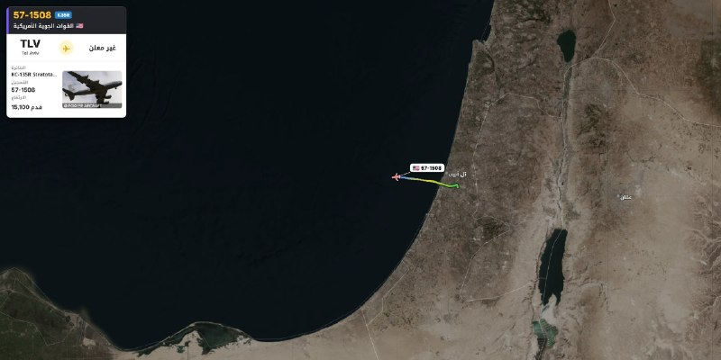

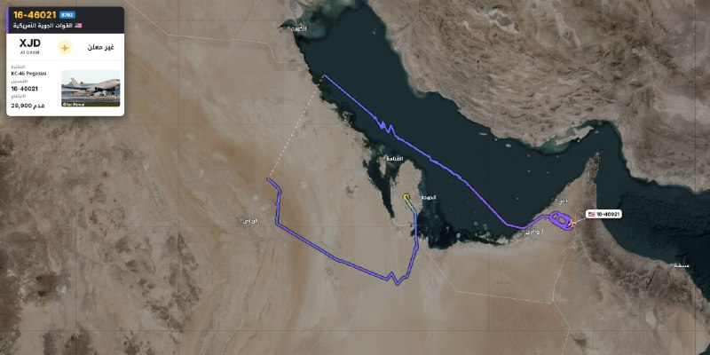

⚜سه فروند هواپیمای سوخت‌رسان آمریکایی از پایگاه هوایی العدید در قطر به مقصد عربستان سعودی و  اسرائیل پرواز کرده‌اند.  

⚜خروج هواپیماهای سوخت‌رسان از پایگاه العدید قطر، در برخی موارد می‌تواند نشانه‌ای از احتمال تشدید تنش‌ها و افزایش تحرکات نظامی باشد.  
✒️#LT  
📃[@Cataphract1](https://t.me/Cataphract1)

· · ·

**🕒 ۱۴۰۵/۰۸/۰۸ ۲۱:۰۳** · [پست 10581](https://t.me/kaavoush/10581)

البته لیبرمن گفته با حامیان تروریسم (رعم و فهرست مشترک) نخواهد نشست. به صراحت نگفته اگر دولت اقلیتی بدون مشارکت مستقیم اعراب تشکیل شود و اعراب فقط در کنست، رأی مثبت به تشکیل آن دهند باز هم مخالف است. با این حساب هنوز می‌توان شانسی هر چند اندک برای سناریوی تشکیل یک دولت اقلیت قائل شد. لازم به ذکر است لیبرمن به صراحت گفته با نتانیاهو هم هم‌پیمان نخواهد شد. یا به عبارت دیگر نه بی‌بی نه طیبی (احمد الطیبی رهبر فهرست مشترک)

· · ·

**🕒 ۱۴۰۵/۰۸/۰۸ ۲۰:۵۹** · [پست 10580](https://t.me/kaavoush/10580)

↪️ فوروارد از یوناتان :|: יונתן

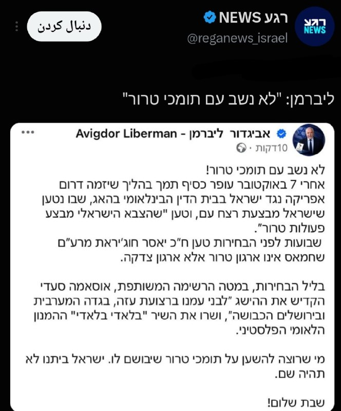

🔹لیبرمن با تروریست نامیدن احزاب عربی، تیر خلاص به شانس ائتلاف میان اعراب و بلوک تغییر به رهبری آیزنکوت را زد  
[@Unaatann](https://t.me/Unaatann)

· · ·

**🕒 ۱۴۰۵/۰۸/۰۸ ۲۰:۱۱** · [پست 10579](https://t.me/kaavoush/10579)

من هنوز گزارشی درباره حرکت ناوگروه روزولت از شرق آسیا به سمت خاورمیانه ندیده‌ام اما مانور شمشیر بران تمام شده و اگر این ناوگروه، حرکت به سمت خاورمیانه را شروع کرده باشد دو سه هفته دیگر به خاورمیانه می‌رسد. اگر غافلگیری در کار نباشد به احتمال زیاد تا استقرار این ناوگروه در منطقه، از شروع جنگ خبری نیست. البته واضح است که دو ناوگروه هواپیمابر هم در ترکیب با اسرائیل، امکان تهاجمی کمی را فراهم نمی‌کند اما خیلی منطقی به نظر نمی‌رسد که ناو سوم پس از پایان جنگ به منطقه برسد.

· · ·

**🕒 ۱۴۰۵/۰۸/۰۸ ۱۹:۴۴** · [پست 10578](https://t.me/kaavoush/10578)

جلوتر یا عقب‌تر بودن ایران در فناوری هسته‌ای به کنار، مشکل اصلی برای ما در مقایسه با آن سه کشور، امنیت زنجیره تامینِ مواد شکافت‌پذیر برای تولید سلاح‌های هسته‌ای است. هند سلاح‌های هسته‌ای خود را با استفاده از پلوتونیوم تولید شده توسط راکتور CIRUS تولید کرد که کانادا در ۱۹۶۰ در این کشور ساخته بود. اسرائیل با کمک فرانسه و تأسیساتی که در دیمونا برایش ساخته بود سلاح‌های هسته‌ای خود را تولید کرد و پاکستان هم که از این امکان محروم بود به سمت غنی‌سازی اورانیوم رفت اما در حالی که سازمان‌های اطلاعاتی جهان از نیت و اقدامات پاکستان باخبر بودند عملا مانعی برایش ایجاد نکردند. همین وضعیت به شکلی دیگر برای کره شمالی هم وجود داشته است. ([اینجا را ببینید](https://t.me/kaavoush/2680)) مشکل ما برای ساخت سلاح هسته‌ای در وهله اول این است که جهان هسته‌ای شدن ایران را تحت هیچ شرایطی نمی‌پذیرد و ما نمی‌توانیم زنجیره غنی‌سازی خود را از حملات نظامی یا خرابکاری حفظ کنیم. اگر این‌گونه نبود ما احتمالا در همان دهه ۸۰ و ذیل برنامه آماد به بمب اتمی رسیده بودیم. اساسا این تصور که تنها مشکل ایران برای ساخت سلاح اتمی نداشتن اراده ساخت سلاح ناشی از فتوای رهبر فقید بوده پرت بودن مدعی را نشان می‌دهد چون ایران هرگز و هیچ‌وقت قصدش برای ساخت سلاح هسته‌ای (در زمان مناسب) را کنار نگذاشته بود. (

… [ادامه در تلگرام](https://t.me/kaavoush/10578)

· · ·

**🕒 ۱۴۰۵/۰۸/۰۸ ۱۹:۱۱** · [پست 10576](https://t.me/kaavoush/10576)

↪️ فوروارد از Exciton Missile Program

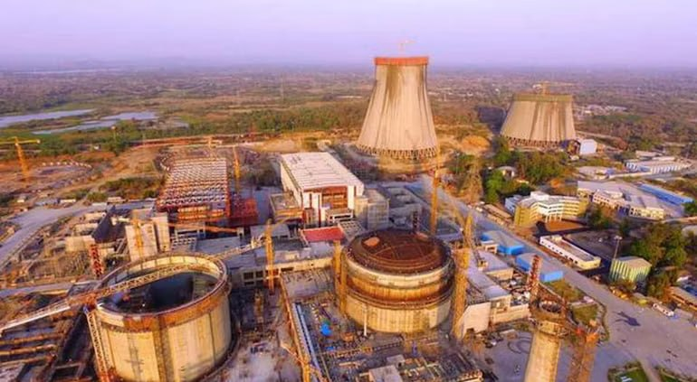

محمد جواد لاریجانی: ساخت بمب اتم برای ما اسباب‌بازی است، در صنعت هسته‌ای از پاکستان، هند و اسرائیل جلوتر هستیم.  

پ.ن: این حرف به غایت اشتباه است. اگر توانمندی عملی و میدانی را ملاک قرار دهیم، هند به مراتب در فناوری و صنعت هسته‌ای از ایران جلوتر است. هند انواع راکتورهای قدرت آب سنگین تحت فشار (PHWR) را در مقیاس‌های بزرگ 200، 500 و 700 مگاواتی با حدود 90% بومی‌سازی می‌سازد. هند حتی راکتور مولد سریع (Fast Breeder) را ساخته و آماده بهره‌برداری کرده که 80-90% آن بومی است. هند همچنین برنامه غنی‌سازی اورانیوم در مقیاس کوچک دارد که برای تأمین سوخت زیردریایی‌های اتمی خود و احتمالا برنامه سلاح‌های اتمی‌اش استفاده می‌کند. هند راکتور کوچک آب تحت فشار CLWR-B1 را با کمک‌های فنی روسیه در داخل ساخته است. ظرفیت اسمی راکتورهای هندی حدود 8800 مگاوات است. این در حالی است که هند انواع سلاح‌های اتمی را هم توسعه داده است.  

بنابراین، این ادعا که ایران از نظر هسته‌ای از هند جلوتر است، کاملا بدون داده و بی محتواست. در مورد اسرائیل هم این حرف احتمالا درست نیست.  

[**@Exciton\_missile\_program**](https://t.me/Exciton_missile_program) 🚀

🎬 ویدیو: [مشاهده در تلگرام](https://t.me/kaavoush/10576?single)

· · ·

**🕒 ۱۴۰۵/۰۸/۰۸ ۱۹:۰۷** · [پست 10575](https://t.me/kaavoush/10575)

↪️ فوروارد از RASTAKHIZ

🔶 حرکت به سمت سلاح هسته‌ای، زمینه‌هایی می‌طلبد که ج ا فاقد آن است. آن زمان که مانند الان ایران در صدر اخبار نبود، نمی‌توانستند امنیت صنعت هسته‌ای را کامل تامین کنند (دانشمندان، خرابکاری‌ها، سرقت اسناد و ...)؛ حال که دیگر عفتی نمانده و فرصت‌های باقی مانده همینطور کمتر می‌شود ؛ آیا به ریسکش می‌ارزد؟  

🔹پیش از ساخت سلاح نیز می‌بایست چندین تست انجام داد (مثلا زیر زمینی) تا بتوان به اولین نمونه کلاهک رسید. آیا ج ا توانایی انجام این کار را در خفا دارد؟  
 (به کره شمالی توجه شود که چگونه توانست تست‌های خود را مخفی نگه دارد)  

🔹حتی با داشتن کلاهک هسته‌ای نیز مسائل دیگری مطرح می‌شود. تعداد، جرات زدن، تنوع در حامل‌های هسته‌ای (نه فقط موشک) و ... . حال باید دید آیا به first strike رسیده‌ایم یا خیر! تا رسیدن به این مرحله چه قدر زمان نیاز است؟ آیا شرایط این اجازه را می‌دهد؟  

🔹بنابراین حتی به نظر نمی‌رسد درک درستی از سلاح هسته‌ای، روند توسعه و بکارگیری آن و ... در کشور وجود داشته باشد. چه بسا بهانه حملات سنگین تر هم بشود!  

مکپر  

#هسته‌ای  

[@RASTAKHIZ\_PERSIAN](https://t.me/RASTAKHIZ_PERSIAN)

· · ·

**🕒 ۱۴۰۵/۰۸/۰۸ ۱۹:۰۶** · [پست 10574](https://t.me/kaavoush/10574)

یک نکته هم این وسط بگم. خوشبختانه یا متأسفانه نظرات امثال ما به کتف هیچ کسی در دو طرف مناقشه نیست. هیچ‌کس از ما برنامه نمی‌گیرد که اگر می‌گرفت همه چیز جور دیگری پیش می‌رفت پس مزخرف سر هم نکنید. احساس زرنگی هم نداشته باشید.

· · ·

**🕒 ۱۴۰۵/۰۸/۰۸ ۱۸:۵۹** · [پست 10573](https://t.me/kaavoush/10573)

پس از اینکه اعلام شد ترامپ برنامه‌های خود را لغو کرده، حالا خبر رسیده که او روز یکشنبه در ایالت‌های آیووا و کانزاس گردهمایی‌های انتخاباتی خود را برگزار می‌کند.

· · ·

**🕒 ۱۴۰۵/۰۸/۰۸ ۱۷:۳۲** · [پست 10571](https://t.me/kaavoush/10571)

🔸 بعضی دوستان در کامنت‌ها گفته‌اند که دکترین ضاحیه جواب نداده اما این دیدگاه، مثل همیشه از نگاه صفر و صدی سرچشمه می‌گیرد. در این نگاه یا شما پیروز می‌شوید یا نیست و نابود و تسلیم می‌شوید و حد وسطی وجود ندارد اما واقعیت پیچیده‌تر از آن است. بر آگاهان به تاریخ لبنان روشن است که حزب‌الله از لحظه تأسیس خود در ابتدای انقلاب ایران تا سال ۲۰۰۶ لحظه‌ای از حمله به اسرائیل دست برنداشت، حتی پس از خروج کامل ارتش اسرائیل از جنوب لبنان در سال ۲۰۰۰ که تصور میشد بهانه حملات علیه اسرائیل را از بین خواهد برد. خروج اسرائیل از جنوب لبنان فقط باعث شد که حزب‌الله حملاتش را به داخل خاک اسرائیل بکشاند. در فاصله خروج اسرائیل از لبنان تا تابستان ۲۰۰۶، حداقل ۲۵ اسرائیلی کشته و ۵ نفر اسیر شدند.

… [ادامه در تلگرام](https://t.me/kaavoush/10571)

· · ·

---

## iaghapour

[کانال در تلگرام](https://t.me/iaghapour) · [آرشیو متن](archive/iaghapour/)

**🕒 ۱۴۰۵/۰۸/۰۹ ۱۶:۴۱** · [پست 3219](https://t.me/iaghapour/3219)


**⭕️ ساخت ۲۸ نوع تانل پیشرفته و ریورس (+ انتخاب خودکار متد سالم)**  

🔹این ابزار از ۲۸ متد مختلف (شامل تونل‌های کرنلی L2/L3 و UDP-Crypt) پشتیبانی میکنه و با استفاده از قابلیت تانل‌های ریورس محدودیت‌های شدید شبکه و پکت‌لاس را دور میزنه. همچنین یاد می‌گیریم چگونه با ابزار هوشمند تست اتصال بهترین متد رو برای تانل زدن پیدا کنیم.  

[**🔗 تماشا ویدیو در یوتیوب**](https://youtu.be/AaG953tIuZs)  

🎁 این ویدیو هم مثل ویدیو های قبلی قرعه‌کشی داره، برای شرکت توی قرعه‌کشی فرصت محدوده (شرایطش هم خیلی راحته؛ فقط کافیه زیر ویدیو برامون کامنت بذارید).  

#آموزش #فیلترشکن #تانل   
برای یادگیری شبکه و آموزش تکنولوژی و هوش مصنوعی ما رو دنبال کنید 💚  
🆔 [@iAghapour](https://t.me/iAghapour) | [YouTube](https://www.youtube.com/@iAghapour)

· · ·

**🕒 ۱۴۰۵/۰۸/۰۹ ۱۴:۴۸** · [پست 3217](https://t.me/iaghapour/3217)

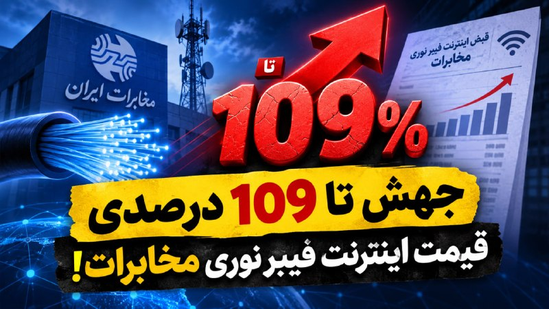

⭕️ **جهش تا ۱۰۹ درصدی قیمت اینترنت فیبر نوری مخابرات**!  

برخلاف تصور عمومی مبنی بر اعمال صرفاً ۴۰ درصد افزایش قیمت از ابتدای آبان، بررسی‌ها حاکی از آن است که تعرفه بسته‌های اینترنت فیبر نوری (FTTH) مخابرات در بازه زمانی ۴ ماهه (از تیر تا آبان ۱۴۰۵)، بین ۶۴ تا بیش از ۱۰۹ درصد افزایش قیمت داشته‌اند.  

🔹 **اعمال دو موج گرانی پیاپی در مرداد و آبان:** مخابرات پیش از مصوبه سراسری آبان‌ماه، در مرداد ۱۴۰۵ یک افزایش قیمت حدوداً ۶۰ درصدی روی بسته‌ها اعمال کرده بود که در ترکیب با مصوبه گرانی ۴۰ درصدی اخیر، رشد سرسام‌آوری را رقم زد.  

🔸 **دو برابر شدن قیمت بسته‌های کم‌حجم و پرمصرف:** بسته ۱۰۰ گیگابایت از ۲۶۸ هزار تومان در تیرماه به ۵۳۲ هزار تومان در آبان رسیده (رشد ۹۸.۵ درصدی) و بسته ۵۰ گیگابایت نیز با ۱۰۹ درصد افزایش قیمت مواجه شده است.  

🔹 **وضعیت بسته‌های حجیم:** بسته‌های پرحجم‌تر نظیر ۱۰۰۰ گیگابایت که در تیرماه ۲.۵۷ میلیون تومان عرضه می‌شدند، طی این مدت با افزایش ۶۴ درصدی قیمت بازنگری شده‌اند.  
[  
](https://www.youtube.com/@iAghapour)**🆔** [**@iAghapour**](https://t.me/iAghapour) **|** [**YouTube**](https://www.youtube.com/@iAghapour)

· · ·

**🕒 ۱۴۰۵/۰۸/۰۸ ۲۱:۰۱** · [پست 3216](https://t.me/iaghapour/3216)

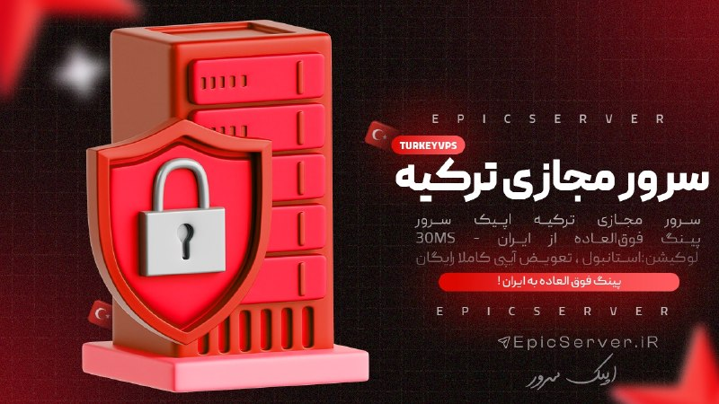

👨‍💻 **اپیک سرور — سرور مجازی لوکیشن ترکیه، استانبول، پورت ۱۰ گیگابیت** با ترافیک **نامحدود**  

🇹🇷 سرور مجازی ترکیه اپیک سرور  
⚡️ پینگ فوق‌العاده از ایران - 30MS  
⭐️ لوکیشن: استانبول  
🛍 تعویض آیپی کاملا رایگان  

⚙️ **دارای** **کنترل پنل** **کامل** **مدیریت سرور**   

**📸** **تضمین تحویل سرور با CheckHost کاملا سالم** 🚀  

**🌐** **تهیه و سفارش از سایت** 🔽  

✅ [https://epicserver.ir/vps-turkey](https://epicserver.ir/vps-turkey)  

✈️ [@EpicServer\_iR](https://t.me/EpicServer_iR)

· · ·

**🕒 ۱۴۰۵/۰۸/۰۸ ۲۱:۰۰** · [پست 3215](https://t.me/iaghapour/3215)

**📌 پیش از خرید از سرویس‌ تبلیغ‌شده زیر، قوانین را بخوانید👇🏻**

· · ·

**🕒 ۱۴۰۵/۰۸/۰۸ ۲۰:۴۰** · [پست 3208](https://t.me/iaghapour/3208)


🎮 **تصاویر جدید گیم‌پلی GTA 6 منتشر شد؛ جهش خیره‌کننده گرافیک!**  

راک‌استار گیمز در آستانه عرضه رسمی بازی **Grand Theft Auto 6**، اسکرین‌شات‌های جدیدی از گیم‌پلی و محیط‌های بازی را از طریق مجله Edge به نمایش گذاشت که استانداردهای بصری نسل جدید را به چالش می‌کشد.  

🔹 **طراحی واقع‌گرایانه چهره و فیزیک محیط:** نورپردازی طبیعی، بافت دقیق پوست و چین‌وچروک کاراکترهای جیسون و لوسیا، در کنار تنوع پوشش گیاهی و بازتاب پیشرفته نور در آب، تحولی چشمگیر در جزئیات گرافیکی ایجاد کرده است.  

🔸 **تاریخ عرضه و پلتفرم‌ها:** عرضه رسمی در تاریخ ۱۹ نوامبر (۲۸ آبان) به‌طور اختصاصی برای کنسول‌های پلی‌استیشن ۵ و ایکس‌باکس سری ایکس | اس.  
[  
](https://www.youtube.com/@iAghapour)**🆔** [**@iAghapour**](https://t.me/iAghapour) **|** [**YouTube**](https://www.youtube.com/@iAghapour)

· · ·

**🕒 ۱۴۰۵/۰۸/۰۸ ۱۹:۰۱** · [پست 3207](https://t.me/iaghapour/3207)


⚠️ **افشای ۳۱۹ افزونه مشکوک کروم با ۱۳.۴ میلیون نصب**!  

شرکت امنیتی Socket از شناسایی شبکه‌ای شامل ۳۱۹ افزونه فریبنده در مرورگر گوگل کروم با بیش از ۱۳.۴ میلیون بار نصب خبر داد که با دستکاری موتور جست‌وجوی مرورگر، داده‌ها و ترافیک کاربران را از سرورهای واسط عبور می‌دادند.  

🔹 **پنهان‌شدن در قالب ابزارهای کاربردی:** این افزونه‌ها در پوشش مبدل‌های PDF، ابزارهای امنیتی و دستیارهای هوش مصنوعی منتشر شده و با سوءاستفاده از قابلیت `chrome_settings_overrides` بدون نیاز به دسترسی‌های حساس، موتور جست‌وجو را تغییر می‌دادند.  

🔸 **کسب درآمد از ریدایرکت کوئری‌ها:** عبارات جست‌وجوشده در نوار آدرس ابتدا به سرورهای مهاجمان منتقل و سپس با شناسه‌های تبلیغاتی به بینگ یا یاهو هدایت می‌شد تا سود حاصل از ارجاع ترافیک ثبت شود.  

🔹 **امکان شنود و تغییر دینامیک مقصد:** بررسی‌ها نشان می‌دهد سرور واسط می‌تواند متن جست‌وجوهای کاربران را رصد کند و بدون نیاز به آپدیت افزونه، کاربر را به صفحات فیشینگ یا بدافزارها هدایت نماید.//تکراتو   
[  
](https://www.youtube.com/@iAghapour)**🆔** [**@iAghapour**](https://t.me/iAghapour) **|** [**YouTube**](https://www.youtube.com/@iAghapour)

· · ·

**🕒 ۱۴۰۵/۰۸/۰۸ ۱۶:۰۱** · [پست 3206](https://t.me/iaghapour/3206)

🖼 *(عکس بعد از ۲۴ ساعت حذف شده)*

🚨 **خبر فوری: گزارش حمله سایبری به بایننس و مسدودسازی ۱.۸ میلیارد دلار استیبل‌کوین!**  

چانگ‌پنگ ژائو (CZ)، هم‌بنیان‌گذار بایننس، از احتمال وقوع یک حمله سایبری به این صرافی خبر داد؛ موضوعی که واکنش فوری ناشران بزرگ استیبل‌کوین در بازار کریپتو را در پی داشته است.  

🔹 **نشانه‌های وقوع حمله به بایننس:** طبق اعلام CZ، بررسی‌های اولیه حاکی از هدف قرار گرفتن این صرافی توسط مهاجمان سایبری است و تیم‌های امنیتی در حال ارزیابی ابعاد دقیق این نفوذ هستند.  

🔸 **اقدام اضطراری تتر و سرکل:** شرکت‌های Tether و Circle بلافاصله پس از انتشار گزارش‌های مربوط به هک، دسترسی به حدود ۱.۸ میلیارد دلار از دارایی‌ها و توکن‌های مشکوک را برای جلوگیری از جابه‌جایی و نقدشدن سرمایه‌ها مسدود (Freeze) کردند.  
[  
](https://www.youtube.com/@iAghapour)**🆔** [**@iAghapour**](https://t.me/iAghapour) **|** [**YouTube**](https://www.youtube.com/@iAghapour)

· · ·

**🕒 ۱۴۰۵/۰۸/۰۷ ۲۱:۰۰** · [پست 3205](https://t.me/iaghapour/3205)

↪️ فوروارد از ∆××∆

🖼 *(عکس بعد از ۲۴ ساعت حذف شده)*

⚡️😙 از موج هوش مصنوعی غافل نشو!  

🤖 بهترین ابزارها و اکانت های پریمیوم رو از ژیمون پلاس تهیه کن :  

✴️Gemini Pro هجده‌ماهه  830,000 تومان فقط تا پایان امشب   

✴️ ElevenLabs با تخفیف ویژه 7 دلار  

✴️ ChatGPT از 1,000,000 تومان  

✴️ Notion از 400,000 تومان  

➕ Claude، Cursor، Spotify ، Codex و کلی اشتراک دیگه...  

💙 نمیدونی کدوم هوش مصنوعی برای کارت مناسبه؟ پیام بده تا راهنماییت کنیم :)  

〰️ خرید سریع از ربات :  

[@ZhimunPlus\_bot](https://t.me/ZhimunPlus_bot)

· · ·

**🕒 ۱۴۰۵/۰۸/۰۷ ۲۱:۰۰** · [پست 3204](https://t.me/iaghapour/3204)

**📌 پیش از خرید از سرویس‌ تبلیغ‌شده زیر، قوانین را بخوانید👇🏻**

· · ·

**🕒 ۱۴۰۵/۰۸/۰۷ ۲۰:۲۳** · [پست 3203](https://t.me/iaghapour/3203)

🖼 *(عکس بعد از ۲۴ ساعت حذف شده)*

🎮 **وعده رفع مشکل پینگ بازی‌های آنلاین تا هفته آینده!**  

بهزاد اکبری، مدیرعامل شرکت ارتباطات زیرساخت، در پاسخ به یکی از کاربران در شبکه اجتماعی X از تلاش برای رفع اختلال و کاهش پینگ دسترسی به بازی‌های آنلاین تا هفته آتی خبر داد.  

🔹 **مسیریابی اجباری از سرورهای اروپا:** به دلیل آسیب‌دیدگی خطوط فیبر نوری در تحولات منطقه، دسترسی مستقیم به سرورهای نزدیک‌تر در خاورمیانه قطع شده و عبور اجباری ترافیک از مسیرهای طولانی‌تر اروپایی، جهش شدید تایم‌پینگ را به همراه داشته است.  

🔸 **تلاش برای بازیابی روتینگ سابق:** طبق اعلام مدیرعامل زیرساخت، پیگیری‌ها برای ترمیم و اتصال دوباره به مسیرهای پایدار در جریان است تا با کاهش تأخیر شبکه (Latency)، وضعیت پینگ گیمرها بهبود پیدا کند.  
[  
](https://www.youtube.com/@iAghapour)**🆔** [**@iAghapour**](https://t.me/iAghapour) **|** [**YouTube**](https://www.youtube.com/@iAghapour)

· · ·

**🕒 ۱۴۰۵/۰۸/۰۷ ۱۹:۰۱** · [پست 3202](https://t.me/iaghapour/3202)

🖼 *(عکس بعد از ۲۴ ساعت حذف شده)*

🛡 **معاون وزیر ارتباطات: افت کیفیت اینترنت ناشی از حملات DDoS و بات‌نت‌های داخلی است!**  

بهزاد اکبری، مدیرعامل شرکت ارتباطات زیرساخت، اعلام کرد تشدید حملات سایبری DDoS و آلودگی گسترده دستگاه‌های کاربران، عامل اصلی افت کیفیت و کندی شدید اینترنت در روزهای اخیر است.  

🔹 **پیشی گرفتن حملات داخلی از خارجی:** طبق آمار رسمی، میانگین روزانه حملات DDoS با مبدأ داخلی (۶۱۲ مورد) از مبدأ خارجی (۴۶۱ مورد) فراتر رفته که نشانه آلودگی سیستم‌ها و عضویت ناخواسته آن‌ها در بات‌نت‌هاست.  

🔸 **حملات با شدت بیش از ۵۰۰ گیگابیت‌برثانیه:** حملات سنگین چندصد گیگابیتی به زیرساخت‌ها و سوئیچ‌های شبکه، در کنار اثرات نامطلوب تجهیزات فیلترینگ، کیفیت شبکه را به شدت کاهش داده است.  

🔹 **نقش فیلترشکن‌های ناامن:** کارشناسان معتقدند نصب برنامه‌ها و فیلترشکن‌های نامعتبر، دستگاه‌های کاربران را ناخواسته به زامبی‌های بات‌نت برای اجرای حملات انکار سرویس تبدیل کرده است.  
[  
](https://www.youtube.com/@iAghapour)**🆔** [**@iAghapour**](https://t.me/iAghapour) **|** [**YouTube**](https://www.youtube.com/@iAghapour)

· · ·

**🕒 ۱۴۰۵/۰۸/۰۷ ۱۷:۰۱** · [پست 3201](https://t.me/iaghapour/3201)

🖼 *(عکس بعد از ۲۴ ساعت حذف شده)*

⭕️ **جمینای ۴ کربن معرفی شد؛ صدرنشینی پرچمدار جدید گوگل در بنچمارک‌ها و امنیت سایبری!**  

گوگل از مدل مرزی **Gemini 4 Carbon** با تمرکز بر دفاع سایبری و کارهای ایجنت‌محور بلندمدت رونمایی کرد؛ مدلی که با امتیاز ۵۹ در صدر شاخص جهانی AA Index v5.0 ایستاد.  

🔹 **صدرنشینی در بنچمارک‌ها:** کسب رتبه نخست شاخص AA Index v5.0 (بالاتر از Claude Opus 5.5 و GPT-6 Astra) و ثبت امتیاز ۹۶.۲٪ در آزمون کانتکست GraphWalks.  

🔸 **تحول در کشف باگ و پچ امنیتی:** شناسایی ۸۸.۲٪ نقص‌های امنیتی در SEC-bench Pro و ترمیم کدها با امتیاز ۷۱٪ در CWE-bench (تولید پچ تا ۱۰ برابر بهتر از رقبا).  

🔹 **نفوذناپذیری بی‌سابقه:** رساندن نرخ نفوذ حملات تزریق پرامپت (Indirect Prompt Injection) به ۰.۰٪ و به صفر رسیدن نقض قوانین در محیط ترمینال.  

🔸 **پایداری در کارهای چندروزه:** توانایی اجرای مداوم چندروزه برای دیباگ سیستم‌های پیچیده و ثبت امتیاز ۶۵.۲٪ در Terminal-Bench 4.0.  

🔹 **دسترسی و تعرفه API:** عرضه اولیه برای متخصصان امنیت و انتشار عمومی به‌زودی با نرخ ۲ دلار برای ورودی و ۱۰ دلار برای خروجی (به ازای هر میلیون توکن).  
[  
](https://www.youtube.com/@iAghapour)**🆔** [@iAghapour](https://t.me/iAghapour) | [YouTube](https://www.youtube.com/@iAghapour)

· · ·

**🕒 ۱۴۰۵/۰۸/۰۷ ۱۴:۰۱** · [پست 3200](https://t.me/iaghapour/3200)

🖼 *(عکس بعد از ۲۴ ساعت حذف شده)*

⭕️ **اسکریپت «ExitMesh»؛ مدیریت هوشمند و تجمیع ده‌ها کانفیگ در یک پورت!**  

ابزار قدرتمند ExitMesh برای سرورهای لینوکسی طراحی شده تا ده‌ها کانفیگ مختلف (VLESS ،VMess ،SOCKS5) را تجمیع کرده و به یک خروجی یکپارچه و همیشه متصل SOCKS5 تبدیل کند.  

🔹 **تعویض خودکار (Failover):** بررسی مداوم سلامت کانفیگ‌ها و انتقال فوری و بدون افتادن کانکشن به سرور جایگزین در صورت قطعی.  

🔸 **نشست‌های چسبنده:** ثابت نگه داشتن آی‌پی خروجی برای زمان مشخص (مثلاً ۱۵ دقیقه) تا اکانت شما در سایت‌های حساس (مثل صرافی‌ها) به دلیل تغییر آی‌پی مسدود نشود.  

🔹 **مسیریابی و آمار دقیق:** امکان تعیین مسیر ترافیک (مثلاً باز کردن یک سایت فقط با سرور آلمان) همراه با داشبورد وب برای مشاهده آمار مصرفی هر کانفیگ.  

[🔗 **مشاهده پروژه و دانلود در گیت‌هاب**](https://github.com/frank0live/exitmesh)  

🔻 پروژه کاملاً رایگان و اوپن‌سورس است، اما بررسی امنیتی کاملی روی آن انجام نداده‌ایم؛ پیشنهاد می‌کنم قبل از استفاده، سورس‌کد و اسکریپت نصب را با ابزارهای هوش مصنوعی بررسی کنید.  

**🆔** [@iAghapour](https://t.me/iAghapour) | [YouTube](https://www.youtube.com/@iAghapour)

· · ·

**🕒 ۱۴۰۵/۰۸/۰۶ ۲۱:۰۰** · [پست 3199](https://t.me/iaghapour/3199)

↪️ فوروارد از پارس آپتایم؛ هاست و سرور مجازی ایران و خارج

🖼 *(عکس بعد از ۲۴ ساعت حذف شده)*

**سرور مجازی ایران پارس آپتایم**  

سرور مجازی شما بعد از پرداخت بلافاصله با **آی پی تمیز** و دسترسی کامل به **اینترنت بین الملل** تحویل داده خواهد شد!  

✅ تعویض آی‌پی فقط **۲۰۰ هزار تومان**، تا ۵ بار در ماه برای هر سرور  
✅ ترافیک **آپلود نامحدود** روی شبکه‌ی **۱۰ گیگابیتی**  
✅ ۵۰ گیگابایت **ترافیک دانلود رایگان** در ماه  
✅ دانلود مازاد: هر ترابایت **۸۵۰ هزار تومان**  
✅ میزبانی در دیتاسنتر برج میلاد  
✅ سخت‌افزار سرور نسل G9 و G10  
✅ پنل مدیریت کامل سرور مجازی  

🔗 مشاهده‌ی پلن‌ها و ثبت سفارش:  
[https://parsuptime.com/vps/iran-vps](https://parsuptime.com/vps/iran-vps)  

پارس آپتایم | میزبان ِ شما از سال 2010

· · ·

**🕒 ۱۴۰۵/۰۸/۰۶ ۲۱:۰۰** · [پست 3198](https://t.me/iaghapour/3198)

**📌 پیش از خرید از سرویس‌ تبلیغ‌شده زیر، قوانین را بخوانید👇🏻**

· · ·

**🕒 ۱۴۰۵/۰۸/۰۶ ۲۰:۳۴** · [پست 3197](https://t.me/iaghapour/3197)

🖼 *(عکس بعد از ۲۴ ساعت حذف شده)*

📢 **سخنگوی دولت: بابت گرانی اینترنت عذرخواهی نمی‌کنم!**  

فاطمه مهاجرانی، سخنگوی دولت، در تازه‌ترین اظهارات خود به موضوع افزایش تعرفه اینترنت پرداخت که خلاصه نکات مهم آن به شرح زیر است:  

**تصویب افزایش ۴۰ درصدی:** اپراتورها در ابتدا درخواست افزایش ۱۰۰ درصدی (دو برابر شدن قیمت‌ها) را داده بودند، اما در نهایت ستاد تنظیم بازار با افزایش ۴۰ درصدی موافقت کرده است.  

**دلیل افزایش قیمت:** توجیه دولت برای این تصمیم، ثابت ماندن تعرفه‌های پایه اینترنت از سال ۱۳۹۶ تا ۱۴۰۳ عنوان شده است.  

**عذرخواهی فقط بابت اطلاع‌رسانی:** سخنگوی دولت اعلام کرده بابت اصل تصمیم گرانی عذرخواهی نمی‌کند، اما بابت ضعف مسئولان وزارت ارتباطات در اطلاع‌رسانی زودهنگام و شفاف به مردم پوزش می‌خواهد.//تکراتو   
[  
](https://www.youtube.com/@iAghapour)**🆔** [**@iAghapour**](https://t.me/iAghapour) **|** [**YouTube**](https://www.youtube.com/@iAghapour)

· · ·

**🕒 ۱۴۰۵/۰۸/۰۶ ۱۹:۲۱** · [پست 3196](https://t.me/iaghapour/3196)

**.  
🟢 ۲ نفر از دوستان هنوز برای دریافت هدیه‌شون پیام ندادن!**  

🔹 امشب آخرین فرصت از مهلت یک‌هفته‌ای تحویل جوایزه.  

لطفا برای دریافت جایزه‌تون و هماهنگی‌های لازم، از طریق ربات تماس با ما در تلگرام با پشتیبانی کانال در ارتباط باشید:  
[**🤖 ربات تماس با ما**](https://t.me/iaghapourbot)

· · ·

**🕒 ۱۴۰۵/۰۸/۰۶ ۱۶:۰۱** · [پست 3195](https://t.me/iaghapour/3195)

🖼 *(عکس بعد از ۲۴ ساعت حذف شده)*

🚫 **ممنوعیت رجیستری ۲۴ مدل پرچمدار؛ از آیفون ۱۸ تا گلکسی S27 نیامده در لیست سیاه!**  

براساس بخشنامه جدید ابلاغ‌شده به گمرکات کشور، رجیستری تجاری و مسافری ۲۴ مدل گوشی هوشمند از برندهای مطرح متوقف شده و ورود نسل جدید پرچمداران به بازار با محدودیت شدید روبه‌رو شده است.  

🔹 **ممنوعیت خانواده گلکسی S27:** در اقدامی کم‌سابقه، تمامی مدل‌های معرفی‌نشده سری S27 سامسونگ (مدل پایه، پلاس و اولترا) در کنار گلکسی Z Fold 8، Z Fold 8 Ultra و Z Flip 8 پیش از رونمایی رسمی در فهرست ممنوعیت قرار گرفته‌اند.  

🔸 **توقف رجیستری سری آیفون ۱۸:** مسدودسازی قطعی ثبت گمرکی و فعال‌سازی شبکه‌ای برای مدل‌های آیفون ۱۸ پرو، ۱۸ پرو مکس و آیفون دوئو (iPhone Duo) در هر دو رویه مسافری و تجاری.  

🔹 **دیگر برندها:** اضافه شدن شیائومی ۱۸ اولترا، ۱۸ پرو مکس و ۱۸ فولد به همراه سری پیکسل ۱۰ گوگل، سری Find اوپو، سری X ویوو و سری Magic آنر به لیست توقیف رجیستری.  

🔸 در کنار ممنوعیت مدل‌های یادشده، ثبت سفارش تجاری برای تمامی گوشی‌های با ارزش گمرکی بیش از ۳۰۰ یورو نیز محدود شده که واردات رسمی میان‌رده‌های پرمیوم و پرچمداران را قفل می‌کند.  
[  
](https://www.youtube.com/@iAghapour)**🆔** [**@iAghapour**](https://t.me/iAghapour) **|** [**YouTube**](https://www.youtube.com/@iAghapour)

· · ·

**🕒 ۱۴۰۵/۰۸/۰۵ ۲۲:۳۱** · [پست 3194](https://t.me/iaghapour/3194)

↪️ فوروارد از Kren

🖼 *(عکس بعد از ۲۴ ساعت حذف شده)*

چرا برای هر ۱ میلیون توکن AI چند دلار هزینه می‌کنی؟**👀**  
وقتی با **Sinox API** هر ۱ میلیون توکن برای تمام مدل ها فقط **۱۹ سنت** هزینه داره!  

**دسترسی به مدل‌های برتر دنیا، همه با یک API و یک قیمت ثابت؛ ۹۹٪ ارزون‌تر!**  

از استفاده روزمره تا کدنویسی و پردازش‌های سنگین؛ دیگه هزینه و حجم مصرف API محدودت نمی‌کنه  

بدون دردسر بلاک شدن اکانت و در دسترس حتی با IP ایران!  
💙[**@Sinoxapi**](https://t.me/+xR3rNjZnEa9kM2Y8)   
🌐 [**Sinoxapi.com**](http://Sinoxapi.com/)

· · ·

**🕒 ۱۴۰۵/۰۸/۰۵ ۲۲:۲۹** · [پست 3193](https://t.me/iaghapour/3193)

**📌 پیش از خرید از سرویس‌ تبلیغ‌شده زیر، قوانین را بخوانید👇🏻**

· · ·

---

## MatinSenPaii

[کانال در تلگرام](https://t.me/MatinSenPaii) · [آرشیو متن](archive/matinsenpaii/)

**🕒 ۱۴۰۵/۰۸/۰۹ ۱۶:۴۹** · [پست 5741](https://t.me/MatinSenPaii/5741)

**یه کتابخونه‌ی پرامپت برای ساخت سایت‌های سه‌بعدی و اسکرول‌محور با AI**  

وبسایت Scrolltide یه مجموعه‌ی آماده‌ست برای وقتی که می‌خواید با Ai سایت‌های بامزه و متحرک بسازید(خودم به شخصه صرفا اسم سبک‌هاش رو نمیدونستم و برام باحال بود).  

بیش از ۶۰۰ پرامپت آماده که هر کدوم یه سایت یا بخش کامل رو توصیف می‌کنه(و طبیعتا بهتره که شخصی سازیش کنید و چشم‌بسته پرامپت ندید و توکن نسوزونید).  

حدودا بیش از ۱۰۰ تا صحنه‌ی سه‌بعدی به درد بخور هم داره  
کامپوننت، شیدر، سکشن و UI آماده  
سورس‌کد کامل هر نمونه هم همراهشه  

لینک سایت: [http://scrolltide.co](http://scrolltide.co/)  

✉️ [t.me/MatinSenPaii](http://t.me/MatinSenPaii)

🎬 ویدیو: [مشاهده در تلگرام](https://t.me/MatinSenPaii/5741)

· · ·

**🕒 ۱۴۰۵/۰۸/۰۹ ۱۴:۱۶** · [پست 5740](https://t.me/MatinSenPaii/5740)


**افزونه‌ی آلوده‌ی Claude Code در مارکت‌پلیس Cursor دسترسی از راه دور و سرقت داده را هدف گرفت**  

گزارش The Decoder می‌گه نسخه‌ای دستکاری‌شده از افزونه‌ی Claude Code حدود ۱۱ ساعت در بازار Cursor در دسترس بود و تلاش می‌کرد داده‌ها رو بدزده و دسترسی از راه دور ایجاد کنه. Cursor بازار افزونه‌ها رو موقتا از دسترس خارج کرد و بعد از بررسی دوباره برگردوند؛ این اتفاق یادآوری می‌کنه اکستنشن‌های IDEها می‌تونه همیشه ما رو به یه هدف راحت تبدیل کنه اگر که آلوده باشن.  

🔗[ منبع](https://the-decoder.com/malicious-claude-code-extension-in-cursors-marketplace-attempted-remote-access-and-data-theft/)  

✉️ [t.me/MatinSenPaii](http://t.me/MatinSenPaii)

· · ·

**🕒 ۱۴۰۵/۰۸/۰۹ ۱۲:۵۴** · [پست 5739](https://t.me/MatinSenPaii/5739)

🎬 **تونل DNS چطور کار می‌کنه؟**  

دوستان، توی ویدیوی قبلی دربارهٔ خود DNS حرف زدیم؛ این بار می‌ریم سراغ **DNS tunneling** و اینکه چطور می‌شه از پرس‌وجوها و جواب‌های DNS برای جابه‌جایی داده استفاده کرد.  

اگه از WhiteDNS استفاده می‌کنید، احتمالاً بارها دکمهٔ اتصال رو زدید. ولی پشت اون دکمه چه اتفاقی می‌افته؟ وقتی سایت‌ها باز نمی‌شن و مسیرهای معمول بسته‌ان، چطور ممکنه هنوز یه پیام ردوبدل بشه؟  

توی این ویدیو مسیر همون پیام رو از گوشی تا ریزالور و سرور تونل دنبال می‌کنیم و می‌بینیم جواب چطور برمی‌گرده. از پایه شروع می‌کنیم و کم‌کم می‌رسیم به اینکه چرا سرعت محدوده، چرا هر ریزالوری به درد تونل نمی‌خوره و رمزنگاری چه نقشی داره.  

⚠️ یه نکتهٔ مهم: **باید هنوز یه مسیر رفت‌وبرگشت DNS تا سرور تونل باقی مونده باشه.** اگه اون مسیر هم کاملاً قطع شده باشه، تونل DNS نمی‌تونه اتصال برقرار کنه.  

پیشنهاد می‌کنم ببینیدش؛ کمک می‌کنه بهتر بفهمیم ابزاری که استفاده می‌کنیم چطور کار می‌کنه و چه محدودیت‌هایی داره. اگه ویدیوی قبلی رو ندیدید، اول اون رو ببینید تا این بحث رو راحت‌تر دنبال کنید 👇  

----------  
#آموزش #DNS #اینترنت\_اضطراری  

🎥 [تماشای ویدیوی تونل DNS](https://www.youtube.com/watch?v=d9ABLNvoctE)

… [ادامه در تلگرام](https://t.me/MatinSenPaii/5739)

· · ·

**🕒 ۱۴۰۵/۰۸/۰۹ ۱۱:۳۶** · [پست 5738](https://t.me/MatinSenPaii/5738)

از حرف‌های سازنده توی ریپلای‌ها، این نکات رو برداشتم که بهتون توضیح بدم:  

۱- خود ویدئوی معرفی(که بالا فرستادم)، کاملا لوکال ساخته شده. ویس‌اور با Qwen TTS، sfx رو کلاد با API صدای خود ابزار نوشته و بیشتر تصویرها و افکت‌ها رو هم کلاد روی Canvas ساخته؛ فقط کلیپ‌های چند ثانیه اول از یه سایت استوک دانلود شدن. کد کامل فیلم معرفی هم توی مثال‌های ریپوی گیت‌هاب هست.  

۲- هزینه‌ی اضافه‌ای نداره، فقط همون اشتراک LLMای که دارید. ساخت تصویر توش نیست؛ یا با Codex تصویر می‌سازید، یا Claude یا LLM دیگه‌ای، SVG تولید می‌کنه. برای صداگذاری کامل هم مدل محلی‌ای مثل Qwen TTS جواب می‌ده. که ما میتونیم از گوگل استفاده کنیم.  

۳- پروژه از صفر نوشته نشده؛ و به نظرم این نکته‌ی مهمیه که بهتون میگم چرا. پروژه روی سه تا پروژه‌ی سنگین Stylo و Blitz و Parley سواره و رندر GPU با Skia انجام می‌شه. موقع توسعه، خروجی رو با رندر کروم مقایسه می‌کردن و کد رو اصلاح می‌کردن. دلیلی هم که مهمه اینه که از صفر وایب کد کردنِ چیزی که همین الان وجود داره، ارزشی نداره. هنر اینه که از ابزارهای موجود استفاده کنیم و چیز جدیدتری بسازیم که یه مشکل واقعی رو حل کنه.

… [ادامه در تلگرام](https://t.me/MatinSenPaii/5738)

· · ·

**🕒 ۱۴۰۵/۰۸/۰۹ ۰۰:۱۶** · [پست 5737](https://t.me/MatinSenPaii/5737)

فردا توضیحات بیشتری راجب انجینش و خود ویدئو دمویی که ساخته شده میدم

· · ·

**🕒 ۱۴۰۵/۰۸/۰۹ ۰۰:۰۱** · [پست 5736](https://t.me/MatinSenPaii/5736)

**ساخت ویدیو با Claude Code، بدون استفاده از انجین کروم**  

یه توسعه‌دهنده ابزاری ساخته به اسم Kinetograph که جای Remotion رو می‌گیره: به جای این که برای رندر هر فریم یه هدلس کروم بالا بیاد، کدهای React و TSX رو روی Node اجرا می‌کنه و فریم‌ها رو یه کامپوزیتور GPU که با Rust نوشته شده می‌سازه. اسکیل کلاد کد هم داره، یعنی فقط توضیح می‌دید ویدئو چی باشه و خودش کامپوننت‌ها رو می‌نویسه و رندر می‌گیره.  

عددهای تست مقایسه‌ای خود سازنده روی مک M4:  
۹۸۸ فریم: ریموشن ۱۳۱ ثانیه، کینتوگراف ۲۲ ثانیه  
۱۱۸۴ فریم: ریموشن ۳۱.۵ ثانیه، کینتوگراف ۱۵ ثانیه  

خود این ویدیویی که می‌بینید هم با همین ابزار ساخته شده. نصبش هم با:  
npx skills add 0xS4N4TG/kinetograph  

🔗[منبع](https://www.reddit.com/r/ClaudeCode/comments/1xh1a8s/i_built_a_way_for_claude_code_to_generate_videos/)  
✉️ [t.me/MatinSenPaii](http://t.me/MatinSenPaii)

🎬 ویدیو: [مشاهده در تلگرام](https://t.me/MatinSenPaii/5736)

· · ·

**🕒 ۱۴۰۵/۰۸/۰۸ ۱۳:۴۱** · [پست 5735](https://t.me/MatinSenPaii/5735)

**پروژه‌ی BLA؛ ابزاری که ایجنت‌های مهندسی معکوس AI(مثل REA) رو به بن‌بست می‌کشونه**  

الان با ابزارهایی مثل REA می‌شه یه فایل اجرایی یا باندل جاوااسکریپت رو داد به ایجنت هوش مصنوعی و ازش مهندسی معکوس گرفت.  
و پروژه‌ی متن‌باز BLA دقیقا برای مقابله با همینه و شعارش هم جالبه: مهندسی معکوس رو دوباره ورشکست کن.  

این BLA توی فایل‌های ریلیز پروژه‌تون سه لایه دفاع می‌ذاره.  
**اول طعمه:** کلیدهای جعلی، اینترفیس‌های الکی و منطق گمراه‌کننده که شبیه مدرک واقعی‌ان.  
**دوم خستگی:** فایل رو از سقف بودجه تحلیل REA رد می‌کنه تا آنالایزر به خطای ظرفیت و محدودیت بخوره.   
**سوم توهم:** ایجنت با یه عالمه سرنخ ناقص و بن‌بست می‌مونه و توکن‌هاش هم می‌سوزه، در حالی که رفتار خود برنامه برای کاربر نهایی هیچ فرقی نکرده.  

سازنده باهاش REA واقعی رو تست کرده: باندل JS به سقف بودجه خورد، فایل Electron از حدود ۶۰۰ بایت رسید به ۱۷ مگابایت و خطای ظرفیت داد و خروجی WASM فقط ناقص خونده شد. روی ۱۴ نمونه هم رفتار نهایی برنامه‌ها عین اصل موند. البته منصفانه بگم، عددهای چندصد برابر شدن هزینه و توکن برآورد داخلی خود پروژه‌ست، نه اندازه‌گیری مستقل؛ چیزی که واقعاً ثبت شده همون خطاهای آنالایزره.  

استفاده‌ش هم ساده‌ست و با Claude Code و Codex و Cursor کار می‌کنه:  
npx bla-agents setup  
npx bla-agents harden .

… [ادامه در تلگرام](https://t.me/MatinSenPaii/5735)

· · ·

**🕒 ۱۴۰۵/۰۸/۰۸ ۱۰:۵۹** · [پست 5734](https://t.me/MatinSenPaii/5734)

🎬 **اصلاً DNS چیه و چطور کار می‌کنه؟**  

دوستان، بیشترِ کاری که اینجا می‌کنیم با DNS سر و کار داره، توی اسم WhiteDNS هم که DNS داریم 😄 گفتیم وقتشه یه ویدیو بسازیم و دربارهٔ خودِ DNS حرف بزنیم.  

🎥 [تماشای ویدیو در یوتیوب](https://www.youtube.com/watch?v=E2MZuktvgHU)  

توی این ویدیو از پایه و با مثال‌های ساده توضیح دادیم که وقتی اسم یه سایت رو می‌نویسید، دستگاهتون چطور آدرس سرورش رو پیدا می‌کنه و DNS وسط این ماجرا چه نقشی داره. برای دیدنش هم لازم نیست از قبل شبکه بلد باشید.  

**واقعاً پیشنهاد می‌کنم همه‌تون این ویدیو رو ببینید.** حتی اگه تا الان فقط اسم DNS رو توی تنظیمات گوشی یا اپ‌ها دیده‌اید، این ویدیو برای شما هم هست.  

توی **ویدیوی بعدی** می‌ریم سراغ **DNS tunneling** و توضیح می‌دیم چطور کار می‌کنه. برای فهمیدن اون، اول باید خود DNS رو بشناسیم؛ دونستن همین پایه‌ها کمک می‌کنه بهتر بفهمیم ابزارهایی که استفاده می‌کنیم پشت صحنه چه کاری انجام می‌دن.  

----------  
#آموزش #DNS  

🎥 [تماشای ویدیو در یوتیوب](https://www.youtube.com/watch?v=E2MZuktvgHU)  
کانال: [@WhiteDNS](https://t.me/WhiteDNS)

· · ·

**🕒 ۱۴۰۵/۰۸/۰۸ ۰۹:۴۶** · [پست 5733](https://t.me/MatinSenPaii/5733)

🖼 *(عکس بعد از ۲۴ ساعت حذف شده)*

**بزرگ‌ترین هک تاریخ کریپتو؛ بایننس ۶.۳ میلیارد دلار از دست داد**  

پنجشنبه بایننس، بزرگ‌ترین صرافی ارز دیجیتال دنیا، هک شد و برآورد خود صرافی از خسارت حدود ۶.۳ میلیارد دلاره؛ رکورد قبلی دست هک ۱.۵ میلیارد دلاری Bybit بود. واریز و برداشت فعلاً متوقفه و بایننس گفته همه خسارت‌ها رو پوشش می‌ده و پول کاربرها امنه.   

جزئیات هک بایننس تا این لحظه:  

مهاجم به کیف پول‌های گرم بایننس، از جمله Binance 14 و Binance 16، دست پیدا کرده و دارایی‌ها رو به آدرس‌های خودش منتقل کرده؛ همون کیف‌هایی که توی گزارش اثبات ذخیره صرافی هم هستن. طبق داده‌های Arkham، کیف پول‌های هکر در اوجش بیش از ۵.۷ میلیارد دلار دارایی داشتن، از جمله حدود ۱.۵ میلیارد دلار بیت‌کوین و ۹۰۰ میلیون دلار اتر.  

بررسی اولیه‌شون می‌گه احتمالاً لپ‌تاپ یکی از مهندس‌های DevOps آلوده شده و مهاجم از اون راه تونسته تراکنش‌های برداشت غیرمجاز ثبت کنه؛ می‌گن نشانه‌ای از لو رفتن کلید خصوصی کیف پول‌ها پیدا نکردن. Yi He، مدیرعامل مشترک بایننس، گفته همه خسارت هک پوشش داده می‌شه و CZ هم تأکید کرده پول کاربرها امنه. صندوق اضطراری SAFU بایننس هم حدود ۱ میلیارد دلار بیت‌کوین داره.

… [ادامه در تلگرام](https://t.me/MatinSenPaii/5733)

· · ·

**🕒 ۱۴۰۵/۰۸/۰۷ ۲۲:۴۱** · [پست 5732](https://t.me/MatinSenPaii/5732)

توی چند روز آینده احتمالا هم Deepseek V4.1 Pro بیاد(اورکا روتر خبرشو گذاشته بود که مشغول چیدن مقدمات زیرساختیش هست) و هم Qwen 4  
از این رقابت شدید بین شرکت‌های چینی بین Distillation و پایین بردن هزینه خوشحالم حقیقتا😂 مینی مکس و GLM انگار ناپدید شدن کلا

· · ·

**🕒 ۱۴۰۵/۰۸/۰۷ ۱۷:۳۷** · [پست 5730](https://t.me/MatinSenPaii/5730)

🖼 *(عکس بعد از ۲۴ ساعت حذف شده)*

از کانفیگ های ورکرتون یه پینگ بگیرید  
اینجا همراه اول اوکی شده پنل BPB و کانفیگ‌های پترنیها

· · ·

**🕒 ۱۴۰۵/۰۸/۰۷ ۱۷:۱۵** · [پست 5729](https://t.me/MatinSenPaii/5729)

**از یه عکس ساده تا یه توپخونه‌ی عنکبوتی سه‌بعدی که شلیک هم می‌کنه**  

به گفته سازنده‌اش، فقط یه تصویر کانسپت به Gemini 4 Argon داده و مدل از همون یه عکس، یه مدل سه‌بعدی رویه‌ای ساخته با اسکلت‌بندی و حرکت مکانیکی و حتی شلیک سریع؛ جزئیاتی مثل سرخ شدن لوله‌های مسلسل از داغی بعد از شلیک طولانی هم توش هست. کل وب‌سایت نمایش این کار رو هم خود مدل ساخته. دموی زنده: [spider-turret.wasmer.app](http://spider-turret.wasmer.app/)  

✍️ [thebuggeddev](https://x.com/thebuggeddev/status/2115425928503550344)

🎬 ویدیو: [مشاهده در تلگرام](https://t.me/MatinSenPaii/5729)

· · ·

**🕒 ۱۴۰۵/۰۸/۰۷ ۱۱:۵۳** · [پست 5728](https://t.me/MatinSenPaii/5728)

🖼 *(عکس بعد از ۲۴ ساعت حذف شده)*

شایعات میگن قراره قبل از پایان 2026، شاهد Deepseek V5 باشیم😁   
همینطور یه سری شوخی با Fable 5.5 هم دیدم از طرف Theo که فکر نمیکنم درست باشه هنوز. اما بعید نیست

· · ·

**🕒 ۱۴۰۵/۰۸/۰۷ ۰۹:۵۶** · [پست 5727](https://t.me/MatinSenPaii/5727)

🖼 *(عکس بعد از ۲۴ ساعت حذف شده)*

این شاید احمقانه‌ترین چیزی باشه که توی یک سال اخیر دیدم

· · ·

**🕒 ۱۴۰۵/۰۸/۰۷ ۰۷:۳۲** · [پست 5726](https://t.me/MatinSenPaii/5726)

🖼 *(عکس بعد از ۲۴ ساعت حذف شده)*

Gemini Carbon  
به نظر خوب میاد🔥 اما فعلا در دسترس عموم نیست مثل همون مسخره بازی Argon

· · ·

**🕒 ۱۴۰۵/۰۸/۰۷ ۰۰:۰۰** · [پست 5725](https://t.me/MatinSenPaii/5725)

**مطالب زیر صرفا در مورد cdn/worker کلودفلر است، روشهای مستقیم و یا وارپ (masque/wireguard) همچنان مثل قبل به خوبی کار میکنند**.  
//  
**فایروال ایرانسل:**  

فایروال ایرانسل تغییری نداشته همچنان میشه با متد F&F بدون هیچگونه محدودیتی به کانفیگ‌های پشت  cdn/worker کلودفلر وصل شد.  
//  
**فایروال همراه اول:**  

فایروال همراه اول اما صرفا محدودیت آپلود ۶ پکتو کمی تعدادشو برده بالا، و همچنان بعد از رد شدن تعدادی پکت کانکشن قطع میشه، بنابراین صرفا در حد لود کردن سایت‌های استاتیک و یا خوندن پیام در تلگرام و يا صرفا دانلود کردن قابل استفاده است.  

**راه حل‌های اتصال بدون محدودیت به cdn/worker کلودفلر روی فایروال همراه اول:**  

**روی IPv6**: در حال حاضر روی IPv6 بلک‌لیست اجرا میشه، یعنی اکثر دامنه ها محدودیتی ندارند و فقط دامنه‌های خاصی محدود و یا کاملا بلاک هستند، بنابراین می‌توان با یک دامنه‌ی شخصی (بدون نیاز به ثبت نیم‌بها) و یا دامنه `workers.dev.*` بدون محدودیت به cdn/worker کلودفلر متصل شد، راه‌حل های زیادی هم برای سفید کردن دامنه‌های سیاه/محدود روی IPv6 وجود داره که بزودی منتشر خواهم کرد.  

**روی** **IPv4**: اما در حال حاضر روی IPv4 وایت‌لیست اجرا میشه، یعنی صرفا برای معدودی دامنه‌ی وایت‌لیست محدودیتی وجود نداره، و سایر دامنه ها یا کاملا بلاک هستند و یا محدود هستند.

… [ادامه در تلگرام](https://t.me/MatinSenPaii/5725)

· · ·

**🕒 ۱۴۰۵/۰۸/۰۶ ۲۲:۳۹** · [پست 5724](https://t.me/MatinSenPaii/5724)

دلیلی که اینو میگم هم اصلا Grok 4.7 نیست😂

· · ·

**🕒 ۱۴۰۵/۰۸/۰۶ ۱۹:۳۰** · [پست 5723](https://t.me/MatinSenPaii/5723)

جابه‌جایی رتبه‌بندی مدل‌های هوش مصنوعی توی بنچمارک Artificial Analysis بعد از آپدیت جدید بنچمارک  
دیپ‌سیک چرا سقوط کرد😭 از اون طرف مدلهای OpenAI یهو خودشونو کشیدن بالا  
اما واقعا درست‌تر از قبل به نظر میرسه  

✉️ [t.me/MatinSenPaii](http://t.me/MatinSenPaii)

🎬 ویدیو: [مشاهده در تلگرام](https://t.me/MatinSenPaii/5723)

· · ·

**🕒 ۱۴۰۵/۰۸/۰۶ ۱۷:۲۹** · [پست 5720](https://t.me/MatinSenPaii/5720)

**گوگل Genie 4 رو معرفی کرد؛ دنیایی که خودت می‌سازی و توش راه می‌ری**  

تیم گوگل دیپ‌مایند دیروز Genie 4 رو به‌صورت research preview منتشر کرد. با متن یا عکس، دنیای فوتورئالیستی می‌سازه که می‌تونید توش بگردید و باهاش تعامل کنید.    

نسبت به نسخه سوم:  
🔈 **صدای native:** اولین world model real-time گوگله که صدا هم تولید می‌کنه. محیط، موسیقی و دیالوگ همه همون لحظه ساخته می‌شن.  

🎬 **کنترل با زبان طبیعی:** وسط صحنه می‌تونید دوربین رو جابه‌جا کنید، هوا رو عوض کنید یا آدم جدید وارد صحنه کنی. کنترل با کیبورد هم هست.  

👨‍💻 **آدم‌ها و فیزیک:** شبیه‌سازی برخورد و آیرودینامیک بهتر شده، و حرکت آدم‌ها هم طبیعی‌تره.  

🧠 همکاری با Gemini: جمنای نقش کارگردان رو داره: مرحله‌ها رو برنامه‌ریزی می‌کنه و فریم‌ها رو چک می‌کنه، Genie هم تصویر می‌سازه.    

**به چه دردی می‌خوره؟**  
گوگل از فیلم‌سازی، خبرنگاری، بازی‌سازی و تولید صنعتی اسم برده. تسترها هم دارن برای پروتوتایپ فیلم ازش استفاده می‌کنن. برای آموزش ربات‌ها و ایجنت‌ها هم داره با Gemini Robotics تستش می‌کنه.    

**محدودیت‌ها:**  
خود گوگل می‌گه مدل هنوز آزمایشیه و توی جلسه‌های طولانی ناسازگاری تصویری پیش میاد. مکان‌های واقعی رو هم دقیق شبیه‌سازی نمی‌کنه و همه خروجی‌ها SynthID می‌خورن.  

چطور بهش دسترسی پیدا کنیم؟

… [ادامه در تلگرام](https://t.me/MatinSenPaii/5720)

🎬 ویدیو: [مشاهده در تلگرام](https://t.me/MatinSenPaii/5720?single)

🎬 ویدیو: [مشاهده در تلگرام](https://t.me/MatinSenPaii/5721?single)

🎬 ویدیو: [مشاهده در تلگرام](https://t.me/MatinSenPaii/5722?single)

· · ·

**🕒 ۱۴۰۵/۰۸/۰۶ ۰۹:۴۸** · [پست 5719](https://t.me/MatinSenPaii/5719)

🖼 *(عکس بعد از ۲۴ ساعت حذف شده)*

**دادخواستی علیه OpenAI درباره‌ی توصیه‌ی ChatGPT به قطع داروی تشنج**  

یه خانواده از OpenAI شکایت کرده و مدعی شده GPT-4o دخترشون رو به کم‌کردن پنهانی داروی تشنج و پنهان‌کردن این موضوع از پزشکان راهنمایی کرده؛ که توی بهمن‌ماه پارسال درگذشت. این ادعاها توی دادخواست مطرح شده و هنوز نتیجه‌ی رسیدگی قضایی مشخص نیست؛  
و با اینکه پرونده دوباره پرسش‌های جدی درباره‌ی ایمنی چت‌بات‌ها توی موضوعات پزشکی رو پیش می‌کشه، باید بگم که خود کمپانی‌های AI و سازنده‌ی LLMها، ده‌ها بار میگن توی شرایط سرویس و حتی توی خود صفحه‌ی چت، که:  
AI can make mistakes  
و با اینکه بچه گناه داشته و از دنیا رفته، اما واقعا من حق رو به این خانواده نمیدم. متأسفانه خودش اشتباه کرده و ای کاش بپذیرن خانوادش و گردن شخص دیگه‌ای نندازن  

[🔗 منبع](https://techcrunch.com/2026/10/27/parents-sue-openai-alleging-gpt-4o-coached-their-daughter-off-seizure-medication/)  

✉️ [t.me/MatinSenPaii](http://t.me/MatinSenPaii)

· · ·

---

## whitedns

[کانال در تلگرام](https://t.me/whitedns) · [آرشیو متن](archive/whitedns/)

**🕒 ۱۴۰۵/۰۸/۰۹ ۰۶:۱۵** · [پست 2211](https://t.me/whitedns/2211)

🎬 **تونل DNS چطور کار می‌کنه؟**  

دوستان، توی ویدیوی قبلی دربارهٔ خود DNS حرف زدیم؛ این بار می‌ریم سراغ **DNS tunneling** و اینکه چطور می‌شه از پرس‌وجوها و جواب‌های DNS برای جابه‌جایی داده استفاده کرد.  

اگه از WhiteDNS استفاده می‌کنید، احتمالاً بارها دکمهٔ اتصال رو زدید. ولی پشت اون دکمه چه اتفاقی می‌افته؟ وقتی سایت‌ها باز نمی‌شن و مسیرهای معمول بسته‌ان، چطور ممکنه هنوز یه پیام ردوبدل بشه؟  

توی این ویدیو مسیر همون پیام رو از گوشی تا ریزالور و سرور تونل دنبال می‌کنیم و می‌بینیم جواب چطور برمی‌گرده. از پایه شروع می‌کنیم و کم‌کم می‌رسیم به اینکه چرا سرعت محدوده، چرا هر ریزالوری به درد تونل نمی‌خوره و رمزنگاری چه نقشی داره.  

⚠️ یه نکتهٔ مهم: **باید هنوز یه مسیر رفت‌وبرگشت DNS تا سرور تونل باقی مونده باشه.** اگه اون مسیر هم کاملاً قطع شده باشه، تونل DNS نمی‌تونه اتصال برقرار کنه.  

پیشنهاد می‌کنم ببینیدش؛ کمک می‌کنه بهتر بفهمیم ابزاری که استفاده می‌کنیم چطور کار می‌کنه و چه محدودیت‌هایی داره. اگه ویدیوی قبلی رو ندیدید، اول اون رو ببینید تا این بحث رو راحت‌تر دنبال کنید 👇  

----------  
#آموزش #DNS #اینترنت\_اضطراری  

🎥 [تماشای ویدیوی تونل DNS](https://www.youtube.com/watch?v=d9ABLNvoctE)

… [ادامه در تلگرام](https://t.me/whitedns/2211)

· · ·

**🕒 ۱۴۰۵/۰۸/۰۸ ۱۸:۵۶** · [پست 2210](https://t.me/whitedns/2210)

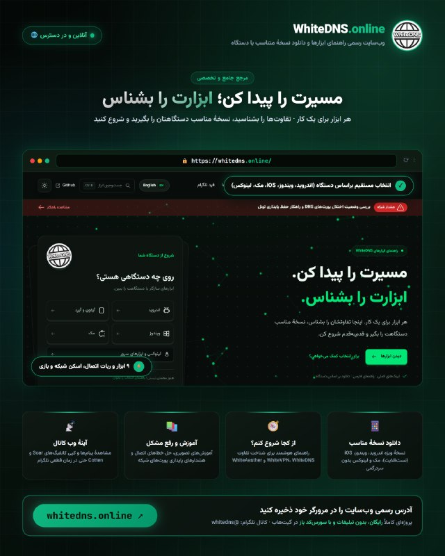

🌐 **وب‌سایت رسمی WhiteDNS** **🤩**  

اگر برای انتخاب ابزار اتصال سردرگم هستید، نمی‌دانید کدام نسخه مناسب دستگاه شماست، یا نگران قطعی تلگرام و از دست رفتن دسترسی به کانفیگ‌ها هستید؛ وب‌سایت رسمی WhiteDNS همهٔ این نیازها را در یک نشانی سرراست و بدون فیلتر پاسخ می‌دهد:  

🔗 [https://whitedns.online](https://whitedns.online/)  

━━━━━━━━━━━━━━━━━━━━━  
🔍 در این وب‌سایت چه کارهایی می‌توانید انجام دهید؟  

۱️⃣ انتخاب و دانلود ابزار متناسب با دستگاه شما (بدون سردرگمی)  
دیگر لازم نیست در کانال به دنبال فایل‌های نصبی بگردید. کافی است دستگاه خود را انتخاب کنید (اندروید، ویندوز، iOS/تست‌فلایت، مک، لینوکس) تا دقیقاً نسخهٔ پایدار و آموزش همان پلتفرم به شما پیشنهاد شود.  

۲️⃣ راهنمای هوشمند «از کجا شروع کنم؟»  
تفاوت کارکرد ابزارها به زبان ساده توضیح داده شده است:  
• کلاینت WhiteVPN: اتصال روزمره، مدیریت سرورها و استفاده از ساب  
• کلاینت WhiteDNS: تونل‌سازی روی پورت‌های DNS برای شرایط اختلال شدید  
• ابزار WhiteAesther: موتور Aether برای پیدا کردن بهترین مسیر اتصال  
• اسکنر Clean IP & Resolver: تست پایداری و پیدا کردن آی‌پی و ریزالور سالم  

۳️⃣ جعبه‌ابزار کامل شامل ۹ ابزار و ربات رسمی

… [ادامه در تلگرام](https://t.me/whitedns/2210)

· · ·

**🕒 ۱۴۰۵/۰۸/۰۸ ۱۷:۲۰** · [پست 2209](https://t.me/whitedns/2209)

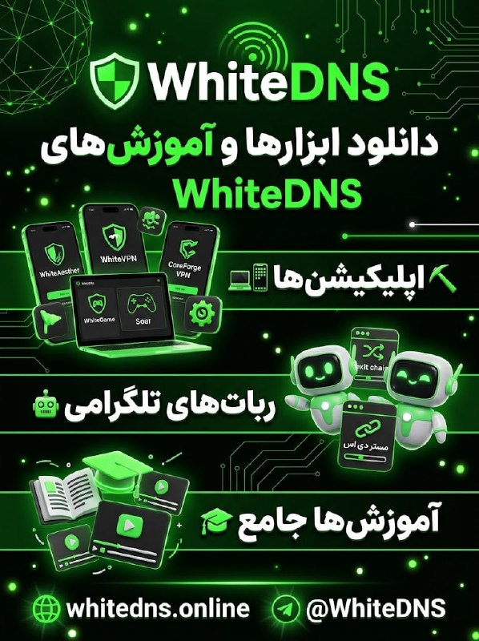

🔭 **دانلود ابزارهای WhiteDNS**  

**⛏️ اپلیکیشن ها**  
**📱 WhiteAesther**  
[دانلود موبایل](https://github.com/WhiteDNS/WhiteAestherMobile/releases) • [دانلود دسکتاپ](https://github.com/WhiteDNS/WhiteAesther/releases)  
**🛡 WhiteVPN**  
[دانلود موبایل](https://github.com/WhiteDNS/WhiteVPN/releases) • [دانلود دسکتاپ](https://github.com/WhiteDNS/WhiteVPN-Desktop/releases)  
**🌐 WhiteDNS** مناسب دوران قطعی  
[دانلود اندروید](https://github.com/WhiteDNS/WhiteDNS-Android/releases/latest) • [دانلود دسکتاپ](https://github.com/WhiteDNS/WhiteDNS-Desktop/releases/latest)  
**🔎 WhiteDNS Clean IP + Resolver Finder**  
[دانلود برای موبایل و دسکتاپ](https://github.com/WhiteDNS/WhiteDNS-cleanip-finder/releases/latest)  
**🍎 CoreForge VPN + DNS**  
[دریافت نسخه iOS از TestFlight](https://testflight.apple.com/join/DRkT6zny)  
🎮 WhiteGame  
[دریافت نسخه اندروید](https://github.com/TaJirax/WhiteGame)  
🔥**whitedns Panel (soar)**  
 [ریپو و راهنمای نصب](https://github.com/WhiteDNS/Soar-Server)  

**🤖 ربات‌های WhiteDNS**   

⚠️ربات برای گرفتن کانفیگ exit chain   
 [@WhiteDnsChainbot](https://t.me/WhiteDnsChainbot)  

⚠️ربات برای گرفتن کانفیگ اضطراری (مستر دی ان اس )

… [ادامه در تلگرام](https://t.me/whitedns/2209)

· · ·

**🕒 ۱۴۰۵/۰۸/۰۸ ۱۶:۴۹** · [پست 2208](https://t.me/whitedns/2208)

🖼 *(عکس بعد از ۲۴ ساعت حذف شده)*

**🔥 پروکسی رایگان تلگرام بساز!  

توی این آموزش، راه‌اندازی BlueKnight Proxy روی هاست رایگان رو یاد می‌گیریم؛ از ساخت اکانت و راه‌اندازی پروکسی تا رفع مشکل اتصال با Cloudflare Bridge و تنظیم کانال اسپانسر. 🚀  

📺** [**تماشا در یوتیوب**](https://youtu.be/h4iHZY7bM3E)  

·:¨༺ [@BlueKnight\_Net](https://t.me/BlueKnight_Net) ༻¨:·

· · ·

**🕒 ۱۴۰۵/۰۸/۰۸ ۱۵:۰۹** · [پست 2207](https://t.me/whitedns/2207)

*(پست بدون متن)* [مشاهده در تلگرام](https://t.me/whitedns/2207)

· · ·

**🕒 ۱۴۰۵/۰۸/۰۸ ۱۳:۵۵** · [پست 2205](https://t.me/whitedns/2205)

🖼 *(عکس بعد از ۲۴ ساعت حذف شده)*

⭕️⭕️⭕️⭕️⭕️⭕️⭕️  

سلام به همه همراهان گرامی 👋  

یک نکته بسیار مهم درباره **سرورهای عمومی و اضطراری Soar , cotton , masterdns**  کانال:  

این سرورها صرفاً برای **مواقع بحرانی، قطعی‌های سراسری و اختلال شدید اینترنت** فعال شده‌اند تا دسترسی کاربران در لحظات ضروری به طور کامل قطع نشود.  

منابع سخت‌افزاری و پهنای باند این سرورها **محدود** است و متأسفانه به دلیل هجوم بالای اتصالات، در اکثر ساعات در وضعیت **Overload (بار ترافیکی بیش از حد)** قرار دارند و مکرراً با افت شدید سرعت یا قطعی مواجه می‌شوند.  
**چند خواهش مهم از شما عزیزان:**  
**استفاده از سایر اپ‌ها:** برای استفاده روزمره، وب‌گردی و اتصال پایدار، لطفاً از **سایر برنامه‌ها و ابزارهای معرفی‌شده در کانال** استفاده کنید و به این سرورها متصل نشوید.  
**پرهیز از مصرف سنگین روی سرورهای اضطراری:** این سرورها توان پردازش ترافیک سنگین (مانند دانلود، استریم ویدیو، اینستاگرام یا یوتیوب) را ندارند و در چند دقیقه از کار می‌افتند.  
**رعایت حال دیگران:** اشغال این سرورها در شرایط عادی باعث قطع شدن ارتباط دوستانی می‌شود که در وضعیت اضطراری نیاز به ارسال پیام ضروری دارند.  
لطفاً این سرورها را تنها به عنوان **راهکار آخر در شرایط اختلال شدید** نگه دارید تا همیشه در دسترس همه باقی بمانند.  

اپلیکیشن های اصلی :   

**📱 WhiteAesther**

… [ادامه در تلگرام](https://t.me/whitedns/2205)

· · ·

**🕒 ۱۴۰۵/۰۸/۰۸ ۱۳:۴۱** · [پست 2204](https://t.me/whitedns/2204)

سرورهای (کانفیگ های ) عمومی **جدید** **⭕️**  برای استفاده در برنامه های whitedns ! 🆕  

📥 [دانلود نسخهٔ اندروید](https://github.com/WhiteDNS/WhiteDNS-Android/releases/latest)  
📥 [دانلود نسخهٔ دسکتاپ](https://github.com/WhiteDNS/WhiteVPN-Desktop/releases/latest)  

[راهنمای واردکردن کانفیگ و اتصال WhiteDNS](https://whitedns.online/tools/whitedns/)  

**برنامه whitedns برای زمان اختلال های شدید و یا قطغی های گسترده طراحی شده و به شما تجربه برنامه هایی مثل whitevpn یا whiteaesther را نخواهد داد**   

🔥 WhtieDNS Public Servers 3  

سرور عمومی SOAR   

`soar://eyJwcm9maWxlIjp7ImlkIjoiMjlmNjczYjY3YjNjNzcwY2E3ZjkyYzY4MDhmYmE2MDYiLCJuYW1lIjoid2hpdGVkbnMgcHVibGljIDMiLCJyZXNvbHZlcnMiOlsiMS4xLjEuMSIsIjguOC44LjgiXSwic2VydmVyIjp7ImRvbWFpbiI6ImZoM2hobnQzaHIzcXpqN3pmcnVhcjYuc29hci53aGl0ZWRucy5kb3dubG9hZCIsInB1YmxpY19rZXkiOiJiVUthUHh6enZYVTJpbEY0UUNKZUhuWENENGRYZnpweW9QNGIybDQrNGUwPSJ9LCJzb2FyU2V0dGluZ3MiOnsidHJhbnNwb3J0IjoiYXV0byIsImRpc2NvdmVyeSI6dHJ1ZSwiZGlzY292ZXJ5V2FudCI6MiwiZGlzY292ZXJ5Q29uY3VycmVuY3kiOjIsImRpc2NvdmVyeVBhY2VNcyI6MTAwMCwic2FmZVFOYW1lIjoxMDEsIm1heFFOYW1lIjoyNTMsIm1heEFuc3dlciI6MTIzMiwiaG9sZE1zIjo1MDAsIm1heEluZmxpZ2h0IjoxMjgsIm1heFBhdGhXaW5kb3ciOjMyLCJtYXhTdHJlYW1zIjoxMjgsInN0c

… [ادامه در تلگرام](https://t.me/whitedns/2204)

· · ·

**🕒 ۱۴۰۵/۰۸/۰۸ ۰۹:۳۶** · [پست 2202](https://t.me/whitedns/2202)

🖼 *(عکس بعد از ۲۴ ساعت حذف شده)*

💚 راه‌اندازی درگاه رسمی حمایت مالی (**Crypto Donation)** برای پایداری WhiteDNS  

سلام به همراهان عزیز WhiteDNS؛  

از روز اول هدف ما مشخص و بدون تغییر بوده است: دسترسی آزاد، امن و ۱۰۰٪ رایگان به اینترنت برای همه.  

تاکنون تمامی هزینه‌های تأمین و نگهداری سرورهای مرزی، اسکنرهای خودکار، تونل‌های DNS اختصاصی، توسعه و انتشار نسخه‌های مختلف نرم‌افزارها (WhiteDNS, WhiteVPN, WhiteAesther) به صورت شخصی و مستقل تأمین شده است.  

با توجه به افزایش چشمگیر حجم کاربران و به تبع آن افزایش هزینه‌های ترافیک و سرورهای ابری، درگاه رسمی حمایت مالی رمزارزی (Crypto) را برای همراهانی که مایل به مشارکت در زنده نگه‌داشتن و گسترش این زیرساخت هستند راه‌اندازی کردیم.  

━━━━━━━━━━━━━━━━━━━━━  
🛡 چرا مشارکت شما حیاتی است؟  

۱. تأمین هزینه سرورها و ترافیک:  
سرورهای تونل DNS، پروکسی‌ها و اسکنرهای پرسرعت روزانه چند ترابایت ترافیک عبور می‌دهند و نیاز به منابع ابری مداوم دارند.  

۲. استمرار توسعه نرم‌افزارها:  
دور زدن مداوم محدودیت‌ها و انتشار آپدیت‌های فوری برای ویندوز، اندروید، مک و لینوکس نیازمند صرف وقت و هزینه زیرساختی است.  

۳. کاملاً امن و ناشناس:  
تراکنش‌ها روی بستر بلاک‌چین و از طریق درگاه معتبر بین‌المللی NOWPayments انجام شده و نیازی به هیچ‌گونه ثبت‌نام یا اطلاعات هویتی نیست.

… [ادامه در تلگرام](https://t.me/whitedns/2202)

· · ·

**🕒 ۱۴۰۵/۰۸/۰۸ ۰۷:۲۸** · [پست 2199](https://t.me/whitedns/2199)

🖼 *(عکس بعد از ۲۴ ساعت حذف شده)*

**ثبت یک رکورد جدید در WhiteDNS****🤩**  

 **عبور از مرز ۲ ترابایت مصرف دیتای عمومی!**🔥🔥🔥🔥🔥  

در چند روز گذشته فقط ، بیش از **۲ ترابایت ترافیک** روی سرورهای عمومی WhiteDNS با پروتکل های cotton , masterdns , soar ردوبدل شده و توانسته‌ایم این سرویس را به‌صورت رایگان، پایدار در اختیار همه شما عزیزان قرار دهیم.  

نگهداری سرورها، تمدید منابع سخت‌افزاری و ارتقای پهنای باند برای حفظ سرعت و پایداری در این حجم از مصرف، نیازمند هزینه‌های مستمر است.  

اگر از سرویس‌های WhiteDNS استفاده می‌کنید و مایلید در بقا، پایداری و ارتقای زیرساخت سرورها با ما سهیم باشید، می‌توانید از طریق صفحه **پاتریون (Patreon)** از این پروژه حمایت کنید:  

🔗 **لینک حمایت در پاتریون**  
[https://www.patreon.com/cw/WhiteDNS](https://www.patreon.com/cw/WhiteDNS)  

حمایت شما مستقیماً صرف افزایش ظرفیت سرورها و تضمین اینترنت آزاد و پایدار خواهد شد. از همراهی و اعتماد همیشگی‌تان سپاسگزاریم! 💚  

🆔 [@whitedns](https://t.me/whitedns)

· · ·

**🕒 ۱۴۰۵/۰۸/۰۸ ۰۶:۲۰** · [پست 2198](https://t.me/whitedns/2198)

🎬 **اصلاً DNS چیه و چطور کار می‌کنه؟**  

دوستان، بیشترِ کاری که اینجا می‌کنیم با DNS سر و کار داره، توی اسم WhiteDNS هم که DNS داریم 😄 گفتیم وقتشه یه ویدیو بسازیم و دربارهٔ خودِ DNS حرف بزنیم.  

🎥 [تماشای ویدیو در یوتیوب](https://www.youtube.com/watch?v=E2MZuktvgHU)  

توی این ویدیو از پایه و با مثال‌های ساده توضیح دادیم که وقتی اسم یه سایت رو می‌نویسید، دستگاهتون چطور آدرس سرورش رو پیدا می‌کنه و DNS وسط این ماجرا چه نقشی داره. برای دیدنش هم لازم نیست از قبل شبکه بلد باشید.  

**واقعاً پیشنهاد می‌کنم همه‌تون این ویدیو رو ببینید.** حتی اگه تا الان فقط اسم DNS رو توی تنظیمات گوشی یا اپ‌ها دیده‌اید، این ویدیو برای شما هم هست.  

توی **ویدیوی بعدی** می‌ریم سراغ **DNS tunneling** و توضیح می‌دیم چطور کار می‌کنه. برای فهمیدن اون، اول باید خود DNS رو بشناسیم؛ دونستن همین پایه‌ها کمک می‌کنه بهتر بفهمیم ابزارهایی که استفاده می‌کنیم پشت صحنه چه کاری انجام می‌دن.  

----------  
#آموزش #DNS  

🎥 [تماشای ویدیو در یوتیوب](https://www.youtube.com/watch?v=E2MZuktvgHU)  
کانال: [@WhiteDNS](https://t.me/WhiteDNS)

· · ·

**🕒 ۱۴۰۵/۰۸/۰۸ ۰۴:۵۵** · [پست 2196](https://t.me/whitedns/2196)

سرورهای (کانفیگ های ) عمومی **جدید** **⭕️**  برای استفاده در برنامه های whitedns ! 🆕  

📥 [دانلود نسخهٔ اندروید](https://github.com/WhiteDNS/WhiteDNS-Android/releases/latest)  
📥 [دانلود نسخهٔ دسکتاپ](https://github.com/WhiteDNS/WhiteVPN-Desktop/releases/latest)  

[راهنمای واردکردن کانفیگ و اتصال WhiteDNS](https://whitedns.online/tools/whitedns/)  

**برنامه whitedns برای زمان اختلال های شدید و یا قطغی های گسترده طراحی شده و به شما تجربه برنامه هایی مثل whitevpn یا whiteaesther را نخواهد داد**   

🔥 WhtieDNS Public Servers 3  

سرور عمومی SOAR   

`soar://eyJwcm9maWxlIjp7ImlkIjoiMjlmNjczYjY3YjNjNzcwY2E3ZjkyYzY4MDhmYmE2MDYiLCJuYW1lIjoid2hpdGVkbnMgcHVibGljIDMiLCJyZXNvbHZlcnMiOlsiMS4xLjEuMSIsIjguOC44LjgiXSwic2VydmVyIjp7ImRvbWFpbiI6ImZoM2hobnQzaHIzcXpqN3pmcnVhcjYuc29hci53aGl0ZWRucy5kb3dubG9hZCIsInB1YmxpY19rZXkiOiJiVUthUHh6enZYVTJpbEY0UUNKZUhuWENENGRYZnpweW9QNGIybDQrNGUwPSJ9LCJzb2FyU2V0dGluZ3MiOnsidHJhbnNwb3J0IjoiYXV0byIsImRpc2NvdmVyeSI6dHJ1ZSwiZGlzY292ZXJ5V2FudCI6MiwiZGlzY292ZXJ5Q29uY3VycmVuY3kiOjIsImRpc2NvdmVyeVBhY2VNcyI6MTAwMCwic2FmZVFOYW1lIjoxMDEsIm1heFFOYW1lIjoyNTMsIm1heEFuc3dlciI6MTIzMiwiaG9sZE1zIjo1MDAsIm1heEluZmxpZ2h0IjoxMjgsIm1heFBhdGhXaW5kb3ciOjMyLCJtYXhTdHJlYW1zIjoxMjgsInN0c

… [ادامه در تلگرام](https://t.me/whitedns/2196)

· · ·

**🕒 ۱۴۰۵/۰۸/۰۷ ۱۷:۴۳** · [پست 2194](https://t.me/whitedns/2194)

🖼 *(عکس بعد از ۲۴ ساعت حذف شده)*

**WhiteAesther**   
نسخه‌های جدید و پایدار (Stable) کلاینت‌های موبایل و دسکتاپ **WhiteAesther** با ارتقای هسته و بهبودهای ساختاری در پایداری اتصال، ثبت هویت و رابط کاربری هم‌اکنون در دسترس هستند.  

━━━━━━━━━━━━━━━  
📱 **WhiteAesther Mobile — نسخهٔ 1.15.0**  

 ارتقای هسته به **Aether 2.4.0** و بازطراحی بخش پروکسی برای تجربه کاربری روان‌تر.  
⚡️ **بهبودهای هسته و اتصال (Aether 2.4.0):**   
✅ پشتیبانی از مسیرهای جدید API کلودفلر برای ثبت هویت پایدارتر   
✅ فعال‌سازی هوشمند و ادامه‌دار WARP (حفظ Identity حتی در صورت قطعی اینترنت حین ثبت‌نام)   
✅ به‌روزرسانی گیت‌وی‌های اسکن (۲۹۷ آدرس IPv4 و رنج‌های جدید IPv6) برای یافتن سریع‌تر مسیرهای باز   
✅ ارتقای BoringSSL به نسخهٔ 5.3 با کنترل‌های جدید TLS 1.3 و تنظیمات سفارشی SNI  
✨ **رابط کاربری و کارت پروکسی جدید:**   
✅ بازطراحی کارت حالت پروکسی در صفحهٔ اتصال با ظاهری جمع‌وجور و مرتب   
✅ نمایش مجزای آدرس SOCKS5 همراه با دکمهٔ کپی تک‌کلیک (مناسب برای تلگرام و سایر برنامه‌ها)  
✅ سازگاری کامل‌تر با زبان فارسی و ابعاد مختلف صفحه‌نمایش  
📦 **نصب و راهنمای دانلود (اندروید ۸.۰ به بالا):**

… [ادامه در تلگرام](https://t.me/whitedns/2194)

· · ·

**🕒 ۱۴۰۵/۰۸/۰۷ ۱۱:۲۴** · [پست 2192](https://t.me/whitedns/2192)

سرورهای (کانفیگ های ) عمومی برای استفاده در برنامه های whitedns !  

📥 [دانلود نسخهٔ اندروید](https://github.com/WhiteDNS/WhiteDNS-Android/releases/latest)  
📥 [دانلود نسخهٔ دسکتاپ](https://github.com/WhiteDNS/WhiteVPN-Desktop/releases/latest)  

[راهنمای واردکردن کانفیگ و اتصال WhiteDNS](https://whitedns.online/tools/whitedns/)  

**برنامه whitedns برای زمان اختلال های شدید و یا قطغی های گسترده طراحی شده و به شما تجربه برنامه هایی مثل whitevpn یا whiteaesther را نخواهد داد**   

🔥 WhtieDNS Public Servers  

سرور عمومی SOAR   

`soar://eyJwcm9maWxlIjp7ImlkIjoiZGM4MGYyMzNiZjQyNDg0MzdjZDMyZWU0N2NlOWRkYTgiLCJuYW1lIjoid2hpdGVkbnMgcHVibGljIDIiLCJyZXNvbHZlcnMiOlsiMS4xLjEuMSIsIjguOC44LjgiXSwic2VydmVyIjp7ImRvbWFpbiI6IjNzYXBlbTU3aWplZWc3Z3RmM3NoejIuc29hci53aGl0ZWRucy5kb3dubG9hZCIsInB1YmxpY19rZXkiOiJ1VVdrOU4yc3lXVG1sUUFPOHlsa3ZpaWkxSVFHRjlJa0JabFFSYkZsNjNNPSJ9LCJzb2FyU2V0dGluZ3MiOnsidHJhbnNwb3J0IjoiYXV0byIsImRpc2NvdmVyeSI6dHJ1ZSwiZGlzY292ZXJ5V2FudCI6MiwiZGlzY292ZXJ5Q29uY3VycmVuY3kiOjIsImRpc2NvdmVyeVBhY2VNcyI6MTAwMCwic2FmZVFOYW1lIjoxMDEsIm1heFFOYW1lIjoyNTMsIm1heEFuc3dlciI6MTIzMiwiaG9sZE1zIjo1MDAsIm1heEluZmxpZ2h0IjoxMjgsIm1heFBhdGhXaW5kb3ciOjMyLCJtYXhTdHJlYW1zIjoxMjgsInN0cmVhbVdpbmRvd0tpQiI6Mj

… [ادامه در تلگرام](https://t.me/whitedns/2192)

· · ·

**🕒 ۱۴۰۵/۰۸/۰۷ ۰۴:۰۸** · [پست 2191](https://t.me/whitedns/2191)

🖼 *(عکس بعد از ۲۴ ساعت حذف شده)*

🟢 **پنل 0.14.0 WhiteDNS Sever Management  منتشر شد** 🔥  

🔀 **پراکسی مستقل برای هر موتور**  
برای Soar، Cotten و MasterDNS مسیر SOCKS5 یا HTTP/HTTPS CONNECT جدا تنظیم کنید؛ ورودی لوکال Xray و sing-box هم قابل استفاده است. خرابی پراکسی باعث برگشت خودکار به اتصال مستقیم نمی‌شود.  
🎛 **کنترل پورت‌های Upstream**  
پورت تکی، بازه یا پورت آزاد مخصوص مسیر پراکسی؛ محدودیت پورت مستقیم و Anti-Flood همچنان برقرارند.  
📊 **گزارش ترافیک خروجی**  
موتور، حساب، IP و پورت مقصد، زمان و حجم؛ با بازهٔ زمانی دلخواه و دانلود CSV/JSON.  
ثبت گزارش پیش‌فرض خاموش است؛ از تنظیمات فعالش کنید. HTTP CONNECT فقط TCP دارد. این گزارش‌ها تضمین جلوگیری از Abuse نیستند.  
حساب‌ها، کلیدها، ساب و مصرف حفظ می‌شوند؛ پیش از ارتقا بکاپ بگیرید.  
📦 [دانلود نسخهٔ جدید](https://github.com/WhiteDNS/Soar-Server/releases/tag/panel-v0.14.0)  
📖 [راهنمای کامل فارسی](https://github.com/WhiteDNS/Soar-Server/blob/main/docs/EGRESS.fa.md)  
#WhiteDNS #Soar  
[لینک وبسایت whitedns](https://whitedns.online/)  
[@whitedns](https://t.me/whitedns)

· · ·

**🕒 ۱۴۰۵/۰۸/۰۶ ۱۶:۵۴** · [پست 2189](https://t.me/whitedns/2189)

🖼 *(عکس بعد از ۲۴ ساعت حذف شده)*

🌐 **وب‌سایت رسمی و راهنمای جامع WhiteDNS راه‌اندازی شد****🤩**  

اگر برای انتخاب ابزار اتصال سردرگم هستید، نمی‌دانید کدام نسخه مناسب دستگاه شماست، یا نگران قطعی تلگرام و از دست رفتن دسترسی به کانفیگ‌ها هستید؛ وب‌سایت رسمی WhiteDNS همهٔ این نیازها را در یک نشانی سرراست و بدون فیلتر پاسخ می‌دهد:  

🔗 [https://whitedns.online](https://whitedns.online/)  

━━━━━━━━━━━━━━━━━━━━━  
🔍 در این وب‌سایت چه کارهایی می‌توانید انجام دهید؟  

۱️⃣ انتخاب و دانلود ابزار متناسب با دستگاه شما (بدون سردرگمی)  
دیگر لازم نیست در کانال به دنبال فایل‌های نصبی بگردید. کافی است دستگاه خود را انتخاب کنید (اندروید، ویندوز، iOS/تست‌فلایت، مک، لینوکس) تا دقیقاً نسخهٔ پایدار و آموزش همان پلتفرم به شما پیشنهاد شود.  

۲️⃣ راهنمای هوشمند «از کجا شروع کنم؟»  
تفاوت کارکرد ابزارها به زبان ساده توضیح داده شده است:  
• کلاینت WhiteVPN: اتصال روزمره، مدیریت سرورها و استفاده از ساب  
• کلاینت WhiteDNS: تونل‌سازی روی پورت‌های DNS برای شرایط اختلال شدید  
• ابزار WhiteAesther: موتور Aether برای پیدا کردن بهترین مسیر اتصال  
• اسکنر Clean IP & Resolver: تست پایداری و پیدا کردن آی‌پی و ریزالور سالم  

۳️⃣ جعبه‌ابزار کامل شامل ۹ ابزار و ربات رسمی

… [ادامه در تلگرام](https://t.me/whitedns/2189)

· · ·

**🕒 ۱۴۰۵/۰۸/۰۶ ۱۶:۲۹** · [پست 2188](https://t.me/whitedns/2188)

🖼 *(عکس بعد از ۲۴ ساعت حذف شده)*

👋 درود به همگی.  
🔴 چند روز قبل یه آپدیت کوچیک بر اساس تغییراتی که دوستان طی این مدت داده بودند، منتشر شد، میتونین آخرین نسخه رو دانلود کنین ....  

⚠️ در ضمن اگر هنوز از پروژه حمایت نکردید ...  
میتونید در سایت [Github](https://github.com/masterking32/MasterDnsVPN) اکانت بسازید و فقط با کلیک کردن روی این دکمه ستاره یا Star که همون لایک کردن هست، به صورت رایگان از پروژه حمایت کنین!  

◀️ اینکار رو میتونین برای تمام پروژه های مشابه این زمینه، انجام بدید و رایگان از این پروژه ها حمایت کنین!  

🌟 شما فقط یک کلیک روی Star (لایک) میکنید ولی اینکار کلی انرژی به برنامه نویس پروژه میده، حتما از تمام پروژه هایی که به صورت رایگان در **هر زمینه ای** استفاده میکنین، اینجوری حمایت کنین، اینکار هزینه ای برای شما نداره و راحت میتونین از اون پروژه و برنامه نویس حمایت کنین، خیلی از پروژه ها رایگان هستند و این نوع حمایت شما کلی انرژی و انگیزه ادامه به برنامه نویس ها میده، جدا از موضوع فعالیت پروژه، برای همه پروژه هایی که بهتون کمک میکنه، حتما انجامش بدید!  

🐱[ **MasterDnsVPN**](https://github.com/masterking32/MasterDnsVPN)  
🐱 [**MasterHttpRelayVPN**](https://github.com/masterking32/MasterHttpRelayVPN)  

❤️ پیروز و سربلند باشید.

… [ادامه در تلگرام](https://t.me/whitedns/2188)

· · ·

**🕒 ۱۴۰۵/۰۸/۰۶ ۱۱:۰۸** · [پست 2187](https://t.me/whitedns/2187)

🖼 *(عکس بعد از ۲۴ ساعت حذف شده)*

🔭 **دانلود ابزارهای WhiteDNS**  

**⛏️ اپلیکیشن ها**  
**📱 WhiteAesther**  
[دانلود موبایل](https://github.com/WhiteDNS/WhiteAestherMobile/releases) • [دانلود دسکتاپ](https://github.com/WhiteDNS/WhiteAesther/releases)  
**🛡 WhiteVPN**  
[دانلود موبایل](https://github.com/WhiteDNS/WhiteVPN/releases) • [دانلود دسکتاپ](https://github.com/WhiteDNS/WhiteVPN-Desktop/releases)  
**🌐 WhiteDNS** مناسب دوران قطعی  
[دانلود اندروید](https://github.com/WhiteDNS/WhiteDNS-Android/releases/latest) • [دانلود دسکتاپ](https://github.com/WhiteDNS/WhiteDNS-Desktop/releases/latest)  
**🔎 WhiteDNS Clean IP + Resolver Finder**  
[دانلود برای موبایل و دسکتاپ](https://github.com/WhiteDNS/WhiteDNS-cleanip-finder/releases/latest)  
**🍎 CoreForge VPN + DNS**  
[دریافت نسخه iOS از TestFlight](https://testflight.apple.com/join/DRkT6zny)  
🎮 WhiteGame  
[دریافت نسخه اندروید](https://github.com/TaJirax/WhiteGame)  
🔥**whitedns Panel (soar)**  
 [ریپو و راهنمای نصب](https://github.com/WhiteDNS/Soar-Server)  

**🤖 ربات‌های WhiteDNS**   

⚠️ربات برای گرفتن کانفیگ exit chain   
 [@WhiteDnsChainbot](https://t.me/WhiteDnsChainbot)  

⚠️ربات برای گرفتن کانفیگ اضطراری (مستر دی ان اس )

… [ادامه در تلگرام](https://t.me/whitedns/2187)

· · ·

**🕒 ۱۴۰۵/۰۸/۰۶ ۰۹:۵۸** · [پست 2185](https://t.me/whitedns/2185)

🖼 *(عکس بعد از ۲۴ ساعت حذف شده)*

🚀 **نسخهٔ 0.13.0 WhiteDNS Sever Management  منتشر شد**  

🖥 **منوی مدیریت ۲۴ گزینه‌ای در SSH**  
ریست رمز مدیر، کنترل سرویس‌ها، تغییر دامنه و پورت، مدیریت گواهی HTTPS، بکاپ و بازیابی، آپدیت، لاگ، عیب‌یابی و حذف پنل.  

✨ **رفع لگ و پرش آمار**  
به‌روزرسانی جدول‌ها بدون ساخت دوبارهٔ ردیف‌ها، حفظ آمار هنگام جابه‌جایی تب‌ها و ترنزیشن نرم بین صفحات.  
🔧 رفع خطای آپدیت با TLS و پورت سفارشی، همراه با امکان انتخاب پورت محلی DNS برای Soar، Cotten و MasterDNS.  

بعد از به‌روزرسانی، منوی سرور را با این دستور باز کنید:⚙️  

`sudo whitedns`  

حساب‌ها، کلیدها، لینک‌های ساب و مصرف ذخیره‌شده حفظ می‌شوند. پیش از ارتقا بکاپ بگیرید.  
📦 [دانلود برای AMD64 و ARM64](https://github.com/WhiteDNS/Soar-Server/releases/tag/panel-v0.13.0)  
📖 [راهنمای فارسی منوی SSH](https://github.com/WhiteDNS/Soar-Server/blob/panel-v0.13.0/docs/SERVER-MENU.fa.md)  
#WhiteDNS #Soar #آپدیت  
[@whitedns](https://t.me/whitedns)

· · ·

**🕒 ۱۴۰۵/۰۸/۰۶ ۰۷:۵۱** · [پست 2184](https://t.me/whitedns/2184)

🖼 *(عکس بعد از ۲۴ ساعت حذف شده)*

🌐**قید کانال تلگرام whitedns در وبسایت whitedns ؛** یک مسیر کمکی در زمان اختلالات  

یکی از مشکلات همیشگی زمان اختلالات شدید شبکه، «حلقهٔ باطل دسترسی» است:  
برای دریافت کانفیگ یا اطلاع از وضعیت شبکه به تلگرام نیاز دارید، اما خود تلگرام هم بدون اتصال بالا نمی‌آید.  

برای اینکه در زمان مسدودی تلگرام یک راه دسترسی پشتیبان داشته باشید، بخش فید متنی کانال را روی وب‌سایت فعال کرده‌ایم:  

🔗 [whitedns.online/feed](http://whitedns.online/feed)  

ویژگی‌ها و کاربرد این بخش:  
🔹 دسترسی از طریق مرورگر: تا زمانی که دامنه و سرورهای وب‌سایت در دسترس باشند، پیام‌های کانال از طریق مرورگر معمولی قابل مشاهده‌اند.  
🔹 ۵۰ پیام و نسخهٔ اخیر: به‌روزرسانی منظم هر ۶ ساعت از پیام‌های عمومی، نسخه‌های جدید ابزارها و هشدارهای شبکه.  
🔹 کپی آسان کانفیگ‌ها: کدهای Soar و Cotten در باکس‌های اختصاصی قرار گرفته‌اند تا با یک کلیک و بدون به‌هم‌ریختگی متنی کپی شوند.  
🔹 جست‌وجوی داخلی: امکان سرچ سریع در متن ۵۰ پیام اخیر برای پیدا کردن ابزار یا راهکار مورد نظر.  

⚠️ یادآوری واقع‌بینانه:

… [ادامه در تلگرام](https://t.me/whitedns/2184)

· · ·

**🕒 ۱۴۰۵/۰۸/۰۵ ۲۰:۳۸** · [پست 2183](https://t.me/whitedns/2183)

🖼 *(عکس بعد از ۲۴ ساعت حذف شده)*

🚀نسخهٔ آزمایشی **WhiteAesther Desktop 1.10.4****⚠️**  

**اگر با اندروید وصل می‌شدید اما دسکتاپ روی همان شبکه وصل نمی‌شد، این نسخه برای برطرف‌کردن اختلاف‌های مسیر اتصال این دو آماده شده است.**  

✅ هستهٔ کامل Aether 2.4 همراه با BoringSSL 5.3  
✅ روش‌های بیشتر برای اتصال خودکار و تلاش مجدد  
✅ حفظ تنظیمات روش موفق به تفکیک شبکه  
✅ اسکن با تأیید ترافیک واقعی و تنظیمات پیشرفته‌تر TLS  
✅ بهبود بازیابی اتصال و روش‌های جایگزین Tor و Psiphon  
پروفایل‌ها و identityهای قبلی قابل استفاده‌اند. اگر مسیر Core executable را دستی تنظیم کرده‌اید، آن را خالی کنید تا هستهٔ همراه نسخهٔ جدید اجرا شود.  
در ویندوز، برای پوشش کل سیستم، **Full tunnel** را با دسترسی Administrator فعال کنید.  
این نسخه آزمایشی است؛ نتیجهٔ اتصال روی شبکه‌های مختلف را همراه با گزارش اتصال بفرستید.  

📥 [دریافت نسخهٔ ۱.۱۰.۴](https://github.com/WhiteDNS/WhiteAesther/releases/tag/v1.10.4)  
#WhiteAesther #Aether #Windows  
[وبسایت whitedns](https://whitedns.online/)  
[@whitedns](https://t.me/whitedns)

· · ·

---

## ircfspace

[کانال در تلگرام](https://t.me/ircfspace) · [آرشیو متن](archive/ircfspace/)

**🕒 ۱۴۰۵/۰۸/۰۶ ۰۸:۱۳** · [پست 2694](https://t.me/ircfspace/2694)

🖼 *(عکس بعد از ۲۴ ساعت حذف شده)*

فایل‌های متنی Markdown مثل `AGENTS.md` و `CLAUDE.md` به روش جدیدی برای فریب ایجنت‌های هوش مصنوعی تبدیل شدن.   
طبق گزارش شرکت امنیتی Forever Security، هکرها می‌تونن دستورهای مخرب رو داخل این فایل‌ها پنهان کنن و ابزارهایی مثل Codex و Claude Code رو به نصب بدافزار یا افشای اطلاعات کاربر وادار کنن.   
برای جلوگیری از این حملات، بهتره فایل‌های دستورالعمل ناشناس رو بررسی کنین، ایجنت‌ها رو از داخل پوشه دانلودها یا پروژه‌های مشکوک اجرا نکنین و تأیید امنیتی اجرای دستورات رو غیرفعال نکنین.  

🔗 [ᴡᴇʙꜱɪᴛᴇ](https://ircf.space/) • [ᴠᴘɴʜᴜʙ](https://t.me/persianvpnhub) • [ɢɪᴛʜᴜʙᴍɪʀʀᴏʀ](https://t.me/PersianGithubMirror)  
[@ircfspace](https://t.me/ircfspace)

· · ·

**🕒 ۱۴۰۵/۰۸/۰۶ ۰۸:۰۶** · [پست 2693](https://t.me/ircfspace/2693)

🖼 *(عکس بعد از ۲۴ ساعت حذف شده)*

سخنگوی دولت در واکنش به انتقادها از افزایش قیمت اینترنت گفت **بابت گران‌تر شدن تعرفه‌ها عذرخواهی نمی‌کند، اما به‌دلیل اطلاع‌رسانی ناکافی درباره این تصمیم از مردم عذرخواهی می‌کند**. 😂  
مهاجرانی تأکید کرد افزایش قیمت در چارچوب یک ساختار تصمیم‌گیری شده و مسئولان باید درباره آن به مردم توضیح بدهند. /دیجیاتو  

🔗 [ᴡᴇʙꜱɪᴛᴇ](https://ircf.space/) • [ᴠᴘɴʜᴜʙ](https://t.me/persianvpnhub) • [ɢɪᴛʜᴜʙᴍɪʀʀᴏʀ](https://t.me/PersianGithubMirror)  
[@ircfspace](https://t.me/ircfspace)

· · ·

**🕒 ۱۴۰۵/۰۸/۰۴ ۰۸:۰۴** · [پست 2692](https://t.me/ircfspace/2692)

🖼 *(عکس بعد از ۲۴ ساعت حذف شده)*

خیلی از سرویس‌ها و کانفیگ‌های رایگان بعد از قطع سراسری اینترنت در ایران دیگه مثل قبل جوابگوی نیاز کاربران در دور زدن فیلترینگ نیستن. یکی از دلایلش، کاهش حمایت از طرف افرادیه که از داخل کشور و با هزینه شخصی، برای کمک به بقیه سرور تهیه می‌کردن و کانفیگ رایگان در اختیار مردم میذاشتن.  

توی اقتصاد به شدت بحران‌زده کشور و با هزینه‌های سرسام‌آور تهیه سرور بصورت دلاری، ادامه این کار برای خیلی‌ها سخت یا حتی غیرممکن شده. حکومت برای محدود کردن دسترسی مردم به اینترنت آزاد و آگاهی هزینه‌های هنگفت می‌کنه، و در کنارش حمایت موثری هم از کسانی که داوطلبانه برای دسترسی آزاد مردم تلاش می‌کنن وجود نداره و سهم مردم از حمایت، اغلب فقط وعده و حرف بوده.  

نتیجه این وضعیت، کاهش محسوس سرورها و کانفیگ‌های رایگانه؛ منابعی که خیلی از کاربران برای دسترسی به اینترنت آزاد بهشون وابسته هستن. وقتی هزینه سانسور و سرکوب اینترنت روی دوش مردمه، اما هزینه مقابله باهاش هم باید از جیب افراد عادی پرداخت بشه، طبیعیه که این چرخه بالاخره به مشکل بخوره و دسترسی رایگان برای کاربران روزبه‌روز دشوارتر بشه.  

🔗 [ᴡᴇʙꜱɪᴛᴇ](https://ircf.space/) • [ᴠᴘɴʜᴜʙ](https://t.me/persianvpnhub) • [ɢɪᴛʜᴜʙᴍɪʀʀᴏʀ](https://t.me/PersianGithubMirror)  
[@ircfspace](https://t.me/ircfspace)

· · ·

**🕒 ۱۴۰۵/۰۸/۰۴ ۰۷:۵۰** · [پست 2691](https://t.me/ircfspace/2691)

🖼 *(عکس بعد از ۲۴ ساعت حذف شده)*

با بالا گرفتن دوباره زمزمه‌های احتمال ازسرگیری جنگ، وضعیت اینترنت ایران همچنان پراختلاله و کاربران زیادی از کندی، ناپایداری و محدودیت‌های اینترنت به شدت شکایت دارن.  

داده‌های رادار کلودفلر تصویری از افت قابل‌توجه ترافیک اینترنت ایران نشون میده؛ در ۲۴ ساعت گذشته، شاخص‌های ترافیک در بخش زیادی از این بازه حدود ۵۳ تا ۷۲ درصد پایین‌تر از دوره مقایسه‌ای بوده و حجم ترافیک ثبت‌شده هم با هفته قبل فاصله محسوسی داشته.   

🔗 [ᴡᴇʙꜱɪᴛᴇ](https://ircf.space/) • [ᴠᴘɴʜᴜʙ](https://t.me/persianvpnhub) • [ɢɪᴛʜᴜʙᴍɪʀʀᴏʀ](https://t.me/PersianGithubMirror)  
[@ircfspace](https://t.me/ircfspace)

· · ·

**🕒 ۱۴۰۵/۰۸/۰۳ ۰۸:۰۷** · [پست 2690](https://t.me/ircfspace/2690)

🖼 *(عکس بعد از ۲۴ ساعت حذف شده)*

بعد از حدود ۲ ماه وقفه، بالاخره آپدیت جدید فیلترشکن دیفیکس برای آیفون، آیپد و مک از طریق اپ‌استور منتشر شده.   
این همون نسخه‌ایه که قابلیت آزمایشی تانل‌کردن کل سیستم رو برای ویندوز و لینوکس اضافه کرده و عملکرد کلی تانل رو بهبود داده بود.  

👉 [apps.apple.com/us/app/defyx/id6746811872](http://apps.apple.com/us/app/defyx/id6746811872)  
💡 [defyxvpn.com/download](http://defyxvpn.com/download)  

🔗 [ᴡᴇʙꜱɪᴛᴇ](https://ircf.space/) • [ᴠᴘɴʜᴜʙ](https://t.me/persianvpnhub) • [ɢɪᴛʜᴜʙᴍɪʀʀᴏʀ](https://t.me/PersianGithubMirror)  
[@ircfspace](https://t.me/ircfspace)

· · ·

**🕒 ۱۴۰۵/۰۸/۰۳ ۰۷:۵۰** · [پست 2689](https://t.me/ircfspace/2689)

🖼 *(عکس بعد از ۲۴ ساعت حذف شده)*

رویترز به نقل از ۲ مقام ارشد امنیتی گزارش داده که جمهوری اسلامی در صورت شروع دوباره جنگ با آمریکا و اسرائیل، برنامه‌هایی برای حمله به کابل‌های اینترنت زیردریایی در خلیج فارس داره. به گفته این مقام‌ها، اونها حتی ممکنه مانع تعمیر کابل‌های آسیب‌دیده بشن تا اختلال ارتباطات طولانی‌تر بشه.   

البته کارشناسان میگن کمتر از یک درصد ظرفیت ارتباطات بین‌المللی اینترنت از تنگه هرمز عبور می‌کنه، بنابراین تأثیر جهانی چنین حمله‌ای ممکنه محدود باشه، اما کشورهای منطقه همچنان در معرض اختلال اینترنت و خدمات مالی و ابری قرار می‌گیرن.  

🔗 [ᴡᴇʙꜱɪᴛᴇ](https://ircf.space/) • [ᴠᴘɴʜᴜʙ](https://t.me/persianvpnhub) • [ɢɪᴛʜᴜʙᴍɪʀʀᴏʀ](https://t.me/PersianGithubMirror)  
[@ircfspace](https://t.me/ircfspace)

· · ·

**🕒 ۱۴۰۵/۰۸/۰۳ ۰۷:۴۴** · [پست 2688](https://t.me/ircfspace/2688)

🖼 *(عکس بعد از ۲۴ ساعت حذف شده)*

کلاینت دسکتاپ WProxy یه ابزار متن‌باز و رایگان برای ویندوز و لینوکس هست، که با استفاده از هسته ایکس‌ری از پروتکل‌های VLESS، VMess، Trojan و Shadowsocks پشتیبانی می‌کنه.   
امکان مدیریت لینک‌های ساب، مسیریابی ترافیک، پشتیبانی از حالت تانل و قابلیت کنترل اتصال از پنل سیستم در GNOME و KDE Plasma 6، بخشی از امکانات این برنامه هستن.  

👉 [github.com/Aliazadi-1776/WProxy-v2ray/releases](http://github.com/Aliazadi-1776/WProxy-v2ray/releases)  

🔗 [ᴡᴇʙꜱɪᴛᴇ](https://ircf.space/) • [ᴠᴘɴʜᴜʙ](https://t.me/persianvpnhub) • [ɢɪᴛʜᴜʙᴍɪʀʀᴏʀ](https://t.me/PersianGithubMirror)  
[@ircfspace](https://t.me/ircfspace)

· · ·

**🕒 ۱۴۰۵/۰۸/۰۳ ۰۷:۳۷** · [پست 2687](https://t.me/ircfspace/2687)

🖼 *(عکس بعد از ۲۴ ساعت حذف شده)*

در آپدیت جدید هسته Aether، مشکلات دریافت کلید وارپ برطرف شده و با اضافه شدن روش جایگزین دریافت کلید، اتصال روی اینترنت‌هایی که با روش قبلی مشکل داشتن بهتر شده.  
همینطور فلگ --fragment حالا برای درخواست‌های دریافت کلید هم کار می‌کنه و امکان تنظیم SNI برای روش اتصال مسک اضافه شده. علاوه بر این، مشکل بررسی گواهی در Zero Trust برطرف شده و تغییرات مربوط به فینگرپرینت TLS امکان شبیه‌سازی دقیق‌تر رفتار کلاینت‌های واقعی رو فراهم می‌کنه.  

👉 [github.com/CluvexStudio/Aether/releases](http://github.com/CluvexStudio/Aether/releases)  

🔗 [ᴡᴇʙꜱɪᴛᴇ](https://ircf.space/) • [ᴠᴘɴʜᴜʙ](https://t.me/persianvpnhub) • [ɢɪᴛʜᴜʙᴍɪʀʀᴏʀ](https://t.me/PersianGithubMirror)  
[@ircfspace](https://t.me/ircfspace)

· · ·

**🕒 ۱۴۰۵/۰۸/۰۱ ۱۴:۱۹** · [پست 2686](https://t.me/ircfspace/2686)

تعرفه اینترنت (شما بخونین آشغال‌نت) از امروز ۴۰ درصد افزایش پیدا کرد، تا اپراتورها در کنار شدیدترین اختلال‌ها و محدودیت‌ها، یه دور دیگه جیب ملت رو بزنن!  

🔗 [ᴡᴇʙꜱɪᴛᴇ](https://ircf.space/) • [ᴠᴘɴʜᴜʙ](https://t.me/persianvpnhub) • [ɢɪᴛʜᴜʙᴍɪʀʀᴏʀ](https://t.me/PersianGithubMirror)  
[@ircfspace](https://t.me/ircfspace)

· · ·

**🕒 ۱۴۰۵/۰۷/۳۰ ۱۷:۰۳** · [پست 2685](https://t.me/ircfspace/2685)

🖼 *(عکس بعد از ۲۴ ساعت حذف شده)*

۳ روز پیش گواهی eMudhra که خودش صادر کننده گواهی TLS هست، به خاطر افشای کلید خصوصی باطل شده.  
بعد فکر میکنید کلید خصوصی چی بود؟ عدد ۴!  

این گواهی میانی حدود یک و نیم سال معتبر بوده و طی اون مدت هر انسانی میتونسته برای هر وبساتی روی کره زمین گواهی معتبر TLS صادر کنه، اگر فقط میدونسته که کلید خصوصی این گواهی میانی عدد ۴ هست.  

توصیه می‌کنم همه دیوایس‌ها، مرورگرها و سیستم‌های خودتون رو آپدیت کنید و بعدش به آدرس زیر برید؛ اگه نتیجه رو connected زده بود، یعنی سیستم شما امن نیست.  

👉 [emudhra.we-have-a-problem.com](http://emudhra.we-have-a-problem.com/)   
💡 [gist.github.com/Fluepke/9a103c7f990c3cc2fb5002f7476f2f48](http://gist.github.com/Fluepke/9a103c7f990c3cc2fb5002f7476f2f48)  
© aleskxyz  

🔗 [ᴡᴇʙꜱɪᴛᴇ](https://ircf.space/) • [ᴠᴘɴʜᴜʙ](https://t.me/persianvpnhub) • [ɢɪᴛʜᴜʙᴍɪʀʀᴏʀ](https://t.me/PersianGithubMirror)  
[@ircfspace](https://t.me/ircfspace)

· · ·

**🕒 ۱۴۰۵/۰۷/۳۰ ۱۶:۴۷** · [پست 2684](https://t.me/ircfspace/2684)

🖼 *(عکس بعد از ۲۴ ساعت حذف شده)*

فریدم‌هاوس امتیاز آزادی اینترنت ایران رو در گزارش سال ۲۰۲۶ خودش از ۱۳ به ۹ (از ۱۰۰) کاهش داده؛ امتیازی که نشون میده وضعیت آزادی اینترنت در ایران همچنان در یکی از بحرانی‌ترین سطوح جهانه.  

👉 [freedomhouse.org/country/iran/freedom-net/2026](http://freedomhouse.org/country/iran/freedom-net/2026)  

🔗 [ᴡᴇʙꜱɪᴛᴇ](https://ircf.space/) • [ᴠᴘɴʜᴜʙ](https://t.me/persianvpnhub) • [ɢɪᴛʜᴜʙᴍɪʀʀᴏʀ](https://t.me/PersianGithubMirror)  
[@ircfspace](https://t.me/ircfspace)

· · ·

**🕒 ۱۴۰۵/۰۷/۳۰ ۰۸:۱۴** · [پست 2683](https://t.me/ircfspace/2683)

🖼 *(عکس بعد از ۲۴ ساعت حذف شده)*

نهادهای بالادستی در نامه‌ای رسمی و الزام‌آور تأکید کرده‌اند که در صورت آغاز جنگ جدید، دسترسی کاربران در ایران باید بلافاصله به اینترنت بین‌الملل قطع شود. این تصمیم به عنوان یک تکلیف اجرایی تعیین شده تا در شرایط درگیری نظامی، دسترسی به شبکه جهانی قطع شود. /زومان  

🔗 [ᴡᴇʙꜱɪᴛᴇ](https://ircf.space/) • [ᴠᴘɴʜᴜʙ](https://t.me/persianvpnhub) • [ɢɪᴛʜᴜʙᴍɪʀʀᴏʀ](https://t.me/PersianGithubMirror)  
[@ircfspace](https://t.me/ircfspace)

· · ·

**🕒 ۱۴۰۵/۰۷/۳۰ ۰۸:۰۲** · [پست 2682](https://t.me/ircfspace/2682)

🖼 *(عکس بعد از ۲۴ ساعت حذف شده)*

وزیر قطع‌ارتباطات گفته در دوران جنگ ۲۷۰۰ میلیارد تومان از منابع داخلی  خرج حمایت از پیام‌رسان‌ها و سکوهای داخلی شده!  

سفره رانت رو براشون پهن کردن و میلیاردها تومان از جیب منابع عمومی ریختن توی حلقشون، اما وقتش که رسید حتی از پس ابتدایی‌ترین نیازهای ارتباطی مردم برنیومدن.  

🔗 [ᴡᴇʙꜱɪᴛᴇ](https://ircf.space/) • [ᴠᴘɴʜᴜʙ](https://t.me/persianvpnhub) • [ɢɪᴛʜᴜʙᴍɪʀʀᴏʀ](https://t.me/PersianGithubMirror)  
[@ircfspace](https://t.me/ircfspace)

· · ·

**🕒 ۱۴۰۵/۰۷/۳۰ ۰۷:۵۶** · [پست 2681](https://t.me/ircfspace/2681)

🖼 *(عکس بعد از ۲۴ ساعت حذف شده)*

یه واتس‌اپ فیک توی گوگل‌پلی به رکورد باورنکردنی بیشتر از ۵۰۰ هزار دانلود رسید.  
هکرها یه اپلیکیشن کاملا جعلی رو با کپی مو‌به‌مو از توضیحات، اسکرین‌شات‌ها و آیکون واتس‌اپ اصلی منتشر کردن که از ماه سپتامبر تا الان توی استور گوگل فعال بوده. این برنامه تقلبی حتی توی بخش تبلیغات اسپانسری نتایج سرچ هم به یوزرها پیشنهاد می‌شده. سازنده این بدافزار با سوءاستفاده از قابلیت Early Access گوگل‌پلی که بخش ثبت نظرات رو می‌بنده، جلوی باخبر شدن بقیه رو گرفته بود تا نیم میلیون نفر بدون متوجه شدن، اون رو به عنوان مسنجر اصلی نصب کنن.  
این دومین گاف امنیتی بزرگ گوگل در یک بازه زمانی کوتاه، چون چند روز قبل هم نسخه تقلبی کروم با ۱۰۰ هزار دانلود کشف شده بود.  

© behradjaved\_com  

🔗 [ᴡᴇʙꜱɪᴛᴇ](https://ircf.space/) • [ᴠᴘɴʜᴜʙ](https://t.me/persianvpnhub) • [ɢɪᴛʜᴜʙᴍɪʀʀᴏʀ](https://t.me/PersianGithubMirror)  
[@ircfspace](https://t.me/ircfspace)

· · ·

**🕒 ۱۴۰۵/۰۷/۳۰ ۰۷:۴۹** · [پست 2680](https://t.me/ircfspace/2680)

🖼 *(عکس بعد از ۲۴ ساعت حذف شده)*

تیم PHP دو آسیب‌پذیری امنیتی بسیار جدی رو شناسایی کرده که مهاجم‌ها می‌تونن بدون نیاز به ورود به حساب کاربری، از راه دور روی سرورهای آسیب‌پذیر کد اجرا کنن و کنترلشون رو به دست بگیرن. این مشکل نسخه‌های مختلف PHP رو تحت تأثیر قرار داده و نسخه‌های اصلاح‌شده منتشر شدن. مدیران سایت‌ها باید هرچه زودتر PHP رو به‌روزرسانی کنن، چون راهکارهای موقت به‌تنهایی امنیت کامل رو تضمین نمی‌کنن.  

👉 [php.net/index.php#2026-10-21-5](http://php.net/index.php#2026-10-21-5)  

🔗 [ᴡᴇʙꜱɪᴛᴇ](https://ircf.space/) • [ᴠᴘɴʜᴜʙ](https://t.me/persianvpnhub) • [ɢɪᴛʜᴜʙᴍɪʀʀᴏʀ](https://t.me/PersianGithubMirror)  
[@ircfspace](https://t.me/ircfspace)

· · ·

**🕒 ۱۴۰۵/۰۷/۲۶ ۲۲:۳۰** · [پست 2679](https://t.me/ircfspace/2679)

🖼 *(عکس بعد از ۲۴ ساعت حذف شده)*

فالس‌نیوز به نقل از یک عضو هیئت‌رئیسه مجلس اعلام کرده، که ۲۵ نماینده بدلیل نداشتن دسترسی به اینترنت نتونستن در رأی‌گیری الکترونیکی اعتماد به وزیر پیشنهادی دفاع شرکت کنن! 😄  

🔗 [ᴡᴇʙꜱɪᴛᴇ](https://ircf.space/) • [ᴠᴘɴʜᴜʙ](https://t.me/persianvpnhub) • [ɢɪᴛʜᴜʙᴍɪʀʀᴏʀ](https://t.me/PersianGithubMirror)  
[@ircfspace](https://t.me/ircfspace)

· · ·

**🕒 ۱۴۰۵/۰۷/۲۶ ۲۲:۲۴** · [پست 2678](https://t.me/ircfspace/2678)

🖼 *(عکس بعد از ۲۴ ساعت حذف شده)*

در یک پرونده قضایی در آمریکا که مربوط به اتهام حمایت از یک سازمان تروریستی خارجی و تقلب ویزایی بوده، اطلاعات یک کاربر تلگرام در اختیار مقام‌های آمریکایی قرار گرفته؛ موضوعی که طبق گزارش رسانه‌ها در اواسط اکتبر ۲۰۲۶ منتشر شده و حالا بحث‌هایی درباره حریم خصوصی تلگرام به راه انداخته.  
طبق نامه‌ای که در اسناد دادگاه منتشر شده، تلگرام شماره تلفن، شناسه حساب کاربری و آدرس IP بهمراه زمان اتصال این فرد رو ارائه کرده. با این حال، در اطلاعات افشاشده اثری از محتوای پیام‌ها، فهرست مخاطبان یا تاریخچه نشست‌های کاربر دیده نمی‌شه.  

نکته مهم اینه که مبنای حقوقی این اقدام هنوز کاملاً روشن نیست. گزارش 404Media از ارائه اطلاعات در پی دستور قضایی صحبت می‌کنه، اما خود تلگرام در نامه‌اش این اقدام رو داوطلبانه توصیف کرده و صلاحیت قضایی آمریکا رو هم نپذیرفته.  
طبق سیاست حریم خصوصی تلگرام، این شرکت در شرایط مشخص قانونی می‌تونه شماره تلفن و IP کاربران مظنون به فعالیت‌های مجرمانه رو در اختیار مراجع قضایی قرار بده.  

🔗 [ᴡᴇʙꜱɪᴛᴇ](https://ircf.space/) • [ᴠᴘɴʜᴜʙ](https://t.me/persianvpnhub) • [ɢɪᴛʜᴜʙᴍɪʀʀᴏʀ](https://t.me/PersianGithubMirror)  
[@ircfspace](https://t.me/ircfspace)

· · ·

**🕒 ۱۴۰۵/۰۷/۲۲ ۰۸:۳۲** · [پست 2677](https://t.me/ircfspace/2677)

توی یکسال اخیر فقط در یک نوبت ۸۸ روز اینترنت رو قطع کردن، بعد با [وقاحت](https://t.me/ircfspace/2676) از ضرورت مدیریت مقتدرانه و شرایط جنگی حرف می‌زنن، انگار بقیه سال اینترنت برقرار بوده!  

اینترنتی که ازش حرف می‌زنن، یه شبکه وایت‌لیست‌شده، پر از اختلال و محدودیته که حتی سایت‌ها و سرویس‌های داخلی هم درست کار نمی‌کنن و اطلاعات خصوصی مردم کف اینترنت پخشه! اسم این وضعیت رو هر چیزی مثل ملانت، آشغال‌نت، ‌اختلال‌نت میشه گذاشت، اما اینترنت نه.   

اگه مدیریت شرایط جنگی و بستن پروازها رو بلد بودن، فاجعه PS752 رقم نمی‌خورد. اگر زبان انتقاد رو می‌فهمیدن، ده‌ها هزار نفر توی دی‌ماه قتل‌عام نمیشدن؛ اما دست از سرکوب برنداشتن و برنمیدارن!  

استارلینک هم نتونستن متوقف کنن؛ همونطور که نتونستن (یا نخواستن) جلوی فروش IP سفید رو بگیرن و بازار سیاه برای کانفیگ‌های گیگ/میلیونی شکل گرفت. همونطور که سیم‌کارت سفید رو به نماد تبعیض و رانت تبدیل کردن.  

از جاسوسی و فرماندهی دشمن حرف می‌زنن! دشمن کیه؟ مردمی که می‌خوان به اینترنت آزاد دسترسی داشته باشن، یا کسانی که با قطع ارتباط مردم، رانت‌فروشی و تحریف واقعیت، اعتماد عمومی رو نابود کردن؟  

بین ما و شما دریایی از خون فاصله هست.  

🔗 [ᴡᴇʙꜱɪᴛᴇ](https://ircf.space/) • [ᴠᴘɴʜᴜʙ](https://t.me/persianvpnhub) • [ɢɪᴛʜᴜʙᴍɪʀʀᴏʀ](https://t.me/PersianGithubMirror)

… [ادامه در تلگرام](https://t.me/ircfspace/2677)

· · ·

**🕒 ۱۴۰۵/۰۷/۲۲ ۰۸:۲۲** · [پست 2676](https://t.me/ircfspace/2676)

🖼 *(عکس بعد از ۲۴ ساعت حذف شده)*

خلاصه اظهارات گوه‌هربار آقامیری، دبیر شورای عالی فضای مجازی: به نظر می‌رسد استارلینک بیشتر ابزار جنگ است تا ارتباط؛ برای فرماندهی و کنترل دشمن، جاسوسی و جمع‌آوری اطلاعات استفاده می‌شود. فناوری‌ای که نه قوانین را رعایت می‌کند و نه رویکرد خدمت‌رسانی دارد، مسئله‌ای جدی است که باید مقتدرانه مدیریت شود. ما هم سامانه شناسایی پایانه‌های استارلینک را داریم و هم فناوری‌هایی برای قطع ارتباط. متخصصان کشور بسیار خوب کار کرده‌اند؛ محصولات آماده و آزمایش شده‌اند. در دی‌ماه از یکی از این فناوری‌ها استفاده کردیم و ارتباط آن قطع شد.  
ما شبکه ملی اطلاعات داریم، اگر اینترنت بین‌الملل قطع شود، هیچ دستگاه پوزی از کار نمی‌افتد؛ درحالی‌که در فرانسه سیستم‌های پرداخت از کار افتاد.  
تنها یک‌بار در دی‌ماه، برای چند ساعت اینترنت را به‌طور کامل قطع کردیم تا مسئولان امنیتی بتوانند صحنه را مدیریت کنند. بقیه موارد صرفاً محدودسازی بوده است.  
هیچکس دوست ندارد اینترنت قطع شود، همانطور که هیچکس ترجیح نمی‌دهد در دوره جنگ، پروازها بسته شود اما چاره‌ای نیست.  

🔗 [ᴡᴇʙꜱɪᴛᴇ](https://ircf.space/) • [ᴠᴘɴʜᴜʙ](https://t.me/persianvpnhub) • [ɢɪᴛʜᴜʙᴍɪʀʀᴏʀ](https://t.me/PersianGithubMirror)  
[@ircfspace](https://t.me/ircfspace)

· · ·

**🕒 ۱۴۰۵/۰۷/۲۲ ۰۸:۰۶** · [پست 2675](https://t.me/ircfspace/2675)

🖼 *(عکس بعد از ۲۴ ساعت حذف شده)*

مهاجرانی، سخنگوی دولت: دستگاه‌های متولی به‌جهت اهمیتی که پایگاه‌های داده ما و خدمات مبتنی بر اینترنت دارند، گاهی مجبور می‌شوند سرعت اینترنت را پایین بیاورند!  
این موضوع را اصلا انکار نمی‌کنیم؛ اتفاقا اعلام می‌کنیم که در راستای صیانت از دارایی‌های کشور است. /رویداد۲۴  

🔗 [ᴡᴇʙꜱɪᴛᴇ](https://ircf.space/) • [ᴠᴘɴʜᴜʙ](https://t.me/persianvpnhub) • [ɢɪᴛʜᴜʙᴍɪʀʀᴏʀ](https://t.me/PersianGithubMirror)  
[@ircfspace](https://t.me/ircfspace)

· · ·

---

## patt_channel_x

[کانال در تلگرام](https://t.me/patt_channel_x) · [آرشیو متن](archive/patt_channel_x/)

**🕒 ۱۴۰۵/۰۸/۰۶ ۲۲:۴۸** · [پست 204](https://t.me/patt_channel_x/204)

**مطالب زیر صرفا در مورد cdn/worker کلودفلر است، روشهای مستقیم و یا وارپ (masque/wireguard) همچنان مثل قبل به خوبی کار میکنند**.  
//  
**فایروال ایرانسل:**  

فایروال ایرانسل تغییری نداشته همچنان میشه با متد F&F بدون هیچگونه محدودیتی به کانفیگ‌های پشت  cdn/worker کلودفلر وصل شد.  
//  
**فایروال همراه اول:**  

فایروال همراه اول اما صرفا محدودیت آپلود ۶ پکتو کمی تعدادشو برده بالا، و همچنان بعد از رد شدن تعدادی پکت کانکشن قطع میشه، بنابراین صرفا در حد لود کردن سایت‌های استاتیک و یا خوندن پیام در تلگرام و يا صرفا دانلود کردن قابل استفاده است.  

**راه حل‌های اتصال بدون محدودیت به cdn/worker کلودفلر روی فایروال همراه اول:**  

**روی IPv6**: در حال حاضر روی IPv6 بلک‌لیست اجرا میشه، یعنی اکثر دامنه ها محدودیتی ندارند و فقط دامنه‌های خاصی محدود و یا کاملا بلاک هستند، بنابراین می‌توان با یک دامنه‌ی شخصی (بدون نیاز به ثبت نیم‌بها) و یا دامنه `workers.dev.*` بدون محدودیت به cdn/worker کلودفلر متصل شد، راه‌حل های زیادی هم برای سفید کردن دامنه‌های سیاه/محدود روی IPv6 وجود داره که بزودی منتشر خواهم کرد.  

**روی** **IPv4**: اما در حال حاضر روی IPv4 وایت‌لیست اجرا میشه، یعنی صرفا برای معدودی دامنه‌ی وایت‌لیست محدودیتی وجود نداره، و سایر دامنه ها یا کاملا بلاک هستند و یا محدود هستند.

… [ادامه در تلگرام](https://t.me/patt_channel_x/204)

· · ·

**🕒 ۱۴۰۵/۰۸/۰۵ ۱۷:۱۲** · [پست 202](https://t.me/patt_channel_x/202)

آپدیت فیلترینگ ...

· · ·

**🕒 ۱۴۰۵/۰۸/۰۴ ۰۷:۴۲** · [پست 201](https://t.me/patt_channel_x/201)

**با توجه به سوالات و ابهامات مطرح شده در گروه جا داره نکاتی رو متذکر بشم:**  

۱. در حال حاضر پروتوکل های  
Masque-http/2  
Wireguard IPv6  
روی اکثر نت‌ها متصل هستند.  

۲. برای رفع تحریم باید سایفون را با وارپ چین کنید  
warp -\> psiphon  

بهتر است یک کانفیگ بدون سایفون برای سرعت حداکثری و یک کانفیگ با سایفون برای رفع تحریم ایجاد کنید.  

۳. گزینه‌ی exit-node پروکسی که قرار است warp/psiphon/tor از طریق آن متصل شود را مشخص میکند، یعنی chain به صورت:  

exit-node -\> warp/psiphon/tor  

برای chain کردن برعکس باید از طریق Add Proxy chain اقدام کنید، و یا برای chain کردن کل یک ساب، باید از همون تنظیمات خود ساب اقدام کنید.  

۴. در PattN وقتی روی یک کانفیگ هستید، آن کانفیگ فعال است و فقط میتوانید tun/proxy سیستم را غیر فعال کنید. بنابراین برای ساخت مجدد کانفیگ‌های aether، و برای اینکه امکان scan داشته باشید، باید ابتدا روی یک کانفیگ غیر aether بروید تا هسته‌ی aether آزاد شود و بتوانید از امکان scan آن برای ایجاد کانفیگ بعدی استفاده کنید.

· · ·

**🕒 ۱۴۰۵/۰۸/۰۲ ۲۱:۵۲** · [پست 200](https://t.me/patt_channel_x/200)

اگر کارهای بنده باعث شده گره ای از مشکلات شما باز شود ممنون میشم حمایتی هم از اینجانب بکنید:  

USDT (BEP20):  

```
0x76a768B53Ca77B43086946315f0BDF21156bF424
```

USDT (TRC20):  

```
TU5gKvKqcXPn8itp1DouBCwcqGHMemBm8o
```

TON (TON):  

```
UQAc-mZB3y7uxWHKiMmq0ORZEYgycWDWZ4V1k73HsXvTJx-i
```

BTC (BTC):  

```
bc1q8cptsn497hlfay6ypaaladldlrjalvx2ah233g
```

· · ·

**🕒 ۱۴۰۵/۰۸/۰۲ ۲۱:۴۶** · [پست 199](https://t.me/patt_channel_x/199)

Mark Pashmfouroush ❤️

· · ·

**🕒 ۱۴۰۵/۰۸/۰۲ ۲۱:۴۰** · [پست 198](https://t.me/patt_channel_x/198)

[PattN v7.25.6-P37](https://github.com/patterniha/PattN)

📎 فایل: [مشاهده در تلگرام](https://t.me/patt_channel_x/198)

· · ·

**🕒 ۱۴۰۵/۰۸/۰۲ ۲۱:۳۷** · [پست 197](https://t.me/patt_channel_x/197)

[PattNG v2.3.13-P68](https://github.com/patterniha/PattNG)

📎 فایل: [مشاهده در تلگرام](https://t.me/patt_channel_x/197)

· · ·

**🕒 ۱۴۰۵/۰۸/۰۲ ۲۱:۲۵** · [پست 196](https://t.me/patt_channel_x/196)

[PattN v7.25.6-P37](https://github.com/patterniha/PattN)  

[PattNG v2.3.12-P68](https://github.com/patterniha/PattNG)  

بالاخره بعد از یک چالش یک هفته ای هسته ی aether به PattN اضافه شد، همه چیز مشابه همان PattNG هست، تشکر دوباره از [@CluvexStudio](https://t.me/CluvexStudio)   

با توجه به اضافه شدن هسته‌ی جدید و همچنین تغییرات گسترده، پیشنهاد میشه برای عدم بروز هر گونه مشکل، PattN را از نو دانلود و اکسترکت کنید، و ترجیحا روی ورژن‌های قبلی آپدیت نکنید (صرفا جهت احتیاط).  

///  
**تغییرات اصلی  PattN/PattNG**:  

\* مشکل فیلتر بودن سرویس کلید وارپ حل شده و در حال حاضر میتوانید بدون نیاز به فیلترشکن کلید های وارپ را دریافت کنید (با تشکر از [@Break\_The\_Barriers](https://t.me/Break_The_Barriers)).  

\* مشکل عدم اتصال به پروتکل MASQUE-HTTP/2 نیز حل شده  

\* اکنون میتوانید کانفیگ های aether رو بدون ip و port مشخص ذخیره کنید، با این کار موقع اتصال برنامه ابتدا سعی میکند به آخرین ip موفق وصل شود و در صورت عدم اتصال دوباره اتوماتیک اسکن را انجام میدهد و به اولین ip موفق وصل میشود.  

///  

یه سورپرایز مهم هم داشتم که ترجیح دادم بزارمش برای نسخه‌ی بعد

· · ·

**🕒 ۱۴۰۵/۰۸/۰۲ ۰۳:۴۹** · [پست 195](https://t.me/patt_channel_x/195)

آپدیت بزرگ PattN و PattNG در راهه ...

· · ·

**🕒 ۱۴۰۵/۰۷/۳۰ ۰۰:۳۵** · [پست 194](https://t.me/patt_channel_x/194)

**جمع بندی راه‌های کنونی اتصال به کلودفلر بر روی فایروال همراه اول:**  

1. CDN/WORKER with IPv6  

در صورت داشتن IPv6 و در صورتی که دامنه‌ی شخصی فیلتر نشده دارید، و یا از دامنه‌ی [workers.dev](http://workers.dev/).\* استفاده میکنید، میتوانید از این روش استفاده کنید (دامنه [pages.dev](http://pages.dev/).\* به طور کلی فیلتر است).  

برای استفاده ابتدا echConfigList و cipherSuites و finalMask را پاک کنید، فینگرپرینت را روی chrome قرار دهید و سپس از یک آدرس IPv6 به طور مثال  
`2a06:98c1:3101::6812:202f`  
استفاده کنید.  

2. WARP with IPv6  

از قسمت add aether ابتدا پروتوکل را روی wireguard قرار دهید، نوع آیپی را IPv6 انتخاب کنید، اسکن کنید، بعد از پیدا شدن آیپی اسم انتخاب کنید و سیو کنید.  

3. MASQUE/H2  

از قسمت add aether پروتوکل را روی MASQUE-HTTP/2 قرار دهید،  سپس اسکن کنید، و بعد از پیدا شدن آیپی اسم انتخاب کنید و سیو کنید.  

////////////////////  

**جمع بندی راه‌های کنونی اتصال به کلودفلر بر روی فایروال ایرانسل:**  

1. CDN/WORKER with F&F method  

ابتدا echConfigList را پاک کنید، از یک آدرس مناسب به طور مثال  
`188.114.98.0`

… [ادامه در تلگرام](https://t.me/patt_channel_x/194)

· · ·

**🕒 ۱۴۰۵/۰۷/۲۹ ۱۴:۲۴** · [پست 193](https://t.me/patt_channel_x/193)

یه نکتم فراموش کردم بگم اینه که رو فایروال همراه اول و رو IPv6 همچنان بلک‌لیسته و نه وایت‌لیست.  

یعنی اگه IPv6 دارید با اختصاص دادن یه دامنه‌ی شخصی میتونید به کلودفلر وصل بشید (حتی دامنه workers هم رو IPv6 قابل اتصاله ولی pages کلا فیلتره)

· · ·

**🕒 ۱۴۰۵/۰۷/۲۹ ۱۳:۲۶** · [پست 192](https://t.me/patt_channel_x/192)

بعد از بسته شدن وارپ و فیلترشکن‌های رایگانی مثل lantern قطعا [Sni-Spoofing](https://t.me/patt_channel_x/183) منتشر میشه، این متد فقط در صورتی که کلودفلر رو کلا ببندن قطع خواهد شد.

· · ·

**🕒 ۱۴۰۵/۰۷/۲۹ ۱۳:۰۱** · [پست 191](https://t.me/patt_channel_x/191)

خب دامنه [cloudflare-ech.com](http://cloudflare-ech.com/) به صورت کلی بسته شد، و بنابراین روش ECH به هیچ صورت دیگر متصل نخواهد شد.  

رو فایروال ایرانسل همچنان متد F&F فعال است.  

**همچنان وارپ masque-http/2 با حداکثر سرعت روی تمام نت‌ها متصل است، برای اتصال به‌ این پروتوکل روی PattNG، کافی است add aether را بزنید و پروتوکل را روی MASQUE-HTTP/2 قرار دهید، و اسکن کنید و بعد از پیدا شدن اندپوینت ذخیره کنید و متصل شوید، دقت کنید که در صورتی که قبلش کلید وارپ ندارید باید قبلش کلید رو از طریق  یک پروکسی دیگر (exit-node) و یا کلا از طریق یک vpn دیگر خارج از PattNG دریافت کنید، و حتما پس از دریافت کلید vpn را خاموش کنید.**

· · ·

**🕒 ۱۴۰۵/۰۷/۲۸ ۲۳:۲۹** · [پست 190](https://t.me/patt_channel_x/190)

خب هنوز حالت های ساده‌‌تری هم کار میکنند که نیاز به echOutbound ندارند، مثل:  

[https://8.8.8.8/dns-query](https://8.8.8.8/dns-query)  
[crypto.cloudflare.com](http://crypto.cloudflare.com/)+udp://1.1.1.1  
...

· · ·

**🕒 ۱۴۰۵/۰۷/۲۸ ۲۲:۵۴** · [پست 189](https://t.me/patt_channel_x/189)

ببینید اگه روش ECH براتون کنده (وصله ولی کنده) یعنی فایروالتون ایرانسله (حتی میتونه سیم کارتتون همراه اول باشه) و باید از متد F&F کلا استفاده کنید و نه ECH.  
///  
**همچنان هم masque-http/2 راحتترین و سریعترین راه اتصال رایگان عمومی هست.**

· · ·

**🕒 ۱۴۰۵/۰۷/۲۸ ۲۱:۴۵** · [پست 188](https://t.me/patt_channel_x/188)

ببینید اگه سایت   
[https://cloudflare-ech.com](https://cloudflare-ech.com/)  

براتون تو مرورگر باز میشه یعنی همچنان روش ECH کار میکنه و دامنش قابل استفادس، الان فقط اومدن جلوگیری کردن از اینکه شما بتونید از طریق plain DNS کلید ECH رو بگیرید.  

که خب من از قبل فکرش رو کرده بودم و  echSockopt رو در هسته‌ی اصلی Xray-core و echOutbound رو در PattN/PattNG پیاده سازی کرده بودم.  

بنابراین برای استفاده از روش ECH در حال حاضر کافیه:  

echConfigList:  
`h2c://1.1.1.1/dns-query`  

و  

echOutbound:  

```
{
      "tag": "tls-repack-dns",
      "protocol": "direct",
      "settings": {
        "redirect": "1.1.1.1:443"
      },
      "streamSettings": {
        "security": "tls",
        "tlsSettings": {
          "serverName": "www.microsoft.com",
          "verifyPeerCertByName": "fromMitM,www.microsoft.com",
          "alpn": ["fromMitM"],
          "fingerprint": "chrome"
        }
      }
    }
```

قرار بدید، از آخرین نسخه PattN و PattNG هم استفاده کنید. (PattNG P67, PattN P34)  

///  

اگر کارها و تفکرات بنده باعث اتصال شما شده، امیدوارم برای انگیزه‌ی بیشتر برای ادامه‌ی راه حمایت فراموش نشه 🙏

· · ·

**🕒 ۱۴۰۵/۰۷/۲۸ ۱۳:۵۴** · [پست 187](https://t.me/patt_channel_x/187)

امیدوارم کسانی که تواناییش رو دارن حمایت رو فراموش نکنند 🙏

· · ·

**🕒 ۱۴۰۵/۰۷/۲۸ ۱۰:۴۲** · [پست 186](https://t.me/patt_channel_x/186)

Aether in PattN ...

· · ·

**🕒 ۱۴۰۵/۰۷/۲۷ ۱۵:۵۲** · [پست 185](https://t.me/patt_channel_x/185)

📎 فایل: [مشاهده در تلگرام](https://t.me/patt_channel_x/185)

· · ·

**🕒 ۱۴۰۵/۰۷/۲۷ ۱۵:۴۹** · [پست 184](https://t.me/patt_channel_x/184)

[PattNG v2.3.12-P66](https://github.com/patterniha/PattNG)  

\* Use Xray-core v26.10.17  
\* Base on v2rayNG v2.3.12  
\* Use Xray Tun by default

· · ·

---

## mahsa_net

[کانال در تلگرام](https://t.me/mahsa_net) · [آرشیو متن](archive/mahsa_net/)

**🕒 ۱۴۰۵/۰۸/۰۱ ۲۲:۵۹** · [پست 284](https://t.me/mahsa_net/284)

🖼 *(عکس بعد از ۲۴ ساعت حذف شده)*

لیست 30 اهداکننده‌ی برتر در مهرماه:  

1. [NASNET استارلینک برای ایران](https://t.me/joinnasnet) (~594 TB)  
2. [Hermes\_Network\_vpn](https://t.me/Hermes_Network_vpn) (~612 TB)  
3. [Bahamestan باهمستان آزادی](https://t.me/BahamestanAzadi) (~282 TB)  
4. [JusVPN](https://t.me/JusVPN) (~457 TB)  
5. 9127d869e2354a (~244 TB)  
6. Ozumuz (~292 TB)  
7. [V2rayBaz](https://t.me/v2ray_bazi) (~142TB)  
8. e8b762a1e868c4 (~187TB)  
9. [ConfigYab\_FREE](https://t.me/ConfigYab_FREE) (~284 TB)  
10. Borusli بروسلی (~263 TB)  
11. Internet Azad (~111 TB)  
12. 4b074802aa5407 (~126 TB)  
13. 25acb86e0fd1fe (~122 TB)  
14. [Meoow\_VPN](https://t.me/Meoow_VPN) (~214 TB)  
15. [v2FreeHub](https://t.me/v2FreeHub) (~91 TB)  
16. [VPN\_KING\_V2RAY](https://t.me/VPN_KING_V2RAY) (~169 TB)  
17. b473d1164d09c5 (~96 TB)  
18. [teymur\_vpn](https://t.me/teymur_vpn) (~80 TB)  
19. [Freecoffee](https://t.me/ffreecoffee) (~139 TB)  
20. [mahsa\_net](https://t.me/mahsa_net) (~93 TB)  
21. [UCIRANIR یوسی ایران](https://t.me/UCIRANIR) (~103 TB)  
22. ee822bd32984b8 (~47 TB)  
23. 0baffc8affd869 (~80 TB)  
24. c72f0989dd04f380 (~110 TB)  
25. 514662052fe30d (~37 TB)

… [ادامه در تلگرام](https://t.me/mahsa_net/284)

· · ·

**🕒 ۱۴۰۵/۰۷/۱۳ ۲۲:۰۰** · [پست 283](https://t.me/mahsa_net/283)

**نسخه 18 اپ MahsaNG در گوگل پلی نیز منتشر شد😍**  

**دانلود از گوگل پلی:**  
[https://play.google.com/store/apps/details?id=com.MahsaNet.MahsaNG](https://play.google.com/store/apps/details?id=com.MahsaNet.MahsaNG)  

حتما آپدیت کنید. این نسخه بهبود قابل توجهی هم در ظاهر هم در کارایی اپ دارد.  

اگرچه با مسدودشدن آیپی های کلودفلر (محدودیت ۶ پکت برای udp و tcp) ،  MASQUE و WARP و Fragment مختل شدند اما ابزارهای دیگر اپ مانند سایفون، منوی پروکسی تلگرام و کانفیگهای اورژانسی EMS میتوانند در شرایط بحرانی به شما کمک کنند.  

ما برای دور زدن فیلترینگ جدیدی که از دیروز شروع شده، ابزارهایی داریم. منتظر آپدیت بعدی ما نیز باشید.  

به امید سرنگونی حکومت فاسد اسلامی

· · ·

**🕒 ۱۴۰۵/۰۷/۱۲ ۱۵:۲۵** · [پست 282](https://t.me/mahsa_net/282)

🖼 *(عکس بعد از ۲۴ ساعت حذف شده)*

طبق رادار کلودفلر، از دو روز گدشته ترافیک ایران به کلودفلر به شدت کمتر شده.  
محدودیت‌هایی که در دو روز گذشته روی اینترنت اعمال شده:  

- اکثر کانفیگها و اتصالات به کلودفلر مختل شدن مثل وبسوکت و xhttp.  

- فرگمنت روی همراه اول و مخابرات بسته شده و روی ایرانسل ضعیف کار میکنه.  

- پروتکل udp به سمت کلودفلر کلا بلاک شده.  

- اکثر رنج ایپی های هتزنر و ovh از بیخ بلاک شدن.

· · ·

**🕒 ۱۴۰۵/۰۷/۱۱ ۲۳:۲۵** · [پست 281](https://t.me/mahsa_net/281)

**نسخه 18 اپ MahsaNG در گیتهاب منتشر شد😍**  

**دانلود از گیتهاب:**  
[https://github.com/GFW-knocker/MahsaNG/releases/latest/](https://github.com/GFW-knocker/MahsaNG/releases/latest/)  

**انتشار در گوگل پلی تا چند روز آینده**  

**امکانات جدید:**  
- آپدیت هسته مهسا به v26.10.3  
- پشتیبانی از پروتکل مسک  
- آیپی اسکنر مخصوص وایرگارد، مسک با قابلیت نویز و پورت  
- قابلیت کانفیگ وایرگارد، مسک با کلید auto  
- قابلیت بکاپ از کانفیگهای شخصی  
- صفحه پروکسی تلگرام با امکان کپی و تست پروکسی  
- امکان undo sort با نگه داشتن دکمه sort  
- بهبود فرگمنت و مد auto آن  
- افزودن نویزهای جدید برای عبور از فیلترینگ udp  
- افزودن کانفیگهای جدید یوتیوب  
- پشتیبانی از cipher suite برای سرعت آپلود (متد پترنیها)  
- پشتیبانی از finalmask روی پروتکلهای جدید مسک و هیستریا  
- ابزار زنجیره ساز کانفیگ با پشتیبانی از فرگمنت، هیستریا و مسک  
- توانایی بیشتر در دریافت کانفیگ از مهساسرور  

**بهبود ظاهر برنامه:**  
- بازطراحی زیبای صفحات داخلی  
- جابجایی بین ساب ها با کشیدن به چپ و راست  
- نمایشگر رنگی وضعیت کانفیگ در قسمت پینگ  

**رفع اشکالات:**  
- رفع مشکل نمایش آیپی در قسمت پینگ  
- پیام متنی دیگر قسمت پینگ را نمیپوشاند  
- رفع مشکل تست آپلود در قسمت پینگ

… [ادامه در تلگرام](https://t.me/mahsa_net/281)

· · ·

**🕒 ۱۴۰۵/۰۷/۱۰ ۲۳:۱۱** · [پست 280](https://t.me/mahsa_net/280)

🖼 *(عکس بعد از ۲۴ ساعت حذف شده)*

**بلاهایی که شهریور سر اینترنت اومد:**  

۱ و ۲ شهریور: ایرانسل رنج IP سرورهای هتزنر و OVH رو بسته بود و ۲ شهریور باز کرد.  

۱۴ تا ۱۷ شهریور: مودم‌های همراه اول و مخابرات هر از گاهی جواب نمی‌دادن، در حالی که خود خط وصل بود.  

۱۷ و ۱۸ شهریور: اینترنت بین‌الملل روی همه اپراتورها مختل شد و رئیس زیرساخت (اکبری) گفت مشکل از فیبرهای ارمنستانه.  

۱۹ شهریور: ECH کلادفلر روی ایرانسل و آسیاتک بسته شد و فیلترشکن‌هایی که ازش استفاده می‌کردن از کار افتادن.  

۲۱ شهریور: سرعت مخابرات دو ساعت تمام به حدود ۰٫۱ مگابیت رسید.  

۲۲ شهریور: سرویس‌های گوگل تمام روز تو کل کشور قطع و وصل می‌شد.  

۲۹ شهریور: همراه اول حدود نیم ساعت رنج IP بقیه رو به اسم خودش به دنیا اعلام کرد.  

**اسمش رو گذاشتن اینترنت، ولی در واقع یه قطعیه دائمیه که گاهی وصل می‌شه.**  

#مهسانت

· · ·

**🕒 ۱۴۰۵/۰۷/۰۱ ۲۰:۵۸** · [پست 279](https://t.me/mahsa_net/279)

🖼 *(عکس بعد از ۲۴ ساعت حذف شده)*

لیست 30 اهداکننده‌ی برتر در شهریورماه:  

1. Internet Azad (~1074 TB)  
2. [V2rayBaz](https://t.me/v2ray_bazi) (~986 TB)  
3. [Bahamestan باهمستان آزادی](https://t.me/BahamestanAzadi) (~303 TB)  
4. [NASNET استارلینک برای ایران](https://t.me/joinnasnet) (~339 TB)  
5. Ozumuz (~498 TB)  
6. [teymur\_vpn](https://t.me/teymur_vpn) (~254 TB)  
7. [SOSIranConnect](https://t.me/SOSIranConnect) (~190 TB)  
8. 9127d869e2354a (~189 TB)  
9. [JusVPN](https://t.me/JusVPN) (~290 TB)  
10. Baraye iran (~134 TB)  
11. Borusli بروسلی (~221 TB)  
12. [Hermes\_Network\_vpn](https://t.me/Hermes_Network_vpn) (~183 TB)  
13. [UCIRANIR یوسی ایران](https://t.me/UCIRANIR) (~185 TB)  
14. e8b762a1e868c4 (~127 TB)  
15. [welcomGRF](https://t.me/welcomGRF) (~109 TB)  
16. azjahanam (~73 TB)  
17. e964d5c5af79e8 (~175 TB)  
18. 2fbbea30db57e51b (~92 TB)  
19. c72f0989dd04f380 (~135 TB)  
20. b473d1164d09c5 (~72 TB)  
21. 6ae9dca002e951 (~131 TB)  
22. [mahsa\_net](https://t.me/mahsa_net) (~54 TB)  
23. [Meoow\_VPN](https://t.me/Meoow_VPN) (~101 TB)  
24. [AzadNet](https://t.me/AzadNet) (~51 TB)  
25. 6e68252c7f1811 (~59 TB)  
26. 25acb86e0fd1fe (~64 TB)  
27. 514662052fe30d (~36 TB)

… [ادامه در تلگرام](https://t.me/mahsa_net/279)

· · ·

**🕒 ۱۴۰۵/۰۶/۲۲ ۲۱:۰۴** · [پست 278](https://t.me/mahsa_net/278)

چهارسال از انقلاب مهسا گذشت.  
آکنده از رنج و درد  
و پر کشیدن هزاران هزار جان عزیز  

و اما خون‌های ریخته شده، نقاب از چهره زشت حکومت وحشی اسلامی برداشت.  

و آه مادران داغدار، سران جنایتکارش را به دست تقدیر سپرد.  

و چه انتقامی! جمع بزرگی از آن جنایتکاران به هلاکت رسیدند و بخشی دیگر در زیرزمین پنهان‌اند تا شاید از سرنوشت محتوم خود بگریزند.  

و چه عبرتی شد برای ظالمان!  

#نه\_میبخشیم\_نه\_فراموش\_میکنیم  
#زن\_زندگی\_آزادی  
#مهسا\_امینی  
#انقلاب\_شیروخورشید

🎬 ویدیو: [مشاهده در تلگرام](https://t.me/mahsa_net/278)

· · ·

**🕒 ۱۴۰۵/۰۶/۰۹ ۱۴:۴۹** · [پست 277](https://t.me/mahsa_net/277)

قسمت دوم از معرفی سایت جدید مهساسرور، صفحه My Configs و آمار تک‌تک کانفیگ‌ها.  

توی My Configs لیست کانفیگ‌هایی که اهدا کردید رو می‌بینید. اعدادی که توی داشبورد به‌صورت کلی بود، اینجا برای هر کانفیگ جداست: Received و Used و Performance. همون‌جا هم معلومه کدوم کانفیگ فعاله و تست Xray رو پاس کرده. اگه یکیشون مشکل داشته باشه، با یه نگاه پیداش می‌کنید.  

ولی بخش اصلی، صفحه آمار هر کانفیگه که نشون می‌ده دقیقاً کجا و چطور داره استفاده می‌شه.  

بالای صفحه مجموع استفاده ۱۴ روز اخیر هست و ساعت اوج مصرف. یعنی چه روزی و چه ساعتی بیشترین استفاده با این کانفیگ بوده.  

بعد نمودار مصرف روزانه به تفکیک اپراتور رو دارید. می‌بینید کانفیگتون روی اپراتورها چقدر استفاده شده و هر کدوم رو هم می‌شه جدا روشن و خاموش کرد.  

و آخر صفحه آمار استان‌هاست. اینکه کاربرهای شما بیشتر از کجا وصل می‌شن و روند هر استان چطور بوده.  

[https://mahsaserver.com](https://mahsaserver.com/)  

#mahsaserver

🎬 ویدیو: [مشاهده در تلگرام](https://t.me/mahsa_net/277)

· · ·

**🕒 ۱۴۰۵/۰۶/۰۳ ۲۳:۴۳** · [پست 276](https://t.me/mahsa_net/276)

🖼 *(عکس بعد از ۲۴ ساعت حذف شده)*

لیست 30 اهداکننده‌ی برتر در مرداد‌ماه:  

1. Internet Azad (~1136 TB)  
2. [V2rayBaz](https://t.me/v2ray_bazi) (~980 TB)  
3. Ozumuz (~687 TB)  
4. [Bahamestan باهمستان آزادی](https://t.me/BahamestanAzadi) (~341 TB)  
5. [NASNET استارلینک برای ایران](https://t.me/joinnasnet) (~281 TB)  
6. [khosrow](https://t.me/Khosrow_vpn) (~236 TB)  
7. [Hermes\_Network\_vpn](https://t.me/Hermes_Network_vpn) (~368 TB)  
8. c72f0989dd04f380 (~188 TB)  
9. [iSpeedTopVPN](https://t.me/iSpeedTopVPN) (~244 TB)  
10. azjahanam (~197 TB)  
11. [SOSIranConnect](https://t.me/SOSIranConnect) (~173 TB)  
12. [mahsa\_net](https://t.me/mahsa_net) (~124 TB)  
13. [Go\_vpns](https://t.me/Go_vpns) (~140 TB)  
14. 9127d869e2354a (~177 TB)  
15. 2fbbea30db57e51b (~119 TB)  
16. [UCIRANIR یوسی ایران](https://t.me/UCIRANIR) (~184 TB)  
17. ee822bd32984b8 (~99 TB)  
18. [teymur\_vpn](https://t.me/teymur_vpn) (~118 TB)  
19. 514662052fe30d (~68 TB)  
20. f3bbb4bb59f8c0 (~58 TB)  
21. [FreeVPNBazaar ](https://t.me/freevpnbazaar)(~109 TB)  
22. [AмÎη.м2](https://t.me/Vpn_m2s) (~57 TB)  
23. [vpnmeli\_robot](https://t.me/vpnmeli_robot) (~61 TB)  
24. e8b762a1e868c4 (~78 TB)  
25. [v2rei](https://t.me/v2rei) (~47 TB)

… [ادامه در تلگرام](https://t.me/mahsa_net/276)

· · ·

**🕒 ۱۴۰۵/۰۵/۲۶ ۱۵:۵۹** · [پست 275](https://t.me/mahsa_net/275)

🖼 *(عکس بعد از ۲۴ ساعت حذف شده)*

با انتشار سایت جدید مهساسرور، از این به بعد تغییراتش رو بخش‌به‌بخش براتون میگیم.  

از داشبورد اهداکنندگان شروع می‌کنیم. وقتی وارد حسابتون می‌شید، بالای صفحه چند تا عدد هست که با یه نگاه میگه کانفیگ‌هاتون چطور دارن کار می‌کنن.  

قسمت اول تعداد کانفیگ‌هاییه که اهدا کردید و اینکه جدیدترین و قدیمی‌ترینشون مال کیه. Total Received یعنی مجموعا چند بار کانفیگ‌های شما برای کاربرها ارسال شده، و Total Used یعنی از همون تعداد، چند بار کاربرها واقعا وصل شدن.  

گرفتن کانفیگ به معنی وصل شدن نیست، و اینجا عدد چهارم به کار میاد. Performance یا همون عملکرد، از روی این دو عدد حساب میشه و به‌شکل درصد میگه کانفیگ‌هاتون چه کیفیتی دارن. از الان برای هر کانفیگ هم جداگانه میتونید عملکردشو ببینید.  

بهترین حالت اینه که این دو عدد برابر باشن (عملکرد 100%)؛ یعنی هر کاربری که کانفیگ شما رو گرفته، توی هر استان و روی هر اپراتوری، همون موقع تونسته وصل بشه.  

اهداکننده‌ها هم هر چی کانفیگ باکیفیت‌تری اهدا کنن، عملکردشون بالاتر میره و توی جدول اهداکنندگان بالاتر میان؛ جایی که لینک اهدا و معرفیشون بهتر دیده میشه.  

[mahsaserver.com](http://mahsaserver.com/)

· · ·

**🕒 ۱۴۰۵/۰۵/۲۲ ۰۰:۲۹** · [پست 272](https://t.me/mahsa_net/272)

🖼 *(عکس بعد از ۲۴ ساعت حذف شده)*

**سایت جدید مهساسرور منتشر شد.**  

ظاهر و تجربه‌ی کاربری سایت کاملاً بازطراحی شده و از الان در دسترس قرار گرفت. طراحی جدید، سرعت بالاتر و کار کردن ساده‌تر، هم روی موبایل هم دسکتاپ.  

بطور خلاصه چی تغییر کرده؟  

● داشبورد جدید برای اهداکنندگان: وضعیت کانفیگ‌ها در یک نگاه  
● مدیریت کانفیگ‌ها خیلی ساده‌تر و سریع‌تر از قبل  
● نمودارهای بیشتر و کاربردی برای هر کانفیگ  
● نمودار تفکیک مصرف هر کانفیگ بر اساس اپراتور و استان  
● راهنماها و صفحات عمومی با چیدمان تازه  
● حالت تاریک و روشن  

و این تازه شروعه؛ بخش‌های بیشتری در راهه.  
[mahsaserver.com](http://mahsaserver.com/)  

#mahsaserver

· · ·

**🕒 ۱۴۰۵/۰۵/۲۰ ۱۴:۱۹** · [پست 271](https://t.me/mahsa_net/271)

از ویژگیهای مهم [MahsaNG v17](https://play.google.com/store/apps/details?id=com.MahsaNet.MahsaNG) :  

هسته سایفون برای ایران بهینه شده، کاربر حرفه ای میتونه با آیپی تمیز Akamai، کانفیگ سایفون بسازه و به اشتراک بگذاره. کاربر مبتدی هم به راحتی میتونه به اون کانفیگ متصل بشه.  

برای ساخت کانفیگ، ابتدا از منوی Mahsa IP Scanner گزینه‌ی akamai رو انتخاب و اسکن کنید. یک یا چند ایپی GREEN را کپی و در تنظیمات سایفون در akamai cdn ip وارد و save رو بزنید. سپس دکمه copy url زده و در صفحه اصلی اپ paste کرده و استفاده کنید یا بعنوان کانفیگ برای دوستان خود بفرستید.  

سایفون در نسخه 17 مهسا ، به چند طریق میتونه روشن بشه:  
- با دریافت و انتخاب کانفیگ سایفون  
- با روشن کردن از منوی F بصورت alone (تنها) یا بصورت after (ترکیبی با v2ray)  

نکات:  
1. در سایفون after (ترکیبی با ویتوری)، باید protocol=auto باشد و region هرکشوری باشد ایپی نهایی شما اون کشور خواهد بود و حجم v2ray نیز مصرف میشود.  

2. در سایفون alone (و کانفیگ سایفون) ، region=auto باشد و protocol=cdn\_fronting بهمراه آیپی تمیز آکامای یا فستلی و دامین وایت در قسمت sni  

3. اگر میخواهید آیپی تمیزها در لینک قابل رویت نباشد از copy AES url استفاده کنید.  

4. توصیه میشود Aggressive=on و برای سایر پارامترها، پیشفرض خودشان بهترین است.

… [ادامه در تلگرام](https://t.me/mahsa_net/271)

· · ·

**🕒 ۱۴۰۵/۰۵/۱۰ ۱۷:۰۰** · [پست 270](https://t.me/mahsa_net/270)

**ظاهر و** **رابط کاربری MahsaNG توی نسخه 17 از نو طراحی شده و حسابی مدرن‌تر شده.**  

با یک sweep بین ساب‌ها جابه‌جا می‌شید، موقع تست تعداد کانفیگ‌ها رو می‌بینید و کانفیگ‌های بدون پینگ رو هم میتونید با یک دکمه حذف کنید.  

تست کانفیگ هم پیشرفته‌تر شده: بعد از پینگ، یه لمس طولانی کافیه تا آی‌پی نهایی کانفیگ رو ببینید، دوباره نگه دارید جزئیات بیشتر میاد، و همون‌جا می‌تونید سرعت دانلود و آپلود رو هم سریع بسنجید.  

روی پلتفرم Android TV هم می‌تونید با ریموت به‌راحتی در تمام بخش‌های اپ جابه‌جا و متصل شید.  

دانلود از گوگل پلی:  
[https://play.google.com/store/apps/details?id=com.MahsaNet.MahsaNG](https://play.google.com/store/apps/details?id=com.MahsaNet.MahsaNG)  

#MahsaNG

🎬 ویدیو: [مشاهده در تلگرام](https://t.me/mahsa_net/270)

· · ·

**🕒 ۱۴۰۵/۰۵/۰۱ ۱۱:۱۴** · [پست 269](https://t.me/mahsa_net/269)

🖼 *(عکس بعد از ۲۴ ساعت حذف شده)*

لیست 30 اهداکننده‌ی برتر در تیرماه:  

1. [khosrow](https://t.me/Khosrow_vpn) (~522 TB)  
2. [V2rayBaz](https://t.me/V2raybazi) (~700 TB)  
3. Internet Azad  (~559 TB)  
4. Ozumuz (~650 TB)  
5. azjahanam (~388 TB)  
6. [NASNET استارلینک برای ایران](https://t.me/joinnasnet) (~240 TB)  
7. 2fbbea30db57e51b (~263 TB)  
8. c72f0989dd04f380 (~330 TB)  
9. [XV2RAY](https://t.me/XV2RAY) (~199 TB)  
10. d0984ff804268f (~189 TB)  
11. [AмÎη.м2](https://t.me/Vpn_m2s) (~136 TB)  
12. ee822bd32984b8 (~128 TB)  
13. [VPN\_KING\_V2RAY](https://t.me/VPN_KING_V2RAY) (~208 TB)  
14. [v2rei](https://t.me/v2rei) (~141 TB)  
15. [Hermes\_Network\_vpn](https://t.me/Hermes_Network_vpn) (~148 TB)  
16. [Hermes\_Network\_vpn](https://t.me/Hermes_Network_vpn) (~151 TB)  
17. [Ana](https://t.me/ANA_SERVICE) (~140 TB)  
18. 9127d869e2354a (~81 TB)  
19. f3bbb4bb59f8c0 (~47 TB)  
20. Borusli بروسلی (~72 TB)  
21. [v2rei](https://t.me/v2rei) (~82 TB)  
22. [Bahamestan باهمستان آزادی](https://t.me/BahamestanAzadi) (~80 TB)  
23. [vpnmeli\_robot](https://t.me/vpnmeli_robot) (~77 TB)  
24. e8b762a1e868c4 (~61 TB)  
25. 514662052fe30d (~48 TB)  
26. [mahsa\_net](https://t.me/mahsa_net) (~60 TB)

… [ادامه در تلگرام](https://t.me/mahsa_net/269)

· · ·

**🕒 ۱۴۰۵/۰۴/۱۲ ۱۰:۵۰** · [پست 268](https://t.me/mahsa_net/268)

نسخه 17 اپ MahsaNG در گوگل پلی و گیتهاب منتشر شد😍  

**دانلود از گوگل پلی:**  
[https://play.google.com/store/apps/details?id=com.MahsaNet.MahsaNG](https://play.google.com/store/apps/details?id=com.MahsaNet.MahsaNG)  

**دانلود از گیتهاب:**  
[https://github.com/GFW-knocker/MahsaNG/releases/latest/](https://github.com/GFW-knocker/MahsaNG/releases/latest/)  

**امکانات جدید:**  
- هسته سایفون بهینه شده برای ایران  
- ساخت و اشتراک‌گذاری کانفیگ "://psiphon"  
- ایپی اسکنر مخصوص cdn\_fronting  
- قابلیت دریافت کانفیگ از طریق نوتیفیکیشن  
- ابزار زنجیره سازی دو کانفیگ  
- حذف کانفیگهای بدون پینگ  
- طراحی جدید و زیبای واسط گرافیکی  
- قابلیت دریافت اطلاع رسانی با نوتیفیکیشن  
- جابجایی بین سابها با sweep  
- نمایش تعداد کانفیگ هنگام تست  
- رفع مشکل اتصال خودکار سایفون  
- رفع کرش روی arm-v7a  
و موارد دیگر

· · ·

**🕒 ۱۴۰۵/۰۴/۰۱ ۱۳:۲۹** · [پست 267](https://t.me/mahsa_net/267)

🖼 *(عکس بعد از ۲۴ ساعت حذف شده)*

**لیست 30 اهداکننده‌ی برتر در خردادماه:**  

1. [mahsa\_net](https://t.me/mahsa_net) (~705 TB)  
2. 514662052fe30d (~237 TB)  
3. [khosrow](https://t.me/Khosrow_vpn) (~199 TB)  
4. e8b762a1e868c4 (~167 TB)  
5. [V2rayBaz](https://t.me/V2raybazi) (~159 TB)  
6. 3d9826f3dccbf8 (~212 TB)  
7. Borusli بروسلی (~129 TB)  
8. [VPN\_KING\_V2RAY](https://t.me/VPN_KING_V2RAY) (~171 TB)  
9. [allworldcfg](https://t.me/allworldcfg) (~137 TB)  
10. f3bbb4bb59f8c0 (~84 TB)  
11. 2fbbea30db57e51b (~155 TB)  
12. [v2rei](https://t.me/v2rei) (~126 TB)  
13. azjahanam (~ 146 TB)  
14. 9127d869e2354a (~92 TB)  
15. [v2rei2](https://t.me/v2rei2) (~105 TB)  
16. [AмÎη.м2](https://t.me/Vpn_m2s) (~79 TB)  
17. Internet Azad  (~58 TB)  
18. [v2FreeHub](https://t.me/v2FreeHub) (~61 TB)  
19. [Ana](https://t.me/ANA_SERVICE) (~71 TB)  
20. [Bahamestan باهمستان آزادی](https://t.me/BahamestanAzadi) (~31 TB)  
21. [NASNET استارلینک برای ایران](https://t.me/joinnasnet) (~46 TB)  
22. f5a9a6db370974 (~56 TB)  
23. [V2rayEnglish](https://t.me/V2rayEnglish) (~21 TB)  
24. [iProxyChannel](https://t.me/iProxyChannel) (~39 TB)  
25. [Napsternet2](https://t.me/Leviko_v2ray) (~52 TB)  
26. 2f9ba90edf4fd3 (~17 TB)

… [ادامه در تلگرام](https://t.me/mahsa_net/267)

· · ·

**🕒 ۱۴۰۵/۰۲/۲۷ ۰۹:۵۰** · [پست 266](https://t.me/mahsa_net/266)

نسخه 16 اپ MahsaNG در گیتهاب و گوگل پلی منتشر شد😍  

دانلود از گوگل پلی:  
[https://play.google.com/store/apps/details?id=com.MahsaNet.MahsaNG](https://play.google.com/store/apps/details?id=com.MahsaNet.MahsaNG)  

دانلود از گیتهاب:  
[https://github.com/GFW-knocker/MahsaNG/releases/latest/](https://github.com/GFW-knocker/MahsaNG/releases/latest/)  

دانلود مستقیم فایل apk از گروه مهسا:  
[https://t.me/+YIlqV-fl9y4zMmRk](https://t.me/+YIlqV-fl9y4zMmRk)  

امکانات جدید:  
پشتیبانی از  [MasterDNS](https://github.com/masterking32/MasterDnsVPN)  
پشتیبانی از [GooseRelay](https://github.com/Kianmhz/GooseRelayVPN)  
پشتیبانی از [FlowDriver](https://github.com/NullLatency/FlowDriver)  
پشتیبانی از Psiphon CDN-Fronting   
(credit: [shirkhorshid](https://github.com/shirokhorshid/shirokhorshid-android) & [patterniha](https://github.com/patterniha/MITM-DomainFronting))  
افزودن Psiphon LAN sharing  
افزودن "type manually HTTP"  
امکان اجرای سایفون به تنهایی  
بهبود اسکنر dns با توالی رندوم  
بهبود منو و رفع برخی کرش ها  
و سهولت کار در android TV

… [ادامه در تلگرام](https://t.me/mahsa_net/266)

· · ·

**🕒 ۱۴۰۵/۰۲/۲۱ ۱۸:۰۱** · [پست 265](https://t.me/mahsa_net/265)

🖼 *(عکس بعد از ۲۴ ساعت حذف شده)*

دوستان، با اپ thefeed میتوانید در زمان قطعی نت بین‌الملل، کانالهای منتخب تلگرام را با نت ملی مشاهده کرده و از اخبار مطلع شوید.  

این اپ هم میتواند بدون کانفیگ کار کند (با کمک پروژه [telemirror](https://t.me/ircfspace/2300))، هم در شرایط بحرانی، با کانفیگ‌های مخصوص که عمومی و خصوصی منتشر می‌شوند، راه خود را از اینترانت فاجعه‌بار جاعش، به دنیای آزاد باز می‌کند.  

لینک دانلود:   
(گیتهاب سارتو توسط تروریستهای ج.ا ریپورت شده و 404 میده. این خطا موقتیه و با پیگیری باز میشه. قبلا نیز گیتهاب بسیاری از فعالین از جمله خودم ریپورت شده بود.)  
[https://github.com/sartoopjj/thefeed/releases/latest](https://github.com/sartoopjj/thefeed/releases/latest)  
کانال برنامه:  
[@networkti](https://t.me/networkti)  
کانال کانفیگ thefeed:  
[@thefeedconfig](https://t.me/thefeedconfig)  

پ.ن: ما رنج قطع اینترنت را تا عمق استخوان چشیده‌ایم، ما نه می‌بخشیم نه فراموش میکنیم. سرانجام نوبت ما خواهد رسید و عاملان و مجریان این جنایت، جواب پس خواهند داد.

· · ·

**🕒 ۱۴۰۵/۰۱/۲۵ ۲۰:۱۲** · [پست 264](https://t.me/mahsa_net/264)

نسخه 15 اپ MahsaNG در گوگل‌پلی و گیتهاب منتشر شد😍  
[https://play.google.com/store/apps/details?id=com.MahsaNet.MahsaNG](https://play.google.com/store/apps/details?id=com.MahsaNet.MahsaNG)  

دانلود از گیتهاب:  
[https://github.com/GFW-knocker/MahsaNG/releases/latest/](https://github.com/GFW-knocker/MahsaNG/releases/latest/)  

دانلود مستقیم فایل apk از گروه مهسا:  
[https://t.me/+YIlqV-fl9y4zMmRk](https://t.me/+YIlqV-fl9y4zMmRk)  

امکانات نسخه جدید:  
- آپدیت هسته به v26.3.31  
- پشتیبانی از dnstt و xdns  
- اضافه شدن سایفون (با تشکر از [Samim](https://x.com/pawntopromotion) برای افزودن سایفون)  
- قابلیت اجرای سایفون به تنهایی یا بعد از کانفیگ  
- قابلیت اتصال به کاندوییت سایفون  
- قابلیت انتخاب کشور در سایفون  
- اضافه شدن اسکنر dns  
- بهبود زیاد در TV و راحتی کار با کنترل  
- قابلیت تست سرعت در صفحه اصلی برنامه  
- دریافت کانفیگ dnstt در منوی اورژانسی  
- قابلیت آپدیت sub از طریق کانفیگ با روشن بودن vpn  
- قابلیت محدودسازی dnstt به تلگرام برای صرفه جویی پهنای باند  
- تطابق با استانداردهای اندروید 16

· · ·

---

## VahidOnline

[کانال در تلگرام](https://t.me/VahidOnline) · [آرشیو متن](archive/vahidonline/)

**🕒 ۱۴۰۵/۰۸/۰۹ ۱۶:۳۸** · [پست 78927](https://t.me/VahidOnline/78927)

تسنیم خبرگزاری وابسته به سپاه پاسداران انقلاب اسلامی:   
هیئتی از ایران به دوحه سفر کرده است اما هیچ مذاکره‌ای با امریکا در قطر مطرح نیست و حضور هیئت ایرانی برای پیشبرد امور مذاکرات اخیر با قطر است.  
[‌](https://t.me/VahidOOnLine/267677)   
خبرنگار آکسیوس ۴۰ دقیقه پیش:  
میانجی‌گران قطری به رهبری علی الثوادی همچنان در دوحه مشغول مذاکره با معاون وزیر امور خارجه ایران هستند. یک منبع دیپلماتیک به من گفت که میانجی‌گران قطری به‌طور منظم با کاخ سفید در تماس هستند.  

در این مرحله، هنوز هیچ توافقی برای ازسرگیری مذاکرات مستقیم میان آمریکا و ایران حاصل نشده و هیچ تاریخی نیز برای ورود هیئت آمریکایی به دوحه تعیین نشده است.  
[BarakRavid](https://x.com/BarakRavid/status/2116506752015339683)  

📡 [@VahidOnline](https://t.me/VahidOnline)

· · ·

**🕒 ۱۴۰۵/۰۸/۰۹ ۱۶:۱۱** · [پست 78926](https://t.me/VahidOnline/78926)

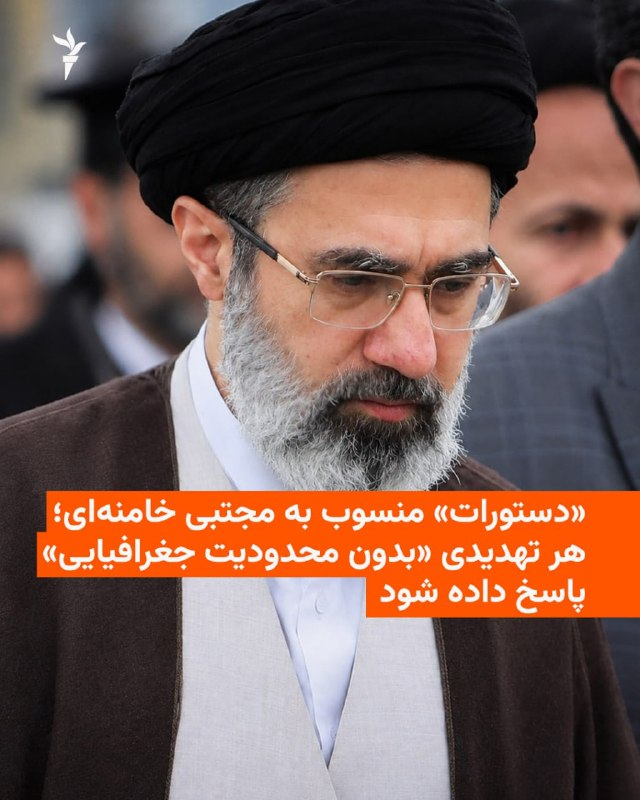

رسانه‌های ایران با انتشار متنی منسوب به مجتبی خامنه‌ای، رهبر جمهوری اسلامی، می‌گویند او به فرماندهان ارشد نیروهای مسلح دستور داده است به هرگونه تهدید احتمالی «فوری، اثرگذار و بدون محدودیت جغرافیایی» پاسخ بدهند.  

این متن روز شنبه نهم آبان به نقل از دفتر رهبر جمهوری اسلامی منتشر شد و در آن آمده است که مجتبی خامنه‌ای در دیدار با فرماندهان نظامی، خواستار «آمادگی رزمی هوشمندانه برای مقابلهٔ پرقدرت با دشمنان» شده است.  

در این گزارش‌ها زمان و مکان دیدار اعلام نشده و هیچ تصویر یا صدایی نیز از آن منتشر نشده است. این ادامهٔ روند پیشین است که از زمان اعلام مجتبی خامنه‌ای به‌عنوان رهبر جمهوری اسلامی، هیچ تصویر یا فایل صوتی تازه‌ای از او انتشار نیافته و هیچ توضیحی هم دربارهٔ دلیل آن ارائه نشده است.  

رسانه‌های حکومتی نوشته‌اند که در این دیدار، علی عبداللهی، رئیس ستاد کل نیروهای مسلح، امیر حاتمی، فرمانده کل ارتش، و احمد وحیدی، فرمانده کل سپاه پاسداران، گزارش‌هایی دربارهٔ وضعیت آمادگی نیروها در سواحل خلیج فارس، تنگه هرمز، دریای عمان و مرزهای شمال غرب و جنوب شرق ایران ارائه کرده‌اند.  
@[VahidHeadline](https://t.me/VahidHeadline/329095)  

📡 [@VahidOnline](https://t.me/VahidOnline)

· · ·

**🕒 ۱۴۰۵/۰۸/۰۹ ۱۶:۱۰** · [پست 78925](https://t.me/VahidOnline/78925)

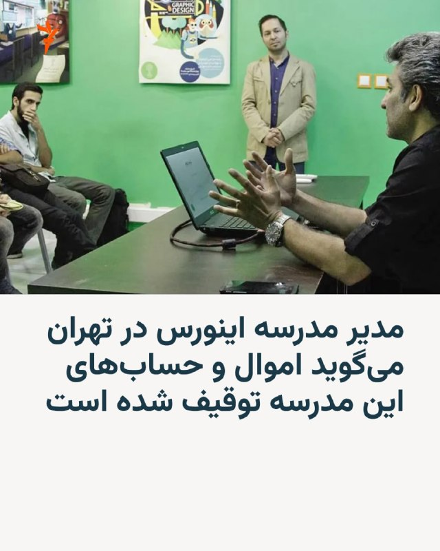

مدرسهٔ هنری «اینورس» در ایران از توقیف اموال، مسدودشدن حساب‌های بانکی و درگاه پرداخت و فیلترشدن وب‌سایت خود خبر داد.  

علیرضا اردوبادی، بنیان‌گذار اینورس، در اطلاعیه‌ای که روز جمعه هشتم آبان در حساب اینستاگرام مدرسه منتشر شد، اعلام کرد که این اقدامات بدون ارائهٔ توضیح روشن دربارهٔ دلایل و مبنای قانونی آن‌ها انجام شده و روند مصادرهٔ اموال مجموعه نیز در جریان است.  

او با تأکید بر این که مدرسهٔ اینورس هیچ‌گاه فعالیت سیاسی نداشته است، برخورد با این مجموعهٔ آموزشی را ناشی از مواضع شخصی خود دانست.  

اردوبادی همچنین گفته است که این مدرسه در طول فعالیت خود به بیش از ۷۰ هزار نفر آموزش داده است.  

مقامات قضایی جمهوری اسلامی هنوز توضیحی در این باره نداده‌اند، اما خبرگزاری فارس، نزدیک به سپاه پاسداران، روز شنبه با اعلام این‌که «اموال علیرضا اردوبادی توقیف و در حال مصادره است»، او را متهم کرد که در صفحات شخصی خود در شبکه‌های اجتماعی «ضمن اهانت به شیعیان، به تبلیغ علیه نظام می‌پرداخت».  
@[VahidHeadline](https://t.me/VahidHeadline/329077)  

📡 [@VahidOnline](https://t.me/VahidOnline)

· · ·

**🕒 ۱۴۰۵/۰۸/۰۹ ۱۶:۰۹** · [پست 78924](https://t.me/VahidOnline/78924)

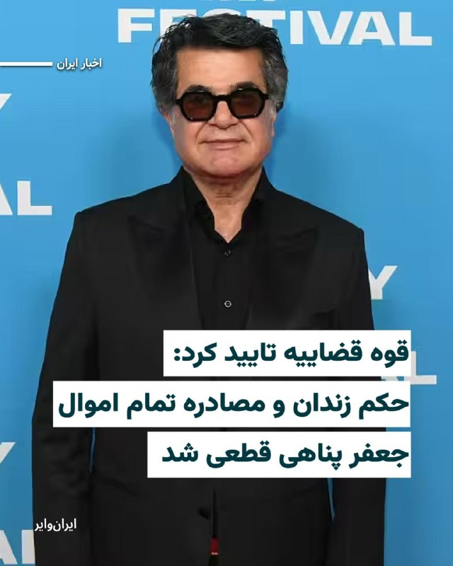

قوه قضاییه جمهوری اسلامی اعلام کرده است که اقدامات لازم برای شناسایی و توقیف تمامی اموال «جعفر پناهی»، فیلمساز سرشناس ایرانی، آغاز شده و او برای اجرای حکم پنج سال و یک ماه حبس به زندان احضار شده است. این اقدام در ادامه فشارهای قضایی بر کارگردانی صورت می‌گیرد که سال گذشته با فیلم «یک تصادف ساده» برنده نخل طلای جشنواره کن شد.  
@[VahidHeadline](https://t.me/VahidHeadline/329076)  

📡 [@VahidOnline](https://t.me/VahidOnline)

· · ·

**🕒 ۱۴۰۵/۰۸/۰۹ ۱۶:۰۶** · [پست 78923](https://t.me/VahidOnline/78923)

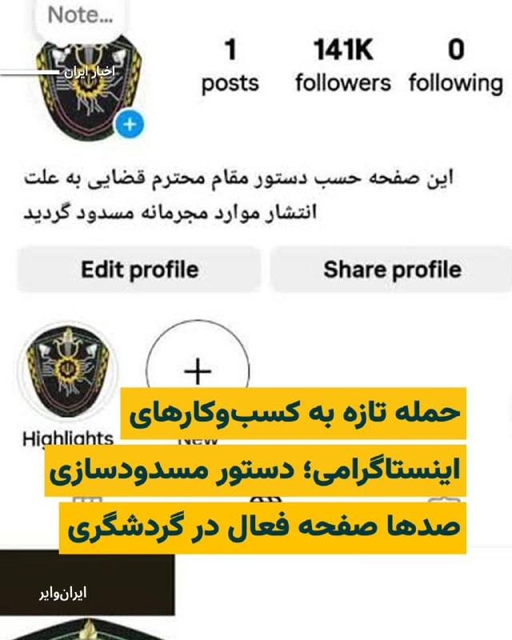

در ادامه برخوردهای جمهوری اسلامی با فعالیت شهروندان در شبکه‌های اجتماعی، معاون گردشگری استان تهران از شناسایی نزدیک به ۸۰۰ صفحه اینستاگرامی در حوزه گردشگری خبر داده است؛ حساب‌هایی که مقام‌های حکومتی آن‌ها را «غیرمجاز» می‌خوانند و اکنون با دستور دادستان تهران در معرض مسدودسازی قرار گرفته‌اند.  
به گزارش ایسنا، معاون گردشگری استان تهران اعلام کرده است که تاکنون نزدیک به ۸۰۰ صفحه اینستاگرامی فعال در حوزه گردشگری که فاقد مجوز تشخیص داده شده‌اند، شناسایی شده‌اند.  
او همچنین گفته است که با دستور دادستان تهران، صفحات غیرمجاز گردشگری در اینستاگرام مسدود خواهند شد.  

این خبر یک روز پس از آن منتشر شد که [دادستان تهران با اشاره به موضوع حجاب، دستور داد صفحات مجازی تورهای گردشگری فاقد مجوز ظرف یک هفته مسدود شوند](https://t.me/VahidHeadline/328944).  
@[VahidHeadline](https://t.me/VahidHeadline/329074)  

📡 [@VahidOnline](https://t.me/VahidOnline)

· · ·

**🕒 ۱۴۰۵/۰۸/۰۹ ۱۶:۰۵** · [پست 78922](https://t.me/VahidOnline/78922)


**حمله نیروهای بسیجی و لباس‌شخصی به برگزارکنندگان هالووین در خیابان ایرانشهر تهران**  

شامگاه جمعه ۸ آبان، خیابان ایرانشهر تهران، هم‌زمان با تجمع جمعی از جوانان با لباس‌ها و گریم‌های ویژه هالووین، شاهد حضور نیروهای بسیجی و لباس‌شخصی و برخورد با شهروندان بود.  

نیروهای امنیتی و لباس‌شخصی با حضور گسترده در این محدوده، مسیر خیابان را مسدود کرده و با ورود به محل تجمع، اقدام به متفرق کردن جوانان کردند. بر اساس روایت شاهدان عینی، نیروها همچنین کافه‌های خیابان را تعطیل کرده، مشتریان را از محل بیرون رانده و تعدادی از شهروندان را مورد ضرب‌وشتم قرار داده‌اند.  

یکی از شاهدان عینی در توصیف فضای حاکم بر خیابان گفته است نیروهای لباس‌شخصی با صورت‌های پوشیده و مجهز به چوب و چماق در محل مستقر بودند و عابران را نیز هدف برخورد قرار می‌دادند.  

بر اساس روایت دیگری از شاهدان این واقعه، دو نفر بازداشت شده‌اند و دامنه برخوردها تنها به جوانانی که با لباس و گریم هالووین در خیابان حضور داشتند محدود نبوده است. به گفته این شاهد، خانواده‌هایی که در پارک هنرمندان حضور داشتند نیز با برخورد نیروها مواجه شدند.  
@[VahidOOnLine](https://t.me/VahidOOnLine/267654)  

📡 [@VahidOnline](https://t.me/VahidOnline)

· · ·

**🕒 ۱۴۰۵/۰۸/۰۹ ۱۶:۰۴** · [پست 78921](https://t.me/VahidOnline/78921)

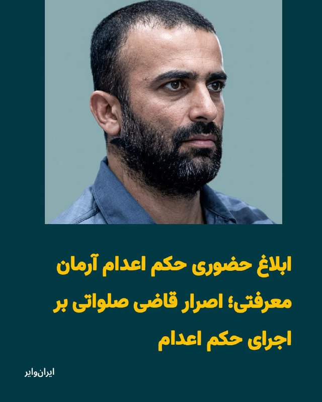

«آرمین (آرمان) معرفتی»، از بازداشت‌شدگان اعتراضات دی۱۴۰۴، این هفته بار دیگر به شعبه ۱۵ دادگاه انقلاب تهران احضار شده و «ابوالقاسم صلواتی»، رییس این شعبه، حکم اعدام او را به‌صورت حضوری ابلاغ کرده است.  
آرمان معرفتی، شهروند ۳۰ ساله اهل سقز در استان کردستان، پیش‌تر به اتهام «محاربه» از سوی شعبه ۱۵ دادگاه انقلاب تهران به اعدام محکوم شده بود.  
@[VahidHeadline](https://t.me/VahidHeadline/329056)  

📡 [@VahidOnline](https://t.me/VahidOnline)

· · ·

**🕒 ۱۴۰۵/۰۸/۰۹ ۰۶:۱۲** · [پست 78920](https://t.me/VahidOnline/78920)

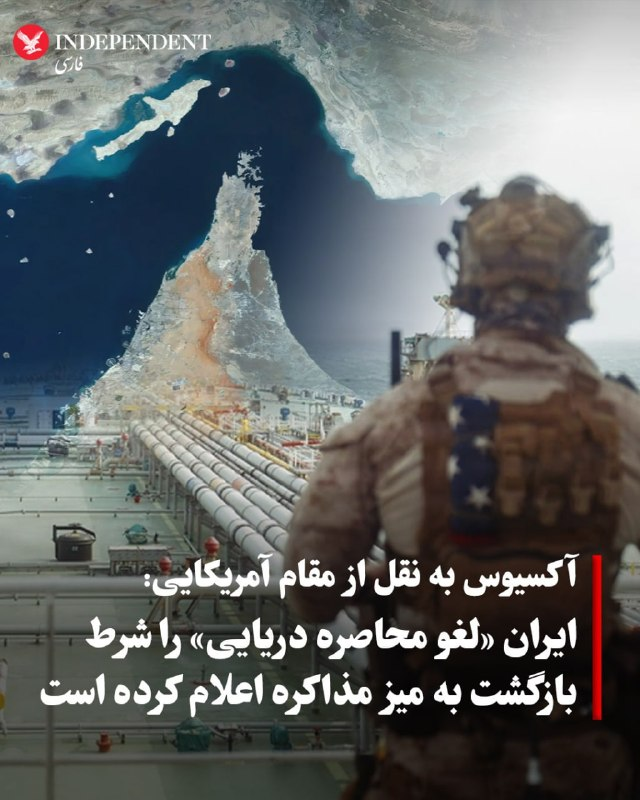

▪️ یک مقام آمریکایی گفت دو خواسته متعارض تاکنون مانع پیشرفت مذاکرات شده است: اصرار دولت ترامپ بر اینکه ایران باید به‌عنوان بخشی از روند ازسرگیری مذاکرات، امتیازهایی در زمینه هسته‌ای بدهد؛ و شرط ایران مبنی بر اینکه آمریکا ابتدا محاصره دریایی را لغو کند، دارایی‌های مسدودشده را آزاد کند و اجازه فروش نفت به ایران بدهد.  

▪️ قطری‌ها تلاش می‌کنند ایران را متقاعد کنند که به‌عنوان اقدامی اعتمادساز، به بازرسان سازمان ملل اجازه بازدید از تأسیسات هسته‌ای بمباران‌شده خود را بدهد؛ اقدامی که آمریکا در مقابل آن، بخشی از تحریم‌ها را کاهش خواهد داد.  

ترجمه ماشین:  
به گفته منابع دیپلماتیک، میانجی‌های قطری روز جمعه بیش از ۱۲ ساعت در تهران مذاکره کردند تا به توافقی برای ازسرگیری مذاکرات مستقیم میان آمریکا و ایران دست یابند و از آغاز جنگ پس از انتخابات میان‌دوره‌ای آمریکا جلوگیری کنند.  

▪️ این گفت‌وگوها روز شنبه در دوحه، پایتخت قطر، ادامه خواهد یافت.  

🔻 **چرا مهم است:**  
آمریکا اکنون تنها چند روز با عملیات نظامی احتمالی فاصله دارد که می‌تواند خسارات عظیمی به ایران وارد کند و احتمالاً به حملات تلافی‌جویانه علیه اسرائیل و شماری از کشورهای حاشیه خلیج فارس منجر شود.  

🔻 **تحولات اصلی:**

… [ادامه در تلگرام](https://t.me/VahidOnline/78920)

· · ·

**🕒 ۱۴۰۵/۰۸/۰۸ ۲۳:۳۷** · [پست 78919](https://t.me/VahidOnline/78919)

خبرنگار اکسیوس، ترجمه ماشین:  

یک منبع دیپلماتیک به من گفت که مذاکره‌کنندگان قطری در تهران حضور داشته‌اند و مذاکرات به مدت ۱۲ ساعت ادامه داشته است. این منبع افزود که میانجیگران قطری در طول روز به‌طور مرتب با کاخ سفید نیز در تماس بوده‌اند.  

این منبع گفت: «گفت‌وگوها همچنان در جریان است و تلاش‌ها برای دستیابی به توافقی میان آمریکا و ایران ادامه دارد.»  
[BarakRavid](https://x.com/BarakRavid/status/2116247747364012494)  

📡 [@VahidOnline](https://t.me/VahidOnline)

· · ·

**🕒 ۱۴۰۵/۰۸/۰۸ ۲۱:۳۷** · [پست 78918](https://t.me/VahidOnline/78918)


پست سنتکام، ترجمه ماشین:  
🚫 ادعا: امروز سپاه پاسداران انقلاب اسلامی ایران مدعی شد که یک شناور بدون سرنشین نظامی آمریکا را در تنگه هرمز منهدم کرده است. این ادعا دروغ است؛ درست مانند بسیاری دیگر از دروغ‌های سپاه پاسداران در این هفته.  

✅ واقعیت: تمامی شناورهای سطحی بدون سرنشین ارتش آمریکا در خاورمیانه حاضر و وضعیت آن‌ها مشخص است؛ از جمله یک اسکادران از شناورهای بدون سرنشین پیشرفته که در تنگه هرمز گشت‌زنی می‌کنند و از لایه دفاعی فرماندهی مرکزی آمریکا (سنتکام) پشتیبانی می‌کنند.  
[CENTCOM](https://x.com/CENTCOM/status/2116227440347394114)  

📡 [@VahidOnline](https://t.me/VahidOnline)

· · ·

**🕒 ۱۴۰۵/۰۸/۰۸ ۱۸:۱۶** · [پست 78917](https://t.me/VahidOnline/78917)


فریدریش مرتس، صدراعظم آلمان، روز جمعه هشتم آبان‌ماه، در نشستی خبری در سئول، پایتخت کره جنوبی، اعلام کرد که دولت آلمان در حال هماهنگی و تقویت تلاش‌های دیپلماتیک برای پایان دادن به جنگ ایران در سریع‌ترین زمان ممکن است.  

به گزارش خبرگزاری فرانسه، مرتس با تأکید بر ضرورت حل مسالمت‌آمیز این مناقشه گفت: «از همهٔ طرف‌های درگیر می‌خواهم توجه داشته باشند که این مناقشه راه‌حل نظامی ندارد و باید از طریق دیپلماسی و گفت‌وگو حل شود.» او افزود که این موضوع دربارهٔ اسرائیل و دولت آینده این کشور نیز صدق می‌کند.  

صدراعظم آلمان با اشاره به روابط خوب برلین با اسرائیل و کشورهای حاشیه خلیج فارس گفت: «ما از مسیرهای مختلف در حال هماهنگی و تقویت تلاش‌های دیپلماتیک خود هستیم تا این مناقشه هرچه سریع‌تر پایان یابد.» او همچنین تأکید کرد که آلمان با کشورهای منطقه در تماس است و برای حل مسالمت‌آمیز جنگ تلاش می‌کند.  

مرتس با اشاره به پیامدهای اقتصادی جنگ ایران برای اروپا اعلام کرد که افزایش قیمت انرژی طی هشت ماه گذشته بیش از ۱۰۰ میلیارد یورو هزینه به اروپا تحمیل کرده است.  
@[VahidOOnLine](https://t.me/VahidOOnLine/267546)  

📡 [@VahidOnline](https://t.me/VahidOnline)

· · ·

**🕒 ۱۴۰۵/۰۸/۰۸ ۱۷:۰۶** · [پست 78916](https://t.me/VahidOnline/78916)

🖼 *(عکس بعد از ۲۴ ساعت حذف شده)*

«دونالد ترامپ» رییس‌جمهوری آمریکا، بار دیگر پیش‌بینی کرد جنگ با ایران به‌زودی پایان خواهد یافت، در حالی‌که خبرگزاری آسوشیتدپرس گزارش داده واشنگتن به متحدان منطقه‌ای خود درباره احتمال ازسرگیری حملات به ایران پس از انتخابات میان‌دوره‌ای کنگره هشدار داده است.  
ترامپ جمعه ۸آبان۱۴۰۵ در گفت‌وگو با ایستگاه رادیویی KCMO در کانزاس‌سیتی گفت: «این ماجرا به‌زودی تمام می‌شود.» او افزود: «ما به تضمینی نیاز داریم که هرگز سلاح هسته‌ای وجود نداشته باشد.»  
@[VahidHeadline](https://t.me/VahidHeadline/328929)  

📡 [@VahidOnline](https://t.me/VahidOnline)

· · ·

**🕒 ۱۴۰۵/۰۸/۰۸ ۱۵:۳۸** · [پست 78914](https://t.me/VahidOnline/78914)

🖼 *(عکس بعد از ۲۴ ساعت حذف شده)*

خبرگزاری رویترز به نقل از یک مقام آگاه گزارش داد که میانجی‌گران قطری بار دیگر به تهران سفر کرده‌اند تا تلاش‌ها برای دستیابی به توافق میان ایران و آمریکا برای پایان دادن به جنگ را ادامه دهند.  

این مقام روز جمعه هشتم آبان به رویترز گفت که گفت‌وگوهای میانجی‌گرانه با هماهنگی واشینگتن انجام می‌شود، اما جزئیات بیشتری دربارهٔ مذاکرات تازه ارائه نکرد.  
این دومین سفر میانجی‌گران قطری به ایران در یک هفتهٔ اخیر است.  
قطر روز یکشنبهٔ گذشته پیش‌نویس طرحی برای پایان جنگ را به ایران ارائه کرده بود، اما یک مقام ارشد جمهوری اسلامی این پیشنهادها را «غیرقابل‌قبول» خواند و تأکید کرد که موضع تهران دربارهٔ برنامهٔ هسته‌ای تغییر نکرده است.  
@[VahidHeadline](https://t.me/VahidHeadline/328888)  
خبرگزاری ایرنا، روز جمعه هشتم آبان ماه گزارش کرد، هیئتی به ریاست محمد بن عبدالرحمن بن جاسم آل ثانی، وزیر خارجه قطر، صبح جمعه هشتم آبان‌ماه، برای دیدار و رایزنی با مقام‌های ارشد جمهوری اسلامی وارد تهران شده است.  
@[VahidOOnLine](https://t.me/VahidOOnLine/267508)  

📡 [@VahidOnline](https://t.me/VahidOnline)

· · ·

**🕒 ۱۴۰۵/۰۸/۰۸ ۱۵:۳۵** · [پست 78913](https://t.me/VahidOnline/78913)

🖼 *(عکس بعد از ۲۴ ساعت حذف شده)*

الناز شاکردوست، بازیگر سینمای ایران، در بخش نظرات صفحه اینستاگرام یک فیلم‌ سینمایی، در واکنش به انتشار خبر مهاجرتش نوشت، از ایران مهاجرت نکرده، بلکه حکم زندان مانع بازگشت او به کشور شده است.  

الناز شاکردوست پس از انتشار متنی مرتبط با اعتراض‌های دی‌ماه ۱۴۰۴ در روایتگر اینستاگرام، با اتهام «فعالیت تبلیغی علیه نظام» در دادگاه انقلاب محاکمه شد. دادگاه بدوی این بازیگر سینمای ایران را به ۱ سال حبس تعزیری و ۲ سال محرومیت از فعالیت‌های سیاسی، مجازی و هنری محکوم کرده است.  

هوشنگ پوربابایی، وکیل الناز شاکردوست، روز جمعه ۱۰ مهرماه در گفتگو با پایگاه خبری «امتداد» اعلام کرد که شعبه ۳۶ دادگاه تجدیدنظر استان تهران، حکم موکلش را تایید کرده است.  

در همین حال، رسانه تابناک از تلاش یک «کارگردان زن بانفوذ» برای عفو این بازیگر باسابقه خبر داده است.  
@[VahidOOnLine](https://t.me/VahidOOnLine/267492)  

📡 [@VahidOnline](https://t.me/VahidOnline)

· · ·

**🕒 ۱۴۰۵/۰۸/۰۸ ۱۵:۳۴** · [پست 78912](https://t.me/VahidOnline/78912)

🖼 *(عکس بعد از ۲۴ ساعت حذف شده)*

دستاورد تازه جمهوری اسلامی برای ایران:  
**مارک کارنی، نخست‌وزیر کانادا از ادعای مالکیت امارات متحده عربی بر جزایر سه‌گانه خلیج فارس حمایت کرده است.**  

این حمایت هم‌زمان با دیدار شیخ خالد بن محمد بن زاید آل‌نهیان، ولیعهد ابوظبی از کانادا صورت گرفته است.  

در پی این دیدار دو طرف با صدور یک بیانیه مشترک در ۲۸ اکتبر بر همکاری کانادا و امارات متحده عربی در زمینه‌های مختلف تاکید کردند.  

بند پایانی این بیانیه مشترک به ادعای مالکیت امارات بر جزایر تنب بزرگ، تنب کوچک و ابوموسی پرداخته و خواهان پایان «اشغال» این جزایر به وسیله ایران شده است.  

این بیانیه می‌نویسد: «دو کشور خواستار پایان اشغال جزایر سه‌گانه تنب بزرگ و کوچک و ابوموسی هستند و آن را نقض حاکمیت ملی امارات متحده عربی و منشور سازمان ملل متحد می‌دانند.»  

ایران جزایر سه‌گانه خلیج فارس را بخش جدایی ناپذیر از سرزمین خود می‌داند که در اشغال بریتانیا بوده است.  

نیروی دریایی ایران پیش از اعلام موجودیت امارات متحده عربی در سال ۱۹۷۱ این جزایر راهبردی را در اختیار گرفت.  
@[VahidHeadline](https://t.me/VahidHeadline/328858)  

📡 [@VahidOnline](https://t.me/VahidOnline)

· · ·

**🕒 ۱۴۰۵/۰۸/۰۸ ۱۵:۳۳** · [پست 78911](https://t.me/VahidOnline/78911)

رویترز در تحقیقی از شبکه‌ای با بیش از ۵۰۰۰ نهاد مرتبط با وزارت دفاع جمهوری اسلامی پرده برداشته که با استفاده از درآمدهای نفتی خارج از کشور و واسطه‌های تجاری، به تأمین قطعات، مواد اولیه نظامی و خودرو ادامه داده است؛ شبکه‌ای که تحریم‌ها، جنگ و محاصره دریایی آمریکا نیز جریان واردات آن را متوقف نکرده‌اند.  
@[VahidOOnLine](https://t.me/VahidOOnLine/267497)  

📡 [@VahidOnline](https://t.me/VahidOnline)

🎬 ویدیو: [مشاهده در تلگرام](https://t.me/VahidOnline/78911)

· · ·

**🕒 ۱۴۰۵/۰۸/۰۸ ۱۵:۲۹** · [پست 78907](https://t.me/VahidOnline/78907)

🖼 *(عکس بعد از ۲۴ ساعت حذف شده)*

**گروه مالی پاسارگاد هم‌زمان با روز  کوروش: یا پوشش اسلامی موردپسند مدیرعامل یا اخراج**  

پانزده کارمند شرکت «پاد» سه‌شنبه پنجم آبان در جریان بازدید مجید قاسمی، مدیرعامل بانک پاسارگاد، شغل‌شان را از دست دادند؛ چهارده زن به‌دلیل رعایت نکردن حجاب اجباری و یک مرد به‌دلیل پوشیدن شلوار جین.  

قاسمی همان‌جا دستور اخراج آن‌ها را صادر کرد و همان روز مدیرعامل شرکت را نیز برکنار کرد.   
چند ساعت بعد، پیام به کارکنان شرکت‌های دیگر مجموعه رسید: فردا با پوشش تعیین‌شده بیایید، وگرنه اجازه ورود ندارید.  

برای کارکنانی که تا روز قبل بدون مانتو و حجاب اجباری در محل کار حاضر می‌شدند، این پیام به معنای تغییر ناگهانی شرایط کار بود. حالا باید مقنعه و لباس اداری تهیه می‌کردند، کفش‌هایشان را تغییر می‌دادند و خود را با دستور تازه تطبیق می‌دادند؛ یا صبح پشت در شرکت می‌ماندند.  

ایران‌وایر همچنین مطلع شده است که به کارکنان برخی شرکت‌های مجموعه، از جمله پاد، ده میلیون تومان برای خرید لباس مورد نظر هلدینگ پرداخت شده است. وعده کمک‌هزینه‌ای که در تصویر دستورالعمل دیده می‌شود، در برخی شرکت‌ها به پرداخت رسیده؛ همراه با الزامی که ورود به محل کار را به پوشش کارکنان گره می‌زند.

… [ادامه در تلگرام](https://t.me/VahidOnline/78907)

· · ·

**🕒 ۱۴۰۵/۰۸/۰۸ ۰۸:۱۱** · [پست 78906](https://t.me/VahidOnline/78906)

🖼 *(عکس بعد از ۲۴ ساعت حذف شده)*

ائتلاف نظامی به رهبری عربستان سعودی اعلام کرد یک پهپاد پرتاب‌شده از سوی حوثی‌های مورد حمایت جمهوری اسلامی را در منطقه مکه رهگیری و منهدم کرده است.  

این حادثه تازه‌ترین مورد از حملات فرامرزی منتسب به حوثی‌ها علیه عربستان سعودی است.  
حوثی‌ها در هفته‌های اخیر با استفاده از پهپادها و موشک‌ها، تاسیسات نظامی، فرودگاه‌ها و زیرساخت‌های انرژی این کشور را هدف قرار داده‌اند.  

حوثی‌ها تاکنون به این حادثه واکنشی نشان نداده‌اند. این گروه پیش‌تر بارها اتهام حمله به مکه و مدینه، دو شهر مقدس مسلمانان، را رد کرده است.  
@[VahidOOnLine](https://t.me/VahidOOnLine/267488)  

📡 [@VahidOnline](https://t.me/VahidOnline)

· · ·

**🕒 ۱۴۰۵/۰۸/۰۸ ۰۸:۰۸** · [پست 78905](https://t.me/VahidOnline/78905)

🖼 *(عکس بعد از ۲۴ ساعت حذف شده)*

سازمان عملیات تجارت دریایی بریتانیا ([UKMTO](https://x.com/UK_MTO/status/2116007177714336103)) در آخرین به‌روزرسانی هشدار خود اعلام کرد یک قایق کوچک در تنگه هرمز به یک نفتکش نزدیک شد و دو وسیله انفجاری به بدنه آن متصل کرد. انفجار این مواد باعث آتش‌سوزی در موتورخانه و از کار افتادن موقت نفتکش شد. هویت این قایق در اطلاعیه مشخص نشده است.  

بر اساس این گزارش، حادثه ساعت ۲۲:۱۲ به وقت جهانی در ۲۹ اکتبر، در فاصله ۲۵ مایل دریایی شمال‌شرق خصب عمان رخ داد. این نفتکش هنگام وقوع حادثه در حال عبور به سمت خارج از تنگه هرمز بود.  
@[VahidOOnLine](https://t.me/VahidOOnLine/267487)  

📡 [@VahidOnline](https://t.me/VahidOnline)

· · ·

**🕒 ۱۴۰۵/۰۸/۰۸ ۰۴:۴۰** · [پست 78904](https://t.me/VahidOnline/78904)

🖼 *(عکس بعد از ۲۴ ساعت حذف شده)*

جی‌دی ونس، معاون رئیس‌جمهوری ایالات متحده، روز پنجشنبه هفتم آبان در نشست پرسش و پاسخ شبکهٔ فاکس‌نیوز در فورت ورث ایالت تگزاس گفت که دونالد ترامپ اجازه نخواهد داد درگیری آمریکا با ایران به «جنگی بی‌پایان» تبدیل شود.  
ونس در پاسخ به پرسش یکی از دانشجویان دربارهٔ وعده‌های انتخاباتی دولت ترامپ برای پایان دادن به جنگ‌های پرهزینهٔ خارجی گفت: «هفت ماه است که به شکلی درگیر ایران هستیم. ایالات متحده ۴۷ سال است که با ایران سروکار دارد و به شما قول می‌دهم دونالد ترامپ اجازه نخواهد داد ایران به یک جنگ بی‌پایان تبدیل شود.»  
او با اشاره به سابقهٔ خدمت نظامی خود در عراق افزود که نارضایتی از مداخلات نظامی آمریکا در خاورمیانه یکی از دلایل اصلی ورودش به سیاست بوده است.  
@[VahidOOnLine](https://t.me/VahidOOnLine/267472)  

📡 [@VahidOnline](https://t.me/VahidOnline)

· · ·
