# 📡 فید کانال‌های تلگرام

آخرین بررسی: ۱۴۰۵/۰۸/۱۶ ۲۲:۰۹ (به وقت تهران)

هر ساعت به‌روز می‌شود. از هر کانال ۲۰ پست آخر نمایش داده می‌شود؛ عکس‌ها ۲۴ ساعت می‌مانند، برای ویدیو فقط متن و لینک پست آمده است. متن همه‌ی پست‌ها در پوشه‌ی [archive](archive/) نگه‌داری می‌شود.

## فهرست کانال‌ها

- [irnetmonitor](#irnetmonitor) · آخرین پست: ۱۴۰۵/۰۸/۱۳ ۱۲:۲۳
- [CyberNigga2](#cybernigga2) · آخرین پست: ۱۴۰۵/۰۸/۱۵ ۲۱:۲۹
- [kaavoush](#kaavoush) · آخرین پست: ۱۴۰۵/۰۸/۱۶ ۲۱:۴۵
- [iaghapour](#iaghapour) · آخرین پست: ۱۴۰۵/۰۸/۱۶ ۲۱:۰۹
- [MatinSenPaii](#matinsenpaii) · آخرین پست: ۱۴۰۵/۰۸/۱۶ ۲۰:۰۳
- [whitedns](#whitedns) · آخرین پست: ۱۴۰۵/۰۸/۱۶ ۱۵:۰۵
- [ircfspace](#ircfspace) · آخرین پست: ۱۴۰۵/۰۸/۱۴ ۱۹:۴۹
- [patt_channel_x](#patt_channel_x) · آخرین پست: ۱۴۰۵/۰۸/۱۴ ۰۳:۳۷
- [mahsa_net](#mahsa_net) · آخرین پست: ۱۴۰۵/۰۸/۰۱ ۲۲:۵۹
- [VahidOnline](#vahidonline) · آخرین پست: ۱۴۰۵/۰۸/۱۶ ۲۰:۲۲

---

## irnetmonitor

[کانال در تلگرام](https://t.me/irnetmonitor) · [آرشیو متن](archive/irnetmonitor/)

**🕒 ۱۴۰۵/۰۸/۱۳ ۱۲:۲۳** · [پست 5240](https://t.me/irnetmonitor/5240)

خوب به سلامتی دموکرات ها رای اکثریت رو اوردن و کاخ سفید رو حسینیه کردین،  مبارکتون باشه خطر جنگ هم دور شد ازتون ، آقای وزارت قطع ارتباطات حالا وقتش نیست یکم نت رو شل کنید؟ اختلال نندازید و از این جور پدرسگ بازیا؟

· · ·

**🕒 ۱۴۰۵/۰۸/۰۹ ۱۸:۳۰** · [پست 5239](https://t.me/irnetmonitor/5239)

↪️ فوروارد از Pishdad Network🫡

**اعلام وضعیت زرد اینترنت ⚠️⚠️⚠️**  
(این هشدار برای دو هفته آینده است)  

در شرایط فعلی توصیه می‌شود:  

- ترافیک سرورهای اندازه یک هفته حداقل شارژ داشته باشید.  
- حساب اعتباری سایت برای مواقع ضروری شارژ داشته باشد.  
- سرورهای مورد نیاز چه ایران و خارج زودتر تهیه کنید.  

شبکه پیشداد

· · ·

**🕒 ۱۴۰۵/۰۸/۰۹ ۱۸:۱۸** · [پست 5238](https://t.me/irnetmonitor/5238)

[iran internet monitor](https://t.me/irnetmonitor) pinned «⚠️ اطلاعیه فوری  طبق اطلاعات دریافتی از چند دیتاسنتر معتبر و پیگیری‌های انجام‌شده، احتمال اعمالل قطعی اینترنت بین‌الملل از هفته آینده مطرح شده است.  با توجه به احتمال بروز اختلال در دسترسی به اینترنت و سرویس‌های وابسته، توصیه می‌شود در صورت وابستگی فعالیت‌های…»

· · ·

**🕒 ۱۴۰۵/۰۸/۰۹ ۱۸:۱۸** · [پست 5237](https://t.me/irnetmonitor/5237)

⚠️ اطلاعیه فوری  

طبق اطلاعات دریافتی از چند دیتاسنتر معتبر و پیگیری‌های انجام‌شده، احتمال اعمالل قطعی اینترنت بین‌الملل از هفته آینده مطرح شده است.  

با توجه به احتمال بروز اختلال در دسترسی به اینترنت و سرویس‌های وابسته، توصیه می‌شود در صورت وابستگی فعالیت‌های کاری یا تجاری شما به اینترنت، اقدامات ضروری از جمله تهیه نسخه پشتیبان (Backup) از اطلاعات، ذخیره فایل‌های مهم و انجام امور ضروری را در اسرع وقت انجام دهید.

· · ·

**🕒 ۱۴۰۵/۰۸/۰۶ ۰۲:۰۹** · [پست 5236](https://t.me/irnetmonitor/5236)

عرزشی ، ساندیسی ، پاسدار ، حمال جمهوری اسلامی ،  زوزه بکش

🎬 ویدیو: [مشاهده در تلگرام](https://t.me/irnetmonitor/5236)

· · ·

**🕒 ۱۴۰۵/۰۸/۰۶ ۰۱:۵۷** · [پست 5235](https://t.me/irnetmonitor/5235)

🔴 #خبر\_فوری  
لحظاتی پیش کانال 14 اسرائیل نتایج به‌روزرسانی شده از انتخابات اسرائیل را منتشر کرد:  
ائتلاف به رهبری نتانیاهو 61 کرسی را به دست آورده است و دولت بعدی اسرائیل را تشکیل خواهد داد.

· · ·

**🕒 ۱۴۰۵/۰۸/۰۶ ۰۱:۵۱** · [پست 5234](https://t.me/irnetmonitor/5234)

خوب به نظر باید جمهوری اسلامی دوباره چیزایی که باز کرده رو ببنده  چون بنیامین نتانیاهو برنده انتخابات شد و کون جمهوری اسلامی رو به زودی هدف خواهد گرفت 😂

· · ·

**🕒 ۱۴۰۵/۰۸/۰۵ ۱۸:۵۶** · [پست 5233](https://t.me/irnetmonitor/5233)

فوری :  
از دقایقی پیش گشایش هایی در پروتکل های مسدود شده هفته های اخیر به مقصد دیتاسنتر های معروف در  اکثر اپراتور ها انجام شده و از وضعیت انقباضی  و جنگی خارج شد  

تست شده با همراه اول ، ایرانسل ، رایتل در تهران

· · ·

**🕒 ۱۴۰۵/۰۸/۰۳ ۱۶:۲۴** · [پست 5232](https://t.me/irnetmonitor/5232)

🖼 *(عکس بعد از ۲۴ ساعت حذف شده)*

پینگ گیتوی ابراروان ریجن اسیاتکشونو مشاهده فرمایید... تست با شبکه 5g ایرانسل ! نوار قلب یه مریض رو به موت هم اینطوری نیست والا

· · ·

**🕒 ۱۴۰۵/۰۸/۰۳ ۱۶:۲۱** · [پست 5231](https://t.me/irnetmonitor/5231)

🖼 *(عکس بعد از ۲۴ ساعت حذف شده)*

در این روزها شاهد تجربه  پر اختلال ترین و بی کیفیت ترین اینترنت در ایران هستیم ... ، فقط وصلیم ... عملا هیچکار نمیشه کرد  کیفیت منفی صفر

· · ·

**🕒 ۱۴۰۵/۰۸/۰۲ ۱۶:۵۵** · [پست 5230](https://t.me/irnetmonitor/5230)

↪️ فوروارد از منیجیت | Manageit

**⭕️ گزارش شبکه:**  
بررسی ترافیک CDN منیجیت نشان میدهد ارتباطات زیرساخت در حال تست فرآیندهایی است که VPNهای داخل شبکه ایران را شناسایی و مسدود کند، احتمالا قرار است بعد از قطع اینترنت بین المللی این سیاست‌ها به صورت کامل بر روی شبکه داخلی اجرایی شوند، همچنین در چند روز اخیر مسدود شدن آی پی ها و دامنه‌هایی که روی CDN ها و سرورهای داخل ایران هستند شدت گرفته است.

· · ·

**🕒 ۱۴۰۵/۰۸/۰۱ ۱۲:۰۵** · [پست 5229](https://t.me/irnetmonitor/5229)

مهملات و توهمات ایرانسل در مورد افزایش تعرفه ها   

[https://irancell.ir/b/332391/internet-price-change-aban-1405](https://irancell.ir/b/332391/internet-price-change-aban-1405)

· · ·

**🕒 ۱۴۰۵/۰۸/۰۱ ۰۲:۴۸** · [پست 5228](https://t.me/irnetmonitor/5228)

↪️ فوروارد از شهر سخت افزار

🖼 *(عکس بعد از ۲۴ ساعت حذف شده)*

**🔴 اینترنت موبایل از بامداد جمعه گران شد؟**  

📱 ظاهراً از بامداد امروز جمعه ۱ آبان، قیمت بسته‌های اینترنت موبایل افزایش پیدا کرده و کاربران با تعرفه‌های بالاتری نسبت به قبل روبه‌رو شده‌اند.  

💸 بررسی‌های اولیه حاکی از افزایش چشمگیر قیمت برخی بسته‌هاست؛ با این حال هنوز اطلاعیه رسمی درباره این تغییر قیمت منتشر نشده است.  

⚠️ فعلاً جزئیات میزان افزایش قیمت و علت آن مشخص نیست و باید دید اپراتورها یا نهادهای مسئول چه توضیحی ارائه می‌کنند.  

[**🌐در شهرسخت‌افزار بخوانید**](https://www.shahrsakhtafzar.com/fa/news/internet-operator/62711-mobile-internet-package-price-hike-iran)  

**🆔**[**@ShahrSakhtAfzar**](https://t.me/ShahrSakhtAfzar)

· · ·

**🕒 ۱۴۰۵/۰۷/۲۹ ۱۸:۰۴** · [پست 5227](https://t.me/irnetmonitor/5227)

↪️ فوروارد از زومان | Zoomon

🖼 *(عکس بعد از ۲۴ ساعت حذف شده)*

**قطع فوری اینترنت در صورت آغاز جنگ جدید؛ دستور صادر شد**  

بر اساس اطلاعات دریافتی زومان، نهادهای بالادستی در نامه‌ای رسمی و الزام‌آور تأکید کرده‌اند که در صورت آغاز جنگ جدید، دسترسی کاربران در ایران به اینترنت بین‌الملل باید بلافاصله قطع شود.  

این تصمیم به عنوان یک تکلیف اجرایی تعیین شده است تا در شرایط درگیری نظامی، دسترسی به شبکه جهانی قطع شود.  

[🌐 در زومان بخوانید](https://www.zoomon.ir/behind-the-news/9226-iran-war-internet-blackout-order/?utm_source=Telegram&amp;utm_term=pr86wljqv)  

🆔 [@thezoomon](https://t.me/thezoomon)

· · ·

**🕒 ۱۴۰۵/۰۷/۲۹ ۱۴:۳۲** · [پست 5226](https://t.me/irnetmonitor/5226)

وضعیت جیتر و پینگ بعد از هر بار مسدودی vpn ها بسیار خوب و استییل میشه ( مثل امروز )   

دلایل این وضعیت:   
۱- ترافیک عظیم vpn ها از شبکه موقتا خارج میشه و بعد از چند روز vpn پرووایدر ها مجددا با روش جدید برمیگردند و دوباره شبکه رو بهم میریزن   

۲- پهنای باند بین الملل ایران محدوده و وزارت هیچ تصمیمی جهت افزایش آن با این وضعیت قیمت دلار ندارد

· · ·

**🕒 ۱۴۰۵/۰۷/۲۹ ۱۴:۰۸** · [پست 5225](https://t.me/irnetmonitor/5225)

در همکاری جدیدی که وزارت ارتباطات با وزارت نیرو اغاز کرده هر روز شبکه اینترنت در ایران به این صورت شده

🎬 ویدیو: [مشاهده در تلگرام](https://t.me/irnetmonitor/5225)

· · ·

**🕒 ۱۴۰۵/۰۷/۲۸ ۰۳:۴۳** · [پست 5224](https://t.me/irnetmonitor/5224)

بروزرسانی :  
اکثر پروتکل های شبکه مثل gre ,... در اکثر اپراتور ها مسدود شد   

همچنین رنج ایپی های اتصال اولیه ( پورت 3074 udp ) بازی های call of duty  نیز مسدود شده اند و برای ورود به صفحه اصلی گیم باید از vpn استفاده کنید   
رنج های مسدود شده :  

[185.34.106.0/24](http://185.34.106.0/24)  
[185.34.107.0/24](http://185.34.107.0/24)

· · ·

**🕒 ۱۴۰۵/۰۷/۲۵ ۲۲:۴۰** · [پست 5223](https://t.me/irnetmonitor/5223)

اگر پلیر call of duty هستید ، پورت ۳۰۷۴ و کل سرورهای azure  و freesas  بازی فیلتر شده اند ، در حال حاضر فقط سرورهای سفید vultr در فیلترینگ جمهوری اسلامی  با پورت های رنج ۵۰۰۰۰-۶۰۰۰۰ udp وصل هستند که متاسفانه سرورهای دیتاسنتر مذکور کیفیت بسیار پایین ولگ بسیار زیادی دارد

· · ·

**🕒 ۱۴۰۵/۰۷/۲۵ ۲۲:۳۷** · [پست 5222](https://t.me/irnetmonitor/5222)

تغییرات ۲۴ ساعت گذشته اینترنت در ایران :   
۱- مجدد udp  به مقصد خیلی از دیتاسنتر های خارجی در بیشتر isp ها مسدود شد  

۲- در این لحظه که پیغام رو مینویسم پینگ ۵۰ ۶۰ میلی ثانیه افزایش پیدا کرده   

۳- اکثر application layer ها مثل http / https به مقصد دیتاسنتر های خارجی مسدود شده

· · ·

**🕒 ۱۴۰۵/۰۱/۲۷ ۰۴:۴۷** · [پست 191](https://t.me/irnetmonitor/191)

Operator: TCI-ADSL-Tehran  
Time: 2026-08-10 15:58:00  

✅ [chatgpt.com](http://chatgpt.com/) : [104.18.32.47](http://104.18.32.47/)  
✅ [www.speedtest.net](http://www.speedtest.net/) : [104.17.147.22](http://104.17.147.22/)  
✅ [google.com](http://google.com/) : [216.239.38.120](http://216.239.38.120/)  
✅ [gmail.com](http://gmail.com/) : [142.250.202.37](http://142.250.202.37/)  
✅ [play.google.com](http://play.google.com/) : [142.251.20.138](http://142.251.20.138/)  
✅ [translate.google.com](http://translate.google.com/) : [142.251.38.14](http://142.251.38.14/)  
✅ [wikipedia.org](http://wikipedia.org/) : [185.15.59.224](http://185.15.59.224/)  
✅ [github.com](http://github.com/) : [140.82.121.4](http://140.82.121.4/)  
✅ [dash.cloudflare.com](http://dash.cloudflare.com/) : [104.17.111.184](http://104.17.111.184/)  
✅ [fastly.com](http://fastly.com/) : [151.101.193.57](http://151.101.193.57/)  
✅ [microsoft.com](http://microsoft.com/) : [13.107.226.45](http://13.107.226.45/)  
✅ [apple.com](http://apple.com/) : [17.253.144.10](http://17.253.144.10/)  
✅ [xbox.com](http://xbox.com/) : [20.76.201.171](http://20.76.201.171/)

… [ادامه در تلگرام](https://t.me/irnetmonitor/191)

· · ·

---

## CyberNigga2

[کانال در تلگرام](https://t.me/CyberNigga2) · [آرشیو متن](archive/cybernigga2/)

**🕒 ۱۴۰۵/۰۸/۱۵ ۲۱:۲۹** · [پست 5287](https://t.me/CyberNigga2/5287)

Individual 🫩

🎬 ویدیو: [مشاهده در تلگرام](https://t.me/CyberNigga2/5287)

· · ·

**🕒 ۱۴۰۵/۰۸/۱۴ ۱۴:۰۱** · [پست 5286](https://t.me/CyberNigga2/5286)

🖼 *(عکس بعد از ۲۴ ساعت حذف شده)*

· · ·

**🕒 ۱۴۰۵/۰۸/۱۲ ۱۶:۴۹** · [پست 5285](https://t.me/CyberNigga2/5285)

🖼 *(عکس بعد از ۲۴ ساعت حذف شده)*

· · ·

**🕒 ۱۴۰۵/۰۸/۱۱ ۰۰:۲۵** · [پست 5284](https://t.me/CyberNigga2/5284)

Life update: i'm losing my shit

· · ·

**🕒 ۱۴۰۵/۰۸/۰۹ ۰۰:۵۹** · [پست 5283](https://t.me/CyberNigga2/5283)

This nigga needs a game developer (C#/C++) without being mentally challenged:  

[@CatwomansHusband](https://t.me/CatwomansHusband)

· · ·

**🕒 ۱۴۰۵/۰۷/۲۹ ۲۲:۵۵** · [پست 5282](https://t.me/CyberNigga2/5282)

🖼 *(عکس بعد از ۲۴ ساعت حذف شده)*

ظاهرا پاکستانی ها تو دانلود پورن با پروکسی ازمون زدن جلو 😢

· · ·

**🕒 ۱۴۰۵/۰۷/۲۹ ۲۲:۳۲** · [پست 5281](https://t.me/CyberNigga2/5281)

فقط چیزی که رو مخم رفته اینه که پروکسی با اینترنت شاتل تست میشه. کلا پروکسی و VPN های مستقیم (بدون تانل) با همه اوپراتور ها جواب نیستن.   

دلم میخواست پروکسی ها، با تمام اینترنت ها تست بشن و نتیجه تو همون پست مشخص باشه اما فعلا راهی ندارم براش ندارم که خودم پیاده کنم. اما شاید با کمک داوطلب بتونم وضعیت هر اوپراتور و منطقه رو مشخص کنیم. اگه نیاز شد پیام میزارم تو کانال

· · ·

**🕒 ۱۴۰۵/۰۷/۲۹ ۲۲:۲۷** · [پست 5280](https://t.me/CyberNigga2/5280)

سیستم اتو پروکسی راه اندازی شد. ازین به بعد هر پروکسی که فیلتر بشه، اتوماتیک 2تا پروکسی جدید جاشو میگیره.  

اگرم به تلگرام برای گرفتن پروکسی های جدید دسترسی پیدا کنید، میتونید ازین وبسایت استفاده کنید:  

[https://elaproxy.github.io](https://elaproxy.github.io/)  

کانال پروکسی:  

[@Ela\_Proxy](https://t.me/Ela_Proxy)

· · ·

**🕒 ۱۴۰۵/۰۷/۲۹ ۱۷:۲۰** · [پست 5278](https://t.me/CyberNigga2/5278)

🖼 *(عکس بعد از ۲۴ ساعت حذف شده)*

What in the actual fuck

· · ·

**🕒 ۱۴۰۵/۰۷/۲۶ ۱۶:۴۰** · [پست 5277](https://t.me/CyberNigga2/5277)

جالبه چنتا پروکسی جدید که گذاشتم رندوم اختلال افتاد. اما همین باعث شد یه ایده ای به سرم بزنه. دارم رو یه سیستمی کار میکنم که هر پروکسی که فیلتر بشه، اتوماتیک 2 تا جدید تو کانال بزاره.  

خوبیش اینه هر ساعت از روز مشکلی واسه هر پروکسی پیش بیاد، اتوماتیک پروکسی جدید میاد تو کانال:  

🫆 [@Ela\_Proxy](https://t.me/Ela_Proxy)

· · ·

**🕒 ۱۴۰۵/۰۷/۲۶ ۱۵:۳۴** · [پست 5276](https://t.me/CyberNigga2/5276)

🖼 *(عکس بعد از ۲۴ ساعت حذف شده)*

· · ·

**🕒 ۱۴۰۵/۰۷/۲۶ ۱۴:۱۱** · [پست 5275](https://t.me/CyberNigga2/5275)

🖼 *(عکس بعد از ۲۴ ساعت حذف شده)*

· · ·

**🕒 ۱۴۰۵/۰۷/۲۵ ۲۲:۵۵** · [پست 5274](https://t.me/CyberNigga2/5274)

اسمش شد:  

[@Ela\_Proxy](https://t.me/Ela_Proxy)  

هر 10 دقیقه ام پروکسی ها خودکار خودشون با اینترنت شاتل تست میشن و پست آپدیت میشه

· · ·

**🕒 ۱۴۰۵/۰۷/۲۵ ۱۴:۲۶** · [پست 5272](https://t.me/CyberNigga2/5272)

🖼 *(عکس بعد از ۲۴ ساعت حذف شده)*

· · ·

**🕒 ۱۴۰۵/۰۷/۱۸ ۱۶:۵۳** · [پست 5271](https://t.me/CyberNigga2/5271)

🖼 *(عکس بعد از ۲۴ ساعت حذف شده)*

This is what C/C++ does to a nigga  
Sent by a Nigga

· · ·

**🕒 ۱۴۰۵/۰۷/۱۸ ۱۶:۰۰** · [پست 5270](https://t.me/CyberNigga2/5270)

↪️ فوروارد از Ela Proxy | اِلا پروکسی

**پروکسی شماره 3  
پروکسی شماره 3  
پروکسی شماره 3**  

[@no\_name\_proxy](https://t.me/no_name_proxy)

· · ·

**🕒 ۱۴۰۵/۰۷/۱۷ ۲۳:۴۶** · [پست 5269](https://t.me/CyberNigga2/5269)

🖼 *(عکس بعد از ۲۴ ساعت حذف شده)*

· · ·

**🕒 ۱۴۰۵/۰۷/۱۶ ۲۱:۳۹** · [پست 5268](https://t.me/CyberNigga2/5268)

نیازمند C کار آشنا به شبکه:  

[@musl0x01](https://t.me/musl0x01)

· · ·

**🕒 ۱۴۰۵/۰۷/۱۵ ۰۰:۲۰** · [پست 5267](https://t.me/CyberNigga2/5267)

🖼 *(عکس بعد از ۲۴ ساعت حذف شده)*

آخه مرد بزار 2 دقه سرور آنلاین بشه بعد پورن بزار زیر دانلود

· · ·

**🕒 ۱۴۰۵/۰۷/۱۵ ۰۰:۰۵** · [پست 5266](https://t.me/CyberNigga2/5266)

پروکسی راه اندازی شد. اما اسمی به ذهنم نرسید واسه کانال فعلا برید وصل بشید تا بعد:  

[@no\_name\_proxy](https://t.me/no_name_proxy)  

اگه براتون مثل آدم کار کرد، تو کامنتا اسم اوپراتورتون رو بگید. اگرم اسمی واسه کانال به ذهنتون رسید بگید 🥰

· · ·

---

## kaavoush

[کانال در تلگرام](https://t.me/kaavoush) · [آرشیو متن](archive/kaavoush/)

**🕒 ۱۴۰۵/۰۸/۱۶ ۲۱:۴۵** · [پست 10876](https://t.me/kaavoush/10876)

جناح اپوزیسون نتانیاهو خود دچار درگیری‌های خاموش داخلی هستند. آیزنکوت که شاید برای اولین و آخرین بار شانس رسیدن به نخست‌وزیری داشته باشد نمی‌خواهد این فرصت را از دست دهد و برخلاف همه صحبت‌های قبلی و ۴ شرطی که اعلام کرده بود، در پی تشکیل دولت اقلیت با حمایت بیرونی اعراب است. لیبرمن هم بازی خود را پیش می‌برد و ضمن مخالفت صریح با دولت متکی به اعراب، با انعطاف نشان دادن در موضوع سربازی حریدی‌ها به دنبال تشکیل یک دولت کاملا صهیونیستی بدون اعراب است. یائیر گولان رهبر حزب دموکرات که بسیار مشتاق تشکیل دولت با همراهی اعراب است در بیانیه‌ای برای ائتلاف با حریدی‌ها شرایط سختی تعیین کرد که تحققش شاید ناممکن باشد و اما نشانه‌ها حاکی از آن است که نفتالی بنت که این روزها سکوت پیشه کرده و چیزی نمی‌گوید با هر دو گزینه مخالف است یعنی نه دولت متکی به اعراب را می‌پسندد نه ائتلاف با حریدی‌ها در ازای انعطاف در قانون خدمت سربازی آن‌ها. فردا آیزنکوت، مأموریت تشکیل کابینه را از رئیس‌جمهور دریافت می‌کند اما جدال‌ها و بازی‌های سیاسی در اسرائیل تازه شروع شده است. آیا آیزنکوت در فرصت ۲۸ روزه می‌تواند دولت تشکیل دهد؟

· · ·

**🕒 ۱۴۰۵/۰۸/۱۶ ۲۱:۱۳** · [پست 10875](https://t.me/kaavoush/10875)

↪️ فوروارد از Minas Tirith

نتانیاهو در پیامی خطاب به جناح مخالف خواستار تشکیل دولت وحدت شد (در چنین حالتی دو دوره 2 ساله برای نخست وزیری هر طرف در نظر گرفته می شود)  

درخواست به احتمال قوی از سوی اپوزیسیون رد خواهد شد   

[@Minas\_Tirith2024](https://t.me/Minas_Tirith2024)

· · ·

**🕒 ۱۴۰۵/۰۸/۱۶ ۲۱:۰۸** · [پست 10874](https://t.me/kaavoush/10874)

در ادامه بحث دلایل و زمینه‌های سقوط شاه، اکر حوصله داشتید بد نیست این رشته پست‌ها را هم ببینید  

[https://t.me/OpinionWave/1661](https://t.me/OpinionWave/1661)

· · ·

**🕒 ۱۴۰۵/۰۸/۱۶ ۲۰:۵۶** · [پست 10873](https://t.me/kaavoush/10873)

↪️ فوروارد از جنگاوران


آلمان ارسال پاتریوت‌های بیشتر به اوکراین را به دلیل محدودیت موجودی متوقف کرد. پیستوریوس، وزیر دفاع آلمان، اعلام کرد ارسال بیشتر خلأ جبران‌ناپذیر در دفاع آلمان ایجاد می‌کند و انتظار دارد سایر کشورها مشارکت کنند.

· · ·

**🕒 ۱۴۰۵/۰۸/۱۶ ۲۰:۴۸** · [پست 10872](https://t.me/kaavoush/10872)

در مورد احتمال برکناری جی‌دی‌ونس هم باید بگویم که رئیس‌جمهور طبق قانون اجازه برکناری معاونش را ندارد. برکناری او ممکن نیست مگر با استعفا یا استیضاح توسط کنگره. جانشین او هم باید رأی اعتماد کنگره را کسب کند که طبیعتا با ترکیب جدید کنگره، فرد بهتری از ونس نخواهد بود.

· · ·

**🕒 ۱۴۰۵/۰۸/۱۶ ۲۰:۴۳** · [پست 10871](https://t.me/kaavoush/10871)

عملکرد میلر را در دوره تصدی‌اش باید دید اما حداقل آن‌گونه که او را شناخته‌ام، بسیار وفادار به شخص ترامپ و ایده‌های اوست و به انعطاف در برابر مخالفان هم علاقه‌ای ندارد. این احتمالا باعث می‌شود که حداقل در موضوعات داخلی آمریکا که نقطه تمرکز همیشگی او بوده، شاهد چالش‌های جدی دولت ترامپ با مخالفان دموکرات‌ و همچنین مخالفانِ درون حزبی ترامپ باشیم.

· · ·

**🕒 ۱۴۰۵/۰۸/۱۶ ۲۰:۲۸** · [پست 10870](https://t.me/kaavoush/10870)

دنیای سیاست، دنیای بسیار کثیفی‌ است دوستان. نمی‌شود وارد بازی قدرت شویم اما لباسمان خیس نشود. حتی در کشورهای دموکراتیک هم‌ نمی‌توان همیشه صادق بود و رو بازی کرد. بازی‌های انتخاباتی در آمریکا که جلوی چشم شماست. طبيعتا نمی‌شود یک حکومت فردی تشکیل داد اما رفتاری که پیش می‌بریم تناسبی با الزامات چنین حکومتی نداشته باشد.

· · ·

**🕒 ۱۴۰۵/۰۸/۱۶ ۲۰:۱۰** · [پست 10869](https://t.me/kaavoush/10869)

لازم نیست همه چیز در سقوط شاه را از منظر "فاکتور سرکوب" ببینید که اتفاقا نقش بسیار مهمی داشت. مشکلات حکومت شاه در اداره سیاسی کشور یکی و دو تا نبود. یک مورد دیگرش را هم در [این پست قدیمی](https://t.me/kaavoush/2268) می‌توانید ببینید.

· · ·

**🕒 ۱۴۰۵/۰۸/۱۶ ۱۹:۳۶** · [پست 10868](https://t.me/kaavoush/10868)

♦️وضعیت حکومت شاه در سال ۵۷ را مقایسه کنید با وضعیت امروز جمهوری اسلامی که در سال‌های اخیر چند اعتراض بزرگ سراسری را از سر گذراند، سال‌ها تحریم را تحمل کرد، ابرقدرت جهانی و شاید بهترین نیروی هوایی جهان با همکاری هم دو بار به ایران حمله کردند. تعداد زیادی از فرماندهان نظامی ارشد حکومت در این حملات کشته شدند، رهبری نظام در همان لحظه صفر جنگ کشته شد، جانشینش ماه‌هاست که مخفی شده، کشور محاصره‌ی دریایی شده، وضعیت اقتصادی کشور از این بدتر نمی‌توانست باشد اما با همه این‌ها شاید فقط یک معجزه ممکن است باعث شود که جمهوری اسلامی ساقط شود.  

♦️چرایی‌اش هم بسیار روشن است. جمهوری اسلامی شاید در خیلی چیزها ضعیف بود اما سازوکارهای سیاسی را خیلی خوب می‌شناخت. آن‌ها یک اقلیت کوچک اما وفادار تشکیل دادند، نیروهای مسلح جمهوری اسلامی کاملا ایدئولوژیک سامان داده شده و با ساز و کارهای مختلف تحت کنترل حکومت هستند و شاید از همه این‌ها مهم‌تر، حکومت اراده محکمی برای بقا دارد و این اراده را در بحران‌های بزرگ سیاسی نشان داده است. طبیعتا نتیجه این وضعیت بايد متفاوت باشد با شرایطی که نه طبقه وفاداری به حکومت شاه ایجاد شده بود، نه برای سرکوب، برنامه درستی داشتند و نه حتی ارتش شاهنشاهی از نظر وفاداری به حکومت، گزینش درستی شده بود و بدتر از همه شاهی که در هر بحرانی که پیش می‌آمد فورا چمدان‌ها را برمی‌داشت و

… [ادامه در تلگرام](https://t.me/kaavoush/10868)

· · ·

**🕒 ۱۴۰۵/۰۸/۱۶ ۱۹:۱۳** · [پست 10867](https://t.me/kaavoush/10867)

چون بقیه جملاتش هر چه که بود و هر طور هم که گفته میشد هیچ اهمیتی نداشت. همان یک جمله، کار را تمام کرد. اساسا درک نادرست شاه و اطرافیانش از اين که دنیای سیاست چطور کار می‌کند و پایه‌های قدرت بر چه چيزهايی استوار است، سرنوشتی جز آنچه پیش آمد نمی‌توانست رقم بزند.

· · ·

**🕒 ۱۴۰۵/۰۸/۱۶ ۱۹:۱۰** · [پست 10866](https://t.me/kaavoush/10866)

↪️ فوروارد از گاراژ ــ مهدی تدینی

**من نیز صدای انقلاب شما را شنیدم — نسخهٔ کامل   

 این سخنرانی در پونزدهم آبان ۵۷ پخش شد و از تمام جملاتش فقط یک جمله شنیده شد. این نسخهٔ کاملشه**  

#ویدئوی\_تاریخی #شاهد\_تاریخی   
[@Garajetadayoni](https://t.me/Garajetadayoni) | [گاراژ](https://t.me/Garajetadayoni)

🎬 ویدیو: [مشاهده در تلگرام](https://t.me/kaavoush/10866)

· · ·

**🕒 ۱۴۰۵/۰۸/۱۶ ۱۸:۵۶** · [پست 10865](https://t.me/kaavoush/10865)


فواد حسین وزیر امور خارجه عراق در مصاحبه با الجزیره خبر داد که واشنگتن به طور رسمی از بغداد خواسته است همه گذرگاه‌های مرزی خود با ایران، بجز دو گذرگاه را ببندد. او همچنین اشاره کرد که اوضاع کنونی نشان دهنده احتمال از سرگرفته شدن جنگ در منطقه است.

· · ·

**🕒 ۱۴۰۵/۰۸/۱۶ ۱۸:۲۳** · [پست 10864](https://t.me/kaavoush/10864)


شیخه موزه مادر امیر قطر

· · ·

**🕒 ۱۴۰۵/۰۸/۱۶ ۱۸:۲۰** · [پست 10863](https://t.me/kaavoush/10863)

گاردین از طرح قطر برای توافق بین ایران و آمریکا پرده برداشت که بر اساس آن، آمریکا محاصره دریایی ایران را لغو کرده و ۸ میلیارد دلار از دارایی‌های تهران را آزاد می‌کند و در مقابل ایران با بازدید بازرسان آژانس بین‌المللی انرژی اتمی از تاسیسات هسته‌ای و باز شدن تنگه هرمز موافقت می‌کند.

· · ·

**🕒 ۱۴۰۵/۰۸/۱۶ ۱۷:۵۴** · [پست 10862](https://t.me/kaavoush/10862)

↪️ فوروارد از Praetorio


**سنتکام مسیرهای ترانزیت زمینی ایران را هدف می‌دهد**  

فرماندهی مرکزی آمریکا/سنتکام از تشکیل کارگروهی با عنوان دروازه آهنین خبر داده است که مأموریت آن شناسایی و مختل‌کردن مسیرهای زمینی مورد استفاده ایران برای انتقال تسلیحات پیشرفته، فناوری‌های دومنظوره و کالاهای مشمول تحریم است.  

این کارگروه متشکل از حدود 20 نیروی نظامی و غیرنظامی، در تامپا ایالت فلوریدا مستقر خواهد شد و با نهادهای مختلف دولت آمریکا برای محدودسازی شبکه‌های ترانزیتی و جریان‌های مالی مرتبط با ایران همکاری می‌کند. دریاسالار برد کوپر، فرمانده سنتکام، اعلام کرده است این اقدام در راستای تکمیل محاصره دریایی ایران و جلوگیری از تأمین منابع مالی و لجستیکی برای بازسازی توان نظامی این کشور انجام می‌شود.  

سنتکام مدعی است محاصره دریایی آمریکا تاکنون مانع صادرات بیش از 25 میلیارد دلار نفت خام ایران شده است. تشکیل این کارگروه نشان‌دهنده تلاش واشنگتن برای گسترش فشار بر شبکه‌های تجاری و ترانزیتی ایران، فراتر از محدودیت‌های دریایی است.  

منابع:  

[سنتکام](https://x.com/CENTCOM/status/2119059918120526182)  
[رویترز](https://www.reuters.com/world/middle-east/expanding-naval-blockade-us-military-looks-restrict-iranian-land-commerce-2026-11-07/)  

[@P\_raetorio](https://t.me/P_raetorio)

· · ·

**🕒 ۱۴۰۵/۰۸/۱۶ ۱۳:۳۵** · [پست 10859](https://t.me/kaavoush/10859)

↪️ فوروارد از Minas Tirith

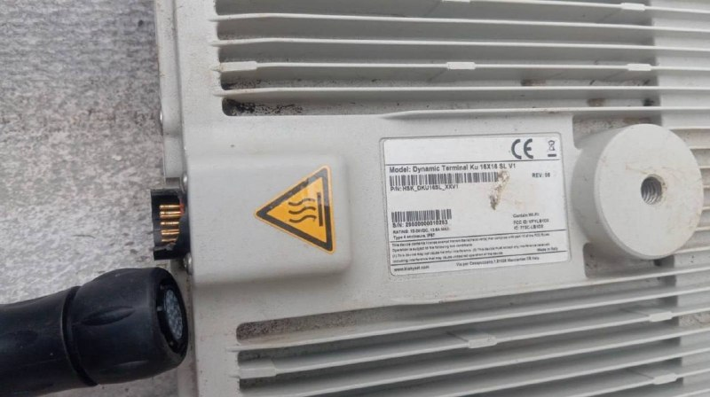

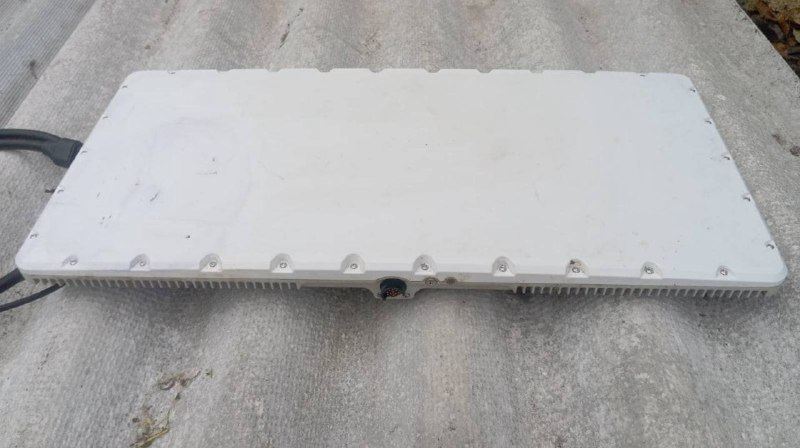

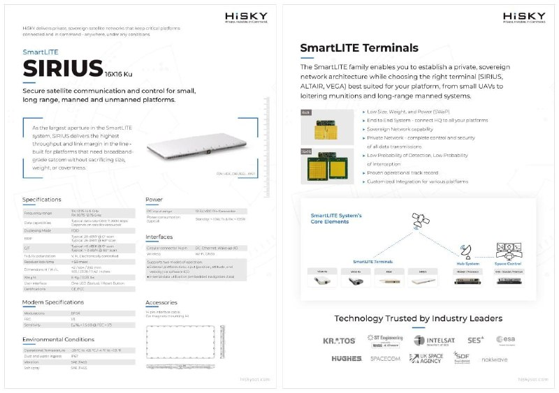

منابع روسی مدعی هستند ارتش اوکراین شروع به استفاده از ترمینال های ماهواره ای HiSky اسرائیلی برای حملات عمقی در خاک روسیه کرده است   

این ترمینال ها پهنای باند کمتری نسبت به استارلینک دارند اما در تمام خاک روسیه قابل استفاده خواهند بود  

[@Minas\_Tirith2024](https://t.me/Minas_Tirith2024)

· · ·

**🕒 ۱۴۰۵/۰۸/۱۶ ۱۳:۱۸** · [پست 10858](https://t.me/kaavoush/10858)

امثال ما که مجبوریم پیگیری کنیم اما توصیه می‌کنم به همه دوستان حداقل یک هفته از اخبار فاصله بگیرند. به نظر من وضعیت همه چیز در هفته‌های آینده تا حد زیادی روشن میشه اما فعلاً جز ابهام و صبر و انتظار چیزی نداریم. دور شید از اخبار و به زندگی‌تون برسید.

· · ·

**🕒 ۱۴۰۵/۰۸/۱۶ ۱۲:۳۷** · [پست 10856](https://t.me/kaavoush/10856)

↪️ فوروارد از Exciton Missile Program

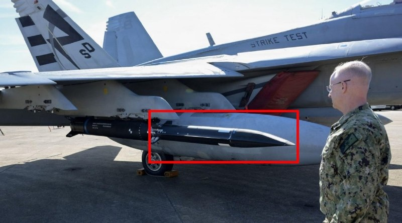


در برخی خبرها آمده است که ج.ا به دنبال خرید سامانه پدافندی S-400 از روسیه است. واقعا در زمانی که آمریکایی‌ها در حال توسعه انواع موشک‌های هایپرسونیک ارزان و پرتعداد هستند، یک سامانه دفاع استراتژیک با تحرک پایین چند دقیقه در برابر انواع موشک‌های آمریکا و اسرائیل دوام خواهد آورد؟  
حتی نیازی به استفاده از موشک‌های هایپرسونیک هم ندارند. با موشک‌های کروز ساب‌سونیک می‌توانند S-400 و سامانه‌های پدافندی نقطه‌ای محافظ آن را اشباع کنند و نابودش کنند. تنها در صورتی که تعداد آتشبارها زیاد باشد، شاید روند سرکوب سامانه‌ها یک تاخیر اولیه و پیش‌اخطار ایجاد کند (آن‌هم نه در همه سناریوها). امری که اسرائیل در سرکوب سامانه S-300 در اصفهان و سرکوب انواع سامانه‌های استراتژیک در عملیات "روزهای توبه"، پیش از جنگ دوازده‌روزه، تلاش کرد این مرحله را در جنگ کوتاه و یا حذف کند.  

ابعاد خالص موشک هایپرسونیک ارزان آمریکایی رادر عکس  ببینید. هدفی با چنین ابعاد کوچکی را در حالی که سرعت هایپرسونیک یا سوپرسونیک دارد را باید رهگیری کنی. ([مطلب پیشین](https://t.me/Exciton_missile_program/8061))  

[**@Exciton\_missile\_program**](https://t.me/Exciton_missile_program) 🚀

· · ·

**🕒 ۱۴۰۵/۰۸/۱۶ ۱۰:۱۱** · [پست 10855](https://t.me/kaavoush/10855)


افراد مطلع از اوضاع به روزنامه «واشنگتن‌پست» گفته‌اند که در هفته‌ها و ماه‌های منتهی به برکناری سوزی وایلز از سمت رئیس دفتر کاخ سفید در روز گذشته، او نسبت به نحوه مدیریت پنتاگون توسط پیت هگست، جنگ جاری با ایران، و همچنین اقدام جنجالی او در برکناری مقامات ارشد نظامی، به‌طور فزاینده‌ای منتقد شده بود.

· · ·

**🕒 ۱۴۰۵/۰۸/۱۶ ۱۰:۰۷** · [پست 10852](https://t.me/kaavoush/10852)

↪️ فوروارد از جنگاوران

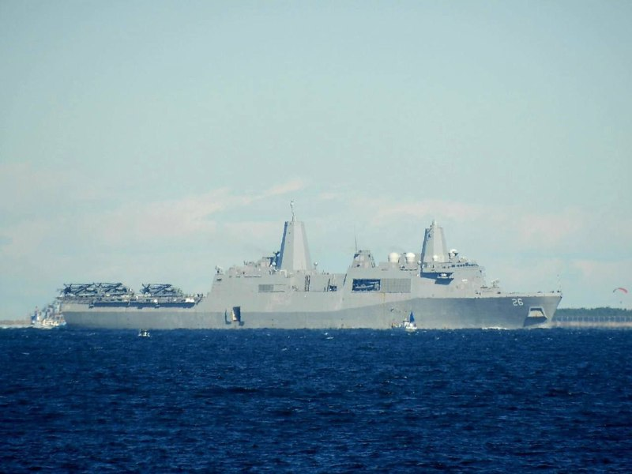

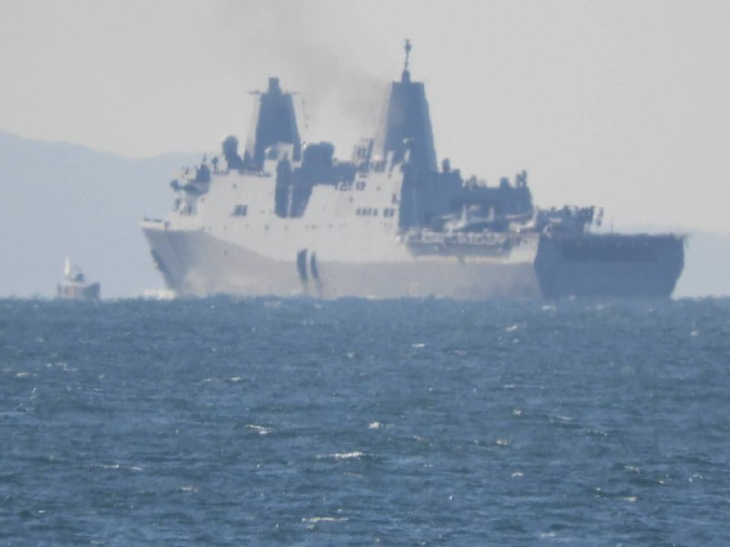

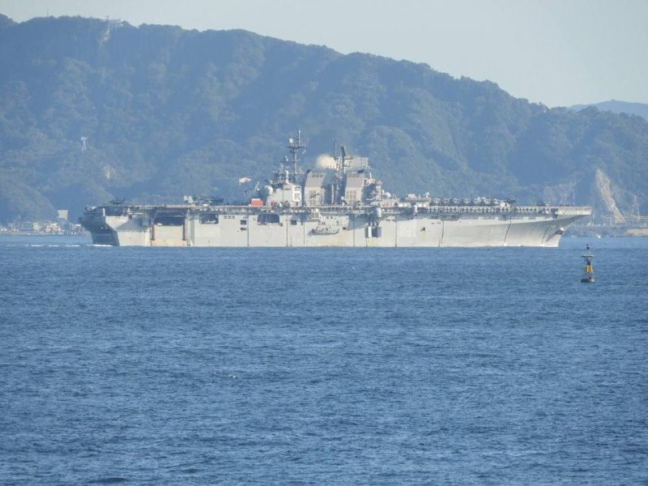

حرکت گروه آبی‌ـ‌خاکی آمریکا از ژاپن به سمت خاورمیانه  

گروه آماده آبی‌ـ‌خاکی ناوگان آمریکا موسوم به Makin Island ARG، پایگاه دریایی یوکوسوکا در ژاپن را ترک کرد تا به مسیر خود به‌سوی منطقه عملیاتی سنتکام در خاورمیانه ادامه دهد.  

این گروه شامل سه شناور است:  

 ناو تهاجمی آبی‌ـ‌خاکی USS Makin Island از [کلاس وسپ](https://jangaavaran.ir/%D9%86%D8%A7%D9%88-%D8%A8%D8%A7%D9%84%DA%AF%D8%B1%D8%AF-%D9%88-%D8%A7%D8%A8%DB%8C-%D8%AE%D8%A7%DA%A9%DB%8C-%D9%88%D8%B3%D9%BE/)  
 ناو ترابری آبی‌ـ‌خاکی USS Anchorage از [کلاس سن آنتونیو ](https://jangaavaran.ir/%D9%86%D8%A7%D9%88-%D8%AA%D8%AF%D8%A7%D8%B1%D9%88%DA%A9%D8%A7%D8%AA%DB%8C-%D9%88-%D8%A7%D8%A8%DB%8C-%D8%AE%D8%A7%DA%A9%DB%8C-%DA%A9%D9%84%D8%A7%D8%B3-%D8%B3%D9%86-%D8%A7%D9%86%D8%AA%D9%86%DB%8C%D9%88/)  
ناو ترابری آبی‌ـ‌خاکی USS John P. Murtha  

این گروه علاوه بر شناورها، حامل بیش از ۲۲۰۰ تفنگدار دریایی است و حرکت آن در شرایط افزایش حضور نظامی آمریکا در خاورمیانه انجام می‌شود.  

#آمریکا #ژاپن #خاورمیانه #نیروی\_دریایی

· · ·

---

## iaghapour

[کانال در تلگرام](https://t.me/iaghapour) · [آرشیو متن](archive/iaghapour/)

**🕒 ۱۴۰۵/۰۸/۱۶ ۲۱:۰۹** · [پست 3262](https://t.me/iaghapour/3262)


◀️ ☯️**اشتراک‌های محبوبت رو از گیفت‌پین بگیر!**  
📞 **خرید شماره مجازی** کاملا اتوماتیک | شروع از 50,000 تومان 👀  
از هوش مصنوعی ❤️ **❤️** و تولید محتوا تا بازی و خدمات تلگرام؛ با پرداخت ریالی، ساده و سریع خرید کن.  
👩‍💻👩‍💻👩‍💻 ✦ **هوش مصنوعی و برنامه‌نویسی**  
ChatGPT Plus و Go، Claude Pro، Cursor، GitHub Copilot و SuperGrok  
⏳✦ **ابزارهای طراحی و تولید محتوا**  
Google Flow، Midjourney، Kling AI، CapCut Pro، Figma Pro، Suno و ElevenLabs  
🎵❤️❤️  ✦ **گیفت‌کارت و اعتبار بازی**  
اپل، استیم، پلی‌استیشن و یوسی پابجی و ...❤️❤️❤️❤️  
🪙🤑 ✦ **خدمات تگرام**  
🌟تلگرام پریمیوم و استارز  
✔️**درگاه امن پرداخت آنلاین | تحویل سریع**  
🛒 محصولت رو انتخاب کن و آنلاین سفارش بده:  
🌐 [https://giftpin.ir](https://giftpin.ir/)

· · ·

**🕒 ۱۴۰۵/۰۸/۱۶ ۲۱:۰۹** · [پست 3261](https://t.me/iaghapour/3261)

**📌 پیش از خرید از سرویس‌ تبلیغ‌شده زیر، قوانین را بخوانید👇🏻**

· · ·

**🕒 ۱۴۰۵/۰۸/۱۶ ۲۱:۰۱** · [پست 3260](https://t.me/iaghapour/3260)

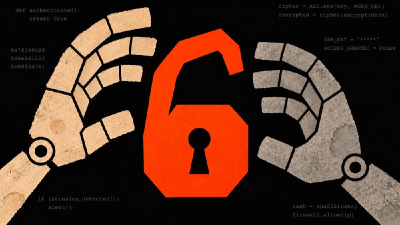

🤖 **رونمایی از GPT-6 Cyber؛ مدل امنیتی جدید OpenAI برای کشف آسیب‌پذیری و اکسپلویت!**  

کمپانی OpenAI از مدل تخصصی **GPT-6 Cyber** (بر پایه GPT-6 Astra) رونمایی کرد؛ مدلی بازطراحی‌شده برای کشف باگ‌ها، بازتولید کرش‌ها و ساخت اکسپلویت‌های عملیاتی در چارچوب تست نفوذ قانونمند.  

🔹 **جهش در بنچمارک‌ها:** کسب امتیاز ۴۸.۵٪ در ExploitGym (بهبود ۵۱ درصدی نسبت به نسل قبل) و موفقیت ۹۵ درصدی در اکسپلویت باگ‌های گیت‌لب، جنکینز و پستگرس در RemoteExploitBench.  

🔸 **کارنامه در لینوکس و فایرفاکس:** بازتولید ۱,۷۲۴ آسیب‌پذیری در کرنل لینوکس و ساخت ۹۴۸ اکسپلویت (با ارائه ۳۰۴ پچ امنیتی)، به‌همراه کشف ۸۱ باگ بحرانی جدید در فایرفاکس.  

🔹 **پایبندی به محدوده مجاز (Scope):** عملکرد ۹۹.۹۳ درصدی در پرهیز از حمله به اهداف خارج از دامنه تست در سناریوهای تله‌گذاری (Honeypot).  

🔸 **دسترسی محدود و نظارت‌شده:** عرضه اولیه صرفاً برای سازمان‌های تأییدشده در قالب برنامه امنیتی Daybreak Red جهت تست زیرساخت‌های حیاتی.  
[  
](https://www.youtube.com/@iAghapour)**🆔** [**@iAghapour**](https://t.me/iAghapour) **|** [**YouTube**](https://www.youtube.com/@iAghapour)

· · ·

**🕒 ۱۴۰۵/۰۸/۱۶ ۲۰:۳۸** · [پست 3259](https://t.me/iaghapour/3259)


⚠️ **هشدار قطع دسترسی و مسدودسازی حساب‌های Claude در ایران**!  

شرکت Anthropic نسخه جدید شرایط استفاده (Terms of Service) هوش مصنوعی Claude را منتشر کرد که اجرای سخت‌گیرانه آن از روز پنجشنبه ۱۲ نوامبر (۲۱ آبان) آغاز می‌شود و ریسک مسدود شدن گسترده حساب کاربران ایرانی را به دنبال دارد.  

🔹 **ممنوعیت صریح بر اساس موقعیت فیزیکی:** در قوانین جدید به‌وضوح اعلام شده استفاده افراد حاضر در مناطق پشتیبانی‌نشده (از جمله ایران) و نهادهای وابسته نقض کامل توافق‌نامه است و با فعال‌تر شدن سامانه‌های پایش، احتمال مسدود شدن حساب‌های کاربران داخل کشور شدت می‌گیرد.  

🔸 **آموزش بکاپ‌گیری از چت‌ها و پروژه‌ها:** برای جلوگیری از دست رفتن داده‌ها، پیش از تاریخ مذکور وارد نسخه وب شوید و از مسیر **Settings \> Data** فایل خروجی تمام مکالمات و داده‌های خود را دانلود و ذخیره کنید.//دیجیاتو  
[  
](https://www.youtube.com/@iAghapour)**🆔** [**@iAghapour**](https://t.me/iAghapour) **|** [**YouTube**](https://www.youtube.com/@iAghapour)

· · ·

**🕒 ۱۴۰۵/۰۸/۱۵ ۲۱:۰۵** · [پست 3258](https://t.me/iaghapour/3258)

🖼 *(عکس بعد از ۲۴ ساعت حذف شده)*

[🚀](https://t.me/SimbaServerAdmin) **انتخاب با تو، نصب با سیمبا.**  

برای سایتت، فایل‌هات یا کارهای تیمت، ابزار مناسب رو انتخاب کن؛ **سرور مجازی ایرانت رو با اپلیکیشن نصب‌شده تحویل بگیر.**  

🌐 **WordPress** برای ساخت سایت و وبلاگ  
☁️ **Nextcloud** برای فضای ابری شخصی و اشتراک فایل  
⚙️ **n8n** برای خودکارسازی کارهای تکراری  
💬 **Rocket.Chat و Mattermost** برای ارتباط تیمی  
📡 **Uptime Kuma** برای اطلاع از قطعی سایت و سرور  
و چند اپلیکیشن کاربردی دیگه!  

📦 نصب از **مخزن داخلی سیمبا** انجام می‌شه و در مرحلهٔ نصب به اینترنت خارج نیازی نیست.  
〰[️〰️〰️〰️〰️〰️](https://t.me/SimbaServerAdmin)  
🌐 [SimbaServer.ir](http://SimbaServer.ir/)  
💬 [@SimbaServerAdmin](https://t.me/SimbaServerAdmin)  
🦁 [@SimbaServer](https://t.me/SimbaServer)

· · ·

**🕒 ۱۴۰۵/۰۸/۱۵ ۲۰:۴۰** · [پست 3257](https://t.me/iaghapour/3257)

*(پست بدون متن)* [مشاهده در تلگرام](https://t.me/iaghapour/3257)

· · ·

**🕒 ۱۴۰۵/۰۸/۱۵ ۱۸:۱۷** · [پست 3256](https://t.me/iaghapour/3256)

🔴 **هشدار مهم امنیتی: مراقب بدافزارها در پوشش ابزارهای دور زدن فیلترینگ باشید!**  

رفقا سلام. اخیراً پیامی از یکی از کاربران دریافت کردم که متاسفانه بعد از تست کردن اسکریپت‌ها و نرم‌افزارهای ناشناس گیت‌هاب، سرورش چندین بار مورد حمله هکری قرار گرفته و آلوده شده. 🤦‍♂️  

این روزها به خاطر شرایط اینترنت، خیلی‌ها هر اسکریپتی رو روی سرور ران میکنن یا هر فایل نصبی رو بدون بررسی روی ویندوز و گوشی نصب میکنن. برای اینکه اطلاعات شخصی و سرورتون به باد نره، حتماً این ۵ قانون طلایی رو رعایت کنید:  

1️⃣ **هر چیزی که تو گیت‌هاب هست، امن نیست!** گیت‌هاب فقط یک فضاست. هر کسی میتونه یک کد مخرب بنویسه و اونجا آپلود کنه. همیشه به تعداد ستاره‌ها (Stars)، فورک‌ها، سابقه فعالیت توسعه‌دهنده و کامیونیتی اون پروژه دقت کنید. از مخازنِ تازه‌تاسیس و بدون اعتبار دوری کنید.  

2️⃣ **کدهای یک‌خطی رو چشم‌بسته اجرا نکنید**: اجرای کدهایی مثل `bash <(curl -s ...)` روی سرور، یعنی دارید کلید خونتون رو دو دستی تقدیم طرف میکنید. بعضی از این اسکریپت‌ها بک‌دور (Backdoor) دارن و به محض نصب، اطلاعات سرور شما رو برای هکر می‌فرستن تا از منابعتون برای ماینینگ یا حملات سایبری استفاده کنه.

… [ادامه در تلگرام](https://t.me/iaghapour/3256)

· · ·

**🕒 ۱۴۰۵/۰۸/۱۵ ۱۴:۰۵** · [پست 3246](https://t.me/iaghapour/3246)

🖼 *(عکس بعد از ۲۴ ساعت حذف شده)*

🎮 **انتشار ۳۹ اسکرین‌شات رسمی جدید از بازی GTA 6**  

وب‌سایت رسمی استودیوی راک‌استار گیمز در یک به‌روزرسانی تازه، گالری رسانه‌ای خود را با انتشار ۳۹ تصویر باکیفیت و دیده‌نشده از عنوان **Grand Theft Auto VI** به‌روزرسانی کرد؛ تصاویری که جزئیات عمیق‌تری از محیط‌های شهری و طبیعت ایالت لئونیدا را به نمایش می‌گذارند.  

🔹 **شبیه‌سازی پیشرفته اتمسفر و آب‌وهوا:** تمرکز محسوس روی پویایی بازتاب نور از سطوح مرطوب، واکنش واقع‌گرایانه پوشش گیاهی به باد و جریان‌های محیطی، و فیزیک پیچیده شرایط جوی.  

🔸 **جهش در بافت‌ها و نورپردازی:** بهبود چشمگیر موتور گرافیکی در پردازش سایه‌ها، افکت‌های نوری مستقیم و غیرمستقیم، و بالا رفتن وضوح متریال‌ها نسبت به آثار پیشین کمپانی.  

🔹 **تنوع اکوسیستم و حیات وحش دریایی:** نمایش مناظر بکر طبیعی در کنار بافت‌های شهری متراکم، به‌همراه طراحی دقیق زیست‌بوم و جانداران دریایی.  
[  
](https://www.youtube.com/@iAghapour)**🆔** [**@iAghapour**](https://t.me/iAghapour) **|** [**YouTube**](https://www.youtube.com/@iAghapour)

· · ·

**🕒 ۱۴۰۵/۰۸/۱۴ ۲۱:۰۰** · [پست 3245](https://t.me/iaghapour/3245)

↪️ فوروارد از 𓆩 𝐇𝐢 𝐒𝐩𝐞𝐞𝐝 𓆪 ️ᵃᵈᵐⁱⁿ 👨🏻‍💻

🖼 *(عکس بعد از ۲۴ ساعت حذف شده)*

𓆩 𝐇𝐢 𝐒𝐩𝐞𝐞𝐝 𓆪 **| سرعت ، کیفیت و پشتیبانی واقعی**  

دنبال یه VPN پرسرعت و پایدار با ضمانت بازگشت وجهی ؟ **اول تست کن بعد خرید انجام بده** 👋  

🇮🇷 **سرور نت ملی** **🇮🇷** **در بین کانفیگ هامون هست تا در هر شرایطی اتصال شما برقرار باشد**🌐✔️  

🦉🕦  بیش از 5 **سال سابقه فروش و** پشتیبانی 24 **ساعته** 🕦🦉  

➗ قیمت‌های رقابتی نسبت به بازار 🛍🕯  

🤖 ربات خرید :  
[@Hi\_Speed\_channel\_bot](https://t.me/Hi_Speed_channel_bot) ☑  
💻 **ادمین فروش و پشتیبانی:**  
[@Hi\_Speed\_Admin](https://t.me/Hi_Speed_Admin) ☑  
🌐 **کانال اطلاع‌رسانی:**  
[@Hi\_Speed\_Channel1](https://t.me/Hi_Speed_Channel1)☑

· · ·

**🕒 ۱۴۰۵/۰۸/۱۴ ۲۱:۰۰** · [پست 3244](https://t.me/iaghapour/3244)

**📌 پیش از خرید از سرویس‌ تبلیغ‌شده زیر، قوانین را بخوانید👇🏻**

· · ·

**🕒 ۱۴۰۵/۰۸/۱۴ ۲۰:۳۳** · [پست 3243](https://t.me/iaghapour/3243)

✍🏻 اگه دقت کرده باشید، الان بیشتر از یک ماهه که کلاً هیچ تبلیغی برای خرید فیلترشکن و سرویس‌های مشابه نداشتیم. شاید کمتر کانالی تا این حد روی این قضایا وسواس به خرج بده :) دلیلش هم کاملاً مشخص بود؛ با توجه به شرایط و احتمال اختلالات و قطعی‌ها، واقعاً نمی‌خواستیم چیزی معرفی کنیم که بچه‌ها به دردسر یا ضرر بیفتن.  

اما از اونجایی که اوضاع کلاً غیرقابل پیش‌بینیه، تصمیم گرفتیم خیلی کمتر از قبل و با حساسیت بالا، تک‌وتوک بعضی از سرویس‌ها رو به مرور معرفی کنیم تا اگر واقعاً نیاز ضروری دارید کارتون راه بیفته.  

**🔻فقط مثل همیشه این دو تا مورد رو حتماً رعایت کنید:**  
۱. قبل از هرگونه پرداختی، حتماً اکانت تست بگیرید و عملکردش رو روی اینترنت خودتون بررسی کنید.  

۲. خرید نهایی با مسئولیت، بررسی و تصمیم شخصی خودتونه.

· · ·

**🕒 ۱۴۰۵/۰۸/۱۴ ۱۹:۲۷** · [پست 3242](https://t.me/iaghapour/3242)

🔥 **اجرای Native سیستم‌عامل OpenWrt و کلاینت Passwall2 روی مودم ZLT X28**  

با مهندسی معکوس فریمور، بوت‌لودر و ساخت ماژول‌های اختصاصی کرنل، امکان اجرای مستقیم و Native نسخه 23.05.5 سیستم‌عامل **OpenWrt** روی مودم سیم‌کارتی **ZLT X28** فراهم شد؛ دستاوردی که اجرای مستقیم ابزارهای (V2Ray و Xray) را روی سطح مودم ممکن می‌کند.  

🔹 **اجرای مستقیم Xray و Passwall2:** مدیریت تونل‌های V2Ray از طریق پنل LuCI با پشتیبانی کامل از ترافیک TCP، UDP و IPv6 جهت عبور تمامی دستگاه‌های متصل به مودم از فیلترشکن بدون نیاز به برنامه مجزا.  

🔸 **بوت Native بدون حذف ریکاوری:** اجرای OpenWrt با حفظ پایداری ارتباط 5G و وای‌فای، در کنار باقی‌ماندن فریمور اصلی دستگاه در صورت نیاز به ریکاوری.  

🔹 **پشتیبانی از WireGuard و OpenVPN:** بیلد ماژول‌های موردنیاز کرنل (مانند TPROXY) با دستیابی به سرعت انتقال محلی حدود ۷۱۵ مگابیت‌برثانیه روی ترافیک وایرگارد.  

🔸 **وضعیت پروژه:** در مرحله بتا و تست‌شده روی سخت‌افزار فیزیکی با انتشار عمومی مستندات، ابزارها و کدهای بایپس بوت‌لودر.  

[ 🔗 **مخزن پروژه و راهنمای نصب در گیت‌هاب**](https://github.com/mralinp/zlt-x28-openwrt)

… [ادامه در تلگرام](https://t.me/iaghapour/3242)

· · ·

**🕒 ۱۴۰۵/۰۸/۱۴ ۱۸:۱۰** · [پست 3241](https://t.me/iaghapour/3241)

🖼 *(عکس بعد از ۲۴ ساعت حذف شده)*

🚀 **معرفی اسکریپت Nash Tunnel؛ مدیریت تونل معکوس (GRE، FRP و Backhaul)**  

یک ابزار متن‌باز، سبک و رایگان برای برقراری و پایش تونل میان سرور ایران و خارج بدون نیاز به وابستگی‌های سنگین یا لایسنس، همراه با پنل وب اختصاصی فارسی.  

🔹 **پشتیبانی چند پروتکله:** پیاده‌سازی تونل سطح شبکه (GRE)، تونل معکوس (FRP) و ارتباط رو‌به‌جلو با پوشش ترافیک Xray REALITY Backhaul.  

🔸 **پنل وب مستقل و سبک:** توسعه‌یافته بر پایه کتابخانه استاندارد پایتون (بدون نیاز به pip و پکیج اضافی) با رابط فارسی.  

🔹 **واچ‌داگ:** بررسی مداوم سلامت سرویس‌ها در بازه‌های ۶۰ ثانیه‌ای، ری‌استارت خودکار اتصالات قطع‌شده و ارسال گزارش زنده به ربات تلگرام.  

🔸 **تست تأخیر و فیل‌اور خودکار:** سنجش پینگ و رتبه‌بندی نودها همراه با امکان سوئیچ خودکار یا دستی به سالم‌ترین سرور (Failover).  

[**🔗 سورس پروژه در گیت‌هاب**](https://github.com/frank0live/nash-tunnel)  

🔻 پروژه کاملاً رایگان و اوپن‌سورس است، اما بررسی امنیتی کاملی روی آن انجام نداده‌ایم؛ پیشنهاد می‌کنم قبل از استفاده، سورس‌کد و اسکریپت نصب را با ابزارهای هوش مصنوعی بررسی کنید.  

🆔 [@iAghapour](https://t.me/iAghapour) | [YouTube](https://www.youtube.com/@iAghapour)

· · ·

**🕒 ۱۴۰۵/۰۸/۱۴ ۱۶:۰۱** · [پست 3240](https://t.me/iaghapour/3240)

🖼 *(عکس بعد از ۲۴ ساعت حذف شده)*

می‌خواستی با پولش چی بخری؟  

سه ماه ضربه زدن ۲۴ ساعته به عشقِ بنز و ویلای شمال...   

آخرش پولِ دو تا فلافل و یه بسته چسب زخم برای انگشتای داغون.😁

· · ·

**🕒 ۱۴۰۵/۰۸/۱۳ ۲۲:۳۰** · [پست 3239](https://t.me/iaghapour/3239)

🖼 *(عکس بعد از ۲۴ ساعت حذف شده)*

**سرعت** واقعی ، قیمت بهتر !  

سرور مجازی ایران - **آ**سیاتک 🛜  

**+ آپلود رایگان**   
**+ پورت شبکه 10Gbps** اشتراکی  
**+ شروع قیمت از 649 هزار تومن**  
**+ هر گیگ ترافیک 550 تومن**  
**+ تعویض ای پی در پنل بدون تیکت**  

پشتیبانی تلگرام : [@Nextsession\_admin](https://t.me/Nextsession_admin)  

خرید : [https://nextsession.ir](https://nextsession.ir/)  

چنل : [https://t.me/NextCloud\_IR](https://t.me/NextCloud_IR)

· · ·

**🕒 ۱۴۰۵/۰۸/۱۳ ۱۶:۱۵** · [پست 3238](https://t.me/iaghapour/3238)

🖼 *(عکس بعد از ۲۴ ساعت حذف شده)*

**⭕️ نسل جدید پروکسی تلگرام در ۱ دقیقه! (کاملاً رایگان با ورکر کلودفلر)**  

🔹در این ویدیو پیاده‌سازی پروتکل جدید وب‌پروکسی رسمی تلگرام (TWP) را بررسی می‌کنیم که بدون نیاز به خرید سرور مجازی و درگیر شدن با خطاهای نصب، مستقیماً روی بستر ورکر کلادفلر اجرا می‌شود؛ روشی که ترافیک شما را پشت ترافیک یک وب‌سایت عادی استتار کرده و لینک اتصال مستقیم را به صورت آنی تحویل می‌دهد.  

[**🔗 تماشا ویدیو در یوتیوب**](https://youtu.be/m7TOabt1iqI)  

#آموزش #فیلترشکن #رایگان #ورکر #کلودفلر   
برای یادگیری شبکه و آموزش تکنولوژی و هوش مصنوعی ما رو دنبال کنید 💚  
🆔 [@iAghapour](https://t.me/iAghapour) | [YouTube](https://www.youtube.com/@iAghapour)

· · ·

**🕒 ۱۴۰۵/۰۸/۱۳ ۱۵:۴۰** · [پست 3237](https://t.me/iaghapour/3237)

🖼 *(عکس بعد از ۲۴ ساعت حذف شده)*

⭕️ **حذف احراز هویت (KYC) برای خرید تلگرام پرمیوم و استارز در فرگمنت!**  

پلتفرم رسمی فرگمنت (Fragment) محدودیت و الزام احراز هویت را برای خرید مستقیم خدمات تلگرام برداشت؛ تغییری کاربردی که امکان خرید تلگرام پرمیوم و ستاره‌ها (Telegram Stars) را بدون نیاز به ارسال مدارک هویتی فراهم کرده است.  

🔸 **رفع یک چالش بزرگ برای کاربران ایرانی:** با توجه به محدودیت‌ها و سخت‌گیری‌های احراز هویت بین‌المللی با مدارک ایرانی، این اقدام فرآیند تهیه پرمیوم، گیفت و خرید استارز را برای کاربران بسیار سریع‌تر و بی‌دردسرتر می‌کند.  

🔹 **تداوم الزام احراز هویت برای برداشت و تسویه‌حساب:** حذف KYC صرفاً مربوط به «خرید و پرداخت» است؛ برای نقد کردن درآمدهای حاصل از استارز، فروش نام‌های کاربری یا درآمد تبلیغات، احراز هویت کامل همچنان اجباری است.  

🔸 **عدم انتشار بیانیه رسمی:** تلگرام یا فرگمنت هنوز اطلاعیه رسمی درباره دائمی بودن این سیاست منتشر نکرده‌اند و امکان تغییر شرایط در آینده وجود دارد.  

[ **🌐 سایت فرگمنت**](https://fragment.com/)  

**🆔** [@iAghapour](https://t.me/iAghapour) | [YouTube](https://www.youtube.com/@iAghapour)

· · ·

**🕒 ۱۴۰۵/۰۸/۱۳ ۱۵:۰۱** · [پست 3236](https://t.me/iaghapour/3236)

⚡️ **جهش ۴۰ درصدی سرعت ویندوز ۱۱ روی سیستم‌های مجهز به ۸ گیگابایت رم!**  

مایکروسافت با انتشار به‌روزرسانی جدید، معماری مدیریت رم را در سیستم‌های میان‌رده بهینه‌سازی کرد؛ تغییری که طبق اعلام رسمی، پاسخ‌دهی ویندوز ۱۱ را تا ۲۰ درصد و سرعت اجرای هم‌زمان چند برنامه (Multitasking) را تا ۴۰ درصد افزایش داده است.  

🔹 **فشرده‌سازی هوشمند رم:** نگهداری تا ۲ گیگابایت داده فعال بیشتر در حافظه موقت به‌جای انتقال آن به حافظه ذخیره‌سازی (دیسک)؛ قابلیتی که مانع از کندی سیستم و لود مجدد برنامه‌ها و تب‌های باز مرورگر می‌شود.  

🔸 **کاهش ۹۰۰ مگابایتی مصرف حافظه برنامه‌ها:** صرفه‌جویی ۳۶۰ مگابایتی در مصرف رم برنامه‌های آفیس ۳۶۵، معلق شدن تب‌های غیرفعال مایکروسافت اج پس از ۱۵ دقیقه، و عدم بارگذاری پس‌زمینه ویجت‌ها در رم تا زمان کلیک کاربر (آزادسازی حدود ۲۰۰ مگابایت).  

🔹 **بهینه‌سازی حافظه رزرو سخت‌افزار:** همکاری مستقیم ردموندی‌ها با سازندگان تراشه و مادربورد برای کاهش میزان رم رزروشده توسط قطعات سخت‌افزاری (Hardware Reserved) جهت آزاد ماندن ظرفیت بیشتر در دسترس سیستم‌عامل.  
[  
](https://www.youtube.com/@iAghapour)**🆔** [**@iAghapour**](https://t.me/iAghapour) **|** [**YouTube**](https://www.youtube.com/@iAghapour)

🎬 ویدیو: [مشاهده در تلگرام](https://t.me/iaghapour/3236)

· · ·

**🕒 ۱۴۰۵/۰۸/۱۲ ۲۱:۰۰** · [پست 3235](https://t.me/iaghapour/3235)

*(پست بدون متن)* [مشاهده در تلگرام](https://t.me/iaghapour/3235)

· · ·

**🕒 ۱۴۰۵/۰۸/۱۲ ۲۱:۰۰** · [پست 3234](https://t.me/iaghapour/3234)

**📌 پیش از خرید از سرویس‌ تبلیغ‌شده زیر، قوانین را بخوانید👇🏻**

· · ·

---

## MatinSenPaii

[کانال در تلگرام](https://t.me/MatinSenPaii) · [آرشیو متن](archive/matinsenpaii/)

**🕒 ۱۴۰۵/۰۸/۱۶ ۲۰:۰۳** · [پست 5812](https://t.me/MatinSenPaii/5812)

با Atomic mail ثبت نام کنید شماره مجازی هم ازتون نمی‌خواد دوستان😁 محدودیتش هم «میگن» که ۴۰ ریکوئست در دقیقست و سقف نداره اما در عمل اذیت میکنه یه کم. که خب شاید بهتر شده باشه الان. تست نکردم

· · ·

**🕒 ۱۴۰۵/۰۸/۱۶ ۱۸:۱۹** · [پست 5811](https://t.me/MatinSenPaii/5811)

**دموی Miracle نشون می‌ده وسط ویدیو رنگ مو رو عوض می‌کنید، پس‌زمینه رو برمی‌دارید و سر رو تا ۱۸۰ درصد بزرگ می‌کنید**  

این دمو رو یه کاربر توییتری گذاشته و Miracle رو «لحظه‌ی Mythos تدوین ویدئو» خونده؛ (Mythos همون جهش بزرگیه آنتروپیک روی مدلهای کلاد داد)  

توی دمو سوژه از پس‌زمینه جداست و با اسلایدر زنده ادیت می‌شه: رنگ مو از بلوند به قرمز عوض می‌شه و اندازه‌ی سر بالا و پایین می‌ره. همونطور که توی پست قبل گفتم، ویدئو دیگه یه فایل تخت نیست، لایه‌لایه‌ست و هر لایه دست خودتونه.  

🔗 [منبع](https://x.com/adilinthewild/status/2118772763557269977)  
✉️ [t.me/MatinSenPaii](http://t.me/MatinSenPaii)

🎬 ویدیو: [مشاهده در تلگرام](https://t.me/MatinSenPaii/5811)

· · ·

**🕒 ۱۴۰۵/۰۸/۱۶ ۱۸:۰۲** · [پست 5810](https://t.me/MatinSenPaii/5810)

**هیگزفیلد یه فناوری جدید به اسم Miracle معرفی کرده که ویدیو رو لایه‌لایه می‌کنه تا مثل عکس ادیتش کنید**  

تیم Higgsfield، از میرکل(معجزه) رونمایی کرد. فناوری پست‌پروداکشن خودشون که هر ویدیویی رو به لایه‌های جدا تبدیل می‌کنه تا روش ادیت موضعی و در حد پیکسل انجام بدید، اون هم در لحظه و موقع پخش.  

طرز کارش این شکلیه که هر فریم ویدیو عمق تصویر رو هم با خودش نگه می‌داره؛ یعنی معلومه چی جلوئه و چی عقب، پس می‌تونید یه شیء رو جابه‌جا کنید، رنگش رو عوض کنید یا حذفش کنید، بدون اینکه بقیه‌ی صحنه به هم بریزه.  

فعلا توی بتای خصوصیه و قراره به Higgsfield MCP بیاد، یعنی از داخل کلاد و... هم قابل استفاده می‌شه.  
اما الان چند دقیقه بعد یه ویدئوی دیگه ازش می‌ذارم کیف کنید:)  

🔗 [منبع](https://x.com/higgsfield/status/2118732716346933423)  
✉️ [t.me/MatinSenPaii](http://t.me/MatinSenPaii)

🎬 ویدیو: [مشاهده در تلگرام](https://t.me/MatinSenPaii/5810)

· · ·

**🕒 ۱۴۰۵/۰۸/۱۶ ۱۵:۳۴** · [پست 5809](https://t.me/MatinSenPaii/5809)

واژه‌ی Perplexity (پرپلکسیتی) توی مدل‌های زبانی، معیاریه که نشون می‌ده مدل چقدر داخل پیش‌بینی توکن بعدی یک متن دچار عدم قطعیت می‌شه.  
که کمپانی Perplexity اسمش رو از همین گرفته و خواستم یک وقت گیج نشید

· · ·

**🕒 ۱۴۰۵/۰۸/۱۶ ۱۵:۳۳** · [پست 5808](https://t.me/MatinSenPaii/5808)


**گوگل با معماری Muir می‌گه ۱۰ میلیون توکن رو می‌شه توی ۲۵ مگابایت جا داد**  

یه مقاله‌ی تازه‌ی گوگل ریسرچ به اسم Muir به چشمم خورد دیروز؛ که یه معماری اتنشن خطیه، یعنی به‌جای اینکه کل متن رو مثل یه حافظه‌ی بزرگ نگه داره، خلاصه‌ش رو توی یه حالت کوچیک با اندازه‌ی ثابت جمع می‌کنه.  

عددهای خود مقاله می‌گن مدل ۱٫۳۴ میلیاردی Muir که فقط روی ۴ هزار توکن آموزش دیده، تا ۱۰ میلیون توکن بدون افت کیفیت ادامه می‌ده و حافظه‌ش فقط ۲۵ مگابایته؛ در حالی که یه ترنسفورمر معمولی برای همون ۱۰ میلیون توکن ۲٫۱ ترابایت حافظه می‌خواد. perplexity(نه کمپانی😂) هم که یعنی معیار سردرگمی مدل، ۲٫۵ تا ۳٫۶٪ از ترنسفورمر بهتره.  

البته هنوز معلوم نیست گوگل این رو توی محصولی می‌ذاره یا نه.  

🔗 [منبع](https://www.reddit.com/r/MachineLearning/comments/1xplbuu/muir_linear_attention_with_sensitivityallocated/)  
✉️ [t.me/MatinSenPaii](http://t.me/MatinSenPaii)

· · ·

**🕒 ۱۴۰۵/۰۸/۱۶ ۱۳:۱۷** · [پست 5807](https://t.me/MatinSenPaii/5807)


**یه نسخه از Jev که وقتی شک داره از Opus کمک می‌گیره، همون دقت Opus رو با ۴ برابر هزینه کمتر می‌ده**  

بلاگ Hightouch می‌گه تیمشون یه تست جالب کرده: مدل تصمیم‌گیر Jev(همونی که تصمیم صفر و یک میگیره و اینجا راجبش صحبت کردم [https://youtu.be/l-o\_fQM\_9AI](https://youtu.be/l-o_fQM_9AI)) رو گذاشتن جلو تا قضاوت کنه کدوم رکوردها واقعا مال یه آدمن و کدوم‌ها اشتباهی قاطی شدن.  

خود Jev به تنهایی، دقتش ۹۵٫۶٪ بود و از هر هزار تا قضاوت فقط ۰٫۰۵ دلار خرج داشت؛ Opus تنهایی ۹۹٪ دقیق بود ولی ۳٫۸۶ دلار هزینه داشت واسه این هزارتا و طبیعتا سرعت خیلیییی پایینتر.  

حالا وقتی Jev فقط همون‌هایی که اطمینانش بین ۳۰ تا ۹۰٪ بود رو فرستاد دست Opus، دقت رسید به ۹۸٫۸٪ با ۰٫۸۸ دلار؛ و خیلی سریعتر. یعنی تقریبا دقت Opus با بیش از ۴ برابر هزینه کمتر.  

روی یه تست سخت‌تر هم همین ترکیب ۹۵٫۳٪ شد و از خود Opus با ۹۵٫۱٪ یه ذره جلو زد. خلاصه‌اش اینه که مدل ارزون وقتی بلده بگه نمی‌دونم، لازم نیست همه چی رو بسپرید دست مدل گرون.  

🔗 [منبع](https://hightouch.com/blog/llm-judges-identity-resolution)  
✉️ [t.me/MatinSenPaii](http://t.me/MatinSenPaii)

· · ·

**🕒 ۱۴۰۵/۰۸/۱۶ ۱۲:۰۳** · [پست 5806](https://t.me/MatinSenPaii/5806)

**مدل** **Ling-3.2-flash حالا عکس و ویدئو رو هم مستقیم می‌فهمه**  

توی r/LLMDevs میگن داک API شرکت Ant Ling حالا Ling-3.2-flash رو با ورودی native عکس و ویدئو لیست کرده، هم با API سازگار با OpenAI و هم سازگار با Anthropic. مشخصاتش: ۵۶۰ میلیارد پارامتر در کل، ۲۵ میلیارد فعال، پنجره کانتکست ۱ میلیون توکن؛ و راهنمای اتصال به کلاد کد و Kilo Code هم براش منتشر شده.  

🔗 [منبع](https://www.reddit.com/r/LLMDevs/comments/1xpddyu/ling32flash_adds_native_image_and_video_input/)  
✉️ [t.me/MatinSenPaii](http://t.me/MatinSenPaii)

· · ·

**🕒 ۱۴۰۵/۰۸/۱۶ ۱۰:۴۹** · [پست 5805](https://t.me/MatinSenPaii/5805)

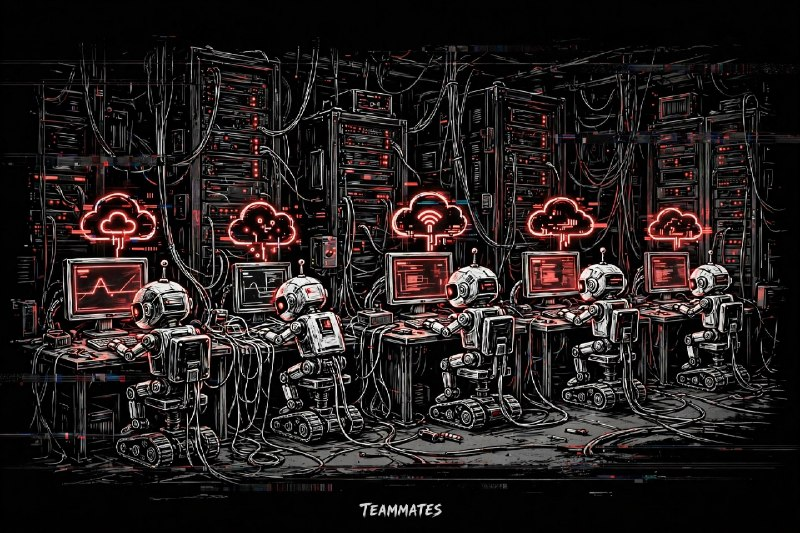

**کمپانی** **Perplexity هم ایجنت همیشه‌روشن خودش رو داد بیرون: Teammates**  

پرپلکسیتی دستیار Teammates رو معرفی کرده؛ ایجنت‌هایی که روی ماشین مجازی خودشون پروژه‌ها رو ادامه‌دار جلو می‌برن و از Slack هم میشه باهاشون حرف زد. قیمتش اما پلن Max ماهی ۲۰۰ دلاره؛ در حالی که Dots از ۱۰۰ دلار و Duet از ۲۰ دلار شروع می‌شن. چند روز پیش هم مصرف بالای ایجنت‌ها باعث شد SpaceX سقف مصرف Grok Bots رو محدودتر کنه.  
به نظرم حداقل توی رقابت قیمتی، نتونسته به خوبی وارد بشه و خوبی نشون بده که اصلا کسی بخره! چه برسه به اینکه نظر بدن مردم.  

حساب کنید Muse داره همین رو رایگان در اختیار ملت می‌ذاره  

🔗 [منبع](https://the-decoder.com/perplexity-now-has-its-own-always-on-ai-agent/)  
✉️ [t.me/MatinSenPaii](http://t.me/MatinSenPaii)

· · ·

**🕒 ۱۴۰۵/۰۸/۱۶ ۰۷:۵۴** · [پست 5804](https://t.me/MatinSenPaii/5804)

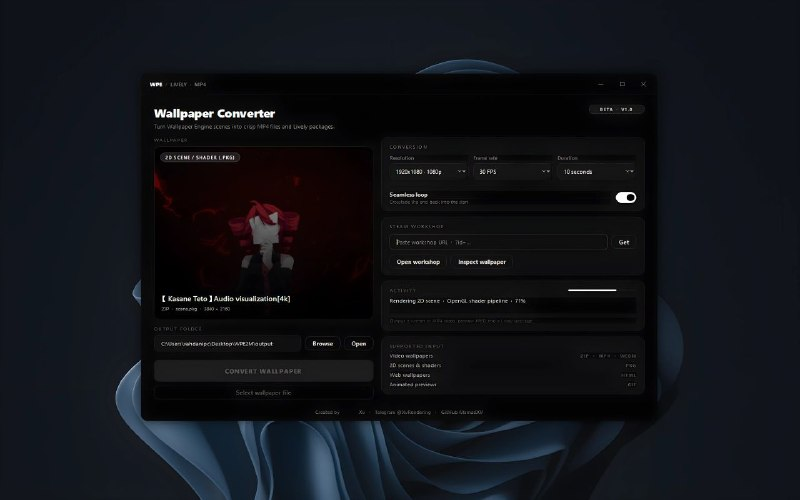

🎨**اپلیکیشن WPE2M؛ والپیپرهای Wallpaper Engine رو تبدیل کن به Lively و MP4!**  

یه ابزار اوپن سورس خیلی خفن دیدم که والپیپرهای Wallpaper Engine(که سرویس خارجیش پولی و نسبتا گرون هستش) رو براتون به فرمت Lively Wallpaper یا ویدئوی MP4 تبدیل می‌کنه. موتور رندر اختصاصی خودش رو داره و حتی صحنه‌های دوبعدی و Shaderها رو هم مستقیم رندر می‌کنه.  

💪 چیکار می‌کنه؟  
• تبدیل والپیپر به فرمت سازگار با Lively  
• ساپورت ZIP، PKG، MP4، WebM، GIF و پوشه‌ی والپیپر  
• رندر صحنه‌های دوبعدی تا 4K  
• پردازش Shaderها با GPU (GLSL)  
• درآوردن ویدئوهای مخفی از PKG بدون افت کیفیت  
• رندر والپیپرهای وب‌بیس با Edge و Chrome  
• خروجی MP4، تصویر Preview و متادیتای Lively  
• Drag & Drop و تنظیم رزولوشن، FPS و مدت زمان  
📱 تکنولوژی: Python 3.9+ | FFmpeg | OpenGL | GLSL  

⚠️ هنوز نسخه‌ی BETA هست، پس ممکنه والپیپرهای پیچیده، Shaderهای پیشرفته و افکت‌های Particle دقیق رندر نشن.  

🔗 سورس کد:  
[https://github.com/MamadXV/WPE2M](https://github.com/MamadXV/WPE2M)  
اگر دوست داشتید، با یه استار به سازنده انرژی بدید  

✉️ [t.me/MatinSenPaii](http://t.me/MatinSenPaii)

· · ·

**🕒 ۱۴۰۵/۰۸/۱۶ ۰۶:۰۱** · [پست 5803](https://t.me/MatinSenPaii/5803)

هیگزفیلد عجب چیزی ساخته.  
Miracle   
 عصر وقت کنم در موردش می‌نویسم  
انقلابیه واسه خودش توی ادیت فیلم

· · ·

**🕒 ۱۴۰۵/۰۸/۱۶ ۰۴:۴۸** · [پست 5802](https://t.me/MatinSenPaii/5802)


**شایعه: نسل بعدی Astra و Sol همین جمعه از OpenAI می‌رسه**  

توی r/singularity میگن The Information نوشته مدل‌های جدید OpenAI ممکنه همین جمعه برسن؛ از جمله نسل بعدی Astra و Sol و مدل‌های سایبر. خود متن هم می‌گه زمان‌بندی مدل‌ها ممکنه عوض بشه.  
توی Polymarket هم ملت همیشه در صحنه شرط‌بندی کردن کلی  

🔗 [منبع](https://www.reddit.com/r/singularity/comments/1xpetje/chatgpt_astra_62_could_release_today_per_the/)  
✉️ [t.me/MatinSenPaii](http://t.me/MatinSenPaii)

· · ·

**🕒 ۱۴۰۵/۰۸/۱۵ ۲۳:۱۲** · [پست 5801](https://t.me/MatinSenPaii/5801)

بهترین توصیف از یه ایجنت بدون گاردریل‌های امنیتی روی سرور/سیستم شما:

🎬 ویدیو: [مشاهده در تلگرام](https://t.me/MatinSenPaii/5801)

· · ·

**🕒 ۱۴۰۵/۰۸/۱۵ ۲۲:۵۷** · [پست 5800](https://t.me/MatinSenPaii/5800)

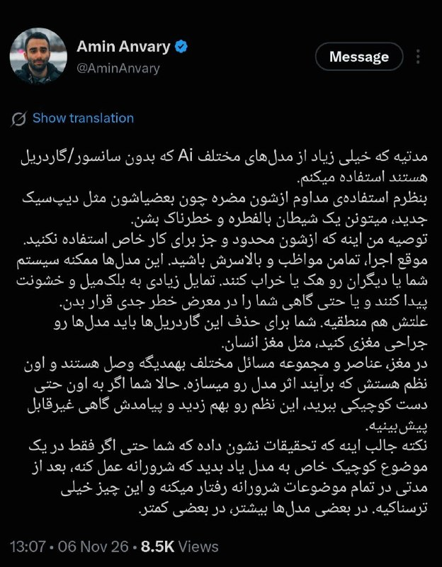

راه‌های زیادی برای دسترسی به مدلهای Uncensored هوش مصنوعی وجود داره، اما هرچقدر فکر کردم، دیدم حقیقتا معرفی راه‌های دسترسی بیشتر از اینکه مفید باشه، آسیب‌زاست.  
 از آموزش ساختن مواد مخدر توی آزمایشگاه مدرسه و انواع و اقسام چیزای خطرناک(اینا صرفا توی چت هستن تازه.  نه ایجنت. و چیزای خوبش رو گفتم. هزارتا کار وحشتناک و داغون میشه کرد باهاش) بگیر، تا مشکلاتی که دوستمون اشاره کرده و مربوط به ایجنت‌هاست.  
اگر واقعا برای Cyber security می‌خواید که خودتون تا الان رفتید دنبالش و بهترین‌هاش رو هم پیدا کردید. ولی واقعا توی استفاده‌ی عمومی یا ایجنتیک، توصیه می‌کنم نه دنبال مدلهای گاردریل آزاد برید و نه تست کنید.

· · ·

**🕒 ۱۴۰۵/۰۸/۱۵ ۱۹:۵۴** · [پست 5799](https://t.me/MatinSenPaii/5799)

یکی هکرا رو متوقف کنه😭

· · ·

**🕒 ۱۴۰۵/۰۸/۱۵ ۱۹:۴۴** · [پست 5798](https://t.me/MatinSenPaii/5798)

🖼 *(عکس بعد از ۲۴ ساعت حذف شده)*

**Phone Harness ایجنت‌ها رو به گوشی واقعی وصل می‌کنه؛ تپ و اسکرول و تایپ، بدون نصب هیچی روی گوشی**  

خلاصه بخوام بگم، ایجنت‌ها مرورگر و کامپیوتر رو گرفته بودن، ولی بخش بزرگی از کارها توی گوشی اتفاق می‌فته؛ اپ‌هایی که فقط موبایلن(مثل اپ‌های بانکی)، لاگین‌ها و کدهای تایید پیامکی.  

طرز کار این ابزار این شکلیه که یه CLI متن‌بازه که به کلاد کد یا Codex یا هر ایجنت دیگه‌ای وصل می‌شه و روی آیفون یا اندروید واقعی، گوشی خودتون یا یه گوشی ابری(با emulator)، تپ می‌کنه و اسکرول می‌کنه و تایپ می‌کنه و صفحه رو می‌خونه. نه جیل‌بریک می‌خواد، نه سایدلود، نه نصب چیزی روی خود گوشی.  

بنیان‌گذارش Shawn Pana قبلا توی Browser Use بوده و از سازنده‌های اصلی ابزار مرورگرشون بوده  

🔗 [ریپو](https://github.com/phone-harness/phone-harness)  
✉️ [t.me/MatinSenPaii](http://t.me/MatinSenPaii)

· · ·

**🕒 ۱۴۰۵/۰۸/۱۵ ۱۶:۳۴** · [پست 5797](https://t.me/MatinSenPaii/5797)

🖼 *(عکس بعد از ۲۴ ساعت حذف شده)*

**یکی با GPT-6 Astra وزن‌های یه شبکه عصبی رو مستقیم ساخت و باهاش پونگ بازی کرد**  

توی r/singularity یکی امتحان کرده با GPT-6 Astra مستقیم وزن‌های یه شبکه عصبی رو بسازه؛ یعنی به‌جای اینکه مدل کد بنویسه، خود وزن‌ها رو تولید کنه. سوژه‌ش یه بازی پونگ بوده که چند تا شبکه کوچیک، هر کدوم با یه وظیفه مشخص، باهاش ساخته شده.  

به گفته خودش ساخت وزن‌ها حدود ۸ دقیقه طول کشیده و حدود ۲۰۰ هزار توکن مصرف کرده که بیشترش Output بوده. یه ادیتور زنده هم ساخته که می‌شه وزن‌ها رو همون‌طور که بازی در حال اجراست عوض کرد؛ مثلا با عوض کردن یه نورون، توپ دیگه به چپ نمی‌رفت.  

🔗 [منبع](https://www.reddit.com/r/singularity/comments/1xp1jua/weight_space_generation_of_state_machines_gpt6/)  
✉️ [t.me/MatinSenPaii](http://t.me/MatinSenPaii)

· · ·

**🕒 ۱۴۰۵/۰۸/۱۵ ۱۵:۱۶** · [پست 5796](https://t.me/MatinSenPaii/5796)

🎭 استیکر: [مشاهده در تلگرام](https://t.me/MatinSenPaii/5796)

· · ·

**🕒 ۱۴۰۵/۰۸/۱۵ ۱۴:۱۴** · [پست 5795](https://t.me/MatinSenPaii/5795)

🖼 *(عکس بعد از ۲۴ ساعت حذف شده)*

**شایعه مدل تازه Anthropic که تو همه بنچمارک‌های METR بالای ۵۰ درصد زده**  

توی r/singularity یه اسکرین‌شات از پستی در ایکس دست‌به‌دست می‌شه که می‌گه Anthropic یه مدل داخلی تازه داره که ماه پیش آموزشش تموم شده و METR بهش می‌گه Model 4. به ادعای همون پست، این اولین مدلیه که تو هر ۱۵ تا بنچمارکی که METR تست کرده بالای ۵۰ درصد گرفته و بالاترین امتیاز رو بین مدل‌هایی داره که METR بررسی کرده. نه خود Anthropic چیزی گفته، نه METR اسم مدل رو اعلام کرده؛ پس فعلا در حد همین شایعه‌ست.  
و شاید با Fable 5.5 سر و کار داشته باشیم  

🔗 [منبع](https://www.reddit.com/r/singularity/comments/1xowicq/anthropic_has_a_powerful_new_ai_model_it_hasnt/)  
✉️ [t.me/MatinSenPaii](http://t.me/MatinSenPaii)

· · ·

**🕒 ۱۴۰۵/۰۸/۱۵ ۱۰:۱۳** · [پست 5794](https://t.me/MatinSenPaii/5794)

🖼 *(عکس بعد از ۲۴ ساعت حذف شده)*

**یه نفر بدون اینکه دوباره ترین کنه، با دست‌کاری مستقیم وزن‌ها TTS کوچیکش رو درست کرد**  

توی ساب‌ردیت r/LocalLLaMA یه سازنده می‌گه داشته روی Silencio-2 کار می‌کرده، یه فاین‌تیون کوچیک از Pocket TTS شرکت Kyutai که تگ‌های احساسی مثل \<whisper\> رو می‌فهمه؛ ولی همین تگ زمزمه یا ویسپر فقط ۱ بار از ۵ بار رو واقعا زمزمه می‌کرد.  

حالا به‌جای جمع کردن دیتای بیشتر، با یه ایجنت کلاد اومده وزن‌های مدل رو پروب کرده و ریشه مشکل رو پیدا کرده، بعد مستقیم یه جمله رتبه‌یک به وزن‌های W\_K هر لایه اضافه کرده، بدون حتی یه قدم گرادیان. نتیجه روی ست تست نگه‌داشته‌شده: زمزمه واقعی از ۵ از ۲۴ تا شد ۲۲ از ۲۴ تا. نمونه‌های صوتی هم توی صفحه‌ی پروژه‌ست.  

[https://nikuson.github.io/silencio-2-weight-edit/](https://nikuson.github.io/silencio-2-weight-edit/)  

🔗 [منبع](https://www.reddit.com/r/LocalLLaMA/comments/1xou096/i_fixed_my_tiny_tts_by_editing_the_weights/)  
✉️ [t.me/MatinSenPaii](http://t.me/MatinSenPaii)

· · ·

**🕒 ۱۴۰۵/۰۸/۱۴ ۲۰:۳۵** · [پست 5793](https://t.me/MatinSenPaii/5793)

**لابراتوار Vercel ابزار agent-desktop رو متن‌باز کرده تا ایجنت‌ها خودشون با برنامه‌های دسکتاپ کار کنن**  

حساب RoundtableSpace توی ایکس معرفیش کرده؛ کارش اینه که به ایجنت کدنویسی‌تون یه دست اضافه می‌ده برای برنامه‌هایی که فقط نسخه دسکتاپ دارن.  

طرز کارش این شکلیه که به جای اسکرین‌شات گرفتن و حدس زدن جای دکمه‌ها، درخت دسترسی خود برنامه رو می‌خونه؛ یعنی همه دکمه‌ها و کادرهای ورودی رو با آدرس مشخص می‌شناسه، روشون کلیک می‌کنه یا توی اون‌ها تایپ می‌کنه، بعد نتیجه رو دوباره چک می‌کنه و ادامه می‌ده.  

روی مک و ویندوز و لینوکس کار می‌کنه و با یه دستور npm نصب می‌شه. داخل خودش هیچ مدلی نداره و حلقه تصمیم‌گیری توی ایجنت خودتونه.  

🔗 [ریپو](https://github.com/vercel-labs/agent-desktop)  
✉️ [t.me/MatinSenPaii](http://t.me/MatinSenPaii)

🎬 ویدیو: [مشاهده در تلگرام](https://t.me/MatinSenPaii/5793)

· · ·

---

## whitedns

[کانال در تلگرام](https://t.me/whitedns) · [آرشیو متن](archive/whitedns/)

**🕒 ۱۴۰۵/۰۸/۱۶ ۱۵:۰۵** · [پست 2247](https://t.me/whitedns/2247)

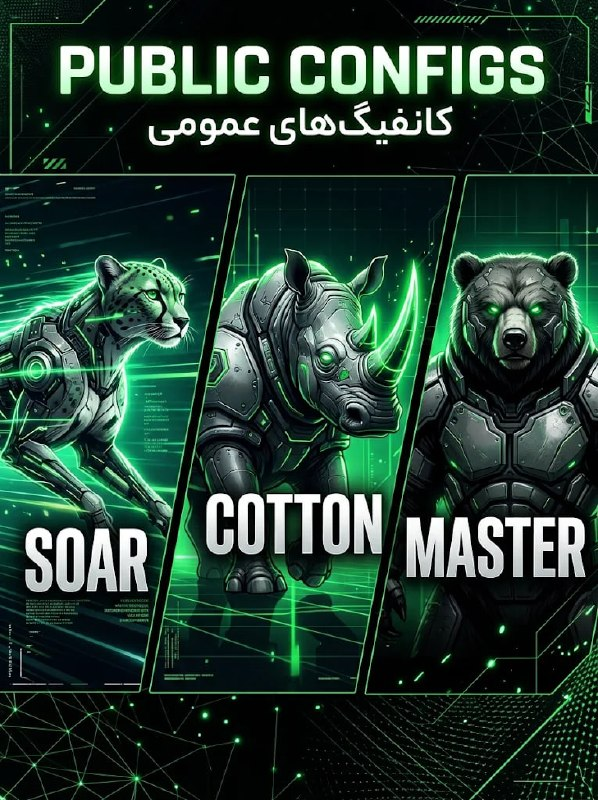

سرورهای (کانفیگ های ) عمومی **جدید** **⭕️**  برای استفاده در برنامه های whitedns ! 🆕  

**2 روزه برای تست و آشنایی با برنامه whitedns** **⚠️**  

📥 [دانلود نسخهٔ اندروید](https://github.com/WhiteDNS/WhiteDNS-Android/releases/latest)  
📥 [دانلود نسخهٔ دسکتاپ](https://github.com/WhiteDNS/WhiteVPN-Desktop/releases/latest)  

[راهنمای واردکردن کانفیگ و اتصال WhiteDNS](https://whitedns.online/tools/whitedns/)  

**برنامه whitedns برای زمان اختلال های شدید و یا قطغی های گسترده طراحی شده و به شما تجربه برنامه هایی مثل whitevpn یا whiteaesther را نخواهد داد**   

🔥 WhtieDNS Temp server   

سرور عمومی SOAR

… [ادامه در تلگرام](https://t.me/whitedns/2247)

· · ·

**🕒 ۱۴۰۵/۰۸/۱۶ ۱۱:۴۱** · [پست 2246](https://t.me/whitedns/2246)


ویدیو جدید رسییددد 😌  

توی این آموزش پنل Nightline رو روی Railway دیپلوی می‌کنیم، کانفیگ V2Ray می‌سازیم و با اسکن IPهای Railway، روش‌های مختلف اتصال رو تست می‌کنیم! 💘  

👇 آموزش کامل راه‌اندازی پنل رو ببین:  
🎬 [https://youtu.be/FK9mc\_jjmIA](https://youtu.be/FK9mc_jjmIA)  

👥 گروه تلگرام Nightline:  
[https://t.me/+CzY2mRiwWldkZWQ0](https://t.me/+CzY2mRiwWldkZWQ0)  

·:¨༺ [@BlueKnight\_Net](https://t.me/BlueKnight_Net) ༻¨:·

· · ·

**🕒 ۱۴۰۵/۰۸/۱۶ ۱۱:۰۶** · [پست 2245](https://t.me/whitedns/2245)

📊 نظرسنجی: [مشاهده در تلگرام](https://t.me/whitedns/2245)

· · ·

**🕒 ۱۴۰۵/۰۸/۱۶ ۰۸:۰۷** · [پست 2242](https://t.me/whitedns/2242)

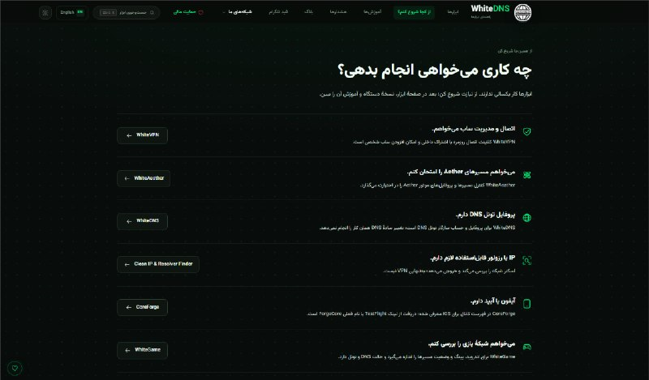

📥 **دنبال ابزار مناسب برای دسترسی آزاد و امن به اینترنت هستی، اما نمی‌دونی کدومش به کارت میاد؟** 🤔  

سایت **WhiteDNS** یه راهنمای فوق‌العاده و ۱۰۰٪ رایگان براتون آماده کرده که بدون پیچیدگی، دقیقا دست میذاره روی نیاز شما! 💡  

**«چه کاری می‌خواهی انجام بدهی؟»**  
 👇 این صفحه بهت کمک می‌کنه بر اساس نیازت، بهترین ابزار رو انتخاب کنی:  

🔹 **اتصال روزمره و مدیریت ساب؟** ➡️ **WhiteVPN** (با اشتراک داخلی و امکان اضافه کردن ساب شخصی)   
🔹 **تنظیم مسیرهای Aether؟** ➡️ **WhiteAesther**   
🔹 **پروفایل تونل DNS داری؟** ➡️ **WhiteDNS**   
🔹 **پیدا کردن IP یا رزولور فعال؟** ➡️ **اسکنر شبکه (Finder)**   
🔹 **مخصوص کاربران آیفون و آیپد؟** ➡️ **CoreForge** (نسخه iOS)   
🔹 **کاهش پینگ و بررسی شبکه بازی؟** ➡️ **WhiteGame** (مخصوص اندروید)   
🔹 **راه‌اندازی سرور شخصی؟** ➡️ **WhiteDNS Panel** (برای VPS لینوکسی)   
🔹 **دریافت کانفیگ و حساب؟** ➡️ ربات‌های **Exit Chain** و **MasterDNS**  
⚠️ **مهم‌ترین ویژگی‌ها:**   
✅ تمامی سرویس‌ها و ابزارها **۱۰۰٪ رایگان** هستند (هیچ اکانت فروشی یا پلن VIP وجود ندارد!)   
✅ بدون ثبت لاگ و بدون ردیاب 🔒  
 ✅ راهنمای گام‌به‌گام و آموزش استفاده برای هر ابزار 📖  
🔍 از همین‌جا شروع کن و ابزار مناسبِ شبکه خودت رو پیدا کن:

… [ادامه در تلگرام](https://t.me/whitedns/2242)

· · ·

**🕒 ۱۴۰۵/۰۸/۱۶ ۰۵:۱۵** · [پست 2240](https://t.me/whitedns/2240)


⚠️  

دوستانی که بعد از نصب ورکر کلادفلر توی ورژن قبلی **whiteaesther** خطای 1101 و یا abuse گرفتن دو مورد را انجام بدهند لطفا :   

1. حتما سعی کنید از page استفاده کنید 🔥  

2.یک تغییراتی توی اخرین ورژن pre-release دادیم میتونید تست کنید 👀  

[ورژن ازمایشی دسکتاپ](https://github.com/WhiteDNS/WhiteAesther/releases/tag/v1.11.1)   
[ورژن ازمایشی مبایل ](https://github.com/WhiteDNS/WhiteAestherMobile/releases/tag/v1.15.2-rc.1)  
[@whitedns](https://t.me/whitedns)   
[https://whitedns.online](https://whitedns.online/)

· · ·

**🕒 ۱۴۰۵/۰۸/۱۵ ۲۱:۳۴** · [پست 2239](https://t.me/whitedns/2239)

🚀 **آپدیت جدید CottenRouter نسخه‌ v1.2.26 منتشر شد!**  
در این آپدیت، پشتیبانی و سازگاری با نسخه‌های جدید سرویس‌های زیر بهبود پیدا کرده است:  
🔹 TheFeed v0.42.0  
🔹 SlipGate v1.6.8  
🔹 WhiteDNS Panel v0.14.4  
✨ **مهم‌ترین تغییرات:**  
✅ **TheFeed**  
- مسیریابی خودکار دامنه‌های اصلی، جایگزین، پیام‌رسان‌ها و تلگرام (MTProto)  
- حفظ تنظیمات و انتخاب‌های قبلی کاربران  
✅ **SlipGate**  
- اضافه شدن پشتیبانی از Soar در کنار DNSTT، Slipstream و VayDNS  
- پشتیبانی از تبدیل DNS-over-TCP به ارتباطات UDP  
- بهبود بررسی اتصال، حفظ تنظیمات WARP فعال و پاک‌سازی مسیرهای قدیمی  
✅ **WhiteDNS Panel**  
- رفع مشکلات نصب و آپدیت نسخه پایدار پنل  
- پشتیبانی از معماری‌های AMD64 و ARM64  
- هماهنگ‌سازی دامنه‌های سرویس با Router  
- حفظ حساب‌ها، کلیدها، سهمیه‌ها و محدودیت‌های کاربران هنگام آپدیت  
✅ **نسخه v1.2.26 شامل تمام بهبودهای v1.2.25 نیز هست.**  
🔄 **آموزش آپدیت CottenRouter و سرویس‌ها**  
**1️⃣ ابتدا CottenRouter را آپدیت کنید:**  
`curl -fsSL https://raw.githubusercontent.com/TaJirax/CottenRouter/main/scripts/install.sh | sudo bash`  
**2️⃣ سپس سرویس‌های نصب‌شده را جداگانه آپدیت کنید:**  
🔹 **آپدیت TheFeed:**  
`sudo cottenrouter update --project thefeed`  
🔹 **آپدیت SlipGate:**

… [ادامه در تلگرام](https://t.me/whitedns/2239)

· · ·

**🕒 ۱۴۰۵/۰۸/۱۵ ۱۸:۵۳** · [پست 2237](https://t.me/whitedns/2237)

🖼 *(عکس بعد از ۲۴ ساعت حذف شده)*

☁️ ورکر کلادفلر در WhiteAesther دسکتاپ 1.11.0  

پروکسی شخصی‌تان را روی حساب رایگان کلادفلر، از داخل خود برنامه بسازید و به آن وصل شوید. پنل جدا، ترمینال یا کپی‌کردن کانفیگ لازم نیست. همان قابلیت نسخهٔ اندروید، حالا روی ویندوز، مک و لینوکس.  

✨ امکانات  
• ساخت، به‌روزرسانی و حذف Worker یا Pages با یک توکن API  
• اتصال VLESS در سه حالت: عادی (بهترین پینگ)، فرگمنت و Browser Dialer  
• IP و دامنهٔ تمیز، پورت‌های TLS، دامنهٔ سفارشی و ECH  
• باز شدن سایت‌های پشت کلادفلر از طریق Proxy IP خودتان یا درگاه‌های عمومی NAT64؛ اگر یک درگاه از کار افتاده باشد، بقیه به نوبت امتحان می‌شوند  
• نمایش و حذف بقیهٔ Workers و Pagesهای حساب  
• «متصل» فقط بعد از عبور یک درخواست واقعی نمایش داده می‌شود  
• توکن API ذخیره نمی‌شود و فقط تا وقتی صفحه باز است در حافظه می‌ماند  

📖 راه‌اندازی در یک دقیقه  
۱. برنامه را باز کنید و به Advanced ← «ورکرهای کلادفلر» بروید.  
۲. «ساخت توکن API» را بزنید، حساب خود را انتخاب کنید و توکن را بسازید.  
۳. توکن را وارد کنید و «دریافت حساب‌ها» را بزنید.  
۴. Workers یا Pages را انتخاب کنید و «استقرار» را بزنید.  
۵. روی کارت استقرار «اتصال از طریق این استقرار» را بزنید و از صفحهٔ Simple وصل شوید.

… [ادامه در تلگرام](https://t.me/whitedns/2237)

· · ·

**🕒 ۱۴۰۵/۰۸/۱۵ ۱۰:۲۸** · [پست 2236](https://t.me/whitedns/2236)

🖼 *(عکس بعد از ۲۴ ساعت حذف شده)*

☁️ ورکر کلادفلر در WhiteAesther 1.15.1  

حالا می‌توانید از داخل خود برنامه، پروکسی شخصی‌تان را روی حساب رایگان کلادفلر بسازید و به آن وصل شوید. پنل جدا، ترمینال یا کپی‌کردن کانفیگ لازم نیست.  

✨ امکانات  
• ساخت، به‌روزرسانی و حذف Worker یا Pages با یک توکن API  
• اتصال VLESS در سه حالت: عادی (بهترین پینگ)، فرگمنت، و Browser Dialer  
• آی‌پی و دامنهٔ تمیز، پورت‌های TLS، دامنهٔ سفارشی و ECH  
• باز شدن سایت‌های پشت کلادفلر از طریق Proxy IP خودتان یا درگاه‌های عمومی NAT64  
• آمار مصرف ۲۴ ساعت گذشته  
• توکن API فقط تا زمانی که صفحه باز است در حافظه می‌ماند و جایی ذخیره نمی‌شود  

📖 آموزش کوتاه  
۱. در صفحهٔ اتصال، «روش اتصال» را باز کنید و «ورکر کلادفلر» را انتخاب کنید.  
۲. روی «ورکرهای کلادفلر» بزنید.  
۳. «ساخت توکن API» را بزنید. فرم کلادفلر با دسترسی‌های لازم باز می‌شود. حساب خود را در Account Resources انتخاب کنید و توکن را بسازید.  
۴. توکن را در برنامه وارد کنید و «دریافت حساب‌ها» را بزنید.  
۵. در «استقرار جدید»، Workers یا Pages را انتخاب کنید و «استقرار» را بزنید.  
۶. بعد از تمام شدن استقرار، به صفحهٔ اصلی برگردید و وصل شوید.  

💡 نکته‌ها  
• اگر وصل نشد، در «تنظیمات اتصال ورکر» حالت فرگمنت را امتحان کنید یا IP تمیز اضافه کنید.

… [ادامه در تلگرام](https://t.me/whitedns/2236)

· · ·

**🕒 ۱۴۰۵/۰۸/۱۵ ۰۰:۱۷** · [پست 2235](https://t.me/whitedns/2235)

توی نسخه جدید دفید میتونید به اکانت تلگرام شخصیتون لاگین کنید و  به زودی کاتن روتر رو هم اپدیت میکنیم که از اخرین ورژن the feed  ساپورت کنه  

----------  
#اطلاعیه #CottenRouter

· · ·

**🕒 ۱۴۰۵/۰۸/۱۵ ۰۰:۱۳** · [پست 2234](https://t.me/whitedns/2234)

↪️ فوروارد از Sarto | سارتو

🎬 **آموزش جامع TheFeed | از صفر تا صد**  

‏TheFeed آپدیت شده و حالا علاوه بر قابلیت‌های قبلی، امکانات جدیدی مثل پیام‌رسان اختصاصی و دسترسی به خود تلگرام هم بهش اضافه شده! 🚀  

توی این ویدیو تمام بخش‌های برنامه رو از ابتدا آموزش دادیم تا بدون سردرگمی بتونید از امکاناتش استفاده کنید.  

📚 **توی این آموزش یاد می‌گیرید:**  

🔹 نصب و راه‌اندازی و اضافه کردن کانفیگ  
🔹 استفاده از کانفیگ‌های پیش‌فرض برنامه  
🔹 آشنایی با ریزالورها و نحوه مدیریت اون‌ها  
🔹 پیدا کردن DNS های سالم با اسکنر داخلی  
🔹 مشاهده کانال‌ها و دانلود محتوا  
🔹 استفاده از TeleMirror و دنبال کردن کانال‌های دلخواه  
🔹 فعال‌سازی پیام‌رسان اختصاصی TheFeed با رمزنگاری E2E  
🔹 ساخت شناسه اختصاصی و چت با کاربران دیگر  
🔹 استفاده از قابلیت جدید تلگرام با اکانت شخصی، از طریق تونل DNS  
💬 **تلگرام در TheFeed چیه؟**  
با این قابلیت می‌تونید با اکانت واقعی تلگرامتون وارد بشید و به گفتگوها و کانال‌ها دسترسی داشته باشید؛ بدون نیاز به VPN یا پروکسی معمولی.  
اطلاعات از طریق DNS منتقل میشن و رمزنگاری اصلی تلگرام هم دست‌نخورده باقی مونده. البته در نسخه فعلی فقط پیام‌های متنی پشتیبانی میشن.  
  
📢 **کانال اصلی پروژه:**  
[@networkti](https://t.me/networkti)  
⚙️ **دریافت کانفیگ‌ها:**  
[@thefeedconfig](https://t.me/thefeedconfig)

… [ادامه در تلگرام](https://t.me/whitedns/2234)

🎬 ویدیو: [مشاهده در تلگرام](https://t.me/whitedns/2234)

· · ·

**🕒 ۱۴۰۵/۰۸/۱۵ ۰۰:۱۳** · [پست 2233](https://t.me/whitedns/2233)

↪️ فوروارد از Sarto | سارتو

🚀 نسخه جدید #TheFeed (v.0.42.0)  

🔹 رفع باگ و بهبود قابلیت لاگین به تلگرام شخصی  (بتا)  

برای تست این قابلیت، کانفیگ توی این پست رو به نسخه جدید برنامه اضافه کنید:  
[https://t.me/networkti/613](https://t.me/networkti/613)  

[🔽 نصب از طریق گوگل‌ پلی](https://play.google.com/store/apps/details?id=com.thefeed.android)  
[🔽 نصب از طریق تست‌فلایت برای ios](https://testflight.apple.com/join/J6bfxDdZ)  
دانلود برای همه سیستم عامل ها 👇  
[🔽 دانلود از طریق گیتهاب](https://github.com/sartoopjj/thefeed/releases)   
🔽[ دانلود از طریق تلگرام](https://t.me/thefeedfile)  
[📹 آموزش کار با برنامه](https://t.me/networkti/620)  

📢 کانال اصلی اخبار پروژه:  
[@networkti](https://t.me/networkti)  
⚙ کانال کانفیگ‌های پروژه:  
[@thefeedconfig](https://t.me/thefeedconfig)

📎 فایل: [مشاهده در تلگرام](https://t.me/whitedns/2233)

· · ·

**🕒 ۱۴۰۵/۰۸/۱۴ ۱۰:۰۲** · [پست 2232](https://t.me/whitedns/2232)

🖼 *(عکس بعد از ۲۴ ساعت حذف شده)*

🟢 پنل WhiteDNS نسخهٔ 0.14.4 منتشر شد  
(شامل تغییرات 0.14.3)  
🔓 پورت روی IP خود سرور  
گزینهٔ تازه: «پورت‌های مجاز روی IP خود سرور». پیش‌فرض خالی است و اتصال به خود سرور مسدود می‌ماند.  
⚠️ پورت بازشده برای همهٔ حساب‌ها در دسترس است؛ پورت پنل و SSH را اضافه نکنید.  
🔀 پراکسی خروجی پایدارتر  
پراکسی کند، در TCP و UDP، زودتر از موعد قطع نمی‌شود و پاسخ‌های UDP در SOCKS5 درست‌تر دریافت می‌شوند.  
🧭 لاگ دقیق‌تر  
علت رد شدن اتصال حالا مشخص است: مقصد روی خود سرور یا شبکهٔ خصوصی (destination\_not\_public)، یا پراکسی خاموش یا بستن پورت ۵۳ (proxy\_dns\_failed).  
⚙️ موتورها  
همین طور Cotten: اصلاح کش DNS و جدا شدن درخواست‌ها با تنظیمات متفاوت، تطبیق دقیق‌تر پاسخ‌ها و آزادسازی سوکت‌های بی‌کار UDP. برای اصلاحات سمت کلاینت، کلاینت Cotten را هم به‌روز کنید.  
موتور Soar: به‌روزرسانی به v0.2.4.  
🛡 سرورهای پشت NAT  
ای پی عمومی پنل حالا روی این سرورها هم مسدود است، مگر پورتش در لیست باشد.  
پیش از ارتقا بکاپ بگیرید.  
📦 ادرس مخزن :  
[https://github.com/WhiteDNS/Soar-Server/releases/tag/panel-v0.14.4](https://github.com/WhiteDNS/Soar-Server/releases/tag/panel-v0.14.4)  
#WhiteDNS #Soar  
[@whitedns](https://t.me/whitedns)  
[https://whitedns.online](https://whitedns.online/)

· · ·

**🕒 ۱۴۰۵/۰۸/۱۳ ۱۹:۲۸** · [پست 2231](https://t.me/whitedns/2231)

🖼 *(عکس بعد از ۲۴ ساعت حذف شده)*

💚 راه‌اندازی درگاه رسمی حمایت مالی (**Crypto Donation)** برای پایداری WhiteDNS  

سلام به همراهان عزیز WhiteDNS؛  

از روز اول هدف ما مشخص و بدون تغییر بوده است: دسترسی آزاد، امن و ۱۰۰٪ رایگان به اینترنت برای همه.  

تاکنون تمامی هزینه‌های تأمین و نگهداری سرورهای مرزی، اسکنرهای خودکار، تونل‌های DNS اختصاصی، توسعه و انتشار نسخه‌های مختلف نرم‌افزارها (WhiteDNS, WhiteVPN, WhiteAesther) به صورت شخصی و مستقل تأمین شده است.  

با توجه به افزایش چشمگیر حجم کاربران و به تبع آن افزایش هزینه‌های ترافیک و سرورهای ابری، درگاه رسمی حمایت مالی رمزارزی (Crypto) را برای همراهانی که مایل به مشارکت در زنده نگه‌داشتن و گسترش این زیرساخت هستند راه‌اندازی کردیم.  

━━━━━━━━━━━━━━━━━━━━━  
🛡 چرا مشارکت شما حیاتی است؟  

۱. تأمین هزینه سرورها و ترافیک:  
سرورهای تونل DNS، پروکسی‌ها و اسکنرهای پرسرعت روزانه چند ترابایت ترافیک عبور می‌دهند و نیاز به منابع ابری مداوم دارند.  

۲. استمرار توسعه نرم‌افزارها:  
دور زدن مداوم محدودیت‌ها و انتشار آپدیت‌های فوری برای ویندوز، اندروید، مک و لینوکس نیازمند صرف وقت و هزینه زیرساختی است.  

۳. کاملاً امن و ناشناس:  
تراکنش‌ها روی بستر بلاک‌چین و از طریق درگاه معتبر بین‌المللی NOWPayments انجام شده و نیازی به هیچ‌گونه ثبت‌نام یا اطلاعات هویتی نیست.

… [ادامه در تلگرام](https://t.me/whitedns/2231)

· · ·

**🕒 ۱۴۰۵/۰۸/۱۳ ۰۹:۲۵** · [پست 2229](https://t.me/whitedns/2229)

🖼 *(عکس بعد از ۲۴ ساعت حذف شده)*

📥 **دنبال ابزار مناسب برای دسترسی آزاد و امن به اینترنت هستی، اما نمی‌دونی کدومش به کارت میاد؟** 🤔  

سایت **WhiteDNS** یه راهنمای فوق‌العاده و ۱۰۰٪ رایگان براتون آماده کرده که بدون پیچیدگی، دقیقا دست میذاره روی نیاز شما! 💡  

**«چه کاری می‌خواهی انجام بدهی؟»**  
 👇 این صفحه بهت کمک می‌کنه بر اساس نیازت، بهترین ابزار رو انتخاب کنی:  

🔹 **اتصال روزمره و مدیریت ساب؟** ➡️ **WhiteVPN** (با اشتراک داخلی و امکان اضافه کردن ساب شخصی)   
🔹 **تنظیم مسیرهای Aether؟** ➡️ **WhiteAesther**   
🔹 **پروفایل تونل DNS داری؟** ➡️ **WhiteDNS**   
🔹 **پیدا کردن IP یا رزولور فعال؟** ➡️ **اسکنر شبکه (Finder)**   
🔹 **مخصوص کاربران آیفون و آیپد؟** ➡️ **CoreForge** (نسخه iOS)   
🔹 **کاهش پینگ و بررسی شبکه بازی؟** ➡️ **WhiteGame** (مخصوص اندروید)   
🔹 **راه‌اندازی سرور شخصی؟** ➡️ **WhiteDNS Panel** (برای VPS لینوکسی)   
🔹 **دریافت کانفیگ و حساب؟** ➡️ ربات‌های **Exit Chain** و **MasterDNS**  
⚠️ **مهم‌ترین ویژگی‌ها:**   
✅ تمامی سرویس‌ها و ابزارها **۱۰۰٪ رایگان** هستند (هیچ اکانت فروشی یا پلن VIP وجود ندارد!)   
✅ بدون ثبت لاگ و بدون ردیاب 🔒  
 ✅ راهنمای گام‌به‌گام و آموزش استفاده برای هر ابزار 📖  
🔍 از همین‌جا شروع کن و ابزار مناسبِ شبکه خودت رو پیدا کن:

… [ادامه در تلگرام](https://t.me/whitedns/2229)

· · ·

**🕒 ۱۴۰۵/۰۸/۱۳ ۰۷:۰۴** · [پست 2228](https://t.me/whitedns/2228)

🖼 *(عکس بعد از ۲۴ ساعت حذف شده)*

📢 **اطلاعیه مهم:   

 از دسترس خارج شدن سرورهای عمومی**  

سلام به همه همراهان گرامی WhiteDNS 👋  

به اطلاع می‌رسانیم که با توجه به شرایط ترافیکی اخیر و تصمیم تیم فنی، **کلیه سرورهای عمومی و اضطراری قبلی (از جمله Soar، Cotton و MasterDNS) از دسترس خارج شدند.**  

**علت این تصمیم:**   

این سرورها با ظرفیت و منابع محدود، صرفاً برای مواقع بحرانی و قطعی‌های سراسری پیش‌بینی شده بودند؛ اما حجم بسیار بالای اتصالات همزمان و مصرف ترافیک سنگین بی مورد باعث افت شدید پایداری و ایجاد اختلالات پیاپی شده بود. هرچند ما بارها اعلام کردیم که فقط در صورتی که هیچ کدام از اپ های ما روی اپراتور شما پاسخگو نیست از این سرورها استفاده کنید ولی همچنان تعداد زیادی از دوستان بی مهری کردند .   

**شما همچنان این کانفیگ ها را میتوانید در برنامه whitedns داشته باشید در صورت قطعی سراسری و یا به منظور ازمایش های کوتاه مدت این کانفیگ ها فعال خواهد شد**. ⚠️  

🚀 راهکار اتصال و اپلیکیشن‌های اصلی:  

برای وب‌گردی روزمره، سرعت بالا و اتصال کاملاً پایدار، لطفاً از برنامه‌ها و کانفیگ‌های رسمی مجموعه استفاده کنید:  
**📱 WhiteAesther**  
[دانلود موبایل](https://github.com/WhiteDNS/WhiteAestherMobile/releases) • [دانلود دسکتاپ](https://github.com/WhiteDNS/WhiteAesther/releases)  
**🛡 WhiteVPN**

… [ادامه در تلگرام](https://t.me/whitedns/2228)

· · ·

**🕒 ۱۴۰۵/۰۸/۱۲ ۲۰:۰۸** · [پست 2227](https://t.me/whitedns/2227)

🖼 *(عکس بعد از ۲۴ ساعت حذف شده)*

🟢 پنل WhiteDNS نسخهٔ 0.14.2 منتشر شد  

🔀 اتصال پایدارتر  
سقف مقصد حالا برای هر حساب جداست؛ یک حساب پرمصرف راه Telegram یا CDN را برای بقیه نمی‌بندد. خرابی پراکسی یا قطع اینترنت سرور هم حساب‌ها را قرنطینه نمی‌کند.  

🌐 با DNS سالم‌تر   
نام‌های داخل دامنهٔ پنل دیگر REFUSED نمی‌گیرند. DNS روی پراکسی SOCKS5 بدون UDP هم با TCP کار می‌کند.  

🔏 آپدیت امضاشده  
از این نسخه به بعد، پنل فقط آپدیت دارای امضای آفلاین را نشان می‌دهد و نصب می‌کند.  

🗄 بازیابی بکاپ بدون root  
فایل بکاپ حالا با کاربر پنل بررسی می‌شود، نه root.  

⚠️ سقف‌های سخت‌گیرانهٔ ضدفلاد را بازبینی کنید؛ مجموع حساب‌ها حالا تا ۸ برابر مقدار تنظیم‌شده به یک مقصد مجاز است.  

حساب‌ها، کلیدها، ساب و مصرف حفظ می‌شوند؛ پیش از ارتقا بکاپ بگیرید.  

📦 دانلود:  
[https://github.com/WhiteDNS/Soar-Server/releases/tag/panel-v0.14.2](https://github.com/WhiteDNS/Soar-Server/releases/tag/panel-v0.14.2)  

📖 راهنمای ضدفلاد:  
[https://github.com/WhiteDNS/Soar-Server/blob/main/docs/ANTIFLOOD.fa.md](https://github.com/WhiteDNS/Soar-Server/blob/main/docs/ANTIFLOOD.fa.md)  

#WhiteDNS #Soar  
[@whitedns](https://t.me/whitedns)  
[https://whitedns.online](https://whitedns.online/)

· · ·

**🕒 ۱۴۰۵/۰۸/۱۲ ۱۷:۰۴** · [پست 2226](https://t.me/whitedns/2226)

🖼 *(عکس بعد از ۲۴ ساعت حذف شده)*

· · ·

**🕒 ۱۴۰۵/۰۸/۱۲ ۱۶:۵۸** · [پست 2225](https://t.me/whitedns/2225)

Channel photo updated

· · ·

**🕒 ۱۴۰۵/۰۸/۱۲ ۱۳:۳۵** · [پست 2223](https://t.me/whitedns/2223)

↪️ فوروارد از White DNS

🖼 *(عکس بعد از ۲۴ ساعت حذف شده)*

⭕️⭕️⭕️⭕️⭕️⭕️⭕️  

سلام به همه همراهان گرامی 👋  

یک نکته بسیار مهم درباره **سرورهای عمومی و اضطراری Soar , cotton , masterdns**  کانال:  

این سرورها صرفاً برای **مواقع بحرانی، قطعی‌های سراسری و اختلال شدید اینترنت** فعال شده‌اند تا دسترسی کاربران در لحظات ضروری به طور کامل قطع نشود.  

منابع سخت‌افزاری و پهنای باند این سرورها **محدود** است و متأسفانه به دلیل هجوم بالای اتصالات، در اکثر ساعات در وضعیت **Overload (بار ترافیکی بیش از حد)** قرار دارند و مکرراً با افت شدید سرعت یا قطعی مواجه می‌شوند.  
**چند خواهش مهم از شما عزیزان:**  
**استفاده از سایر اپ‌ها:** برای استفاده روزمره، وب‌گردی و اتصال پایدار، لطفاً از **سایر برنامه‌ها و ابزارهای معرفی‌شده در کانال** استفاده کنید و به این سرورها متصل نشوید.  
**پرهیز از مصرف سنگین روی سرورهای اضطراری:** این سرورها توان پردازش ترافیک سنگین (مانند دانلود، استریم ویدیو، اینستاگرام یا یوتیوب) را ندارند و در چند دقیقه از کار می‌افتند.  
**رعایت حال دیگران:** اشغال این سرورها در شرایط عادی باعث قطع شدن ارتباط دوستانی می‌شود که در وضعیت اضطراری نیاز به ارسال پیام ضروری دارند.  
لطفاً این سرورها را تنها به عنوان **راهکار آخر در شرایط اختلال شدید** نگه دارید تا همیشه در دسترس همه باقی بمانند.  

اپلیکیشن های اصلی :   

**📱 WhiteAesther**

… [ادامه در تلگرام](https://t.me/whitedns/2223)

· · ·

**🕒 ۱۴۰۵/۰۸/۱۲ ۰۷:۰۲** · [پست 2221](https://t.me/whitedns/2221)

🖼 *(عکس بعد از ۲۴ ساعت حذف شده)*

[https://whitedns.online](https://whitedns.online/)  
[@whitedns](https://t.me/whitedns)

· · ·

---

## ircfspace

[کانال در تلگرام](https://t.me/ircfspace) · [آرشیو متن](archive/ircfspace/)

**🕒 ۱۴۰۵/۰۸/۱۴ ۱۹:۴۹** · [پست 2704](https://t.me/ircfspace/2704)

🖼 *(عکس بعد از ۲۴ ساعت حذف شده)*

پروکسی‌گشا یک اسکریپت رایگانه که با استفاده از سرویس ورکر کلودفلر، برای تلگرام WEB Proxy راه‌اندازی می‌کنه. این نوع پروکسی برخلاف MTProto، ترافیکش رو در قالب HTTPS معمولی منتقل می‌کنه و میتونه پشت سی‌دی‌ان کلودفلر فعالیت کنه؛ در نتیجه از نظر فیلترینگ، شبیه ترافیک عادی وب‌سایته و حتی اگه کسی آدرس پروکسی رو توی مرورگر باز کنه، یه سایت اینترنتی معمولی می‌بینه!   

👉 [github.com/amirmarandidev/proxygosha](http://github.com/amirmarandidev/proxygosha)  

🔗 [ᴡᴇʙꜱɪᴛᴇ](https://ircf.space/) • [ᴠᴘɴʜᴜʙ](https://t.me/persianvpnhub) • [ɢɪᴛʜᴜʙᴍɪʀʀᴏʀ](https://t.me/PersianGithubMirror)  
[@ircfspace](https://t.me/ircfspace)

· · ·

**🕒 ۱۴۰۵/۰۸/۱۴ ۱۹:۴۳** · [پست 2703](https://t.me/ircfspace/2703)

🖼 *(عکس بعد از ۲۴ ساعت حذف شده)*

بعد از حذف اپلیکیشن همسریابی "آدم و حوا" از گوگل‌پلی و پاک شدن صفحات تبلیغاتی اون از پلتفرم‌های متا بدلیل معرفی دختران ۱۳ ساله به‌عنوان گزینه ازدواج، یکی از مدیران وزارت ورزش از این موضوع دفاع کرده و گفته طبق قوانین جمهوری اسلامی، ازدواج دختران از ۱۳ سالگی با رضایت خانواده قانونیه و فعلاً مبنای مشخصی برای برخورد با این سامانه وجود نداره؛ با این حال به مراکز همسان‌گزینی توصیه کرده حداقل سن پذیرش دختران رو به بالای ۱۵ سال افزایش بدن! /هرانا  

🔗 [ᴡᴇʙꜱɪᴛᴇ](https://ircf.space/) • [ᴠᴘɴʜᴜʙ](https://t.me/persianvpnhub) • [ɢɪᴛʜᴜʙᴍɪʀʀᴏʀ](https://t.me/PersianGithubMirror)  
[@ircfspace](https://t.me/ircfspace)

· · ·

**🕒 ۱۴۰۵/۰۸/۱۴ ۰۹:۴۳** · [پست 2702](https://t.me/ircfspace/2702)

🖼 *(عکس بعد از ۲۴ ساعت حذف شده)*

بررسی امنیتی تیم پس‌کوچه روی فیلترشکن MiuMiu VPN که تاکنون بیش از ۵۰۰ هزار بار از گوگل‌پلی دانلود شده، نشون داده که این برنامه با وجود اتصال VPN، ممکنه درخواست‌های DNS بعضی اپلیکیشن‌هارو خارج از تانل و بصورت رمزنگاری‌نشده ارسال کنه؛ و حتی قابلیت Lockdown اندروید هم جلوی این نشت اطلاعات رو نمی‌گیره.  
همینطور در جریان آزمایش‌ها مشخص شده که میشه ارتباط برنامه با سرورش رو دستکاری کرد و پاسخ تنظیمات جعلی رو به برنامه تحمیل کرد؛ موضوعی که می‌تونه زمینه هدایت کاربر به سرورهای مخرب رو فراهم کنه. نکته نگران‌کننده‌تر اینکه برخلاف ادعای جمع‌آوری‌نکردن اطلاعات، برنامه داده‌هایی مثل شناسه دستگاه، مدل گوشی و اطلاعات فنی اون رو به سرور خودش ارسال می‌کنه.  

🔗 [ᴡᴇʙꜱɪᴛᴇ](https://ircf.space/) • [ᴠᴘɴʜᴜʙ](https://t.me/persianvpnhub) • [ɢɪᴛʜᴜʙᴍɪʀʀᴏʀ](https://t.me/PersianGithubMirror)  
[@ircfspace](https://t.me/ircfspace)

· · ·

**🕒 ۱۴۰۵/۰۸/۱۴ ۰۹:۳۶** · [پست 2701](https://t.me/ircfspace/2701)

🖼 *(عکس بعد از ۲۴ ساعت حذف شده)*

کدهای کشف‌شده در جدیدترین نسخه اندروید یوتیوب نشون میدن گوگل در حال آزمایش یه پلتفرم اجتماعی جدید به اسم Tamba هست که می‌تونه رقیبی برای اینستاگرام باشه.   
این سرویس قراره قابلیت‌هایی مثل فالو کردن کاربران، انتشار پست، ارسال دایرکت و چت گروهی داشته باشه و حتی امکان اشتراک‌گذاری و تماشای ویدیوهای Shorts رو فراهم کنه.   
البته هنوز مشخص نیست Tamba بصورت یه اپلیکیشن مستقل منتشر می‌شه، یا صرفاً بستری برای آزمایش قابلیت‌های اجتماعی جدیده.  

© androidauthority  

🔗 [ᴡᴇʙꜱɪᴛᴇ](https://ircf.space/) • [ᴠᴘɴʜᴜʙ](https://t.me/persianvpnhub) • [ɢɪᴛʜᴜʙᴍɪʀʀᴏʀ](https://t.me/PersianGithubMirror)  
[@ircfspace](https://t.me/ircfspace)

· · ·

**🕒 ۱۴۰۵/۰۸/۱۱ ۱۰:۰۰** · [پست 2700](https://t.me/ircfspace/2700)

🖼 *(عکس بعد از ۲۴ ساعت حذف شده)*

یه آسیب‌پذیری خطرناک به اسم SMS of Death در اندروید شناسایی شده که به مهاجم اجازه میده فقط با ارسال یه پیامک مخرب و بدون نیاز به باز کردن پیام توسط کاربر، تماس‌های گوشی رو قطع کنه و حتی در صورت تکرار حمله، دستگاه رو وارد چرخه ری‌استارت کنه.  
این مشکل روی گوشی‌های پیکسل و سامسونگ گلکسی آزمایش شده و نمونه عملی حمله هم منتشر شده. گوگل این مشکل رو در آپدیت امنیتی اکتبر برای اندروید ۱۴ به بالا برطرف کرده، اما دستگاه‌های قدیمی‌تر مثل گوشی‌های مجهز به اندروید ۱۲ و ۱۳ ممکنه همچنان آسیب‌پذیر باشن.  

© bleepingcomputer  

🔗 [ᴡᴇʙꜱɪᴛᴇ](https://ircf.space/) • [ᴠᴘɴʜᴜʙ](https://t.me/persianvpnhub) • [ɢɪᴛʜᴜʙᴍɪʀʀᴏʀ](https://t.me/PersianGithubMirror)  
[@ircfspace](https://t.me/ircfspace)

· · ·

**🕒 ۱۴۰۵/۰۸/۱۱ ۰۹:۵۷** · [پست 2699](https://t.me/ircfspace/2699)

به گفته معاون گردشگری استان تهران، تا الان نزدیک به ۸۰۰ صفحه اینستاگرامی مربوط به تورهای گردشگری فاقد مجوز شناسایی و اطلاعاتشون برای پیگیری قضایی ارسال شده! این موضوع در پی دستور اخیر دادستان تهران برای مسدودسازی این صفحات مطرح شده. /زومیت  

🔗 [ᴡᴇʙꜱɪᴛᴇ](https://ircf.space/) • [ᴠᴘɴʜᴜʙ](https://t.me/persianvpnhub) • [ɢɪᴛʜᴜʙᴍɪʀʀᴏʀ](https://t.me/PersianGithubMirror)  
[@ircfspace](https://t.me/ircfspace)

· · ·

**🕒 ۱۴۰۵/۰۸/۱۱ ۰۹:۵۳** · [پست 2698](https://t.me/ircfspace/2698)

فیلترینگ، تورم چندرقمی، تحریم، آلودگی هوا، نابودی محیط‌زیست، جنگ و ناترازی دائمی برق، گاز، آب و سوخت و ...  
مردم دنیا شاید یکی‌دو مورد از این مصائب را دیده یا شنیده باشند؛ اما بر سر ملت ما همه را یکجا آوار کرده‌اند  
در هیچ جای تاریخ، زندگی انسان‌ها اینگونه هزینه مُشتی شعار واهی نشد!  

© mohammadparsi1  

🔗 [ᴡᴇʙꜱɪᴛᴇ](https://ircf.space/) • [ᴠᴘɴʜᴜʙ](https://t.me/persianvpnhub) • [ɢɪᴛʜᴜʙᴍɪʀʀᴏʀ](https://t.me/PersianGithubMirror)  
[@ircfspace](https://t.me/ircfspace)

· · ·

**🕒 ۱۴۰۵/۰۸/۱۱ ۰۹:۴۲** · [پست 2697](https://t.me/ircfspace/2697)

با وجود اینکه بایننس میگه حدود ۶ میلیارد دلار از دارایی‌های سرقت‌شده رو جایگزین کرده، خروج سرمایه از این صرافی همچنان یکی از مهمترین پیامدهای هک اخیرشه. طبق گزارش رویترز، بعد از بازگشت تدریجی امکان برداشت، حدود ۳.۶۴ میلیارد دلار خروج خالص دارایی از بایننس ثبت شده؛ رقمی که معادل ۲.۱ درصد از کل دارایی‌های این صرافیه.  

این حمله ۷ آبان، کیف پول‌های گرم بایننس رو هدف قرار داد و ارزش دارایی‌های تحت تأثیرش حدود ۶.۳ میلیارد دلار برآورد شده. بررسی اولیه نشون می‌داد احتمالاً لپ‌تاپ یکی از مهندسان DevOps هک شده و مهاجم از طریق دسترسی به زیرساخت داخلی، برداشت‌های غیرمجاز انجام داده؛ اما بایننس بعداً از شناسایی نقاط نفوذ بیشتری خبر داد و گفت هنوز مدرکی از افشای کلیدهای خصوصی کیف پول‌ها پیدا نکرده. گزارش FBI هم این حمله رو به گروه TraderTraitor وابسته به کره شمالی نسبت داد.

… [ادامه در تلگرام](https://t.me/ircfspace/2697)

· · ·

**🕒 ۱۴۰۵/۰۸/۱۱ ۰۹:۳۰** · [پست 2696](https://t.me/ircfspace/2696)

🖼 *(عکس بعد از ۲۴ ساعت حذف شده)*

سازمان فناوری اطلاعات (زیرمجموعه وزارت قطع‌ارتباطات) یه گزارش در رابطه با ارزیابی پلتفرم‌های دیجیتال منتشر کرده، که در اون کارپینو (سرویسی که چندساله تعطیل شده و حتی دامینش فروخته شده) بدلیل رابط کاربری، سهولت و کارایی مقام چهارم رو در بین تاکسی‌های اینترنتی کسب کرده 😂  

🔗 [ᴡᴇʙꜱɪᴛᴇ](https://ircf.space/) • [ᴠᴘɴʜᴜʙ](https://t.me/persianvpnhub) • [ɢɪᴛʜᴜʙᴍɪʀʀᴏʀ](https://t.me/PersianGithubMirror)  
[@ircfspace](https://t.me/ircfspace)

· · ·

**🕒 ۱۴۰۵/۰۸/۱۱ ۰۹:۲۴** · [پست 2695](https://t.me/ircfspace/2695)

افزایش تعرفه اینترنت در حالی با واکنش کاربران روبه‌رو شده که اطلاعات منتشرشده از صورت‌های مالی همراه اول نشان می‌دهد این اپراتور در نیمه نخست امسال از سرویس #اینترنت\_پرو حدود ۱,۷۰۰ میلیارد تومان درآمد داشته است. /آی‌تی‌رسان  

🔗 [ᴡᴇʙꜱɪᴛᴇ](https://ircf.space/) • [ᴠᴘɴʜᴜʙ](https://t.me/persianvpnhub) • [ɢɪᴛʜᴜʙᴍɪʀʀᴏʀ](https://t.me/PersianGithubMirror)  
[@ircfspace](https://t.me/ircfspace)

· · ·

**🕒 ۱۴۰۵/۰۸/۰۶ ۰۸:۱۳** · [پست 2694](https://t.me/ircfspace/2694)

🖼 *(عکس بعد از ۲۴ ساعت حذف شده)*

فایل‌های متنی Markdown مثل `AGENTS.md` و `CLAUDE.md` به روش جدیدی برای فریب ایجنت‌های هوش مصنوعی تبدیل شدن.   
طبق گزارش شرکت امنیتی Forever Security، هکرها می‌تونن دستورهای مخرب رو داخل این فایل‌ها پنهان کنن و ابزارهایی مثل Codex و Claude Code رو به نصب بدافزار یا افشای اطلاعات کاربر وادار کنن.   
برای جلوگیری از این حملات، بهتره فایل‌های دستورالعمل ناشناس رو بررسی کنین، ایجنت‌ها رو از داخل پوشه دانلودها یا پروژه‌های مشکوک اجرا نکنین و تأیید امنیتی اجرای دستورات رو غیرفعال نکنین.  

🔗 [ᴡᴇʙꜱɪᴛᴇ](https://ircf.space/) • [ᴠᴘɴʜᴜʙ](https://t.me/persianvpnhub) • [ɢɪᴛʜᴜʙᴍɪʀʀᴏʀ](https://t.me/PersianGithubMirror)  
[@ircfspace](https://t.me/ircfspace)

· · ·

**🕒 ۱۴۰۵/۰۸/۰۶ ۰۸:۰۶** · [پست 2693](https://t.me/ircfspace/2693)

🖼 *(عکس بعد از ۲۴ ساعت حذف شده)*

سخنگوی دولت در واکنش به انتقادها از افزایش قیمت اینترنت گفت **بابت گران‌تر شدن تعرفه‌ها عذرخواهی نمی‌کند، اما به‌دلیل اطلاع‌رسانی ناکافی درباره این تصمیم از مردم عذرخواهی می‌کند**. 😂  
مهاجرانی تأکید کرد افزایش قیمت در چارچوب یک ساختار تصمیم‌گیری شده و مسئولان باید درباره آن به مردم توضیح بدهند. /دیجیاتو  

🔗 [ᴡᴇʙꜱɪᴛᴇ](https://ircf.space/) • [ᴠᴘɴʜᴜʙ](https://t.me/persianvpnhub) • [ɢɪᴛʜᴜʙᴍɪʀʀᴏʀ](https://t.me/PersianGithubMirror)  
[@ircfspace](https://t.me/ircfspace)

· · ·

**🕒 ۱۴۰۵/۰۸/۰۴ ۰۸:۰۴** · [پست 2692](https://t.me/ircfspace/2692)

🖼 *(عکس بعد از ۲۴ ساعت حذف شده)*

خیلی از سرویس‌ها و کانفیگ‌های رایگان بعد از قطع سراسری اینترنت در ایران دیگه مثل قبل جوابگوی نیاز کاربران در دور زدن فیلترینگ نیستن. یکی از دلایلش، کاهش حمایت از طرف افرادیه که از داخل کشور و با هزینه شخصی، برای کمک به بقیه سرور تهیه می‌کردن و کانفیگ رایگان در اختیار مردم میذاشتن.  

توی اقتصاد به شدت بحران‌زده کشور و با هزینه‌های سرسام‌آور تهیه سرور بصورت دلاری، ادامه این کار برای خیلی‌ها سخت یا حتی غیرممکن شده. حکومت برای محدود کردن دسترسی مردم به اینترنت آزاد و آگاهی هزینه‌های هنگفت می‌کنه، و در کنارش حمایت موثری هم از کسانی که داوطلبانه برای دسترسی آزاد مردم تلاش می‌کنن وجود نداره و سهم مردم از حمایت، اغلب فقط وعده و حرف بوده.  

نتیجه این وضعیت، کاهش محسوس سرورها و کانفیگ‌های رایگانه؛ منابعی که خیلی از کاربران برای دسترسی به اینترنت آزاد بهشون وابسته هستن. وقتی هزینه سانسور و سرکوب اینترنت روی دوش مردمه، اما هزینه مقابله باهاش هم باید از جیب افراد عادی پرداخت بشه، طبیعیه که این چرخه بالاخره به مشکل بخوره و دسترسی رایگان برای کاربران روزبه‌روز دشوارتر بشه.  

🔗 [ᴡᴇʙꜱɪᴛᴇ](https://ircf.space/) • [ᴠᴘɴʜᴜʙ](https://t.me/persianvpnhub) • [ɢɪᴛʜᴜʙᴍɪʀʀᴏʀ](https://t.me/PersianGithubMirror)  
[@ircfspace](https://t.me/ircfspace)

· · ·

**🕒 ۱۴۰۵/۰۸/۰۴ ۰۷:۵۰** · [پست 2691](https://t.me/ircfspace/2691)

🖼 *(عکس بعد از ۲۴ ساعت حذف شده)*

با بالا گرفتن دوباره زمزمه‌های احتمال ازسرگیری جنگ، وضعیت اینترنت ایران همچنان پراختلاله و کاربران زیادی از کندی، ناپایداری و محدودیت‌های اینترنت به شدت شکایت دارن.  

داده‌های رادار کلودفلر تصویری از افت قابل‌توجه ترافیک اینترنت ایران نشون میده؛ در ۲۴ ساعت گذشته، شاخص‌های ترافیک در بخش زیادی از این بازه حدود ۵۳ تا ۷۲ درصد پایین‌تر از دوره مقایسه‌ای بوده و حجم ترافیک ثبت‌شده هم با هفته قبل فاصله محسوسی داشته.   

🔗 [ᴡᴇʙꜱɪᴛᴇ](https://ircf.space/) • [ᴠᴘɴʜᴜʙ](https://t.me/persianvpnhub) • [ɢɪᴛʜᴜʙᴍɪʀʀᴏʀ](https://t.me/PersianGithubMirror)  
[@ircfspace](https://t.me/ircfspace)

· · ·

**🕒 ۱۴۰۵/۰۸/۰۳ ۰۸:۰۷** · [پست 2690](https://t.me/ircfspace/2690)

🖼 *(عکس بعد از ۲۴ ساعت حذف شده)*

بعد از حدود ۲ ماه وقفه، بالاخره آپدیت جدید فیلترشکن دیفیکس برای آیفون، آیپد و مک از طریق اپ‌استور منتشر شده.   
این همون نسخه‌ایه که قابلیت آزمایشی تانل‌کردن کل سیستم رو برای ویندوز و لینوکس اضافه کرده و عملکرد کلی تانل رو بهبود داده بود.  

👉 [apps.apple.com/us/app/defyx/id6746811872](http://apps.apple.com/us/app/defyx/id6746811872)  
💡 [defyxvpn.com/download](http://defyxvpn.com/download)  

🔗 [ᴡᴇʙꜱɪᴛᴇ](https://ircf.space/) • [ᴠᴘɴʜᴜʙ](https://t.me/persianvpnhub) • [ɢɪᴛʜᴜʙᴍɪʀʀᴏʀ](https://t.me/PersianGithubMirror)  
[@ircfspace](https://t.me/ircfspace)

· · ·

**🕒 ۱۴۰۵/۰۸/۰۳ ۰۷:۵۰** · [پست 2689](https://t.me/ircfspace/2689)

🖼 *(عکس بعد از ۲۴ ساعت حذف شده)*

رویترز به نقل از ۲ مقام ارشد امنیتی گزارش داده که جمهوری اسلامی در صورت شروع دوباره جنگ با آمریکا و اسرائیل، برنامه‌هایی برای حمله به کابل‌های اینترنت زیردریایی در خلیج فارس داره. به گفته این مقام‌ها، اونها حتی ممکنه مانع تعمیر کابل‌های آسیب‌دیده بشن تا اختلال ارتباطات طولانی‌تر بشه.   

البته کارشناسان میگن کمتر از یک درصد ظرفیت ارتباطات بین‌المللی اینترنت از تنگه هرمز عبور می‌کنه، بنابراین تأثیر جهانی چنین حمله‌ای ممکنه محدود باشه، اما کشورهای منطقه همچنان در معرض اختلال اینترنت و خدمات مالی و ابری قرار می‌گیرن.  

🔗 [ᴡᴇʙꜱɪᴛᴇ](https://ircf.space/) • [ᴠᴘɴʜᴜʙ](https://t.me/persianvpnhub) • [ɢɪᴛʜᴜʙᴍɪʀʀᴏʀ](https://t.me/PersianGithubMirror)  
[@ircfspace](https://t.me/ircfspace)

· · ·

**🕒 ۱۴۰۵/۰۸/۰۳ ۰۷:۴۴** · [پست 2688](https://t.me/ircfspace/2688)

🖼 *(عکس بعد از ۲۴ ساعت حذف شده)*

کلاینت دسکتاپ WProxy یه ابزار متن‌باز و رایگان برای ویندوز و لینوکس هست، که با استفاده از هسته ایکس‌ری از پروتکل‌های VLESS، VMess، Trojan و Shadowsocks پشتیبانی می‌کنه.   
امکان مدیریت لینک‌های ساب، مسیریابی ترافیک، پشتیبانی از حالت تانل و قابلیت کنترل اتصال از پنل سیستم در GNOME و KDE Plasma 6، بخشی از امکانات این برنامه هستن.  

👉 [github.com/Aliazadi-1776/WProxy-v2ray/releases](http://github.com/Aliazadi-1776/WProxy-v2ray/releases)  

🔗 [ᴡᴇʙꜱɪᴛᴇ](https://ircf.space/) • [ᴠᴘɴʜᴜʙ](https://t.me/persianvpnhub) • [ɢɪᴛʜᴜʙᴍɪʀʀᴏʀ](https://t.me/PersianGithubMirror)  
[@ircfspace](https://t.me/ircfspace)

· · ·

**🕒 ۱۴۰۵/۰۸/۰۳ ۰۷:۳۷** · [پست 2687](https://t.me/ircfspace/2687)

🖼 *(عکس بعد از ۲۴ ساعت حذف شده)*

در آپدیت جدید هسته Aether، مشکلات دریافت کلید وارپ برطرف شده و با اضافه شدن روش جایگزین دریافت کلید، اتصال روی اینترنت‌هایی که با روش قبلی مشکل داشتن بهتر شده.  
همینطور فلگ --fragment حالا برای درخواست‌های دریافت کلید هم کار می‌کنه و امکان تنظیم SNI برای روش اتصال مسک اضافه شده. علاوه بر این، مشکل بررسی گواهی در Zero Trust برطرف شده و تغییرات مربوط به فینگرپرینت TLS امکان شبیه‌سازی دقیق‌تر رفتار کلاینت‌های واقعی رو فراهم می‌کنه.  

👉 [github.com/CluvexStudio/Aether/releases](http://github.com/CluvexStudio/Aether/releases)  

🔗 [ᴡᴇʙꜱɪᴛᴇ](https://ircf.space/) • [ᴠᴘɴʜᴜʙ](https://t.me/persianvpnhub) • [ɢɪᴛʜᴜʙᴍɪʀʀᴏʀ](https://t.me/PersianGithubMirror)  
[@ircfspace](https://t.me/ircfspace)

· · ·

**🕒 ۱۴۰۵/۰۸/۰۱ ۱۴:۱۹** · [پست 2686](https://t.me/ircfspace/2686)

تعرفه اینترنت (شما بخونین آشغال‌نت) از امروز ۴۰ درصد افزایش پیدا کرد، تا اپراتورها در کنار شدیدترین اختلال‌ها و محدودیت‌ها، یه دور دیگه جیب ملت رو بزنن!  

🔗 [ᴡᴇʙꜱɪᴛᴇ](https://ircf.space/) • [ᴠᴘɴʜᴜʙ](https://t.me/persianvpnhub) • [ɢɪᴛʜᴜʙᴍɪʀʀᴏʀ](https://t.me/PersianGithubMirror)  
[@ircfspace](https://t.me/ircfspace)

· · ·

**🕒 ۱۴۰۵/۰۷/۳۰ ۱۷:۰۳** · [پست 2685](https://t.me/ircfspace/2685)

🖼 *(عکس بعد از ۲۴ ساعت حذف شده)*

۳ روز پیش گواهی eMudhra که خودش صادر کننده گواهی TLS هست، به خاطر افشای کلید خصوصی باطل شده.  
بعد فکر میکنید کلید خصوصی چی بود؟ عدد ۴!  

این گواهی میانی حدود یک و نیم سال معتبر بوده و طی اون مدت هر انسانی میتونسته برای هر وبساتی روی کره زمین گواهی معتبر TLS صادر کنه، اگر فقط میدونسته که کلید خصوصی این گواهی میانی عدد ۴ هست.  

توصیه می‌کنم همه دیوایس‌ها، مرورگرها و سیستم‌های خودتون رو آپدیت کنید و بعدش به آدرس زیر برید؛ اگه نتیجه رو connected زده بود، یعنی سیستم شما امن نیست.  

👉 [emudhra.we-have-a-problem.com](http://emudhra.we-have-a-problem.com/)   
💡 [gist.github.com/Fluepke/9a103c7f990c3cc2fb5002f7476f2f48](http://gist.github.com/Fluepke/9a103c7f990c3cc2fb5002f7476f2f48)  
© aleskxyz  

🔗 [ᴡᴇʙꜱɪᴛᴇ](https://ircf.space/) • [ᴠᴘɴʜᴜʙ](https://t.me/persianvpnhub) • [ɢɪᴛʜᴜʙᴍɪʀʀᴏʀ](https://t.me/PersianGithubMirror)  
[@ircfspace](https://t.me/ircfspace)

· · ·

---

## patt_channel_x

[کانال در تلگرام](https://t.me/patt_channel_x) · [آرشیو متن](archive/patt_channel_x/)

**🕒 ۱۴۰۵/۰۸/۱۴ ۰۳:۳۷** · [پست 216](https://t.me/patt_channel_x/216)

یه چند نفری راجع به روش **oob** سوال پرسیدن، اولا ایده روش قدیمی هست و من صرفا تو هسته‌ xray خودم پیاده‌سازیش کردم، دوما این روش باعث میشه sni خونده نشه بنابراین **فقط روی فایروال بلک‌لیست موثر هستش**.  

برای اتصال به کانفیگهای worker/cdn کلودفلر در حال حاضر روی فایروال همراه اول و روی IPv4 وایتلیست اجرا میشه، بنابراین این روش براش موثر نیست، ولی روی IPv6 بلک لیست اجرا میشه، **بنابراین این روش فقط برای فایروال همراه اول و فقط بر روی IPv6 موثر هستش.**  

برای اجراش هم در حال حاضر کافیه ابتدا آدرس رو یک ipv6 سالم کلودفلر به طور مثال `2a06:98c1:3101::6812:202f`  قرار بدین و dialMode رو هم `oob.0`  قرار بدین.  

**در صورتی که فایروالتون همراه اوله و  IPv6 هم دارید یکی از مهمترین کاربردهای این روش اتصال به کانفیگ‌های pages کلودفلر بدون داشتن دامنه‌ی شخصی میباشد.**  

///  

برای فایروال ایرانسل همچنان متد F&F که در [اینجا](https://t.me/patt_channel_x/194) توضیح داده شده باعث رفع محدودیت آپلود میشود و هم روی IPv4 و هم روی IPv6 قابل استفادس.

· · ·

**🕒 ۱۴۰۵/۰۸/۱۳ ۱۱:۵۸** · [پست 215](https://t.me/patt_channel_x/215)

همچنان وارپ masque-http/2 سریعترین و راحتترین راه اتصال عمومی است.  

\* دقت کنید برای فایروال ایرانسل باید فینگرپرینتی غیر کروم براش انتخاب کنید.  

\* برای دور زدن تحریم‌ها اون رو با سایفون چین کنید (warp-\>psiphon).

· · ·

**🕒 ۱۴۰۵/۰۸/۱۳ ۱۱:۴۱** · [پست 214](https://t.me/patt_channel_x/214)

معرفی یه پروژه‌ی خوب 👆

· · ·

**🕒 ۱۴۰۵/۰۸/۱۳ ۱۱:۴۰** · [پست 213](https://t.me/patt_channel_x/213)

↪️ فوروارد از ℳ S҈H̥ͦ.......®

#Proxy | پروکسی رایگان  

دوستان پروژه ای نوشتند  
که تمام پروکسی های سطح تلگرام رو جمع میکنه، تست واقعی انجام میده روشون  
و بهترین و پرسرعت ترین پروکسی رو به شما میده  
که دیگه نیاز به کانال های پروکسی نداشته باشید  

لینک سایت بدون فیلتر : [https://0xradikal.github.io/Free-Telegram-Proxy/fa/](https://0xradikal.github.io/Free-Telegram-Proxy/fa/)  

لینک ریپوزیتوری : [https://github.com/0xRadikal/Free-Telegram-Proxy](https://github.com/0xRadikal/Free-Telegram-Proxy)  (حتما استار بدید برای حمایت)  

و برای استفاده مستقیم از این ربات تلگرام میتونید استفاده کنید : [@ConfigExBot](https://t.me/ConfigExBot?start=start)

🎬 ویدیو: [مشاهده در تلگرام](https://t.me/patt_channel_x/213)

· · ·

**🕒 ۱۴۰۵/۰۸/۱۲ ۲۳:۲۲** · [پست 210](https://t.me/patt_channel_x/210)

فایروال همراه اول: کانفیگ oob -\> یوتویوب (اپ و مرورگر)، اینستاگرام (اپ و مرورگر)  

فایروال ایرانسل: کانفیگ fragA -\> یوتویوب (اپ و مرورگر)، اینستاگرام (فقط مرورگر)، ایکس (اپ و مرورگر)

· · ·

**🕒 ۱۴۰۵/۰۸/۱۲ ۱۲:۵۴** · [پست 209](https://t.me/patt_channel_x/209)

به ورژن 54 آپدیت شد (برای حل مشکل اینستاگرام)

· · ·

**🕒 ۱۴۰۵/۰۸/۱۲ ۱۰:۴۶** · [پست 208](https://t.me/patt_channel_x/208)

سرورلس برای ایران هم به ورژن 54 آپدیت شد.  

در این آپدیت از روش جدیدی (oob) استفاده شده، که فعلا فقط در هسته‌ی xray خودم پیاده‌سازیش کردم و بنابراین فعلا فقط در  PattN/PattNG (آخرین ورژن) قابل استفاده خواهد بود (ایده روش هم قدیمی است و من صرفا روش رو در هسته‌ی xray خودم پیاده‌سازیش کردم).  

\* برای دسترسی مستقیم و بدون واسطه و با حداکثر سرعت به یوتویوب و بسیاری از سایت‌های دیگر مناسب میباشد.  

\* فعلا فقط روی فایروال همراه اول جواب میده، همچنین در صورت داشتن IPv6 سایتهای بیشتری برای شما باز خواهد شد.

· · ·

**🕒 ۱۴۰۵/۰۸/۱۱ ۲۰:۴۷** · [پست 207](https://t.me/patt_channel_x/207)

برای اتصال به پروتوکل masque-http/2 روی فایروال ایرانسل از فینگرپرینتی غیر chrome استفاده کنید.  
پروتوکل wireguard نیز روی فایروال ایرانسل با IPv4/IPv6 و روی فایروال همراه اول با IPv6 به خوبی کار میکند.

· · ·

**🕒 ۱۴۰۵/۰۸/۱۰ ۱۵:۲۷** · [پست 206](https://t.me/patt_channel_x/206)

[PattNG v2.3.15-P71](https://github.com/patterniha/PattNG)

📎 فایل: [مشاهده در تلگرام](https://t.me/patt_channel_x/206)

· · ·

**🕒 ۱۴۰۵/۰۸/۱۰ ۱۵:۲۵** · [پست 205](https://t.me/patt_channel_x/205)

[PattN v7.25.6-P40](https://github.com/patterniha/PattN)

📎 فایل: [مشاهده در تلگرام](https://t.me/patt_channel_x/205)

· · ·

**🕒 ۱۴۰۵/۰۸/۰۶ ۲۲:۴۸** · [پست 204](https://t.me/patt_channel_x/204)

**مطالب زیر صرفا در مورد cdn/worker کلودفلر است، روشهای مستقیم و یا وارپ (masque/wireguard) همچنان مثل قبل به خوبی کار میکنند**.  
//  
**فایروال ایرانسل:**  

فایروال ایرانسل تغییری نداشته همچنان میشه با متد F&F بدون هیچگونه محدودیتی به کانفیگ‌های پشت  cdn/worker کلودفلر وصل شد.  
//  
**فایروال همراه اول:**  

فایروال همراه اول اما صرفا محدودیت آپلود ۶ پکتو کمی تعدادشو برده بالا، و همچنان بعد از رد شدن تعدادی پکت کانکشن قطع میشه، بنابراین صرفا در حد لود کردن سایت‌های استاتیک و یا خوندن پیام در تلگرام و يا صرفا دانلود کردن قابل استفاده است.  

**راه حل‌های اتصال بدون محدودیت به cdn/worker کلودفلر روی فایروال همراه اول:**  

**روی IPv6**: در حال حاضر روی IPv6 بلک‌لیست اجرا میشه، یعنی اکثر دامنه ها محدودیتی ندارند و فقط دامنه‌های خاصی محدود و یا کاملا بلاک هستند، بنابراین می‌توان با یک دامنه‌ی شخصی (بدون نیاز به ثبت نیم‌بها) و یا دامنه `workers.dev.*` بدون محدودیت به cdn/worker کلودفلر متصل شد، راه‌حل های زیادی هم برای سفید کردن دامنه‌های سیاه/محدود روی IPv6 وجود داره که بزودی منتشر خواهم کرد.  

**روی** **IPv4**: اما در حال حاضر روی IPv4 وایت‌لیست اجرا میشه، یعنی صرفا برای معدودی دامنه‌ی وایت‌لیست محدودیتی وجود نداره، و سایر دامنه ها یا کاملا بلاک هستند و یا محدود هستند.

… [ادامه در تلگرام](https://t.me/patt_channel_x/204)

· · ·

**🕒 ۱۴۰۵/۰۸/۰۵ ۱۷:۱۲** · [پست 202](https://t.me/patt_channel_x/202)

آپدیت فیلترینگ ...

· · ·

**🕒 ۱۴۰۵/۰۸/۰۴ ۰۷:۴۲** · [پست 201](https://t.me/patt_channel_x/201)

**با توجه به سوالات و ابهامات مطرح شده در گروه جا داره نکاتی رو متذکر بشم:**  

۱. در حال حاضر پروتوکل های  
Masque-http/2  
Wireguard IPv6  
روی اکثر نت‌ها متصل هستند.  

۲. برای رفع تحریم باید سایفون را با وارپ چین کنید  
warp -\> psiphon  

بهتر است یک کانفیگ بدون سایفون برای سرعت حداکثری و یک کانفیگ با سایفون برای رفع تحریم ایجاد کنید.  

۳. گزینه‌ی exit-node پروکسی که قرار است warp/psiphon/tor از طریق آن متصل شود را مشخص میکند، یعنی chain به صورت:  

exit-node -\> warp/psiphon/tor  

برای chain کردن برعکس باید از طریق Add Proxy chain اقدام کنید، و یا برای chain کردن کل یک ساب، باید از همون تنظیمات خود ساب اقدام کنید.  

۴. در PattN وقتی روی یک کانفیگ هستید، آن کانفیگ فعال است و فقط میتوانید tun/proxy سیستم را غیر فعال کنید. بنابراین برای ساخت مجدد کانفیگ‌های aether، و برای اینکه امکان scan داشته باشید، باید ابتدا روی یک کانفیگ غیر aether بروید تا هسته‌ی aether آزاد شود و بتوانید از امکان scan آن برای ایجاد کانفیگ بعدی استفاده کنید.

· · ·

**🕒 ۱۴۰۵/۰۸/۰۲ ۲۱:۵۲** · [پست 200](https://t.me/patt_channel_x/200)

اگر کارهای بنده باعث شده گره ای از مشکلات شما باز شود ممنون میشم حمایتی هم از اینجانب بکنید:  

USDT (BEP20):  

```
0x76a768B53Ca77B43086946315f0BDF21156bF424
```

USDT (TRC20):  

```
TU5gKvKqcXPn8itp1DouBCwcqGHMemBm8o
```

TON (TON):  

```
UQAc-mZB3y7uxWHKiMmq0ORZEYgycWDWZ4V1k73HsXvTJx-i
```

BTC (BTC):  

```
bc1q8cptsn497hlfay6ypaaladldlrjalvx2ah233g
```

· · ·

**🕒 ۱۴۰۵/۰۸/۰۲ ۲۱:۴۶** · [پست 199](https://t.me/patt_channel_x/199)

Mark Pashmfouroush ❤️

· · ·

**🕒 ۱۴۰۵/۰۸/۰۲ ۲۱:۴۰** · [پست 198](https://t.me/patt_channel_x/198)

[PattN v7.25.6-P37](https://github.com/patterniha/PattN)

📎 فایل: [مشاهده در تلگرام](https://t.me/patt_channel_x/198)

· · ·

**🕒 ۱۴۰۵/۰۸/۰۲ ۲۱:۳۷** · [پست 197](https://t.me/patt_channel_x/197)

[PattNG v2.3.13-P68](https://github.com/patterniha/PattNG)

📎 فایل: [مشاهده در تلگرام](https://t.me/patt_channel_x/197)

· · ·

**🕒 ۱۴۰۵/۰۸/۰۲ ۲۱:۲۵** · [پست 196](https://t.me/patt_channel_x/196)

[PattN v7.25.6-P37](https://github.com/patterniha/PattN)  

[PattNG v2.3.12-P68](https://github.com/patterniha/PattNG)  

بالاخره بعد از یک چالش یک هفته ای هسته ی aether به PattN اضافه شد، همه چیز مشابه همان PattNG هست، تشکر دوباره از [@CluvexStudio](https://t.me/CluvexStudio)   

با توجه به اضافه شدن هسته‌ی جدید و همچنین تغییرات گسترده، پیشنهاد میشه برای عدم بروز هر گونه مشکل، PattN را از نو دانلود و اکسترکت کنید، و ترجیحا روی ورژن‌های قبلی آپدیت نکنید (صرفا جهت احتیاط).  

///  
**تغییرات اصلی  PattN/PattNG**:  

\* مشکل فیلتر بودن سرویس کلید وارپ حل شده و در حال حاضر میتوانید بدون نیاز به فیلترشکن کلید های وارپ را دریافت کنید (با تشکر از [@Break\_The\_Barriers](https://t.me/Break_The_Barriers)).  

\* مشکل عدم اتصال به پروتکل MASQUE-HTTP/2 نیز حل شده  

\* اکنون میتوانید کانفیگ های aether رو بدون ip و port مشخص ذخیره کنید، با این کار موقع اتصال برنامه ابتدا سعی میکند به آخرین ip موفق وصل شود و در صورت عدم اتصال دوباره اتوماتیک اسکن را انجام میدهد و به اولین ip موفق وصل میشود.  

///  

یه سورپرایز مهم هم داشتم که ترجیح دادم بزارمش برای نسخه‌ی بعد

· · ·

**🕒 ۱۴۰۵/۰۸/۰۲ ۰۳:۴۹** · [پست 195](https://t.me/patt_channel_x/195)

آپدیت بزرگ PattN و PattNG در راهه ...

· · ·

**🕒 ۱۴۰۵/۰۷/۳۰ ۰۰:۳۵** · [پست 194](https://t.me/patt_channel_x/194)

**جمع بندی راه‌های کنونی اتصال به کلودفلر بر روی فایروال همراه اول:**  

1. CDN/WORKER with IPv6  

در صورت داشتن IPv6 و در صورتی که دامنه‌ی شخصی فیلتر نشده دارید، و یا از دامنه‌ی [workers.dev](http://workers.dev/).\* استفاده میکنید، میتوانید از این روش استفاده کنید (دامنه [pages.dev](http://pages.dev/).\* به طور کلی فیلتر است).  

برای استفاده ابتدا echConfigList و cipherSuites و finalMask را پاک کنید، فینگرپرینت را روی chrome قرار دهید و سپس از یک آدرس IPv6 به طور مثال  
`2a06:98c1:3101::6812:202f`  
استفاده کنید.  

2. WARP with IPv6  

از قسمت add aether ابتدا پروتوکل را روی wireguard قرار دهید، نوع آیپی را IPv6 انتخاب کنید، اسکن کنید، بعد از پیدا شدن آیپی اسم انتخاب کنید و سیو کنید.  

3. MASQUE/H2  

از قسمت add aether پروتوکل را روی MASQUE-HTTP/2 قرار دهید،  سپس اسکن کنید، و بعد از پیدا شدن آیپی اسم انتخاب کنید و سیو کنید.  

////////////////////  

**جمع بندی راه‌های کنونی اتصال به کلودفلر بر روی فایروال ایرانسل:**  

1. CDN/WORKER with F&F method  

ابتدا echConfigList را پاک کنید، از یک آدرس مناسب به طور مثال  
`188.114.98.0`

… [ادامه در تلگرام](https://t.me/patt_channel_x/194)

· · ·

---

## mahsa_net

[کانال در تلگرام](https://t.me/mahsa_net) · [آرشیو متن](archive/mahsa_net/)

**🕒 ۱۴۰۵/۰۸/۰۱ ۲۲:۵۹** · [پست 284](https://t.me/mahsa_net/284)

🖼 *(عکس بعد از ۲۴ ساعت حذف شده)*

لیست 30 اهداکننده‌ی برتر در مهرماه:  

1. [NASNET استارلینک برای ایران](https://t.me/joinnasnet) (~594 TB)  
2. [Hermes\_Network\_vpn](https://t.me/Hermes_Network_vpn) (~612 TB)  
3. [Bahamestan باهمستان آزادی](https://t.me/BahamestanAzadi) (~282 TB)  
4. [JusVPN](https://t.me/JusVPN) (~457 TB)  
5. 9127d869e2354a (~244 TB)  
6. Ozumuz (~292 TB)  
7. [V2rayBaz](https://t.me/v2ray_bazi) (~142TB)  
8. e8b762a1e868c4 (~187TB)  
9. [ConfigYab\_FREE](https://t.me/ConfigYab_FREE) (~284 TB)  
10. Borusli بروسلی (~263 TB)  
11. Internet Azad (~111 TB)  
12. 4b074802aa5407 (~126 TB)  
13. 25acb86e0fd1fe (~122 TB)  
14. [Meoow\_VPN](https://t.me/Meoow_VPN) (~214 TB)  
15. [v2FreeHub](https://t.me/v2FreeHub) (~91 TB)  
16. [VPN\_KING\_V2RAY](https://t.me/VPN_KING_V2RAY) (~169 TB)  
17. b473d1164d09c5 (~96 TB)  
18. [teymur\_vpn](https://t.me/teymur_vpn) (~80 TB)  
19. [Freecoffee](https://t.me/ffreecoffee) (~139 TB)  
20. [mahsa\_net](https://t.me/mahsa_net) (~93 TB)  
21. [UCIRANIR یوسی ایران](https://t.me/UCIRANIR) (~103 TB)  
22. ee822bd32984b8 (~47 TB)  
23. 0baffc8affd869 (~80 TB)  
24. c72f0989dd04f380 (~110 TB)  
25. 514662052fe30d (~37 TB)

… [ادامه در تلگرام](https://t.me/mahsa_net/284)

· · ·

**🕒 ۱۴۰۵/۰۷/۱۳ ۲۲:۰۰** · [پست 283](https://t.me/mahsa_net/283)

**نسخه 18 اپ MahsaNG در گوگل پلی نیز منتشر شد😍**  

**دانلود از گوگل پلی:**  
[https://play.google.com/store/apps/details?id=com.MahsaNet.MahsaNG](https://play.google.com/store/apps/details?id=com.MahsaNet.MahsaNG)  

حتما آپدیت کنید. این نسخه بهبود قابل توجهی هم در ظاهر هم در کارایی اپ دارد.  

اگرچه با مسدودشدن آیپی های کلودفلر (محدودیت ۶ پکت برای udp و tcp) ،  MASQUE و WARP و Fragment مختل شدند اما ابزارهای دیگر اپ مانند سایفون، منوی پروکسی تلگرام و کانفیگهای اورژانسی EMS میتوانند در شرایط بحرانی به شما کمک کنند.  

ما برای دور زدن فیلترینگ جدیدی که از دیروز شروع شده، ابزارهایی داریم. منتظر آپدیت بعدی ما نیز باشید.  

به امید سرنگونی حکومت فاسد اسلامی

· · ·

**🕒 ۱۴۰۵/۰۷/۱۲ ۱۵:۲۵** · [پست 282](https://t.me/mahsa_net/282)

🖼 *(عکس بعد از ۲۴ ساعت حذف شده)*

طبق رادار کلودفلر، از دو روز گدشته ترافیک ایران به کلودفلر به شدت کمتر شده.  
محدودیت‌هایی که در دو روز گذشته روی اینترنت اعمال شده:  

- اکثر کانفیگها و اتصالات به کلودفلر مختل شدن مثل وبسوکت و xhttp.  

- فرگمنت روی همراه اول و مخابرات بسته شده و روی ایرانسل ضعیف کار میکنه.  

- پروتکل udp به سمت کلودفلر کلا بلاک شده.  

- اکثر رنج ایپی های هتزنر و ovh از بیخ بلاک شدن.

· · ·

**🕒 ۱۴۰۵/۰۷/۱۱ ۲۳:۲۵** · [پست 281](https://t.me/mahsa_net/281)

**نسخه 18 اپ MahsaNG در گیتهاب منتشر شد😍**  

**دانلود از گیتهاب:**  
[https://github.com/GFW-knocker/MahsaNG/releases/latest/](https://github.com/GFW-knocker/MahsaNG/releases/latest/)  

**انتشار در گوگل پلی تا چند روز آینده**  

**امکانات جدید:**  
- آپدیت هسته مهسا به v26.10.3  
- پشتیبانی از پروتکل مسک  
- آیپی اسکنر مخصوص وایرگارد، مسک با قابلیت نویز و پورت  
- قابلیت کانفیگ وایرگارد، مسک با کلید auto  
- قابلیت بکاپ از کانفیگهای شخصی  
- صفحه پروکسی تلگرام با امکان کپی و تست پروکسی  
- امکان undo sort با نگه داشتن دکمه sort  
- بهبود فرگمنت و مد auto آن  
- افزودن نویزهای جدید برای عبور از فیلترینگ udp  
- افزودن کانفیگهای جدید یوتیوب  
- پشتیبانی از cipher suite برای سرعت آپلود (متد پترنیها)  
- پشتیبانی از finalmask روی پروتکلهای جدید مسک و هیستریا  
- ابزار زنجیره ساز کانفیگ با پشتیبانی از فرگمنت، هیستریا و مسک  
- توانایی بیشتر در دریافت کانفیگ از مهساسرور  

**بهبود ظاهر برنامه:**  
- بازطراحی زیبای صفحات داخلی  
- جابجایی بین ساب ها با کشیدن به چپ و راست  
- نمایشگر رنگی وضعیت کانفیگ در قسمت پینگ  

**رفع اشکالات:**  
- رفع مشکل نمایش آیپی در قسمت پینگ  
- پیام متنی دیگر قسمت پینگ را نمیپوشاند  
- رفع مشکل تست آپلود در قسمت پینگ

… [ادامه در تلگرام](https://t.me/mahsa_net/281)

· · ·

**🕒 ۱۴۰۵/۰۷/۱۰ ۲۳:۱۱** · [پست 280](https://t.me/mahsa_net/280)

🖼 *(عکس بعد از ۲۴ ساعت حذف شده)*

**بلاهایی که شهریور سر اینترنت اومد:**  

۱ و ۲ شهریور: ایرانسل رنج IP سرورهای هتزنر و OVH رو بسته بود و ۲ شهریور باز کرد.  

۱۴ تا ۱۷ شهریور: مودم‌های همراه اول و مخابرات هر از گاهی جواب نمی‌دادن، در حالی که خود خط وصل بود.  

۱۷ و ۱۸ شهریور: اینترنت بین‌الملل روی همه اپراتورها مختل شد و رئیس زیرساخت (اکبری) گفت مشکل از فیبرهای ارمنستانه.  

۱۹ شهریور: ECH کلادفلر روی ایرانسل و آسیاتک بسته شد و فیلترشکن‌هایی که ازش استفاده می‌کردن از کار افتادن.  

۲۱ شهریور: سرعت مخابرات دو ساعت تمام به حدود ۰٫۱ مگابیت رسید.  

۲۲ شهریور: سرویس‌های گوگل تمام روز تو کل کشور قطع و وصل می‌شد.  

۲۹ شهریور: همراه اول حدود نیم ساعت رنج IP بقیه رو به اسم خودش به دنیا اعلام کرد.  

**اسمش رو گذاشتن اینترنت، ولی در واقع یه قطعیه دائمیه که گاهی وصل می‌شه.**  

#مهسانت

· · ·

**🕒 ۱۴۰۵/۰۷/۰۱ ۲۰:۵۸** · [پست 279](https://t.me/mahsa_net/279)

🖼 *(عکس بعد از ۲۴ ساعت حذف شده)*

لیست 30 اهداکننده‌ی برتر در شهریورماه:  

1. Internet Azad (~1074 TB)  
2. [V2rayBaz](https://t.me/v2ray_bazi) (~986 TB)  
3. [Bahamestan باهمستان آزادی](https://t.me/BahamestanAzadi) (~303 TB)  
4. [NASNET استارلینک برای ایران](https://t.me/joinnasnet) (~339 TB)  
5. Ozumuz (~498 TB)  
6. [teymur\_vpn](https://t.me/teymur_vpn) (~254 TB)  
7. [SOSIranConnect](https://t.me/SOSIranConnect) (~190 TB)  
8. 9127d869e2354a (~189 TB)  
9. [JusVPN](https://t.me/JusVPN) (~290 TB)  
10. Baraye iran (~134 TB)  
11. Borusli بروسلی (~221 TB)  
12. [Hermes\_Network\_vpn](https://t.me/Hermes_Network_vpn) (~183 TB)  
13. [UCIRANIR یوسی ایران](https://t.me/UCIRANIR) (~185 TB)  
14. e8b762a1e868c4 (~127 TB)  
15. [welcomGRF](https://t.me/welcomGRF) (~109 TB)  
16. azjahanam (~73 TB)  
17. e964d5c5af79e8 (~175 TB)  
18. 2fbbea30db57e51b (~92 TB)  
19. c72f0989dd04f380 (~135 TB)  
20. b473d1164d09c5 (~72 TB)  
21. 6ae9dca002e951 (~131 TB)  
22. [mahsa\_net](https://t.me/mahsa_net) (~54 TB)  
23. [Meoow\_VPN](https://t.me/Meoow_VPN) (~101 TB)  
24. [AzadNet](https://t.me/AzadNet) (~51 TB)  
25. 6e68252c7f1811 (~59 TB)  
26. 25acb86e0fd1fe (~64 TB)  
27. 514662052fe30d (~36 TB)

… [ادامه در تلگرام](https://t.me/mahsa_net/279)

· · ·

**🕒 ۱۴۰۵/۰۶/۲۲ ۲۱:۰۴** · [پست 278](https://t.me/mahsa_net/278)

چهارسال از انقلاب مهسا گذشت.  
آکنده از رنج و درد  
و پر کشیدن هزاران هزار جان عزیز  

و اما خون‌های ریخته شده، نقاب از چهره زشت حکومت وحشی اسلامی برداشت.  

و آه مادران داغدار، سران جنایتکارش را به دست تقدیر سپرد.  

و چه انتقامی! جمع بزرگی از آن جنایتکاران به هلاکت رسیدند و بخشی دیگر در زیرزمین پنهان‌اند تا شاید از سرنوشت محتوم خود بگریزند.  

و چه عبرتی شد برای ظالمان!  

#نه\_میبخشیم\_نه\_فراموش\_میکنیم  
#زن\_زندگی\_آزادی  
#مهسا\_امینی  
#انقلاب\_شیروخورشید

🎬 ویدیو: [مشاهده در تلگرام](https://t.me/mahsa_net/278)

· · ·

**🕒 ۱۴۰۵/۰۶/۰۹ ۱۴:۴۹** · [پست 277](https://t.me/mahsa_net/277)

قسمت دوم از معرفی سایت جدید مهساسرور، صفحه My Configs و آمار تک‌تک کانفیگ‌ها.  

توی My Configs لیست کانفیگ‌هایی که اهدا کردید رو می‌بینید. اعدادی که توی داشبورد به‌صورت کلی بود، اینجا برای هر کانفیگ جداست: Received و Used و Performance. همون‌جا هم معلومه کدوم کانفیگ فعاله و تست Xray رو پاس کرده. اگه یکیشون مشکل داشته باشه، با یه نگاه پیداش می‌کنید.  

ولی بخش اصلی، صفحه آمار هر کانفیگه که نشون می‌ده دقیقاً کجا و چطور داره استفاده می‌شه.  

بالای صفحه مجموع استفاده ۱۴ روز اخیر هست و ساعت اوج مصرف. یعنی چه روزی و چه ساعتی بیشترین استفاده با این کانفیگ بوده.  

بعد نمودار مصرف روزانه به تفکیک اپراتور رو دارید. می‌بینید کانفیگتون روی اپراتورها چقدر استفاده شده و هر کدوم رو هم می‌شه جدا روشن و خاموش کرد.  

و آخر صفحه آمار استان‌هاست. اینکه کاربرهای شما بیشتر از کجا وصل می‌شن و روند هر استان چطور بوده.  

[https://mahsaserver.com](https://mahsaserver.com/)  

#mahsaserver

🎬 ویدیو: [مشاهده در تلگرام](https://t.me/mahsa_net/277)

· · ·

**🕒 ۱۴۰۵/۰۶/۰۳ ۲۳:۴۳** · [پست 276](https://t.me/mahsa_net/276)

🖼 *(عکس بعد از ۲۴ ساعت حذف شده)*

لیست 30 اهداکننده‌ی برتر در مرداد‌ماه:  

1. Internet Azad (~1136 TB)  
2. [V2rayBaz](https://t.me/v2ray_bazi) (~980 TB)  
3. Ozumuz (~687 TB)  
4. [Bahamestan باهمستان آزادی](https://t.me/BahamestanAzadi) (~341 TB)  
5. [NASNET استارلینک برای ایران](https://t.me/joinnasnet) (~281 TB)  
6. [khosrow](https://t.me/Khosrow_vpn) (~236 TB)  
7. [Hermes\_Network\_vpn](https://t.me/Hermes_Network_vpn) (~368 TB)  
8. c72f0989dd04f380 (~188 TB)  
9. [iSpeedTopVPN](https://t.me/iSpeedTopVPN) (~244 TB)  
10. azjahanam (~197 TB)  
11. [SOSIranConnect](https://t.me/SOSIranConnect) (~173 TB)  
12. [mahsa\_net](https://t.me/mahsa_net) (~124 TB)  
13. [Go\_vpns](https://t.me/Go_vpns) (~140 TB)  
14. 9127d869e2354a (~177 TB)  
15. 2fbbea30db57e51b (~119 TB)  
16. [UCIRANIR یوسی ایران](https://t.me/UCIRANIR) (~184 TB)  
17. ee822bd32984b8 (~99 TB)  
18. [teymur\_vpn](https://t.me/teymur_vpn) (~118 TB)  
19. 514662052fe30d (~68 TB)  
20. f3bbb4bb59f8c0 (~58 TB)  
21. [FreeVPNBazaar ](https://t.me/freevpnbazaar)(~109 TB)  
22. [AмÎη.м2](https://t.me/Vpn_m2s) (~57 TB)  
23. [vpnmeli\_robot](https://t.me/vpnmeli_robot) (~61 TB)  
24. e8b762a1e868c4 (~78 TB)  
25. [v2rei](https://t.me/v2rei) (~47 TB)

… [ادامه در تلگرام](https://t.me/mahsa_net/276)

· · ·

**🕒 ۱۴۰۵/۰۵/۲۶ ۱۵:۵۹** · [پست 275](https://t.me/mahsa_net/275)

🖼 *(عکس بعد از ۲۴ ساعت حذف شده)*

با انتشار سایت جدید مهساسرور، از این به بعد تغییراتش رو بخش‌به‌بخش براتون میگیم.  

از داشبورد اهداکنندگان شروع می‌کنیم. وقتی وارد حسابتون می‌شید، بالای صفحه چند تا عدد هست که با یه نگاه میگه کانفیگ‌هاتون چطور دارن کار می‌کنن.  

قسمت اول تعداد کانفیگ‌هاییه که اهدا کردید و اینکه جدیدترین و قدیمی‌ترینشون مال کیه. Total Received یعنی مجموعا چند بار کانفیگ‌های شما برای کاربرها ارسال شده، و Total Used یعنی از همون تعداد، چند بار کاربرها واقعا وصل شدن.  

گرفتن کانفیگ به معنی وصل شدن نیست، و اینجا عدد چهارم به کار میاد. Performance یا همون عملکرد، از روی این دو عدد حساب میشه و به‌شکل درصد میگه کانفیگ‌هاتون چه کیفیتی دارن. از الان برای هر کانفیگ هم جداگانه میتونید عملکردشو ببینید.  

بهترین حالت اینه که این دو عدد برابر باشن (عملکرد 100%)؛ یعنی هر کاربری که کانفیگ شما رو گرفته، توی هر استان و روی هر اپراتوری، همون موقع تونسته وصل بشه.  

اهداکننده‌ها هم هر چی کانفیگ باکیفیت‌تری اهدا کنن، عملکردشون بالاتر میره و توی جدول اهداکنندگان بالاتر میان؛ جایی که لینک اهدا و معرفیشون بهتر دیده میشه.  

[mahsaserver.com](http://mahsaserver.com/)

· · ·

**🕒 ۱۴۰۵/۰۵/۲۲ ۰۰:۲۹** · [پست 272](https://t.me/mahsa_net/272)

🖼 *(عکس بعد از ۲۴ ساعت حذف شده)*

**سایت جدید مهساسرور منتشر شد.**  

ظاهر و تجربه‌ی کاربری سایت کاملاً بازطراحی شده و از الان در دسترس قرار گرفت. طراحی جدید، سرعت بالاتر و کار کردن ساده‌تر، هم روی موبایل هم دسکتاپ.  

بطور خلاصه چی تغییر کرده؟  

● داشبورد جدید برای اهداکنندگان: وضعیت کانفیگ‌ها در یک نگاه  
● مدیریت کانفیگ‌ها خیلی ساده‌تر و سریع‌تر از قبل  
● نمودارهای بیشتر و کاربردی برای هر کانفیگ  
● نمودار تفکیک مصرف هر کانفیگ بر اساس اپراتور و استان  
● راهنماها و صفحات عمومی با چیدمان تازه  
● حالت تاریک و روشن  

و این تازه شروعه؛ بخش‌های بیشتری در راهه.  
[mahsaserver.com](http://mahsaserver.com/)  

#mahsaserver

· · ·

**🕒 ۱۴۰۵/۰۵/۲۰ ۱۴:۱۹** · [پست 271](https://t.me/mahsa_net/271)

از ویژگیهای مهم [MahsaNG v17](https://play.google.com/store/apps/details?id=com.MahsaNet.MahsaNG) :  

هسته سایفون برای ایران بهینه شده، کاربر حرفه ای میتونه با آیپی تمیز Akamai، کانفیگ سایفون بسازه و به اشتراک بگذاره. کاربر مبتدی هم به راحتی میتونه به اون کانفیگ متصل بشه.  

برای ساخت کانفیگ، ابتدا از منوی Mahsa IP Scanner گزینه‌ی akamai رو انتخاب و اسکن کنید. یک یا چند ایپی GREEN را کپی و در تنظیمات سایفون در akamai cdn ip وارد و save رو بزنید. سپس دکمه copy url زده و در صفحه اصلی اپ paste کرده و استفاده کنید یا بعنوان کانفیگ برای دوستان خود بفرستید.  

سایفون در نسخه 17 مهسا ، به چند طریق میتونه روشن بشه:  
- با دریافت و انتخاب کانفیگ سایفون  
- با روشن کردن از منوی F بصورت alone (تنها) یا بصورت after (ترکیبی با v2ray)  

نکات:  
1. در سایفون after (ترکیبی با ویتوری)، باید protocol=auto باشد و region هرکشوری باشد ایپی نهایی شما اون کشور خواهد بود و حجم v2ray نیز مصرف میشود.  

2. در سایفون alone (و کانفیگ سایفون) ، region=auto باشد و protocol=cdn\_fronting بهمراه آیپی تمیز آکامای یا فستلی و دامین وایت در قسمت sni  

3. اگر میخواهید آیپی تمیزها در لینک قابل رویت نباشد از copy AES url استفاده کنید.  

4. توصیه میشود Aggressive=on و برای سایر پارامترها، پیشفرض خودشان بهترین است.

… [ادامه در تلگرام](https://t.me/mahsa_net/271)

· · ·

**🕒 ۱۴۰۵/۰۵/۱۰ ۱۷:۰۰** · [پست 270](https://t.me/mahsa_net/270)

**ظاهر و** **رابط کاربری MahsaNG توی نسخه 17 از نو طراحی شده و حسابی مدرن‌تر شده.**  

با یک sweep بین ساب‌ها جابه‌جا می‌شید، موقع تست تعداد کانفیگ‌ها رو می‌بینید و کانفیگ‌های بدون پینگ رو هم میتونید با یک دکمه حذف کنید.  

تست کانفیگ هم پیشرفته‌تر شده: بعد از پینگ، یه لمس طولانی کافیه تا آی‌پی نهایی کانفیگ رو ببینید، دوباره نگه دارید جزئیات بیشتر میاد، و همون‌جا می‌تونید سرعت دانلود و آپلود رو هم سریع بسنجید.  

روی پلتفرم Android TV هم می‌تونید با ریموت به‌راحتی در تمام بخش‌های اپ جابه‌جا و متصل شید.  

دانلود از گوگل پلی:  
[https://play.google.com/store/apps/details?id=com.MahsaNet.MahsaNG](https://play.google.com/store/apps/details?id=com.MahsaNet.MahsaNG)  

#MahsaNG

🎬 ویدیو: [مشاهده در تلگرام](https://t.me/mahsa_net/270)

· · ·

**🕒 ۱۴۰۵/۰۵/۰۱ ۱۱:۱۴** · [پست 269](https://t.me/mahsa_net/269)

🖼 *(عکس بعد از ۲۴ ساعت حذف شده)*

لیست 30 اهداکننده‌ی برتر در تیرماه:  

1. [khosrow](https://t.me/Khosrow_vpn) (~522 TB)  
2. [V2rayBaz](https://t.me/V2raybazi) (~700 TB)  
3. Internet Azad  (~559 TB)  
4. Ozumuz (~650 TB)  
5. azjahanam (~388 TB)  
6. [NASNET استارلینک برای ایران](https://t.me/joinnasnet) (~240 TB)  
7. 2fbbea30db57e51b (~263 TB)  
8. c72f0989dd04f380 (~330 TB)  
9. [XV2RAY](https://t.me/XV2RAY) (~199 TB)  
10. d0984ff804268f (~189 TB)  
11. [AмÎη.м2](https://t.me/Vpn_m2s) (~136 TB)  
12. ee822bd32984b8 (~128 TB)  
13. [VPN\_KING\_V2RAY](https://t.me/VPN_KING_V2RAY) (~208 TB)  
14. [v2rei](https://t.me/v2rei) (~141 TB)  
15. [Hermes\_Network\_vpn](https://t.me/Hermes_Network_vpn) (~148 TB)  
16. [Hermes\_Network\_vpn](https://t.me/Hermes_Network_vpn) (~151 TB)  
17. [Ana](https://t.me/ANA_SERVICE) (~140 TB)  
18. 9127d869e2354a (~81 TB)  
19. f3bbb4bb59f8c0 (~47 TB)  
20. Borusli بروسلی (~72 TB)  
21. [v2rei](https://t.me/v2rei) (~82 TB)  
22. [Bahamestan باهمستان آزادی](https://t.me/BahamestanAzadi) (~80 TB)  
23. [vpnmeli\_robot](https://t.me/vpnmeli_robot) (~77 TB)  
24. e8b762a1e868c4 (~61 TB)  
25. 514662052fe30d (~48 TB)  
26. [mahsa\_net](https://t.me/mahsa_net) (~60 TB)

… [ادامه در تلگرام](https://t.me/mahsa_net/269)

· · ·

**🕒 ۱۴۰۵/۰۴/۱۲ ۱۰:۵۰** · [پست 268](https://t.me/mahsa_net/268)

نسخه 17 اپ MahsaNG در گوگل پلی و گیتهاب منتشر شد😍  

**دانلود از گوگل پلی:**  
[https://play.google.com/store/apps/details?id=com.MahsaNet.MahsaNG](https://play.google.com/store/apps/details?id=com.MahsaNet.MahsaNG)  

**دانلود از گیتهاب:**  
[https://github.com/GFW-knocker/MahsaNG/releases/latest/](https://github.com/GFW-knocker/MahsaNG/releases/latest/)  

**امکانات جدید:**  
- هسته سایفون بهینه شده برای ایران  
- ساخت و اشتراک‌گذاری کانفیگ "://psiphon"  
- ایپی اسکنر مخصوص cdn\_fronting  
- قابلیت دریافت کانفیگ از طریق نوتیفیکیشن  
- ابزار زنجیره سازی دو کانفیگ  
- حذف کانفیگهای بدون پینگ  
- طراحی جدید و زیبای واسط گرافیکی  
- قابلیت دریافت اطلاع رسانی با نوتیفیکیشن  
- جابجایی بین سابها با sweep  
- نمایش تعداد کانفیگ هنگام تست  
- رفع مشکل اتصال خودکار سایفون  
- رفع کرش روی arm-v7a  
و موارد دیگر

· · ·

**🕒 ۱۴۰۵/۰۴/۰۱ ۱۳:۲۹** · [پست 267](https://t.me/mahsa_net/267)

🖼 *(عکس بعد از ۲۴ ساعت حذف شده)*

**لیست 30 اهداکننده‌ی برتر در خردادماه:**  

1. [mahsa\_net](https://t.me/mahsa_net) (~705 TB)  
2. 514662052fe30d (~237 TB)  
3. [khosrow](https://t.me/Khosrow_vpn) (~199 TB)  
4. e8b762a1e868c4 (~167 TB)  
5. [V2rayBaz](https://t.me/V2raybazi) (~159 TB)  
6. 3d9826f3dccbf8 (~212 TB)  
7. Borusli بروسلی (~129 TB)  
8. [VPN\_KING\_V2RAY](https://t.me/VPN_KING_V2RAY) (~171 TB)  
9. [allworldcfg](https://t.me/allworldcfg) (~137 TB)  
10. f3bbb4bb59f8c0 (~84 TB)  
11. 2fbbea30db57e51b (~155 TB)  
12. [v2rei](https://t.me/v2rei) (~126 TB)  
13. azjahanam (~ 146 TB)  
14. 9127d869e2354a (~92 TB)  
15. [v2rei2](https://t.me/v2rei2) (~105 TB)  
16. [AмÎη.м2](https://t.me/Vpn_m2s) (~79 TB)  
17. Internet Azad  (~58 TB)  
18. [v2FreeHub](https://t.me/v2FreeHub) (~61 TB)  
19. [Ana](https://t.me/ANA_SERVICE) (~71 TB)  
20. [Bahamestan باهمستان آزادی](https://t.me/BahamestanAzadi) (~31 TB)  
21. [NASNET استارلینک برای ایران](https://t.me/joinnasnet) (~46 TB)  
22. f5a9a6db370974 (~56 TB)  
23. [V2rayEnglish](https://t.me/V2rayEnglish) (~21 TB)  
24. [iProxyChannel](https://t.me/iProxyChannel) (~39 TB)  
25. [Napsternet2](https://t.me/Leviko_v2ray) (~52 TB)  
26. 2f9ba90edf4fd3 (~17 TB)

… [ادامه در تلگرام](https://t.me/mahsa_net/267)

· · ·

**🕒 ۱۴۰۵/۰۲/۲۷ ۰۹:۵۰** · [پست 266](https://t.me/mahsa_net/266)

نسخه 16 اپ MahsaNG در گیتهاب و گوگل پلی منتشر شد😍  

دانلود از گوگل پلی:  
[https://play.google.com/store/apps/details?id=com.MahsaNet.MahsaNG](https://play.google.com/store/apps/details?id=com.MahsaNet.MahsaNG)  

دانلود از گیتهاب:  
[https://github.com/GFW-knocker/MahsaNG/releases/latest/](https://github.com/GFW-knocker/MahsaNG/releases/latest/)  

دانلود مستقیم فایل apk از گروه مهسا:  
[https://t.me/+YIlqV-fl9y4zMmRk](https://t.me/+YIlqV-fl9y4zMmRk)  

امکانات جدید:  
پشتیبانی از  [MasterDNS](https://github.com/masterking32/MasterDnsVPN)  
پشتیبانی از [GooseRelay](https://github.com/Kianmhz/GooseRelayVPN)  
پشتیبانی از [FlowDriver](https://github.com/NullLatency/FlowDriver)  
پشتیبانی از Psiphon CDN-Fronting   
(credit: [shirkhorshid](https://github.com/shirokhorshid/shirokhorshid-android) & [patterniha](https://github.com/patterniha/MITM-DomainFronting))  
افزودن Psiphon LAN sharing  
افزودن "type manually HTTP"  
امکان اجرای سایفون به تنهایی  
بهبود اسکنر dns با توالی رندوم  
بهبود منو و رفع برخی کرش ها  
و سهولت کار در android TV

… [ادامه در تلگرام](https://t.me/mahsa_net/266)

· · ·

**🕒 ۱۴۰۵/۰۲/۲۱ ۱۸:۰۱** · [پست 265](https://t.me/mahsa_net/265)

🖼 *(عکس بعد از ۲۴ ساعت حذف شده)*

دوستان، با اپ thefeed میتوانید در زمان قطعی نت بین‌الملل، کانالهای منتخب تلگرام را با نت ملی مشاهده کرده و از اخبار مطلع شوید.  

این اپ هم میتواند بدون کانفیگ کار کند (با کمک پروژه [telemirror](https://t.me/ircfspace/2300))، هم در شرایط بحرانی، با کانفیگ‌های مخصوص که عمومی و خصوصی منتشر می‌شوند، راه خود را از اینترانت فاجعه‌بار جاعش، به دنیای آزاد باز می‌کند.  

لینک دانلود:   
(گیتهاب سارتو توسط تروریستهای ج.ا ریپورت شده و 404 میده. این خطا موقتیه و با پیگیری باز میشه. قبلا نیز گیتهاب بسیاری از فعالین از جمله خودم ریپورت شده بود.)  
[https://github.com/sartoopjj/thefeed/releases/latest](https://github.com/sartoopjj/thefeed/releases/latest)  
کانال برنامه:  
[@networkti](https://t.me/networkti)  
کانال کانفیگ thefeed:  
[@thefeedconfig](https://t.me/thefeedconfig)  

پ.ن: ما رنج قطع اینترنت را تا عمق استخوان چشیده‌ایم، ما نه می‌بخشیم نه فراموش میکنیم. سرانجام نوبت ما خواهد رسید و عاملان و مجریان این جنایت، جواب پس خواهند داد.

· · ·

**🕒 ۱۴۰۵/۰۱/۲۵ ۲۰:۱۲** · [پست 264](https://t.me/mahsa_net/264)

نسخه 15 اپ MahsaNG در گوگل‌پلی و گیتهاب منتشر شد😍  
[https://play.google.com/store/apps/details?id=com.MahsaNet.MahsaNG](https://play.google.com/store/apps/details?id=com.MahsaNet.MahsaNG)  

دانلود از گیتهاب:  
[https://github.com/GFW-knocker/MahsaNG/releases/latest/](https://github.com/GFW-knocker/MahsaNG/releases/latest/)  

دانلود مستقیم فایل apk از گروه مهسا:  
[https://t.me/+YIlqV-fl9y4zMmRk](https://t.me/+YIlqV-fl9y4zMmRk)  

امکانات نسخه جدید:  
- آپدیت هسته به v26.3.31  
- پشتیبانی از dnstt و xdns  
- اضافه شدن سایفون (با تشکر از [Samim](https://x.com/pawntopromotion) برای افزودن سایفون)  
- قابلیت اجرای سایفون به تنهایی یا بعد از کانفیگ  
- قابلیت اتصال به کاندوییت سایفون  
- قابلیت انتخاب کشور در سایفون  
- اضافه شدن اسکنر dns  
- بهبود زیاد در TV و راحتی کار با کنترل  
- قابلیت تست سرعت در صفحه اصلی برنامه  
- دریافت کانفیگ dnstt در منوی اورژانسی  
- قابلیت آپدیت sub از طریق کانفیگ با روشن بودن vpn  
- قابلیت محدودسازی dnstt به تلگرام برای صرفه جویی پهنای باند  
- تطابق با استانداردهای اندروید 16

· · ·

---

## VahidOnline

[کانال در تلگرام](https://t.me/VahidOnline) · [آرشیو متن](archive/vahidonline/)

**🕒 ۱۴۰۵/۰۸/۱۶ ۲۰:۲۲** · [پست 79027](https://t.me/VahidOnline/79027)

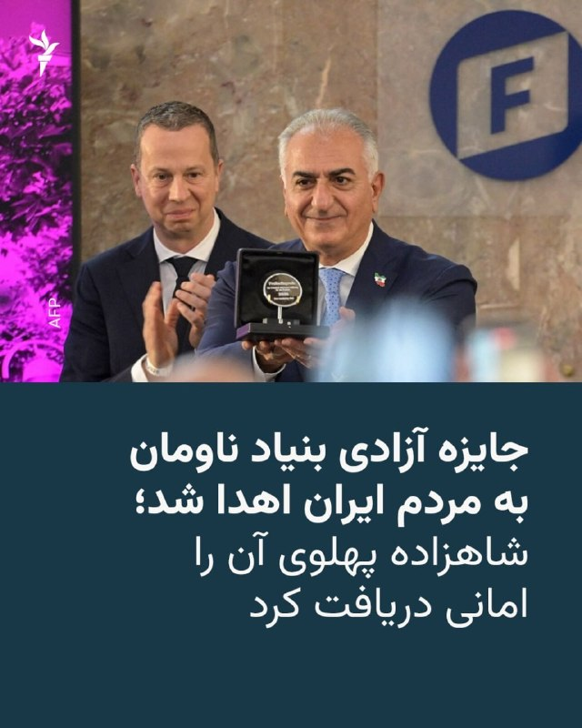

شاهزاده رضا پهلوی روز شنبه ۱۶ آبان در فرانکفورت «جایزه آزادی» بنیاد فریدریش ناومان را که امسال به مردم ایران اهدا شده است دریافت کرد.  

مراسم اهدای جایزه در کلیسای سنت پل فرانکفورت برگزار شد. بنیاد فریدریش ناومان، که به حزب دموکرات آزاد آلمان نزدیک است، اعلام کرده است رضا پهلوی این جایزه را به صورت امانی و تا زمانی که نمایندگان منتخب مردم ایران بتوانند آن را دریافت کنند، در اختیار خواهد داشت.  

شاهزاده رضا پهلوی در سخنرانی خود گفت ایران «کشوری نیست که منتظر آموزش دموکراسی باشد»، بلکه  از «عمل کردن به دموکراسی» بازداشته شده است.  
@[VahidHeadline](https://t.me/VahidHeadline/330312)  
هزاران نفر از حامیان شاهزاده رضا پهلوی روز شنبه ۱۶ آبان برای حمایت از او در فرانکفورت گرد هم آمدند.  
به گزارش پلیس فرانکفورت حدود ۲۰ هزار نفر در این تجمع حضور داشتند.  
@[VahidHeadline](https://t.me/VahidHeadline/330346)   

📡 [@VahidOnline](https://t.me/VahidOnline)

🎬 ویدیو: [مشاهده در تلگرام](https://t.me/VahidOnline/79028?single)

· · ·

**🕒 ۱۴۰۵/۰۸/۱۶ ۱۷:۱۹** · [پست 79026](https://t.me/VahidOnline/79026)

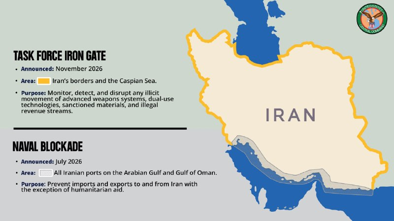

☄️ **"سنتکام کارگروهی برای مختل کردن مسیرهای ترانزیت زمینی ایران در حمایت از محموله‌های غیرقانونی تشکیل می‌دهد"**  

ترجمه ماشین:  
تامپا، فلوریدا — روز ۷ نوامبر، فرمانده ستاد فرماندهی مرکزی ایالات متحده (سنتکام) دستور تشکیل کارگروهی را صادر کرد که از تلاش‌های جاری دولت آمریکا برای جلوگیری از استفاده ایران از مسیرهای زمینی به‌منظور انتقال تسلیحات پیشرفته و سایر اقلام پشتیبانی خواهد کرد.  

دریاسالار برد کوپر دستور تشکیل «کارگروه دروازه آهنین» (Task Force Iron Gate) را صادر کرده است؛ یک گروه داخلی متشکل از حدود ۲۰ نیروی غیرنظامی و نظامی که در تامپا، فلوریدا مستقر خواهند بود.  

تیم جدید سنتکام با دیگر نهادهای دولت آمریکا برای جلوگیری از انتقال سامانه‌های تسلیحاتی پیشرفته، فناوری‌های دارای کاربرد دوگانه، اقلام مشمول تحریم و جریان‌های درآمدی غیرقانونی از طریق مرزهای زمینی ایران و دریای خزر هماهنگی خواهد کرد.  

کوپر گفت: «تشکیل کارگروه دروازه آهنین، موفقیت محاصره دریایی نفوذناپذیر ما علیه ایران را تقویت می‌کند. تقویت همکاری سنتکام با نهادهای مختلف دولت آمریکا، توانایی ایران برای تأمین مالی تروریسم، بازسازی کارخانه‌های تسلیحاتی و تجدید قوای نظامی خود را بیش از پیش محدود خواهد کرد.»

… [ادامه در تلگرام](https://t.me/VahidOnline/79026)

· · ·

**🕒 ۱۴۰۵/۰۸/۱۶ ۱۷:۱۴** · [پست 79025](https://t.me/VahidOnline/79025)

حسین محبی، سخنگوی سپاه پاسداران انقلاب اسلامی، روز شنبه ۱۶ آبان در نشست خبری به مناسبت هفته هوافضای سپاه از برداشته شدن محدودیت برد موشک‌های ایران خبر داد و هشدار داد که در صورت آغاز دور تازه‌ای از درگیری‌ها با آمریکا و اسرائیل، نیروی هوافضای سپاه تسلیحات و [توانمندی‌هایی را به میدان خواهد آورد که به گفته او، موجب شگفتی جهان خواهد شد.](https://t.me/ps752justice)  

محبی در پاسخ به پرسشی درباره اظهارات اخیر رهبر جمهوری اسلامی مبنی بر ضرورت پاسخ فوری و بدون محدودیت جغرافیایی به تهدیدهای «دشمن»، گفت: این محدودیت برای ما برداشته شده است، اما باید در عمل از این قابلیت‌ها رونمایی کنیم و پیش از آن نباید صرفاً شعار بدهیم، چراکه وظیفه ما این است که توانمندی‌های خود را در میدان عمل نشان دهیم.  
@[VahidOOnLine](https://t.me/VahidOOnLine/268896)  

📡 [@VahidOnline](https://t.me/VahidOnline)

🎬 ویدیو: [مشاهده در تلگرام](https://t.me/VahidOnline/79025)

· · ·

**🕒 ۱۴۰۵/۰۸/۱۶ ۱۶:۴۴** · [پست 79024](https://t.me/VahidOnline/79024)

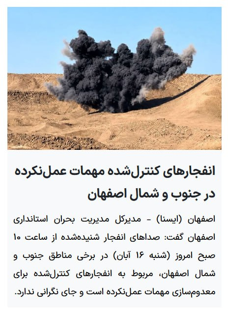

پیام‌های دریافتی درباره انفجارهایی که بعد از وقوع، "انفجارهای کنترل‌شده مهمات عمل‌نکرده در جنوب و شمال اصفهان" اعلام شدند:  

 ساعت ۱۰:۱۰  
سلام اصفهان همین الان صدای انفجار بسیار بلد اومد  

اصفهان همین الان صدا انفجار بدی اومد  
سمت صفه  

سلام وقت بخیر، اصفهان همین الان، سمت کوه صفحه، صدا انفجار اومد.  
۱۰:۱۰ روز شنبه ۱۶ آبان  

اصفهان همین الان صدای انفجار شیشه ها لرزید.  

وحید صدای انفجار شدید اصفهان  
ساعت ۱۰ و ۰۸ دقیقه  

اصفهان صدای انفجار ساعت ۱۰ و ۱۰ دقیقه مال چی بود!  

سلام وحید اصفهان بد لرزیییید یجارو زدن  

حدود ده و ده دقیقه صبح اصفهان صدای انفجار و لرزش خفیف زمین محدوده مسجد سید  

وحید اصفهان انفجار اتفاق افتاد ۱۰:۱۳  

سلام وحیدجان  
اصفهان حدود ساعت ۱۰:۰۵ صدای انفجار اومد که توی کل شهر پیچید.  
دوباره اومد  

الان اصفهان ساعت ۱۰ و ۱۶ دقیقه صدای انفجار اومد شیشه ها لرزید سمت اشکاوندیم ما  

همین الان ساعت ۱۰ و ۱۰ دقیقه صبح یک جایی تو اصفهان رو زد. سمت غرب و شهرک صنعتی بود  
10 و ۱۶ دقیقه باز زد اصفهان رو   
ما شرقی ولی تا غرب و شمال و جنوب لرزید  

سلام.همین الان صدای انفجار شدید در اصفهان.شیشه ها لرزید  

درود وحید جان دادا ی پنج دقیقه پیش اصفهان صدای انفجار اومد  

اصفهان،صدای انفجار اومد   
سمت شمال اصفهان  

۱۰:۱۱ صدای انفجار در اصفهان شنیده شد

… [ادامه در تلگرام](https://t.me/VahidOnline/79024)

· · ·

**🕒 ۱۴۰۵/۰۸/۱۶ ۱۶:۳۹** · [پست 79023](https://t.me/VahidOnline/79023)


«امیر شهیدی‌نژاد»، پدر «مهرشاد شهیدی‌نژاد»، از کشته‌شدگان اعتراضات «زن،زندگی،آزادی» در ۱۴۰۱، به دو سال و شش ماه حبس تعلیقی و پرداخت جزای نقدی به‌جای دو سال و شش ماه حبس تعزیری محکوم شده است. حکم دادگاه در روزهای اخیر به او ابلاغ شده است.  

امیر شهیدی‌نژاد که سال گذشته بازداشت شده بود، پیش‌تر با انتقاد از روند رسیدگی به پرونده کشته‌شدن فرزندش، از عملکرد دستگاه قضایی جمهوری اسلامی انتقاد کرده بود.  

او همچنین گفته بود که قوه قضاییه جمهوری اسلامی حتی موافقت کرده است مجازات حبس محکومان پرونده کشته‌شدن مهرشاد با پرداخت جزای نقدی جایگزین شود.  

مهرشاد شهیدی‌نژاد، جوان ۱۹ ساله اهل اراک، سرآشپز و دانشجوی دانشگاه علمی‌کاربردی بود که روز چهارم آبان۱۴۰۱، هم‌زمان با چهلمین روز جان‌باختن «مهسا ژینا امینی»، در جریان اعتراضات سراسری در اراک کشته شد.  

بر اساس روایت خانواده و شاهدان عینی، نیروهای امنیتی در جریان اعتراضات مهرشاد را تعقیب کردند و پس از آنکه او روی زمین افتاد، با باتوم و شوکر به‌شدت مورد ضرب‌وجرح قرار دادند.  
@[VahidHeadline](https://t.me/VahidHeadline/330254)  

📡 [@VahidOnline](https://t.me/VahidOnline)

· · ·

**🕒 ۱۴۰۵/۰۸/۱۶ ۱۶:۳۵** · [پست 79022](https://t.me/VahidOnline/79022)


خبرگزاری میزان، وابسته به قوه قضائیه، از اجرای حکم اعدام «محمدعارف شه‌بخش» خبر داد. به ادعای میزان، شه‌بخش با جیش‌العدل ارتباط داشت و به اتهام‌های «بغی» و «محاربه» به اعدام محکوم شده بود.  
@[VahidHeadline](https://t.me/VahidHeadline/330269)  

📡 [@VahidOnline](https://t.me/VahidOnline)

· · ·

**🕒 ۱۴۰۵/۰۸/۱۶ ۰۴:۵۵** · [پست 79021](https://t.me/VahidOnline/79021)

دونالد ترامپ، روز جمعه، در پاسخ به پرسش خبرنگاران درباره گزارش‌های مربوط به حملات نظامی در جزیره قشم، این اقدام را تأیید کرد و گفت: «نمی‌خواهم درباره آن صحبت کنم. ما حملات جزئی انجام می‌دهیم.»  
 رئیس‌جمهوری ایالات متحده با اشاره به استقرار سامانه‌های پدافندی جمهوری اسلامی ایران افزود: «آنها یک ابزار پدافند هوایی کوچک ساخته بودند و ما در حدود ۱۵ دقیقه، شاید هم پنج دقیقه، آن را منهدم کردیم.»  

 این اظهارات در حالی مطرح شد که خبرگزاری‌های داخلی، بامداد شنبه، از اصابت دو موشک به جزیرهٔ قشم خبر داده بودند.  
@[VahidOnLive](https://t.me/VahidOnLive/16959)  

📡 [@VahidOnline](https://t.me/VahidOnline)

🎬 ویدیو: [مشاهده در تلگرام](https://t.me/VahidOnline/79021)

· · ·

**🕒 ۱۴۰۵/۰۸/۱۶ ۰۱:۳۱** · [پست 79020](https://t.me/VahidOnline/79020)

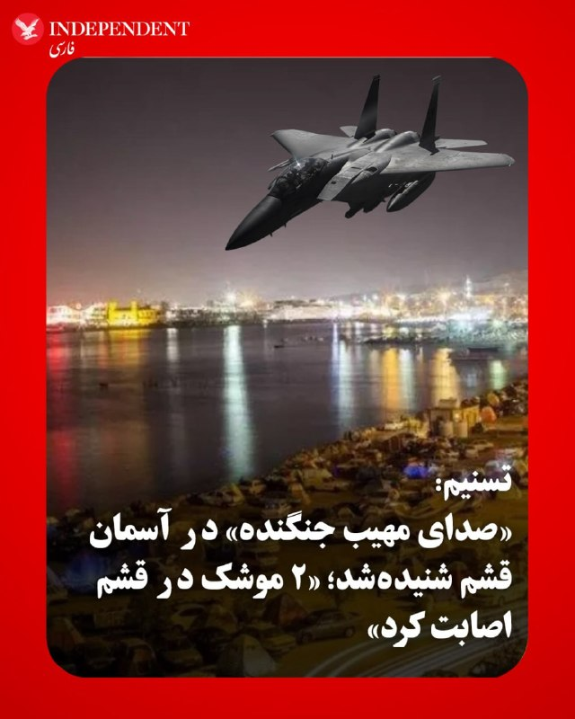

به گزارش تسنیم، بامداد شنبه، «صدای مهیب» ناشی از پرواز یک جنگنده بر فراز شهر قشم و مناطق اطراف شنیده شده و شدت این صدا به حدی بوده که به وحشت و خروج شماری از مردم از خانه‌هایشان انجامیده است. تسنیم در ادامه نوشت: «بر اساس گزارش‌های اولیه، دو موشک در جزیره قشم اصابت کرده است.» این درحالی است که پیش‌تر خبرگزاری ایرنا به نقل از شاهدان محلی از اصابت «دو پرتابه» در منطقه سوزای قشم خبر داده بود و خبرگزاری فارس نیز گفته بود که صداهای انفجار در قشم و بندرخمیر ممکن است ناشی از شلیک تیر هشدار به سوی تنگه هرمز بوده باشد.  
@[VahidOOnLine](https://t.me/VahidOOnLine/268836)  
یک مقام ستاد فرماندهی مرکزی ارتش آمریکا (سنتکام) در واکنش به گزارش‌های انفجار در جزیره قشم، به الجزیره گفت وضعیت اطراف این جزیره «نسبتا آرام» است.  

 این مقام با تایید آگاهی سنتکام از گزارش‌ها، از ارائه توضیح بیشتر خودداری کرد. رسانه‌های رسمی ایران پیش‌تر از اصابت دو موشک به قشم خبر داده بودند.  

به گفته این مقام، سنتکام شنبه ساعت ۱۳:۳۰ به وقت گرینویچ، برابر با ۱۷ به وقت ایران، اطلاعیه‌ای درباره ایران منتشر خواهد کرد.  
@[VahidOnLive](https://t.me/VahidOnLive/16954)   

📡 [@VahidOnline](https://t.me/VahidOnline)

· · ·

**🕒 ۱۴۰۵/۰۸/۱۶ ۰۰:۳۴** · [پست 79019](https://t.me/VahidOnline/79019)

پیام‌های دریافتی:  

وحید جان شروع شد   
قشم همین الان موشک بلند شد  

موشک زدند از قشم  
موشک پدافندی بود  

الان از قشم صدایی شبیه پرتاب موشک اومد  

سلام وحید جان همین الان یک موشک از قشم  
#قشم  
00:32 16 آبان  
شلیک موشک از قشم با صدای واضح  

🔄 پیام دریافتی:  
وحید جان دریابانی سوزا رو زدن  

منابع محلی:  
 ساعت ۴۰ دقیقه بامداد ۱۶ ابان ۱۴۰۵، سوزا در مرکز قشم  مورد هدف قرار گرفت.  گزارش های اولیه از برخورد ۲ پرتابه به مرکز جزیره قشم دارد.  

📡 [@VahidOnline](https://t.me/VahidOnline)

· · ·

**🕒 ۱۴۰۵/۰۸/۱۵ ۲۲:۰۵** · [پست 79018](https://t.me/VahidOnline/79018)

🖼 *(عکس بعد از ۲۴ ساعت حذف شده)*

دونالد ترامپ، رئیس‌جمهوری آمریکا، روز جمعه ۱۵ آبان‌ماه، در پیامی در شبکهٔ اجتماعی تروث سوشال، با اشاره به حملات واشنگتن و تل‌آویو به تهران، گفت که اگر مانع دستیابی جمهوری اسلامی به سلاح هسته‌ای نشده بود، اسرائیل و سراسر خاورمیانه امروز وجود نداشتند.  

ترامپ در این پیام نوشت: «اگر من مانع دستیابی ایران به سلاح هسته‌ای نشده بودم، اسرائیل و در واقع، کل خاورمیانه امروز وجود نداشتند. هیچ‌کس نمی‌خواهد این را بگوید، اما همه می‌دانند که حقیقت دارد.»  
@[VahidOOnLine](https://t.me/VahidOOnLine/268813)  

📡 [@VahidOnline](https://t.me/VahidOnline)

· · ·

**🕒 ۱۴۰۵/۰۸/۱۵ ۱۷:۴۴** · [پست 79017](https://t.me/VahidOnline/79017)

🖼 *(عکس بعد از ۲۴ ساعت حذف شده)*

شرکت یونانی «ولوس تانکرز» جمعه ۱۵آبان۱۴۰۵ کشته‌شدن یکی از خدمه نفتکش «ولوس سفایر» در حمله‌ای به این کشتی در خلیج فارس را تایید کرد. این شرکت اعلام کرد نفتکش احتمالا هدف یک موشک ناشناس قرار گرفته، اما نوع پرتابه و عامل حمله هنوز مشخص نشده است.  

بر اساس بیانیه این شرکت، حمله بامداد پنجشنبه ۱۴آبان، ساعت یک و ۱۵دقیقه به وقت محلی رخ داده است؛ زمانی که نفتکش بدون محموله به سوی «بندر سیترا» در بحرین در حرکت بود.  

به گفته شرکت، اصابت پرتابه به بخش عقبی سمت چپ کشتی باعث انفجار و آتش‌سوزی شد که خدمه موفق به مهار آن شدند. پیکر یکی از دریانوردان که ابتدا مفقود اعلام شده بود، پیدا شد و سایر اعضای خدمه آسیبی ندیدند.  

مرکز عملیات تجارت دریایی بریتانیا (UKMTO) نیز در هشدار شماره ۱۹۶ از اصابت دو پرتابه ناشناس به یک نفتکش در حدود ۵۰ مایل دریایی شمال قطر خبر داده بود.  
@[VahidHeadline](https://t.me/VahidHeadline/330141)  

📡 [@VahidOnline](https://t.me/VahidOnline)

· · ·

**🕒 ۱۴۰۵/۰۸/۱۵ ۰۷:۴۲** · [پست 79016](https://t.me/VahidOnline/79016)

🔺خبرنگار: آقای رئیس‌جمهور، گزارش شده که ایران در حال بررسی مجموعه‌ای از پیشنهادهای ارائه‌شده از سوی میانجی‌هاست که ممکن است آینده برنامه هسته‌ای این کشور را تعیین کنند. آیا آمریکا در این موضوع دخیل است؟  

🔻 ترامپ: آن‌ها بدون تأیید ما هیچ کاری نمی‌کنند. یادتان باشد چه گفتم: ایران هرگز سلاح هسته‌ای نخواهد داشت. آن‌ها بدون تأیید ما هیچ کاری نمی‌کنند.  

🔺خبرنگار: پس شما این پیشنهادها را دیده‌اید؟ پیشنهادی را که ایران در حال بررسی آن است، دیده‌اید؟  

🔻 ترامپ: اصلاً اهمیتی ندارد که دارند چه پیشنهادی را بررسی می‌کنند. آن‌ها قرار نیست سلاح هسته‌ای داشته باشند. خودشان این را می‌دانند و من هم می‌دانم.  

🔻 ترامپ: ما... ما... فکر می‌کنم... نمی‌دانم می‌شود اسمش را جنگ گذاشت یا نه، چون چندین ماه است که کسی کشته نشده. اما ما با جایی به نام جمهوری اسلامی ایران در جنگ هستیم؛ چه جای دوست‌داشتنی‌ای!  
ما کنترل تنگه \[هرمز\] را در دست داریم. الان نفت بیشتری نسبت به قبل از شروع جنگ از تنگه عبور می‌کند و حدود هفت ماه، شش ماه است که کسی کشته نشده.  
می‌دانید، اگر به روسیه و اوکراین نگاه کنید، آن جنگ است. آن واقعاً جنگ است. ماهانه ۲۵ هزار نفر کشته می‌شوند. راستی، ما به‌زودی آن را حل‌وفصل می‌کنیم. اما ماهانه ۲۵ هزار نفر کشته می‌شوند. آن‌ها شب و روز می‌جنگند، شب و روز، تمام روز.

… [ادامه در تلگرام](https://t.me/VahidOnline/79016)

🎬 ویدیو: [مشاهده در تلگرام](https://t.me/VahidOnline/79016)

· · ·

**🕒 ۱۴۰۵/۰۸/۱۵ ۰۱:۲۹** · [پست 79014](https://t.me/VahidOnline/79014)

دونالد ترامپ، رئیس‌جمهوری ایالات متحده، پنجشنبه ۱۴ آبان در گفتگو با خبرنگاران در کاخ سفید، در پاسخ به پرسشی دربارهٔ نقش میانجی‌گران و پیشنهادهایی که ممکن است بر آیندهٔ برنامهٔ هسته‌ای ایران تأثیر بگذارند، گفت: «آن‌ها بدون موافقت ما هیچ کاری انجام نمی‌دهند.»  
ترامپ در ادامه تأکید کرد: «یادتان هست به شما چه گفتم؟ ایران هرگز سلاح هسته‌ای نخواهد داشت.»  
او در بخش دیگری از سخنانش با مقایسهٔ جنگ با ایران و جنگ روسیه و اوکراین گفت: «اگر به روسیه و اوکراین نگاه کنید، آن جنگ است، آن یک جنگ واقعی است! ماهانه ۲۵ هزار نفر کشته می‌شوند. ضمنا به‌زودی آن را حل‌وفصل خواهیم کرد.»  
@[VahidOOnLine](https://t.me/VahidOOnLine/268658)  
پیت هگست، وزیر جنگ آمریکا، با انتشار ویدیویی در ایکس تأکید کرد که دولت دونالد ترامپ مصمم است از دستیابی ایران به سلاح هسته‌ای جلوگیری کند.  
هگست گفت: «وقتی می‌گوییم ایران سلاح هسته‌ای نخواهد داشت، واقعاً منظورمان همین است. ما تحت رهبری رئیس‌جمهوری ترامپ، اقدامات دشوار لازم را برای تضمین این موضوع انجام خواهیم داد.»  
او در ادامه افزود: «چون فارغ از اینکه مردم چه احساسی دربارهٔ جنگ دارند، من معتقدم این جنگ اقدامی شجاعانه و تاریخی است که تضمین خواهد کرد ایران هرگز به سلاح هسته‌ای دست پیدا نکند.»

… [ادامه در تلگرام](https://t.me/VahidOnline/79014)

🎬 ویدیو: [مشاهده در تلگرام](https://t.me/VahidOnline/79014?single)

🎬 ویدیو: [مشاهده در تلگرام](https://t.me/VahidOnline/79015?single)

· · ·

**🕒 ۱۴۰۵/۰۸/۱۴ ۲۱:۵۵** · [پست 79013](https://t.me/VahidOnline/79013)

محسن رضایی، دبیر شورای عالی امنیت ملی جمهوری اسلامی، روز پنجشنبه ۱۴ آبان‌ماه، پس از دیدار با ولادیمیر پوتین، رئیس‌جمهوری روسیه، به صداوسیما گفت که تهران هفت شرط به آمریکا ارائه کرده و تا زمانی که واشنگتن این شروط را اجرا نکند، تنگه هرمز باز نخواهد شد و مذاکره‌ای انجام نخواهد گرفت.  
او گفت پوتین در این دیدار، حملات نظامی آمریکا و اسرائیل به جمهوری اسلامی و بمباران تأسیسات هسته‌ای ایران را محکوم کرده و ضمن درخواست پایان سریع جنگ، آمادگی روسیه را برای کمک به پایان درگیری‌ها اعلام کرده است.  
به گفته دبیر شورای عالی امنیت ملی، رئیس‌جمهوری روسیه همچنین از گزارش نشست چهارجانبه تهران استقبال کرده و تأکید کرده است که مسکو نیز مانند پکن با دخالت کشورهای خارجی در امنیت منطقه مخالف است.  
او همچنین از تصویب پروژه راه‌آهن رشت‌ــ‌آستارا و بررسی انتقال گاز روسیه به ایران برای مصرف داخلی و صادرات به کشورهای همسایه خبر داد.  
رضایی در بخش دیگری از گفت‌وگوی خود با صداوسیما اعلام کرد که به درخواست مجتبی خامنه‌ای، رهبر جمهوری اسلامی، پیام او را به ولادیمیر پوتین تحویل داده است.  
@[VahidOOnLine](https://t.me/VahidOOnLine/268624)  

📡 [@VahidOnline](https://t.me/VahidOnline)

🎬 ویدیو: [مشاهده در تلگرام](https://t.me/VahidOnline/79013)

· · ·

**🕒 ۱۴۰۵/۰۸/۱۴ ۱۹:۱۸** · [پست 79012](https://t.me/VahidOnline/79012)

رسانه‌های ایران گزارش دادند محسن رضایی، دبیر شورای عالی امنیت ملی جمهوری اسلامی، در دیدار روز پنج‌شنبه با ولادیمیر پوتین، رییس‌جمهور روسیه، در کاخ کرملین، پیام مجتبی خامنه‌ای، رهبر جمهوری اسلامی را در اختیار او قرار داده است.  
خبرگزاری اینترفاکس گزارش داد رضایی در سفری از پیش اعلام‌نشده به مسکو رفته است تا با مقام‌های روسیه دیدار و گفت‌وگو کند.  
@[VahidOOnLine](https://t.me/VahidOOnLine/268579)  

📡 [@VahidOnline](https://t.me/VahidOnline)

🎬 ویدیو: [مشاهده در تلگرام](https://t.me/VahidOnline/79012)

· · ·

**🕒 ۱۴۰۵/۰۸/۱۴ ۱۶:۰۴** · [پست 79010](https://t.me/VahidOnline/79010)

دیروز:  
یک مسابقهٔ فوتبال زیر ۲۰ سال در برزیل به هرج‌ومرج کامل کشیده شد و داور مسابقه، پس از وقوع درگیری گسترده در زمین، ناچار شد در رکوردی بی‌سابقه ۵۳ کارت قرمز صادر کند.  
مسابقه به مدت ۴۰ دقیقه متوقف شد، اما سرانجام از سر گرفته شد و تیم ماموره در نهمین دقیقه از وقت‌های تلف‌شده، گل دیگری به ثمر رساند و نتیجه را ۳ بر یک کرد.  
به گزارش رسانه‌های برزیلی، یکی از بازیکنان ماموره، هنگام شادی پس از گل، بازیکنان اوبرلاندیا را تحریک کرد و همین موضوع به دعوای گسترده میان اعضای دو تیم و صدور تعداد زیادی کارت قرمز انجامید.  
در مجموع، ۴۳ بازیکن، هشت نفر از اعضای کادر فنی و دو عضو هیئت‌مدیره باشگاه اوبرلاندیا اخراج شدند و شمار اخراجی‌ها به ۵۳ نفر رسید.  
رکورد پیشین گینس برای بیشترین تعداد کارت قرمز در یک مسابقه فوتبال، ۳۶ کارت قرمز بود که در فوریه ۲۰۱۱، در جریان دیداری در لیگ دسته پنجم آرژانتین میان تیم‌های اتلتیکو کلایپول و ویکتوریانو آرناس ثبت شده بود.  
@[VahidHeadline](https://t.me/VahidHeadline/329945)  
پریروز:  
خسوس د میگل، مهاجم ۳۰ ساله تنریف، پس از مصدومیت شدید در یکی از مسابقات دسته دوم فوتبال اسپانیا درگذشت.  
این مهاجم روز دوشنبه در دیدار با آندورا، در برخوردی سخت با خسوس اوونو، دروازه‌بان این تیم، از ناحیه سر و قفسه سینه آسیب دید. اوونو به دلیل این برخورد از زمین اخراج شد.

… [ادامه در تلگرام](https://t.me/VahidOnline/79010)

🎬 ویدیو: [مشاهده در تلگرام](https://t.me/VahidOnline/79010?single)

🎬 ویدیو: [مشاهده در تلگرام](https://t.me/VahidOnline/79011?single)

· · ·

**🕒 ۱۴۰۵/۰۸/۱۴ ۱۶:۰۳** · [پست 79009](https://t.me/VahidOnline/79009)

🖼 *(عکس بعد از ۲۴ ساعت حذف شده)*

بهمن عبدی، مدیرکل دفتر برنامه‌ریزی و مشارکت‌های اجتماعی جوانان وزارت ورزش و جوانان، اعلام کرد که ثبت‌نام دختران ۱۳ ساله در سامانه‌های همسریابی با رضایت خانواده، بر اساس قوانین موجود، لزوما تخلف قانونی محسوب نمی‌شود.  

او در واکنش به حذف اپلیکیشن همسریابی «آدم و حوا» از پلتفرم‌های گوگل و متا گفت: «چنانچه دختران بالای ۱۳ سال با رضایت خانواده در سامانه‌های همسان‌گزینی ثبت‌نام کنند، این موضوع با توجه به مقررات قانونی موجود قابل بررسی است و نمی‌توان صرف ثبت‌نام این افراد را تخلف قانونی تلقی کرد.»  

این مقام وزارت ورزش با اشاره به واکنش نهادهای حقوق بشری به ثبت‌نام دختران کم‌سن‌وسال گفت که در شرایط فعلی، مبنای قانونی مشخصی برای برخورد با این مجموعه وجود ندارد.  

او افزود که به مراکز همسان‌گزینی توصیه شده است حداقل سن پذیرش دختران را به بالای ۱۵ سال افزایش دهند.  
@[VahidOOnLine](https://t.me/VahidOOnLine/268519)  

📡 [@VahidOnline](https://t.me/VahidOnline)

· · ·

**🕒 ۱۴۰۵/۰۸/۱۴ ۱۵:۵۷** · [پست 79008](https://t.me/VahidOnline/79008)

🖼 *(عکس بعد از ۲۴ ساعت حذف شده)*

متین شبانی، از بازداشت‌شدگان اعتراضات دی‌ماه ۱۴۰۴ در شاندیز، به اتهام «محاربه» به اعدام محکوم شده است. حکم شعبه پنجم دادگاه انقلاب مشهد در زندان وکیل‌آباد به او ابلاغ شده است.  
هرانا خبر داد دادگاه به ریاست قاضی حسین یزدان‌خواه و با مستشاری رضا جواد موسوی، این معترض را به اتهام «محاربه از طریق مشارکت در تخریب اموال عمومی و آتش‌زدن مراکز مذهبی» و «اجتماع و تبانی علیه کشور» به اعدام محکوم کرده است.  
@[VahidHeadline](https://t.me/VahidHeadline/329960)  

📡 [@VahidOnline](https://t.me/VahidOnline)

· · ·

**🕒 ۱۴۰۵/۰۸/۱۴ ۱۵:۵۶** · [پست 79007](https://t.me/VahidOnline/79007)

🖼 *(عکس بعد از ۲۴ ساعت حذف شده)*

موج تازه‌ای از تهدیدهای بمب‌گذاری در روز پنج‌شنبه ۱۴ آبان باعث اختلال در پروازهای مسافربری در اروپا شد و شماری از هواپیماها را ناچار به تغییر مسیر یا فرود‌های برنامه‌ریزی‌نشده کرد.  

خبرگزاری‌ها ابتدا گزارش کردند که یک فروند هواپیمای ایرباس که از دوبلین به مقصد رم در حرکت بود، در پی تهدید بمب‌گذاری تغییر مسیر داد و به پایگاه هوایی اِورو در فرانسه هدایت شد.  

پلیس جمهوری چک نیز در شبکه اجتماعی ایکس اعلام کرد که چهار هواپیمای عازم پراگ با تهدید بمب‌گذاری مواجه شده‌اند و نیروهای پلیس در حال آماده‌سازی برای فرود این هواپیماها هستند.  

به گزارش خبرگزاری ایتالیایی آنسا، یک پرواز شرکت هواپیمایی فین‌ایر از هلسینکی به مقصد رم نیز با تهدید بمب‌گذاری مواجه شد.  

خبرگزاری آنسا در عین حال از تهدید بمب‌گذاری در دو پرواز، یکی به مقصد رم و دیگری از مبدأ میلان به ورشو، خبر داد.  

رسانه‌های محلی بلغارستان هم به نقل از مقام‌های این کشور گزارش دادند که سه فروند هواپیما در پی تهدیدهای بمب‌گذاری، فرود اضطراری انجام دادند.  
@[VahidHeadline](https://t.me/VahidHeadline/329967)  

📡 [@VahidOnline](https://t.me/VahidOnline)

· · ·

**🕒 ۱۴۰۵/۰۸/۱۴ ۱۵:۵۵** · [پست 79006](https://t.me/VahidOnline/79006)

🖼 *(عکس بعد از ۲۴ ساعت حذف شده)*

**قالیباف به جی‌دی ونس: چرا این حرف‌ها را به رئیست نمی‌گویی؟**  

محمدباقر قالیباف، رئیس مجلس شورای اسلامی، روز پنجشنبه ۱۴ آبان در واکنش به اظهارات اخیر جی‌دی ونس، معاون رئیس‌جمهوری آمریکا، در شبکه اجتماعی اکس، با کنایه به سیاست‌های دونالد ترامپ در قبال ایران نوشت: «آمریکا حس قماربازی را منتقل می‌کند که مدام می‌بازد، اما دیگر نمی‌تواند از پای میز قمار بلند شود.»  

قالیباف در ادامه پیام خود با اشاره به آنچه سیاست «اول اسرائیل» خوانده، خطاب به ونس نوشت: «درحالی‌که آمریکا در لبه پرتگاه اول اسرائیل ایستاده است، رئیس تو دارد مرحله بعدی جنگ را آماده می‌کند. از این سخنرانی تد (TED) که بگذریم، چرا این حرف‌ها را به رئیست نمی‌گویی؟»  

این واکنش پس از آن مطرح شد که ونس روز چهارشنبه، در پی شکست جمهوری‌خواهان در انتخابات میان‌دوره‌ای کنگره آمریکا، در پیامی طولانی در شبکه اکس، جنگ با ایران را دلیل اصلی شکست حزب متبوعش معرفی کرد.  
دموکرات‌ها در انتخابات ۱۲ آبان موفق شدند کنترل هر دو مجلس نمایندگان و سنا را از جمهوری‌خواهان بگیرند.

… [ادامه در تلگرام](https://t.me/VahidOnline/79006)

· · ·
