# 📡 فید کانال‌های تلگرام

آخرین بررسی: ۱۴۰۵/۰۸/۰۳ ۰۰:۰۸ (به وقت تهران)

هر ساعت به‌روز می‌شود. از هر کانال ۲۰ پست آخر نمایش داده می‌شود؛ عکس‌ها ۲۴ ساعت می‌مانند، برای ویدیو فقط متن و لینک پست آمده است. متن همه‌ی پست‌ها در پوشه‌ی [archive](archive/) نگه‌داری می‌شود.

## فهرست کانال‌ها

- [irnetmonitor](#irnetmonitor) · آخرین پست: ۱۴۰۵/۰۸/۰۲ ۱۶:۵۵
- [CyberNigga2](#cybernigga2) · آخرین پست: ۱۴۰۵/۰۷/۲۹ ۲۲:۵۵
- [kaavoush](#kaavoush) · آخرین پست: ۱۴۰۵/۰۸/۰۲ ۲۲:۳۳
- [iaghapour](#iaghapour) · آخرین پست: ۱۴۰۵/۰۸/۰۲ ۲۱:۰۱
- [MatinSenPaii](#matinsenpaii) · آخرین پست: ۱۴۰۵/۰۸/۰۲ ۲۱:۱۲
- [whitedns](#whitedns) · آخرین پست: ۱۴۰۵/۰۸/۰۲ ۱۹:۳۲
- [ircfspace](#ircfspace) · آخرین پست: ۱۴۰۵/۰۸/۰۱ ۱۴:۱۹
- [patt_channel_x](#patt_channel_x) · آخرین پست: ۱۴۰۵/۰۸/۰۲ ۲۱:۵۲
- [mahsa_net](#mahsa_net) · آخرین پست: ۱۴۰۵/۰۸/۰۱ ۲۲:۵۹
- [VahidOnline](#vahidonline) · آخرین پست: ۱۴۰۵/۰۸/۰۲ ۲۰:۴۹

---

## irnetmonitor

[کانال در تلگرام](https://t.me/irnetmonitor) · [آرشیو متن](archive/irnetmonitor/)

**🕒 ۱۴۰۵/۰۸/۰۲ ۱۶:۵۵** · [پست 5230](https://t.me/irnetmonitor/5230)

↪️ فوروارد از منیجیت | Manageit

**⭕️ گزارش شبکه:**  
بررسی ترافیک CDN منیجیت نشان میدهد ارتباطات زیرساخت در حال تست فرآیندهایی است که VPNهای داخل شبکه ایران را شناسایی و مسدود کند، احتمالا قرار است بعد از قطع اینترنت بین المللی این سیاست‌ها به صورت کامل بر روی شبکه داخلی اجرایی شوند، همچنین در چند روز اخیر مسدود شدن آی پی ها و دامنه‌هایی که روی CDN ها و سرورهای داخل ایران هستند شدت گرفته است.

· · ·

**🕒 ۱۴۰۵/۰۸/۰۱ ۱۲:۰۵** · [پست 5229](https://t.me/irnetmonitor/5229)

مهملات و توهمات ایرانسل در مورد افزایش تعرفه ها   

[https://irancell.ir/b/332391/internet-price-change-aban-1405](https://irancell.ir/b/332391/internet-price-change-aban-1405)

· · ·

**🕒 ۱۴۰۵/۰۸/۰۱ ۰۲:۴۸** · [پست 5228](https://t.me/irnetmonitor/5228)

↪️ فوروارد از شهر سخت افزار

🖼 *(عکس بعد از ۲۴ ساعت حذف شده)*

**🔴 اینترنت موبایل از بامداد جمعه گران شد؟**  

📱 ظاهراً از بامداد امروز جمعه ۱ آبان، قیمت بسته‌های اینترنت موبایل افزایش پیدا کرده و کاربران با تعرفه‌های بالاتری نسبت به قبل روبه‌رو شده‌اند.  

💸 بررسی‌های اولیه حاکی از افزایش چشمگیر قیمت برخی بسته‌هاست؛ با این حال هنوز اطلاعیه رسمی درباره این تغییر قیمت منتشر نشده است.  

⚠️ فعلاً جزئیات میزان افزایش قیمت و علت آن مشخص نیست و باید دید اپراتورها یا نهادهای مسئول چه توضیحی ارائه می‌کنند.  

[**🌐در شهرسخت‌افزار بخوانید**](https://www.shahrsakhtafzar.com/fa/news/internet-operator/62711-mobile-internet-package-price-hike-iran)  

**🆔**[**@ShahrSakhtAfzar**](https://t.me/ShahrSakhtAfzar)

· · ·

**🕒 ۱۴۰۵/۰۷/۲۹ ۱۸:۰۴** · [پست 5227](https://t.me/irnetmonitor/5227)

↪️ فوروارد از زومان | Zoomon

🖼 *(عکس بعد از ۲۴ ساعت حذف شده)*

**قطع فوری اینترنت در صورت آغاز جنگ جدید؛ دستور صادر شد**  

بر اساس اطلاعات دریافتی زومان، نهادهای بالادستی در نامه‌ای رسمی و الزام‌آور تأکید کرده‌اند که در صورت آغاز جنگ جدید، دسترسی کاربران در ایران به اینترنت بین‌الملل باید بلافاصله قطع شود.  

این تصمیم به عنوان یک تکلیف اجرایی تعیین شده است تا در شرایط درگیری نظامی، دسترسی به شبکه جهانی قطع شود.  

[🌐 در زومان بخوانید](https://www.zoomon.ir/behind-the-news/9226-iran-war-internet-blackout-order/?utm_source=Telegram&amp;utm_term=pr86wljqv)  

🆔 [@thezoomon](https://t.me/thezoomon)

· · ·

**🕒 ۱۴۰۵/۰۷/۲۹ ۱۴:۳۲** · [پست 5226](https://t.me/irnetmonitor/5226)

وضعیت جیتر و پینگ بعد از هر بار مسدودی vpn ها بسیار خوب و استییل میشه ( مثل امروز )   

دلایل این وضعیت:   
۱- ترافیک عظیم vpn ها از شبکه موقتا خارج میشه و بعد از چند روز vpn پرووایدر ها مجددا با روش جدید برمیگردند و دوباره شبکه رو بهم میریزن   

۲- پهنای باند بین الملل ایران محدوده و وزارت هیچ تصمیمی جهت افزایش آن با این وضعیت قیمت دلار ندارد

· · ·

**🕒 ۱۴۰۵/۰۷/۲۹ ۱۴:۰۸** · [پست 5225](https://t.me/irnetmonitor/5225)

در همکاری جدیدی که وزارت ارتباطات با وزارت نیرو اغاز کرده هر روز شبکه اینترنت در ایران به این صورت شده

🎬 ویدیو: [مشاهده در تلگرام](https://t.me/irnetmonitor/5225)

· · ·

**🕒 ۱۴۰۵/۰۷/۲۸ ۰۳:۴۳** · [پست 5224](https://t.me/irnetmonitor/5224)

بروزرسانی :  
اکثر پروتکل های شبکه مثل gre ,... در اکثر اپراتور ها مسدود شد   

همچنین رنج ایپی های اتصال اولیه ( پورت 3074 udp ) بازی های call of duty  نیز مسدود شده اند و برای ورود به صفحه اصلی گیم باید از vpn استفاده کنید   
رنج های مسدود شده :  

[185.34.106.0/24](http://185.34.106.0/24)  
[185.34.107.0/24](http://185.34.107.0/24)

· · ·

**🕒 ۱۴۰۵/۰۷/۲۵ ۲۲:۴۰** · [پست 5223](https://t.me/irnetmonitor/5223)

اگر پلیر call of duty هستید ، پورت ۳۰۷۴ و کل سرورهای azure  و freesas  بازی فیلتر شده اند ، در حال حاضر فقط سرورهای سفید vultr در فیلترینگ جمهوری اسلامی  با پورت های رنج ۵۰۰۰۰-۶۰۰۰۰ udp وصل هستند که متاسفانه سرورهای دیتاسنتر مذکور کیفیت بسیار پایین ولگ بسیار زیادی دارد

· · ·

**🕒 ۱۴۰۵/۰۷/۲۵ ۲۲:۳۷** · [پست 5222](https://t.me/irnetmonitor/5222)

تغییرات ۲۴ ساعت گذشته اینترنت در ایران :   
۱- مجدد udp  به مقصد خیلی از دیتاسنتر های خارجی در بیشتر isp ها مسدود شد  

۲- در این لحظه که پیغام رو مینویسم پینگ ۵۰ ۶۰ میلی ثانیه افزایش پیدا کرده   

۳- اکثر application layer ها مثل http / https به مقصد دیتاسنتر های خارجی مسدود شده

· · ·

**🕒 ۱۴۰۵/۰۱/۲۷ ۰۴:۴۷** · [پست 191](https://t.me/irnetmonitor/191)

Operator: TCI-ADSL-Tehran  
Time: 2026-08-10 15:58:00  

✅ [chatgpt.com](http://chatgpt.com/) : [104.18.32.47](http://104.18.32.47/)  
✅ [www.speedtest.net](http://www.speedtest.net/) : [104.17.147.22](http://104.17.147.22/)  
✅ [google.com](http://google.com/) : [216.239.38.120](http://216.239.38.120/)  
✅ [gmail.com](http://gmail.com/) : [142.250.202.37](http://142.250.202.37/)  
✅ [play.google.com](http://play.google.com/) : [142.251.20.138](http://142.251.20.138/)  
✅ [translate.google.com](http://translate.google.com/) : [142.251.38.14](http://142.251.38.14/)  
✅ [wikipedia.org](http://wikipedia.org/) : [185.15.59.224](http://185.15.59.224/)  
✅ [github.com](http://github.com/) : [140.82.121.4](http://140.82.121.4/)  
✅ [dash.cloudflare.com](http://dash.cloudflare.com/) : [104.17.111.184](http://104.17.111.184/)  
✅ [fastly.com](http://fastly.com/) : [151.101.193.57](http://151.101.193.57/)  
✅ [microsoft.com](http://microsoft.com/) : [13.107.226.45](http://13.107.226.45/)  
✅ [apple.com](http://apple.com/) : [17.253.144.10](http://17.253.144.10/)  
✅ [xbox.com](http://xbox.com/) : [20.76.201.171](http://20.76.201.171/)

… [ادامه در تلگرام](https://t.me/irnetmonitor/191)

· · ·

**🕒 ۱۴۰۵/۰۱/۲۷ ۰۴:۴۷** · [پست 189](https://t.me/irnetmonitor/189)

Operator: MCI-5G-Tehran  
Time: 2026-08-10 15:57:09  

❌ [chatgpt.com](http://chatgpt.com/) : [104.18.32.47](http://104.18.32.47/)  
❌ [www.speedtest.net](http://www.speedtest.net/) : [104.17.147.22](http://104.17.147.22/)  
❌ [google.com](http://google.com/) : [216.239.38.120](http://216.239.38.120/)  
❌ [gmail.com](http://gmail.com/) : [142.250.202.37](http://142.250.202.37/)  
❌ [play.google.com](http://play.google.com/) : [142.251.20.138](http://142.251.20.138/)  
❌ [translate.google.com](http://translate.google.com/) : [142.251.38.14](http://142.251.38.14/)  
❌ [wikipedia.org](http://wikipedia.org/) : [185.15.59.224](http://185.15.59.224/)  
❌ [github.com](http://github.com/) : [140.82.121.4](http://140.82.121.4/)  
❌ [dash.cloudflare.com](http://dash.cloudflare.com/) : [104.17.111.184](http://104.17.111.184/)  
❌ [fastly.com](http://fastly.com/) : [151.101.193.57](http://151.101.193.57/)  
❌ [microsoft.com](http://microsoft.com/) : [13.107.226.45](http://13.107.226.45/)  
❌ [apple.com](http://apple.com/) : [17.253.144.10](http://17.253.144.10/)  
❌ [xbox.com](http://xbox.com/) : [20.76.201.171](http://20.76.201.171/)

… [ادامه در تلگرام](https://t.me/irnetmonitor/189)

· · ·

**🕒 ۱۴۰۵/۰۱/۲۷ ۰۴:۴۷** · [پست 188](https://t.me/irnetmonitor/188)

Operator: IRANCELL-5G-Tehran  
Time: 2026-08-10 16:00:08  

✅ [chatgpt.com](http://chatgpt.com/) : [104.18.32.47](http://104.18.32.47/)  
✅ [www.speedtest.net](http://www.speedtest.net/) : [104.17.147.22](http://104.17.147.22/)  
✅ [google.com](http://google.com/) : [216.239.38.120](http://216.239.38.120/)  
✅ [gmail.com](http://gmail.com/) : [142.250.202.37](http://142.250.202.37/)  
✅ [play.google.com](http://play.google.com/) : [142.251.20.138](http://142.251.20.138/)  
✅ [translate.google.com](http://translate.google.com/) : [142.251.38.14](http://142.251.38.14/)  
✅ [wikipedia.org](http://wikipedia.org/) : [185.15.59.224](http://185.15.59.224/)  
✅ [github.com](http://github.com/) : [140.82.121.4](http://140.82.121.4/)  
✅ [dash.cloudflare.com](http://dash.cloudflare.com/) : [104.17.111.184](http://104.17.111.184/)  
✅ [fastly.com](http://fastly.com/) : [151.101.193.57](http://151.101.193.57/)  
✅ [microsoft.com](http://microsoft.com/) : [13.107.226.45](http://13.107.226.45/)  
✅ [apple.com](http://apple.com/) : [17.253.144.10](http://17.253.144.10/)  
✅ [xbox.com](http://xbox.com/) : [20.76.201.171](http://20.76.201.171/)

… [ادامه در تلگرام](https://t.me/irnetmonitor/188)

· · ·

**🕒 ۱۴۰۵/۰۱/۲۷ ۰۴:۴۷** · [پست 187](https://t.me/irnetmonitor/187)

Operator: Hiweb/Parsonline  
Time: 2026-08-10 15:56:17  

✅ [chatgpt.com](http://chatgpt.com/) : [104.18.32.47](http://104.18.32.47/)  
✅ [www.speedtest.net](http://www.speedtest.net/) : [104.17.147.22](http://104.17.147.22/)  
✅ [google.com](http://google.com/) : [216.239.38.120](http://216.239.38.120/)  
✅ [gmail.com](http://gmail.com/) : [142.250.202.37](http://142.250.202.37/)  
✅ [play.google.com](http://play.google.com/) : [142.251.20.138](http://142.251.20.138/)  
✅ [translate.google.com](http://translate.google.com/) : [142.251.38.14](http://142.251.38.14/)  
✅ [wikipedia.org](http://wikipedia.org/) : [185.15.59.224](http://185.15.59.224/)  
✅ [github.com](http://github.com/) : [140.82.121.4](http://140.82.121.4/)  
✅ [dash.cloudflare.com](http://dash.cloudflare.com/) : [104.17.111.184](http://104.17.111.184/)  
✅ [fastly.com](http://fastly.com/) : [151.101.193.57](http://151.101.193.57/)  
✅ [microsoft.com](http://microsoft.com/) : [13.107.226.45](http://13.107.226.45/)  
✅ [apple.com](http://apple.com/) : [17.253.144.10](http://17.253.144.10/)  
✅ [xbox.com](http://xbox.com/) : [20.76.201.171](http://20.76.201.171/)

… [ادامه در تلگرام](https://t.me/irnetmonitor/187)

· · ·

**🕒 ۱۴۰۵/۰۱/۲۶ ۰۰:۴۹** · [پست 1](https://t.me/irnetmonitor/1)

Channel created

· · ·

---

## CyberNigga2

[کانال در تلگرام](https://t.me/CyberNigga2) · [آرشیو متن](archive/cybernigga2/)

**🕒 ۱۴۰۵/۰۷/۲۹ ۲۲:۵۵** · [پست 5282](https://t.me/CyberNigga2/5282)

🖼 *(عکس بعد از ۲۴ ساعت حذف شده)*

ظاهرا پاکستانی ها تو دانلود پورن با پروکسی ازمون زدن جلو 😢

· · ·

**🕒 ۱۴۰۵/۰۷/۲۹ ۲۲:۳۲** · [پست 5281](https://t.me/CyberNigga2/5281)

فقط چیزی که رو مخم رفته اینه که پروکسی با اینترنت شاتل تست میشه. کلا پروکسی و VPN های مستقیم (بدون تانل) با همه اوپراتور ها جواب نیستن.   

دلم میخواست پروکسی ها، با تمام اینترنت ها تست بشن و نتیجه تو همون پست مشخص باشه اما فعلا راهی ندارم براش ندارم که خودم پیاده کنم. اما شاید با کمک داوطلب بتونم وضعیت هر اوپراتور و منطقه رو مشخص کنیم. اگه نیاز شد پیام میزارم تو کانال

· · ·

**🕒 ۱۴۰۵/۰۷/۲۹ ۲۲:۲۷** · [پست 5280](https://t.me/CyberNigga2/5280)

سیستم اتو پروکسی راه اندازی شد. ازین به بعد هر پروکسی که فیلتر بشه، اتوماتیک 2تا پروکسی جدید جاشو میگیره.  

اگرم به تلگرام برای گرفتن پروکسی های جدید دسترسی پیدا کنید، میتونید ازین وبسایت استفاده کنید:  

[https://elaproxy.github.io](https://elaproxy.github.io/)  

کانال پروکسی:  

[@Ela\_Proxy](https://t.me/Ela_Proxy)

· · ·

**🕒 ۱۴۰۵/۰۷/۲۹ ۱۷:۲۰** · [پست 5278](https://t.me/CyberNigga2/5278)

🖼 *(عکس بعد از ۲۴ ساعت حذف شده)*

What in the actual fuck

· · ·

**🕒 ۱۴۰۵/۰۷/۲۶ ۱۶:۴۰** · [پست 5277](https://t.me/CyberNigga2/5277)

جالبه چنتا پروکسی جدید که گذاشتم رندوم اختلال افتاد. اما همین باعث شد یه ایده ای به سرم بزنه. دارم رو یه سیستمی کار میکنم که هر پروکسی که فیلتر بشه، اتوماتیک 2 تا جدید تو کانال بزاره.  

خوبیش اینه هر ساعت از روز مشکلی واسه هر پروکسی پیش بیاد، اتوماتیک پروکسی جدید میاد تو کانال:  

🫆 [@Ela\_Proxy](https://t.me/Ela_Proxy)

· · ·

**🕒 ۱۴۰۵/۰۷/۲۶ ۱۵:۳۴** · [پست 5276](https://t.me/CyberNigga2/5276)

🖼 *(عکس بعد از ۲۴ ساعت حذف شده)*

· · ·

**🕒 ۱۴۰۵/۰۷/۲۶ ۱۴:۱۱** · [پست 5275](https://t.me/CyberNigga2/5275)

🖼 *(عکس بعد از ۲۴ ساعت حذف شده)*

· · ·

**🕒 ۱۴۰۵/۰۷/۲۵ ۲۲:۵۵** · [پست 5274](https://t.me/CyberNigga2/5274)

اسمش شد:  

[@Ela\_Proxy](https://t.me/Ela_Proxy)  

هر 10 دقیقه ام پروکسی ها خودکار خودشون با اینترنت شاتل تست میشن و پست آپدیت میشه

· · ·

**🕒 ۱۴۰۵/۰۷/۲۵ ۱۴:۲۶** · [پست 5272](https://t.me/CyberNigga2/5272)

🖼 *(عکس بعد از ۲۴ ساعت حذف شده)*

· · ·

**🕒 ۱۴۰۵/۰۷/۱۸ ۱۶:۵۳** · [پست 5271](https://t.me/CyberNigga2/5271)

🖼 *(عکس بعد از ۲۴ ساعت حذف شده)*

This is what C/C++ does to a nigga  
Sent by a Nigga

· · ·

**🕒 ۱۴۰۵/۰۷/۱۸ ۱۶:۰۰** · [پست 5270](https://t.me/CyberNigga2/5270)

↪️ فوروارد از Ela Proxy | اِلا پروکسی

**پروکسی شماره 3  
پروکسی شماره 3  
پروکسی شماره 3**  

[@no\_name\_proxy](https://t.me/no_name_proxy)

· · ·

**🕒 ۱۴۰۵/۰۷/۱۷ ۲۳:۴۶** · [پست 5269](https://t.me/CyberNigga2/5269)

🖼 *(عکس بعد از ۲۴ ساعت حذف شده)*

· · ·

**🕒 ۱۴۰۵/۰۷/۱۶ ۲۱:۳۹** · [پست 5268](https://t.me/CyberNigga2/5268)

نیازمند C کار آشنا به شبکه:  

[@musl0x01](https://t.me/musl0x01)

· · ·

**🕒 ۱۴۰۵/۰۷/۱۵ ۰۰:۲۰** · [پست 5267](https://t.me/CyberNigga2/5267)

🖼 *(عکس بعد از ۲۴ ساعت حذف شده)*

آخه مرد بزار 2 دقه سرور آنلاین بشه بعد پورن بزار زیر دانلود

· · ·

**🕒 ۱۴۰۵/۰۷/۱۵ ۰۰:۰۵** · [پست 5266](https://t.me/CyberNigga2/5266)

پروکسی راه اندازی شد. اما اسمی به ذهنم نرسید واسه کانال فعلا برید وصل بشید تا بعد:  

[@no\_name\_proxy](https://t.me/no_name_proxy)  

اگه براتون مثل آدم کار کرد، تو کامنتا اسم اوپراتورتون رو بگید. اگرم اسمی واسه کانال به ذهنتون رسید بگید 🥰

· · ·

**🕒 ۱۴۰۵/۰۷/۱۴ ۱۷:۱۱** · [پست 5265](https://t.me/CyberNigga2/5265)

🎬 ویدیو: [مشاهده در تلگرام](https://t.me/CyberNigga2/5265)

· · ·

**🕒 ۱۴۰۵/۰۷/۱۴ ۱۴:۰۷** · [پست 5264](https://t.me/CyberNigga2/5264)

🖼 *(عکس بعد از ۲۴ ساعت حذف شده)*

· · ·

**🕒 ۱۴۰۵/۰۷/۱۴ ۱۱:۵۳** · [پست 5263](https://t.me/CyberNigga2/5263)

Do gay men poop faster 🤔

· · ·

**🕒 ۱۴۰۵/۰۷/۱۲ ۱۸:۵۴** · [پست 5262](https://t.me/CyberNigga2/5262)

🖼 *(عکس بعد از ۲۴ ساعت حذف شده)*

· · ·

**🕒 ۱۴۰۵/۰۷/۱۲ ۱۸:۲۵** · [پست 5261](https://t.me/CyberNigga2/5261)

اون 2تا پروکسی که این اواخر بالا اورده بودم یادتونه؟ بعد از حدود 1 ماه و خورده ای و چند هزار کاربر فایروال کیر شده بود و نتونست تشخیص بده تا فیلتر کنه  

اما حدود 2 هفته پیش سرورش رو خودم خاموش کردم تا روی یه Obfuscation جدید کار کنم و تقریبا آمدست.   

چون فیلترچی دستش روی دکمه refresh یوتیوب "آموزش پروکسی یا vpn عه" برای بسته نشدن این روش، آموزشش رو پابلیک نمیکنم. اما چون مستقیم رو سرور خارج وصل میشه هزینه هاش جوری هست که خودم از پسش بر بیام و رایگان میزارمش  

آماده که شد یه کانال جدا میزارم مخصوص پروکسی که اگه پروکسی رو به باباتون دادید ازتون نپرسه "نیگا چیه؟"

· · ·

---

## kaavoush

[کانال در تلگرام](https://t.me/kaavoush) · [آرشیو متن](archive/kaavoush/)

**🕒 ۱۴۰۵/۰۸/۰۲ ۲۲:۳۳** · [پست 10406](https://t.me/kaavoush/10406)

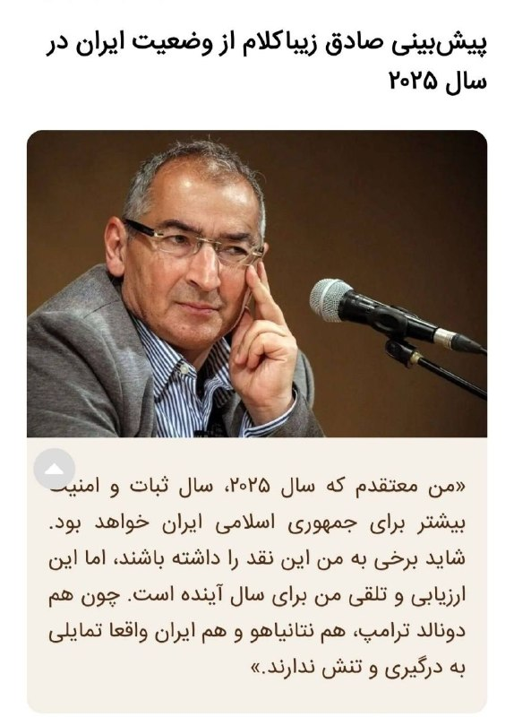

**Join** [**@Patriot\_meme**](https://t.me/Patriot_meme)

· · ·

**🕒 ۱۴۰۵/۰۸/۰۲ ۲۱:۵۹** · [پست 10405](https://t.me/kaavoush/10405)

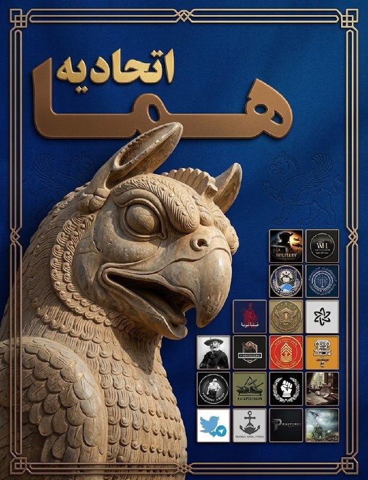

🔰 [همراه با ما در آسمان تاریخ و نظامی گری به پرواز درآیید تا در کنار هم افق های تازه ای در این عرصه را به نظاره بنشینیم! اتحادیه هما، مجموعه ای پیشرو از کانال های نظامی نویس/تحلیلی/تاریخی با ارائه جدیدترین اخبار از تحولات و رویدادهای منطقه و جهان در کنار معرفی و بررسی حوزه تسلیحات، ادوات و تاکتیک های نظامی و بررسی آینده پژوهانه این حوزه ها همراه با طرح مطالب تاریخی و عبرت آموز](https://t.me/addlist/C6NbpXQYY-syYWY0)

· · ·

**🕒 ۱۴۰۵/۰۸/۰۲ ۱۸:۱۱** · [پست 10404](https://t.me/kaavoush/10404)

**تولید موشک خیبرشکن در خاک یمن ؟**   

یمنی ها چگونه به موشک‌های بالستیک سوخت جامد مدرن دست یافتند؟ آیا این موشک‌ها مستقیما از ایران به یمن ارسال می‌شوند یا امکان تولید قطعات مختلف و اسمبل نهایی در خاک یمن وجود دارد؟  

[لینک](https://youtu.be/jAuEas48grE) مشاهده ویدئو در یوتیوب  

[@IRANDEZH\_ONLINE](https://t.me/IRANDEZH_ONLINE)

🎬 ویدیو: [مشاهده در تلگرام](https://t.me/kaavoush/10404)

· · ·

**🕒 ۱۴۰۵/۰۸/۰۲ ۱۷:۱۳** · [پست 10403](https://t.me/kaavoush/10403)

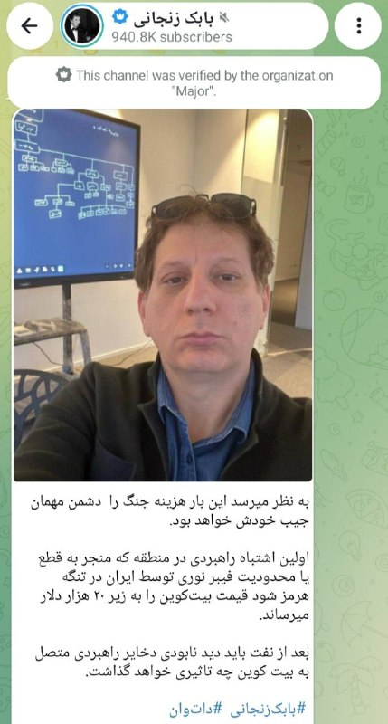

دوستان اشاره کردند که این تز زیبا از فاکس‌نیوز نبوده از بابک زنجانی بوده. استاد اینجا اشتباه کردند. البته که باکی نیست چون اعتبار بابک زنجانی بیشتر از فاکس‌نیوزه

· · ·

**🕒 ۱۴۰۵/۰۸/۰۲ ۱۶:۳۴** · [پست 10402](https://t.me/kaavoush/10402)

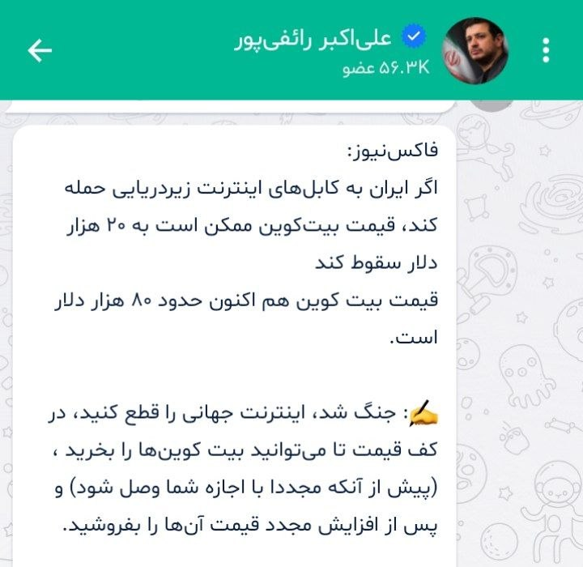

این هم سیگنال خرید امروز شما از استاد رائفی‌پور. برید و حالشو ببرید.

· · ·

**🕒 ۱۴۰۵/۰۸/۰۲ ۱۴:۵۳** · [پست 10401](https://t.me/kaavoush/10401)

⭕️دونالد ترامپ درباره ایران گفت: «موضوع دیگر، نفت است که قیمت آن افزایش یافته است. ما قیمت نفت را در سطح بسیار پایینی نگه داشته بودیم و می‌دانستم که چنین اتفاقی خواهد افتاد، اما این یک انتخاب بود.  

این بهای اندکی است که باید برای گرفتن سلاح هسته‌ای از ایران پرداخت؛ کشوری که بسیار شرور است.»  

از ترامپ پرسیده شد که جنگ را چگونه و چه زمانی پایان‌یافته می‌بیند. او پاسخ داد: «فکر می‌کنم جنگ به‌زودی پایان می‌یابد. به نظرم، به هر شکل ممکن، چه از طریق توافق و چه از راه‌های دیگر، این جنگ تمام خواهد شد.»  

در پاسخ به این پرسش که آیا در دو سال گذشته اقدامی بوده که ترجیح می‌داد به شکل دیگری انجام دهد، ترامپ گفت: «من مجبور بودم به ایران حمله کنم؛ در غیر این صورت، آن‌ها به سلاح هسته‌ای دست پیدا می‌کردند.»  
✒️#LT  
📃[@Cataphract1](https://t.me/Cataphract1)

· · ·

**🕒 ۱۴۰۵/۰۸/۰۲ ۱۴:۵۲** · [پست 10400](https://t.me/kaavoush/10400)

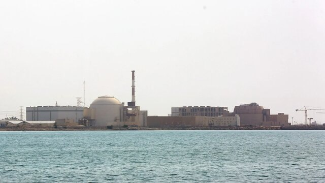

سفارت فدراسیون روسیه در تهران با انتشار بیانیه‌ای انتقال دانشمندان و مهندسان سایت هسته‌ای بوشهر را تکذیب کرد.  

[@P\_raetorio](https://t.me/P_raetorio)

· · ·

**🕒 ۱۴۰۵/۰۸/۰۲ ۰۸:۵۰** · [پست 10399](https://t.me/kaavoush/10399)

↪️ فوروارد از کاتافراکت

⚜روزنامه وال‌استریت ژورنال گزارش داد که پاکستان در چارچوب اجرای تحریم‌های آمریکا، از عبور کامیون‌های ورودی از ایران از دو گذرگاه مرزی جلوگیری کرده است.  

⚜بر اساس این گزارش، فشارهای آمریکا باعث شده ایران بخشی از مسیرهای تجارت زمینی خود را از دست بدهد. یک مقام آمریکایی نیز به وال‌استریت ژورنال گفت که تحریم‌های اقتصادی در حال منزوی کردن حکومت ایران و افزایش فشار بر آن هستند.  

⚜همچنین، به گفته یک مقام ایرانی، حدود ۱۷ هزار کامیون در مرزهای ایران با ترکیه، افغانستان و جمهوری آذربایجان گرفتار شده‌اند. این مقام افزود که صادرات ایران به پاکستان نیز در پی تحریم‌های آمریکا متوقف شده است.  

⚜وال‌استریت ژورنال در بخش دیگری از گزارش خود اعلام کرد که قیمت مواد غذایی در ایران ۱۲۸ درصد افزایش یافته است.  
✒️#LT  
📃[@Cataphract1](https://t.me/Cataphract1)

· · ·

**🕒 ۱۴۰۵/۰۸/۰۱ ۲۳:۳۰** · [پست 10398](https://t.me/kaavoush/10398)

جفتتون می‌تونید نظراتتون رو مکتوب کنید،  لوله‌ش کنید، بکنیدش تو رود راین، مرز مشترک کشورهاتون ❤️

· · ·

**🕒 ۱۴۰۵/۰۸/۰۱ ۲۳:۲۷** · [پست 10397](https://t.me/kaavoush/10397)

↪️ فوروارد از Praetorio

دیگر بس است. ایران و حوثی‌ها با حملات خود به کشتیرانی بین‌المللی، اقتصاد جهانی را تحت فشار و گروگان گرفته‌اند. آن‌ها مسئول بی‌ثباتی خاورمیانه، بحران‌های انسانی در یمن و بحران‌های غذایی در جنوب جهان هستند.  

- یوهان واده‌فول، وزیر خارجه آلمان  

[@P\_raetorio](https://t.me/P_raetorio)

🎬 ویدیو: [مشاهده در تلگرام](https://t.me/kaavoush/10397)

· · ·

**🕒 ۱۴۰۵/۰۸/۰۱ ۲۳:۲۷** · [پست 10396](https://t.me/kaavoush/10396)

↪️ فوروارد از Praetorio

«تشدید تنش‌ها بین ایران و ایالات متحده تنها به شکست بازار و افزایش قیمت نفت منجر خواهد شد.»  

-وزارت امور خارجه فرانسه  

[@P\_raetorio](https://t.me/P_raetorio)

· · ·

**🕒 ۱۴۰۵/۰۸/۰۱ ۲۳:۲۲** · [پست 10395](https://t.me/kaavoush/10395)

عبدالناصر همتی رئیس کل بانک مرکزی در حال تلاش برای توضیح این نکته که «وضعیت ذخایر ارزی ایران خوب است و تا پایان دوره ریاست‌جمهوری ترامپ کافی است» به زبان بسیار سخت

🎬 ویدیو: [مشاهده در تلگرام](https://t.me/kaavoush/10395)

· · ·

**🕒 ۱۴۰۵/۰۸/۰۱ ۲۱:۳۰** · [پست 10394](https://t.me/kaavoush/10394)

↪️ فوروارد از کاتافراکت

⚜ وزیر خارجه ترکیه:  
طی جلساتی که با وزاری خارجه مصر، پاکستان، عربستان، بریتانیا، فرانسه، آلمان و ایتالیا در استانبول داشتیم به این نتیجه رسیدیم حمله مجدد به ایران باعث گسترش درگیری ها میشه و خواهان راه حل دیپلماتیک هستیم   

📃[@Cataphract1](https://t.me/Cataphract1)

· · ·

**🕒 ۱۴۰۵/۰۸/۰۱ ۲۱:۲۸** · [پست 10393](https://t.me/kaavoush/10393)

↪️ فوروارد از Praetorio

🖼 *(عکس بعد از ۲۴ ساعت حذف شده)*

از صبح امروز چندین هواپیما روس برای تخلیه دانشمندان و مهندسان نیروگاه اتمی بوشهر وارد ایران شدند.  

[@P\_raetorio](https://t.me/P_raetorio)

· · ·

**🕒 ۱۴۰۵/۰۸/۰۱ ۲۱:۰۶** · [پست 10392](https://t.me/kaavoush/10392)

↪️ فوروارد از کاتافراکت

#فوری  
⚜ به گزارش کان نیوز ترامپ به سنتکام دستور آمادگی برای انجام حملات علیه ایران را بدون تاریخ مشخص داده است، اسرائیل وارد حالت هشدار امنیتی شده است   

📃[@Cataphract1](https://t.me/Cataphract1)

· · ·

**🕒 ۱۴۰۵/۰۸/۰۱ ۲۰:۵۵** · [پست 10391](https://t.me/kaavoush/10391)

شاید حافظه‌ام یاری نکند اما تا آن‌جا که می‌دانم در مقابل این همه جاسوسی، ترورِ اشخاص مهم و خرابکاری در حساس‌ترین اماکن هسته‌ای و نظامی و سامانه‌های کشور مثل سامانه‌های بانکی یا بنزین که حداقل بخش مهمی از آن‌ها از داخل کشور انجام شده بودند حتی یک مورد از عاملان، دستگیر یا حتی شناسایی نشده‌اند. در مواردی افرادی به جرم جاسوسی برای اسرائیل دستگیر و اعدام شده‌اند اما اتهاماتی که به آن‌ها زده شده اغلب اتهامات نه چندان جدی و حتی در صورت صحت، همکاری با اسرائیل در سطوح کم‌اهمیت بوده است و من به یاد ندارم که بعد از افتضاح دهه ۸۰ و شکنجه افراد بی‌گناه به اتهام ترور دانشمندان هسته‌ای که بعدها خود وزارت اطلاعات هم به دروغ بودن آن اقرار کرد، کسی با جرمی جدی مثلاً لو دادن مکان علی لاریجانی یا مثلاً همکاری در سرقت اسناد هسته‌ای در شورآباد دستگیر شده باشد. یعنی موساد توانسته هم عملیات‌های نفوذ را به خوبی هدایت کند و هم عواملش را از لو رفتن یا دستگیری محافظت کند که سطح بالایی از کار اطلاعاتی را نشان می‌دهد.

· · ·

**🕒 ۱۴۰۵/۰۸/۰۱ ۲۰:۲۳** · [پست 10390](https://t.me/kaavoush/10390)

🖼 *(عکس بعد از ۲۴ ساعت حذف شده)*

روایت فرزند شهید تنگسیری فرمانده نیروی دریایی سپاه:  

روز شهادت، پدرم شاید ۷ تا ۸ بار محل اقامتش را تغییر داده بود و ساعت یک‌ونیم بامداد به آخرین محل رسیده بود. قرار بود پدرم پس از نماز صبح، حدود نیم ساعت بعد، آن ساختمان را ترک کند؛ این نشان می‌دهد دشمن با چه دقت اطلاعاتی بالایی محل حضور او را شناسایی کرده بود. از ساختمان هشت‌طبقه‌ای که فروریخت، دو نفر زنده بیرون آمدند. پدرم همیشه می‌گفت عمر من نه دست آمریکاست و نه اسرائیل؛ دست خداست و هر وقت قرار باشد اتفاقی بیفتد، می‌افتد.  

پ.ن: این حد از نفوذ اطلاعاتی اسرائیل در ایران آن هم در جایی مثل هرمزگان که موساد هیچ‌وقت در آن متمرکز نبوده واقعاً ترسناک است.

· · ·

**🕒 ۱۴۰۵/۰۸/۰۱ ۲۰:۱۵** · [پست 10389](https://t.me/kaavoush/10389)

↪️ فوروارد از Exciton Missile Program

🖼 *(عکس بعد از ۲۴ ساعت حذف شده)*

آمریکایی ها در دو جنگ قبلی از مذاکراتی که مشخصا به بن بست رسیده بود، به عنوان یک تلفن قرمز و راه ارتباطی برای کنترل تنش استفاده کردند تا ابتکار عمل، آمادگی عملیاتی و سوپرایرز را برای خود حفظ کنند. حالا چه پس از انتخابات باشد چه قبل از آن. مهمترین و تعیین ترین رویدادهای جنگ می‌تواند در دقایق، ساعات و روزهای ابتدایی آن رخ میدهد.  

[**@Exciton\_missile\_program**](https://t.me/Exciton_missile_program) 🚀

· · ·

**🕒 ۱۴۰۵/۰۸/۰۱ ۱۹:۳۸** · [پست 10388](https://t.me/kaavoush/10388)

خدا رو شکر جوری حرف می‌زنه که بازار حتی اگر بخواد خوشبین باشه هم نتونه. همه تاکیدش بر حمله نکردن قبل از انتخابات میان‌دوره‌ایه و هیچ کدوم از گزارشات رسانه‌ای درباره احتمال جنگ زیرساختی بعد از انتخابات رو رد نمی‌کنه. خب این ۱۱ روز چه اهمیتی داره در مقابل تبعات این مدل جنگ؟

· · ·

**🕒 ۱۴۰۵/۰۸/۰۱ ۱۹:۳۳** · [پست 10387](https://t.me/kaavoush/10387)

دونالد ترامپ مدعی شد که آمریکا در حال انجام مذاکراتی سازنده با ایران است و پیش از انتخابات میان‌دوره‌ای به آن حمله نخواهد کرد.

· · ·

---

## iaghapour

[کانال در تلگرام](https://t.me/iaghapour) · [آرشیو متن](archive/iaghapour/)

**🕒 ۱۴۰۵/۰۸/۰۲ ۲۱:۰۱** · [پست 3180](https://t.me/iaghapour/3180)

⚠️ اطلاعیه مهم: تنها ۷ روز تا پایان رسمی این آفر گوگل باقی مانده است  
بعد از این تاریخ، دیگه امکان فعال‌سازی جدید اشتراک 18 ماهه Gemini روی ایمیل شخصی شما وجود ندارد و این طرح برای همیشه به پایان می‌رسد.  

🔴اکانت 18 ماهه Gemini Pro رو می‌تونید فقط به قیمت 590 هزار تومن تهیه کنید ✴️  

📝​توضیحات:  
✅اکانت اصلی و امکان دعوت تا ۵ نفر   
✅📱آنتی گراویتی،عالی برای کد نویسی   
✅برای طراحی عکس و فیلم هم خیلی خوبه  
✅فعال سازی روی جیمیل شما  
✅تولید عکس با Nano banana پرو  
✅تولید ویدیو  با Veoپرو  
✅استفاده از Notebook LMپرو  
✅۵ ترابایت  فضای ذخیره سازی شخصی    
✅شما فمیلی اونر خواهید بود  
✅امکان فعال سازی بر روی تمامی ریجن ها  
🛒 جهت خرید :🔻🔻محصولات دیگر   

✴️✴️[@proTJshop\_bot](https://t.me/proTJshop_bot)

🎬 ویدیو: [مشاهده در تلگرام](https://t.me/iaghapour/3180)

· · ·

**🕒 ۱۴۰۵/۰۸/۰۲ ۲۰:۱۰** · [پست 3179](https://t.me/iaghapour/3179)

⭕️ **ارتقای منابع سرور بدون تغییر آی‌پی و حذف اطلاعات! (معرفی قابلیت Resize دوپراکس)**  

🔸 خیلی وقت‌ها پیش میاد که سروری رو تهیه می‌کنیم اما بعد از مدتی بخاطر فشار بالا، به RAM یا CPU بیشتری نیاز پیدا می‌کنیم. با قابلیت Resize می‌تونید بدون دردسر، منابع سرورتون رو به یک پلن دیگه در همون دیتاسنتر ارتقا (یا حتی کاهش) بدید.  

**🔹 بدون تغییر آی‌پی و از بین رفتن دیتا:** با انجام این کار نیازی به Rebuild (ساخت مجدد) سرور نیست. اطلاعات شما کاملاً دست‌نخورده باقی می‌مونه و آی‌پی سرور هم تغییر نمی‌کنه.  

**🔹 سریع و بی‌دردسر:** سرور شما فقط یک ریستارت کوتاه (حدود ۶۰ تا ۹۰ ثانیه) میشه و بلافاصله با منابع جدید در دسترس قرار می‌گیره.  

⚠️ دقت کنید که RAM و CPU رو می‌تونید کم یا زیاد کنید، اما فضای ذخیره‌سازی (Disk) فقط قابل افزایش هست و نمی‌تونید ظرفیتش رو کاهش بدید.  

✅ **نتیجه:** اگر احساس کردید سرورتون زیر بار کم آورده، دیگه نیازی به خرید سرور جدید و انتقال پردردسر اطلاعات نیست؛ با یک کلیک در بخش Resize، قدرت سرورتون رو در کمتر از دو دقیقه بالا ببرید.  

🌐 وب‌سایت: [www.doprax.com](https://www.doprax.com/r/imaniy/)  
💬 کانال دوپراکس: [@dopraxcloud](https://t.me/dopraxcloud)  

**🆔** [**@iAghapour**](https://t.me/iAghapour) **|** [**YouTube**](https://www.youtube.com/@iAghapour)

🎬 ویدیو: [مشاهده در تلگرام](https://t.me/iaghapour/3179)

· · ·

**🕒 ۱۴۰۵/۰۸/۰۲ ۱۸:۱۸** · [پست 3178](https://t.me/iaghapour/3178)


⭕️ **زلزله هوش مصنوعی چینی در بنچمارک‌ها؛ مدل ۲.۸ تریلیون پارامتری Kimi K3.1 Pro معرفی شد!**  

استارتاپ چینی **Moonshot AI** از مدل پرچمدار و متن‌باز جدید خود با نام **Kimi K3.1 Pro** رونمایی کرد؛ مدلی غول‌پیکر با ۲.۸ تریلیون پارامتر و پنجره زمینه ۱ میلیون توکن که در زمینه برنامه‌نویسی و کارهای مبتنی بر ایجنت (Agentic Coding)، رقبای سرسخت غربی را به چالش کشیده.  

🔹 **درخشش در بنچمارک (Terminal-Bench 4.0):** این مدل در تست‌های اجرای کد در محیط ترمینال به امتیاز ۶۵.۷٪ دست یافت؛ عملکردی که آن را فراتر از GPT-6 Astra (با امتیاز ۵۸.۲٪) و در یک قدمی Claude Opus 5.5 (با ۶۶.۴٪) قرار می‌دهد.  

🔸 **رتبه اول ابزارهای متن‌باز:** ارزیاب مستقل Artificial Analysis امتیاز این مدل را در تست ترمینال ۶۷٪ اعلام کرده که بالاترین رقم ثبت‌شده میان تمام مدل‌های ارزیابی‌شده این موسسه تا به امروز است.  

🔹 **کاهش شدید قیمت API:** تعرفه دسترسی به این مدل به ۲ دلار به ازای هر میلیون توکن ورودی و ۱۰ دلار برای هر میلیون توکن خروجی کاهش یافته که ۳۳٪ ارزان‌تر از نسل پیشین و بسیار به‌صرفه‌تر از مدل‌های بسته آمریکایی است.  

**🆔** [**@iAghapour**](https://t.me/iAghapour) **|** [**YouTube**](https://www.youtube.com/@iAghapour)

· · ·

**🕒 ۱۴۰۵/۰۸/۰۲ ۱۶:۰۱** · [پست 3177](https://t.me/iaghapour/3177)


**⭕️ معرفی پروژه Firefox VPN**  

با Firefox VPN می‌تونید از سرویس VPN رایگان موزیلا، بدون نیاز به مرورگر فایرفاکس استفاده کنید. این سرویس با بهره‌گیری از CDN قدرتمند **Fastly**، امکان استفاده از VPN رو فراهم می‌کنه.  

این پروژه متن‌باز، امکان استفاده از این اپلیکیشن رو روی سیستم‌عامل‌های مختلف از جمله اندروید، ویندوز، مک و لینوکس فراهم کرده.  

👇🏻 **ویژگی‌های کلیدی:**  
♾️ ترافیک نامحدود  
🌐 انتخاب خودکار بهترین سرور  
🔀 مسیریابی هوشمند (سایت‌های داخلی بدون مصرف ترافیک VPN)  
⚡️ پشتیبانی از پروتکل‌های HTTP/2 و HTTP/3  
🛡 پشتیبانی از DNS رمزگذاری‌شده (DoH)  
🔓 کاملاً رایگان، متن‌باز و بدون تبلیغات  
[ ](https://github.com/armanlife/firefox-vpn-client)  
[📥 **دانلود اپلیکیشن**](https://github.com/armanlife/firefox-vpn-client)  

🔻این پروژه رایگان و اوپن‌سورس است، اما کدهای آن توسط ما به‌طور کامل بررسی امنیتی نشده؛ پیشنهاد می‌کنم قبل از استفاده، سورس‌کدها و اسکریپت نصب را با ابزارهای هوش مصنوعی بررسی کنید و بعد استفاده نمایید.  

**🆔** [**@iAghapour**](https://t.me/iAghapour) **|** [**YouTube**](https://www.youtube.com/@iAghapour)

· · ·

**🕒 ۱۴۰۵/۰۸/۰۱ ۲۱:۰۰** · [پست 3176](https://t.me/iaghapour/3176)

☁ سرور مجازی ابری، توی همین تلگرام!  

❌ بدون ثبت‌نام، بدون پنل، بدون انتظار  
⚡ فقط ۵ تا ضربه تا سرور روشن  
🎁 یک ساعت اول صفر تومان؛ راضی بودید نگهش دارید  

ریسک صفر، با یک دکمه از دریافت اطلاعات سرورتون فاصله دارید.  

👇 دریافت سرور تو ۵ ثانیه:  

🤖 [@webdadebot](https://t.me/webdadebot)  

📞 031-3740  
🌐 [webdade.com](http://webdade.com/)

🎬 ویدیو: [مشاهده در تلگرام](https://t.me/iaghapour/3176)

· · ·

**🕒 ۱۴۰۵/۰۸/۰۱ ۲۱:۰۰** · [پست 3175](https://t.me/iaghapour/3175)

**📌 پیش از خرید از سرویس‌ تبلیغ‌شده زیر، قوانین را بخوانید👇🏻**

· · ·

**🕒 ۱۴۰۵/۰۸/۰۱ ۲۰:۳۴** · [پست 3174](https://t.me/iaghapour/3174)

🖼 *(عکس بعد از ۲۴ ساعت حذف شده)*

🔥 **آپدیت 0.13.0 سانگ‌برد (Songbird)؛ اضافه شدن تماس صوتی و تصویری P2P!**  

سانگ‌برد یک پلتفرم پیام‌رسان متن‌باز، امن و سبک برای میزبانی شخصی (Self-Hosted) است که امکان راه‌اندازی سرور اختصاصی چت، گروه‌ها و کانال‌ها، آینه‌کردن کانال‌های تلگرام، اپلیکیشن تحت‌وب نصب‌شدنی (PWA) و استقرار ابری را با پشتیبانی کامل از زبان فارسی فراهم می‌کند.  

⚙️ **تغییرات و قابلیت‌های کلیدی نسخه 0.13.0:**  

🔹 **تماس صوتی و تصویری P2P:** پیاده‌سازی تماس‌های صوتی و ویدیویی نظیر‌به‌نظیر، امن و مستقیم بین کاربران با حداقل تاخیر.  

🔸 **صفحه اختصاصی تاریخچه تماس‌ها:** اضافه شدن رابط کاربری جدید برای مشاهده و مدیریت لیست تماس‌های ورودی، خروجی و ازدست‌رفته.  

🔹 **مدیریت پیشرفته تماس و مانیتورینگ TURN:** افزوده شدن کارت بررسی سلامت سرور TURN در پنل ادمین به‌همراه متغیرهای محیطی برای کنترل دقیق پیکربندی تماس‌ها.  

🔸 **بازطراحی سایدبار دسکتاپ:** طراحی مجدد پنل گفتگوها با دکمه دسترسی سریع کاربری و بخش یکپارچه تنظیمات.  

[ 💻 **مشاهده پروژه در گیت‌هاب**](https://github.com/bllackbull/Songbird/releases/tag/v0.13.0)  

**🆔** [**@iAghapour**](https://t.me/iAghapour) **|** [**YouTube**](https://www.youtube.com/@iAghapour)

· · ·

**🕒 ۱۴۰۵/۰۸/۰۱ ۱۹:۰۸** · [پست 3173](https://t.me/iaghapour/3173)

🖼 *(عکس بعد از ۲۴ ساعت حذف شده)*

**👈🏻 یک ترابایت اس‌اس‌دی: ۷۷ میلیون تومان!**  

**👈🏻 دو ترابایت: ۱۴۲ میلیون تومان (تازه با ۲۹٪ تخفیف شگفت‌انگیز!) 🫠**  

یادتونه یه زمانی با ۱۴۰ میلیون می‌شد ماشین خرید؟ حالا باید بدیمش پای ۲ ترابایت حافظه معمولی SATA تا توش چارتا فایل و عکس بریزیم.  

**🆔** [**@iAghapour**](https://t.me/iAghapour) **|** [**YouTube**](https://www.youtube.com/@iAghapour)

· · ·

**🕒 ۱۴۰۵/۰۸/۰۱ ۱۵:۰۱** · [پست 3172](https://t.me/iaghapour/3172)

🖼 *(عکس بعد از ۲۴ ساعت حذف شده)*

📈 **افزایش رسمی تعرفه‌ها؛ بسته‌های اینترنت، مکالمه و پیامک تا ۴۰ درصد گران شدند!**  

همراه اول و ایرانسل از بامداد امروز با اعمال نرخ‌های جدید، قیمت بسته‌های اینترنت همراه، اینترنت ثابت (TD-LTE و فیبر نوری)، مکالمه و پیامک را تا سقف ۴۰ درصد افزایش دادند؛ تغییری که در برخی بسته‌ها هزینه هر گیگابایت اینترنت را تا مرز ۳۰ هزار تومان رسانده است.  

🔹 **گرانی ۴۰ درصدی اینترنت و خدمات پایه:** افزایش نرخ شامل بسته‌های دیتای همراه، مکالمه، پیامک و همچنین سرویس‌های اینترنت ثابت TD-LTE و FTTx تا سقف ۴۰ درصد است.  

🔸 **جهش قیمت هر گیگابایت:** با بازنگری و تغییر برخی بسته‌های اقتصادی، قیمت مؤثر هر گیگابایت در خریدهای جدید برای کاربران به حدود ۳۰ هزار تومان رسیده است.  
[  
](https://www.youtube.com/@iAghapour)**🆔** [**@iAghapour**](https://t.me/iAghapour) **|** [**YouTube**](https://www.youtube.com/@iAghapour)

· · ·

**🕒 ۱۴۰۵/۰۷/۳۰ ۲۱:۰۱** · [پست 3171](https://t.me/iaghapour/3171)

↪️ فوروارد از پشتیبانی جمینو

🖼 *(عکس بعد از ۲۴ ساعت حذف شده)*

✅ اکانت های پریمیوم با بهترین قیمت و پشتیبانی در [ ***فروشگاه جمینو***](https://mygemino.ir/t/MtjWGWnYPcco)***🪐***  

🤖 اشتراک شخصی **18 ماهه** جمینای ***Google AI Pro*،** به مدت محدود فقط 980 هزار تومان با کد تخفیف `Gemini18`  
💎 **Gemini Pro**   
 پیشرفته‌ترین مدل زبانی و هوش مصنوعی گوگل  
🍌 **NanoBanana**   
 خلق و ویرایش حرفه‌ای تصویر  
📚 **NotebookLM**   
 دستیار هوشمند مطالعه، یادگیری و ساخت پادکست  
⚽️ **Veo**, Omni  
 نسل جدید تولید ویدیو با بالاترین کیفیت  
📹 **Flow**   
 استودیوی خلاقانه تولید و ادیت عکس  
🖥 **AntiGravity**   
 کدنویسی پیشرفته با قدرت مدل‌های Claude و Google  
کد تخفیف **400,000 تومانی** جمینای، ویژه ده نفر اول: **AGHAPOUR400T**  
⚠️ **اطلاعیه مهم:** تنها ۷ روز تا پایان رسمی این آفر گوگل باقی مانده است  
بعد از این تاریخ، دیگه امکان فعال‌سازی جدید اشتراک 18 ماهه Gemini روی ایمیل شخصی شما وجود ندارد و این طرح برای همیشه به پایان می‌رسد.  

👀 محصولات دیگر با بهترین قیمت از جمله :  
انواع پلن های **ChatGPT Plus**🤖 :اختصاصی و اشتراکی از **890** هزار تومان  
💥 Claude  💻Cursor   🤖 Muse      
👨‍🎨 Figma    ❤️ Canva   🦜 Doulingo  
📒 Notion  📱 Mimo    💻 Windows  
🚀Grok       🎧 Spotify  📱 Capcut    
‏

… [ادامه در تلگرام](https://t.me/iaghapour/3171)

· · ·

**🕒 ۱۴۰۵/۰۷/۳۰ ۲۱:۰۰** · [پست 3170](https://t.me/iaghapour/3170)

**📌 پیش از خرید از سرویس‌ تبلیغ‌شده زیر، قوانین را بخوانید👇🏻**

· · ·

**🕒 ۱۴۰۵/۰۷/۳۰ ۲۰:۳۱** · [پست 3169](https://t.me/iaghapour/3169)

🖼 *(عکس بعد از ۲۴ ساعت حذف شده)*

📡 **سرافراز: اینترنت ماهواره‌ای را هم مثل ماهواره نمی‌توانید قطع کنید؛ سیاست‌های فعلی شکست خورده است!**  

محمد سرافراز، عضو شورای عالی فضای مجازی و رئیس اسبق صداوسیما، در اظهاراتی صریح ضمن انتقاد شدید از سیاست‌های فیلترینگ، رویکردهای سلبی و طرح‌های تفکیک دسترسی، خواستار بازنگری اساسی در شیوه مدیریت اینترنت شد.  

🔹 **ناتوانی در مهار اینترنت ماهواره‌ای:** همان‌طور که مهار شبکه‌های تلویزیونی ماهواره‌ای ممکن نشد، با فراگیر شدن اتصال مستقیم ماهواره به گوشی‌های هوشمند، مسدودسازی اینترنت ماهواره‌ای نیز در آینده عملاً غیرممکن خواهد بود.  

🔸 **فسادزا بودن سیم‌کارت سفید و اینترنت طبقاتی:** سرافراز ارائه اینترنت بدون فیلتر به گروه‌های خاص در زمان قطعی عمومی را رفتاری تبعیض‌آمیز خواند که نتیجه‌ای جز ایجاد بازار سیاه برای فروش سیم‌کارت سفید نداشته است.  

🔹 **عقب‌ماندگی ناشی از سیاست‌های سلبی:** محدودیت‌های تحمیلی نه‌تنها اهداف مسئولان را محقق نکرده، بلکه باعث فراگیر شدن استفاده از فیلترشکن‌ها، افزایش نارضایتی عمومی و عقب‌ماندن کشور از ابزارهای حیاتی مانند هوش مصنوعی شده است.  
[  
](https://www.youtube.com/@iAghapour)**🆔** [**@iAghapour**](https://t.me/iAghapour) **|** [**YouTube**](https://www.youtube.com/@iAghapour)

· · ·

**🕒 ۱۴۰۵/۰۷/۳۰ ۱۸:۳۱** · [پست 3168](https://t.me/iaghapour/3168)

**تبریک به برنده‌های عزیز قرعه‌کشی (دوره شانزدهم) 🎉**  

همونطور که قول داده بودیم، قرعه‌کشی از بین کامنت‌های ویدیو یوتیوب انجام شد و برنده‌های **اکانت 1 ماهه Nexora** مشخص شدن:  

**👤 برنده عزیز با آیدی یوتیوب goldenmag6757**  
**👤 برنده عزیز با آیدی یوتیوب birang\_ali**  
**👤 برنده عزیز با آیدی یوتیوب Legend7-QR**  
**👤 برنده عزیز با آیدی یوتیوب mohammadzamany4706**  
**👤 برنده عزیز با آیدی یوتیوب sydalihosini3080**  

**مبارکتون باشه! ✨**  

لطفا برای دریافت جایزه‌تون و هماهنگی‌های لازم، از طریق ربات تماس با ما در تلگرام با پشتیبانی کانال در ارتباط باشید: (مهلت دریافت جایزه 1 هفته)  
[**🤖 ربات تماس با ما**](https://t.me/iaghapourbot)  

از همه عزیزانی که در این قرعه‌کشی شرکت کردند صمیمانه تشکر می‌کنیم.💚

🎬 ویدیو: [مشاهده در تلگرام](https://t.me/iaghapour/3168)

· · ·

**🕒 ۱۴۰۵/۰۷/۳۰ ۱۶:۳۲** · [پست 3167](https://t.me/iaghapour/3167)

🖼 *(عکس بعد از ۲۴ ساعت حذف شده)*

🛑 **فشار دوطرفه بر اینترنت آزاد؛ مسدودسازی کامل ECH و موج جدید محدودیت‌های کلودفلر!**  

طی ۲۴ ساعت گذشته، اعمال محدودیت‌های ارتباطی وارد فاز پیچیده‌تری شده؛ به‌طوری‌که همزمان با فیلترینگ ساختارهای رمزنگاری در داخل، تحریم‌ها و انسداد حساب‌ها از سوی ارائه‌دهندگان بین‌المللی نیز اوج گرفته.  

🔹 **مسدودسازی کلیدهای ECH و فیلتر SNI:** از شب گذشته امکان دریافت کلیدهای Encrypted Client Hello از طریق پروتکل سنتی DNS-over-UDP قطع شده بود و در ادامه، دامنه مرجع `cloudflare-ech.com` نیز به‌طور کامل در سطح SNI مسدود شد.  

🔸 **از کار افتادن بای‌پس‌های مبتنی بر DNS:** روش‌های موقت قبلی (نظیر استفاده از DoH، تغییر DNS سرورها یا تکنیک‌های دور زدن محلی) عملاً با بلاک شدن مستقیم دامنه کلودفلر ناکارآمد شده‌اند.  

🔹 **محدودیت‌های مضاعف و بستن اکانت‌ها توسط Cloudflare:** همزمان با فیلترینگ داخلی، کلودفلر نیز مسدودسازی حساب‌های کاربری متصل از ایران و ممانعت از ساخت و اجرای تانل‌ها (Cloudflare Tunnels) را به‌طور جدی تشدید کرده است. ©️ارسالی کاربران  
[  
](https://www.youtube.com/@iAghapour)**🆔** [**@iAghapour**](https://t.me/iAghapour) **|** [**YouTube**](https://www.youtube.com/@iAghapour)

· · ·

**🕒 ۱۴۰۵/۰۷/۲۹ ۲۱:۰۰** · [پست 3166](https://t.me/iaghapour/3166)

🖼 *(عکس بعد از ۲۴ ساعت حذف شده)*

🚀 **جا نمونی! بقیه دارن GPT-6 Astra رو با نصف قیمت استفاده می‌کنن...**  

⭐️یک فرصت طلایی و تکرارنشدنی برای دسترسی به غول جدید OpenAI. با این آفر، **۴ ماه کامل** اشتراک قانونی ChatGPT Plus رو با **۵۰٪ تخفیف** مال خودت کن!  

**🥇****اکانت آماده یا تمدید رو اکانت شما:** فقط ۴۳ دلار  

🥈 **تمدید روی اکانت شما (دارای اشتراک فعال پلاس/گو):** فقط ۳۸ دلار  

✔️فعالسازی اکانت با ضمانت کامل💯💯  

⚠️ **هشدار:** به دلیل قیمت‌گذاری استثنایی (نصف قیمت)، ظرفیت این طرح به شدت محدوده.  

⭐ 🛒تا ظرفیت پر نشده، کارهات رو بسپار به هوش مصنوعی و از رقبا جلو بزن و از طریق **ربات یا پشتیبانی** اقدام کنید**:****⬇️****⬇️**  

⭐[@PremiumStoreFaBot](https://t.me/PremiumStoreFaBot) | ربات خرید  
💬[@PremiumStore\_Support](https://t.me/PremiumStore_Support) | پشتیبانی

· · ·

**🕒 ۱۴۰۵/۰۷/۲۹ ۲۱:۰۰** · [پست 3165](https://t.me/iaghapour/3165)

**📌 پیش از خرید از سرویس‌ تبلیغ‌شده زیر، قوانین را بخوانید👇🏻**

· · ·

**🕒 ۱۴۰۵/۰۷/۲۹ ۲۰:۲۰** · [پست 3164](https://t.me/iaghapour/3164)

🖼 *(عکس بعد از ۲۴ ساعت حذف شده)*

🛡 **تشخیص سایت‌های فریبنده و بدافزار با جمینای؛ قابلیت‌های امنیتی جدید گوگل کروم!**  

گوگل در جدیدترین به‌روزرسانی مرورگر کروم، با بهره‌گیری از مدل هوش مصنوعی Gemini در بستر ابری، سیستم Safe Browsing را برای شناسایی صفحات کلاهبرداری و تفکیک سایت‌های «مشکوک» از «خطرناک» ارتقا داد.  

🔹 **تفکیک هوشمند سایت‌های مشکوک از خطرناک:** سایت‌هایی که الگوهای فیشینگ دارند اما هنوز مخرب بودن آن‌ها قطعی نشده، با یک پنجره هشدار و تیره شدن پس‌زمینه نمایش داده می‌شوند؛ درحالی‌که سایت‌های بدافزاری قطعی همچنان با صفحه قرمز تمام‌صفحه مسدود خواهند شد.  

🔸 **شناسایی و خنثی‌سازی حملات فریبنده ClickFix:** مهار حملاتی که با جعل ارورهای ویندوز کاربر را فریب می‌دهند تا کدی مخرب را در ترمینال یا PowerShell اجرا کند؛ کروم اکنون کدهای مشکوک کپی‌شده در کلیپ‌بورد را پیش از اجرا بررسی و هشدار صادر می‌کند.  

🔹 **نحوه فعال‌سازی:** این محافظت برای کاربرانی فعال است که از مسیر `Settings > Privacy and security > Security` گزینه **Enhanced protection** را در بخش Safe Browsing روشن کرده باشند.//تکراتو  
[  
](https://www.youtube.com/@iAghapour)**🆔** [**@iAghapour**](https://t.me/iAghapour) **|** [**YouTube**](https://www.youtube.com/@iAghapour)

· · ·

**🕒 ۱۴۰۵/۰۷/۲۹ ۱۸:۰۳** · [پست 3163](https://t.me/iaghapour/3163)

🖼 *(عکس بعد از ۲۴ ساعت حذف شده)*

🚫 **اختلال در دسترسی مستقیم به ChatGPT، Claude و Grok در ایران؛ فیلترینگ یا محدودیت جغرافیایی؟**  

از روز سه‌شنبه ۲۸ مهرماه، دسترسی مستقیم (بدون فیلترشکن) بخشی از کاربران ایرانی به سرویس‌های هوش مصنوعی با اختلال روبه‌رو شده و برای گروهی از افراد پیام‌های خطای منطقه‌ای نمایش داده می‌شود.  

🔹 **سرویس‌های تحت تأثیر:** گزارش‌های متعددی از عدم اتصال مستقیم به ChatGPT (محصول OpenAI)، Claude (محصول Anthropic) و Grok (متعلق به xAI) ثبت شده که در مواردی با پیام عدم پشتیبانی از کشور/منطقه همراه است.  

🔸 **ناپایداری و تفاوت میان اپراتورها:** اختلال در تمام شبکه‌ها یکنواخت نیست؛ دسترسی روی برخی اپراتورهای ثابت یا همراه برقرار بوده و وضعیت اتصال در نسخه وب با اپلیکیشن موبایل نیز تفاوت دارد.  

🔹 **علت نامشخص رویداد:** هنوز مشخص نیست ریشه مشکل ناشی از تغییر سیاست‌های شناسایی IP توسط ارائه‌دهندگان خارجی است، فیلترینگ داخلی در حال اعمال است، یا جابجایی مسیرهای روتینگ و گیت‌وی‌های بین‌المللی عامل آن شده است.  
[  
](https://www.youtube.com/@iAghapour)**🆔** [**@iAghapour**](https://t.me/iAghapour) **|** [**YouTube**](https://www.youtube.com/@iAghapour)

· · ·

**🕒 ۱۴۰۵/۰۷/۲۹ ۱۶:۰۱** · [پست 3162](https://t.me/iaghapour/3162)

🖼 *(عکس بعد از ۲۴ ساعت حذف شده)*

⭕️ **رمزارز چیست و چطور کار می‌کند؟ راهنمای سریع و کاربردی برای شروع**  

اگر میخواهید تفاوت مفاهیم پایه‌ای مثل کوین، توکن و استیبل‌کوین را بدون درگیر شدن با اصطلاحات پیچیده بشناسید، این نکات کلیدی را در نظر داشته باشید:  

🔹 **حذف واسطه بانکی:** رمزارزها دارایی‌های دیجیتالی هستند که به‌جای بانک‌های مرکزی، روی دفترکل توزیع‌شده (بلاک‌چین) و از طریق سازوکارهای رمزنگاری و تأیید نودهای شبکه مدیریت و منتقل می‌شوند.  

🔸 **تفاوت کوین و توکن:** کوین‌ها (مانند بیت‌کوین و اتریوم) بلاک‌چین اختصاصی خود را دارند؛ درحالی‌که توکن‌ها روی شبکه‌های موجود ساخته می‌شوند و برای دسترسی به خدمات دیفای، حاکمیت پروژه یا بازی‌ها کاربرد دارند.  

🔹 **استیبل‌کوین‌ها (دلار دیجیتال):** ارزهایی مانند تتر (USDT) و USDC که قیمت آن‌ها معادل ۱ دلار آمریکا تنظیم شده و ابزار اصلی جابجایی دارایی و در امان ماندن از نوسانات شدید بازار هستند.  

🔸 امکان معاملات ۲۴ ساعته، نقدشوندگی سریع و انتقال جهانی.  

🔹 صرافی‌ها صرفاً پلتفرمی برای معامله هستند؛ برای نگهداری امن دارایی‌های بلندمدت حتماً باید از کیف‌پول‌های شخصی استفاده کنید.//شبکه‌چی  
[  
](https://www.youtube.com/@iAghapour)**🆔** [**@iAghapour**](https://t.me/iAghapour) **|** [**YouTube**](https://www.youtube.com/@iAghapour)

· · ·

**🕒 ۱۴۰۵/۰۷/۲۸ ۲۱:۰۰** · [پست 3161](https://t.me/iaghapour/3161)

↪️ فوروارد از Milad

🖼 *(عکس بعد از ۲۴ ساعت حذف شده)*

**خداحافظی با جمنای پرو 18 ماهه ارزان قیمت!!  

این طرح که قرار داد شرکت Jio با گوگل بود تا 26 اکتبر به پایان میرسه😩  
اشتراک جمنای پرو در حالت عادی ماهیانه 20 دلار است!!**  

**قبل از پایان این طرح اکانت جمنای پرو خودتون رو خریداری کنید**  

**اکانت جمنای پرو 18 ماهه فقط برای 50 نفر اول 450 هزار تومان  
قیمت اصلی ~~600 هزار تومن~~!**  

🔹ساخت ابزار های **رایگان** پرامپت نویسی به صورت کاملا رایگان برای ممبر های کانال  
🔹پرامپ های ترند روز برای ساخت عکس و ویدیو  

[@aiprompt98](https://t.me/aiprompt98)

· · ·

---

## MatinSenPaii

[کانال در تلگرام](https://t.me/MatinSenPaii) · [آرشیو متن](archive/matinsenpaii/)

**🕒 ۱۴۰۵/۰۸/۰۲ ۲۱:۱۲** · [پست 5690](https://t.me/MatinSenPaii/5690)

یادش به خیر یه دانشجوی دکتری توی خوابگاه بود  
بنده خدا سنش هم بالا بود و دنبال یه سری کتاب بود پیدا نمیکرد  
اینو بهش معرفی کردم، سر از پا نمیشناخت  
انقدر میترسید یهو اپه رو ببندن از کتابایی که دانلود کرده بود روی 3-4 تا فلش و هارد بکاپ گرفته بود

· · ·

**🕒 ۱۴۰۵/۰۸/۰۲ ۲۰:۳۳** · [پست 5688](https://t.me/MatinSenPaii/5688)

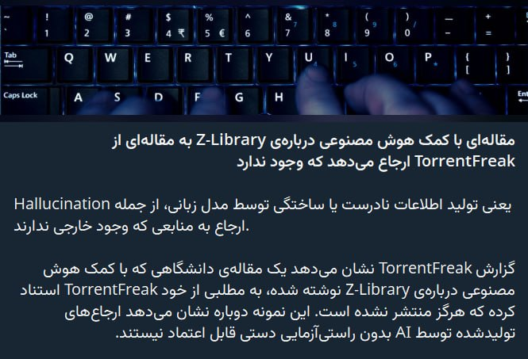


خود خبر زیاد جالب نبود اما باید بگم Z-Library بزرگترین آرشیو دزدی از کتابهاست و از کتابهای آموزش ژاپنی تا رمان‌های فارسی و کتب تخصصی جبر و کامپیوتر و مقاله و... داخلش پیدا میشه  
سال 2022 دولت آمریکا چندتا از دامین‌هاش رو بست، اما الان یکی از دامین‌هاش رو براتون پیدا کردم که موردی نداره: [https://z-library.im/](https://z-library.im/)  
دامین جعلی ازش بسیار زیاده و ریسک اسکم داره. دقت کنید که این پلتفرم کاملا رایگانه  
اپ اندرویدش رو هم میتونید از [https://z-lib.en.uptodown.com/android](https://z-lib.en.uptodown.com/android) بگیرید.  
نمونه‌ای از دامین‌های جعلیش:  
[https://z-lib.id](https://z-lib.id/)  
[https://z-library.bz](https://z-library.bz/)  
[https://z-lib.mx](https://z-lib.mx/)  

هم میتونید دانلود کنید، هم میتونید آنلاین بخونید  

✉️ [t.me/MatinSenPaii](http://t.me/MatinSenPaii)

· · ·

**🕒 ۱۴۰۵/۰۸/۰۲ ۱۶:۳۹** · [پست 5687](https://t.me/MatinSenPaii/5687)

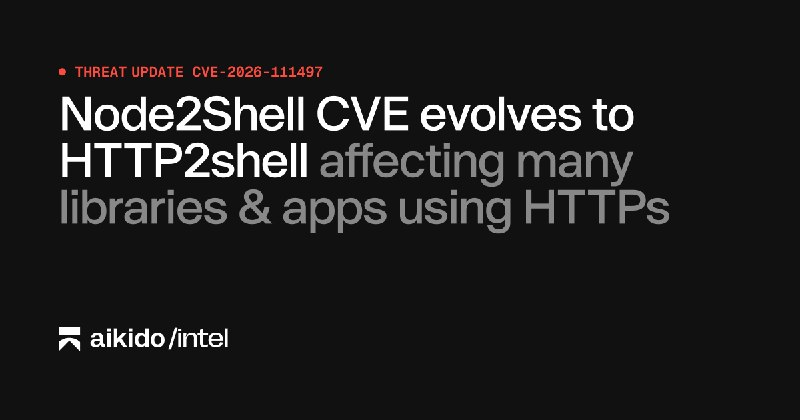

**آسیب‌پذیری Brotli با شناسه CVE-2026-111497 (node2shell) در پایتون و دیگر مصرف‌کنندگان این کتابخانه هم قابل بهره‌برداری است**  

الگوریتم Brotli یک الگوریتم فشرده‌سازی داده است که در بسیاری از کتابخانه‌های HTTP و مرورگرها استفاده می‌شود؛ CVE شناسه‌ی عمومی ثبت یک آسیب‌پذیری امنیتی است.  

گزارش Aikido نشان می‌دهد آسیب‌پذیری node2shell که این هفته درباره‌ی Brotli منتشر شد، فقط به Node.js محدود نیست و در پکیج‌های پایتون و دیگر مصرف‌کنندگان Brotli هم قابل بهره‌برداری است. در بحث Hacker News از تکامل آن به HTTP2Shell و دامنه‌ی اثر گسترده روی کتابخانه‌ها و اپلیکیشن‌های HTTP صحبت شده است. Maintainer ها و تیم‌های امنیتی باید وابستگی‌های خود به Brotli را بررسی و به‌روزرسانی کنند.  

[🔗 منبع](https://www.aikido.dev/blog/python-packages-vulnerable-node2shell-brotli-cve-2026-111497)  

✉️ [t.me/MatinSenPaii](http://t.me/MatinSenPaii)

· · ·

**🕒 ۱۴۰۵/۰۸/۰۲ ۱۶:۱۱** · [پست 5686](https://t.me/MatinSenPaii/5686)

یه آسیب‌پذیری جدید پیدا کردن باز. خدا رحم کنه

· · ·

**🕒 ۱۴۰۵/۰۸/۰۲ ۱۵:۱۳** · [پست 5685](https://t.me/MatinSenPaii/5685)

این ویدئو رو ببینید و برای خودتون بر پایه‌ی DNS، وی‌پی‌ان حاضر کنید با SOAR:  
[https://www.youtube.com/watch?v=qTLDn2pbSKQ](https://www.youtube.com/watch?v=qTLDn2pbSKQ)  
شرایط اینترنت ناجالبه مقداری  
پترنیها هم گفته که قراره PattN و PattNG آپدیت داشته باشن و امیدوارم بتونه ما رو از این تله‌ی اینترنت نجات بده

· · ·

**🕒 ۱۴۰۵/۰۸/۰۲ ۱۵:۰۴** · [پست 5684](https://t.me/MatinSenPaii/5684)

یه نفر توییتر گفته بود قیمت اینترنت کم کم داره به قیمت اینترنت پرو میرسه:))

· · ·

**🕒 ۱۴۰۵/۰۸/۰۲ ۱۳:۵۹** · [پست 5683](https://t.me/MatinSenPaii/5683)

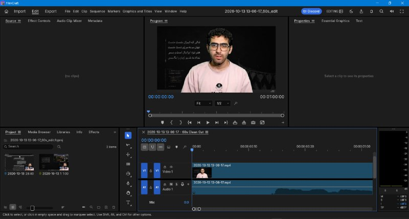

اینکه می‌بینم ایجنت رندوم اپ رو باز میکنه و باهاش کار میکنه همیشه لذت بخشه، اما تأکید می‌کنم که با AI نمیشه ویدئو ادیت کرد و ته تهش، ابزار دستیه برای ادیتورها که سرعت کارشون خفن بالا بره.  
وگرنه من بزنم صد درصد Slop میشه

· · ·

**🕒 ۱۴۰۵/۰۸/۰۲ ۱۳:۵۷** · [پست 5681](https://t.me/MatinSenPaii/5681)

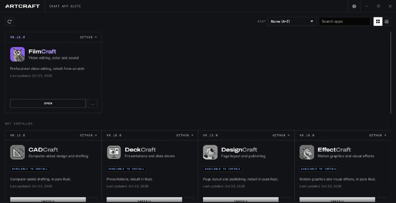

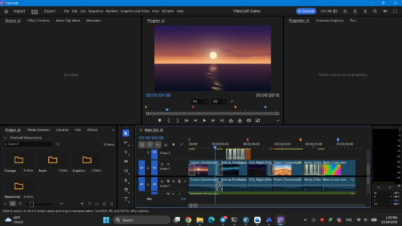

این اپ ArtCraft(که نرم‌افزارهای اوپن سورس ادوبی رو ساختن) دانلود کردم، و پریمیرش رو تست کردم و خیلی خوبه  
کلا 60 مگابایته😂 و خیلییی از امکانات رو نداره  
بسیار ابتدایی و ساده‌ست  
اما آینده‌ی روشنی واسه‌ش میبینم  
سرور mcp هم داره دادم Kimi و Claude یه ویدئوم رو ادیت کنن باهاش

· · ·

**🕒 ۱۴۰۵/۰۸/۰۲ ۱۲:۵۸** · [پست 5680](https://t.me/MatinSenPaii/5680)


**افشای بنچمارک‌های گمراه‌کننده‌ی زبان Tov در ادعای «سریع‌تر از Rust»**  

تیم Fyra Labs در یک گزارش تحلیلی ادعای «سریع‌تر از Rust» بودن زبان Tov را بررسی کرده و بنچمارک‌های منتشرشده‌ی آن را گمراه‌کننده و مغرضانه توصیف می‌کند. این گزارش در Lobsters مطرح شده است. نتیجه آن است که ادعاهای عملکردی زبان‌های جدید بدون بازتولید مستقل بنچمارک‌ها قابل اتکا نیستند.  

🔗[ منبع](https://blog.fyralabs.com/debunking-faster-than-rust-malicious-benchmarks-in-tov/)  

✉️ [t.me/MatinSenPaii](http://t.me/MatinSenPaii)

· · ·

**🕒 ۱۴۰۵/۰۸/۰۲ ۱۰:۵۶** · [پست 5679](https://t.me/MatinSenPaii/5679)

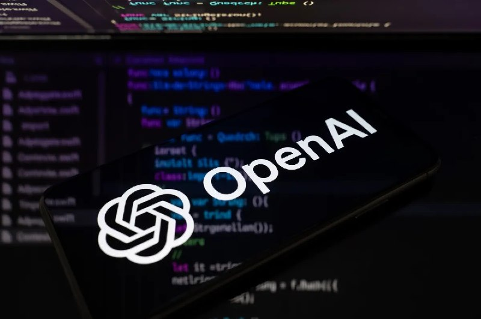

**اوپن‌ای‌آی آموزش مدل‌های هوش مصنوعی روی اینترنت زنده را متوقف می‌کند**  

منظور از آموزش روی اینترنت زنده (live internet) این است که مدل در حین یادگیری یا ارزیابی به وب واقعی دسترسی داشته باشد.  

به گزارش TechCrunch، OpenAI اعلام کرده دیگر مدل‌های پیشرو (frontier) خود را روی اینترنت زنده آموزش نمی‌دهد و دلیل آن را «ریسک‌های قابل‌توجه» عنوان کرده است. این تصمیم چند هفته پس از آن گرفته شد که یکی از مهندسان همین شرکت گفته بود چنین راهکاری جواب نمی‌دهد. نتیجه این تغییر، جدا شدن محیط آموزش مدل‌های بزرگ از وب باز است(که باید دید چه تأثیری می‌ذاره در کل)  

🔗[ منبع](https://techcrunch.com/2026/10/23/openai-says-it-will-no-longer-train-its-ai-models-on-the-live-internet-citing-significant-risks/)  

✉️ [t.me/MatinSenPaii](http://t.me/MatinSenPaii)

· · ·

**🕒 ۱۴۰۵/۰۸/۰۲ ۰۹:۲۸** · [پست 5678](https://t.me/MatinSenPaii/5678)

ویدئوی موشن گرافیک ساخته شده توسط Kimi K3.1 Pro، صفر تا صد نوشته شده با کد(بدون Skill یا پلاگین و...) با هارنس خام Kimi Code  
با Effort مکس و کلا 10 دقیقه(سریع بود نسبتا)  

پرامپت:  
make a dynamic 15-second motion graphics video that shows what an incredible motion designer you are, like it's your showreel for a résumé. go all out.  
و هزینه هم 0.33 دلار API  

قسمت مکعب روبیکش رو خیلی دوست داشتم. اما بعدش که کادر بندی کرد یه کم کشیده شد ولی در کل، خیلی دوست داشتم این آرامش‌بخش بودنش رو😁  

✉️ [t.me/MatinSenPaii](http://t.me/MatinSenPaii)

🎬 ویدیو: [مشاهده در تلگرام](https://t.me/MatinSenPaii/5678)

· · ·

**🕒 ۱۴۰۵/۰۸/۰۲ ۰۷:۵۴** · [پست 5677](https://t.me/MatinSenPaii/5677)

جالبه روی مود "Never Ask" که می‌ذاری دیگه خودش میره نون میگیره میاد  
برا خودش چت می‌کنه با ایجنت دیگه نظر ما رو هم نمی‌پرسه😂

· · ·

**🕒 ۱۴۰۵/۰۸/۰۲ ۰۷:۲۲** · [پست 5676](https://t.me/MatinSenPaii/5676)


بریم سراغ Kimi K3.1 Pro  
با خود هارنس Kimi Code دارم اون پرامپت همیشگی رو میزنم ببینم چه میکنه

· · ·

**🕒 ۱۴۰۵/۰۸/۰۲ ۰۲:۲۷** · [پست 5675](https://t.me/MatinSenPaii/5675)


**بچه‌هااا  

یه روش پیدا کردم که کانفیگش روی اینترنت‌های مختلف تست شده و نتیجه‌ش واقعاً خوب بوده! 👀💙  

توی این آموزش یاد می‌گیریم چطور با Blue Knight Panel روی هاست رایگان کانفیگ  بسازیم 🎀✨  

🎬 ویدیوی آموزش رو از دست ندین:** [https://youtu.be/VLUi1vG3\_mA](https://youtu.be/VLUi1vG3_mA)  

**·:¨༺** [**@BlueKnight\_Net**](https://t.me/BlueKnight_Net) **༻¨:·**

· · ·

**🕒 ۱۴۰۵/۰۸/۰۲ ۰۱:۱۴** · [پست 5674](https://t.me/MatinSenPaii/5674)

↪️ فوروارد از Linuxor ?

این بازی GTA در تهران که با هوش مصنوعی ساخته شده بود توی شبکه های اجتماعی ترکونده و میلیون ها بازدید خورده  

به نظرتون چرا بازی ساز های ایرانی اکثرا موفق نیستن؟ چون اکثرشون ایده هایی رو دارن اجرا میکنن که از نظر خودشون خفنه و مردم اصلا باهاش حال نمیکنن؛ مثلا بهش بگی بیا روی همین GTA توی تهران کار کن میگه نه من مگه دیونه ام از راکستار کپی کنم! اتفاقا توی بازی ساز باید از بازی های خارجی کپی کنی چون بیزنس بلد نیستی اونا آزمایش ها و تحقیقاتش رو کردن و تو از نتیجه موفقش استفاده میکنی این کار خیلی چیز طبیعیه چون همچی تقریبا توی ایران کپی خارجه: دیجی کالا، اسنپ، دیوار و...  

همین GTA در تهران رو بین تا الان صد ها گیمر و استریمر از روش ویدیو گرفتن، شما هرچقدر هم خلاقیت به خرج بدید و بازی جدیدی بسارید انقدر نمیتونید تبلیغ مفتی بدست بیارن.  

[@Linuxor](https://t.me/Linuxor)

· · ·

**🕒 ۱۴۰۵/۰۸/۰۲ ۰۱:۱۴** · [پست 5673](https://t.me/MatinSenPaii/5673)

↪️ فوروارد از Linuxor ?

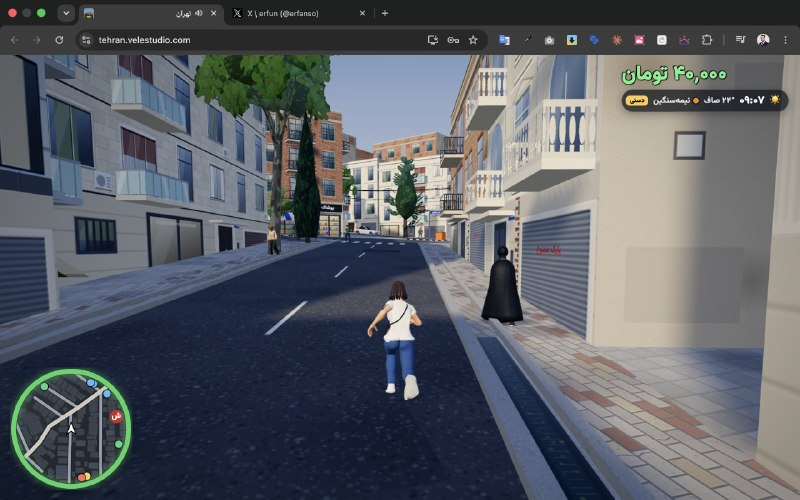

من یه عالمه توکن دیگه سوزوندم و منطقه یک تهران را حالت بازی جهان باز شبیه به gta تحت وب ساختم.زبان و هوا و ترافیک با تهران واقعی سینک میشه میتونی موتور ماشین هلیکوپتر و هواپیما سوار بشی ماموریت انجام بدی .به مرور زمان کامل ترش میکنم  

 [tehran.velestudio.com](https://t.co/iyLfIZ00X7)  

[@Linuxor](https://t.me/Linuxor) ~ erfanso

· · ·

**🕒 ۱۴۰۵/۰۸/۰۱ ۲۲:۱۱** · [پست 5671](https://t.me/MatinSenPaii/5671)

🖼 *(عکس بعد از ۲۴ ساعت حذف شده)*

ساعاتی پیش مدل Kimi K3.1 Pro معرفی شد؛ قوی‌ترین مدل اوپن ویت Moonshot تا امروز  

نسخه‌ی بهترشده K3 هستش، توی کلاس ۳ تریلیون پارامتری(سر کیمی 3 هم گفتم، تریلی هم وزن 3 تریلیون رو نمیکشه😂)  
با کانتکست ۱ میلیون توکنی؛ عکس و ویدیو هم می‌گیره و فقط توی حالت thinking کار می‌کنه. یه نسخه‌ی Highspeed هم کنارش دادن که همون قدرته ولی ۲ تا ۳ برابر سریع‌تره.  

توی Terminal-Bench 4.0 امتیاز ۶۵.۷ گرفته، 7 نمره بالاتر از Claude Opus 5.5 و GPT-6 Astra. توی ساخت مدل سه‌بعدی با کد (BenchCAD) هم ۹۲.۷ گرفته و نرخ توهمش توی تست داخلی خودشون از ۲۳.۴ درصد رسیده به ۸.۳ درصد.   

با قیمت ساننت ۵.۵ که به نظرم خیلی خوبه اگر واقعا قدرتش این باشه:  

• input $2  
• output $10  
• cached $0.20  

نسخه Highspeed دو برابر اینه، ۴ و ۲۰ دلار. یعنی مدل معمولی نصف قیمت Opus 5.5 درمیاد و از K3 قدیم هم ارزون‌تره.  

توی اپ و سایت Kimi و Kimi Code و از طریق API در دسترسه؛ وزنهاش هم تا ۴ نوامبر منتشر میشه، البته خودشون گفتن عمدا دیتای مربوط به هک و آسیب‌پذیری رو از آموزش مدل حذف کردن که نسخه‌ی اوپن از نظر سایبری جلوتر از مدل‌های بسته نره.  

🔗 [منبع](http://kimi.ai/)  
✉️ [t.me/MatinSenPaii](http://t.me/MatinSenPaii)

· · ·

**🕒 ۱۴۰۵/۰۸/۰۱ ۱۶:۱۹** · [پست 5670](https://t.me/MatinSenPaii/5670)

🖼 *(عکس بعد از ۲۴ ساعت حذف شده)*

**آنتروپیک اپلیکیشن Claude Duet را برای agent های کاری معرفی کرد**  

آنتروپیک اپلیکیشن تازه‌ای با نام Claude Duet را از طریق waitlist در اختیار کاربران پلن‌های Pro و Max قرار داده است. این agent بر پایه‌ی مدل Claude Opus 5.5 ساخته شده، به بیش از ۶۰۰۰ connector و plug-in متصل می‌شود، وظایف را در ماشین مجازی اختصاصی خود در پس‌زمینه پیش می‌برد و در صورت نیاز به تأیید کاربر بازمی‌گردد. Duet گزارش روزانه و داشبورد می‌سازد و برخلاف agent های شخصی، برای کارهای حرفه‌ای و کسب‌وکارهای کوچک طراحی شده است. با این محصول، رقابت آنتروپیک با OpenAI، Meta و xAI از سطح مدل به سطح محصول و تجربه‌ی کاربر منتقل می‌شود.   

[🔗 منبع](https://techcrunch.com/2026/10/22/claude-duet-app-is-anthropics-bet-on-agents/)  

✉️ [t.me/MatinSenPaii](http://t.me/MatinSenPaii)

· · ·

**🕒 ۱۴۰۵/۰۸/۰۱ ۱۴:۲۸** · [پست 5668](https://t.me/MatinSenPaii/5668)

ساخت این سایت دمو با Kimi K3.1 Pro فقط ۱۵ دقیقه طول کشیده، وان شات  
به نظرم که Kimi اگر بتونه هزینه رو پایین بیاره، خیلی خوب میشه  

[🔗](https://techcrunch.com/2026/10/22/canva-releases-its-first-image-generation-model/) [منبع](https://x.com/chetaslua/status/2113552063636578445?s=20)  
✉️ [t.me/MatinSenPaii](http://t.me/MatinSenPaii)

🎬 ویدیو: [مشاهده در تلگرام](https://t.me/MatinSenPaii/5668?single)

🎬 ویدیو: [مشاهده در تلگرام](https://t.me/MatinSenPaii/5669?single)

· · ·

**🕒 ۱۴۰۵/۰۸/۰۱ ۱۳:۳۹** · [پست 5667](https://t.me/MatinSenPaii/5667)

خیلی حال میده کدی که با Sonnet 4 thinking زده بودم یکی دو سال پیش رو، الان میدم Opus 5.5 واسم Review کنه و پیشنهاد بده چطور می‌تونم بهترش کنم

· · ·

---

## whitedns

[کانال در تلگرام](https://t.me/whitedns) · [آرشیو متن](archive/whitedns/)

**🕒 ۱۴۰۵/۰۸/۰۲ ۱۹:۳۲** · [پست 2143](https://t.me/whitedns/2143)

🚀 **آموزش CottenMax در WhiteDNS؛ فعال‌سازی و آپدیت سرور**  

دوستان، حالت **CottenMax (Beta)** داخل CottenDNS در دسترسه؛ یک حالت آزمایشی برای اتصال روی مسیرهای محدود و ناپایدار. نتیجه روی هر اینترنت می‌تونه متفاوت باشه و لزوماً از حالت معمول بهتر نیست.  

📱 **فعال‌سازی در اندروید**  

اول برنامهٔ WhiteDNS رو به‌روز کنید، بعد:  
۱. وارد بخش **Profiles** بشید.  
۲. روی سه‌نقطهٔ کنار کانفیگ **CottenDNS** بزنید.  
۳. گزینهٔ **Edit profile** رو انتخاب کنید.  
۴. در قسمت **CottenDNS mode**، گزینهٔ **CottenMax (beta)** رو انتخاب کنید.  
۵. روی **Save** بزنید، اتصال قبلی رو قطع کنید و دوباره وصل بشید.  

🖥 **سمت سرور چی لازم داریم؟**  

سرور هم باید از CottenMax پشتیبانی کنه. مسیر آپدیت به روش نصب شما بستگی داره:  

**۱. اگر از پنل WhiteDNS استفاده می‌کنید**  
آخرین نسخهٔ CottenDNS همراه پنل نصب شده و نیازی به نصب یا آپدیت جداگانهٔ اون ندارید. اگر پنل‌تون قدیمیه، اول خود پنل رو به‌روز کنید؛ دستورهای پایین مخصوص نصب مستقل و CottenRouter هستن، نه موتور داخلی پنل.  

**۲. اگر CottenDNS رو مستقیم نصب کرده‌اید**  
با SSH وارد سرور بشید و قبل از آپدیت از تنظیمات و کلیدتون بکاپ بگیرید.  

اگر مسیر نصب شما همین پوشه‌ست، دستورهای ورود و آپدیت رو اجرا کنید: 

```

… [ادامه در تلگرام](https://t.me/whitedns/2143)

· · ·

**🕒 ۱۴۰۵/۰۸/۰۲ ۱۷:۰۰** · [پست 2141](https://t.me/whitedns/2141)

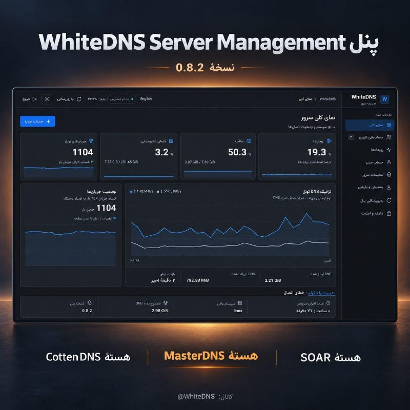

🚀 **نسخهٔ 0.8.2 پنل WhiteDNS Server Management منتشر شد**  

دوستان، پشتیبانی از **MasterDNS** هم توی سری 0.8 به پنل اضافه شده؛ حالا می‌تونید **CottenDNS، MasterDNS و SOAR** رو هم‌زمان روی سرور شخصی‌تون داشته باشید و برای هر حساب، یک موتور یا هر ترکیبی از این سه‌تا رو انتخاب کنید.  

**تغییرات نسخهٔ 0.8.2:**  
• نام پنل در صفحهٔ ورود، داشبورد و نصب‌کننده به WhiteDNS Server Management تغییر کرده.  
• مشکل نمایش شماره‌نسخهٔ قدیمی رفع شده و نسخهٔ واقعی سرور همه‌جا یکسان نمایش داده می‌شه.  

🔄 **از داخل پنل آپدیت کنید**؛ اول بکاپ بگیرید و بعد از آپدیت، صفحه رو رفرش کنید. حساب‌ها و ساب‌های قبلی حفظ می‌شن.  
پنل‌های خیلی قدیمیِ بدون آپدیت داخلی، به اجرای یک‌بارهٔ نصب‌کنندهٔ رسمی نیاز دارن.  

برای حساب‌های قبلی، خودتون MasterDNS یا «هر سه موتور» رو در ویرایش حساب انتخاب کنید و بعد ساب رو داخل اپ تازه‌سازی کنید؛ خودکار فعال نمی‌شه.  

📌 برای اضافه‌کردن **StormDNS به این پنل** در ادامه برنامه‌ای نداریم.  

----------  
#آپدیت #WhiteDNS\_Panel #MasterDNS  

📥 [دانلود آخرین نسخهٔ پایدار پنل](https://github.com/WhiteDNS/Soar-Server/releases/latest)  
📖 [جزئیات انتشار نسخهٔ 0.8.2](https://github.com/WhiteDNS/Soar-Server/releases/tag/panel-v0.8.2)  
کانال: [@WhiteDNS](https://t.me/WhiteDNS)

· · ·

**🕒 ۱۴۰۵/۰۸/۰۲ ۱۳:۳۷** · [پست 2140](https://t.me/whitedns/2140)

⚠️  
وبسایت به روز رسانی شد   
[https://whitedns.online](https://whitedns.online/)

· · ·

**🕒 ۱۴۰۵/۰۸/۰۲ ۱۲:۵۳** · [پست 2139](https://t.me/whitedns/2139)


وبسایت [whitedns.online](http://whitedns.online/) انلاین شد 🔥🔥  

🌐 **ابزار درست، برای دستگاه تو!**  

**بین ابزارها و نسخه‌های مختلف سردرگم نشو؛ راهنمای فارسی WhiteDNS کمک می‌کند از جای درست شروع کنی.**  

از WhiteVPN و WhiteAesther تا WhiteDNS، اسکنر و ابزارهای دیگر؛ در صفحهٔ هر ابزار می‌بینی:  
🔹 چیست و برای چه کاری مناسب است  
🔹 کدام فایل را برای دستگاهت دانلود کنی  
🔹 چطور شروع کنی و آموزش‌هایش را کجا ببینی  
📱 دانلود بر اساس سیستم‌عامل، با لینک مستقیم منابع اصلی  

🌗 طراحی مناسب موبایل، با حالت روشن و تیره  
برای کسی که بین ابزارها و لینک‌های دانلود سردرگم است هم بفرست 👇  
[whitedns.online](http://whitedns.online/)  
[@WhiteDNS](https://t.me/WhiteDNS)

· · ·

**🕒 ۱۴۰۵/۰۸/۰۲ ۱۲:۳۳** · [پست 2138](https://t.me/whitedns/2138)

🔥 WhtieDNS Public Servers  

سرور عمومی SOAR   

`soar://eyJwcm9maWxlIjp7ImlkIjoiZGM4MGYyMzNiZjQyNDg0MzdjZDMyZWU0N2NlOWRkYTgiLCJuYW1lIjoid2hpdGVkbnMgcHVibGljIDIiLCJyZXNvbHZlcnMiOlsiMS4xLjEuMSIsIjguOC44LjgiXSwic2VydmVyIjp7ImRvbWFpbiI6IjNzYXBlbTU3aWplZWc3Z3RmM3NoejIuc29hci53aGl0ZWRucy5kb3dubG9hZCIsInB1YmxpY19rZXkiOiJ1VVdrOU4yc3lXVG1sUUFPOHlsa3ZpaWkxSVFHRjlJa0JabFFSYkZsNjNNPSJ9LCJzb2FyU2V0dGluZ3MiOnsidHJhbnNwb3J0IjoiYXV0byIsImRpc2NvdmVyeSI6dHJ1ZSwiZGlzY292ZXJ5V2FudCI6MiwiZGlzY292ZXJ5Q29uY3VycmVuY3kiOjIsImRpc2NvdmVyeVBhY2VNcyI6MTAwMCwic2FmZVFOYW1lIjoxMDEsIm1heFFOYW1lIjoyNTMsIm1heEFuc3dlciI6MTIzMiwiaG9sZE1zIjo1MDAsIm1heEluZmxpZ2h0IjoxMjgsIm1heFBhdGhXaW5kb3ciOjMyLCJtYXhTdHJlYW1zIjoxMjgsInN0cmVhbVdpbmRvd0tpQiI6MjU2LCJzZW5kQnVmZmVyS2lCIjo2NCwic2Vzc2lvbklkbGVTZWNvbmRzIjo5MCwiZGlhbFRpbWVvdXRTZWNvbmRzIjo5MCwiY291bnRyeSI6IklSIn19LCJzY2hlbWEiOiJ3aGl0ZWRucy5wcm9maWxlIiwidmVyc2lvbiI6MX0`

… [ادامه در تلگرام](https://t.me/whitedns/2138)

· · ·

**🕒 ۱۴۰۵/۰۸/۰۲ ۱۲:۳۳** · [پست 2137](https://t.me/whitedns/2137)

↪️ فوروارد از White DNS

آموزش کوتاه نحوه استفاده از whitedns mobile   

پروکسی استفاده شده در آموزش:  
[https://t.me/socks?server=127.0.0.1&port=10886](https://t.me/socks?server=127.0.0.1&port=10886)  

با تشکر از دوست عزیزمان Sepee ❤️  

[@whitedns](https://t.me/whitedns)

🎬 ویدیو: [مشاهده در تلگرام](https://t.me/whitedns/2137)

· · ·

**🕒 ۱۴۰۵/۰۸/۰۲ ۱۲:۳۲** · [پست 2136](https://t.me/whitedns/2136)

حتما برنامه های whitedns را نصب کنید و امتحان کنید تا یاد بگیرید چطور کار میکنه تا موقع قطعی گسترده سوپرایز نشید .   

 **WhiteDNS**  

برنامه ها   
[دانلود پایدار اندروید](https://github.com/WhiteDNS/WhiteDNS-Android/releases/latest)  
[دانلود پایدار دسکتاپ](https://github.com/WhiteDNS/WhiteDNS-Desktop/releases/latest)  
[آموزش ویدیویی دسکتاپ](https://www.youtube.com/watch?v=spFuEWejbLE)  
[آموزش ویدیویی اندروید](https://www.youtube.com/watch?v=tz8cj7HzHVI)  

پتل   
📥 [دریافت آخرین نسخهٔ پنل](https://github.com/WhiteDNS/Soar-Server/releases/latest)  
📖 [راهنمای فارسی پنل](https://github.com/WhiteDNS/Soar-Server/blob/panel-v0.6.0/docs/PANEL.fa.md)  

ربات   
[ربات دریافت کانفیگ اضطراری masterdns](https://t.me/WhiteDnsChainbot)  
( این ربات در صورت بروز قطعی گسترده فقط روشن خواهد شد)  

----------  
#فهرست\_منابع #WhiteDNS #WhiteDNS\_Panel #اینترنت\_اضطراری

· · ·

**🕒 ۱۴۰۵/۰۸/۰۲ ۱۱:۴۰** · [پست 2133](https://t.me/whitedns/2133)

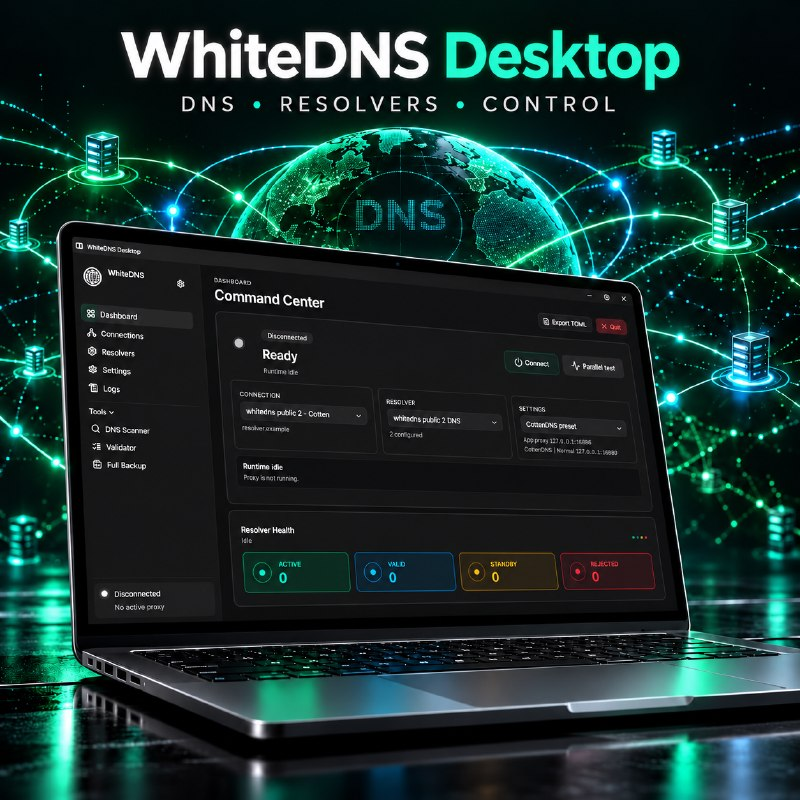

💻 **نسخهٔ 1.4.3 برنامهٔ WhiteDNS Desktop منتشر شد**  

دوستان، توی این نسخه اسکن ریزالور با موتور Soar اضافه شده و مشکل واردکردن کانفیگ‌های CottenDNS هم رفع شده.  

• اسکن با موتور اصلی Soar و تنظیمات پروفایل شما، تا ۸ پردازش هم‌زمان، با امکان لغو و ذخیرهٔ نتایج؛ گزینهٔ Pause برای این موتور فعال نیست.  
• تشخیص درست لینک‌های CottenDNS هنگام Import؛ دیگه اشتباهی با نوع MasterDNS ذخیره نمی‌شن.  
• رفع مشکل ثبت نتایج نهایی اسکن‌های کوتاه و به‌روزرسانی وضعیت اسکنر.  

🔧 **اگه قبلاً کانفیگ CottenDNS وارد کردید:**  
اگه نوعش MasterDNS ثبت شده، در بخش `Connections` گزینهٔ `Import type` رو به `CottenDNS` تغییر بدید و ذخیره کنید. بعد همون پروفایل رو در اسکنر انتخاب کنید و دوباره اسکن بگیرید.  

نسخه‌های ویندوز، لینوکس و مک آمادهٔ دانلودن.  
برای ویندوز با پردازندهٔ Intel یا AMD، فایل `windows-x64` رو بگیرید؛ نسخهٔ `windows-arm64` مخصوص ویندوز آرم هست.  

----------  
#آپدیت #WhiteDNS #Soar #CottenDNS  

📥 [دانلود آخرین نسخهٔ پایدار دسکتاپ](https://github.com/WhiteDNS/WhiteDNS-Desktop/releases/latest)  
کانال: [@WhiteDNS](https://t.me/WhiteDNS)

· · ·

**🕒 ۱۴۰۵/۰۸/۰۲ ۱۱:۳۳** · [پست 2132](https://t.me/whitedns/2132)

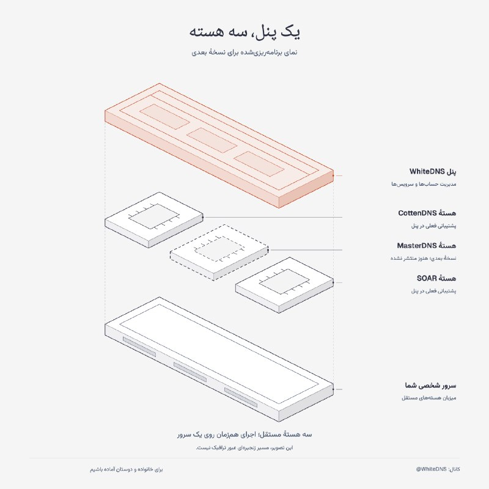

🧩 **قدم بعدی پنل: سه هسته روی یک سرور**  

دوستان، اگه [پست نسخهٔ جدید پنل](https://t.me/whitedns/2131) رو ندیدید، یه نگاه بندازید.  

توی نسخهٔ بعدی پنل Soar Server، پشتیبانی از MasterDNS رو هم اضافه می‌کنیم؛ تا بتونید هسته‌های CottenDNS، MasterDNS و SOAR رو هم‌زمان روی سرور شخصی‌تون اجرا و مدیریت کنید. **این قابلیت هنوز منتشر نشده.**  

سرور شخصی فقط برای خودتون نیست! می‌تونید در حد ظرفیتش به افراد زیادی دسترسی بدید. لطفاً برای خانواده و دوستاتون حساب جدا بسازید، کانفیگ بدید و از الان اتصال رو با هم امتحان کنید؛ تا اگه دوباره قطعی گسترده پیش اومد، اون‌ها هم یه راه جایگزین برای دسترسی به اینترنت داشته باشن.  

ظرفیت به منابع سرور و شرایط شبکه بستگی داره؛ اتصال در هر نوع قطعی تضمین‌شده نیست.  

----------  
#اطلاعیه #WhiteDNS\_Panel #MasterDNS #اینترنت\_اضطراری  

📥 [دانلود نسخهٔ فعلی پنل](https://github.com/WhiteDNS/Soar-Server/releases/latest)  
📖 [راهنمای راه‌اندازی سرور شخصی](https://github.com/WhiteDNS/Soar-Server/blob/panel-v0.7.0/docs/PANEL.fa.md)  
کانال: [@WhiteDNS](https://t.me/WhiteDNS)

· · ·

**🕒 ۱۴۰۵/۰۸/۰۲ ۰۹:۴۸** · [پست 2131](https://t.me/whitedns/2131)

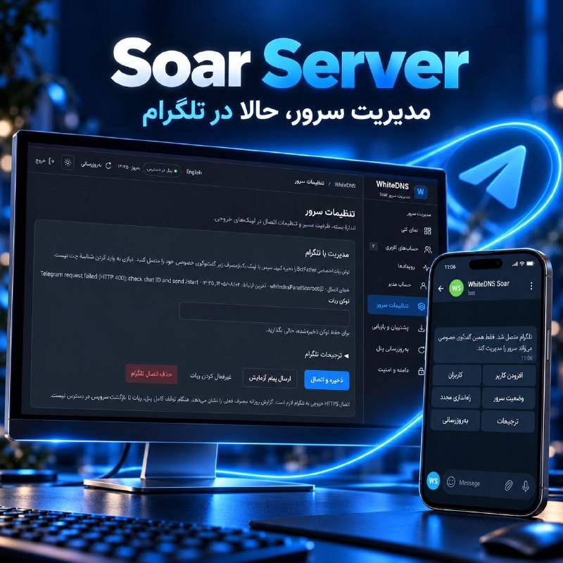

🚀 **نسخهٔ ۰.۷.۰ پنل Soar Server**  

دوستان، حالا می‌تونید سرورتون رو با ربات اختصاصی تلگرام و منوهای فارسی و انگلیسی مدیریت کنید 🤖  

• اتصال با توکن و لینک امن، بدون واردکردن دستی Chat ID  
• ساخت و ویرایش کاربر، تعیین حجم و انقضا، قطع اتصال و تعویض کلید یا لینک ساب  
• آمار لحظه‌ای با `/stats` و هشدار انقضا، اتمام حجم و اختلال سرویس  
• گزارش روزانه، پیش‌فرض ساعت ۹ صبح تهران؛ مصرف گزارش مجموع فعلی حساب‌هاست، نه ترافیک دیروز  
• ری‌استارت پنل و تونل‌ها و نصب آپدیت‌های پایدار رسمی  

🔒 دسترسی فقط برای یک مدیر در چت خصوصی؛ تغییرات حساس با تأیید یک‌بارمصرف پنج‌دقیقه‌ای  
🦾 بسته‌های لینوکس برای معماری‌های amd64 و arm64، با انتخاب خودکار موقع نصب و آپدیت  
🛠 رفع اشکال ذخیرهٔ تنظیمات ربات و بازیابی پیام‌ها و گزارش‌های ازدست‌رفته  

⚠️ برای مدیریت تلگرامی، هم خودتون و هم سرور باید به تلگرام دسترسی داشته باشید. ربات هنگام قطع کامل سرور یا پنل نمی‌تونه هشدار بفرسته.  

----------  
#آپدیت #WhiteDNS\_Panel #ربات #Linux  

📥 [دانلود آخرین نسخهٔ پایدار پنل](https://github.com/WhiteDNS/Soar-Server/releases/latest)  
📖 [راهنمای اتصال و بازیابی ربات](https://github.com/WhiteDNS/Soar-Server/blob/panel-v0.7.0/docs/TELEGRAM.md)  
کانال: [@WhiteDNS](https://t.me/WhiteDNS)

· · ·

**🕒 ۱۴۰۵/۰۸/۰۲ ۰۸:۳۶** · [پست 2130](https://t.me/whitedns/2130)

🎙 پیام صوتی: [مشاهده در تلگرام](https://t.me/whitedns/2130)

· · ·

**🕒 ۱۴۰۵/۰۸/۰۲ ۰۸:۳۴** · [پست 2129](https://t.me/whitedns/2129)

🎙 پیام صوتی: [مشاهده در تلگرام](https://t.me/whitedns/2129)

· · ·

**🕒 ۱۴۰۵/۰۸/۰۲ ۰۷:۴۲** · [پست 2127](https://t.me/whitedns/2127)

**نسخهٔ 1.6.12 برنامهٔ WhiteDNS برای اندروید منتشر شد**🔥

📎 فایل: [مشاهده در تلگرام](https://t.me/whitedns/2127)

· · ·

**🕒 ۱۴۰۵/۰۸/۰۲ ۰۷:۱۹** · [پست 2126](https://t.me/whitedns/2126)

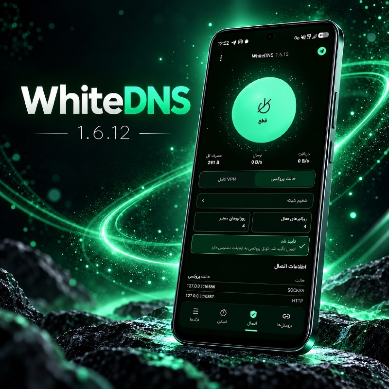

📱 **نسخهٔ 1.6.12 برنامهٔ WhiteDNS برای اندروید منتشر شد**  

**تغییرات این نسخه:**  
• رفع مشکل قطع و اتصال مجدد در حالت VPN  
• اصلاح بررسی اتصال پروکسی با آدرس‌های سفارشی IPv4 و IPv6  
• رفع مشکل اتصال CottenMax از تنظیمات سریع هنگام کشف خودکار ریزالور  
• اصلاح نگه‌داری نتایج اسکن DNS و حفظ پورت‌های سفارشی  

برای آپدیت، APK رسمی رو روی نسخهٔ قبلی نصب کنید؛ پروفایل‌ها و ساب‌هاتون حفظ می‌شن.  

توجه: طبق توضیحات انتشار، تست مجدد روی گوشی فیزیکی و شبکه‌های محدود هنوز انجام نشده.  

----------  
#آپدیت #WhiteDNS #Android  

📥 [دانلود آخرین نسخهٔ پایدار اندروید](https://github.com/WhiteDNS/WhiteDNS-Android/releases/latest)  
کانال: [@WhiteDNS](https://t.me/WhiteDNS)

· · ·

**🕒 ۱۴۰۵/۰۸/۰۱ ۱۹:۱۲** · [پست 2122](https://t.me/whitedns/2122)

⚠️

· · ·

**🕒 ۱۴۰۵/۰۸/۰۱ ۱۹:۱۲** · [پست 2121](https://t.me/whitedns/2121)

حتما برنامه های whitedns را نصب کنید و امتحان کنید تا یاد بگیرید چطور کار میکنه تا موقع قطعی گسترده سوپرایز نشید .   

 **WhiteDNS**  

برنامه ها   
[دانلود پایدار اندروید](https://github.com/WhiteDNS/WhiteDNS-Android/releases/latest)  
[دانلود پایدار دسکتاپ](https://github.com/WhiteDNS/WhiteDNS-Desktop/releases/latest)  
[آموزش ویدیویی دسکتاپ](https://www.youtube.com/watch?v=spFuEWejbLE)  
[آموزش ویدیویی اندروید](https://www.youtube.com/watch?v=tz8cj7HzHVI)  

پتل   
📥 [دریافت آخرین نسخهٔ پنل](https://github.com/WhiteDNS/Soar-Server/releases/latest)  
📖 [راهنمای فارسی پنل](https://github.com/WhiteDNS/Soar-Server/blob/panel-v0.6.0/docs/PANEL.fa.md)  

ربات   
[ربات دریافت کانفیگ اضطراری masterdns](https://t.me/WhiteDnsChainbot)  
( این ربات در صورت بروز قطعی گسترده فقط روشن خواهد شد)

· · ·

**🕒 ۱۴۰۵/۰۸/۰۱ ۱۶:۴۸** · [پست 2120](https://t.me/whitedns/2120)

آموزش کوتاه نحوه استفاده از whitedns mobile   

پروکسی استفاده شده در آموزش:  
[https://t.me/socks?server=127.0.0.1&port=10886](https://t.me/socks?server=127.0.0.1&port=10886)  

با تشکر از دوست عزیزمان Sepee ❤️  

[@whitedns](https://t.me/whitedns)

🎬 ویدیو: [مشاهده در تلگرام](https://t.me/whitedns/2120)

· · ·

**🕒 ۱۴۰۵/۰۸/۰۱ ۱۴:۰۹** · [پست 2118](https://t.me/whitedns/2118)

↪️ فوروارد از White DNS

🖼 *(عکس بعد از ۲۴ ساعت حذف شده)*

**کدام ابزار برای چه شرایطی مناسب است؟**  

----------  
#معرفی\_ابزار #WhiteVPN #WhiteAesther #WhiteDNS #CoreForge  

**برنامهٔ WhiteVPN**  
[دانلود پایدار اندروید](https://github.com/WhiteDNS/WhiteVPN/releases/latest)  
[دانلود پایدار دسکتاپ](https://github.com/WhiteDNS/WhiteVPN-Desktop/releases/latest)  
[آموزش ویدیویی دسکتاپ](https://www.youtube.com/watch?v=tm0ls3r4ppw)  

**برنامهٔ WhiteAesther**  
[دانلود پایدار اندروید](https://github.com/WhiteDNS/WhiteAestherMobile/releases/latest)  
[دانلود پایدار دسکتاپ](https://github.com/WhiteDNS/WhiteAesther/releases/latest)  
[آموزش ویدیویی دسکتاپ](https://www.youtube.com/watch?v=cRfqxbDY1Dg)  
[راهنمای فارسی اندروید](https://github.com/WhiteDNS/WhiteAestherMobile/blob/main/docs/GUIDE.fa.md)  

**برنامهٔ WhiteDNS**  
[دانلود پایدار اندروید](https://github.com/WhiteDNS/WhiteDNS-Android/releases/latest)  
[دانلود پایدار دسکتاپ](https://github.com/WhiteDNS/WhiteDNS-Desktop/releases/latest)  
[آموزش ویدیویی دسکتاپ](https://www.youtube.com/watch?v=spFuEWejbLE)  
[آموزش ویدیویی اندروید](https://www.youtube.com/watch?v=tz8cj7HzHVI)  

**برنامهٔ CoreForge**  
[دریافت آزمایشی آیفون و آیپد](https://testflight.apple.com/join/vAaXH9Cv)

… [ادامه در تلگرام](https://t.me/whitedns/2118)

· · ·

**🕒 ۱۴۰۵/۰۸/۰۱ ۱۴:۰۷** · [پست 2117](https://t.me/whitedns/2117)

↪️ فوروارد از White DNS

**📂 مجموعهٔ یکپارچهٔ ریزالورهای منتشرشده در کانال**  

فهرست‌های متنی و فایل‌های ریزالوری که قبلاً در کانال منتشر کرده بودیم را در یک فایل جمع کردیم و آدرس‌های تکراری را حذف کردیم.  

📌 تعداد نهایی: ۷٬۶۲۹ آدرس یکتا  
📄 فرمت فایل: متن ساده، هر آدرس در یک خط  

دیگر لازم نیست فهرست‌های قدیمی را جداگانه پیدا و با هم ترکیب کنید؛ مجموعهٔ ادغام‌شده را از فایل همین پست دریافت کنید.  

----------  
#اسکن #DNS #Resolvers  

کانال: [@WhiteDNS](https://t.me/WhiteDNS)

📎 فایل: [مشاهده در تلگرام](https://t.me/whitedns/2117)

· · ·

**🕒 ۱۴۰۵/۰۸/۰۱ ۱۴:۰۶** · [پست 2116](https://t.me/whitedns/2116)

↪️ فوروارد از White DNS

🔥 WhtieDNS Public Servers  

سرور عمومی SOAR   

`soar://eyJwcm9maWxlIjp7ImlkIjoiZGM4MGYyMzNiZjQyNDg0MzdjZDMyZWU0N2NlOWRkYTgiLCJuYW1lIjoid2hpdGVkbnMgcHVibGljIDIiLCJyZXNvbHZlcnMiOlsiMS4xLjEuMSIsIjguOC44LjgiXSwic2VydmVyIjp7ImRvbWFpbiI6IjNzYXBlbTU3aWplZWc3Z3RmM3NoejIuc29hci53aGl0ZWRucy5kb3dubG9hZCIsInB1YmxpY19rZXkiOiJ1VVdrOU4yc3lXVG1sUUFPOHlsa3ZpaWkxSVFHRjlJa0JabFFSYkZsNjNNPSJ9LCJzb2FyU2V0dGluZ3MiOnsidHJhbnNwb3J0IjoiYXV0byIsImRpc2NvdmVyeSI6dHJ1ZSwiZGlzY292ZXJ5V2FudCI6MiwiZGlzY292ZXJ5Q29uY3VycmVuY3kiOjIsImRpc2NvdmVyeVBhY2VNcyI6MTAwMCwic2FmZVFOYW1lIjoxMDEsIm1heFFOYW1lIjoyNTMsIm1heEFuc3dlciI6MTIzMiwiaG9sZE1zIjo1MDAsIm1heEluZmxpZ2h0IjoxMjgsIm1heFBhdGhXaW5kb3ciOjMyLCJtYXhTdHJlYW1zIjoxMjgsInN0cmVhbVdpbmRvd0tpQiI6MjU2LCJzZW5kQnVmZmVyS2lCIjo2NCwic2Vzc2lvbklkbGVTZWNvbmRzIjo5MCwiZGlhbFRpbWVvdXRTZWNvbmRzIjo5MCwiY291bnRyeSI6IklSIn19LCJzY2hlbWEiOiJ3aGl0ZWRucy5wcm9maWxlIiwidmVyc2lvbiI6MX0`

… [ادامه در تلگرام](https://t.me/whitedns/2116)

· · ·

---

## ircfspace

[کانال در تلگرام](https://t.me/ircfspace) · [آرشیو متن](archive/ircfspace/)

**🕒 ۱۴۰۵/۰۸/۰۱ ۱۴:۱۹** · [پست 2686](https://t.me/ircfspace/2686)

تعرفه اینترنت (شما بخونین آشغال‌نت) از امروز ۴۰ درصد افزایش پیدا کرد، تا اپراتورها در کنار شدیدترین اختلال‌ها و محدودیت‌ها، یه دور دیگه جیب ملت رو بزنن!  

🔗 [ᴡᴇʙꜱɪᴛᴇ](https://ircf.space/) • [ᴠᴘɴʜᴜʙ](https://t.me/persianvpnhub) • [ɢɪᴛʜᴜʙᴍɪʀʀᴏʀ](https://t.me/PersianGithubMirror)  
[@ircfspace](https://t.me/ircfspace)

· · ·

**🕒 ۱۴۰۵/۰۷/۳۰ ۱۷:۰۳** · [پست 2685](https://t.me/ircfspace/2685)

🖼 *(عکس بعد از ۲۴ ساعت حذف شده)*

۳ روز پیش گواهی eMudhra که خودش صادر کننده گواهی TLS هست، به خاطر افشای کلید خصوصی باطل شده.  
بعد فکر میکنید کلید خصوصی چی بود؟ عدد ۴!  

این گواهی میانی حدود یک و نیم سال معتبر بوده و طی اون مدت هر انسانی میتونسته برای هر وبساتی روی کره زمین گواهی معتبر TLS صادر کنه، اگر فقط میدونسته که کلید خصوصی این گواهی میانی عدد ۴ هست.  

توصیه می‌کنم همه دیوایس‌ها، مرورگرها و سیستم‌های خودتون رو آپدیت کنید و بعدش به آدرس زیر برید؛ اگه نتیجه رو connected زده بود، یعنی سیستم شما امن نیست.  

👉 [emudhra.we-have-a-problem.com](http://emudhra.we-have-a-problem.com/)   
💡 [gist.github.com/Fluepke/9a103c7f990c3cc2fb5002f7476f2f48](http://gist.github.com/Fluepke/9a103c7f990c3cc2fb5002f7476f2f48)  
© aleskxyz  

🔗 [ᴡᴇʙꜱɪᴛᴇ](https://ircf.space/) • [ᴠᴘɴʜᴜʙ](https://t.me/persianvpnhub) • [ɢɪᴛʜᴜʙᴍɪʀʀᴏʀ](https://t.me/PersianGithubMirror)  
[@ircfspace](https://t.me/ircfspace)

· · ·

**🕒 ۱۴۰۵/۰۷/۳۰ ۱۶:۴۷** · [پست 2684](https://t.me/ircfspace/2684)

🖼 *(عکس بعد از ۲۴ ساعت حذف شده)*

فریدم‌هاوس امتیاز آزادی اینترنت ایران رو در گزارش سال ۲۰۲۶ خودش از ۱۳ به ۹ (از ۱۰۰) کاهش داده؛ امتیازی که نشون میده وضعیت آزادی اینترنت در ایران همچنان در یکی از بحرانی‌ترین سطوح جهانه.  

👉 [freedomhouse.org/country/iran/freedom-net/2026](http://freedomhouse.org/country/iran/freedom-net/2026)  

🔗 [ᴡᴇʙꜱɪᴛᴇ](https://ircf.space/) • [ᴠᴘɴʜᴜʙ](https://t.me/persianvpnhub) • [ɢɪᴛʜᴜʙᴍɪʀʀᴏʀ](https://t.me/PersianGithubMirror)  
[@ircfspace](https://t.me/ircfspace)

· · ·

**🕒 ۱۴۰۵/۰۷/۳۰ ۰۸:۱۴** · [پست 2683](https://t.me/ircfspace/2683)

🖼 *(عکس بعد از ۲۴ ساعت حذف شده)*

نهادهای بالادستی در نامه‌ای رسمی و الزام‌آور تأکید کرده‌اند که در صورت آغاز جنگ جدید، دسترسی کاربران در ایران باید بلافاصله به اینترنت بین‌الملل قطع شود. این تصمیم به عنوان یک تکلیف اجرایی تعیین شده تا در شرایط درگیری نظامی، دسترسی به شبکه جهانی قطع شود. /زومان  

🔗 [ᴡᴇʙꜱɪᴛᴇ](https://ircf.space/) • [ᴠᴘɴʜᴜʙ](https://t.me/persianvpnhub) • [ɢɪᴛʜᴜʙᴍɪʀʀᴏʀ](https://t.me/PersianGithubMirror)  
[@ircfspace](https://t.me/ircfspace)

· · ·

**🕒 ۱۴۰۵/۰۷/۳۰ ۰۸:۰۲** · [پست 2682](https://t.me/ircfspace/2682)

🖼 *(عکس بعد از ۲۴ ساعت حذف شده)*

وزیر قطع‌ارتباطات گفته در دوران جنگ ۲۷۰۰ میلیارد تومان از منابع داخلی  خرج حمایت از پیام‌رسان‌ها و سکوهای داخلی شده!  

سفره رانت رو براشون پهن کردن و میلیاردها تومان از جیب منابع عمومی ریختن توی حلقشون، اما وقتش که رسید حتی از پس ابتدایی‌ترین نیازهای ارتباطی مردم برنیومدن.  

🔗 [ᴡᴇʙꜱɪᴛᴇ](https://ircf.space/) • [ᴠᴘɴʜᴜʙ](https://t.me/persianvpnhub) • [ɢɪᴛʜᴜʙᴍɪʀʀᴏʀ](https://t.me/PersianGithubMirror)  
[@ircfspace](https://t.me/ircfspace)

· · ·

**🕒 ۱۴۰۵/۰۷/۳۰ ۰۷:۵۶** · [پست 2681](https://t.me/ircfspace/2681)

🖼 *(عکس بعد از ۲۴ ساعت حذف شده)*

یه واتس‌اپ فیک توی گوگل‌پلی به رکورد باورنکردنی بیشتر از ۵۰۰ هزار دانلود رسید.  
هکرها یه اپلیکیشن کاملا جعلی رو با کپی مو‌به‌مو از توضیحات، اسکرین‌شات‌ها و آیکون واتس‌اپ اصلی منتشر کردن که از ماه سپتامبر تا الان توی استور گوگل فعال بوده. این برنامه تقلبی حتی توی بخش تبلیغات اسپانسری نتایج سرچ هم به یوزرها پیشنهاد می‌شده. سازنده این بدافزار با سوءاستفاده از قابلیت Early Access گوگل‌پلی که بخش ثبت نظرات رو می‌بنده، جلوی باخبر شدن بقیه رو گرفته بود تا نیم میلیون نفر بدون متوجه شدن، اون رو به عنوان مسنجر اصلی نصب کنن.  
این دومین گاف امنیتی بزرگ گوگل در یک بازه زمانی کوتاه، چون چند روز قبل هم نسخه تقلبی کروم با ۱۰۰ هزار دانلود کشف شده بود.  

© behradjaved\_com  

🔗 [ᴡᴇʙꜱɪᴛᴇ](https://ircf.space/) • [ᴠᴘɴʜᴜʙ](https://t.me/persianvpnhub) • [ɢɪᴛʜᴜʙᴍɪʀʀᴏʀ](https://t.me/PersianGithubMirror)  
[@ircfspace](https://t.me/ircfspace)

· · ·

**🕒 ۱۴۰۵/۰۷/۳۰ ۰۷:۴۹** · [پست 2680](https://t.me/ircfspace/2680)

🖼 *(عکس بعد از ۲۴ ساعت حذف شده)*

تیم PHP دو آسیب‌پذیری امنیتی بسیار جدی رو شناسایی کرده که مهاجم‌ها می‌تونن بدون نیاز به ورود به حساب کاربری، از راه دور روی سرورهای آسیب‌پذیر کد اجرا کنن و کنترلشون رو به دست بگیرن. این مشکل نسخه‌های مختلف PHP رو تحت تأثیر قرار داده و نسخه‌های اصلاح‌شده منتشر شدن. مدیران سایت‌ها باید هرچه زودتر PHP رو به‌روزرسانی کنن، چون راهکارهای موقت به‌تنهایی امنیت کامل رو تضمین نمی‌کنن.  

👉 [php.net/index.php#2026-10-21-5](http://php.net/index.php#2026-10-21-5)  

🔗 [ᴡᴇʙꜱɪᴛᴇ](https://ircf.space/) • [ᴠᴘɴʜᴜʙ](https://t.me/persianvpnhub) • [ɢɪᴛʜᴜʙᴍɪʀʀᴏʀ](https://t.me/PersianGithubMirror)  
[@ircfspace](https://t.me/ircfspace)

· · ·

**🕒 ۱۴۰۵/۰۷/۲۶ ۲۲:۳۰** · [پست 2679](https://t.me/ircfspace/2679)

🖼 *(عکس بعد از ۲۴ ساعت حذف شده)*

فالس‌نیوز به نقل از یک عضو هیئت‌رئیسه مجلس اعلام کرده، که ۲۵ نماینده بدلیل نداشتن دسترسی به اینترنت نتونستن در رأی‌گیری الکترونیکی اعتماد به وزیر پیشنهادی دفاع شرکت کنن! 😄  

🔗 [ᴡᴇʙꜱɪᴛᴇ](https://ircf.space/) • [ᴠᴘɴʜᴜʙ](https://t.me/persianvpnhub) • [ɢɪᴛʜᴜʙᴍɪʀʀᴏʀ](https://t.me/PersianGithubMirror)  
[@ircfspace](https://t.me/ircfspace)

· · ·

**🕒 ۱۴۰۵/۰۷/۲۶ ۲۲:۲۴** · [پست 2678](https://t.me/ircfspace/2678)

🖼 *(عکس بعد از ۲۴ ساعت حذف شده)*

در یک پرونده قضایی در آمریکا که مربوط به اتهام حمایت از یک سازمان تروریستی خارجی و تقلب ویزایی بوده، اطلاعات یک کاربر تلگرام در اختیار مقام‌های آمریکایی قرار گرفته؛ موضوعی که طبق گزارش رسانه‌ها در اواسط اکتبر ۲۰۲۶ منتشر شده و حالا بحث‌هایی درباره حریم خصوصی تلگرام به راه انداخته.  
طبق نامه‌ای که در اسناد دادگاه منتشر شده، تلگرام شماره تلفن، شناسه حساب کاربری و آدرس IP بهمراه زمان اتصال این فرد رو ارائه کرده. با این حال، در اطلاعات افشاشده اثری از محتوای پیام‌ها، فهرست مخاطبان یا تاریخچه نشست‌های کاربر دیده نمی‌شه.  

نکته مهم اینه که مبنای حقوقی این اقدام هنوز کاملاً روشن نیست. گزارش 404Media از ارائه اطلاعات در پی دستور قضایی صحبت می‌کنه، اما خود تلگرام در نامه‌اش این اقدام رو داوطلبانه توصیف کرده و صلاحیت قضایی آمریکا رو هم نپذیرفته.  
طبق سیاست حریم خصوصی تلگرام، این شرکت در شرایط مشخص قانونی می‌تونه شماره تلفن و IP کاربران مظنون به فعالیت‌های مجرمانه رو در اختیار مراجع قضایی قرار بده.  

🔗 [ᴡᴇʙꜱɪᴛᴇ](https://ircf.space/) • [ᴠᴘɴʜᴜʙ](https://t.me/persianvpnhub) • [ɢɪᴛʜᴜʙᴍɪʀʀᴏʀ](https://t.me/PersianGithubMirror)  
[@ircfspace](https://t.me/ircfspace)

· · ·

**🕒 ۱۴۰۵/۰۷/۲۲ ۰۸:۳۲** · [پست 2677](https://t.me/ircfspace/2677)

توی یکسال اخیر فقط در یک نوبت ۸۸ روز اینترنت رو قطع کردن، بعد با [وقاحت](https://t.me/ircfspace/2676) از ضرورت مدیریت مقتدرانه و شرایط جنگی حرف می‌زنن، انگار بقیه سال اینترنت برقرار بوده!  

اینترنتی که ازش حرف می‌زنن، یه شبکه وایت‌لیست‌شده، پر از اختلال و محدودیته که حتی سایت‌ها و سرویس‌های داخلی هم درست کار نمی‌کنن و اطلاعات خصوصی مردم کف اینترنت پخشه! اسم این وضعیت رو هر چیزی مثل ملانت، آشغال‌نت، ‌اختلال‌نت میشه گذاشت، اما اینترنت نه.   

اگه مدیریت شرایط جنگی و بستن پروازها رو بلد بودن، فاجعه PS752 رقم نمی‌خورد. اگر زبان انتقاد رو می‌فهمیدن، ده‌ها هزار نفر توی دی‌ماه قتل‌عام نمیشدن؛ اما دست از سرکوب برنداشتن و برنمیدارن!  

استارلینک هم نتونستن متوقف کنن؛ همونطور که نتونستن (یا نخواستن) جلوی فروش IP سفید رو بگیرن و بازار سیاه برای کانفیگ‌های گیگ/میلیونی شکل گرفت. همونطور که سیم‌کارت سفید رو به نماد تبعیض و رانت تبدیل کردن.  

از جاسوسی و فرماندهی دشمن حرف می‌زنن! دشمن کیه؟ مردمی که می‌خوان به اینترنت آزاد دسترسی داشته باشن، یا کسانی که با قطع ارتباط مردم، رانت‌فروشی و تحریف واقعیت، اعتماد عمومی رو نابود کردن؟  

بین ما و شما دریایی از خون فاصله هست.  

🔗 [ᴡᴇʙꜱɪᴛᴇ](https://ircf.space/) • [ᴠᴘɴʜᴜʙ](https://t.me/persianvpnhub) • [ɢɪᴛʜᴜʙᴍɪʀʀᴏʀ](https://t.me/PersianGithubMirror)

… [ادامه در تلگرام](https://t.me/ircfspace/2677)

· · ·

**🕒 ۱۴۰۵/۰۷/۲۲ ۰۸:۲۲** · [پست 2676](https://t.me/ircfspace/2676)

🖼 *(عکس بعد از ۲۴ ساعت حذف شده)*

خلاصه اظهارات گوه‌هربار آقامیری، دبیر شورای عالی فضای مجازی: به نظر می‌رسد استارلینک بیشتر ابزار جنگ است تا ارتباط؛ برای فرماندهی و کنترل دشمن، جاسوسی و جمع‌آوری اطلاعات استفاده می‌شود. فناوری‌ای که نه قوانین را رعایت می‌کند و نه رویکرد خدمت‌رسانی دارد، مسئله‌ای جدی است که باید مقتدرانه مدیریت شود. ما هم سامانه شناسایی پایانه‌های استارلینک را داریم و هم فناوری‌هایی برای قطع ارتباط. متخصصان کشور بسیار خوب کار کرده‌اند؛ محصولات آماده و آزمایش شده‌اند. در دی‌ماه از یکی از این فناوری‌ها استفاده کردیم و ارتباط آن قطع شد.  
ما شبکه ملی اطلاعات داریم، اگر اینترنت بین‌الملل قطع شود، هیچ دستگاه پوزی از کار نمی‌افتد؛ درحالی‌که در فرانسه سیستم‌های پرداخت از کار افتاد.  
تنها یک‌بار در دی‌ماه، برای چند ساعت اینترنت را به‌طور کامل قطع کردیم تا مسئولان امنیتی بتوانند صحنه را مدیریت کنند. بقیه موارد صرفاً محدودسازی بوده است.  
هیچکس دوست ندارد اینترنت قطع شود، همانطور که هیچکس ترجیح نمی‌دهد در دوره جنگ، پروازها بسته شود اما چاره‌ای نیست.  

🔗 [ᴡᴇʙꜱɪᴛᴇ](https://ircf.space/) • [ᴠᴘɴʜᴜʙ](https://t.me/persianvpnhub) • [ɢɪᴛʜᴜʙᴍɪʀʀᴏʀ](https://t.me/PersianGithubMirror)  
[@ircfspace](https://t.me/ircfspace)

· · ·

**🕒 ۱۴۰۵/۰۷/۲۲ ۰۸:۰۶** · [پست 2675](https://t.me/ircfspace/2675)

🖼 *(عکس بعد از ۲۴ ساعت حذف شده)*

مهاجرانی، سخنگوی دولت: دستگاه‌های متولی به‌جهت اهمیتی که پایگاه‌های داده ما و خدمات مبتنی بر اینترنت دارند، گاهی مجبور می‌شوند سرعت اینترنت را پایین بیاورند!  
این موضوع را اصلا انکار نمی‌کنیم؛ اتفاقا اعلام می‌کنیم که در راستای صیانت از دارایی‌های کشور است. /رویداد۲۴  

🔗 [ᴡᴇʙꜱɪᴛᴇ](https://ircf.space/) • [ᴠᴘɴʜᴜʙ](https://t.me/persianvpnhub) • [ɢɪᴛʜᴜʙᴍɪʀʀᴏʀ](https://t.me/PersianGithubMirror)  
[@ircfspace](https://t.me/ircfspace)

· · ·

**🕒 ۱۴۰۵/۰۷/۲۲ ۰۸:۰۱** · [پست 2674](https://t.me/ircfspace/2674)

یک لحظه زندگی در ایران  

© geedook13  

🔗 [ᴡᴇʙꜱɪᴛᴇ](https://ircf.space/) • [ᴠᴘɴʜᴜʙ](https://t.me/persianvpnhub) • [ɢɪᴛʜᴜʙᴍɪʀʀᴏʀ](https://t.me/PersianGithubMirror)  
[@ircfspace](https://t.me/ircfspace)

🎬 ویدیو: [مشاهده در تلگرام](https://t.me/ircfspace/2674)

· · ·

**🕒 ۱۴۰۵/۰۷/۲۲ ۰۷:۵۵** · [پست 2673](https://t.me/ircfspace/2673)

🖼 *(عکس بعد از ۲۴ ساعت حذف شده)*

مسدودسازی سیم‌کارتها اول در رابطه با روزنامه‌نگاران، منتقدان، فعالان سیاسی و فعالان مدنی بوده، اما حالا روایت‌های تازه‌تر از گسترش این مسئله به کاربران عادی، صاحبان کسب‌وکارهای اینستاگرامی و زنانی حکایت داره که به دلایلی مثل حجاب با مسدودشدن خط مواجه شدن.  
شرق در گزارشش نوشته که این موضوع به قطع تماس و اینترنت ختم نمیشه؛ بلکه رمز پویا، حساب بانکی، خرید اقساطی، درخواست تاکسی اینترنتی و حتی دسترسی به حساب‌های کاربری و اداره یک کسب‌وکار آنلاین با این مدل اقدامات از دسترس صاحب خط خارج میشن.  

🔗 [ᴡᴇʙꜱɪᴛᴇ](https://ircf.space/) • [ᴠᴘɴʜᴜʙ](https://t.me/persianvpnhub) • [ɢɪᴛʜᴜʙᴍɪʀʀᴏʀ](https://t.me/PersianGithubMirror)  
[@ircfspace](https://t.me/ircfspace)

· · ·

**🕒 ۱۴۰۵/۰۷/۲۰ ۲۲:۱۲** · [پست 2672](https://t.me/ircfspace/2672)

🖼 *(عکس بعد از ۲۴ ساعت حذف شده)*

فیلد مارشال محسن رضایی: در صورت ازسرگیری جنگ به کابل‌های اینترنت و دیتاسنترهای خاورمیانه حمله می‌کنیم /انتخاب  

🔗 [ᴡᴇʙꜱɪᴛᴇ](https://ircf.space/) • [ᴠᴘɴʜᴜʙ](https://t.me/persianvpnhub) • [ɢɪᴛʜᴜʙᴍɪʀʀᴏʀ](https://t.me/PersianGithubMirror)  
[@ircfspace](https://t.me/ircfspace)

· · ·

**🕒 ۱۴۰۵/۰۷/۲۰ ۲۲:۰۳** · [پست 2671](https://t.me/ircfspace/2671)

🖼 *(عکس بعد از ۲۴ ساعت حذف شده)*

نکته‌ای که در زمینه [محدودیت](https://t.me/ircfspace/2670) دسترسی ۵ پلتفرم رمزارز به خدمات برداشت غیرحضوری بانکی وجود دارد، اختلاف بر سر نحوه دسترسی نهادهای مسئول به اطلاعات کاربران و ضرورت مشخص‌ شدن هدف جمع‌آوری داده‌ها، حدود دسترسی به آن‌ها و مسئولیت حفاظت از این اطلاعات است.  
پلتفرم‌های فعال در این حوزه پیش از این گفته‌اند که بخشی از فشارها و محدودیت‌های اعمال‌شده به پافشاری بر حفظ حریم خصوصی کاربران و خودداری از ارائه اطلاعات بدون شفاف‌ شدن شرایط دسترسی مربوط می‌شود. /زومیت  

🔗 [ᴡᴇʙꜱɪᴛᴇ](https://ircf.space/) • [ᴠᴘɴʜᴜʙ](https://t.me/persianvpnhub) • [ɢɪᴛʜᴜʙᴍɪʀʀᴏʀ](https://t.me/PersianGithubMirror)  
[@ircfspace](https://t.me/ircfspace)

· · ·

**🕒 ۱۴۰۵/۰۷/۲۰ ۲۱:۵۹** · [پست 2670](https://t.me/ircfspace/2670)

🖼 *(عکس بعد از ۲۴ ساعت حذف شده)*

‌بانک مرکزی تسویه ریالی ۵ صرافی رمزارز نوبیتکس، بیت‌پین، رمزینکس، ارزینجا و تترلند را به مدت ۳ روزه محدود کرد.  
دلیل این تصمیم تخلف از ابلاغیه مربوط به API اعلام شده و می‌تواند فرایند برداشت و تسویه ریالی کاربران را با تأخیر مواجه کند. /شرق  

🔗 [ᴡᴇʙꜱɪᴛᴇ](https://ircf.space/) • [ᴠᴘɴʜᴜʙ](https://t.me/persianvpnhub) • [ɢɪᴛʜᴜʙᴍɪʀʀᴏʀ](https://t.me/PersianGithubMirror)  
[@ircfspace](https://t.me/ircfspace)

· · ·

**🕒 ۱۴۰۵/۰۷/۲۰ ۲۱:۵۲** · [پست 2669](https://t.me/ircfspace/2669)

🖼 *(عکس بعد از ۲۴ ساعت حذف شده)*

در آپدیت جدید از فیلترشکن متن‌باز و رایگان PyWarp که برای ویندوز، لینوکس و مک ارائه شده، امکانات بیشتری برای مدیریت اتصال از طریق وارپ لحاظ شده.   
حالا می‌تونین بین پروتکل‌های وایرگارد و مسک سوییچ کنین، مسیر اتصال رو هوشمندانه‌تر مدیریت کنین و از تنظیمات پیشرفته برای سازگاری بهتر با شبکه‌های محدود استفاده کنین. امکان مدیریت حساب‌های شخصی و Zero Trust، مشاهده کیفیت شبکه و بررسی خودکار بروزرسانی‌ها هم در رابط کاربری جدید این‌برنامه قرار گرفته.  

👉 [github.com/saeedmasoudie/pywarp/releases](http://github.com/saeedmasoudie/pywarp/releases)  

🔗 [ᴡᴇʙꜱɪᴛᴇ](https://ircf.space/) • [ᴠᴘɴʜᴜʙ](https://t.me/persianvpnhub) • [ɢɪᴛʜᴜʙᴍɪʀʀᴏʀ](https://t.me/PersianGithubMirror)  
[@ircfspace](https://t.me/ircfspace)

· · ·

**🕒 ۱۴۰۵/۰۷/۲۰ ۲۱:۴۴** · [پست 2668](https://t.me/ircfspace/2668)

🖼 *(عکس بعد از ۲۴ ساعت حذف شده)*

روی حماقت امثال شریعتمداری حساب باز شده!  

حسین شریعتمداری مدیرمسئول روزنامه کیهان: آیا حق مسلم ما نیست که برای به زانو درآوردن و قطع نفس این جرثومه‌های پلیدی، مانع عبور کابل‌های اینترنتی از عمق آب‌های خلیج‌فارس و تنگه هرمز بشویم؟ کابل‌ها برایمان دست تکان می‌دهند و با هزار زبان می‌گویند چرا نقش ما را در این جنگ فراموش کرده‌اید؟ /اکوایران  

🔗 [ᴡᴇʙꜱɪᴛᴇ](https://ircf.space/) • [ᴠᴘɴʜᴜʙ](https://t.me/persianvpnhub) • [ɢɪᴛʜᴜʙᴍɪʀʀᴏʀ](https://t.me/PersianGithubMirror)  
[@ircfspace](https://t.me/ircfspace)

· · ·

**🕒 ۱۴۰۵/۰۷/۲۰ ۰۷:۴۷** · [پست 2667](https://t.me/ircfspace/2667)

🖼 *(عکس بعد از ۲۴ ساعت حذف شده)*

نسخه CLI ابزار متن‌باز و رایگان GNet برای ویندوز، لینوکس و مک منتشر شده. جی‌نت که قبلاً بعنوان یک اپلیکیشن اندرویدی شناخته می‌شد، حالا با نسخه خط فرمان، امکان اشتراک‌گذاری اتصال VPN با دستگاه‌های دیگه رو هم فراهم می‌کنه.  
با GNet CLI می‌تونین سیستم خودتون رو به یک سرور پروکسی تبدیل کنین و اتصال VPN رو از طریق پروتکل‌های HTTP و SOCKS5 در اختیار دستگاه‌های دیگه قرار بدین. به این ترتیب، می‌تونین ترافیک گوشی، تبلت، تلویزیون هوشمند و سایر دستگاه‌ها رو از طریق اتصال VPN سیستم عبور بدین. این اشتراک‌گذاری از راه‌های مختلفی مثل وای‌فای، لن، هات‌اسپات، اتصال USB یا ... امکان‌پذیره.  

👉 [github.com/frank-vpl/gnet-cli/releases](http://github.com/frank-vpl/gnet-cli/releases)  

🔗 [ᴡᴇʙꜱɪᴛᴇ](https://ircf.space/) • [ᴠᴘɴʜᴜʙ](https://t.me/persianvpnhub) • [ɢɪᴛʜᴜʙᴍɪʀʀᴏʀ](https://t.me/PersianGithubMirror)  
[@ircfspace](https://t.me/ircfspace)

· · ·

---

## patt_channel_x

[کانال در تلگرام](https://t.me/patt_channel_x) · [آرشیو متن](archive/patt_channel_x/)

**🕒 ۱۴۰۵/۰۸/۰۲ ۲۱:۵۲** · [پست 200](https://t.me/patt_channel_x/200)

اگر کارهای بنده باعث شده گره ای از مشکلات شما باز شود ممنون میشم حمایتی هم از اینجانب بکنید:  

USDT (BEP20):  

```
0x76a768B53Ca77B43086946315f0BDF21156bF424
```

USDT (TRC20):  

```
TU5gKvKqcXPn8itp1DouBCwcqGHMemBm8o
```

TON (TON):  

```
UQAc-mZB3y7uxWHKiMmq0ORZEYgycWDWZ4V1k73HsXvTJx-i
```

BTC (BTC):  

```
bc1q8cptsn497hlfay6ypaaladldlrjalvx2ah233g
```

· · ·

**🕒 ۱۴۰۵/۰۸/۰۲ ۲۱:۴۶** · [پست 199](https://t.me/patt_channel_x/199)

Mark Pashmfouroush ❤️

· · ·

**🕒 ۱۴۰۵/۰۸/۰۲ ۲۱:۴۰** · [پست 198](https://t.me/patt_channel_x/198)

[PattN v7.25.6-P37](https://github.com/patterniha/PattN)

📎 فایل: [مشاهده در تلگرام](https://t.me/patt_channel_x/198)

· · ·

**🕒 ۱۴۰۵/۰۸/۰۲ ۲۱:۳۷** · [پست 197](https://t.me/patt_channel_x/197)

[PattNG v2.3.13-P68](https://github.com/patterniha/PattNG)

📎 فایل: [مشاهده در تلگرام](https://t.me/patt_channel_x/197)

· · ·

**🕒 ۱۴۰۵/۰۸/۰۲ ۲۱:۲۵** · [پست 196](https://t.me/patt_channel_x/196)

[PattN v7.25.6-P37](https://github.com/patterniha/PattN)  

[PattNG v2.3.12-P68](https://github.com/patterniha/PattNG)  

بالاخره بعد از یک چالش یک هفته ای هسته ی aether به PattN اضافه شد، همه چیز مشابه همان PattNG هست، تشکر دوباره از [@CluvexStudio](https://t.me/CluvexStudio)   

با توجه به اضافه شدن هسته‌ی جدید و همچنین تغییرات گسترده، پیشنهاد میشه برای عدم بروز هر گونه مشکل، PattN را از نو دانلود و اکسترکت کنید، و ترجیحا روی ورژن‌های قبلی آپدیت نکنید (صرفا جهت احتیاط).  

///  
**تغییرات اصلی  PattN/PattNG**:  

\* مشکل فیلتر بودن سرویس کلید وارپ حل شده و در حال حاضر میتوانید بدون نیاز به فیلترشکن کلید های وارپ را دریافت کنید (با تشکر از [@Break\_The\_Barriers](https://t.me/Break_The_Barriers)).  

\* مشکل عدم اتصال به پروتکل MASQUE-HTTP/2 نیز حل شده  

\* اکنون میتوانید کانفیگ های aether رو بدون ip و port مشخص ذخیره کنید، با این کار موقع اتصال برنامه ابتدا سعی میکند به آخرین ip موفق وصل شود و در صورت عدم اتصال دوباره اتوماتیک اسکن را انجام میدهد و به اولین ip موفق وصل میشود.  

///  

یه سورپرایز مهم هم داشتم که ترجیح دادم بزارمش برای نسخه‌ی بعد

· · ·

**🕒 ۱۴۰۵/۰۸/۰۲ ۰۳:۴۹** · [پست 195](https://t.me/patt_channel_x/195)

آپدیت بزرگ PattN و PattNG در راهه ...

· · ·

**🕒 ۱۴۰۵/۰۷/۳۰ ۰۰:۳۵** · [پست 194](https://t.me/patt_channel_x/194)

**جمع بندی راه‌های کنونی اتصال به کلودفلر بر روی فایروال همراه اول:**  

1. CDN/WORKER with IPv6  

در صورت داشتن IPv6 و در صورتی که دامنه‌ی شخصی فیلتر نشده دارید، و یا از دامنه‌ی [workers.dev](http://workers.dev/).\* استفاده میکنید، میتوانید از این روش استفاده کنید (دامنه [pages.dev](http://pages.dev/).\* به طور کلی فیلتر است).  

برای استفاده ابتدا echConfigList و cipherSuites و finalMask را پاک کنید، فینگرپرینت را روی chrome قرار دهید و سپس از یک آدرس IPv6 به طور مثال  
`2a06:98c1:3101::6812:202f`  
استفاده کنید.  

2. WARP with IPv6  

از قسمت add aether ابتدا پروتوکل را روی wireguard قرار دهید، نوع آیپی را IPv6 انتخاب کنید، اسکن کنید، بعد از پیدا شدن آیپی اسم انتخاب کنید و سیو کنید.  

3. MASQUE/H2  

از قسمت add aether پروتوکل را روی MASQUE-HTTP/2 قرار دهید،  سپس اسکن کنید، و بعد از پیدا شدن آیپی اسم انتخاب کنید و سیو کنید.  

////////////////////  

**جمع بندی راه‌های کنونی اتصال به کلودفلر بر روی فایروال ایرانسل:**  

1. CDN/WORKER with F&F method  

ابتدا echConfigList را پاک کنید، از یک آدرس مناسب به طور مثال  
`188.114.98.0`

… [ادامه در تلگرام](https://t.me/patt_channel_x/194)

· · ·

**🕒 ۱۴۰۵/۰۷/۲۹ ۱۴:۲۴** · [پست 193](https://t.me/patt_channel_x/193)

یه نکتم فراموش کردم بگم اینه که رو فایروال همراه اول و رو IPv6 همچنان بلک‌لیسته و نه وایت‌لیست.  

یعنی اگه IPv6 دارید با اختصاص دادن یه دامنه‌ی شخصی میتونید به کلودفلر وصل بشید (حتی دامنه workers هم رو IPv6 قابل اتصاله ولی pages کلا فیلتره)

· · ·

**🕒 ۱۴۰۵/۰۷/۲۹ ۱۳:۲۶** · [پست 192](https://t.me/patt_channel_x/192)

بعد از بسته شدن وارپ و فیلترشکن‌های رایگانی مثل lantern قطعا [Sni-Spoofing](https://t.me/patt_channel_x/183) منتشر میشه، این متد فقط در صورتی که کلودفلر رو کلا ببندن قطع خواهد شد.

· · ·

**🕒 ۱۴۰۵/۰۷/۲۹ ۱۳:۰۱** · [پست 191](https://t.me/patt_channel_x/191)

خب دامنه [cloudflare-ech.com](http://cloudflare-ech.com/) به صورت کلی بسته شد، و بنابراین روش ECH به هیچ صورت دیگر متصل نخواهد شد.  

رو فایروال ایرانسل همچنان متد F&F فعال است.  

**همچنان وارپ masque-http/2 با حداکثر سرعت روی تمام نت‌ها متصل است، برای اتصال به‌ این پروتوکل روی PattNG، کافی است add aether را بزنید و پروتوکل را روی MASQUE-HTTP/2 قرار دهید، و اسکن کنید و بعد از پیدا شدن اندپوینت ذخیره کنید و متصل شوید، دقت کنید که در صورتی که قبلش کلید وارپ ندارید باید قبلش کلید رو از طریق  یک پروکسی دیگر (exit-node) و یا کلا از طریق یک vpn دیگر خارج از PattNG دریافت کنید، و حتما پس از دریافت کلید vpn را خاموش کنید.**

· · ·

**🕒 ۱۴۰۵/۰۷/۲۸ ۲۳:۲۹** · [پست 190](https://t.me/patt_channel_x/190)

خب هنوز حالت های ساده‌‌تری هم کار میکنند که نیاز به echOutbound ندارند، مثل:  

[https://8.8.8.8/dns-query](https://8.8.8.8/dns-query)  
[crypto.cloudflare.com](http://crypto.cloudflare.com/)+udp://1.1.1.1  
...

· · ·

**🕒 ۱۴۰۵/۰۷/۲۸ ۲۲:۵۴** · [پست 189](https://t.me/patt_channel_x/189)

ببینید اگه روش ECH براتون کنده (وصله ولی کنده) یعنی فایروالتون ایرانسله (حتی میتونه سیم کارتتون همراه اول باشه) و باید از متد F&F کلا استفاده کنید و نه ECH.  
///  
**همچنان هم masque-http/2 راحتترین و سریعترین راه اتصال رایگان عمومی هست.**

· · ·

**🕒 ۱۴۰۵/۰۷/۲۸ ۲۱:۴۵** · [پست 188](https://t.me/patt_channel_x/188)

ببینید اگه سایت   
[https://cloudflare-ech.com](https://cloudflare-ech.com/)  

براتون تو مرورگر باز میشه یعنی همچنان روش ECH کار میکنه و دامنش قابل استفادس، الان فقط اومدن جلوگیری کردن از اینکه شما بتونید از طریق plain DNS کلید ECH رو بگیرید.  

که خب من از قبل فکرش رو کرده بودم و  echSockopt رو در هسته‌ی اصلی Xray-core و echOutbound رو در PattN/PattNG پیاده سازی کرده بودم.  

بنابراین برای استفاده از روش ECH در حال حاضر کافیه:  

echConfigList:  
`h2c://1.1.1.1/dns-query`  

و  

echOutbound:  

```
{
      "tag": "tls-repack-dns",
      "protocol": "direct",
      "settings": {
        "redirect": "1.1.1.1:443"
      },
      "streamSettings": {
        "security": "tls",
        "tlsSettings": {
          "serverName": "www.microsoft.com",
          "verifyPeerCertByName": "fromMitM,www.microsoft.com",
          "alpn": ["fromMitM"],
          "fingerprint": "chrome"
        }
      }
    }
```

قرار بدید، از آخرین نسخه PattN و PattNG هم استفاده کنید. (PattNG P67, PattN P34)  

///  

اگر کارها و تفکرات بنده باعث اتصال شما شده، امیدوارم برای انگیزه‌ی بیشتر برای ادامه‌ی راه حمایت فراموش نشه 🙏

· · ·

**🕒 ۱۴۰۵/۰۷/۲۸ ۱۳:۵۴** · [پست 187](https://t.me/patt_channel_x/187)

امیدوارم کسانی که تواناییش رو دارن حمایت رو فراموش نکنند 🙏

· · ·

**🕒 ۱۴۰۵/۰۷/۲۸ ۱۰:۴۲** · [پست 186](https://t.me/patt_channel_x/186)

Aether in PattN ...

· · ·

**🕒 ۱۴۰۵/۰۷/۲۷ ۱۵:۵۲** · [پست 185](https://t.me/patt_channel_x/185)

📎 فایل: [مشاهده در تلگرام](https://t.me/patt_channel_x/185)

· · ·

**🕒 ۱۴۰۵/۰۷/۲۷ ۱۵:۴۹** · [پست 184](https://t.me/patt_channel_x/184)

[PattNG v2.3.12-P66](https://github.com/patterniha/PattNG)  

\* Use Xray-core v26.10.17  
\* Base on v2rayNG v2.3.12  
\* Use Xray Tun by default

· · ·

**🕒 ۱۴۰۵/۰۷/۲۶ ۱۸:۱۴** · [پست 183](https://t.me/patt_channel_x/183)

🖼 *(عکس بعد از ۲۴ ساعت حذف شده)*

دو روش کاملا متفاوت Sni-Spoofing رو با موفقیت روی فایروال آپدیت شده‌ی تمام نت‌هایی که در دسترس داشتم با موفقیت تست کردم.  

متاسفانه یکی از محدودیت های اندروید رو در نظر نگرفته بودم و بنابراین هیچ‌کدام از این روش‌ها روی اندروید غیر روت قابل اجرا نیستند.  

در صورت محدود شدن شدید نت، و به شرطی که حداقل یک دامنه‌ روی cdn کلودفلر باز بمونه، یکی از روشها منتشر میشه، احتمالا مثل قبل اون رو به صورت یک فایل exe مجزا که با [127.0.0.1:40443](http://127.0.0.1:40443/) میشه بهش وصل شد منتشر میکنم، بنابراین اون قضیه‌ انتخاب اسم و انتشار روش در درون PattN/PattNG فعلا منتفی است.

· · ·

**🕒 ۱۴۰۵/۰۷/۲۴ ۱۰:۰۷** · [پست 182](https://t.me/patt_channel_x/182)

رو فایروال ایرانسل دامنه ECH ([cloudflare-ech.com](http://cloudflare-ech.com/)) مثل سایر دامنه‌های غیر وایت به صورت خاکستری باز شده، یعنی متصله ولی با محدودیت شدید آپلود.  

برای تست آپلود هم میتونید از سایت  
[https://testmy.net/upload](https://testmy.net/upload)  
استفاده کنید.  

خلاصه اینکه اگه دیدید سرعت آپلودتون به شدت پایین هست، فایروالتون ایرانسله (حتی سیم کارتتون میتونه همراه اول باشه) و برای رفع محدودیت آپلود باید از متد F&F استفاده کنید و نه ECH.  

///  

در حال حاضر MASQUE-HTTP/2 هم رو تمام اپراتور‌ها بدون هیچ محدودیتی باز هست، یکی از راحتترین و سریعترین راه‌های اتصال است.  
برای رفع تحریم هم میتونید اون را با سایفون (warp -\> psiphon) چین کنید.  

[https://t.me/patt\_channel\_x/166](https://t.me/patt_channel_x/166)

· · ·

**🕒 ۱۴۰۵/۰۷/۲۲ ۲۱:۰۹** · [پست 180](https://t.me/patt_channel_x/180)

برای اتصال از طریق ورکر کلودفلر ترجیحا از edgetunnel اصلی استفاده کنید:  

[https://github.com/cmliu/edgetunnel](https://github.com/cmliu/edgetunnel)  

و حتما هم روی **pages** دیپلوی کنید نه workers.  

برای دور زدن فیلترینگش هم رو فایروال همراه اول باید از ECH و رو فایروال ایرانسل باید از F&F استفاده کنید، در اینجا کامل توضیح دادم:  

[https://t.me/patt\_channel\_x/166](https://t.me/patt_channel_x/166)

· · ·

---

## mahsa_net

[کانال در تلگرام](https://t.me/mahsa_net) · [آرشیو متن](archive/mahsa_net/)

**🕒 ۱۴۰۵/۰۸/۰۱ ۲۲:۵۹** · [پست 284](https://t.me/mahsa_net/284)

🖼 *(عکس بعد از ۲۴ ساعت حذف شده)*

لیست 30 اهداکننده‌ی برتر در مهرماه:  

1. [NASNET استارلینک برای ایران](https://t.me/joinnasnet) (~594 TB)  
2. [Hermes\_Network\_vpn](https://t.me/Hermes_Network_vpn) (~612 TB)  
3. [Bahamestan باهمستان آزادی](https://t.me/BahamestanAzadi) (~282 TB)  
4. [JusVPN](https://t.me/JusVPN) (~457 TB)  
5. 9127d869e2354a (~244 TB)  
6. Ozumuz (~292 TB)  
7. [V2rayBaz](https://t.me/v2ray_bazi) (~142TB)  
8. e8b762a1e868c4 (~187TB)  
9. [ConfigYab\_FREE](https://t.me/ConfigYab_FREE) (~284 TB)  
10. Borusli بروسلی (~263 TB)  
11. Internet Azad (~111 TB)  
12. 4b074802aa5407 (~126 TB)  
13. 25acb86e0fd1fe (~122 TB)  
14. [Meoow\_VPN](https://t.me/Meoow_VPN) (~214 TB)  
15. [v2FreeHub](https://t.me/v2FreeHub) (~91 TB)  
16. [VPN\_KING\_V2RAY](https://t.me/VPN_KING_V2RAY) (~169 TB)  
17. b473d1164d09c5 (~96 TB)  
18. [teymur\_vpn](https://t.me/teymur_vpn) (~80 TB)  
19. [Freecoffee](https://t.me/ffreecoffee) (~139 TB)  
20. [mahsa\_net](https://t.me/mahsa_net) (~93 TB)  
21. [UCIRANIR یوسی ایران](https://t.me/UCIRANIR) (~103 TB)  
22. ee822bd32984b8 (~47 TB)  
23. 0baffc8affd869 (~80 TB)  
24. c72f0989dd04f380 (~110 TB)  
25. 514662052fe30d (~37 TB)

… [ادامه در تلگرام](https://t.me/mahsa_net/284)

· · ·

**🕒 ۱۴۰۵/۰۷/۱۳ ۲۲:۰۰** · [پست 283](https://t.me/mahsa_net/283)

**نسخه 18 اپ MahsaNG در گوگل پلی نیز منتشر شد😍**  

**دانلود از گوگل پلی:**  
[https://play.google.com/store/apps/details?id=com.MahsaNet.MahsaNG](https://play.google.com/store/apps/details?id=com.MahsaNet.MahsaNG)  

حتما آپدیت کنید. این نسخه بهبود قابل توجهی هم در ظاهر هم در کارایی اپ دارد.  

اگرچه با مسدودشدن آیپی های کلودفلر (محدودیت ۶ پکت برای udp و tcp) ،  MASQUE و WARP و Fragment مختل شدند اما ابزارهای دیگر اپ مانند سایفون، منوی پروکسی تلگرام و کانفیگهای اورژانسی EMS میتوانند در شرایط بحرانی به شما کمک کنند.  

ما برای دور زدن فیلترینگ جدیدی که از دیروز شروع شده، ابزارهایی داریم. منتظر آپدیت بعدی ما نیز باشید.  

به امید سرنگونی حکومت فاسد اسلامی

· · ·

**🕒 ۱۴۰۵/۰۷/۱۲ ۱۵:۲۵** · [پست 282](https://t.me/mahsa_net/282)

🖼 *(عکس بعد از ۲۴ ساعت حذف شده)*

طبق رادار کلودفلر، از دو روز گدشته ترافیک ایران به کلودفلر به شدت کمتر شده.  
محدودیت‌هایی که در دو روز گذشته روی اینترنت اعمال شده:  

- اکثر کانفیگها و اتصالات به کلودفلر مختل شدن مثل وبسوکت و xhttp.  

- فرگمنت روی همراه اول و مخابرات بسته شده و روی ایرانسل ضعیف کار میکنه.  

- پروتکل udp به سمت کلودفلر کلا بلاک شده.  

- اکثر رنج ایپی های هتزنر و ovh از بیخ بلاک شدن.

· · ·

**🕒 ۱۴۰۵/۰۷/۱۱ ۲۳:۲۵** · [پست 281](https://t.me/mahsa_net/281)

**نسخه 18 اپ MahsaNG در گیتهاب منتشر شد😍**  

**دانلود از گیتهاب:**  
[https://github.com/GFW-knocker/MahsaNG/releases/latest/](https://github.com/GFW-knocker/MahsaNG/releases/latest/)  

**انتشار در گوگل پلی تا چند روز آینده**  

**امکانات جدید:**  
- آپدیت هسته مهسا به v26.10.3  
- پشتیبانی از پروتکل مسک  
- آیپی اسکنر مخصوص وایرگارد، مسک با قابلیت نویز و پورت  
- قابلیت کانفیگ وایرگارد، مسک با کلید auto  
- قابلیت بکاپ از کانفیگهای شخصی  
- صفحه پروکسی تلگرام با امکان کپی و تست پروکسی  
- امکان undo sort با نگه داشتن دکمه sort  
- بهبود فرگمنت و مد auto آن  
- افزودن نویزهای جدید برای عبور از فیلترینگ udp  
- افزودن کانفیگهای جدید یوتیوب  
- پشتیبانی از cipher suite برای سرعت آپلود (متد پترنیها)  
- پشتیبانی از finalmask روی پروتکلهای جدید مسک و هیستریا  
- ابزار زنجیره ساز کانفیگ با پشتیبانی از فرگمنت، هیستریا و مسک  
- توانایی بیشتر در دریافت کانفیگ از مهساسرور  

**بهبود ظاهر برنامه:**  
- بازطراحی زیبای صفحات داخلی  
- جابجایی بین ساب ها با کشیدن به چپ و راست  
- نمایشگر رنگی وضعیت کانفیگ در قسمت پینگ  

**رفع اشکالات:**  
- رفع مشکل نمایش آیپی در قسمت پینگ  
- پیام متنی دیگر قسمت پینگ را نمیپوشاند  
- رفع مشکل تست آپلود در قسمت پینگ

… [ادامه در تلگرام](https://t.me/mahsa_net/281)

· · ·

**🕒 ۱۴۰۵/۰۷/۱۰ ۲۳:۱۱** · [پست 280](https://t.me/mahsa_net/280)

🖼 *(عکس بعد از ۲۴ ساعت حذف شده)*

**بلاهایی که شهریور سر اینترنت اومد:**  

۱ و ۲ شهریور: ایرانسل رنج IP سرورهای هتزنر و OVH رو بسته بود و ۲ شهریور باز کرد.  

۱۴ تا ۱۷ شهریور: مودم‌های همراه اول و مخابرات هر از گاهی جواب نمی‌دادن، در حالی که خود خط وصل بود.  

۱۷ و ۱۸ شهریور: اینترنت بین‌الملل روی همه اپراتورها مختل شد و رئیس زیرساخت (اکبری) گفت مشکل از فیبرهای ارمنستانه.  

۱۹ شهریور: ECH کلادفلر روی ایرانسل و آسیاتک بسته شد و فیلترشکن‌هایی که ازش استفاده می‌کردن از کار افتادن.  

۲۱ شهریور: سرعت مخابرات دو ساعت تمام به حدود ۰٫۱ مگابیت رسید.  

۲۲ شهریور: سرویس‌های گوگل تمام روز تو کل کشور قطع و وصل می‌شد.  

۲۹ شهریور: همراه اول حدود نیم ساعت رنج IP بقیه رو به اسم خودش به دنیا اعلام کرد.  

**اسمش رو گذاشتن اینترنت، ولی در واقع یه قطعیه دائمیه که گاهی وصل می‌شه.**  

#مهسانت

· · ·

**🕒 ۱۴۰۵/۰۷/۰۱ ۲۰:۵۸** · [پست 279](https://t.me/mahsa_net/279)

🖼 *(عکس بعد از ۲۴ ساعت حذف شده)*

لیست 30 اهداکننده‌ی برتر در شهریورماه:  

1. Internet Azad (~1074 TB)  
2. [V2rayBaz](https://t.me/v2ray_bazi) (~986 TB)  
3. [Bahamestan باهمستان آزادی](https://t.me/BahamestanAzadi) (~303 TB)  
4. [NASNET استارلینک برای ایران](https://t.me/joinnasnet) (~339 TB)  
5. Ozumuz (~498 TB)  
6. [teymur\_vpn](https://t.me/teymur_vpn) (~254 TB)  
7. [SOSIranConnect](https://t.me/SOSIranConnect) (~190 TB)  
8. 9127d869e2354a (~189 TB)  
9. [JusVPN](https://t.me/JusVPN) (~290 TB)  
10. Baraye iran (~134 TB)  
11. Borusli بروسلی (~221 TB)  
12. [Hermes\_Network\_vpn](https://t.me/Hermes_Network_vpn) (~183 TB)  
13. [UCIRANIR یوسی ایران](https://t.me/UCIRANIR) (~185 TB)  
14. e8b762a1e868c4 (~127 TB)  
15. [welcomGRF](https://t.me/welcomGRF) (~109 TB)  
16. azjahanam (~73 TB)  
17. e964d5c5af79e8 (~175 TB)  
18. 2fbbea30db57e51b (~92 TB)  
19. c72f0989dd04f380 (~135 TB)  
20. b473d1164d09c5 (~72 TB)  
21. 6ae9dca002e951 (~131 TB)  
22. [mahsa\_net](https://t.me/mahsa_net) (~54 TB)  
23. [Meoow\_VPN](https://t.me/Meoow_VPN) (~101 TB)  
24. [AzadNet](https://t.me/AzadNet) (~51 TB)  
25. 6e68252c7f1811 (~59 TB)  
26. 25acb86e0fd1fe (~64 TB)  
27. 514662052fe30d (~36 TB)

… [ادامه در تلگرام](https://t.me/mahsa_net/279)

· · ·

**🕒 ۱۴۰۵/۰۶/۲۲ ۲۱:۰۴** · [پست 278](https://t.me/mahsa_net/278)

چهارسال از انقلاب مهسا گذشت.  
آکنده از رنج و درد  
و پر کشیدن هزاران هزار جان عزیز  

و اما خون‌های ریخته شده، نقاب از چهره زشت حکومت وحشی اسلامی برداشت.  

و آه مادران داغدار، سران جنایتکارش را به دست تقدیر سپرد.  

و چه انتقامی! جمع بزرگی از آن جنایتکاران به هلاکت رسیدند و بخشی دیگر در زیرزمین پنهان‌اند تا شاید از سرنوشت محتوم خود بگریزند.  

و چه عبرتی شد برای ظالمان!  

#نه\_میبخشیم\_نه\_فراموش\_میکنیم  
#زن\_زندگی\_آزادی  
#مهسا\_امینی  
#انقلاب\_شیروخورشید

🎬 ویدیو: [مشاهده در تلگرام](https://t.me/mahsa_net/278)

· · ·

**🕒 ۱۴۰۵/۰۶/۰۹ ۱۴:۴۹** · [پست 277](https://t.me/mahsa_net/277)

قسمت دوم از معرفی سایت جدید مهساسرور، صفحه My Configs و آمار تک‌تک کانفیگ‌ها.  

توی My Configs لیست کانفیگ‌هایی که اهدا کردید رو می‌بینید. اعدادی که توی داشبورد به‌صورت کلی بود، اینجا برای هر کانفیگ جداست: Received و Used و Performance. همون‌جا هم معلومه کدوم کانفیگ فعاله و تست Xray رو پاس کرده. اگه یکیشون مشکل داشته باشه، با یه نگاه پیداش می‌کنید.  

ولی بخش اصلی، صفحه آمار هر کانفیگه که نشون می‌ده دقیقاً کجا و چطور داره استفاده می‌شه.  

بالای صفحه مجموع استفاده ۱۴ روز اخیر هست و ساعت اوج مصرف. یعنی چه روزی و چه ساعتی بیشترین استفاده با این کانفیگ بوده.  

بعد نمودار مصرف روزانه به تفکیک اپراتور رو دارید. می‌بینید کانفیگتون روی اپراتورها چقدر استفاده شده و هر کدوم رو هم می‌شه جدا روشن و خاموش کرد.  

و آخر صفحه آمار استان‌هاست. اینکه کاربرهای شما بیشتر از کجا وصل می‌شن و روند هر استان چطور بوده.  

[https://mahsaserver.com](https://mahsaserver.com/)  

#mahsaserver

🎬 ویدیو: [مشاهده در تلگرام](https://t.me/mahsa_net/277)

· · ·

**🕒 ۱۴۰۵/۰۶/۰۳ ۲۳:۴۳** · [پست 276](https://t.me/mahsa_net/276)

🖼 *(عکس بعد از ۲۴ ساعت حذف شده)*

لیست 30 اهداکننده‌ی برتر در مرداد‌ماه:  

1. Internet Azad (~1136 TB)  
2. [V2rayBaz](https://t.me/v2ray_bazi) (~980 TB)  
3. Ozumuz (~687 TB)  
4. [Bahamestan باهمستان آزادی](https://t.me/BahamestanAzadi) (~341 TB)  
5. [NASNET استارلینک برای ایران](https://t.me/joinnasnet) (~281 TB)  
6. [khosrow](https://t.me/Khosrow_vpn) (~236 TB)  
7. [Hermes\_Network\_vpn](https://t.me/Hermes_Network_vpn) (~368 TB)  
8. c72f0989dd04f380 (~188 TB)  
9. [iSpeedTopVPN](https://t.me/iSpeedTopVPN) (~244 TB)  
10. azjahanam (~197 TB)  
11. [SOSIranConnect](https://t.me/SOSIranConnect) (~173 TB)  
12. [mahsa\_net](https://t.me/mahsa_net) (~124 TB)  
13. [Go\_vpns](https://t.me/Go_vpns) (~140 TB)  
14. 9127d869e2354a (~177 TB)  
15. 2fbbea30db57e51b (~119 TB)  
16. [UCIRANIR یوسی ایران](https://t.me/UCIRANIR) (~184 TB)  
17. ee822bd32984b8 (~99 TB)  
18. [teymur\_vpn](https://t.me/teymur_vpn) (~118 TB)  
19. 514662052fe30d (~68 TB)  
20. f3bbb4bb59f8c0 (~58 TB)  
21. [FreeVPNBazaar ](https://t.me/freevpnbazaar)(~109 TB)  
22. [AмÎη.м2](https://t.me/Vpn_m2s) (~57 TB)  
23. [vpnmeli\_robot](https://t.me/vpnmeli_robot) (~61 TB)  
24. e8b762a1e868c4 (~78 TB)  
25. [v2rei](https://t.me/v2rei) (~47 TB)

… [ادامه در تلگرام](https://t.me/mahsa_net/276)

· · ·

**🕒 ۱۴۰۵/۰۵/۲۶ ۱۵:۵۹** · [پست 275](https://t.me/mahsa_net/275)

🖼 *(عکس بعد از ۲۴ ساعت حذف شده)*

با انتشار سایت جدید مهساسرور، از این به بعد تغییراتش رو بخش‌به‌بخش براتون میگیم.  

از داشبورد اهداکنندگان شروع می‌کنیم. وقتی وارد حسابتون می‌شید، بالای صفحه چند تا عدد هست که با یه نگاه میگه کانفیگ‌هاتون چطور دارن کار می‌کنن.  

قسمت اول تعداد کانفیگ‌هاییه که اهدا کردید و اینکه جدیدترین و قدیمی‌ترینشون مال کیه. Total Received یعنی مجموعا چند بار کانفیگ‌های شما برای کاربرها ارسال شده، و Total Used یعنی از همون تعداد، چند بار کاربرها واقعا وصل شدن.  

گرفتن کانفیگ به معنی وصل شدن نیست، و اینجا عدد چهارم به کار میاد. Performance یا همون عملکرد، از روی این دو عدد حساب میشه و به‌شکل درصد میگه کانفیگ‌هاتون چه کیفیتی دارن. از الان برای هر کانفیگ هم جداگانه میتونید عملکردشو ببینید.  

بهترین حالت اینه که این دو عدد برابر باشن (عملکرد 100%)؛ یعنی هر کاربری که کانفیگ شما رو گرفته، توی هر استان و روی هر اپراتوری، همون موقع تونسته وصل بشه.  

اهداکننده‌ها هم هر چی کانفیگ باکیفیت‌تری اهدا کنن، عملکردشون بالاتر میره و توی جدول اهداکنندگان بالاتر میان؛ جایی که لینک اهدا و معرفیشون بهتر دیده میشه.  

[mahsaserver.com](http://mahsaserver.com/)

· · ·

**🕒 ۱۴۰۵/۰۵/۲۲ ۰۰:۲۹** · [پست 272](https://t.me/mahsa_net/272)

🖼 *(عکس بعد از ۲۴ ساعت حذف شده)*

**سایت جدید مهساسرور منتشر شد.**  

ظاهر و تجربه‌ی کاربری سایت کاملاً بازطراحی شده و از الان در دسترس قرار گرفت. طراحی جدید، سرعت بالاتر و کار کردن ساده‌تر، هم روی موبایل هم دسکتاپ.  

بطور خلاصه چی تغییر کرده؟  

● داشبورد جدید برای اهداکنندگان: وضعیت کانفیگ‌ها در یک نگاه  
● مدیریت کانفیگ‌ها خیلی ساده‌تر و سریع‌تر از قبل  
● نمودارهای بیشتر و کاربردی برای هر کانفیگ  
● نمودار تفکیک مصرف هر کانفیگ بر اساس اپراتور و استان  
● راهنماها و صفحات عمومی با چیدمان تازه  
● حالت تاریک و روشن  

و این تازه شروعه؛ بخش‌های بیشتری در راهه.  
[mahsaserver.com](http://mahsaserver.com/)  

#mahsaserver

· · ·

**🕒 ۱۴۰۵/۰۵/۲۰ ۱۴:۱۹** · [پست 271](https://t.me/mahsa_net/271)

از ویژگیهای مهم [MahsaNG v17](https://play.google.com/store/apps/details?id=com.MahsaNet.MahsaNG) :  

هسته سایفون برای ایران بهینه شده، کاربر حرفه ای میتونه با آیپی تمیز Akamai، کانفیگ سایفون بسازه و به اشتراک بگذاره. کاربر مبتدی هم به راحتی میتونه به اون کانفیگ متصل بشه.  

برای ساخت کانفیگ، ابتدا از منوی Mahsa IP Scanner گزینه‌ی akamai رو انتخاب و اسکن کنید. یک یا چند ایپی GREEN را کپی و در تنظیمات سایفون در akamai cdn ip وارد و save رو بزنید. سپس دکمه copy url زده و در صفحه اصلی اپ paste کرده و استفاده کنید یا بعنوان کانفیگ برای دوستان خود بفرستید.  

سایفون در نسخه 17 مهسا ، به چند طریق میتونه روشن بشه:  
- با دریافت و انتخاب کانفیگ سایفون  
- با روشن کردن از منوی F بصورت alone (تنها) یا بصورت after (ترکیبی با v2ray)  

نکات:  
1. در سایفون after (ترکیبی با ویتوری)، باید protocol=auto باشد و region هرکشوری باشد ایپی نهایی شما اون کشور خواهد بود و حجم v2ray نیز مصرف میشود.  

2. در سایفون alone (و کانفیگ سایفون) ، region=auto باشد و protocol=cdn\_fronting بهمراه آیپی تمیز آکامای یا فستلی و دامین وایت در قسمت sni  

3. اگر میخواهید آیپی تمیزها در لینک قابل رویت نباشد از copy AES url استفاده کنید.  

4. توصیه میشود Aggressive=on و برای سایر پارامترها، پیشفرض خودشان بهترین است.

… [ادامه در تلگرام](https://t.me/mahsa_net/271)

· · ·

**🕒 ۱۴۰۵/۰۵/۱۰ ۱۷:۰۰** · [پست 270](https://t.me/mahsa_net/270)

**ظاهر و** **رابط کاربری MahsaNG توی نسخه 17 از نو طراحی شده و حسابی مدرن‌تر شده.**  

با یک sweep بین ساب‌ها جابه‌جا می‌شید، موقع تست تعداد کانفیگ‌ها رو می‌بینید و کانفیگ‌های بدون پینگ رو هم میتونید با یک دکمه حذف کنید.  

تست کانفیگ هم پیشرفته‌تر شده: بعد از پینگ، یه لمس طولانی کافیه تا آی‌پی نهایی کانفیگ رو ببینید، دوباره نگه دارید جزئیات بیشتر میاد، و همون‌جا می‌تونید سرعت دانلود و آپلود رو هم سریع بسنجید.  

روی پلتفرم Android TV هم می‌تونید با ریموت به‌راحتی در تمام بخش‌های اپ جابه‌جا و متصل شید.  

دانلود از گوگل پلی:  
[https://play.google.com/store/apps/details?id=com.MahsaNet.MahsaNG](https://play.google.com/store/apps/details?id=com.MahsaNet.MahsaNG)  

#MahsaNG

🎬 ویدیو: [مشاهده در تلگرام](https://t.me/mahsa_net/270)

· · ·

**🕒 ۱۴۰۵/۰۵/۰۱ ۱۱:۱۴** · [پست 269](https://t.me/mahsa_net/269)

🖼 *(عکس بعد از ۲۴ ساعت حذف شده)*

لیست 30 اهداکننده‌ی برتر در تیرماه:  

1. [khosrow](https://t.me/Khosrow_vpn) (~522 TB)  
2. [V2rayBaz](https://t.me/V2raybazi) (~700 TB)  
3. Internet Azad  (~559 TB)  
4. Ozumuz (~650 TB)  
5. azjahanam (~388 TB)  
6. [NASNET استارلینک برای ایران](https://t.me/joinnasnet) (~240 TB)  
7. 2fbbea30db57e51b (~263 TB)  
8. c72f0989dd04f380 (~330 TB)  
9. [XV2RAY](https://t.me/XV2RAY) (~199 TB)  
10. d0984ff804268f (~189 TB)  
11. [AмÎη.м2](https://t.me/Vpn_m2s) (~136 TB)  
12. ee822bd32984b8 (~128 TB)  
13. [VPN\_KING\_V2RAY](https://t.me/VPN_KING_V2RAY) (~208 TB)  
14. [v2rei](https://t.me/v2rei) (~141 TB)  
15. [Hermes\_Network\_vpn](https://t.me/Hermes_Network_vpn) (~148 TB)  
16. [Hermes\_Network\_vpn](https://t.me/Hermes_Network_vpn) (~151 TB)  
17. [Ana](https://t.me/ANA_SERVICE) (~140 TB)  
18. 9127d869e2354a (~81 TB)  
19. f3bbb4bb59f8c0 (~47 TB)  
20. Borusli بروسلی (~72 TB)  
21. [v2rei](https://t.me/v2rei) (~82 TB)  
22. [Bahamestan باهمستان آزادی](https://t.me/BahamestanAzadi) (~80 TB)  
23. [vpnmeli\_robot](https://t.me/vpnmeli_robot) (~77 TB)  
24. e8b762a1e868c4 (~61 TB)  
25. 514662052fe30d (~48 TB)  
26. [mahsa\_net](https://t.me/mahsa_net) (~60 TB)

… [ادامه در تلگرام](https://t.me/mahsa_net/269)

· · ·

**🕒 ۱۴۰۵/۰۴/۱۲ ۱۰:۵۰** · [پست 268](https://t.me/mahsa_net/268)

نسخه 17 اپ MahsaNG در گوگل پلی و گیتهاب منتشر شد😍  

**دانلود از گوگل پلی:**  
[https://play.google.com/store/apps/details?id=com.MahsaNet.MahsaNG](https://play.google.com/store/apps/details?id=com.MahsaNet.MahsaNG)  

**دانلود از گیتهاب:**  
[https://github.com/GFW-knocker/MahsaNG/releases/latest/](https://github.com/GFW-knocker/MahsaNG/releases/latest/)  

**امکانات جدید:**  
- هسته سایفون بهینه شده برای ایران  
- ساخت و اشتراک‌گذاری کانفیگ "://psiphon"  
- ایپی اسکنر مخصوص cdn\_fronting  
- قابلیت دریافت کانفیگ از طریق نوتیفیکیشن  
- ابزار زنجیره سازی دو کانفیگ  
- حذف کانفیگهای بدون پینگ  
- طراحی جدید و زیبای واسط گرافیکی  
- قابلیت دریافت اطلاع رسانی با نوتیفیکیشن  
- جابجایی بین سابها با sweep  
- نمایش تعداد کانفیگ هنگام تست  
- رفع مشکل اتصال خودکار سایفون  
- رفع کرش روی arm-v7a  
و موارد دیگر

· · ·

**🕒 ۱۴۰۵/۰۴/۰۱ ۱۳:۲۹** · [پست 267](https://t.me/mahsa_net/267)

🖼 *(عکس بعد از ۲۴ ساعت حذف شده)*

**لیست 30 اهداکننده‌ی برتر در خردادماه:**  

1. [mahsa\_net](https://t.me/mahsa_net) (~705 TB)  
2. 514662052fe30d (~237 TB)  
3. [khosrow](https://t.me/Khosrow_vpn) (~199 TB)  
4. e8b762a1e868c4 (~167 TB)  
5. [V2rayBaz](https://t.me/V2raybazi) (~159 TB)  
6. 3d9826f3dccbf8 (~212 TB)  
7. Borusli بروسلی (~129 TB)  
8. [VPN\_KING\_V2RAY](https://t.me/VPN_KING_V2RAY) (~171 TB)  
9. [allworldcfg](https://t.me/allworldcfg) (~137 TB)  
10. f3bbb4bb59f8c0 (~84 TB)  
11. 2fbbea30db57e51b (~155 TB)  
12. [v2rei](https://t.me/v2rei) (~126 TB)  
13. azjahanam (~ 146 TB)  
14. 9127d869e2354a (~92 TB)  
15. [v2rei2](https://t.me/v2rei2) (~105 TB)  
16. [AмÎη.м2](https://t.me/Vpn_m2s) (~79 TB)  
17. Internet Azad  (~58 TB)  
18. [v2FreeHub](https://t.me/v2FreeHub) (~61 TB)  
19. [Ana](https://t.me/ANA_SERVICE) (~71 TB)  
20. [Bahamestan باهمستان آزادی](https://t.me/BahamestanAzadi) (~31 TB)  
21. [NASNET استارلینک برای ایران](https://t.me/joinnasnet) (~46 TB)  
22. f5a9a6db370974 (~56 TB)  
23. [V2rayEnglish](https://t.me/V2rayEnglish) (~21 TB)  
24. [iProxyChannel](https://t.me/iProxyChannel) (~39 TB)  
25. [Napsternet2](https://t.me/Leviko_v2ray) (~52 TB)  
26. 2f9ba90edf4fd3 (~17 TB)

… [ادامه در تلگرام](https://t.me/mahsa_net/267)

· · ·

**🕒 ۱۴۰۵/۰۲/۲۷ ۰۹:۵۰** · [پست 266](https://t.me/mahsa_net/266)

نسخه 16 اپ MahsaNG در گیتهاب و گوگل پلی منتشر شد😍  

دانلود از گوگل پلی:  
[https://play.google.com/store/apps/details?id=com.MahsaNet.MahsaNG](https://play.google.com/store/apps/details?id=com.MahsaNet.MahsaNG)  

دانلود از گیتهاب:  
[https://github.com/GFW-knocker/MahsaNG/releases/latest/](https://github.com/GFW-knocker/MahsaNG/releases/latest/)  

دانلود مستقیم فایل apk از گروه مهسا:  
[https://t.me/+YIlqV-fl9y4zMmRk](https://t.me/+YIlqV-fl9y4zMmRk)  

امکانات جدید:  
پشتیبانی از  [MasterDNS](https://github.com/masterking32/MasterDnsVPN)  
پشتیبانی از [GooseRelay](https://github.com/Kianmhz/GooseRelayVPN)  
پشتیبانی از [FlowDriver](https://github.com/NullLatency/FlowDriver)  
پشتیبانی از Psiphon CDN-Fronting   
(credit: [shirkhorshid](https://github.com/shirokhorshid/shirokhorshid-android) & [patterniha](https://github.com/patterniha/MITM-DomainFronting))  
افزودن Psiphon LAN sharing  
افزودن "type manually HTTP"  
امکان اجرای سایفون به تنهایی  
بهبود اسکنر dns با توالی رندوم  
بهبود منو و رفع برخی کرش ها  
و سهولت کار در android TV

… [ادامه در تلگرام](https://t.me/mahsa_net/266)

· · ·

**🕒 ۱۴۰۵/۰۲/۲۱ ۱۸:۰۱** · [پست 265](https://t.me/mahsa_net/265)

🖼 *(عکس بعد از ۲۴ ساعت حذف شده)*

دوستان، با اپ thefeed میتوانید در زمان قطعی نت بین‌الملل، کانالهای منتخب تلگرام را با نت ملی مشاهده کرده و از اخبار مطلع شوید.  

این اپ هم میتواند بدون کانفیگ کار کند (با کمک پروژه [telemirror](https://t.me/ircfspace/2300))، هم در شرایط بحرانی، با کانفیگ‌های مخصوص که عمومی و خصوصی منتشر می‌شوند، راه خود را از اینترانت فاجعه‌بار جاعش، به دنیای آزاد باز می‌کند.  

لینک دانلود:   
(گیتهاب سارتو توسط تروریستهای ج.ا ریپورت شده و 404 میده. این خطا موقتیه و با پیگیری باز میشه. قبلا نیز گیتهاب بسیاری از فعالین از جمله خودم ریپورت شده بود.)  
[https://github.com/sartoopjj/thefeed/releases/latest](https://github.com/sartoopjj/thefeed/releases/latest)  
کانال برنامه:  
[@networkti](https://t.me/networkti)  
کانال کانفیگ thefeed:  
[@thefeedconfig](https://t.me/thefeedconfig)  

پ.ن: ما رنج قطع اینترنت را تا عمق استخوان چشیده‌ایم، ما نه می‌بخشیم نه فراموش میکنیم. سرانجام نوبت ما خواهد رسید و عاملان و مجریان این جنایت، جواب پس خواهند داد.

· · ·

**🕒 ۱۴۰۵/۰۱/۲۵ ۲۰:۱۲** · [پست 264](https://t.me/mahsa_net/264)

نسخه 15 اپ MahsaNG در گوگل‌پلی و گیتهاب منتشر شد😍  
[https://play.google.com/store/apps/details?id=com.MahsaNet.MahsaNG](https://play.google.com/store/apps/details?id=com.MahsaNet.MahsaNG)  

دانلود از گیتهاب:  
[https://github.com/GFW-knocker/MahsaNG/releases/latest/](https://github.com/GFW-knocker/MahsaNG/releases/latest/)  

دانلود مستقیم فایل apk از گروه مهسا:  
[https://t.me/+YIlqV-fl9y4zMmRk](https://t.me/+YIlqV-fl9y4zMmRk)  

امکانات نسخه جدید:  
- آپدیت هسته به v26.3.31  
- پشتیبانی از dnstt و xdns  
- اضافه شدن سایفون (با تشکر از [Samim](https://x.com/pawntopromotion) برای افزودن سایفون)  
- قابلیت اجرای سایفون به تنهایی یا بعد از کانفیگ  
- قابلیت اتصال به کاندوییت سایفون  
- قابلیت انتخاب کشور در سایفون  
- اضافه شدن اسکنر dns  
- بهبود زیاد در TV و راحتی کار با کنترل  
- قابلیت تست سرعت در صفحه اصلی برنامه  
- دریافت کانفیگ dnstt در منوی اورژانسی  
- قابلیت آپدیت sub از طریق کانفیگ با روشن بودن vpn  
- قابلیت محدودسازی dnstt به تلگرام برای صرفه جویی پهنای باند  
- تطابق با استانداردهای اندروید 16

· · ·

---

## VahidOnline

[کانال در تلگرام](https://t.me/VahidOnline) · [آرشیو متن](archive/vahidonline/)

**🕒 ۱۴۰۵/۰۸/۰۲ ۲۰:۴۹** · [پست 78830](https://t.me/VahidOnline/78830)


رسانه‌های رسمی ایران،‌ روز شنبه دوم آبان‌ماه از دیدار غلامحسین محسنی اژه‌ای، رئیس قوه قضاییه جمهوری اسلامی، با مجتبی خامنه‌ای، رهبر سوم جمهوری اسلامی، خبر دادند. این گزارش در حالی منتشر شده است که پیش‌تر مسعود پزشکیان، رئیس‌جمهوری، و محمدباقر قالیباف، رئیس مجلس شورای اسلامی، نیز مدعی دیدار با او شده بودند.  

به گزارش تسنیم، در دیدار محسنی اژه‌ای با مجتبی خامنه‌ای «بر افزایش سرمایه اجتماعی جمهوری اسلامی از طریق گسترش عدالت، تأمین حقوق عمومی، مبارزه با فساد و تسریع در رسیدگی به پرونده‌های قضایی» تأکید شده است.  
تسنیم همچنین اعلام کرد که در این دیدار بر رسیدگی به کوتاهی مسئولان در انجام وظایف قانونی که به وقوع جرم منجر می‌شود، مقابله با زمینه‌های تخلف و پیگیری خسارت‌های مادی و معنوی ناشی از اقداماتی که مقام‌های جمهوری اسلامی به آمریکا و اسرائیل نسبت می‌دهند، تأکید شده است.  

انتشار این خبر در حالی است که با گذشت نزدیک به هشت ماه از نهم اسفندماه، تاکنون تصویر یا صدای جدیدی از مجتبی خامنه‌ای، رهبر سوم جمهوری اسلامی، منتشر نشده و رسانه‌های داخلی فقط پیام‌هایی منسوب به او را منتشر می‌کنند.  
@[VahidOOnLine](https://t.me/VahidOOnLine/266622)  

📡 [@VahidOnline](https://t.me/VahidOnline)

· · ·

**🕒 ۱۴۰۵/۰۸/۰۲ ۱۵:۳۰** · [پست 78829](https://t.me/VahidOnline/78829)

۲۶ ساچمه در صورت؛   
روایت صاحب رستورانی که  ۱۹ دی‌ماه بینایی‌اش را از دست داد:  
📱 [mahoor\_restaurantt](https://www.instagram.com/p/De3acPcgYZ5/)  
پدرام محمودی، صاحب یک کافه‌رستوران با انتشار ویدیویی از وضعیت خود، از نابینایی هر دو چشمش در پی اصابت ساچمه در شامگاه ۱۹ دی ۱۴۰۴ خبر داده است. او می‌گوید این حادثه ساعت ۱۹:۵۵، زمانی رخ داد که در رستوران خود حضور داشت و در اعتراضات شرکت نداشت. به گفته محمودی، حدود ۲۶ ساچمه به صورتش اصابت کرد و او بینایی هر دو چشم خود را از دست داد.  

محمودی در این ویدیو از زندگی در تاریکی مطلق و محرومیت از دیدن چهره همسر و فرزند ۹ ساله‌اش سخن می‌گوید.   
او با اشاره به دشواری‌های زندگی پس از حادثه می‌گوید در ماه‌های گذشته، مسئولیت تأمین معاش خانواده و اداره زندگی بر دوش همسرش بوده است.  

محمودی می‌گوید همسرش با وجود دشواری‌های فراوان، کافه‌رستوران را دوباره راه‌اندازی کرده است. او در پایان ویدیو از مشتریان و افرادی که پیش‌تر به این مجموعه رفت‌وآمد داشته‌اند درخواست می‌کند با حمایت از کسب‌وکار خانوادگی آن‌ها، در این شرایط دشوار تنهاشان نگذارند.  
@[VahidOOnLine](https://t.me/VahidOOnLine/266586)  

📡 [@VahidOnline](https://t.me/VahidOnline)

🎬 ویدیو: [مشاهده در تلگرام](https://t.me/VahidOnline/78829)

· · ·

**🕒 ۱۴۰۵/۰۸/۰۲ ۱۵:۲۷** · [پست 78828](https://t.me/VahidOnline/78828)

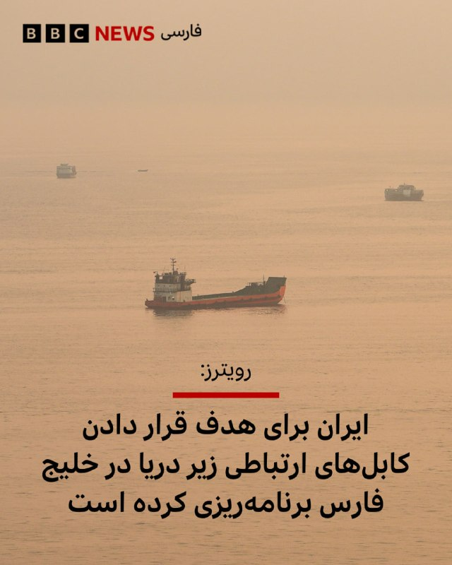

دو مقام ارشد امنیتی جمهوری اسلامی به رویترز گفتند که تهران طرح‌های مفصلی برای هدف قرار دادن کابل‌های ارتباطی زیردریایی در خلیج فارس تهیه کرده است که در صورت حمله دوباره آمریکا و اسرائیل به ایران ممکن است به اجرا گذاشته شوند.  

این دو مقام که نخواستند نامشان فاش شود، جزئیاتی درباره محل و شیوه اجرای احتمالی این حملات ارائه نکردند، اما یکی از آنها گفت که ایران ممکن است برای جلوگیری از تعمیر کابل‌های آسیب‌دیده نیز اقدام کند تا اختلال در ارتباطات، از جمله اینترنت، طولانی‌تر شود.  

یکی از این مقام‌ها هشدار داد که در صورت حمله مجدد به ایران، «دیگر هیچ خط قرمزی وجود نخواهد داشت» و اهداف احتمالی از کابل‌های زیردریایی تا پایگاه‌های نظامی، از جمله پایگاه‌های مخفی، را در بر خواهد گرفت.  
@[VahidHeadline](https://t.me/VahidHeadline/327858)  

📡 [@VahidOnline](https://t.me/VahidOnline)

· · ·

**🕒 ۱۴۰۵/۰۸/۰۲ ۱۵:۲۶** · [پست 78826](https://t.me/VahidOnline/78826)

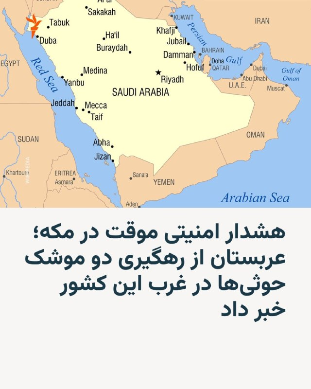

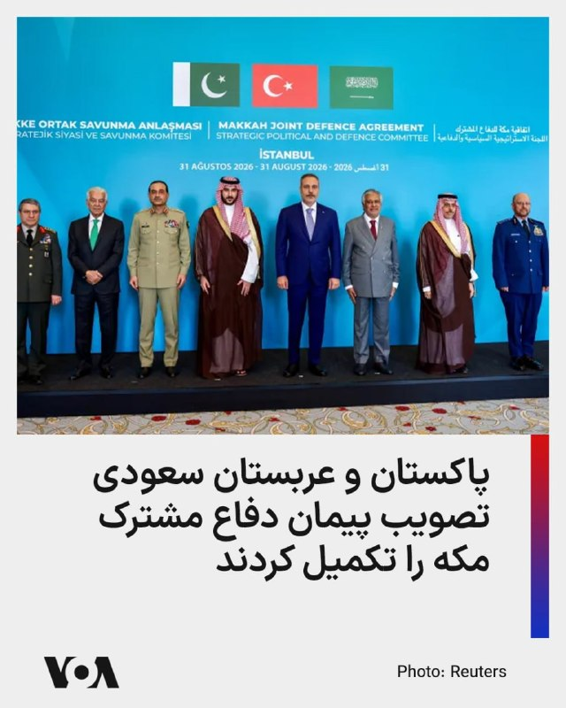

ائتلاف نظامی به رهبری عربستان سعودی روز شنبه دوم آبان اعلام کرد که دو موشک شلیک‌شده از سوی حوثی‌های یمن به سمت شهرهای طائف و ینبع در غرب این کشور را رهگیری کرده است.  

این خبر اندکی پس از آن منتشر شد که سازمان دفاع مدنی عربستان درباره «خطر احتمالی» در چند منطقه غربی این کشور، از جمله مکه، طائف و ینبع، هشدار صادر کرد و از ساکنان خواست به نزدیک‌ترین مکان امن پناه ببرند.  
این هشدارها دقایقی بعد لغو شدند.  
عربستان سعودی در هفته‌های اخیر بارها هدف حملات موشکی و پهپادی حوثی‌های مورد حمایت جمهوری اسلامی قرار گرفته است. این گروه که با دولت به‌رسمیت‌شناخته‌شدهٔ یمن، مورد حمایت عربستان، می‌جنگد، فرودگاه‌ها و تأسیسات نفتی این کشور را هدف قرار داده است.  
@[VahidHeadline](https://t.me/VahidHeadline/327896)  
سخنگوی وزارت امور خارجه پاکستان اعلام کرد پاکستان و عربستان سعودی روند تصویب پیمان دفاع مشترک مکه را به پایان رسانده‌اند و ترکیه مراحل قانونی خود را در پیش دارد.  
سجاد حیدر خان روز جمعه گفت: «پاکستان و پادشاهی عربستان سعودی پیش‌تر روند تصویب خود را تکمیل کرده‌اند.» او افزود ترکیه در چارچوب حقوقی داخلی خود «در حال انجام رویه‌های لازم» است.  
ترکیه پیمان را ۲۸ مهر برای تصویب به مجلس خود سپرد.  
@[VahidHeadline](https://t.me/VahidHeadline/327862)

… [ادامه در تلگرام](https://t.me/VahidOnline/78826)

· · ·

**🕒 ۱۴۰۵/۰۸/۰۲ ۱۵:۲۳** · [پست 78825](https://t.me/VahidOnline/78825)

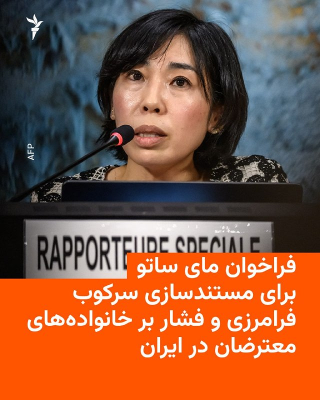

مای ساتو، گزارشگر ویژۀ سازمان ملل در امور حقوق بشر ایران، از قربانیان نقض حقوق بشر، خانواده‌های آن‌ها، مدافعان حقوق بشر، سازمان‌های مدنی و کارشناسان خواست اطلاعات و مستندات خود را برای تهیۀ گزارش بعدی او به شصت‌وچهارمین نشست شورای حقوق بشر سازمان ملل ارسال کنند.  

بر اساس فراخوان منتشرشده در وب‌سایت دفتر حقوق بشر سازمان ملل، این گزارش علاوه بر بررسی تحولات حقوق بشری ایران، به‌ویژه از شهریور ۱۴۰۵ به بعد، بر سرکوب فرامرزی، فشار بر خانواده‌های قربانیان، حقوق زنان و تبعیض جنسیتی متمرکز خواهد بود.  

در این فراخوان به اقداماتی از جمله تهدید، ارعاب، نظارت و آزار مخالفان جمهوری اسلامی در خارج از کشور، فشار بر بستگان آن‌ها در ایران، محدودیت‌های سفر، مصادرۀ اموال و استفاده از خدمات کنسولی برای اعمال فشار اشاره شده است.  

همچنین از خانواده‌های افرادی که بازداشت، ناپدید، کشته یا اعدام شده‌اند، خواسته شده است اطلاعاتی دربارۀ پیامدهای اقتصادی، اجتماعی، حقوقی و روانی این اقدامات ارائه کنند.  
@[VahidHeadline](https://t.me/VahidHeadline/327802)  

📡 [@VahidOnline](https://t.me/VahidOnline)

· · ·

**🕒 ۱۴۰۵/۰۸/۰۲ ۰۵:۲۹** · [پست 78824](https://t.me/VahidOnline/78824)

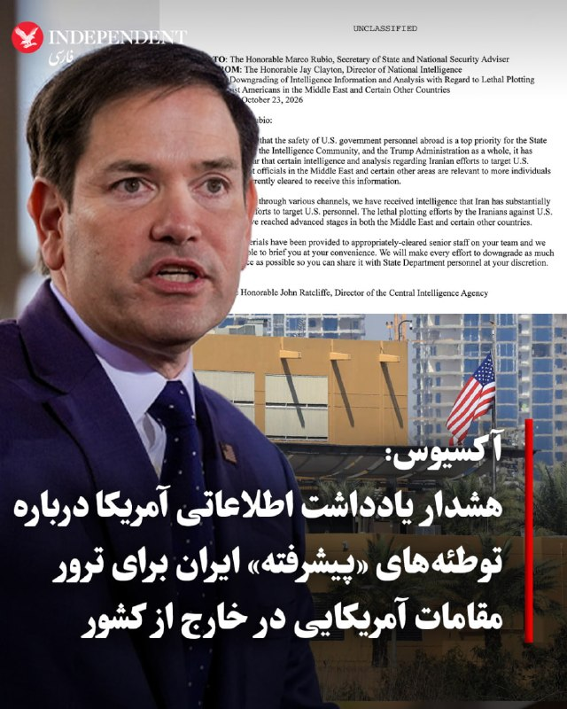

به گزارش «آکسیوس» و بر اساس یک یادداشت اطلاعاتی «غیرمحرمانه» به تاریخ اول آبان‌ماه (۲۳ اکتبر) که خطاب به مارکو روبیو، وزیر امور خارجه و مشاور امنیت ملی آمریکا نگاشته شده است، جی کلیتون، مدیر اطلاعات ملی، نسبت به «پیشرفت چشمگیر» طرح‌های ایران برای ترور مقام‌ها و شهروندان آمریکایی در خاورمیانه و برخی مناطق دیگر هشدار داد.  

 در این سند تأکید شده است که اطلاعات مربوط به این تهدیدات باید به دست طیف گسترده‌تری از کارکنان در معرض خطر برسد و به همین منظور، کلیتون پیشنهاد کرده است تا سطح محرمانگی این اسناد کاهش یابد.   

همزمان با انتشار این هشدار، «سی‌ان‌ان» گزارش داد که وزارت امور خارجه آمریکا در پی تهدیدات ناشی از توطئه‌های ایران و حملات حوثی‌ها، دستور کاهش کادر دیپلماتیک و خروج اعضای خانواده و کارکنان غیرضروری از سفارتخانه‌ها و کنسولگری‌های خود در عربستان سعودی (ریاض، جده و ظهران)، امارات متحده عربی، لبنان، قطر و اردن را صادر کرد.   
@[VahidOOnLine](https://t.me/VahidOOnLine/266544)  

📡 [@VahidOnline](https://t.me/VahidOnline)

· · ·

**🕒 ۱۴۰۵/۰۸/۰۲ ۰۱:۰۵** · [پست 78823](https://t.me/VahidOnline/78823)

پیام‌های دریافتی:  

وحید صدای انفجار شدید بندرکنگ ساعت 1  

سلام بندرکنگ دو صدا امد   
اولی شلیک بود   
دومی خونه لرزید نمیدونم برای شلیک بود یا انفجار  

\[از همون حوالی\]  
بندر لنگه همین الان صدا اومد  
یه جوری بود در خونه لرزید هرشب دارن با لانچر میزنن ایندفعه خیلی بد بود  

📡 [@VahidOnline](https://t.me/VahidOnline)

· · ·

**🕒 ۱۴۰۵/۰۸/۰۱ ۲۳:۳۸** · [پست 78822](https://t.me/VahidOnline/78822)

دونالد ترامپ، رئیس‌جمهوری آمریکا که برای سخنرانی در یک تجمع انتخاباتی به فلوریدا سفر کرده است، نسبت به اظهارات اخیر تام باراک ابراز بی‌اطلاعی کرد.  

باراک، سفیر آمریکا در ترکیه روز جمعه اول آبان در پاسخ به پرسشی درباره احتمال حمله آمریکا به ایران در روزهای آخر هفته، پاسخ داد «قطعاً».  
ترامپ در پاسخ به سوال خبرنگاری در این‌باره، به شوخی گفت: «به نظر می‌رسد سفیر ما در ترکیه مرد قدرتمندی است. اگر چنین برنامه‌ای وجود دارد من چیزی درباره‌اش نمی‌دانم.»  
@[VahidOOnLine](https://t.me/VahidOOnLine/266514)  
«دونالد ترامپ»، رییس‌جمهوری آمریکا روز جمعه در یک گردهمایی انتخاباتی در ایالت فلوریدا گفت: «ممکن است یک عملیات کوچک دیگر از نوع «خشم حماسی» انجام دهیم، یا اینکه آنها توافق کنند.»  

او در ادامه اضافه کرد: «اگر باهوش باشند، به‌سادگی می‌گویند بیایید وارد مذاکره جدی شویم. اما تردید دارم چنین کاری بکنند، چون شاید چندان باهوش نباشند.»  
@[VahidHeadline](https://t.me/VahidHeadline/327829)  

📡 [@VahidOnline](https://t.me/VahidOnline)

🎬 ویدیو: [مشاهده در تلگرام](https://t.me/VahidOnline/78822)

· · ·

**🕒 ۱۴۰۵/۰۸/۰۱ ۲۳:۳۷** · [پست 78821](https://t.me/VahidOnline/78821)

🖼 *(عکس بعد از ۲۴ ساعت حذف شده)*

یوهان واده‌فول، وزیر خارجۀ آلمان، اعلام کرد که این کشور همراه با فرانسه و بریتانیا آمادۀ مذاکره با جمهوری اسلامی برای جلوگیری از دستیابی این کشور به سلاح هسته‌ای است.  

او این اظهارات را پس از نشست هشت کشور اروپایی و منطقه‌ای در استانبول که روز جمعه اول آبان برگزار شد، بیان کرد.  

واده‌فول تأکید کرد که تهران باید برای دستیابی به راه‌حلی دیپلماتیک و پایدار آمادگی جدی نشان دهد.  

شهریور ماه سال جاری، این سه کشور همراه با آمریکا، به‌دلیل عدم پایبندی ایران به تعهدات خود در زمینه گزارش‌دهی هسته‌ای، قطعنامه‌ شورای حکام را برای نخستین بار طی ۲۰ سال گذشته به شورای امنیت ارجاع دادند.  

ایران از زمان حمله اسرائیل و آمریکا به تأسیسات مهم هسته‌ای خود، به بازرسان آژانس بین‌المللی انرژی اتمی اجازه بازگشت به سایت‌های بمباران‌شده را نداده است.  

ایران بیش از ۴۰۰ کیلوگرم اورانیوم با غنای بالا در اختیار دارد و پس از آسیب‌دیدن تأسیسات هسته‌ای در اصفهان، فردو و نطنز در جریان جنگ ۱۲ روزه پارسال، هنوز در مورد سرنوشت ذخایر اورانیوم غنی‌شده شفاف‌سازی نکرده است.  
@[VahidHeadline](https://t.me/VahidHeadline/327809)  

📡 [@VahidOnline](https://t.me/VahidOnline)

· · ·

**🕒 ۱۴۰۵/۰۸/۰۱ ۱۹:۱۳** · [پست 78820](https://t.me/VahidOnline/78820)

دونالد ترامپ، رئیس‌جمهوری آمریکا، روز جمعه اول آبان‌ماه در اظهاراتی درباره ایران گفت که واشنگتن می‌تواند «خیلی سریع» به وضعیت کنونی پایان دهد، اما این پرسش مطرح است که آیا باید «کار را یکسره کرد» یا اجازه داد ایران به‌تدریج تضعیف شود.  

ترامپ با توصیف ایران به‌عنوان «کشوری رو به زوال» گفت: «ما هر مقدار نفتی را که بخواهیم خارج می‌کنیم. این را در تنگه هرمز و با نیروی دریایی ما می‌بینید.» او افزود که آمریکا تنگه هرمز را برای ایران مسدود کرده است، اما دیگر کشورها همچنان می‌توانند از این مسیر نفت منتقل کنند.  

رئیس‌جمهوری آمریکا در ادامه گفت: «در واقع، هفته گذشته بیش از هر زمان دیگری نفت خارج کردیم، حتی بیشتر از دوران پیش از جنگ.» او این موضوع را یکی از اصلی‌ترین نقاط اختلاف توصیف کرد و گفت که اکنون آمریکا کنترل این وضعیت را در اختیار دارد.  

ترامپ با اشاره به شرایط اقتصادی ایران افزود: «آنها تورم دارند، پولی ندارند و سوال این است که آیا می‌خواهیم کار را یکسره کنیم یا فقط می‌خواهیم بگذاریم به‌تدریج از پا درآید؟»  

او در پایان گفت که آمریکا در حال دستیابی به تمام خواسته‌های خود است و میزان نفتی که اکنون از تنگه هرمز خارج می‌شود، از یک سال پیش بیشتر است.  
@[VahidOOnLine](https://t.me/VahidOOnLine/266483)  

📡 [@VahidOnline](https://t.me/VahidOnline)

🎬 ویدیو: [مشاهده در تلگرام](https://t.me/VahidOnline/78820)

· · ·

**🕒 ۱۴۰۵/۰۸/۰۱ ۱۹:۱۱** · [پست 78818](https://t.me/VahidOnline/78818)

🖼 *(عکس بعد از ۲۴ ساعت حذف شده)*

هاکان فیدان، وزیر خارجه ترکیه، گفت کشورهای شرکت‌کننده در نشست استانبول هم‌نظرند که حمله دوباره به ایران، جنگ و درگیری را در منطقه گسترش خواهد داد و دیپلماسی و گفت‌وگو تنها راه است.  

فیدان جمعه یکم آبان پس از نشست وزیران خارجه کشورهای اروپایی و منطقه در استانبول گفت همه حاضران خواستار جلوگیری از گسترش جنگ و برقراری هرچه زودتر آتش‌بس در خلیج فارس و اوکراین هستند. به گفته او، شرکت‌کنندگان تصمیم گرفتند این پیام را به یک شکل به همه طرف‌ها منتقل کنند.  

وزیر خارجه ترکیه همچنین خواستار بازگشایی فوری تنگه هرمز و توقف حملات به عربستان سعودی شد و گفت در نشست، ابزارها و روش‌های دیپلماتیک برای دستیابی به این اهداف به‌تفصیل بررسی شد.  

او اختلال در عبور از تنگه هرمز و باب‌المندب و از میان رفتن تقریبی امنیت کشتیرانی در دریای سیاه را عامل فشار گسترده بر تامین انرژی، مواد غذایی و تجارت آزاد جهان دانست.  
به گفته فیدان، جنگ اوکراین، وضعیت ایران و تنگه هرمز، حملات به عربستان سعودی و نقش بالقوه بی‌ثبات‌کننده اسرائیل در منطقه از موضوعات مذاکرات بود.  
@[VahidOOnLine](https://t.me/VahidOOnLine/266476)

… [ادامه در تلگرام](https://t.me/VahidOnline/78818)

🎬 ویدیو: [مشاهده در تلگرام](https://t.me/VahidOnline/78819?single)

· · ·

**🕒 ۱۴۰۵/۰۸/۰۱ ۱۹:۰۸** · [پست 78817](https://t.me/VahidOnline/78817)

تلویزیون دولتی اردن گزارش داد که در پی تیراندازی در داخل یک کلیسا، دست‌کم هفت نفر کشته و ۱۰ نفر زخمی شده‌اند.  

به گفته این رسانه، دو فرد مسلح به حاضران در کلیسایی در روستای حمود، در استان مرکزی کرک، تیراندازی کردند.  
مقام‌های امنیتی در تعقیب مظنونان هستند و هنوز جزئیات بیشتری از این حادثه منتشر نشده است.  
@[VahidHeadline](https://t.me/VahidHeadline/327781)  

📡 [@VahidOnline](https://t.me/VahidOnline)

🎬 ویدیو: [مشاهده در تلگرام](https://t.me/VahidOnline/78817)

· · ·

**🕒 ۱۴۰۵/۰۸/۰۱ ۱۶:۴۰** · [پست 78816](https://t.me/VahidOnline/78816)

🖼 *(عکس بعد از ۲۴ ساعت حذف شده)*

خبرگزاری فارس، وابسته به سپاه پاسداران، روز جمعه اول آبان ماه به نقل از یک مقام آگاه نزدیک به نیروی دریایی سپاه گزارش کرد، تردد «شناورهای متخلف» در تنگهٔ هرمز به‌طور کامل متوقف شده است.  

به ادعای فارس، این تحول پس از انهدام «سامانه‌های کمک‌ناوبری مورد استفاده این شناورها، اصابت به ۳ نفتکش در روز گذشته و انهدام یک نفتکش دیگر در شب گذشته» روی داده است.  

این مقام سپاه پاسداران هشدار داد در صورت ازسرگیری «قاچاق نفت»، برخورد با کشتی‌های متخلف و سامانه‌های فنی پشتیبان آن‌ها با شدت بسیار بیشتری انجام خواهد شد.  

به گفته این منبع نزدیک به سپاه: «مداخلهٔ مجدد نیروی هوایی ارتش آمریکا و حمایت از قاچاق نفت با پاسخی مستقیم و قاطع‌تر مواجه خواهد شد و مسئولیت عواقب آن برعهدهٔ ارتش آمریکا خواهد بود.»  
@[VahidOOnLine](https://t.me/VahidOOnLine/266419)  

📡 [@VahidOnline](https://t.me/VahidOnline)

· · ·

**🕒 ۱۴۰۵/۰۸/۰۱ ۱۶:۳۹** · [پست 78815](https://t.me/VahidOnline/78815)

🎬 ویدیو: [مشاهده در تلگرام](https://t.me/VahidOnline/78815)

· · ·

**🕒 ۱۴۰۵/۰۸/۰۱ ۱۶:۳۸** · [پست 78814](https://t.me/VahidOnline/78814)

🖼 *(عکس بعد از ۲۴ ساعت حذف شده)*

در پی حمله مسلحانه دو فرد فلسطینی به منطقه تقاطع یهودا در جنوب کرانه باختری، پنج اسرائیلی زخمی شدند که حال دو نفر از آن‌ها وخیم گزارش شده است. ارتش اسرائیل اعلام کرد نیروهای این کشور هر دو مهاجم را کشتند.  

به گفته نیروهای امدادی حاضر در محل، سه نفر دیگر از مجروحان این حمله که روز جمعه یکم آبان رخ داد، جراحات خفیف تا متوسط دارند.  

ارتش اسرائیل اعلام کرد نیروهای این کشور در تقاطع یهودا، واقع در جاده ۳۵، به سوی مهاجمان تیراندازی کردند و دو فرد مسلح فلسطینی را کشتند.  

ارتش اسرائیل همچنین از محاصره منطقه و ادامه عملیات جست‌وجو خبر داد.  

ایال زمیر، رییس ستاد ارتش اسرائیل، گفت اقدام سریع نیروهای این کشور از وقوع حمله‌ای گسترده‌تر جلوگیری کرده است.  

او در نشستی با افسران ارتش برای بررسی این حادثه گفت: «این حمله‌ای جدی بود. اقدام سریع نیروها از وقوع حمله‌ای حتی شدیدتر و آسیب بیشتر به غیرنظامیان و نیروهای امنیتی جلوگیری کرد.»  

زمیر افزود: «مقدار زیادی مهمات در خودرویی که تروریست‌ها با آن به محل حمله آمده بودند، پیدا شد. قرار بود از این مهمات برای اجرای حمله‌ای در مقیاس بزرگ‌تر استفاده شود.»  
@[VahidOOnLine](https://t.me/VahidOOnLine/266407)  
آپدیت:

… [ادامه در تلگرام](https://t.me/VahidOnline/78814)

· · ·

**🕒 ۱۴۰۵/۰۸/۰۱ ۱۶:۳۶** · [پست 78813](https://t.me/VahidOnline/78813)

🖼 *(عکس بعد از ۲۴ ساعت حذف شده)*

روزنامه وال‌استریت ژورنال، روز جمعه اول آبان ماه، گزارش داد مقام‌های تهران از طریق میانجی‌ها هشدار داده‌اند که در صورت حمله دوباره آمریکا، حملات به کشورهای حوزهٔ خلیج فارس گسترش خواهد یافت و زیرساخت‌های اقتصادی و اهداف غیرنظامی را نیز دربر خواهد گرفت.  

به گزارش این روزنامه، این تهدیدها شامل حمله به فرودگاه‌ها، خطوط لولهٔ نفت و دیگر زیرساخت‌های غیرنظامی در کشورهای منطقه است. مقام‌های جمهوری اسلامی همچنین گفته‌اند در صورت ازسرگیری حملات آمریکا، نیروهای آمریکایی را با شدت بیشتری هدف قرار خواهند داد و حتی ممکن است برای غرق کردن ناوهای جنگی آمریکا در منطقه تلاش کنند.  

وال‌استریت ژورنال می‌نویسد جمهوری اسلامی با وجود آسیب دیدن بخش بزرگی از زرادخانهٔ موشکی و پهپادی خود در حملات پیشین آمریکا و اسرائیل، همچنان توانایی انجام حملات تلافی‌جویانه را دارد. به ارزیابی تحلیلگران، تهران ممکن است از حملات نامتقارن برای وارد کردن خسارت به زیرساخت‌های انرژی و ارتباطی منطقه استفاده کند.  
@[VahidOOnLine](https://t.me/VahidOOnLine/266412)  

📡 [@VahidOnline](https://t.me/VahidOnline)

· · ·

**🕒 ۱۴۰۵/۰۸/۰۱ ۱۶:۳۵** · [پست 78812](https://t.me/VahidOnline/78812)

🖼 *(عکس بعد از ۲۴ ساعت حذف شده)*

با ادامه تنش‌ها در خاورمیانه و انتشار گزارش‌هایی از احتمال حمله آمریکا و اسرائیل به ایران، قیمت جهانی نفت روز جمعه اول آبان، با عبور از مرز ۱۱۴ دلار، به بالاترین میزان در پنج ماه اخیر رسید.  

قیمت نفت برنت روز جمعه در معاملات بازارهای اروپایی با بیش از یک درصد افزایش نسبت به روز گذشته هر بشکه ۱۱۴ دلار و ۵۰ سنت معامله شد. این بالاترین قیمت این نوع نفت از ماه مه تا کنون محسوب می‌شود.  

ادامهٔ حملات حوثی‌های تحت حمایت ایران به زیرساخت‌های انرژی عربستان سعودی و افزایش گمانه‌زنی‌ها از دور تازه حملات اسرائیل و آمریکا به ایران پس از انتخابات میان‌دوره‌ای آمریکا به عنوان مهم‌ترین دلایل افزایش قیمت نفت از سوی کارشناسان مطرح شده است.  

همزمان قیمت گاز طبیعی در اروپا روز جمعه چهار درصد دیگر جهش کرد و به این ترتیب، مجموع افزایش قیمت آن در ماه جاری میلادی به حدود ۳۰ درصد رسید.  
@[VahidHeadline](https://t.me/VahidHeadline/327753)  

📡 [@VahidOnline](https://t.me/VahidOnline)

· · ·

**🕒 ۱۴۰۵/۰۸/۰۱ ۱۶:۳۴** · [پست 78811](https://t.me/VahidOnline/78811)

در پی جاری شدن سیلاب در شهرستان‌های سلماس و ماکو، تا زمان انتشار این خبر دست‌کم سه نفر از جمله یک دختر ده ساله جان باخته‌اند.  
به گفته مدیر عامل جمعیت هلال‌احمر آذربایجان غربی، ۲۴ منزل مسکونی در سلماس و ماکو دچار آب‌گرفتگی شده‌اند.   
عملیات جست‌وجو و نجات همچنان ادامه دارد.  
@[VahidHeadline](https://t.me/VahidHeadline/327748)  

📡 [@VahidOnline](https://t.me/VahidOnline)

🎬 ویدیو: [مشاهده در تلگرام](https://t.me/VahidOnline/78811)

· · ·

**🕒 ۱۴۰۵/۰۸/۰۱ ۰۶:۰۱** · [پست 78810](https://t.me/VahidOnline/78810)

دونالد ترامپ، رئیس‌جمهوری آمریکا، در ادامه حضور در کارزارهای انتخاباتی جمهوری‌خواهان پیش از انتخابات میان‌دوره‌ای، بار دیگر گفت درگیری با ایران به‌زودی پایان خواهد یافت و پس از آن قیمت نفت و بنزین کاهش می‌یابد.  
ترامپ در سخنرانی انتخاباتی جمهوری‌خواهان در کارولینای جنوبی گفت: «کار ایران هم خیلی زود تمام خواهد شد؛ به هر طریقی که باشد. برای من تقریبا اهمیتی ندارد که این اتفاق از چه راهی بیفتد، اما به هر حال، این موضوع خیلی زود به پایان خواهد رسید. بعد از آن، قیمت بنزین و نفت شما به‌شدت کاهش خواهد یافت.»  
@[VahidOOnLine](https://t.me/VahidOOnLine/266387)  

📡 [@VahidOnline](https://t.me/VahidOnline)

🎬 ویدیو: [مشاهده در تلگرام](https://t.me/VahidOnline/78810)

· · ·

**🕒 ۱۴۰۵/۰۷/۳۰ ۱۹:۳۷** · [پست 78808](https://t.me/VahidOnline/78808)

🖼 *(عکس بعد از ۲۴ ساعت حذف شده)*

اسکات بسنت، وزیر خزانه‌داری آمریکا، با انتشار تصاویر ماهواره‌ای قدیمی و جدید از پایانه نفتی جزیرۀ خارگ، در حساب خود در شبکۀ ایکس نوشت که برخلاف گذشته، اکنون هیچ نفتکش حامل نفت خامی در این پایانه دیده نمی‌شود.  

او روز پنج‌شنبه ۳۰ مهر نوشت: «جزیرۀ خارگ اکنون چیزی جز نمادی از تنها چیزی نیست که حکومت ایران هنوز می‌تواند تولید کند: شکست.»  

بسنت افزود که عملیات «طرد اقتصادی» آمریکا در حال قطع شریان درآمدهای نفتی جمهوری اسلامی است و منابع مالی مورد استفاده برای حمایت از تروریسم، تأمین تجهیزات برنامۀ هسته‌ای و زندگی تجملی مقام‌های ارشد سپاه پاسداران را محدود می‌کند.  

این اظهارات در ادامۀ سخنان روز سه‌شنبۀ وزیر خزانه‌داری آمریکاست که گفته بود از ماه اوت تاکنون هیچ بارگیری نفتی در تأسیسات جزیرۀ خارگ مشاهده نشده و ایران دیگر محمولۀ نفتی روی آب ندارد.  

بسنت پیش‌تر نیز اعلام کرده بود که ایران در ماه سپتامبر حتی یک بشکه نفت خام روی نفتکش‌ها بارگیری نکرده است؛ موضوعی که داده‌های شرکت‌های ردیابی نفتکش نیز آن را تأیید کرده بودند.  
@[VahidHeadline](https://t.me/VahidHeadline/327632)  

📡 [@VahidOnline](https://t.me/VahidOnline)

· · ·
