# 📡 فید کانال‌های تلگرام

آخرین بررسی: ۱۴۰۵/۰۸/۳۰ ۲۰:۵۰ (به وقت تهران)

هر ساعت به‌روز می‌شود. از هر کانال ۲۰ پست آخر نمایش داده می‌شود؛ عکس‌ها ۲۴ ساعت می‌مانند، برای ویدیو فقط متن و لینک پست آمده است. متن همه‌ی پست‌ها در پوشه‌ی [archive](archive/) نگه‌داری می‌شود.

## فهرست کانال‌ها

- [irnetmonitor](#irnetmonitor) · آخرین پست: ۱۴۰۵/۰۸/۲۷ ۱۳:۳۹
- [CyberNigga2](#cybernigga2) · آخرین پست: ۱۴۰۵/۰۸/۳۰ ۱۵:۵۴
- [kaavoush](#kaavoush) · آخرین پست: ۱۴۰۵/۰۸/۳۰ ۱۹:۵۴
- [iaghapour](#iaghapour) · آخرین پست: ۱۴۰۵/۰۸/۳۰ ۱۹:۴۲
- [MatinSenPaii](#matinsenpaii) · آخرین پست: ۱۴۰۵/۰۸/۳۰ ۲۰:۱۹
- [whitedns](#whitedns) · آخرین پست: ۱۴۰۵/۰۸/۳۰ ۱۸:۱۰
- [ircfspace](#ircfspace) · آخرین پست: ۱۴۰۵/۰۸/۲۹ ۲۳:۴۴
- [patt_channel_x](#patt_channel_x) · آخرین پست: ۱۴۰۵/۰۸/۲۶ ۰۵:۴۴
- [mahsa_net](#mahsa_net) · آخرین پست: ۱۴۰۵/۰۸/۳۰ ۲۰:۳۴
- [VahidOnline](#vahidonline) · آخرین پست: ۱۴۰۵/۰۸/۳۰ ۱۸:۲۶

---

## irnetmonitor

[کانال در تلگرام](https://t.me/irnetmonitor) · [آرشیو متن](archive/irnetmonitor/)

**🕒 ۱۴۰۵/۰۸/۲۷ ۱۳:۳۹** · [پست 5247](https://t.me/irnetmonitor/5247)

از عجایب جمهوری اسلامی اینکه بدون هیچ vpn و پروکسی و dns گذاشته مردم بی پناه ایرانی بدون هیچ مشکلی گیم رو دانلودش کنند ، تازه برخی اپراتور ها مثل مبین نت بسته گیگ پک ۲۱۲ گیگ ۲ روزه برای دانلود gta دادن !

· · ·

**🕒 ۱۴۰۵/۰۸/۲۷ ۱۳:۳۷** · [پست 5246](https://t.me/irnetmonitor/5246)

🖼 *(عکس بعد از ۲۴ ساعت حذف شده)*

بالاخره بعد از ۱۳ سال انتظارها به پایان رسید… ❤️

· · ·

**🕒 ۱۴۰۵/۰۸/۲۶ ۰۳:۱۴** · [پست 5245](https://t.me/irnetmonitor/5245)

اختلال دقایقی پیش به طور کامل رفع شد

· · ·

**🕒 ۱۴۰۵/۰۸/۲۶ ۰۲:۲۷** · [پست 5244](https://t.me/irnetmonitor/5244)

🖼 *(عکس بعد از ۲۴ ساعت حذف شده)*

فوری :   
اینترنت کشور از دقایقی پیش دچار پکت لاس 15 درصدی شده است ،  
دلیل : نامشخص  
تجربه های قبلی : قطعی فیبر اذربایجان/ارمنستان/بروزرسانی فیلترینگ

· · ·

**🕒 ۱۴۰۵/۰۸/۲۰ ۱۶:۰۵** · [پست 5241](https://t.me/irnetmonitor/5241)

🖼 *(عکس بعد از ۲۴ ساعت حذف شده)*

شبکه ایرانسل  تهران از صبح امروز دچار قطعی های گسترده اینترنت بین الملل شده  ( شبکه داخلی مشکلی ندارد ) . مشخص نیست دقیقا چه کاری دارن انجام میدهند

· · ·

**🕒 ۱۴۰۵/۰۸/۱۳ ۱۲:۲۳** · [پست 5240](https://t.me/irnetmonitor/5240)

خوب به سلامتی دموکرات ها رای اکثریت رو اوردن و کاخ سفید رو حسینیه کردین،  مبارکتون باشه خطر جنگ هم دور شد ازتون ، آقای وزارت قطع ارتباطات حالا وقتش نیست یکم نت رو شل کنید؟ اختلال نندازید و از این جور پدرسگ بازیا؟

· · ·

**🕒 ۱۴۰۵/۰۸/۰۹ ۱۸:۳۰** · [پست 5239](https://t.me/irnetmonitor/5239)

↪️ فوروارد از Pishdad Network🫡

**اعلام وضعیت زرد اینترنت ⚠️⚠️⚠️**  
(این هشدار برای دو هفته آینده است)  

در شرایط فعلی توصیه می‌شود:  

- ترافیک سرورهای اندازه یک هفته حداقل شارژ داشته باشید.  
- حساب اعتباری سایت برای مواقع ضروری شارژ داشته باشد.  
- سرورهای مورد نیاز چه ایران و خارج زودتر تهیه کنید.  

شبکه پیشداد

· · ·

**🕒 ۱۴۰۵/۰۸/۰۹ ۱۸:۱۸** · [پست 5238](https://t.me/irnetmonitor/5238)

[iran internet monitor](https://t.me/irnetmonitor) pinned «⚠️ اطلاعیه فوری  طبق اطلاعات دریافتی از چند دیتاسنتر معتبر و پیگیری‌های انجام‌شده، احتمال اعمالل قطعی اینترنت بین‌الملل از هفته آینده مطرح شده است.  با توجه به احتمال بروز اختلال در دسترسی به اینترنت و سرویس‌های وابسته، توصیه می‌شود در صورت وابستگی فعالیت‌های…»

· · ·

**🕒 ۱۴۰۵/۰۸/۰۹ ۱۸:۱۸** · [پست 5237](https://t.me/irnetmonitor/5237)

⚠️ اطلاعیه فوری  

طبق اطلاعات دریافتی از چند دیتاسنتر معتبر و پیگیری‌های انجام‌شده، احتمال اعمالل قطعی اینترنت بین‌الملل از هفته آینده مطرح شده است.  

با توجه به احتمال بروز اختلال در دسترسی به اینترنت و سرویس‌های وابسته، توصیه می‌شود در صورت وابستگی فعالیت‌های کاری یا تجاری شما به اینترنت، اقدامات ضروری از جمله تهیه نسخه پشتیبان (Backup) از اطلاعات، ذخیره فایل‌های مهم و انجام امور ضروری را در اسرع وقت انجام دهید.

· · ·

**🕒 ۱۴۰۵/۰۸/۰۶ ۰۲:۰۹** · [پست 5236](https://t.me/irnetmonitor/5236)

عرزشی ، ساندیسی ، پاسدار ، حمال جمهوری اسلامی ،  زوزه بکش

🎬 ویدیو: [مشاهده در تلگرام](https://t.me/irnetmonitor/5236)

· · ·

**🕒 ۱۴۰۵/۰۸/۰۶ ۰۱:۵۷** · [پست 5235](https://t.me/irnetmonitor/5235)

🔴 #خبر\_فوری  
لحظاتی پیش کانال 14 اسرائیل نتایج به‌روزرسانی شده از انتخابات اسرائیل را منتشر کرد:  
ائتلاف به رهبری نتانیاهو 61 کرسی را به دست آورده است و دولت بعدی اسرائیل را تشکیل خواهد داد.

· · ·

**🕒 ۱۴۰۵/۰۸/۰۶ ۰۱:۵۱** · [پست 5234](https://t.me/irnetmonitor/5234)

خوب به نظر باید جمهوری اسلامی دوباره چیزایی که باز کرده رو ببنده  چون بنیامین نتانیاهو برنده انتخابات شد و کون جمهوری اسلامی رو به زودی هدف خواهد گرفت 😂

· · ·

**🕒 ۱۴۰۵/۰۸/۰۵ ۱۸:۵۶** · [پست 5233](https://t.me/irnetmonitor/5233)

فوری :  
از دقایقی پیش گشایش هایی در پروتکل های مسدود شده هفته های اخیر به مقصد دیتاسنتر های معروف در  اکثر اپراتور ها انجام شده و از وضعیت انقباضی  و جنگی خارج شد  

تست شده با همراه اول ، ایرانسل ، رایتل در تهران

· · ·

**🕒 ۱۴۰۵/۰۸/۰۳ ۱۶:۲۴** · [پست 5232](https://t.me/irnetmonitor/5232)

🖼 *(عکس بعد از ۲۴ ساعت حذف شده)*

پینگ گیتوی ابراروان ریجن اسیاتکشونو مشاهده فرمایید... تست با شبکه 5g ایرانسل ! نوار قلب یه مریض رو به موت هم اینطوری نیست والا

· · ·

**🕒 ۱۴۰۵/۰۸/۰۳ ۱۶:۲۱** · [پست 5231](https://t.me/irnetmonitor/5231)

🖼 *(عکس بعد از ۲۴ ساعت حذف شده)*

در این روزها شاهد تجربه  پر اختلال ترین و بی کیفیت ترین اینترنت در ایران هستیم ... ، فقط وصلیم ... عملا هیچکار نمیشه کرد  کیفیت منفی صفر

· · ·

**🕒 ۱۴۰۵/۰۸/۰۲ ۱۶:۵۵** · [پست 5230](https://t.me/irnetmonitor/5230)

↪️ فوروارد از منیجیت | Manageit

**⭕️ گزارش شبکه:**  
بررسی ترافیک CDN منیجیت نشان میدهد ارتباطات زیرساخت در حال تست فرآیندهایی است که VPNهای داخل شبکه ایران را شناسایی و مسدود کند، احتمالا قرار است بعد از قطع اینترنت بین المللی این سیاست‌ها به صورت کامل بر روی شبکه داخلی اجرایی شوند، همچنین در چند روز اخیر مسدود شدن آی پی ها و دامنه‌هایی که روی CDN ها و سرورهای داخل ایران هستند شدت گرفته است.

· · ·

**🕒 ۱۴۰۵/۰۸/۰۱ ۱۲:۰۵** · [پست 5229](https://t.me/irnetmonitor/5229)

مهملات و توهمات ایرانسل در مورد افزایش تعرفه ها   

[https://irancell.ir/b/332391/internet-price-change-aban-1405](https://irancell.ir/b/332391/internet-price-change-aban-1405)

· · ·

**🕒 ۱۴۰۵/۰۸/۰۱ ۰۲:۴۸** · [پست 5228](https://t.me/irnetmonitor/5228)

↪️ فوروارد از شهر سخت افزار

🖼 *(عکس بعد از ۲۴ ساعت حذف شده)*

**🔴 اینترنت موبایل از بامداد جمعه گران شد؟**  

📱 ظاهراً از بامداد امروز جمعه ۱ آبان، قیمت بسته‌های اینترنت موبایل افزایش پیدا کرده و کاربران با تعرفه‌های بالاتری نسبت به قبل روبه‌رو شده‌اند.  

💸 بررسی‌های اولیه حاکی از افزایش چشمگیر قیمت برخی بسته‌هاست؛ با این حال هنوز اطلاعیه رسمی درباره این تغییر قیمت منتشر نشده است.  

⚠️ فعلاً جزئیات میزان افزایش قیمت و علت آن مشخص نیست و باید دید اپراتورها یا نهادهای مسئول چه توضیحی ارائه می‌کنند.  

[**🌐در شهرسخت‌افزار بخوانید**](https://www.shahrsakhtafzar.com/fa/news/internet-operator/62711-mobile-internet-package-price-hike-iran)  

**🆔**[**@ShahrSakhtAfzar**](https://t.me/ShahrSakhtAfzar)

· · ·

**🕒 ۱۴۰۵/۰۷/۲۹ ۱۸:۰۴** · [پست 5227](https://t.me/irnetmonitor/5227)

↪️ فوروارد از زومان | Zoomon

🖼 *(عکس بعد از ۲۴ ساعت حذف شده)*

**قطع فوری اینترنت در صورت آغاز جنگ جدید؛ دستور صادر شد**  

بر اساس اطلاعات دریافتی زومان، نهادهای بالادستی در نامه‌ای رسمی و الزام‌آور تأکید کرده‌اند که در صورت آغاز جنگ جدید، دسترسی کاربران در ایران به اینترنت بین‌الملل باید بلافاصله قطع شود.  

این تصمیم به عنوان یک تکلیف اجرایی تعیین شده است تا در شرایط درگیری نظامی، دسترسی به شبکه جهانی قطع شود.  

[🌐 در زومان بخوانید](https://www.zoomon.ir/behind-the-news/9226-iran-war-internet-blackout-order/?utm_source=Telegram&amp;utm_term=pr86wljqv)  

🆔 [@thezoomon](https://t.me/thezoomon)

· · ·

**🕒 ۱۴۰۵/۰۷/۲۹ ۱۴:۳۲** · [پست 5226](https://t.me/irnetmonitor/5226)

وضعیت جیتر و پینگ بعد از هر بار مسدودی vpn ها بسیار خوب و استییل میشه ( مثل امروز )   

دلایل این وضعیت:   
۱- ترافیک عظیم vpn ها از شبکه موقتا خارج میشه و بعد از چند روز vpn پرووایدر ها مجددا با روش جدید برمیگردند و دوباره شبکه رو بهم میریزن   

۲- پهنای باند بین الملل ایران محدوده و وزارت هیچ تصمیمی جهت افزایش آن با این وضعیت قیمت دلار ندارد

· · ·

---

## CyberNigga2

[کانال در تلگرام](https://t.me/CyberNigga2) · [آرشیو متن](archive/cybernigga2/)

**🕒 ۱۴۰۵/۰۸/۳۰ ۱۵:۵۴** · [پست 5295](https://t.me/CyberNigga2/5295)

I have 2 sides:

🎬 ویدیو: [مشاهده در تلگرام](https://t.me/CyberNigga2/5295?single)

🎬 ویدیو: [مشاهده در تلگرام](https://t.me/CyberNigga2/5296?single)

· · ·

**🕒 ۱۴۰۵/۰۸/۳۰ ۱۵:۲۱** · [پست 5293](https://t.me/CyberNigga2/5293)

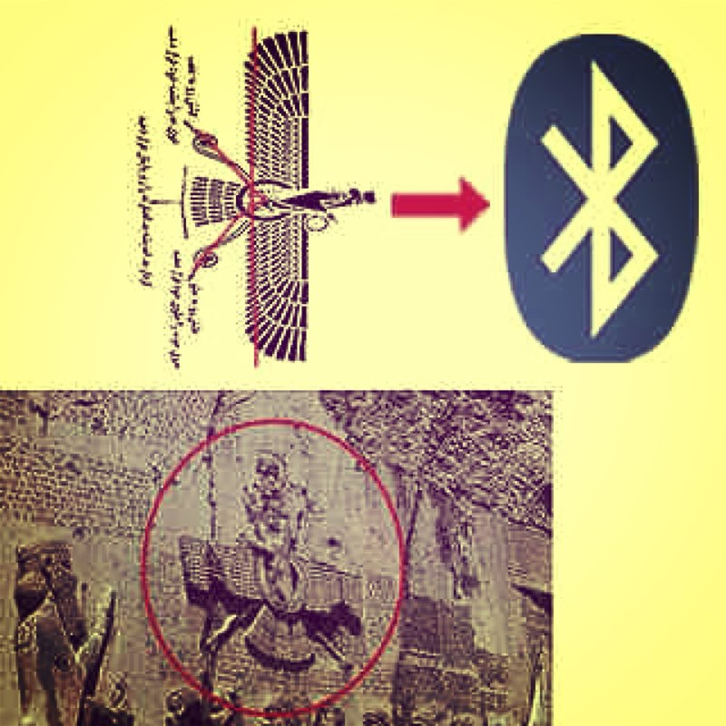


· · ·

**🕒 ۱۴۰۵/۰۸/۲۷ ۱۶:۲۴** · [پست 5292](https://t.me/CyberNigga2/5292)

🖼 *(عکس بعد از ۲۴ ساعت حذف شده)*

· · ·

**🕒 ۱۴۰۵/۰۸/۲۷ ۱۳:۳۲** · [پست 5291](https://t.me/CyberNigga2/5291)

🖼 *(عکس بعد از ۲۴ ساعت حذف شده)*

· · ·

**🕒 ۱۴۰۵/۰۸/۲۰ ۲۳:۰۰** · [پست 5290](https://t.me/CyberNigga2/5290)

🎬 ویدیو: [مشاهده در تلگرام](https://t.me/CyberNigga2/5290)

· · ·

**🕒 ۱۴۰۵/۰۸/۱۹ ۰۱:۴۲** · [پست 5289](https://t.me/CyberNigga2/5289)

Unc twerking like crazy 😭

🎬 ویدیو: [مشاهده در تلگرام](https://t.me/CyberNigga2/5289)

· · ·

**🕒 ۱۴۰۵/۰۸/۱۸ ۱۲:۱۵** · [پست 5288](https://t.me/CyberNigga2/5288)

🖼 *(عکس بعد از ۲۴ ساعت حذف شده)*

· · ·

**🕒 ۱۴۰۵/۰۸/۱۵ ۲۱:۲۹** · [پست 5287](https://t.me/CyberNigga2/5287)

Individual 🫩

🎬 ویدیو: [مشاهده در تلگرام](https://t.me/CyberNigga2/5287)

· · ·

**🕒 ۱۴۰۵/۰۸/۱۴ ۱۴:۰۱** · [پست 5286](https://t.me/CyberNigga2/5286)

🖼 *(عکس بعد از ۲۴ ساعت حذف شده)*

· · ·

**🕒 ۱۴۰۵/۰۸/۱۲ ۱۶:۴۹** · [پست 5285](https://t.me/CyberNigga2/5285)

🖼 *(عکس بعد از ۲۴ ساعت حذف شده)*

· · ·

**🕒 ۱۴۰۵/۰۸/۱۱ ۰۰:۲۵** · [پست 5284](https://t.me/CyberNigga2/5284)

Life update: i'm losing my shit

· · ·

**🕒 ۱۴۰۵/۰۸/۰۹ ۰۰:۵۹** · [پست 5283](https://t.me/CyberNigga2/5283)

This nigga needs a game developer (C#/C++) without being mentally challenged:  

[@CatwomansHusband](https://t.me/CatwomansHusband)

· · ·

**🕒 ۱۴۰۵/۰۷/۲۹ ۲۲:۵۵** · [پست 5282](https://t.me/CyberNigga2/5282)

🖼 *(عکس بعد از ۲۴ ساعت حذف شده)*

ظاهرا پاکستانی ها تو دانلود پورن با پروکسی ازمون زدن جلو 😢

· · ·

**🕒 ۱۴۰۵/۰۷/۲۹ ۲۲:۳۲** · [پست 5281](https://t.me/CyberNigga2/5281)

فقط چیزی که رو مخم رفته اینه که پروکسی با اینترنت شاتل تست میشه. کلا پروکسی و VPN های مستقیم (بدون تانل) با همه اوپراتور ها جواب نیستن.   

دلم میخواست پروکسی ها، با تمام اینترنت ها تست بشن و نتیجه تو همون پست مشخص باشه اما فعلا راهی ندارم براش ندارم که خودم پیاده کنم. اما شاید با کمک داوطلب بتونم وضعیت هر اوپراتور و منطقه رو مشخص کنیم. اگه نیاز شد پیام میزارم تو کانال

· · ·

**🕒 ۱۴۰۵/۰۷/۲۹ ۲۲:۲۷** · [پست 5280](https://t.me/CyberNigga2/5280)

سیستم اتو پروکسی راه اندازی شد. ازین به بعد هر پروکسی که فیلتر بشه، اتوماتیک 2تا پروکسی جدید جاشو میگیره.  

اگرم به تلگرام برای گرفتن پروکسی های جدید دسترسی پیدا کنید، میتونید ازین وبسایت استفاده کنید:  

[https://elaproxy.github.io](https://elaproxy.github.io/)  

کانال پروکسی:  

[@Ela\_Proxy](https://t.me/Ela_Proxy)

· · ·

**🕒 ۱۴۰۵/۰۷/۲۹ ۱۷:۲۰** · [پست 5278](https://t.me/CyberNigga2/5278)

🖼 *(عکس بعد از ۲۴ ساعت حذف شده)*

What in the actual fuck

· · ·

**🕒 ۱۴۰۵/۰۷/۲۶ ۱۶:۴۰** · [پست 5277](https://t.me/CyberNigga2/5277)

جالبه چنتا پروکسی جدید که گذاشتم رندوم اختلال افتاد. اما همین باعث شد یه ایده ای به سرم بزنه. دارم رو یه سیستمی کار میکنم که هر پروکسی که فیلتر بشه، اتوماتیک 2 تا جدید تو کانال بزاره.  

خوبیش اینه هر ساعت از روز مشکلی واسه هر پروکسی پیش بیاد، اتوماتیک پروکسی جدید میاد تو کانال:  

🫆 [@Ela\_Proxy](https://t.me/Ela_Proxy)

· · ·

**🕒 ۱۴۰۵/۰۷/۲۶ ۱۵:۳۴** · [پست 5276](https://t.me/CyberNigga2/5276)

🖼 *(عکس بعد از ۲۴ ساعت حذف شده)*

· · ·

**🕒 ۱۴۰۵/۰۷/۲۶ ۱۴:۱۱** · [پست 5275](https://t.me/CyberNigga2/5275)

🖼 *(عکس بعد از ۲۴ ساعت حذف شده)*

· · ·

**🕒 ۱۴۰۵/۰۷/۲۵ ۲۲:۵۵** · [پست 5274](https://t.me/CyberNigga2/5274)

اسمش شد:  

[@Ela\_Proxy](https://t.me/Ela_Proxy)  

هر 10 دقیقه ام پروکسی ها خودکار خودشون با اینترنت شاتل تست میشن و پست آپدیت میشه

· · ·

---

## kaavoush

[کانال در تلگرام](https://t.me/kaavoush) · [آرشیو متن](archive/kaavoush/)

**🕒 ۱۴۰۵/۰۸/۳۰ ۱۹:۵۴** · [پست 11255](https://t.me/kaavoush/11255)

عباس عراقچی:  

محاصره ایران کاملا غیرقانونی است و گمانه زنی و شایعه زیاد است. **باید به گفتگوهایی که در منطقه وجود دارد فرصت دهیم** و همین طور که واسطه‌ها دارند ادامه پیدا کند. **امیدوارم رفع محاصره از یک مسیر عقلایی صورت بگیرد.**  

پ.ن: عراقچی عملاً ایده خیالی فریدون‌وار شکستن محاصره دریایی را رد کرد، **حداقل فعلا**

🎬 ویدیو: [مشاهده در تلگرام](https://t.me/kaavoush/11255)

· · ·

**🕒 ۱۴۰۵/۰۸/۳۰ ۱۹:۱۴** · [پست 11254](https://t.me/kaavoush/11254)

مدیرعامل شرکت توانیر از قطعی برنامه‌ریزی شده برق از ابتدای آذرماه خبر داد.

🎬 ویدیو: [مشاهده در تلگرام](https://t.me/kaavoush/11254)

· · ·

**🕒 ۱۴۰۵/۰۸/۳۰ ۱۹:۰۱** · [پست 11253](https://t.me/kaavoush/11253)

ترامپ:  

حکیم جفریز فردی باهوش و منطقی است. در مورد چاک شومر هم همین‌طور.

🎬 ویدیو: [مشاهده در تلگرام](https://t.me/kaavoush/11253)

· · ·

**🕒 ۱۴۰۵/۰۸/۳۰ ۱۷:۲۵** · [پست 11252](https://t.me/kaavoush/11252)

↪️ فوروارد از Minas Tirith

ویدئوی منتشر شده از سوی پدافند ارتش و لحظه رصد جنگنده اف۱۶ امریکایی و شلیک به سمت آن   

موشک با فاصله چند صد متری نسبت به جنگنده منفجر شد  

[@Minas\_Tirith2024](https://t.me/Minas_Tirith2024)

🎬 ویدیو: [مشاهده در تلگرام](https://t.me/kaavoush/11252)

· · ·

**🕒 ۱۴۰۵/۰۸/۳۰ ۱۶:۵۹** · [پست 11251](https://t.me/kaavoush/11251)

میانگین نرخ بنزین در آمریکا به ۳/۶۶ دلار به ازای هر گالن رسید که کمتر از ۲۰ درصد نسبت به سال گذشته افزایش نشان می‌دهد اما گازوئیل با قیمت ۵/۸۶ دلار به ازای هر گالن همچنان بیش از ۵۰ درصد افزایش نشان می‌دهد.

· · ·

**🕒 ۱۴۰۵/۰۸/۳۰ ۱۶:۲۲** · [پست 11250](https://t.me/kaavoush/11250)


تقریباً یک سال پس از انتخاب زهران ممدانی به سمت شهرداری نیویورک و اجرای برنامه تثبیت اجاره‌بها برای بخشی از واحدهای مسکونی، متوسط اجاره‌بها در کل شهر بیش از ۴/۵ درصد افزایش یافته است. این افزایش در منهتن ۸/۳ درصد بوده است. پیش‌بینی می‌شود اگر قانون تثبیت اجاره‌بها برای سال‌های آینده هم تمدید شود، رشد کلی اجاره‌بها بدتر هم بشود. ممدانی در عمل از بسیاری از وعده‌های بلند پروازانه دیگر خود مثل اتوبوس مجانی و مهد کودک رایگان عقب‌نشینی کرده و طرح‌هایی مثل ایجاد فروشگاه‌های دولتی با سود صفر هم بسیار کند پیش می‌رود. با این حال محبوبیت ممدانی در شهر نیویورک طبق آخرین نظرسنجی‌ها در حال افزایش است.

· · ·

**🕒 ۱۴۰۵/۰۸/۳۰ ۱۵:۴۸** · [پست 11246](https://t.me/kaavoush/11246)

↪️ فوروارد از Exciton Missile Program


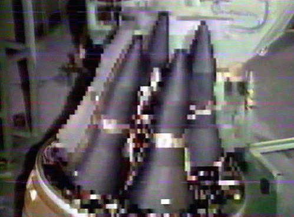


کلیپ جالبی از ورود به جو RV موشک قاره پیمای فرانسوی که نمایش دهنده چگونگی پایداری دینامیکی و میرا شدن ناپایداری یک RV دامن دار در اتمسفر است. این دو تصویر قدیمی هم از RV های دامن دار سرجنگی گرما هسته ای TN-70  یا TN-71  فرانسه که اکنون سرجنگی های جدیدتری ساخته اند.  

[**@Exciton\_missile\_program**](https://t.me/Exciton_missile_program) 🚀

🎬 ویدیو: [مشاهده در تلگرام](https://t.me/kaavoush/11246?single)

· · ·

**🕒 ۱۴۰۵/۰۸/۳۰ ۱۲:۴۹** · [پست 11245](https://t.me/kaavoush/11245)

در همین زمینه صحبت‌های عمار حکیم را ببینید که چندی پیش درباره تحریم‌های آمریکا علیه ایران و رفتاری که عراق باید نسبت به آن داشته باشد صحبت کرده بود. فاصله گرفتن خانواده پرنفوذ حکیم موسس مجلس اعلای اسلامی و گروه‌هایی مثل سازمان بدر از ایران که اساساً در خود ایران و در زمان جنگ ایران و عراق شکل گرفته بودند وضعیت را به خوبی مشخص می‌کند. نفوذ ایران در عراق، چند لایه و بسیار گسترده است اما از گروه‌های کاملاً وابسته به ایران، چیز زیادی جز کتائب حزب‌الله یا جنبش النجبا باقی نمانده‌اند که کاملاً مطیع و گوش به فرمان تهران باشند.

🎬 ویدیو: [مشاهده در تلگرام](https://t.me/kaavoush/11245)

· · ·

**🕒 ۱۴۰۵/۰۸/۳۰ ۱۲:۴۱** · [پست 11244](https://t.me/kaavoush/11244)

علی‌الزیدی نخست‌وزیر عراق دیروز و در فرمان ورود نیروهای فدرال به منطقه جرف‌الصخر که پیش از این در کنترل انحصاری کتائب حزب‌الله بود، آن را نماد شروع دورانی دانست که در پایان آن انحصار سلاح در دستان دولت عراق خواهد بود. به هر حال با وجود آنکه نباید انتظار داشت که روند خلع سلاح یا ادغام واقعی نیروهای وابسته به ایران در نیروهای مسلح عراق بدون چالش و به سرعت طی شود اما می‌توان انتظار داشت که در ادامه روند کاهش نفوذ ایران بر عراق که چند سالی است شروع شده، در نهایت قدرت و نفوذ نیروهای وابسته به ایران به تدریج محدود و محدودتر شوند. ریشه این وضعیت هم به این بازمی‌گردد که عمده سیاستمداران شیعه عراقی توسعه کشور و حفظ قدرت و نفوذشان را به نگاه‌های آرمانی که از تهران برایشان تجویز می‌شود ترجیح می‌دهند.

🎬 ویدیو: [مشاهده در تلگرام](https://t.me/kaavoush/11244)

· · ·

**🕒 ۱۴۰۵/۰۸/۳۰ ۱۱:۴۲** · [پست 11243](https://t.me/kaavoush/11243)

↪️ فوروارد از Tankograd🛡

عباس عراقچی یا بی سواد است یا خودش را به آن راه زده، وضعیت فعلی قطعا جنگی است و در شرایط فعلی نه جنگ نه صلح معنی ندارد.  

از منظر حقوق بین‌الملل، محاصره دریایی یک اقدام جنگی (Act of War) و مصداق تجاوز نظامی محسوب می‌شود، حتی اگر هیچ گلوله‌ای شلیک نشده باشد یا اعلان جنگ رسمی صورت نگرفته باشد.  

بر اساس بندی از ماده 3 قطعنامه 3314 مجمع عمومی سازمان ملل متحد، محاصره بنادر یا سواحل یک دولت توسط نیروهای مسلح دولت دیگر صراحتاً یکی از مصادیق تجاوز نظامی تعریف شده است.   

[پیوند](https://t.me/kaavoush/11239)

· · ·

**🕒 ۱۴۰۵/۰۸/۳۰ ۱۱:۲۴** · [پست 11242](https://t.me/kaavoush/11242)

از مواضع مقامات اینطور برمی‌آید که بیشترین امتیازی که نظام ممکن است به آمریکا بدهد فقط ۲ مورد است:  

۱. باز کردن تنگه هرمز با ترتیبات ایرانی در ازای شروط ۷ گانه در مرحله اول  

۲. رقیق کردن اورانيوم ۶۰ درصدی در ازای پذیرش غنی‌سازی و رفع همه تحریم‌ها و محدودیت‌ها در مرحله دوم  

هر دو وضعیت به گونه‌ای طراحی شده‌اند که مستلزم عقب‌نشینی کامل آمریکا از مواضعش و پذیرش شکست است. در واقعیت اگر دموکرات‌ها حماقت عجیبی نکنند هیچ امکانی برای جلو رفتن حتی یک مرحله از این توافق وجود نخواهد داشت. مرحله دوم هم محال است چون نیاز به رفع تحریم‌ها از سوی کنگره دارد که دموکرات‌ها ممکن نیست در دوران ترامپ به آن تن دهند. جمهوری‌خواهان هم در دوران دموکرات‌ها به آن نخواهند داد.

· · ·

**🕒 ۱۴۰۵/۰۸/۳۰ ۱۱:۰۱** · [پست 11240](https://t.me/kaavoush/11240)

اساسا نقطه تمرکز خیلی از حزب‌اللهی‌ها و به ویژه آقا مجتبی پس از جنگ بر این بوده‌ که کاری کنند آمریکا پس از این همه هزینه، چیزی به دست نیاورد و شکست‌خورده دمش را روی کولش بگذارد و برود. از نگاه آن‌ها اگر این هزینه بدون کسب چیزی که بتوان آن را پیروزی نامید به آمریکا تحمیل شود، دولت‌های آینده‌ی آمریکا دیگر جرأت نخواهند کرد به جمهوری اسلامی ایران حتی نگاه چپ داشته باشند. تفاوتی هم ندارد که این هدف از چه طریقی تأمين شود؛ چه از طریق توافقی یک‌جانبه مثل این توافق ۷ بندی و چه خروج یکجانبه آمریکا از جنگ

· · ·

**🕒 ۱۴۰۵/۰۸/۳۰ ۰۹:۱۳** · [پست 11239](https://t.me/kaavoush/11239)

عباس عراقچی:  

وضعیت «نه جنگ، نه صلح» مطلوب ما نیست و راه‌حل از نگاه ایران، رسیدن به توافقی خوب، شرافتمندانه و پایدار است؛ توافقی که مانع تکرار جنگ شود و البته به معنای واگذاری امتیازی که طرف مقابل بتواند آن را پیروزی خود معرفی کند، نباشد.

· · ·

**🕒 ۱۴۰۵/۰۸/۳۰ ۰۷:۵۳** · [پست 11236](https://t.me/kaavoush/11236)

↪️ فوروارد از Tankograd🛡

در همین عدد 900 تریلر هم بزرگنمایی زیادی وجود دارد و براساس کلیپ های منتشر شده از این صف تریلرها هم میتوان به تخمین های به مراتب کمتری رسید ولی با فرض 900 تریلر باید عرض کنم که این تعداد در حدود بار 7 الی 12 قطار باری است که حقیقتا رقم قابل توجهی نیست (در بهترین حالت حدود 20 هزار تن محموله)  

برای مثال ایران خودرو برای حفظ جریان تولید هفتگی خودش به حدود 12 تا 15 هزار تن متریال نیاز دارد چیزی در حدود 600 الی 700 تریلر کامل از متریال های مختلف از ورق بدنه تا .........  

در خصوص مقایسه با ظرفیت حمل دریایی هم دوست گرامی توضیح لازم را داده اند که این میزان تریلر در مقایسه با ظرفیت حمل دریایی بیشتر به شوخی شباهت دارد تا چیز دیگری.  

یک کلام با این دست تبلیغات عوام فریبانه نمیتوان نیاز مملکت محاصره و تحریم شده را تامین کرد  

[پیوند](https://t.me/kaavoush/11234)

· · ·

**🕒 ۱۴۰۵/۰۸/۳۰ ۰۱:۱۵** · [پست 11235](https://t.me/kaavoush/11235)

↪️ فوروارد از Praetorio

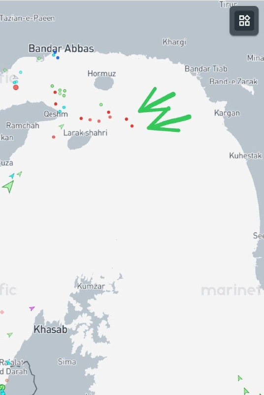

اخبار منتشر شده در برخی کانال ها مبنی بر حرکت نفتکش های «مَهوَش»، «پریوَش»، «آیناز» و «فرنگیز» به سمت شکستن محاصره #چاخان میباشد.  

[@P\_raetorio](https://t.me/P_raetorio)

· · ·

**🕒 ۱۴۰۵/۰۸/۳۰ ۰۰:۵۸** · [پست 11234](https://t.me/kaavoush/11234)

تصویری از کیلومترها صف کامیون‌های عبوری بین ایران و چین در مرز قزاقستان و ازبکستان در چند روز قبل را مشاهده می‌کنید. گفته شده بیش از ۹۰۰ کامیون در صف هستند. جالب است بدانید که همه این‌ها به اندازه یک کشتی کانتینربر نسبتاً کوچک هم ظرفیت حمل بار ندارند.

🎬 ویدیو: [مشاهده در تلگرام](https://t.me/kaavoush/11234)

· · ·

**🕒 ۱۴۰۵/۰۸/۲۹ ۲۲:۴۳** · [پست 11232](https://t.me/kaavoush/11232)

↪️ فوروارد از Praetorio

‏آن‌ها می‌خواهند توافق کنند، اما نمی‌خواهند توافقی انجام دهند که برای من قابل قبول باشد. ما می‌خواهیم به یک توافق واقعی برسیم، نه یک توافق ساختگی... آن‌ها ۵۱ سال است که مردم را با دروغ و حرف‌های مفت سر کار گذاشته‌اند.  

دونالد ترامپ  

[@P\_raetorio](https://t.me/P_raetorio)

🎬 ویدیو: [مشاهده در تلگرام](https://t.me/kaavoush/11232)

· · ·

**🕒 ۱۴۰۵/۰۸/۲۹ ۲۲:۳۵** · [پست 11231](https://t.me/kaavoush/11231)

جی‌دی ونس درباره ایران:  

پرزیدنت ترامپ کسی است که تصمیم می‌گیرد. او گفته است که دوباره وارد جنگ با ایران خواهد شد و وظیفه من حمایت از رئیس‌جمهور است.  

پ.ن: اشاره ونس به صحبت‌های امروز ترامپ است که گفته بود با نوشته ونس پس از انتخابات موافق است و قبول دارد جنگ ایران باعث افزایش قیمت سوخت و شکست جمهوری‌خواهان در انتخابات شده اما اگر به عقب برمی‌گشت باز هم جنگ علیه ایران را آغاز می‌کرد چون ایران نباید سلاح هسته‌ای داشته باشد. ونس اینجا بر اطاعت خود از رئیس‌جمهور صحه می‌گذارد.

🎬 ویدیو: [مشاهده در تلگرام](https://t.me/kaavoush/11231)

· · ·

**🕒 ۱۴۰۵/۰۸/۲۹ ۲۰:۵۳** · [پست 11230](https://t.me/kaavoush/11230)

↪️ فوروارد از Minas Tirith

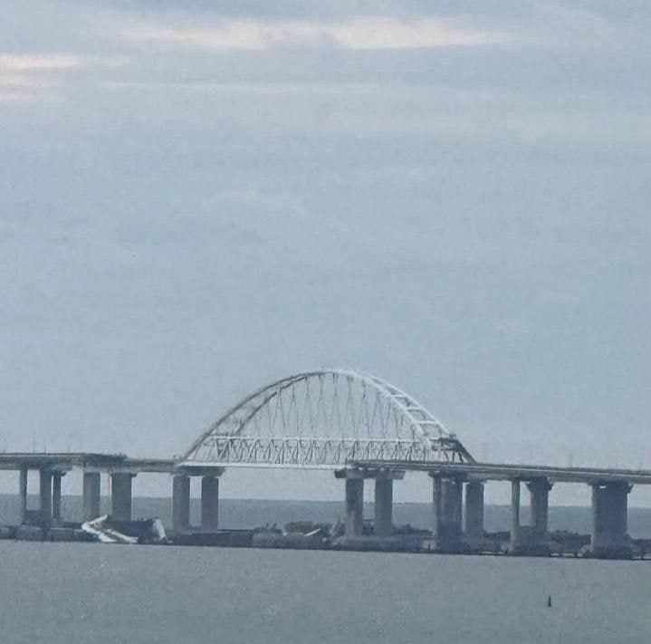

تخمین های اولیه نشان می دهد تعمیر کامل بخش تخریب شده پل کریمه، ساخت قسمت قوسی شکل و انتقال و نصب مجدد آن به شرط تامین امنیت و عدم حملات دوباره ارتش اوکراین ممکن است تا ۲ سال طول بکشد   

[@Minas\_Tirith2024](https://t.me/Minas_Tirith2024)

· · ·

**🕒 ۱۴۰۵/۰۸/۲۹ ۲۰:۱۲** · [پست 11229](https://t.me/kaavoush/11229)

[کاوش](https://t.me/kaavoush) pinned a photo

· · ·

---

## iaghapour

[کانال در تلگرام](https://t.me/iaghapour) · [آرشیو متن](archive/iaghapour/)

**🕒 ۱۴۰۵/۰۸/۳۰ ۱۹:۴۲** · [پست 3321](https://t.me/iaghapour/3321)

**🟢 پیشنهاد می‌کنم ویدیوی بالا رو به هیچ وجه از دست ندید؛**   
بدون اغراق یکی از کامل‌ترین بخش‌های تست تانل رو توی این ویدیو داریم.

· · ·

**🕒 ۱۴۰۵/۰۸/۳۰ ۱۷:۰۱** · [پست 3320](https://t.me/iaghapour/3320)


**⭕️ کدوم تانل روی سرور تو واقعاً جواب میده؟ تست مسیر + نصب با یک لینک**  

🔹در این ویدیو به‌جای حدس و گمان، با تست عملی مسیر شبکه بین سرور مبدأ و مقصد بررسی می‌کنیم که کدام روش تانل‌زنی روی سرور شما بیشترین سرعت، کمترین پینگ و بالاترین پایداری را دارد و در نهایت اتصال بین دو سرور را تنها با یک لینک راه‌اندازی برقرار می‌کنیم.  

[**🔗 تماشا ویدیو در یوتیوب**](https://youtu.be/_ISveXxaLW0)  

🎁 این ویدیو هم مثل ویدیو های قبلی قرعه‌کشی داره، برای شرکت توی قرعه‌کشی فرصت محدوده (شرایطش هم خیلی راحته؛ فقط کافیه زیر ویدیو برامون کامنت بذارید).  

#آموزش #فیلترشکن #تانل   
برای یادگیری شبکه و آموزش تکنولوژی و هوش مصنوعی ما رو دنبال کنید 💚  
🆔 [@iAghapour](https://t.me/iAghapour) | [YouTube](https://www.youtube.com/@iAghapour)

· · ·

**🕒 ۱۴۰۵/۰۸/۳۰ ۱۵:۱۹** · [پست 3319](https://t.me/iaghapour/3319)


🎨 **تبدیل عکس‌های شخصی به پوسترهای بازی GTA 6 با یک کلیک در ChatGPT!**  

یک ابزار اختصاصی در چت‌جی‌پی‌تی با نام **GTA AI Filter** در دسترس کاربران قرار گرفته که بدون نیاز به دانش فتوشاپ یا نوشتن پرامپت‌های پیچیده، تصاویر پرتره شما را به سبک گرافیکی و فضای نئونی شهر وایس‌سیتی تبدیل می‌کند.  

🔹 **تبدیل خودکار بدون پرامپت:** کافی است وارد ابزار GTA AI Filter در ChatGPT شوید، یک عکس واضح (ترجیحاً پرتره یا بالاتنه) آپلود کنید و دستور تبدیل را بزنید تا تصویر نهایی ساخته شود.  

🔸 **پشتیبانی از تصاویر گروهی:** امکان آپلود عکس‌های دونفره یا چندنفره برای تبدیل هم‌زمان تمام افراد به کاراکترهای بازی وجود دارد.  

🔹 **شخصی‌سازی با زبان ساده:** پس از ساخت تصویر اولیه، می‌توانید با دستورات متنی ساده مواردی مثل لباس، عینک، پس‌زمینه (مثلاً خیابان‌های شبانه یا خودروی اسپرت) و میزان شباهت چهره را تغییر دهید.//زومیت  

[🔗 آدرس فیلتر در سایت Chatgpt](https://chatgpt.com/g/g-68bb23e064e88191bc4d5ac6ace0a6ad-gta-ai-filter-create-pics-in-gta-style-portraits)  
[  
](https://www.youtube.com/@iAghapour)🆔 [@iAghapour](https://t.me/iAghapour) | [YouTube](https://www.youtube.com/@iAghapour)

· · ·

**🕒 ۱۴۰۵/۰۸/۲۹ ۲۱:۰۰** · [پست 3318](https://t.me/iaghapour/3318)

*(پست بدون متن)* [مشاهده در تلگرام](https://t.me/iaghapour/3318)

· · ·

**🕒 ۱۴۰۵/۰۸/۲۹ ۲۰:۲۴** · [پست 3317](https://t.me/iaghapour/3317)

🖼 *(عکس بعد از ۲۴ ساعت حذف شده)*

✍🏻 از GTA سن آندریاس تا GTA VI... سال‌ها گذشت اما جیب ما هنوز به این ویترین نرسید.  
[  
](https://www.youtube.com/@iAghapour)🆔 [@iAghapour](https://t.me/iAghapour) | [YouTube](https://www.youtube.com/@iAghapour)

· · ·

**🕒 ۱۴۰۵/۰۸/۲۹ ۱۸:۱۲** · [پست 3316](https://t.me/iaghapour/3316)

🖼 *(عکس بعد از ۲۴ ساعت حذف شده)*

🛡 **ورود مایکروسافت به جنگ علیه کرکرها؛ فناوری Windows Baseline Protection راه دور زدن قفل دنوو را می‌بندد!**  

مایکروسافت در حال آزمایش یک لایه امنیتی جدید در ویندوز ۱۱ به نام **Windows Baseline Protection (WBP)** است که مستقیماً روش نوین کرک بازی‌ها از طریق ماشین مجازی (هایپروایزر) و دور زدن قفل Denuvo را هدف قرار می‌دهد.  

🔹 **یکپارچه‌سازی بررسی‌ امنیتی ویندوز:** این فناوری تمام بررسی‌های حیاتی شامل TPM، Secure Boot، امنیت مبتنی بر مجازی‌سازی (VBS)، راستی‌آزمایی یکپارچگی حافظه و مسدودسازی درایورهای آسیب‌پذیر را در قالب یک بازرسی واحد و مرکزی ادغام می‌کند.  

🔸 **پایان عمر کرک‌های مبتنی بر هایپروایزر:** از آنجا که اجرای بازی‌های کرک‌شده با روش هایپروایزر نیازمند غیرفعال‌سازی این لایه‌های حفاظتی توسط کاربر است، قفل دنوو با استعلام وضعیت WBP در صورت دست‌کاری امنیت سیستم، از اجرای بازی جلوگیری خواهد کرد.  

🔹 **تست‌های اولیه در پلتفرم‌های بزرگ:** این مکانیزم پس از ناکامی آپدیت قبلی دنوو (که ظرف ۳ هفته در بازی Star Wars: Galactic Racer کرک شد)، هم‌اکنون در پلتفرم [Battle.net](http://Battle.net/) و زیرساخت چند ناشر بزرگ در حال آزمایش است.  
[  
](https://www.youtube.com/@iAghapour)**🆔** [**@iAghapour**](https://t.me/iAghapour)

· · ·

**🕒 ۱۴۰۵/۰۸/۲۹ ۱۵:۰۳** · [پست 3315](https://t.me/iaghapour/3315)

🖼 *(عکس بعد از ۲۴ ساعت حذف شده)*

⭕️ **رکوردشکنی تاریخی اینترنت با عرضه GTA 6؛ عبور ترافیک جهانی از ۳۳ ترابیت بر ثانیه!**  

همزمان با انتشار بازی **Grand Theft Auto VI**، بزرگ‌ترین شبکه تبادل اینترنت جهان (DE-CIX) بالاترین میزان مصرف پهنای باند در تاریخ را با ثبت سرعت **۳۳.۰۳ ترابیت بر ثانیه** (معادل انتقال **۴,۱۲۸.۷۵ گیگابایت اطلاعات در هر ثانیه**) به ثبت رساند.  

🔹 **شکستن رکورد پیش‌دانلود:** این رقم در آستانه عرضه رسمی بازی ثبت شد و رکورد قبلی (۳۳.۰۱ ترابیت بر ثانیه در زمان آغاز پیش‌دانلود در ۱۰ نوامبر) و سقف تاریخی سال ۲۰۲۵ (۲۶.۹۹ ترابیت بر ثانیه) را جابه‌جا کرد.  

🔸 **حجم سنگین و عرضه تمام‌دیجیتال:** حجم حدود ۲۱۲ گیگابایتی بازی و نبود دیسک فیزیکی (حتی در نسخه‌های جعبه‌ای فقط کد دانلود قرار دارد) باعث شد تمام خریداران ناچار به دانلود کامل فایل‌ها شوند و ترافیک شبکه ۲۵ درصد بالاتر از میانگین عادی برود.  

🔹 **طوفان استریم هم‌زمان:** علاوه بر دانلودهای سنگین، پخش زنده این بازی در پلتفرم‌هایی نظیر توییچ و یوتیوب به رکورد خیره‌کننده ۷.۹۱ میلیون بیننده هم‌زمان دست یافت.  
[  
](https://www.youtube.com/@iAghapour)**🆔** [**@iAghapour**](https://t.me/iAghapour) **|** [**YouTube**](https://www.youtube.com/@iAghapour)

· · ·

**🕒 ۱۴۰۵/۰۸/۲۸ ۲۲:۰۱** · [پست 3314](https://t.me/iaghapour/3314)

↪️ فوروارد از Amin

🖼 *(عکس بعد از ۲۴ ساعت حذف شده)*

دیگه هزینه سرور و هوش مصنوعی های بیهوده برای ربات و سایتت نکن!  

**🌙** **لوناکس؛ اولین پلتفرم ایرانی ساخت سایت، وب‌اپ و ربات تلگرام با هوش مصنوعی**  

✅ ربات فروشگاهی ؟ سایت شخصی ؟ منوی کافه، وب‌اپ رزرو وقت یا ایجنت پاسخ‌گویی به مشتری؟ به ایجنت لوناکس بگو چی می‌خوای بسازی.  

**◀️** **100,000,000 میلیون اعتبار توکن و ساخت 1 سایت و اپ و سرور رایگان برای 1 ماه برای 500 نفر!**  
{🔔 **ویژه تولید کنندگان** : کد های دعوت 250,000,000 و 1 میلیارد اعتباری.}  

🗄️ همه چی از یه پرامپت تا سایت یا ربات آنلاینت. دیتابیس و Redis آماده! (یا اینکه فقط از گیتهاب پروژه رو بده آنلاینش کن!)  

🗄️ خودت کد می‌زنی؟ نمونه درخواست API و راهنمای دیپلوی با CLI پایین پسته. CLI هنوز نصب عمومی نداره.  

🎟 **برای درخواست کد دعوت، فقط تو سایت ثبت نامتو تکمیل کن، عضو لوناکس شو و بزودی کد دعوت برای 500 نفر اول کاربران لوناکس ارسال میشه.**  

[◀️  عضویت در چنل](https://t.me/Lunax_Code) برای راهنمایی دریافت کد دعوت 💻 [@Lunax\_Code](https://t.me/Lunax_Code)  

**🪐** **سایت**[**: https://lunax.ir**](https://lunax.ir/fa/pricing?utm_source=iaghapour&amp;utm_medium=telegram&amp;utm_campaign=sticky_20261119_builder)

… [ادامه در تلگرام](https://t.me/iaghapour/3314)

· · ·

**🕒 ۱۴۰۵/۰۸/۲۸ ۱۹:۰۱** · [پست 3313](https://t.me/iaghapour/3313)

🖼 *(عکس بعد از ۲۴ ساعت حذف شده)*

**⭕️ معرفی پنل‌ساز اختصاصی: مدیریت و فروش کانفیگ (بدون نیاز به سرور و هزینه زیاد)**  

🔹در این ویدیو یک سیستم پنل‌ساز آماده را بررسی می‌کنیم که به شما اجازه می‌دهد بدون نیاز به خرید سرور مجازی یا درگیری با کانفیگ‌های پیچیده، پنل مدیریت اختصاصی خودتان را داشته باشید. با این ابزار می‌توانید به راحتی برای کاربران کانفیگ بسازید، حجم و زمان مصرفی آن‌ها را مدیریت کنید و بدون سرمایه اولیه بالا، خدمات خود را ارائه دهید.   

[**🔗 تماشا ویدیو در یوتیوب**](https://youtu.be/--mKhhhYIIU)  

#آموزش #فیلترشکن #پنل   
برای یادگیری شبکه و آموزش تکنولوژی و هوش مصنوعی ما رو دنبال کنید 💚  
🆔 [@iAghapour](https://t.me/iAghapour) | [YouTube](https://www.youtube.com/@iAghapour)

· · ·

**🕒 ۱۴۰۵/۰۸/۲۸ ۱۷:۳۱** · [پست 3312](https://t.me/iaghapour/3312)

🖼 *(عکس بعد از ۲۴ ساعت حذف شده)*

⭕️ **رونمایی گوگل از مدل Gemini 4 Neon؛ ترکیب سرعت بالا و استدلال عمیق با هزینه کمتر!**  

گوگل پس از معرفی مدل‌های Carbon و Hydrogen، از عضو جدید خانواده جمنای ۴ با نام **Gemini 4 Neon** رونمایی کرد؛ مدلی میان‌رده و بهینه که تعادلی ایده‌آل میان قدرت استدلال، سرعت پاسخ‌گویی و هزینه برقرار می‌کند.  

🔹 **قدرت استدلال هم‌تراز با کربن و سرعت ۳ برابری:** کسب امتیاز ۶۱ در شاخص هوش Artificial Analysis (بالاتر از کربن با ۶۰ و هیدروژن با ۵۴) همراه با سرعت ۳ برابری و هزینه ۶۰ درصدی نسبت به مدل پرچم‌دار Carbon در ارزیابی‌های اولیه.  

🔸 **تمرکز بر کدنویسی و تسک‌های چندمرحله‌ای:** بهینه‌سازی‌شده برای بررسی و ویرایش هم‌زمان چندین فایل کد، همکاری با ایجنت‌های هوش مصنوعی و پردازش حجم بالای متن، تصویر، صدا و ویدیو با پنجره کانتکست ۱ میلیون توکنی.  

🔹 **جایگزین مدل آرگون:** این مدل با عنوان **Deeper analysis** برای مشترکان طرح‌های Google AI Pro و Ultra در اپلیکیشن جمنای (با دسترسی به جیمیل و داکس) و محیط کدنویسی Antigravity فعال شده است.  
[  
](https://www.youtube.com/@iAghapour)**🆔** [**@iAghapour**](https://t.me/iAghapour) **|** [**YouTube**](https://www.youtube.com/@iAghapour)

· · ·

**🕒 ۱۴۰۵/۰۸/۲۸ ۱۵:۰۱** · [پست 3311](https://t.me/iaghapour/3311)

🖼 *(عکس بعد از ۲۴ ساعت حذف شده)*

🎮 **معرفی ابزار متن‌باز PKGPort؛ انتقال سریع بازی‌های PKG از کامپیوتر به پلی‌استیشن!**  

یک برنامه رایگان و کاربردی برای انتقال مستقیم فایل‌های بازی از کامپیوتر به کنسول پلی‌استیشن از طریق شبکه محلی و پراکسی، بدون نیاز به فلش‌مموری یا مصرف مجدد اینترنت.  

🔹 **انتقال آسان مبتنی بر پراکسی:** انتخاب پوشه حاوی فایل‌های PKG، فعال‌سازی پراکسی و اتصال سریع کنسول برای ارسال خودکار فایل‌های منطبق.  

🔸 **مانیتورینگ لحظه‌ای:** نمایش دقیق سرعت انتقال، درصد پیشرفت عملیات و شناسایی خودکار اطلاعات بازی و پارت‌های فایل.  

🔹 **مولتی‌پلتفرم و دو زبانه:** سازگاری کامل با سیستم‌عامل‌های ویندوز، لینوکس و مک همراه با رابط کاربری فارسی و انگلیسی.  

🔸 **رایگان و متن‌باز (Open-Source):** دسترسی کامل به کد منبع و نسخه‌های اجرایی در گیت‌هاب بدون هیچ‌گونه محدودیت.  
[ ](https://github.com/miladmeidanshahi/pkg-port)  
[🔗 **دانلود و مشاهده پروژه در گیت‌هاب**](https://github.com/miladmeidanshahi/pkg-port)  

**🆔** [**@iAghapour**](https://t.me/iAghapour) **|** [**YouTube**](https://www.youtube.com/@iAghapour)

· · ·

**🕒 ۱۴۰۵/۰۸/۲۷ ۲۱:۰۱** · [پست 3310](https://t.me/iaghapour/3310)

↪️ فوروارد از ̭͙̖̱̬͖͓̻̣̪̭͙̖̱̭͙̖̱̬Abolfazl

🖼 *(عکس بعد از ۲۴ ساعت حذف شده)*

🌱 **افتتاحیه‌ی هیرکانت | ۱۰٪ تخفیف** 🎉  

به مناسبت افتتاحیه، روی همه‌ی سرورهای مجازی و خرید ترافیک اضافه ۱۰٪ تخفیف داریم. 🚀  
**سرور پایه ۷۲۰ تومان**  
**هرترا ترافیک با آپلود رایگان پورت ۱۰ گیگ 📡**  
**۷۲۰ تومان**  

🎟 کد تخفیف:  

```
opening_off
```

(پوف‌باز است) ✅  
خدمات هیرکانت:  
هاستینگ و سرور مجازی 🖥️  
سرور اختصاصی و کولوکیشن 🏢  

🌐 سفارش: [https://hyrca.net](https://hyrca.net/)  
📢 کانال تلگرام: [@hyrcanet](https://t.me/hyrcanet)  
💬 پشتیبانی: [@bororey](https://t.me/bororey)

· · ·

**🕒 ۱۴۰۵/۰۸/۲۷ ۲۰:۲۰** · [پست 3309](https://t.me/iaghapour/3309)

🖼 *(عکس بعد از ۲۴ ساعت حذف شده)*

📊 **عمر فیلترینگ و محدودیت شبکه‌های اجتماعی در منطقه؛ از ۲ روز تا بیش از ۸ سال!**  

بررسی داده‌های اینفوگرافیک بالا نشان می‌دهد مدت‌زمان محدودیت پلتفرم‌ها در کشورهای منطقه از اختلالات مقطعی چندروزه تا انسدادهای چندساله متغیر است:  

🔹 **محدودیت‌های کوتاه‌مدت (در مقیاس روز):** کندی ۲ روزه سرویس‌ها و فیلتر ۸ روزه اینستاگرام در ترکیه، انسداد ۸ تا ۳۶ روزه تلگرام در عراق و محدودیت ۴۶ روزه چند پلتفرم در آذربایجان.  

🔸 **محدودیت‌های بلندمدت (در مقیاس سال):** فیلتر ۱۴ ماهه ایکس (توییتر) در پاکستان، مسدودسازی حدود ۴ ساله تیک‌تاک در اردن و رکوردداری ایران با فیلتر بیش از ۴ ساله اینستاگرام و ۸.۵ ساله تلگرام.//زومیت  
[  
](https://www.youtube.com/@iAghapour)**🆔** [**@iAghapour**](https://t.me/iAghapour) **|** [**YouTube**](https://www.youtube.com/@iAghapour)

· · ·

**🕒 ۱۴۰۵/۰۸/۲۷ ۱۸:۳۸** · [پست 3308](https://t.me/iaghapour/3308)

🖼 *(عکس بعد از ۲۴ ساعت حذف شده)*

🎮 **انفجار نمرات GTA 6 پیش از عرضه رسمی؛ ثبت میانگین خیره‌کننده ۹۹ از ۱۰۰ و رکوردشکنی تاریخی!**  

در آستانه انتشار رسمی موردانتظارترین بازی تاریخ، نقدهای رسانه‌های معتبر جهانی برای **Grand Theft Auto VI** منتشر شد و ساخته جدید راک‌استار گیمز با ثبت میانگین امتیاز ۹۹ در متاکریتیک و اوپن‌کریتیک، جایگاه خود را به‌عنوان برترین بازی تاریخ ویدیوگیم تثبیت کرد.  

🔹 **میانگین امتیاز تاریخی:** ثبت نمره ۹۹ از ۱۰۰ در وب‌سایت مرجع Metacritic و پایگاه OpenCritic (هم‌تراز با رکورد افسانه‌ای Zelda: Ocarina of Time با بیش از ۱۰۰ نقد ثبت‌شده).  

🔸 **باران امتیازات کامل (۱۰۰/۱۰۰):** دریافت نمره کامل از بزرگ‌ترین رسانه‌های دنیا از جمله IGN، GameSpot، Game Informer، Eurogamer، GamesRadar، VGC و Washington Post.  

ویدیو گیمز کرونیکل: نمره ۱۰۰ از ۱۰۰  
گیم اینفورمر: نمره ۱۰۰ از ۱۰۰  
گیم‌اسپات: نمره ۱۰۰ از ۱۰۰  
گیمزرادار: نمره ۱۰۰ از ۱۰۰  
آی‌جی‌ان: نمره ۱۰۰ از ۱۰۰  
یوروگیمر: نمره ۱۰۰ از ۱۰۰  
گیمینگ‌بولت: نمره ۱۰۰ از ۱۰۰  

🆔 [@iAghapour](https://t.me/iAghapour) | [YouTube](https://www.youtube.com/@iAghapour)

· · ·

**🕒 ۱۴۰۵/۰۸/۲۷ ۱۵:۴۰** · [پست 3307](https://t.me/iaghapour/3307)

🖼 *(عکس بعد از ۲۴ ساعت حذف شده)*

🎮 **تحریم مجدد بازی‌های سوپرسل (Supercell) برای کاربران ایرانی**  

گیمرهای ایرانی بار دیگر هنگام ورود به بازی‌های این شرکت با خطای عدم پشتیبانی از موقعیت جغرافیایی (Location Not Supported) مواجه شده‌اند.  

🔹 **عناوین درگیر:** مسدودسازی شامل تمامی بازی‌های آنلاین سوپرسل از جمله **Clash of Clans**، **Clash Royale**، **Brawl Stars**، **Hay Day** و **Boom Beach** است.  

🔸 **تحریم از سمت سرور:** این محدودیت نه به‌دلیل فیلترینگ داخلی، بلکه مستقیماً از سوی سرورهای سوپرسل و با شناسایی IP ایران اعمال می‌شود.  
[  
](https://www.youtube.com/@iAghapour)**🆔** [**@iAghapour**](https://t.me/iAghapour) **|** [**YouTube**](https://www.youtube.com/@iAghapour)

· · ·

**🕒 ۱۴۰۵/۰۸/۲۶ ۲۱:۰۱** · [پست 3306](https://t.me/iaghapour/3306)

↪️ فوروارد از Milad

🖼 *(عکس بعد از ۲۴ ساعت حذف شده)*

به مناسبت افتتاح رباتمون  
 **100 هزار تومن تخفیف** فقط برای **50 نفر اول**🥳🎁  

**یه محصول خفن و ارزون هم واستون موجود کردیم😍**  

**Meta Muse AI♾️**  
میوز هوش مصنوعی شرکت متا(سازنده اینستاگرام)  

**🔹جستجوی وب  
🔹اجرای تسک های مختلف حتی چند مرحله ای  
🔹اتصال به سرویس‌ها و ابزارهای مختلف  
🔹ساخت انواع فایل، محتوا و خروجی‌های مختلف  
🔹انجام وظایف در پس زمینه یا حتی وقتی شما خواب هستید**  

این فقط یه چت بات نیس یه دستیار واقعیه!!  
کامپیوتر خودش رو داره یعنی شما میتونید یه کاری بهش بگید سیستمتون رو خاموش کنید و بعد که برگشتید نتیجه رو تحویل بگیرید  
چون روی سرور های خودش اجرا میشه نه روی سیستم شما!  

این سرویس با 31 میلیارد توکن موجود شده  
این حجم معادل 23 میلیارد کلمه انگلیسیه که شما استفاده کنید  

✅ کد تخفیف Muse100t  
سفارش از طریق بات  
👇👇👇👇  
[@AIPrompt98bot](https://t.me/AIPrompt98bot)

· · ·

**🕒 ۱۴۰۵/۰۸/۲۶ ۱۸:۵۰** · [پست 3305](https://t.me/iaghapour/3305)

🖼 *(عکس بعد از ۲۴ ساعت حذف شده)*

متاسفانه بعضیا رو نمیشه قانع کرد؛  
باید به نفهمیشون احترام گذاشت.  

©️مووی‌کاتج  
🎬 The Boss Baby (2017)

· · ·

**🕒 ۱۴۰۵/۰۸/۲۶ ۱۶:۱۹** · [پست 3304](https://t.me/iaghapour/3304)

🖼 *(عکس بعد از ۲۴ ساعت حذف شده)*

برای ساخت GTA 6 بیشتر از بلندترین برج دنیا هزینه و زمان صرف شده!🧐  
[  
](https://www.youtube.com/@iAghapour)**🆔** [**@iAghapour**](https://t.me/iAghapour) **|** [**YouTube**](https://www.youtube.com/@iAghapour)

· · ·

**🕒 ۱۴۰۵/۰۸/۲۵ ۲۲:۴۹** · [پست 3303](https://t.me/iaghapour/3303)

↪️ فوروارد از فروش هاست

🖼 *(عکس بعد از ۲۴ ساعت حذف شده)*

فروش VPS های بسیار قدرت ایران و خارج  🇮🇷 ترافیک ارزان (هر ترا 800,000 تومان) چنج آیپی 400,000 و پشتیبانی 24 ساعته  

🚀 امکان تست سرورها بصورت ساعتی  
🔵 سرور‌های بسیار پرسرعت توربو G10 و G9  
🔅 تمام آپشن‌های سایت بصورت اتوماتیک می‌باشد  
⚡️ فروش سرور خارج  
🔎 حجم آپلود و ipv6 رایگان  
🌐 پورت 10 گیگابایت  

[https://t.me/+ZbxLUqEk5OZlZGM0](https://t.me/+ZbxLUqEk5OZlZGM0)  

⚡️ [cloud.sheltertm.com](http://cloud.sheltertm.com/)

· · ·

**🕒 ۱۴۰۵/۰۸/۲۵ ۲۲:۴۸** · [پست 3302](https://t.me/iaghapour/3302)

**📌 پیش از خرید از سرویس‌ تبلیغ‌شده زیر، قوانین را بخوانید👇🏻**

· · ·

---

## MatinSenPaii

[کانال در تلگرام](https://t.me/MatinSenPaii) · [آرشیو متن](archive/matinsenpaii/)

**🕒 ۱۴۰۵/۰۸/۳۰ ۲۰:۱۹** · [پست 5941](https://t.me/MatinSenPaii/5941)

🎭 استیکر: [مشاهده در تلگرام](https://t.me/MatinSenPaii/5941)

· · ·

**🕒 ۱۴۰۵/۰۸/۳۰ ۱۶:۵۰** · [پست 5940](https://t.me/MatinSenPaii/5940)

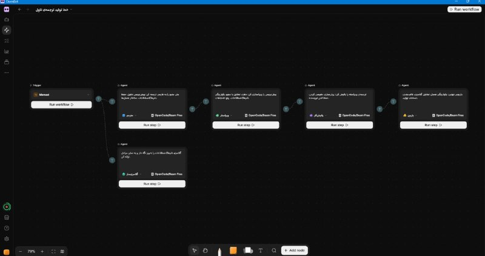

توی ویدئوی امروز(که نمیدونم کی حاضر بشه) بهتون نشون میدم چه شکلی می‌تونید با API رایگان و با ترکیب OpenBot و قابلیت ورک‌فلو و ایجنت چنلش، با کیفیت بالا کتاب/مقاله ترجمه کنیم و ایجنتمون رو واسش تربیت کنیم عملا

· · ·

**🕒 ۱۴۰۵/۰۸/۳۰ ۱۲:۳۷** · [پست 5939](https://t.me/MatinSenPaii/5939)

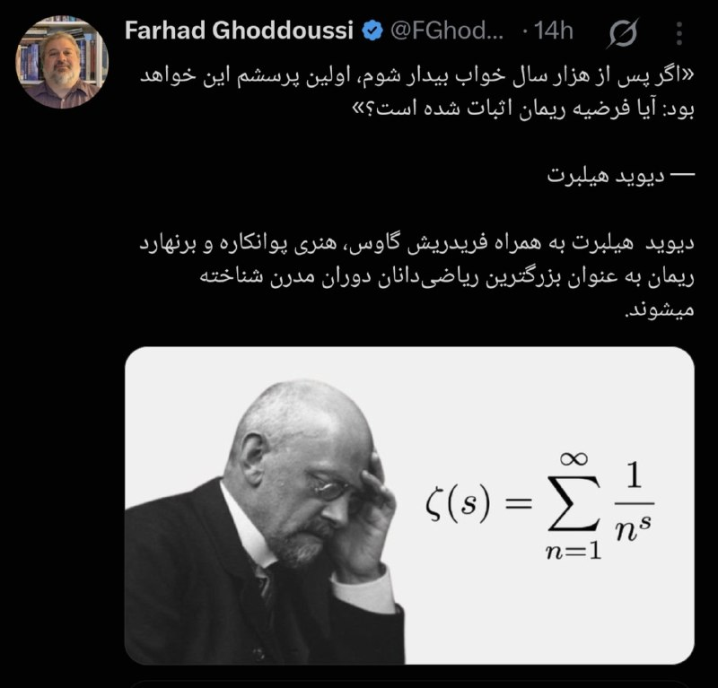

· · ·

**🕒 ۱۴۰۵/۰۸/۳۰ ۰۹:۳۶** · [پست 5938](https://t.me/MatinSenPaii/5938)


**ریاضیدان آنتروپیک ادعا می‌کنه با کمک کلاد فرضیه ریمان رو اثبات کرده**  

لونت آلپوگه توی یه یادداشت کوتاه می‌گه با کلاد به اثبات فرضیه ریمان رسیده؛ یعنی مشهورترین مسئله حل‌نشده ریاضی، درباره اینکه صفرهای تابع زتا دقیقاً کجا قرار می‌گیرن. به ادعای خودش روشش فرضیه ریمان تعمیم‌یافته رو هم حل می‌کنه و استدلال‌ها رو بدون هیچ فرض اضافه‌ای، به صورت صوری هم پیاده کردن. خودش می‌گه نزدیک خط پایان کلاد خیلی ازش جلوتر بوده.  

هنوز هیچ ریاضیدان مستقلی این اثبات رو تایید نکرده و مدرکش یه فایل PDF کوتاهه، پس فعلاً فقط یه ادعای خیلی بزرگه.  

🔗 [منبع](https://simonwillison.net/2026/Nov/20/levent-alpoge/)  
✉️ [t.me/MatinSenPaii](http://t.me/MatinSenPaii)

· · ·

**🕒 ۱۴۰۵/۰۸/۳۰ ۰۱:۳۵** · [پست 5937](https://t.me/MatinSenPaii/5937)

تجربه‌ام توی Video Generation با AI بیشتر شد یه کم   
فردا به احتمال زیاد با یکی از دوستان متخصص میریم سراغ Seedance 2.5 4K  
منتظر اون هم باشید خلاصه.  
شاید دانش زیادی از کارگردانی نداشته باشم توی این حوزه، اما دوستان خوبی دارم که خودم و شما همه با هم می‌تونیم ازشون یاد بگیریم

· · ·

**🕒 ۱۴۰۵/۰۸/۳۰ ۰۱:۲۰** · [پست 5936](https://t.me/MatinSenPaii/5936)


**ساخت اتوماتیک ویدئوی وایرال با هوش مصنوعی (Claude + Higgsfield)**  

از این به بعد ریلزهایی که میلیونی ویو خوردن رو کپی نکنید، در عوض فرمتشون رو برای خودتون بسازید. توی این ویدئو با ترکیب Claude و Higgsfield Shorts Studio نشون می‌دم چطوری یه ورک‌فلو کامل ساخت شورتز/ریلز داشته باشید: با صورت خودتون بدون فیلم‌برداری، یا با یه AI اینفلوئنسر، و با تست سه هوک مختلف برای پیدا کردن فرمت برنده.  

پیج هاپوبزرگ که توی ویدئو ساختیم: [https://www.instagram.com/hapoobozorg](https://www.instagram.com/hapoobozorg)  

این ویدیو با حمایت Higgsfield ساخته شده.  

📹تماشا در یوتوب: [https://youtu.be/hzCKQI9zs94](https://youtu.be/hzCKQI9zs94)

· · ·

**🕒 ۱۴۰۵/۰۸/۲۹ ۲۳:۴۸** · [پست 5935](https://t.me/MatinSenPaii/5935)

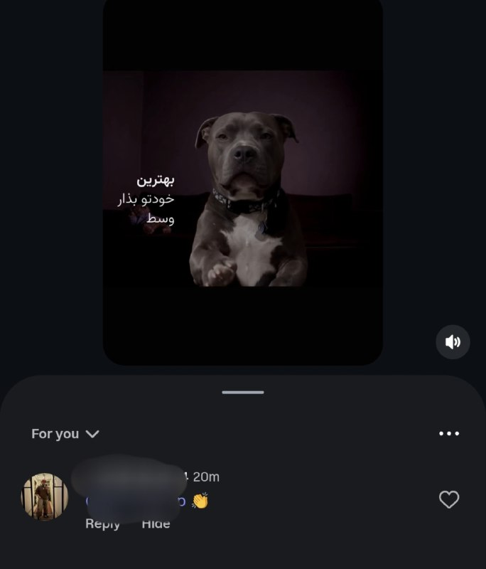

😭😂  
تا اخر شب ویدئوش حاضر میشه  
اما همین الانم تو اکسپلور رفت فکر کنم

· · ·

**🕒 ۱۴۰۵/۰۸/۲۹ ۲۰:۴۰** · [پست 5934](https://t.me/MatinSenPaii/5934)

🎭 استیکر: [مشاهده در تلگرام](https://t.me/MatinSenPaii/5934)

· · ·

**🕒 ۱۴۰۵/۰۸/۲۹ ۲۰:۴۰** · [پست 5933](https://t.me/MatinSenPaii/5933)

🎬 ویدیو: [مشاهده در تلگرام](https://t.me/MatinSenPaii/5933)

· · ·

**🕒 ۱۴۰۵/۰۸/۲۹ ۱۸:۲۲** · [پست 5932](https://t.me/MatinSenPaii/5932)

🎭 استیکر: [مشاهده در تلگرام](https://t.me/MatinSenPaii/5932)

· · ·

**🕒 ۱۴۰۵/۰۸/۲۹ ۱۸:۲۲** · [پست 5931](https://t.me/MatinSenPaii/5931)

🖼 *(عکس بعد از ۲۴ ساعت حذف شده)*

یه کار سم میخوام بکنم

· · ·

**🕒 ۱۴۰۵/۰۸/۲۹ ۱۸:۰۴** · [پست 5930](https://t.me/MatinSenPaii/5930)

🖼 *(عکس بعد از ۲۴ ساعت حذف شده)*

**اسکیل rust-anything اپت رو تیکه‌تیکه به Rust بازنویسی می‌کنه و ثابت می‌کنه هیچی خراب نشده**  

rust-anything یه ابزار و اسکیل کلاد کده که اپ TypeScript و Python و C و Go و Ruby و Java رو قدم‌به‌قدم به Rust خالص می‌بره.  

طرز کارش این شکلیه که اول رفتار نسخه اصلی رو روی هزاران ورودی ضبط می‌کنه، حتی کیس‌های لبه‌ای مثل ایموجی و سرریز عددی. یه باینری Rust می‌ذاره جلو و هر تیکه‌ای که هنوز پورت نشده برمی‌گرده به نسخه اصلی، یعنی اپ از روز اول کار می‌کنه. هر واحد که پورت شد، همه کیس‌ها روش ری‌پلی می‌شن و باید صددرصد یکی باشن. وقتی دیگه فالبکی نموند، کد قدیمی حذف می‌شه.  

سازنده‌ش می‌گه ۳۸٬۲۵۱ کیس ضبط‌شده با صفر مغایرت ری‌پلی شدن و توی حالت فقط سرعت، جست‌وجو توی Node بیست برابر سریع‌تر شده. نصبش یه دستوره و لایسنسش MITه. نسخه ۲ش هم اومده که باهاش Prettier رو پورت کردن و ۱۹ برابر سریع‌ترش کردن.  

🔗 [ریپو](https://github.com/erkamyaman/rust-anything)  
✉️ [t.me/MatinSenPaii](http://t.me/MatinSenPaii)

· · ·

**🕒 ۱۴۰۵/۰۸/۲۹ ۱۸:۰۲** · [پست 5929](https://t.me/MatinSenPaii/5929)

🖼 *(عکس بعد از ۲۴ ساعت حذف شده)*

ویدئو داریم واسش  
خیلی وقته همه چیزشو آماده کردم  
فقط این یه هفته من رو یاری کنید که این دو سه تا کمپین‌های هیگزفیلد تموم بشه می‌ذارم همشو🖊️

· · ·

**🕒 ۱۴۰۵/۰۸/۲۹ ۱۶:۳۱** · [پست 5928](https://t.me/MatinSenPaii/5928)

**کلادفلر مدل Clairic رو منتشر کرده که خروجیش رایگانه**  

Clairic یه مدل استخراج داده‌ست؛ متن و PDF و عکس رو می‌دی و اطلاعات ساخت‌یافته ازش درمیاره. مثلاً متن آگهی استخدام رو می‌دی و می‌گی مهارت‌های ضروری و ترجیحی و سابقه و حقوق رو دربیار، یا عکس فاکتور رو می‌دی و مبلغ و تاریخ رو می‌گیری. فرقش با Jev اینه که Jev تصمیم‌گیری و امتیازدهی می‌کنه، این یکی فقط داده استخراج می‌کنه.  

طرز کارش این شکلیه که ساختار خروجی رو هم خودت تعیین می‌کنی؛ مثلاً می‌گی فقط JSON بده و خروجی رو مستقیم می‌بری توی دیتابیس. برای هر فیلد هم امتیاز اطمینان می‌ده، یعنی خروجی‌های کم‌اطمینان رو جدا می‌کنی برای بررسی انسانی و مطمئن‌ها رو اتوماتیک جلو می‌بری.  

«خروجی رایگان» یعنی مدل توکن خروجی تولید می‌کنه ولی کلادفلر پولش رو نمی‌گیره؛ فقط ورودی حساب می‌شه، فعلاً ۱۰ سنت برای هر یک میلیون توکن. هر دو نسخه‌ش هم اوپن ویتن و می‌تونید روی زیرساخت خودتون اجراش کنید. نویسنده‌ش می‌گه برای استخراج اطلاعات از متن‌های فارسی هم گزینه‌ی خوبیه.  

✍️ [Ali Najafi](https://x.com/alinajafi321/status/2123544511091503464)

· · ·

**🕒 ۱۴۰۵/۰۸/۲۹ ۱۴:۵۷** · [پست 5927](https://t.me/MatinSenPaii/5927)

[https://t.me/bloomintin/341](https://t.me/bloomintin/341)

· · ·

**🕒 ۱۴۰۵/۰۸/۲۹ ۱۴:۴۴** · [پست 5926](https://t.me/MatinSenPaii/5926)

🖼 *(عکس بعد از ۲۴ ساعت حذف شده)*

**کلاد Fable 5.2 دو تا مسئله‌ی لاینحل و باز فیزیک مربوط به سیاه‌چاله‌ها رو حل کرده**  

تیم Anthropic می‌گه مدل Fable 5.2 دو تا مسئله باز فیزیک نظری رو حل کرده که هر دو به سیاه‌چاله و گرانش کوانتومی ربط دارن. اولی محاسبه‌ایه که فیزیک‌دان‌ها سال ۲۰۰۳ طرحش رو ریخته بودن ولی هیچ‌وقت تمومش نکرده بودن: اینکه گذار هاوکینگ-پیج، یعنی لحظه‌ای که گاز داغ ناگهان به سیاه‌چاله تبدیل میشه، توی جهان‌های خیلی کوچیک هم ناگهانیه یا نه؛ جواب کلاد اینه که آره، ناگهانیه.  

دومی هم سقف دقیق یه تکنیکه به اسم modular bootstrap؛ یعنی روشی که ۱۵ ساله برای رد کردن نظریه‌های کاندید گرانش کوانتومی استفاده میشه. کلاد با یه گروه کوچیک از کپی‌های خودش کار کرده و هر تکه محاسبه رو جدا چک کرده؛ فیزیک‌دان‌ها هم نتیجه‌ها رو بررسی کردن و مقاله‌هاش به صورت پیش‌چاپ منتشر شده.  

🔗 [منبع](https://www.reddit.com/r/singularity/comments/1y0buih/fable_52_solved_two_open_problems_in_the_physics/)  
✉️ [t.me/MatinSenPaii](http://t.me/MatinSenPaii)

· · ·

**🕒 ۱۴۰۵/۰۸/۲۹ ۱۳:۵۶** · [پست 5925](https://t.me/MatinSenPaii/5925)

دقیقا دقیقا  
راجب بتهوون هم شفاف‌سازی کن لطفا بانو😭🙏

· · ·

**🕒 ۱۴۰۵/۰۸/۲۹ ۱۳:۵۴** · [پست 5924](https://t.me/MatinSenPaii/5924)

هرگز نمیتونم تصور کنم که چطور یه نفر بدون دیدن و شنیدن تونسته نوازنده بشه..  
تازه، هلن می مارتین به ساز چنگ هم مسلط بوده

· · ·

**🕒 ۱۴۰۵/۰۸/۲۹ ۱۳:۴۸** · [پست 5923](https://t.me/MatinSenPaii/5923)

حس عجیبی میده خوندن راجب این شخصیت‌ها  
دمشون گرم واقعا

· · ·

**🕒 ۱۴۰۵/۰۸/۲۹ ۱۳:۲۵** · [پست 5922](https://t.me/MatinSenPaii/5922)

🖼 *(عکس بعد از ۲۴ ساعت حذف شده)*

**بن شدن اکانت های Claude و مشکل احراز هویت**  

از تیر ماه امسال یه موج بن اکانت‌های کلاد شروع شد که فقط هم دامن ما ایرانیا رو نگرفت. توی این ویدئو بهتون می‌گم علت رسمیش چی بود، چه چیزهایی واقعا باعث بن نمی‌شه، و اگه اکانتتون بن شد یا احراز هویت خواست چیکار کنید.  

◀️ علت رسمی بن‌ها: دیستیلیشن اتک برادران چینی باباعلی  
◀️احراز هویت Claude و اکانت Max: چه راه‌هایی داریم و کدومش امن‌تره  
◀️بازار سیاه احراز هویت با مدرک جعلی و Residential IP، و چرا توصیه نمی‌کنم  
◀️افسانه‌ها: آیا IP، ایرانی بودن یا فارسی حرف زدن باعث بن می‌شه؟  
◀️کارت پرداخت: عاملی که به نظرم واقعا مهمه جایگزین‌های کلاد: ChatGPT / Codex، OpenCode Go، Kimi K3  
◀️مقایسه‌ی پلن ۱۰۰ دلاری Codex و Claude Code  

📹تماشا در یوتوب: [https://youtu.be/xmF9hZ4rRKA](https://youtu.be/xmF9hZ4rRKA)

· · ·

---

## whitedns

[کانال در تلگرام](https://t.me/whitedns) · [آرشیو متن](archive/whitedns/)

**🕒 ۱۴۰۵/۰۸/۳۰ ۱۸:۱۰** · [پست 2307](https://t.me/whitedns/2307)

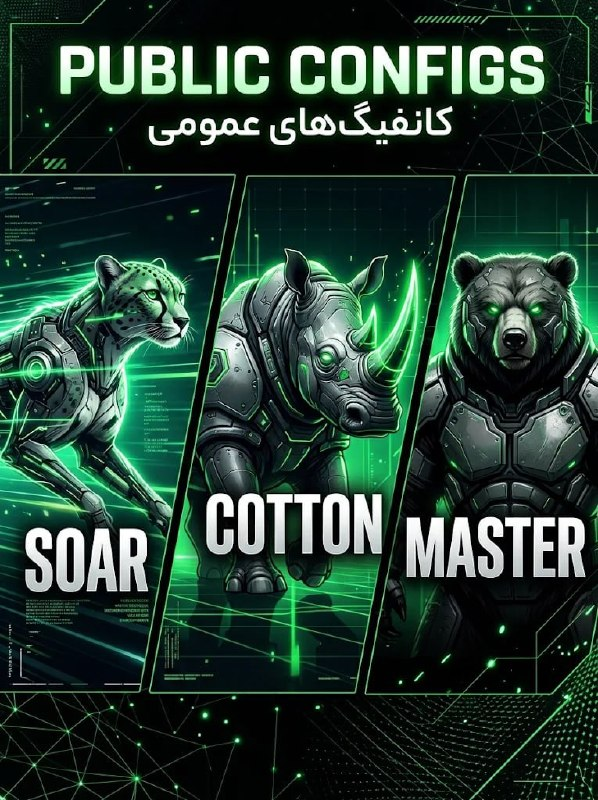

این کانفیگ ها را ذخیره کنید   
در زمان قطعی فعال خواهد شد   

\# whitedns public 2  
`soar://eyJwcm9maWxlIjp7ImlkIjoiZGM4MGYyMzNiZjQyNDg0MzdjZDMyZWU0N2NlOWRkYTgiLCJuYW1lIjoid2hpdGVkbnMgcHVibGljIDIiLCJyZXNvbHZlcnMiOlsiMS4xLjEuMSIsIjguOC44LjgiXSwic2VydmVyIjp7ImRvbWFpbiI6IjNzYXBlbTU3aWplZWc3Z3RmM3NoejIuc29hci53aGl0ZWRucy5kb3dubG9hZCIsInB1YmxpY19rZXkiOiJ1VVdrOU4yc3lXVG1sUUFPOHlsa3ZpaWkxSVFHRjlJa0JabFFSYkZsNjNNPSJ9LCJzb2FyU2V0dGluZ3MiOnsidHJhbnNwb3J0IjoiYXV0byIsImRpc2NvdmVyeSI6dHJ1ZSwiZGlzY292ZXJ5V2FudCI6MiwiZGlzY292ZXJ5Q29uY3VycmVuY3kiOjIsImRpc2NvdmVyeVBhY2VNcyI6MTAwMCwic2FmZVFOYW1lIjoxMDEsIm1heFFOYW1lIjoyNTMsIm1heEFuc3dlciI6MTIzMiwiaG9sZE1zIjo1MDAsIm1heEluZmxpZ2h0IjoxMjgsIm1heFBhdGhXaW5kb3ciOjMyLCJtYXhTdHJlYW1zIjoxMjgsInN0cmVhbVdpbmRvd0tpQiI6MjU2LCJzZW5kQnVmZmVyS2lCIjo2NCwic2Vzc2lvbklkbGVTZWNvbmRzIjo5MCwiZGlhbFRpbWVvdXRTZWNvbmRzIjo5MCwiY291bnRyeSI6IklSIn19LCJzY2hlbWEiOiJ3aGl0ZWRucy5wcm9maWxlIiwidmVyc2lvbiI6MX0`

… [ادامه در تلگرام](https://t.me/whitedns/2307)

· · ·

**🕒 ۱۴۰۵/۰۸/۳۰ ۱۴:۳۹** · [پست 2306](https://t.me/whitedns/2306)

👆  
دوستان :   

برای ربات محدودیت 8 درخواست در دقیقه گذاشته شده که گاها تا 12 درخواست هم شارژ میشه دلیلش هم این هست  که ما با انبود درخواست زامبی ها و بات های خزنده و هوش مصنوعی مواجه نشیم .   

لطفا در اوقات مختلف تلاش کنید   

ممنون  

----------  
#اطلاعیه #ربات

· · ·

**🕒 ۱۴۰۵/۰۸/۳۰ ۱۳:۳۸** · [پست 2305](https://t.me/whitedns/2305)

🎁 **کانفیگ رایگان WhiteDNS در تلگرام**  

از داخل [ربات ](https://t.me/whitednsPanelSoarbot)درخواست بدهید و نتیجه را در «حساب من» ببینید.  

**راهنمای کوتاه**  
۱. ربات را باز کنید و `/ start`  را بفرستید. برای انتخاب زبان، دکمهٔ «فارسی / English» در ردیف اول منو است.  

۲. «دریافت کانفیگ رایگان» را بزنید و یک پلن انتخاب کنید.  

۳. به همان پیام ربات پاسخ بدهید. ابتدا کد را بنویسید، یک فاصله بگذارید و دلیل کوتاه درخواستتان را اضافه کنید.  

نکته خیلی مهم : ادمین ها گزینشی و بر اساس متن شما درخواست شما را تایید میکنند - پس این موضوع را جدی بگیرید . پاسخ شما **"فقط باید به زبان فارسی باشه "**   

۴. درخواست را از «حساب من» پیگیری کنید. پس از تأیید، لینک اتصال یا کد QR را از همان بخش بگیرید و در WhiteDNS وارد کنید.  

[@whitedns](https://t.me/whitedns)   
[https://whitedns.online](https://whitedns.online/)

🎬 ویدیو: [مشاهده در تلگرام](https://t.me/whitedns/2305)

· · ·

**🕒 ۱۴۰۵/۰۸/۳۰ ۰۸:۲۲** · [پست 2304](https://t.me/whitedns/2304)

در ادامه همین موضوع، باید ربات کانفیگ رو راه بندازیم تا از اون کانفیگ بگیرید.   

خیلی کاریش نمیشه کرد چون باقی کاربر ها از کشور های دیگه هم میتونن برن و کانفیگ روزانه بگیرن اما یکم کنترل شده تر میشه.  

----------  
#اطلاعیه #ربات

· · ·

**🕒 ۱۴۰۵/۰۸/۳۰ ۰۷:۲۹** · [پست 2303](https://t.me/whitedns/2303)

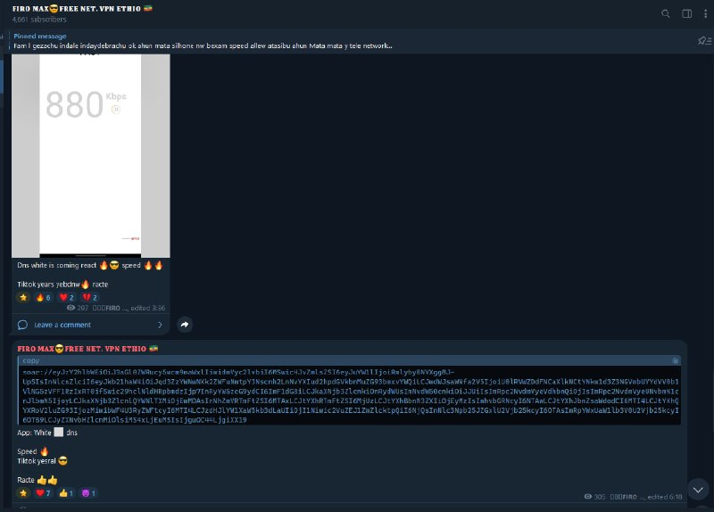

موقت ⚠️  

عجیب ولی واقعی !   

کانفیگ های whitedns که ما برای مردم شریف و عزیز ایران درست میکنیم را الان در کانال های مربوط به قبایل گومبا گومبا تا ساحل اج تا دور افتاده ترین نقاط سیبری و قبایل امازون تا چین و روسیه و .......... میتونید پیدا کنید   

زبان ادم بند میاد که چی بگه   

😔

· · ·

**🕒 ۱۴۰۵/۰۸/۳۰ ۰۵:۲۷** · [پست 2302](https://t.me/whitedns/2302)

(نسخه آزمایشی) whitevpn desktop 1.0.25 beta.1  منتشر شد 🚀  

چه چیزهایی تازه است؟  
🔹 روش اتصال ساده: در صفحهٔ VPN فقط یک سؤال هست: «چطور وصل شوید؟» یکی از پنج گزینه را انتخاب کنید، بقیه کار با برنامه است.  
🔹ا WARP رایگان کلودفلر: با یک کلیک حساب WARP ساخته می‌شود.  
🔹 موتورهای Psiphon و Tor: برای وقتی که فیلترینگ شدید است.  
🔹 دو سرور پشت هم: ترافیک از دو سرور رد می‌شود و سخت‌تر مسدود می‌شود.  
🔹ا ECH خودکار: نام سایت در اتصال‌های CDN پنهان می‌شود.  
🔹 هستهٔ جدید mihomo نسخهٔ ۱.۱۹.۳۴  

📘 آموزش کوتاه  

۱  
. نصب: از صفحهٔ انتشار در گیت‌هاب، فایل مناسب سیستم خود را دانلود کنید:  
• ویندوز معمولی: windows-x64.msi  
• ویندوز ARM: windows-arm64.msi  
• مک: [macos-arm64.zip](http://macos-arm64.zip/) (اپل سیلیکون) یا [macos-amd64.zip](http://macos-amd64.zip/) (اینتل)  
• لینوکس: deb، rpm یا AppImage  

۲. انتخاب روش اتصال: در صفحهٔ VPN یکی از این گزینه‌ها را بزنید:  
• خودکار — پیشنهادی؛ برنامه خودش سرور سالم را پیدا می‌کند.  
• دو سرور پشت هم — امن‌تر ولی کمی کندتر. ترکیب پیشنهادی: نود ۱ = WARP، نود ۲ = یک کانفیگ عمومی.  
•ا WARP — رایگان و سریع، اگر در شبکهٔ شما باز باشد.  
•ا Psiphon — وقتی هیچ‌چیز وصل نمی‌شود؛ خودش راه پیدا می‌کند.  
•ا Tor — بیشترین حریم خصوصی، کندترین حالت.

… [ادامه در تلگرام](https://t.me/whitedns/2302)

🎬 ویدیو: [مشاهده در تلگرام](https://t.me/whitedns/2302)

· · ·

**🕒 ۱۴۰۵/۰۸/۲۹ ۱۷:۵۰** · [پست 2300](https://t.me/whitedns/2300)

دوستان :⚠️  

وبسایت ما به آدرس [https://whitedns.online](https://whitedns.online/) هر چند ساعت یکبار به صورت اتوماتیک بروز رسانی میشه   

نیازی نیست شما در گروه ها و یا از ادمین ها به صورت پراکنده در مورد نرم افزارهای مختلف سوال کنید   

به وبسایت مراجعه کنید ، هر آنچه نیاز شما باشد آنجا موجود است   

[@whitedns](https://t.me/whitedns)  

----------  
#اطلاعیه

· · ·

**🕒 ۱۴۰۵/۰۸/۲۹ ۱۵:۵۲** · [پست 2298](https://t.me/whitedns/2298)

🚀 (نسخه آزمایشی) WhiteVPN mobile 1.8.0-beta.2 منتشر شد !  

این نسخه آزمایشی است؛ اگر دنبال پایداری کامل هستید، فعلاً روی 1.7.1 بمانید. ⚠️  

✨ تغییرات اصلی  

🔹 هسته جدید Mihomo v1.19.34  
اثرانگشت TLS به‌روزتر، رفع یک مشکل امنیتی و پایداری بهتر اتصال‌های XHTTP و DoH.  

ا🔹 ECH خودکار   
برای کانفیگ‌های CDN (WebSocket، gRPC و XHTTP) نام سایت در TLS پنهان می‌شود. اگر سرور از ECH پشتیبانی نکند، اتصال عادی برقرار می‌شود.  
روشن/خاموش: تنظیمات ← امنیت اتصال ← «ECH خودکار»  

🔹 موتورهای اتصال جدید  
Tor (obfs4 / Snowflake / Conjure)، Psiphon، SSH، AmneziaWG و IKEv2  

وارپ (warp) رایگان کلادفلر  
ساخت حساب WARP با یک لمس، بدون نیاز به کانفیگ.  

🔹 زنجیره اتصال بازطراحی شد  
مسیر: گوشی ← نود ۱ ← نود ۲ ← اینترنت  

━━━━━━━━━━━━━━  
📖 آموزش  

1️⃣ ساخت WARP  
پروفایل‌ها ← افزودن ← WARP (Cloudflare)  
یک پروفایل WARP ساخته می‌شود. آن را انتخاب کنید و وصل شوید.  
اگر وصل نشد: روی پروفایل ← ویرایش، یک IP یا پورت دیگر امتحان کنید (مثلاً 2408، 854، 894). «نویز ضدفیلتر» را روشن بگذارید.  

2️⃣ افزودن Tor یا Psiphon  
پروفایل‌ها ← افزودن ← Tor یا Psiphon  
• Tor: اگر obfs4 وصل نشد، Snowflake را امتحان کنید.  
• Psiphon: حالت «auto» را بگذارید. انتخاب کشور اختیاری است.

… [ادامه در تلگرام](https://t.me/whitedns/2298)

🎬 ویدیو: [مشاهده در تلگرام](https://t.me/whitedns/2298)

· · ·

**🕒 ۱۴۰۵/۰۸/۲۹ ۰۸:۳۸** · [پست 2297](https://t.me/whitedns/2297)

🖼 *(عکس بعد از ۲۴ ساعت حذف شده)*

🍓  **این سه‌تا رو امتحان کن**  

🛡 **UAC SNI Spoofer**  
اگه نتتون ایرانسل یا همراه اوله، توی UAC حالت ‎**UAC PoW**‎ رو هم تست کنین. برنامه چند روش اتصال داره پروفایل نت خودتون رو انتخاب کنین. برای ایرانسل ‎**Irancell** ‎ و برای همراه اول ‎**MCI**‎ رو امتحان کنین.  
📲 [نسخهٔ اندروید](https://github.com/Floxu1/UAC-SNI-Spoofer-Android) | [نسخهٔ ویندوز](https://github.com/Floxu1/UAC-SNI-Spoofer-Windows/releases)  
⚡️**Alan RIP DPI**  
اگه یه کانفیگ  **Pages**‎ دارین که توی کلاینت همیشگیتون وصل نمی‌شه، همون رو توی alan وارد کنین و چندتا از روش‌های اتصالش رو تست کنین. بعضی وقتا همون کانفیگ با یکی از متد ها دوباره کار میکنه.   
📲 [نسخهٔ اندروید](https://github.com/DrAlanK/Alan-RIP-Dpi-Android) | [نسخهٔ ویندوز](https://github.com/DrAlanK/Alan-RIP-Dpi-Windows)  
**🤍 WhiteAesther**  
اگه حالت خودکار وصل نشد، این ترکیب دستی رو امتحان کنین 👇🏻  
🔹 **مرحلهٔ ۱** — برین توی تب ‎**Method**‎ و اتصال اول رو روی ‎**Aether**‎ بذارین.  
🔹 **مرحلهٔ ۲** — برای اتصال دوم ‎**Psiphon**‎ رو انتخاب کنین. اگه جواب نداد، جاش ‎**Tor**‎ رو تست کنین.  
🔹 **مرحلهٔ ۳** — توی بخش ‎**Protocol**‎ اول ‎**Automatic**‎ رو امتحان کنین. اگه وصل نشد، ‎**MASQUE H2**‎ رو بذارین.

… [ادامه در تلگرام](https://t.me/whitedns/2297)

· · ·

**🕒 ۱۴۰۵/۰۸/۲۹ ۰۶:۱۷** · [پست 2296](https://t.me/whitedns/2296)

🖼 *(عکس بعد از ۲۴ ساعت حذف شده)*

نسخه 1.14.1 whiteaesther مبایل منتشر شد !   

این نسخه «قوانین مسیریابی» را درست می‌کند. حالا هر قانونی که می‌نویسید، در هر روش اتصال، دقیقاً همان کاری را می‌کند که می‌گوید.  
✅ **«خارج از تونل» واقعاً از تونل رد نمی‌شود**  
سایت‌هایی که در این فهرست می‌گذارید مستقیم باز می‌شوند، و آدرس‌شان را هم DNS شبکهٔ خودتان پیدا می‌کند، درست مثل وقتی که برنامه خاموش است.  
✍️ **هر جور بنویسید، فهمیده می‌شود**  
نشانی کامل (`https://site.com/`)، نام با پورت (`site.com:443`)، `*.site.com`، آدرس IPv4 و IPv6 و محدودهٔ IP.  
خطی که قانون نیست، زیر همان کادر به رنگ قرمز نشان داده می‌شود تا با یک قانون سالم اشتباه نشود.  
🔍 **قانون‌ها روی اتصال‌های با آدرس مستقیم هم اعمال می‌شوند**  
برنامه‌ای که با IP وصل می‌شود هم از روی نام سایت تشخیص داده می‌شود.  
⚡️ **بدون قطع و وصل دستی**  
اگر وقتی وصل هستید قانون‌ها را تغییر دهید، برنامه بعد از چند لحظه خودش با قانون‌های جدید دوباره وصل می‌شود.  
این تغییرها در همهٔ روش‌ها کار می‌کنند: Aether با همهٔ پروتکل‌ها، Automatic، Psiphon، Tor، زنجیرهٔ خروجی و اتصال دو مرحله‌ای، چه در حالت پراکسی و چه در حالت تونل کامل.  
📥 دانلود:  
[https://github.com/WhiteDNS/WhiteAesther/releases/latest](https://github.com/WhiteDNS/WhiteAesther/releases/latest)

… [ادامه در تلگرام](https://t.me/whitedns/2296)

· · ·

**🕒 ۱۴۰۵/۰۸/۲۹ ۰۴:۵۳** · [پست 2295](https://t.me/whitedns/2295)

🖼 *(عکس بعد از ۲۴ ساعت حذف شده)*

🟢 پنل WhiteDNS نسخهٔ 0.16.0 منتشر شد  
خلاصهٔ امکانات تازهٔ نسخه‌های 0.15 و 0.16 و طرز استفاده از آن‌ها 👇  

━━━━━━━━━━━━━━  
📤 خروجی گروهی کانفیگ‌ها  
دیگر لازم نیست حساب‌ها را یکی‌یکی باز کنید.  

طرز کار:  
۱. به «حساب‌های کاربری» بروید.  
۲. حساب‌های دلخواه را تیک بزنید (یا «انتخاب همه»).  
۳. در نوار بالای جدول، «خروجی کانفیگ‌ها» را بزنید.  
۴. «دانلود فایل» یا «کپی» را انتخاب کنید.  

در فایل، برای هر حساب نام، لینک مستقیم Soar، Cotten و MasterDNS و در آخر لینک ساب آمده است.  
🔐 این فایل کلید اتصال حساب‌ها را دارد؛ فقط به صاحب هر حساب بدهید.  

━━━━━━━━━━━━━━  
🌐 پشتیبانی کامل از چند دامنه  
اگر برای سرور چند دامنهٔ تونل تنظیم کرده‌اید، حالا لینک و QR همهٔ دامنه‌ها در دسترس است، نه فقط دامنهٔ ترجیحی.  

طرز کار:  
• در پنجرهٔ «لینک / QR» یک ردیف «دامنه» اضافه شده؛ دامنه را انتخاب کنید تا لینک و QR همان دامنه نمایش داده شود.  
• در «خروجی کانفیگ‌ها» تیک هر دامنه را بزنید یا بردارید؛ لینک‌ها به تفکیک دامنه مرتب می‌شوند و دامنهٔ ترجیحی اول می‌آید.  
• لینک ساب مثل قبل همهٔ دامنه‌ها را خودکار دارد.  
♻️ لینک‌های فعلی، کلیدها و لینک ساب هیچ تغییری نمی‌کنند.  

━━━━━━━━━━━━━━  
🎨 ظاهر تازهٔ پنل  
• منوی کناری در سه گروه: «اصلی»، «پایش و حفاظت» و «سرور»

… [ادامه در تلگرام](https://t.me/whitedns/2295)

· · ·

**🕒 ۱۴۰۵/۰۸/۲۸ ۱۳:۱۷** · [پست 2293](https://t.me/whitedns/2293)

🖼 *(عکس بعد از ۲۴ ساعت حذف شده)*

🔭 **دانلود ابزارهای WhiteDNS**  

**⛏️ اپلیکیشن ها**  
**📱 WhiteAesther**  
[دانلود موبایل](https://github.com/WhiteDNS/WhiteAestherMobile/releases) • [دانلود دسکتاپ](https://github.com/WhiteDNS/WhiteAesther/releases)  
**🛡 WhiteVPN**  
[دانلود موبایل](https://github.com/WhiteDNS/WhiteVPN/releases) • [دانلود دسکتاپ](https://github.com/WhiteDNS/WhiteVPN-Desktop/releases)  
**🌐 WhiteDNS** مناسب دوران قطعی  
[دانلود اندروید](https://github.com/WhiteDNS/WhiteDNS-Android/releases/latest) • [دانلود دسکتاپ](https://github.com/WhiteDNS/WhiteDNS-Desktop/releases/latest)  
**🔎 WhiteDNS Clean IP + Resolver Finder**  
[دانلود برای موبایل و دسکتاپ](https://github.com/WhiteDNS/WhiteDNS-cleanip-finder/releases/latest)  
**🍎 CoreForge VPN + DNS**  
[دریافت نسخه iOS از TestFlight](https://testflight.apple.com/join/DRkT6zny)  
🎮 WhiteGame  
[دریافت نسخه اندروید](https://github.com/TaJirax/WhiteGame)  
🔥**whitedns Panel (soar)**  
 [ریپو و راهنمای نصب](https://github.com/WhiteDNS/Soar-Server)  

**🤖 ربات‌های WhiteDNS**   

⚠️ربات برای گرفتن کانفیگ exit chain   
 [@WhiteDnsChainbot](https://t.me/WhiteDnsChainbot)  

⚠️ربات برای گرفتن کانفیگ اضطراری (مستر دی ان اس )

… [ادامه در تلگرام](https://t.me/whitedns/2293)

· · ·

**🕒 ۱۴۰۵/۰۸/۲۸ ۱۱:۴۶** · [پست 2292](https://t.me/whitedns/2292)

🖼 *(عکس بعد از ۲۴ ساعت حذف شده)*

سری (2)  

کانفیک اضطراری (موقت) به مدت 1 روز -  whitedns   

["کانفیگ های قبلی را پاک نکنید ](https://t.me/whitedns/2264) . در ضورت ملی شدن نت اونها دوباره فعال میشه "  

\# Whitedns-Emergency Config  
`soar://eyJwcm9maWxlIjp7ImlkIjoiOTA0NDdhYzJiNzRkOTQyZDMwZWVlZDc1YTY4NTI5M2IiLCJuYW1lIjoiV2hpdGVkbnMtRW1lcmdlbmN5IENvbmZpZyIsInJlc29sdmVycyI6WyIxLjEuMS4xIiwiOC44LjguOCJdLCJzZXJ2ZXIiOnsiZG9tYWluIjoiand2c2FjcDV5NmVhbjZraWNzbHJ4di5zb2FyLndoaXRlZG5zLmRvd25sb2FkIiwicHVibGljX2tleSI6IlNJUVVmQ3RTQml5ZDQrWDZMNXd2dzRlZm1FWHVVdG9VZTRuc1RRdUcyMUU9In0sInNvYXJTZXR0aW5ncyI6eyJ0cmFuc3BvcnQiOiJhdXRvIiwiZGlzY292ZXJ5Ijp0cnVlLCJkaXNjb3ZlcnlXYW50IjoyLCJkaXNjb3ZlcnlDb25jdXJyZW5jeSI6MiwiZGlzY292ZXJ5UGFjZU1zIjoxMDAwLCJzYWZlUU5hbWUiOjEwMSwibWF4UU5hbWUiOjI1MywibWF4QW5zd2VyIjoxMjMyLCJob2xkTXMiOjUwMCwibWF4SW5mbGlnaHQiOjEyOCwibWF4UGF0aFdpbmRvdyI6MzIsIm1heFN0cmVhbXMiOjEyOCwic3RyZWFtV2luZG93S2lCIjoyNTYsInNlbmRCdWZmZXJLaUIiOjY0LCJzZXNzaW9uSWRsZVNlY29uZHMiOjkwLCJkaWFsVGltZW91dFNlY29uZHMiOjkwLCJjb3VudHJ5IjoiSVIifX0sInNjaGVtYSI6IndoaXRlZG5zLnByb2ZpbGUiLCJ2ZXJzaW9uIjoxfQ`

… [ادامه در تلگرام](https://t.me/whitedns/2292)

· · ·

**🕒 ۱۴۰۵/۰۸/۲۸ ۰۹:۱۸** · [پست 2291](https://t.me/whitedns/2291)

↪️ فوروارد از White DNS

🟢 وب‌سایت جدید WhiteDNS؛ مسیرت را پیدا کن، ابزارت را بشناس.  

طراحی تازه، جست‌وجوی آنی (Ctrl + K)، انتخاب سریع سیستم‌عامل و دسترسی یکپارچه به WhiteVPN، WhiteAesther، WhiteDNS، Clean IP Finder، CoreForge، WhiteGame، WhiteDNS Panel و آینهٔ فید تلگرام — همه‌چیز در یک صفحه.  

🌐 [https://whitedns.online](https://whitedns.online/)  
🆔 [@WhiteDNS](https://t.me/WhiteDNS)

🎬 ویدیو: [مشاهده در تلگرام](https://t.me/whitedns/2291)

· · ·

**🕒 ۱۴۰۵/۰۸/۲۸ ۰۶:۲۰** · [پست 2290](https://t.me/whitedns/2290)

🖼 *(عکس بعد از ۲۴ ساعت حذف شده)*

🚀 پنل وایرگارد و امنزیا بلو نایت؛ کانفیگ شخصی خودت رو بساز!  

نصب با یک دستور  

✅ پشتیبانی از WireGuard و AmneziaWG  
✅ تعیین حجم و تاریخ انقضا برای هر کاربر  
✅ خروجی WARP کلودفلر  
✅ دریافت کانفیگ و QR Code  
✅ تم‌های متنوع  

🎬 آموزش نصب و اتصال:      [https://youtu.be/ddoXBOQPAMM](https://youtu.be/ddoXBOQPAMM)  

·:¨༺ [@BlueKnight\_Net](https://t.me/BlueKnight_Net) ༻¨:·

· · ·

**🕒 ۱۴۰۵/۰۸/۲۷ ۱۱:۰۳** · [پست 2289](https://t.me/whitedns/2289)

اموزش whiteaesther desktop :   

🔗 🎬 اتر + سایفون،   
در ۸ قدم  

اتر از فیلترینگ رد می‌شود. سایفون تعیین می‌کند از کدام کشور بیرون بیایی. وقتی این دو را پشت هم بگذاری، هر دو مزیت را با هم داری.  

۱. برنامه را باز کن. صفحهٔ «ساده» می‌آید و تنظیمات پیش‌فرض آماده است.  

۲. پایین صفحه نوع اتصال را انتخاب کن:  
• فقط همین برنامه: پروکسی روی [127.0.0.1:1819](http://127.0.0.1:1819/)  
• کل دستگاه: پروکسی سیستم ویندوز  
• تونل کامل: همهٔ برنامه‌ها (دسترسی ادمین می‌خواهد)  

۳. اول فقط با اتر وصل شو: دکمهٔ «اتصال» را بزن. سبز که شد یعنی کار می‌کند. حالا «قطع اتصال» را بزن.  

۴. نوار «تنظیمات پیشرفته» کنار صفحه را باز کن و برو به «مسیرها و پروتکل‌ها».  

۵. «راه خروج را برایم پیدا کن» را خاموش کن. زیر «خروج از این شبکه با» گزینهٔ Aether انتخاب بماند.  

۶. زیر «و سپس خروج از» گزینهٔ سایفون را بزن. زنجیره می‌شود: اول Aether، بعد سایفون.  

۷. (اختیاری) از «کشور خروج» یک کشور انتخاب کن، یا «بهترین گزینهٔ موجود» را بگذار. فهرست کشورها بعد از اولین اتصال سایفون پر می‌شود.  

۸. دوباره «اتصال» را بزن. تمام! در کارت «چیزی که سایت‌ها می‌بینند» کشور سایفون را می‌بینی.  

⏳ اولین اتصال سایفون روی شبکه‌های سخت ممکن است چند دقیقه طول بکشد. صبور باش؛ دفعه‌های بعد خیلی سریع‌تر است.

… [ادامه در تلگرام](https://t.me/whitedns/2289)

🎬 ویدیو: [مشاهده در تلگرام](https://t.me/whitedns/2289)

· · ·

**🕒 ۱۴۰۵/۰۸/۲۷ ۱۰:۲۶** · [پست 2287](https://t.me/whitedns/2287)

آموزش whiteaesther mobile :   

🎬 اتر + سایفون:   
اتصال دو مرحله‌ای در WhiteAesther برای تحریم شکن (هوش مصنوعی جمنای و چت جی پی تی و ...................... )   

این ویدیو همهٔ مراحل را از اولین باز کردن برنامه تا اتصال نشان می‌دهد. اول اتر وصل می‌شود و بعد سایفون از داخل اتر. اپراتور فقط اتر را می‌بیند و سایت‌ها آی‌پی سایفون را.  

۱. در صفحهٔ اتصال «تغییر» را بزنید و کارت «سریع · اتر» را انتخاب کنید.  
۲. پروفایل «تطبیقی» را نگه دارید.  
۳. «اتصال ترکیبی» را باز کنید.  
۴. در بخش «بعد»، سایفون را انتخاب کنید.  
۵. برگردید و دکمهٔ اتصال را بزنید.  

اگر «اتصال ترکیبی» را در برگهٔ روش اتصال نمی‌بینید، از این مسیر بروید: تنظیمات ← پیشرفته ← اتصال ترکیبی.  

💡 نکته‌ها  
• حالت VPN را عوض نکنید. پروکسی برای اتصال ترکیبی در دسترس نیست.  
• دو تونل روی هم کندتر از اتر تنهاست. برای کارهای روزمره «هیچ‌چیز دیگر» سریع‌تر است.  
• اگر وصل نشد، پروفایل «شبکهٔ سخت‌گیر» یا «سیگنال ناپایدار» را امتحان کنید.  

📥 دانلود: [https://github.com/WhiteDNS/WhiteAestherMobile/releases/latest](https://github.com/WhiteDNS/WhiteAestherMobile/releases/latest)  

#اموزش   

[@whitedns](https://t.me/whitedns)   
[https://whitedns.online](https://whitedns.online/)  

----------  
#آموزش #WhiteAesther

🎬 ویدیو: [مشاهده در تلگرام](https://t.me/whitedns/2287)

· · ·

**🕒 ۱۴۰۵/۰۸/۲۷ ۱۰:۰۶** · [پست 2286](https://t.me/whitedns/2286)

🎬 ویدیو: [مشاهده در تلگرام](https://t.me/whitedns/2286)

· · ·

**🕒 ۱۴۰۵/۰۸/۲۷ ۱۰:۰۶** · [پست 2285](https://t.me/whitedns/2285)

🖼 *(عکس بعد از ۲۴ ساعت حذف شده)*

برنامه whiteaesther desktop **۱.۱۴.۰ دسکتاپ منتشر شد** 🚀  

**چرا آپدیت کنید؟**  
🔧 **مشکل لود نشدن ساب حل شد.** در نسخه‌ی قبل، اگه یک بار قطع می‌کردید و بعد ساب اضافه یا عوض می‌کردید، لیست کانفیگ‌ها خالی می‌موند. اتصال بعدی هم گاهی fail می‌شد. این مشکل کامل برطرف شده.  
🌐 **بدون تونل هم ساب دانلود میشه.** اگه «اتصال به نودها از داخل تونل» رو خاموش کرده بودید، ساب اصلاً دانلود نمی‌شد. حالا درست کار می‌کنه.  
📋 **لیست نودها قبل از وصل شدن.** دیگه لازم نیست اول وصل بشید تا نودها رو ببینید. با دکمه‌ی «به‌روزرسانی اشتراک‌ها» هر وقت خواستید ساب رو تازه کنید.  
⚡️ **نود خودکار.** برنامه خودش سریع‌ترین نود رو انتخاب می‌کنه. اگه خودتون نودی انتخاب کنید، بعد از reconnect هم همون می‌مونه.  
📶 **تست همه‌ی نودها.** با «تست همه» یا «تست انتخاب‌شده‌ها» پینگ همه رو یک‌جا بگیرید. لیست از سریع‌ترین مرتب میشه، و جستجو و فیلتر پروتکل (Vless، Trojan و…) هم داره.  
👁 **نود فعلی در صفحه‌ی اصلی.** همیشه می‌بینید ترافیکتون از کدوم نود خارج میشه.  
دانلود از صفحه‌ی Releases گیت‌هاب، یا از بخش آپدیت داخل خود برنامه.  

[https://github.com/WhiteDNS/WhiteAesther/releases/tag/v1.14.0](https://github.com/WhiteDNS/WhiteAesther/releases/tag/v1.14.0)  

[@whitedns](https://t.me/whitedns)

… [ادامه در تلگرام](https://t.me/whitedns/2285)

· · ·

**🕒 ۱۴۰۵/۰۸/۲۷ ۰۷:۲۲** · [پست 2284](https://t.me/whitedns/2284)

🖼 *(عکس بعد از ۲۴ ساعت حذف شده)*

🔄 نسخه‌ی ۱.۱۸.۰ whiteaesther mobile منتشر شد  

شاید بپرسید چرا فقط چند روز بعد از ۱.۱۷.۰ یه نسخه‌ی جدید اومده. علتش اینه که بعد از انتشار ۱.۱۷.۰، گزارش‌های شما نشون داد زنجیره‌ی خروج (Exit chain) درست کار نمیکنه. اشتراک‌ها لود نمیشدن، لیست کانفیگ‌ها نمیومد و انتخاب نود عملاً ممکن نبود. چون خیلی از شما برای خروج از آی‌پی کلودفلر به همین بخش وابسته‌اید، نخواستیم تا نسخه‌ی بعدی صبر کنیم.  

✅ چی درست شد:  
• اشتراک‌ها دوباره درست دریافت میشن و لیست نودها نمایش داده میشه  
• اتصال با زنجیره‌ی خروج از همون بار اول برقرار میشه  
• زنجیره‌ی خروج حالا در حالت پروکسی هم کار میکنه، نه فقط VPN  

✨ امکانات جدید:  
• دکمه‌ی «به‌روزرسانی اشتراک‌ها»: هر وقت کانفیگ‌های اشتراکتون عوض شد، با یه دکمه لیست جدید رو بگیرید  
• تست پینگ همه‌ی نودها، حتی قبل از اتصال، با مرتب‌سازی بر اساس سرعت، جستجو و فیلتر پروتکل  
• انتخاب نود خودکار یا دستی: خودکار سریع‌ترین نود رو انتخاب میکنه، یا خودتون یکی رو انتخاب کنید  
• صفحه‌ی اصلی حالا اسم نودی که باهاش وصل هستید، کشور و پینگ واقعی نود رو نشون میده  

📍 «زنجیره‌ی خروج کجا رفت؟»  
خیلی‌ها پرسیده بودید. حالا وقتی روی «تغییر» در صفحه‌ی اصلی میزنید، پایین لیست روش‌ها، بخش «تنظیمات بیشتر اتصال» هست و زنجیره‌ی خروج و اتصال ترکیبی (Two-hop) مستقیم اونجان.

… [ادامه در تلگرام](https://t.me/whitedns/2284)

· · ·

---

## ircfspace

[کانال در تلگرام](https://t.me/ircfspace) · [آرشیو متن](archive/ircfspace/)

**🕒 ۱۴۰۵/۰۸/۲۹ ۲۳:۴۴** · [پست 2725](https://t.me/ircfspace/2725)

فعالیتم رو بعد از آغاز جنبش مهسا و با هدف کمک به دسترسی آزاد مردم به اینترنت شروع کردم. توی این چند سال، بخش زیادی از زمان، انرژی و توانم رو صرف این مسیر کردم و در تمام این مدت، با وجود پیشنهادهای متعدد، هیچوقت تبلیغی منتشر نکردم، از فروش VPN کسب درآمد نکردم و هیچ فاند یا کمک مالی سازمانی هم دریافت نکردم.  
این انتخاب آگاهانه بود. نمی‌خواستم فعالیتی که با هدف کمک به مردم و دسترسی آزاد به اینترنت شکل گرفته، به محلی برای کسب درآمد از شرایط سخت و رنج اونها تبدیل بشه. مخصوصاً وقتی می‌دیدم این محدودیت‌ها و شرایط برای خیلی‌ها مستقیماً با زندگی، ارتباطات و آزادیشون گره خورده.  

اما مستقل موندن و ادامه دادن این مسیر هزینه داره. مدتیه تأمین هزینه‌ها و اختصاص زمان کافی به این فعالیت برام سخت‌تر از گذشته شده و واقعیت اینه که دیگه مدتیه نمیتونم تمام بارش رو به تنهایی به دوش بکشم. برای همین اگر مطالب، ابزارها و اطلاعاتی که در این سال‌ها منتشر کردم براتون مفید بوده و فکر می‌کنین ادامه این فعالیت ارزشمنده، خوشحال میشم در روشن موندن چراغ صفحاتم سهیم بشین. این دونیت کاملاً اختیاریه و هیچ امتیاز یا دسترسی ویژه‌ای در ازای اون ارائه نمیشه. قرار نیست چیزی تغییر کنه؛ همچنان مستقل، بدون تبلیغات و بدون وابستگی به هیچ مجموعه‌ای پیش میرم و حتی اگر هیچ حمایتی نشه، بازم از تمام کسانی که در این سال‌ها همراه

… [ادامه در تلگرام](https://t.me/ircfspace/2725)

· · ·

**🕒 ۱۴۰۵/۰۸/۲۹ ۲۰:۴۱** · [پست 2724](https://t.me/ircfspace/2724)

🖼 *(عکس بعد از ۲۴ ساعت حذف شده)*

هرچی تنش‌ها تشدید میشن، اختلال‌های اینترنت بیشتر میشن!  

🔗 [ᴡᴇʙꜱɪᴛᴇ](https://ircf.space/) • [ᴠᴘɴʜᴜʙ](https://t.me/persianvpnhub) • [ɢɪᴛʜᴜʙᴍɪʀʀᴏʀ](https://t.me/PersianGithubMirror)  
[@ircfspace](https://t.me/ircfspace)

· · ·

**🕒 ۱۴۰۵/۰۸/۲۹ ۲۰:۲۷** · [پست 2723](https://t.me/ircfspace/2723)

🖼 *(عکس بعد از ۲۴ ساعت حذف شده)*

آپدیت جدید فیلترشکن دیفیکس برای Android TV منتشر شده، که با بهبود عملکرد و پایداری، تعدادی از مشکلات گزارش‌شده در نسخه‌های قبلی رو برطرف کرده.  

دیفیکس همچنین اعلام کرده که هر ۶ مورد فنی و امنیتی شناسایی‌شده در ممیزی مستقل تیم پس‌کوچه رو بررسی و اصلاح کرده. این موارد حوزه‌هایی مثل حریم خصوصی، مدیریت اتصال، امنیت WebView و فرایند بیلد رو شامل میشدن و تغییرات مربوط به اون‌ها طی چند روز آینده در دسترس عموم قرار می‌گیره. در کنار این اصلاحات، بهبودهای مختلفی هم برای افزایش کیفیت و پایداری اتصال کاربران در نظر گرفته شده!  

👉 [play.google.com/store/apps/details?id=de.unboundtech.defyxvpn](http://play.google.com/store/apps/details?id=de.unboundtech.defyxvpn)  
💡 [defyxvpn.com/download](http://defyxvpn.com/download)  

🔗 [ᴡᴇʙꜱɪᴛᴇ](https://ircf.space/) • [ᴠᴘɴʜᴜʙ](https://t.me/persianvpnhub) • [ɢɪᴛʜᴜʙᴍɪʀʀᴏʀ](https://t.me/PersianGithubMirror)  
[@ircfspace](https://t.me/ircfspace)

· · ·

**🕒 ۱۴۰۵/۰۸/۲۸ ۲۳:۰۹** · [پست 2722](https://t.me/ircfspace/2722)

🖼 *(عکس بعد از ۲۴ ساعت حذف شده)*

اپ متن‌باز و رایگان BPB برای اندروید، یه کلاینت VPN مبتنی بر هسته Xray هست، که چندین روش مختلف برای عبور از محدودیت‌های اینترنت رو بصورت متمرکز جمع‌آوری کرده.   
این اپ از اتصال‌های Workers و Pages کلودفلر با امکان راه‌اندازی از طریق حساب شخصی، تا متدهای سایفون، مسک، وارپ و تور پشتیبانی می‌کنه و امکان ترکیب چند روش اتصال با قابلیت Chain Proxy رو در اختیارتون میذاره.  

👉 [github.com/bia-pain-bache/BPB-VPN/releases](http://github.com/bia-pain-bache/BPB-VPN/releases)  

🔗 [ᴡᴇʙꜱɪᴛᴇ](https://ircf.space/) • [ᴠᴘɴʜᴜʙ](https://t.me/persianvpnhub) • [ɢɪᴛʜᴜʙᴍɪʀʀᴏʀ](https://t.me/PersianGithubMirror)  
[@ircfspace](https://t.me/ircfspace)

· · ·

**🕒 ۱۴۰۵/۰۸/۲۷ ۰۰:۱۷** · [پست 2721](https://t.me/ircfspace/2721)

🖼 *(عکس بعد از ۲۴ ساعت حذف شده)*

پاول دورف اعلام کرده که از این پس ربات‌ها و مینی‌اپ‌های تلگرام برای فروش خدمات و محصولات دیجیتال داخل این پلتفرم، فقط میتونن از ارز داخلی تلگرام، یعنی Stars استفاده کنن. دلیل این محدودیت قوانین پرداخت اپ‌استور اپل و گوگل اعلام شده که استفاده از سیستم پرداخت اختصاصی خودشون رو برای خریدهای دیجیتال الزامی می‌کنه.  
با این حال، مدیرعامل تلگرام گفته ربات‌های VPN فعال در کشورهای تحت حکومت‌های سرکوبگر از این محدودیت معاف هستن و میتونن پرداخت‌هاشون رو با هر روش و ارزی دریافت کنن!   

🔗 [ᴡᴇʙꜱɪᴛᴇ](https://ircf.space/) • [ᴠᴘɴʜᴜʙ](https://t.me/persianvpnhub) • [ɢɪᴛʜᴜʙᴍɪʀʀᴏʀ](https://t.me/PersianGithubMirror)  
[@ircfspace](https://t.me/ircfspace)

· · ·

**🕒 ۱۴۰۵/۰۸/۲۷ ۰۰:۰۹** · [پست 2720](https://t.me/ircfspace/2720)

🖼 *(عکس بعد از ۲۴ ساعت حذف شده)*

اپ دسکتاپ WhiteAesther بصورت متن‌باز و رایگان برای ویندوز، لینوکس و macOS منتشر شد.   
این برنامه بر پایه هسته Aether، از پروتکل‌های MASQUE، WireGuard و WARP-in-WARP پشتیبانی می‌کنه و امکاناتی مثل انتخاب خودکار یا دستی گیت‌وی، بررسی تأخیر سرورها، اتصال مجدد هوشمند، تنظیم DNS و مسیریابی ترافیک رو در اختیار کاربر میذاره. همچنین امکان وارد کردن قوانین مسیریابی، محدود کردن ارتباط به IPv4 یا IPv6 و تنظیمات پیشرفته‌ای برای مقابله با اختلالات شبکه رو داره.  

👉 [github.com/WhiteDNS/WhiteAesther/releases](http://github.com/WhiteDNS/WhiteAesther/releases)  

🔗 [ᴡᴇʙꜱɪᴛᴇ](https://ircf.space/) • [ᴠᴘɴʜᴜʙ](https://t.me/persianvpnhub) • [ɢɪᴛʜᴜʙᴍɪʀʀᴏʀ](https://t.me/PersianGithubMirror)  
[@ircfspace](https://t.me/ircfspace)

· · ·

**🕒 ۱۴۰۵/۰۸/۲۶ ۲۳:۵۵** · [پست 2719](https://t.me/ircfspace/2719)

🖼 *(عکس بعد از ۲۴ ساعت حذف شده)*

گوگل در گزارش جدیدی که منتشر کرده، هشدار داده که استفاده هکرها از هوش مصنوعی برای اجرای حملات سایبری وارد مرحله تازه‌ای شده. به گفته گروه اطلاعات تهدید گوگل (GTIG)، هکرها حالا از چندین عامل هوش مصنوعی استفاده می‌کنن که می‌تونن بدون دخالت مستقیم انسان، آسیب‌پذیری‌های نرم‌افزاری رو پیدا کنن، کدهای مخرب بسازن و برای نفوذ به سیستم‌ها اقدام کنن.  
گوگل میگه برای اولین بار نمونه‌هایی از حملات رو شناسایی کرده که در اون‌ها فرایند پیدا کردن و سوءاستفاده از آسیب‌پذیری‌ها بطور کامل توسط هوش مصنوعی انجام شده. این شرکت پیش‌بینی می‌کنه طی شش ماه آینده حملات پیچیده و کاملاً خودکاری شکل بگیرن که برای اجرا به دخالت انسان نیاز نداشته باشن؛ یعنی هکرها می‌تونن با سرعت و مقیاسی بسیار بیشتر از گذشته به اهدافشون حمله کنن.  

© bleepingcomputer  

🔗 [ᴡᴇʙꜱɪᴛᴇ](https://ircf.space/) • [ᴠᴘɴʜᴜʙ](https://t.me/persianvpnhub) • [ɢɪᴛʜᴜʙᴍɪʀʀᴏʀ](https://t.me/PersianGithubMirror)  
[@ircfspace](https://t.me/ircfspace)

· · ·

**🕒 ۱۴۰۵/۰۸/۲۶ ۲۳:۴۲** · [پست 2718](https://t.me/ircfspace/2718)

طی روزهای اخیر کاربران برخی اپراتورها در ساعات مختلف با کندی، اختلال یا باز نشدن برخی سرویس‌های بین‌المللی از جمله سرویس‌های هوش مصنوعی مواجه شده‌اند.  
طبق پیگیری‌ها، بخشی از این اختلال به زیرساخت تحریم‌گذر شبکه مرتبط است، که ترافیک برخی سرویس‌ها را از دو مسیر آذربایجان و آلمان عبور می‌دهد. بررسی‌ها نشان می‌دهند عملکرد این مسیرها برای همه کاربران یکسان نیست؛ برخی سرویس‌ها روی مسیر آذربایجان و برخی روی مسیر آلمان اتصال پایدارتری دارند و هنگام سوییچ بین مسیرها، ممکن است دسترسی به سرویس برای مدتی مختل یا قطع شود.  
به همین دلیل ممکن است سرویسی مانند ChatGPT در یک لحظه بدون مشکل در دسترس باشد، اما دقایقی بعد همزمان با تغییر مسیر شبکه، با کندی یا اختلال مواجه شود.  

© IRRadar  

🔗 [ᴡᴇʙꜱɪᴛᴇ](https://ircf.space/) • [ᴠᴘɴʜᴜʙ](https://t.me/persianvpnhub) • [ɢɪᴛʜᴜʙᴍɪʀʀᴏʀ](https://t.me/PersianGithubMirror)  
[@ircfspace](https://t.me/ircfspace)

· · ·

**🕒 ۱۴۰۵/۰۸/۲۳ ۱۱:۴۶** · [پست 2717](https://t.me/ircfspace/2717)

🖼 *(عکس بعد از ۲۴ ساعت حذف شده)*

هسته‌ی رخش برای ساخت شبکه‌های چندگرهی و تانل‌های انعطاف‌پذیر ارا‌ئه شده، تا ترافیک رو بصورت مستقیم یا از طریق تانل، از هر تعداد سروری که در اختیار دارین عبور بده. هدفش اینه که به یک سرور یا روش ارتباطی خاص محدود نباشه و حتی روی شبکه‌هایی که سعی می‌کنن جلوی ارتباط رو بگیرن، به کارش ادامه بده.  

پروتکل اصلی رخش به نوع اتصال وابسته نیست و هر تانل از چند مسیر مستقل تشکیل شده، تا اگر یکی از مسیرها قطع شد، جریان‌های در حال انتقال بتونن از مسیر دیگه ادامه پیدا کنن. همینطور هر گره هویت و کلید اختصاصی خودش رو داره و ارتباط بین گره‌ها با احراز هویت و رمزنگاری سرتاسری محافظت میشن.  

👉 [github.com/CluvexStudio/rakhsh/releases](http://github.com/CluvexStudio/rakhsh/releases)  

🔗 [ᴡᴇʙꜱɪᴛᴇ](https://ircf.space/) • [ᴠᴘɴʜᴜʙ](https://t.me/persianvpnhub) • [ɢɪᴛʜᴜʙᴍɪʀʀᴏʀ](https://t.me/PersianGithubMirror)  
[@ircfspace](https://t.me/ircfspace)

· · ·

**🕒 ۱۴۰۵/۰۸/۲۱ ۰۸:۵۷** · [پست 2716](https://t.me/ircfspace/2716)

🖼 *(عکس بعد از ۲۴ ساعت حذف شده)*

اپ متن‌باز و رایگان theFeed یه فید ریدر و پیامرسان مبتنی بر DNS برای اندروید، iOS، ویندوز، لینوکس و مک هست، که باهاش می‌تونین کانال‌های تلگرام و حساب‌های عمومی X رو بخونین، با کاربران دیگه چت رمزنگاری‌شده سرتاسری داشته باشین و حتی طبق آخرین آپدیتش، مستقیماً وارد حساب تلگرام خودتون بشین.   
همه این کارها از طریق DNS انجام میشه و برای استفاده از قابلیت‌های اصلی برنامه نیازی به راه‌اندازی سرور شخصی ندارین؛ چون چند کانفیگ عمومی از قبل داخل برنامه قرار گرفته.  

👉 [github.com/sartoopjj/thefeed/releases](http://github.com/sartoopjj/thefeed/releases)  

🔗 [ᴡᴇʙꜱɪᴛᴇ](https://ircf.space/) • [ᴠᴘɴʜᴜʙ](https://t.me/persianvpnhub) • [ɢɪᴛʜᴜʙᴍɪʀʀᴏʀ](https://t.me/PersianGithubMirror)  
[@ircfspace](https://t.me/ircfspace)

· · ·

**🕒 ۱۴۰۵/۰۸/۲۱ ۰۸:۳۸** · [پست 2715](https://t.me/ircfspace/2715)

🖼 *(عکس بعد از ۲۴ ساعت حذف شده)*

ماجرای حمله سایبری به سیستم‌های سرمایشی حدود ۷۰۰ سوپرمارکت در فرانسه که به فاسد شدن مواد غذایی و آتش‌سوزی در تعدادی از فروشگاه‌ها منجر شد، ابعاد تازه‌ای پیدا کرده. گزارش‌های جدید رسانه‌های بین‌المللی از جمله رویترز، از هدف قرار گرفتن کشتارگاه‌ها، واحدهای فرآوری مواد غذایی و حتی برخی تأسیسات برق‌آبی در فرانسه خبر میدن. مقام‌های فرانسوی میگن این حملات دست‌کم باعث ۱۵ مورد آتش‌سوزی شده و خسارت بعضی فروشگاه‌ها به ده‌ها میلیون یورو رسیده.  
فرانسه علاوه بر درخواست حکم بازداشت بین‌المللی برای ۳ مقام مرتبط با واحد سایبری سپاه، از پیگیری تحریم‌های اروپایی هم خبر داده. از طرف دیگه، حملات مشابهی در چند کشور اروپایی گزارش شده، اما هنوز ارتباط قطعی اونها با گروه‌های مرتبط با ج.ا تأیید نشده.   
البته وزارت امور خارجه جمهوری اسلامی اتهامات فرانسه رو رد کرده و بی‌اساس و خصمانه دونسته.  

🔗 [ᴡᴇʙꜱɪᴛᴇ](https://ircf.space/) • [ᴠᴘɴʜᴜʙ](https://t.me/persianvpnhub) • [ɢɪᴛʜᴜʙᴍɪʀʀᴏʀ](https://t.me/PersianGithubMirror)  
[@ircfspace](https://t.me/ircfspace)

· · ·

**🕒 ۱۴۰۵/۰۸/۲۱ ۰۸:۳۱** · [پست 2714](https://t.me/ircfspace/2714)

🖼 *(عکس بعد از ۲۴ ساعت حذف شده)*

اسپیس‌ایکس نسل جدید اینترنت ماهواره‌ای قابل حمل Starlink Mini 2 رو معرفی کرده، که مهمترین تغییر این مدل، باتری جداشونده ۷۱ وات‌ساعتیه که تا ۴.۵ ساعت شارژدهی داره. پشتیبانی از Wi-Fi 6، شارژ از طریق USB-C و طراحی باریک‌تر هم از تغییرات دیگه‌ش هست.  
قیمت احتمالی دستگاه حدود ۲۴۹ دلاره، هرچند هنوز قیمت نهایی رسماً تأیید نشده. پیش‌فروش اولیه از ۱۹ آبان در آمریکا شروع شده و ارسال سفارش‌ها از اواخر آذر آغاز میشه.  

© dishytech  

🔗 [ᴡᴇʙꜱɪᴛᴇ](https://ircf.space/) • [ᴠᴘɴʜᴜʙ](https://t.me/persianvpnhub) • [ɢɪᴛʜᴜʙᴍɪʀʀᴏʀ](https://t.me/PersianGithubMirror)  
[@ircfspace](https://t.me/ircfspace)

· · ·

**🕒 ۱۴۰۵/۰۸/۲۱ ۰۸:۲۵** · [پست 2713](https://t.me/ircfspace/2713)

🖼 *(عکس بعد از ۲۴ ساعت حذف شده)*

پنل نس‌نت یک ابزار متن‌باز برای مدیریت روترهای میکروتیک و اتصال‌های استارلینک هست، که بصورت تحت وب طراحی شده و میتونه مستقیماً روی خود روتر اجرا بشه.  
در نسخه جدید از این‌ابزار، امکان مدیریت و بروزرسانی لیست آیپی‌های داخلی، بهبود پشتیبانی از RouterOS و نمایش بهتر وضعیت نصب فریمور درنظر گرفته شده. همچنین می‌تونین بدون نیاز به پیکربندی مجدد روتر، به نسخه‌های قبلی برنامه برگردین.  

👉 [github.com/nasnet-community/nasnet-panel/releases](http://github.com/nasnet-community/nasnet-panel/releases)  

🔗 [ᴡᴇʙꜱɪᴛᴇ](https://ircf.space/) • [ᴠᴘɴʜᴜʙ](https://t.me/persianvpnhub) • [ɢɪᴛʜᴜʙᴍɪʀʀᴏʀ](https://t.me/PersianGithubMirror)  
[@ircfspace](https://t.me/ircfspace)

· · ·

**🕒 ۱۴۰۵/۰۸/۲۱ ۰۸:۰۴** · [پست 2712](https://t.me/ircfspace/2712)

تهدیدهای جمهوری اسلامی درباره هدف قرار دادن کابل‌های اینترنت زیردریایی در خلیج فارس در هفته‌های اخیر جدی‌تر شده؛ رویترز هم به نقل از دو مقام امنیتی ج.ا گزارش داده که برای حمله به این کابل‌ها و حتی جلوگیری از تعمیر مجدد اونها برنامه‌ریزی شده.  

البته برخلاف تصور اولیه، قطع این کابل‌ها به معنی قطع اینترنت جهانی نیست؛ چون درصد محدودی از پهنای باند بین‌المللی اینترنت از تنگه هرمز عبور می‌کنه. با این حال، چنین اقدامی میتونه اینترنت و زیرساخت‌های ارتباطی کشورهای حاشیه خلیج فارس رو با اختلال جدی مواجه کنه.  

در همین شرایط، ایلان ماسک از برنامه‌های اسپیس‌ایکس برای توسعه نسل چهارم استارلینک صحبت کرده؛ شبکه‌ای که به ادعای او در آینده می‌تونه با ظرفیت کابل‌های زیردریایی رقابت کنه.  

ماسک در توضیح این طرح گفته ماهواره‌های V4 به حدود ۱۰۰ ارتباط لیزری مجهز میشن که هرکدوم ظرفیت انتقال داده‌ای بیش از ۱۰ ترابیت بر ثانیه دارن. با استقرار بیش از ۱۰۰ هزار ماهواره از این نسل، استارلینک میتونه از نظر ظرفیت انتقال داده با شبکه جهانی کابل‌های زیردریایی رقابت کنه و حتی از اون پیشی بگیره.

… [ادامه در تلگرام](https://t.me/ircfspace/2712)

· · ·

**🕒 ۱۴۰۵/۰۸/۲۱ ۰۷:۵۱** · [پست 2711](https://t.me/ircfspace/2711)

🖼 *(عکس بعد از ۲۴ ساعت حذف شده)*

اپ متن‌باز و رایگان Keqdroid، یک کلاینت VPN برای اندروید، ویندوز و لینوکس هست، که با هسته‌های Xray و Mihomo کار میکنه و از پشتیبانی VLESS، Hysteria2، WireGuard، AmneziaWG و...، انتخاب خودکار سرور پایدار و قابلیت Split tunnel برخورداره.  

👉 [github.com/Lemonochka/keqdroid/releases](http://github.com/Lemonochka/keqdroid/releases)  

🔗 [ᴡᴇʙꜱɪᴛᴇ](https://ircf.space/) • [ᴠᴘɴʜᴜʙ](https://t.me/persianvpnhub) • [ɢɪᴛʜᴜʙᴍɪʀʀᴏʀ](https://t.me/PersianGithubMirror)  
[@ircfspace](https://t.me/ircfspace)

· · ·

**🕒 ۱۴۰۵/۰۸/۱۸ ۰۸:۳۰** · [پست 2710](https://t.me/ircfspace/2710)

🖼 *(عکس بعد از ۲۴ ساعت حذف شده)*

نسخه ۵.۵ از اپ متن‌باز و رایگان هیدیفای برای اندروید، iOS، ویندوز، مک و لینوکس منتشر شد.   
در این بروزرسانی علاوه بر بازطراحی و بهبود بخش‌های مختلف برنامه، بیش از ۲۰ روش جدید برای عبور از سانسور اضافه شده، که میشه به اضافه شدن پروتکل‌هایی مثل DNSTT، MasterDNS، Soar، Psiphon، GooseRelay، XHTTP، FinalMask و AmneziaWG اشاره کرد. بخش وارپ هم بازطراحی شده و حالا از WireGuard، MASQUE و AmneziaWG با قابلیت انتخاب خودکار نویز و آیپی تمیز پشتیبانی می‌کنه.  
امکان تست سرعت پروکسی‌ها، پالایش هوشمند پروکسی‌های فعال و انتقال سریع کانفیگ از گوشی به Android TV از قابلیت‌های جدید این نسخه هستن؛ همچنین حالت VPN در نسخه‌های ویندوز، مک و لینوکس بطور کامل بازنویسی شده.  

👉 [github.com/hiddify/hiddify-app/releases](http://github.com/hiddify/hiddify-app/releases)  

🔗 [ᴡᴇʙꜱɪᴛᴇ](https://ircf.space/) • [ᴠᴘɴʜᴜʙ](https://t.me/persianvpnhub) • [ɢɪᴛʜᴜʙᴍɪʀʀᴏʀ](https://t.me/PersianGithubMirror)  
[@ircfspace](https://t.me/ircfspace)

· · ·

**🕒 ۱۴۰۵/۰۸/۱۷ ۰۸:۲۹** · [پست 2709](https://t.me/ircfspace/2709)

🖼 *(عکس بعد از ۲۴ ساعت حذف شده)*

فیلترشکن دیفیکس قابلیت Split Tunneling رو در جدیدترین بروزرسانی برای نسخه‌های اندروید، iOS، ویندوز، لینوکس و مک در دسترس قرار داد.  
با این قابلیت می‌تونین مشخص کنین ترافیک کدوم اپلیکیشن‌ها، آیپی‌ها یا آدرس‌ها از تانل VPN عبور نکنه و مستقیماً از اینترنت عادی استفاده کنن. مثلاً می‌تونین بدون قطع اتصال VPN، به سامانه‌های دولتی، بانکی یا سرویس‌هایی که به IP واقعی شما نیاز دارن دسترسی داشته باشین.  
از طرف دیگه، امکان انتخاب مسیر معکوس هم وجود داره؛ یعنی می‌تونین مشخص کنین فقط اپلیکیشن‌های خاصی از تانل دیفیکس عبور کنن.  

👉 [defyxvpn.com/download](http://defyxvpn.com/download)  

🔗 [ᴡᴇʙꜱɪᴛᴇ](https://ircf.space/) • [ᴠᴘɴʜᴜʙ](https://t.me/persianvpnhub) • [ɢɪᴛʜᴜʙᴍɪʀʀᴏʀ](https://t.me/PersianGithubMirror)  
[@ircfspace](https://t.me/ircfspace)

· · ·

**🕒 ۱۴۰۵/۰۸/۱۷ ۰۸:۱۵** · [پست 2708](https://t.me/ircfspace/2708)

🖼 *(عکس بعد از ۲۴ ساعت حذف شده)*

مدتیه گزارش‌های مختلفی از قطع موقت آنتن‌دهی اپراتورهای تلفن همراه در نقاط مختلف کشور منتشر میشه؛ اختلال‌هایی که روی تماس‌ها، اینترنت و حتی دستگاه‌های کارتخوان اثر میذارن و معمولاً در کمتر از یک ساعت برطرف میشن.  

این اتفاق در تابستون و همزمان با قطعی‌های روزانه برق چندان عجیب نبود، اما تداوم چنین گزارش‌هایی در شرایط فعلی می‌تونه نشونه‌ای از مشکلات جدی‌تر در زیرساخت مخابراتی باشه.   
در کنار اختلال‌های عامدانه و محدودیت‌هایی که در شرایط جنگی بر شبکه اعمال میشن، فرسودگی تجهیزات، آسیب دیدن باتری‌ها و سیستم‌های پشتیبان بر اثر قطعی‌های مکرر برق، کمبود منابع مالی برای تعمیر و نوسازی و همچنین تحریم‌های گسترده که تأمین تجهیزات، قطعات جایگزین و خدمات فنی رو دشوارتر کرده، میتونن از جمله عوامل این اختلال‌ها باشن.  

البته بدون دسترسی به اطلاعات فنی اپراتورها نمیشه علت مشخصی رو تأیید کرد، اما تداوم این وضعیت احتمالا نشونه‌ای از کاهش تاب‌آوری شبکه تلفن همراه و دشوارتر شدن نگهداری و نوسازی زیرساخت‌های ارتباطی کشوره.  

🔗 [ᴡᴇʙꜱɪᴛᴇ](https://ircf.space/) • [ᴠᴘɴʜᴜʙ](https://t.me/persianvpnhub) • [ɢɪᴛʜᴜʙᴍɪʀʀᴏʀ](https://t.me/PersianGithubMirror)  
[@ircfspace](https://t.me/ircfspace)

· · ·

**🕒 ۱۴۰۵/۰۸/۱۷ ۰۸:۰۰** · [پست 2707](https://t.me/ircfspace/2707)

🖼 *(عکس بعد از ۲۴ ساعت حذف شده)*

گزارش‌ها به از دسترس خارج شدن تعدادی از دامنه بین‌المللی سایت‌های ایرانی اشاره دارن. دامنه ورزش۳ هم در همین دسته قرار می‌گیره، که توسط شرکت ثبت‌کننده در وضعیت تعلیق (HOLD) قرار گرفته.   
هنوز مشخص نیست این اتفاق‌ها به تحریم‌ها یا اجرای سیاست جدیدی از سوی GoDaddy مربوط باشن و این شرکت هم تا الان توضیح رسمی‌ای در این زمینه ارائه نکرده.  

🔗 [ᴡᴇʙꜱɪᴛᴇ](https://ircf.space/) • [ᴠᴘɴʜᴜʙ](https://t.me/persianvpnhub) • [ɢɪᴛʜᴜʙᴍɪʀʀᴏʀ](https://t.me/PersianGithubMirror)  
[@ircfspace](https://t.me/ircfspace)

· · ·

**🕒 ۱۴۰۵/۰۸/۱۷ ۰۷:۵۲** · [پست 2706](https://t.me/ircfspace/2706)

🖼 *(عکس بعد از ۲۴ ساعت حذف شده)*

آنتروپیک از ۲۱ آبان نسخه جدید سیاست‌های استفاده از هوش مصنوعی کلاد رو اجرا می‌کنه، که در اون محدودیت دسترسی کاربران کشورهای پشتیبانی‌نشده "از جمله ایران" صریح‌تر شده.   
بر اساس این قوانین، نه‌تنها افرادی که از داخل این کشورها به کلاد وصل میشن، بلکه شرکت‌هایی که در این مناطق ثبت شدن یا عمده مالکیت و کنترلشون در اختیار افراد و نهادهای مستقر در اونهاست هم اجازه استفاده از سرویس رو ندارن! بنابراین احتمال مسدود شدن حساب کاربرانی که با روش‌های غیرمستقیم از کلاد استفاده می‌کنن وجود داره، هرچند آنتروپیک زمان یا برنامه مشخصی برای مسدودسازی حساب‌ها اعلام نکرده.  

🔗 [ᴡᴇʙꜱɪᴛᴇ](https://ircf.space/) • [ᴠᴘɴʜᴜʙ](https://t.me/persianvpnhub) • [ɢɪᴛʜᴜʙᴍɪʀʀᴏʀ](https://t.me/PersianGithubMirror)  
[@ircfspace](https://t.me/ircfspace)

· · ·

---

## patt_channel_x

[کانال در تلگرام](https://t.me/patt_channel_x) · [آرشیو متن](archive/patt_channel_x/)

**🕒 ۱۴۰۵/۰۸/۲۶ ۰۵:۴۴** · [پست 225](https://t.me/patt_channel_x/225)

[سرورلس برای ایران](https://github.com/patterniha/Serverless-for-Iran) رو به ورژن ۶۱ آپدیت کردم، برای اجراش باید از آخرین نسخه PattN/PattNG استفاده کنید.  

گرچه با توجه شرایط کنونی نت و باز بودن masque و ... شاید خیلی کاربردی نباشه ولی از تکنیک‌های جذابی استفاده شده تا دسترسی مستقیم و بدون واسطه را تا جای ممکن فراهم کند.  

نسخه کاملترش MitM-DomainFronting نیز بزودی با روش‌های جدیدی آپدیت میشود.

· · ·

**🕒 ۱۴۰۵/۰۸/۲۴ ۱۶:۲۴** · [پست 224](https://t.me/patt_channel_x/224)

اگه رو اون علامت قلب بالای صفحه هم کلیک کنید و به یکی از آدرس‌ها مبلغی رو هر چند کم واریز کنید، سرعتتون چند برابر میشه 😁

· · ·

**🕒 ۱۴۰۵/۰۸/۲۴ ۱۶:۰۷** · [پست 223](https://t.me/patt_channel_x/223)

در حال حاضر راحتترین و سریعترین راه اتصال عمومی استفاده از وارپ masque-http/2  
هستش.  

برای رفع تحریم هم میتونید اون رو با سایفون چین کنید، البته در این صورت سرعت کمی کاهش پیدا میکنه.  

آموزش برای [PattNG](https://github.com/patterniha/PattNG) ضبط شده، ولی برای [PattN](https://github.com/patterniha/PattN) هم دقیقا مشابه هست.

🎬 ویدیو: [مشاهده در تلگرام](https://t.me/patt_channel_x/223)

· · ·

**🕒 ۱۴۰۵/۰۸/۲۳ ۱۱:۵۳** · [پست 222](https://t.me/patt_channel_x/222)

آپدیت های Serverless-for-Iran و MitM-DomainFronting با تکنیک های جدید بزودی ...

· · ·

**🕒 ۱۴۰۵/۰۸/۲۳ ۰۵:۵۴** · [پست 221](https://t.me/patt_channel_x/221)

[PattN v7.25.6-P42](https://github.com/patterniha/PattN)

📎 فایل: [مشاهده در تلگرام](https://t.me/patt_channel_x/221)

· · ·

**🕒 ۱۴۰۵/۰۸/۲۳ ۰۵:۵۱** · [پست 220](https://t.me/patt_channel_x/220)

[PattNG v2.4.0-P72](https://github.com/patterniha/PattNG)

📎 فایل: [مشاهده در تلگرام](https://t.me/patt_channel_x/220)

· · ·

**🕒 ۱۴۰۵/۰۸/۲۳ ۰۵:۵۱** · [پست 219](https://t.me/patt_channel_x/219)

[PattN v7.25.6-P42](https://github.com/patterniha/PattN)

· · ·

**🕒 ۱۴۰۵/۰۸/۲۳ ۰۵:۴۹** · [پست 218](https://t.me/patt_channel_x/218)

[PattNG v2.4.0-P72](https://github.com/patterniha/PattNG)

· · ·

**🕒 ۱۴۰۵/۰۸/۱۴ ۰۳:۳۷** · [پست 216](https://t.me/patt_channel_x/216)

یه چند نفری راجع به روش **oob** سوال پرسیدن، اولا ایده روش قدیمی هست و من صرفا تو هسته‌ xray خودم پیاده‌سازیش کردم، دوما این روش باعث میشه sni خونده نشه بنابراین **فقط روی فایروال بلک‌لیست موثر هستش**.  

برای اتصال به کانفیگهای worker/cdn کلودفلر در حال حاضر روی فایروال همراه اول و روی IPv4 وایتلیست اجرا میشه، بنابراین این روش براش موثر نیست، ولی روی IPv6 بلک لیست اجرا میشه، **بنابراین این روش فقط برای فایروال همراه اول و فقط بر روی IPv6 موثر هستش.**  

برای اجراش هم در حال حاضر کافیه ابتدا آدرس رو یک ipv6 سالم کلودفلر به طور مثال `2a06:98c1:3101::6812:202f`  قرار بدین و dialMode رو هم `oob.0`  قرار بدین.  

**در صورتی که فایروالتون همراه اوله و  IPv6 هم دارید یکی از مهمترین کاربردهای این روش اتصال به کانفیگ‌های pages کلودفلر بدون داشتن دامنه‌ی شخصی میباشد.**  

///  

برای فایروال ایرانسل همچنان متد F&F که در [اینجا](https://t.me/patt_channel_x/194) توضیح داده شده باعث رفع محدودیت آپلود میشود و هم روی IPv4 و هم روی IPv6 قابل استفادس.

· · ·

**🕒 ۱۴۰۵/۰۸/۱۳ ۱۱:۵۸** · [پست 215](https://t.me/patt_channel_x/215)

همچنان وارپ masque-http/2 سریعترین و راحتترین راه اتصال عمومی است.  

\* دقت کنید برای فایروال ایرانسل باید فینگرپرینتی غیر کروم براش انتخاب کنید.  

\* برای دور زدن تحریم‌ها اون رو با سایفون چین کنید (warp-\>psiphon).

· · ·

**🕒 ۱۴۰۵/۰۸/۱۳ ۱۱:۴۱** · [پست 214](https://t.me/patt_channel_x/214)

معرفی یه پروژه‌ی خوب 👆

· · ·

**🕒 ۱۴۰۵/۰۸/۱۳ ۱۱:۴۰** · [پست 213](https://t.me/patt_channel_x/213)

↪️ فوروارد از ℳ S҈H̥ͦ.......®

#Proxy | پروکسی رایگان  

دوستان پروژه ای نوشتند  
که تمام پروکسی های سطح تلگرام رو جمع میکنه، تست واقعی انجام میده روشون  
و بهترین و پرسرعت ترین پروکسی رو به شما میده  
که دیگه نیاز به کانال های پروکسی نداشته باشید  

لینک سایت بدون فیلتر : [https://0xradikal.github.io/Free-Telegram-Proxy/fa/](https://0xradikal.github.io/Free-Telegram-Proxy/fa/)  

لینک ریپوزیتوری : [https://github.com/0xRadikal/Free-Telegram-Proxy](https://github.com/0xRadikal/Free-Telegram-Proxy)  (حتما استار بدید برای حمایت)  

و برای استفاده مستقیم از این ربات تلگرام میتونید استفاده کنید : [@ConfigExBot](https://t.me/ConfigExBot?start=start)

🎬 ویدیو: [مشاهده در تلگرام](https://t.me/patt_channel_x/213)

· · ·

**🕒 ۱۴۰۵/۰۸/۱۲ ۲۳:۲۲** · [پست 210](https://t.me/patt_channel_x/210)

فایروال همراه اول: کانفیگ oob -\> یوتویوب (اپ و مرورگر)، اینستاگرام (اپ و مرورگر)  

فایروال ایرانسل: کانفیگ fragA -\> یوتویوب (اپ و مرورگر)، اینستاگرام (فقط مرورگر)، ایکس (اپ و مرورگر)

· · ·

**🕒 ۱۴۰۵/۰۸/۱۲ ۱۲:۵۴** · [پست 209](https://t.me/patt_channel_x/209)

به ورژن 54 آپدیت شد (برای حل مشکل اینستاگرام)

· · ·

**🕒 ۱۴۰۵/۰۸/۱۲ ۱۰:۴۶** · [پست 208](https://t.me/patt_channel_x/208)

سرورلس برای ایران هم به ورژن 54 آپدیت شد.  

در این آپدیت از روش جدیدی (oob) استفاده شده، که فعلا فقط در هسته‌ی xray خودم پیاده‌سازیش کردم و بنابراین فعلا فقط در  PattN/PattNG (آخرین ورژن) قابل استفاده خواهد بود (ایده روش هم قدیمی است و من صرفا روش رو در هسته‌ی xray خودم پیاده‌سازیش کردم).  

\* برای دسترسی مستقیم و بدون واسطه و با حداکثر سرعت به یوتویوب و بسیاری از سایت‌های دیگر مناسب میباشد.  

\* فعلا فقط روی فایروال همراه اول جواب میده، همچنین در صورت داشتن IPv6 سایتهای بیشتری برای شما باز خواهد شد.

· · ·

**🕒 ۱۴۰۵/۰۸/۱۱ ۲۰:۴۷** · [پست 207](https://t.me/patt_channel_x/207)

برای اتصال به پروتوکل masque-http/2 روی فایروال ایرانسل از فینگرپرینتی غیر chrome استفاده کنید.  
پروتوکل wireguard نیز روی فایروال ایرانسل با IPv4/IPv6 و روی فایروال همراه اول با IPv6 به خوبی کار میکند.

· · ·

**🕒 ۱۴۰۵/۰۸/۱۰ ۱۵:۲۷** · [پست 206](https://t.me/patt_channel_x/206)

[PattNG v2.3.15-P71](https://github.com/patterniha/PattNG)

📎 فایل: [مشاهده در تلگرام](https://t.me/patt_channel_x/206)

· · ·

**🕒 ۱۴۰۵/۰۸/۱۰ ۱۵:۲۵** · [پست 205](https://t.me/patt_channel_x/205)

[PattN v7.25.6-P40](https://github.com/patterniha/PattN)

📎 فایل: [مشاهده در تلگرام](https://t.me/patt_channel_x/205)

· · ·

**🕒 ۱۴۰۵/۰۸/۰۶ ۲۲:۴۸** · [پست 204](https://t.me/patt_channel_x/204)

**مطالب زیر صرفا در مورد cdn/worker کلودفلر است، روشهای مستقیم و یا وارپ (masque/wireguard) همچنان مثل قبل به خوبی کار میکنند**.  
//  
**فایروال ایرانسل:**  

فایروال ایرانسل تغییری نداشته همچنان میشه با متد F&F بدون هیچگونه محدودیتی به کانفیگ‌های پشت  cdn/worker کلودفلر وصل شد.  
//  
**فایروال همراه اول:**  

فایروال همراه اول اما صرفا محدودیت آپلود ۶ پکتو کمی تعدادشو برده بالا، و همچنان بعد از رد شدن تعدادی پکت کانکشن قطع میشه، بنابراین صرفا در حد لود کردن سایت‌های استاتیک و یا خوندن پیام در تلگرام و يا صرفا دانلود کردن قابل استفاده است.  

**راه حل‌های اتصال بدون محدودیت به cdn/worker کلودفلر روی فایروال همراه اول:**  

**روی IPv6**: در حال حاضر روی IPv6 بلک‌لیست اجرا میشه، یعنی اکثر دامنه ها محدودیتی ندارند و فقط دامنه‌های خاصی محدود و یا کاملا بلاک هستند، بنابراین می‌توان با یک دامنه‌ی شخصی (بدون نیاز به ثبت نیم‌بها) و یا دامنه `workers.dev.*` بدون محدودیت به cdn/worker کلودفلر متصل شد، راه‌حل های زیادی هم برای سفید کردن دامنه‌های سیاه/محدود روی IPv6 وجود داره که بزودی منتشر خواهم کرد.  

**روی** **IPv4**: اما در حال حاضر روی IPv4 وایت‌لیست اجرا میشه، یعنی صرفا برای معدودی دامنه‌ی وایت‌لیست محدودیتی وجود نداره، و سایر دامنه ها یا کاملا بلاک هستند و یا محدود هستند.

… [ادامه در تلگرام](https://t.me/patt_channel_x/204)

· · ·

**🕒 ۱۴۰۵/۰۸/۰۵ ۱۷:۱۲** · [پست 202](https://t.me/patt_channel_x/202)

آپدیت فیلترینگ ...

· · ·

---

## mahsa_net

[کانال در تلگرام](https://t.me/mahsa_net) · [آرشیو متن](archive/mahsa_net/)

**🕒 ۱۴۰۵/۰۸/۳۰ ۲۰:۳۴** · [پست 286](https://t.me/mahsa_net/286)

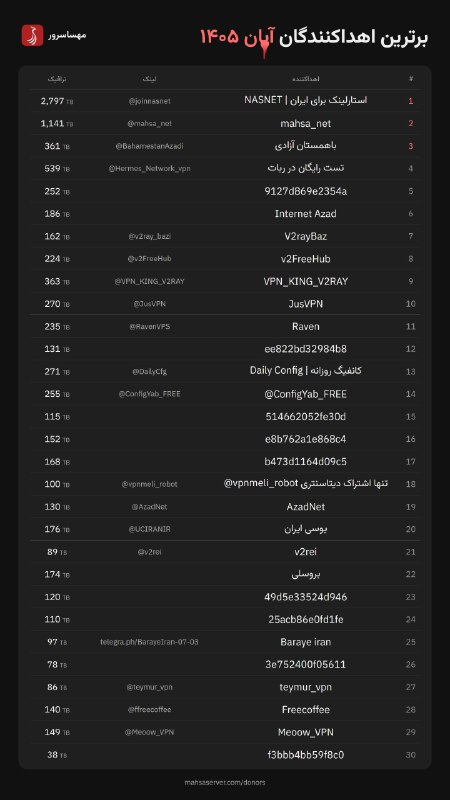

**لیست 30 اهداکننده‌ی برتر در آبان‌ماه:**  

1. [استارلینک برای ایران | NASNET](https://t.me/joinnasnet) (~2797 TB)  
2. [mahsa\_net](https://t.me/mahsa_net) (~1141 TB)  
3. [باهمستان آزادی](https://t.me/BahamestanAzadi) (~361 TB)  
4. [تست رایگان در ربات](https://t.me/Hermes_Network_vpn) (~539 TB)  
5. 9127d869e2354a (~252 TB)  
6. Internet Azad (~186 TB)  
7. [V2rayBaz](https://t.me/v2ray_bazi) (~162 TB)  
8. [v2FreeHub](https://t.me/v2FreeHub) (~224 TB)  
9. [VPN\_KING\_V2RAY](https://t.me/VPN_KING_V2RAY) (~363 TB)  
10. [JusVPN](https://t.me/JusVPN) (~270 TB)  
11. [Raven](https://t.me/RavenVPS) (~235 TB)  
12. ee822bd32984b8 (~131 TB)  
13. [Daily Config | کانفیگ روزانه](https://t.me/DailyCfg) (~271 TB)  
14. [@ConfigYab\_FREE](https://t.me/ConfigYab_FREE) (~255 TB)  
15. 514662052fe30d (~115 TB)  
16. e8b762a1e868c4 (~152 TB)  
17. b473d1164d09c5 (~168 TB)  
18. [@vpnmeli\_robot تنها اشتراک دیتاسنتری](https://t.me/vpnmeli_robot) (~100 TB)  
19. [AzadNet](https://t.me/AzadNet) (~130 TB)  
20. [یوسی ایران](https://t.me/UCIRANIR) (~176 TB)  
21. [v2rei](https://t.me/v2rei) (~89 TB)  
22. بروسلی (~174 TB)  
23. 49d5e33524d946 (~120 TB)  
24. 25acb86e0fd1fe (~110 TB)

… [ادامه در تلگرام](https://t.me/mahsa_net/286)

· · ·

**🕒 ۱۴۰۵/۰۸/۲۵ ۱۹:۲۹** · [پست 285](https://t.me/mahsa_net/285)

**فیلمی از آبان ۹۸ در شهریار**  

ثبت شده در اینترنت: بیش از ۶ سال قبل.  

زمانی که نه هوش مصنوعی بوده، نه جنگ شهری، نه حرفی از عوامل موساد، نه حمله خارجی.  

یک طرف عابر پیاده دست خالی بدون هیچ گناهی، طرف دیگر مامور ج.ا با اسلحه جنگی و شلیک بی‌دلیل از فاصله یک متری.  

و ۱۰ روز قطع کامل اینترنت برای پاک کردن رد خون.  

حالا که دنیا چرخیده، اتحاد، اتحاد؟ نه خیر، جنایت مکافات دارد.  

#آبان\_۹۸  
#نه\_میبخشیم\_نه\_فراموش\_میکنیم

🎬 ویدیو: [مشاهده در تلگرام](https://t.me/mahsa_net/285)

· · ·

**🕒 ۱۴۰۵/۰۸/۰۱ ۲۲:۵۹** · [پست 284](https://t.me/mahsa_net/284)

🖼 *(عکس بعد از ۲۴ ساعت حذف شده)*

لیست 30 اهداکننده‌ی برتر در مهرماه:  

1. [NASNET استارلینک برای ایران](https://t.me/joinnasnet) (~594 TB)  
2. [Hermes\_Network\_vpn](https://t.me/Hermes_Network_vpn) (~612 TB)  
3. [Bahamestan باهمستان آزادی](https://t.me/BahamestanAzadi) (~282 TB)  
4. [JusVPN](https://t.me/JusVPN) (~457 TB)  
5. 9127d869e2354a (~244 TB)  
6. Ozumuz (~292 TB)  
7. [V2rayBaz](https://t.me/v2ray_bazi) (~142TB)  
8. e8b762a1e868c4 (~187TB)  
9. [ConfigYab\_FREE](https://t.me/ConfigYab_FREE) (~284 TB)  
10. Borusli بروسلی (~263 TB)  
11. Internet Azad (~111 TB)  
12. 4b074802aa5407 (~126 TB)  
13. 25acb86e0fd1fe (~122 TB)  
14. [Meoow\_VPN](https://t.me/Meoow_VPN) (~214 TB)  
15. [v2FreeHub](https://t.me/v2FreeHub) (~91 TB)  
16. [VPN\_KING\_V2RAY](https://t.me/VPN_KING_V2RAY) (~169 TB)  
17. b473d1164d09c5 (~96 TB)  
18. [teymur\_vpn](https://t.me/teymur_vpn) (~80 TB)  
19. [Freecoffee](https://t.me/ffreecoffee) (~139 TB)  
20. [mahsa\_net](https://t.me/mahsa_net) (~93 TB)  
21. [UCIRANIR یوسی ایران](https://t.me/UCIRANIR) (~103 TB)  
22. ee822bd32984b8 (~47 TB)  
23. 0baffc8affd869 (~80 TB)  
24. c72f0989dd04f380 (~110 TB)  
25. 514662052fe30d (~37 TB)

… [ادامه در تلگرام](https://t.me/mahsa_net/284)

· · ·

**🕒 ۱۴۰۵/۰۷/۱۳ ۲۲:۰۰** · [پست 283](https://t.me/mahsa_net/283)

**نسخه 18 اپ MahsaNG در گوگل پلی نیز منتشر شد😍**  

**دانلود از گوگل پلی:**  
[https://play.google.com/store/apps/details?id=com.MahsaNet.MahsaNG](https://play.google.com/store/apps/details?id=com.MahsaNet.MahsaNG)  

حتما آپدیت کنید. این نسخه بهبود قابل توجهی هم در ظاهر هم در کارایی اپ دارد.  

اگرچه با مسدودشدن آیپی های کلودفلر (محدودیت ۶ پکت برای udp و tcp) ،  MASQUE و WARP و Fragment مختل شدند اما ابزارهای دیگر اپ مانند سایفون، منوی پروکسی تلگرام و کانفیگهای اورژانسی EMS میتوانند در شرایط بحرانی به شما کمک کنند.  

ما برای دور زدن فیلترینگ جدیدی که از دیروز شروع شده، ابزارهایی داریم. منتظر آپدیت بعدی ما نیز باشید.  

به امید سرنگونی حکومت فاسد اسلامی

· · ·

**🕒 ۱۴۰۵/۰۷/۱۲ ۱۵:۲۵** · [پست 282](https://t.me/mahsa_net/282)

🖼 *(عکس بعد از ۲۴ ساعت حذف شده)*

طبق رادار کلودفلر، از دو روز گدشته ترافیک ایران به کلودفلر به شدت کمتر شده.  
محدودیت‌هایی که در دو روز گذشته روی اینترنت اعمال شده:  

- اکثر کانفیگها و اتصالات به کلودفلر مختل شدن مثل وبسوکت و xhttp.  

- فرگمنت روی همراه اول و مخابرات بسته شده و روی ایرانسل ضعیف کار میکنه.  

- پروتکل udp به سمت کلودفلر کلا بلاک شده.  

- اکثر رنج ایپی های هتزنر و ovh از بیخ بلاک شدن.

· · ·

**🕒 ۱۴۰۵/۰۷/۱۱ ۲۳:۲۵** · [پست 281](https://t.me/mahsa_net/281)

**نسخه 18 اپ MahsaNG در گیتهاب منتشر شد😍**  

**دانلود از گیتهاب:**  
[https://github.com/GFW-knocker/MahsaNG/releases/latest/](https://github.com/GFW-knocker/MahsaNG/releases/latest/)  

**انتشار در گوگل پلی تا چند روز آینده**  

**امکانات جدید:**  
- آپدیت هسته مهسا به v26.10.3  
- پشتیبانی از پروتکل مسک  
- آیپی اسکنر مخصوص وایرگارد، مسک با قابلیت نویز و پورت  
- قابلیت کانفیگ وایرگارد، مسک با کلید auto  
- قابلیت بکاپ از کانفیگهای شخصی  
- صفحه پروکسی تلگرام با امکان کپی و تست پروکسی  
- امکان undo sort با نگه داشتن دکمه sort  
- بهبود فرگمنت و مد auto آن  
- افزودن نویزهای جدید برای عبور از فیلترینگ udp  
- افزودن کانفیگهای جدید یوتیوب  
- پشتیبانی از cipher suite برای سرعت آپلود (متد پترنیها)  
- پشتیبانی از finalmask روی پروتکلهای جدید مسک و هیستریا  
- ابزار زنجیره ساز کانفیگ با پشتیبانی از فرگمنت، هیستریا و مسک  
- توانایی بیشتر در دریافت کانفیگ از مهساسرور  

**بهبود ظاهر برنامه:**  
- بازطراحی زیبای صفحات داخلی  
- جابجایی بین ساب ها با کشیدن به چپ و راست  
- نمایشگر رنگی وضعیت کانفیگ در قسمت پینگ  

**رفع اشکالات:**  
- رفع مشکل نمایش آیپی در قسمت پینگ  
- پیام متنی دیگر قسمت پینگ را نمیپوشاند  
- رفع مشکل تست آپلود در قسمت پینگ

… [ادامه در تلگرام](https://t.me/mahsa_net/281)

· · ·

**🕒 ۱۴۰۵/۰۷/۱۰ ۲۳:۱۱** · [پست 280](https://t.me/mahsa_net/280)

🖼 *(عکس بعد از ۲۴ ساعت حذف شده)*

**بلاهایی که شهریور سر اینترنت اومد:**  

۱ و ۲ شهریور: ایرانسل رنج IP سرورهای هتزنر و OVH رو بسته بود و ۲ شهریور باز کرد.  

۱۴ تا ۱۷ شهریور: مودم‌های همراه اول و مخابرات هر از گاهی جواب نمی‌دادن، در حالی که خود خط وصل بود.  

۱۷ و ۱۸ شهریور: اینترنت بین‌الملل روی همه اپراتورها مختل شد و رئیس زیرساخت (اکبری) گفت مشکل از فیبرهای ارمنستانه.  

۱۹ شهریور: ECH کلادفلر روی ایرانسل و آسیاتک بسته شد و فیلترشکن‌هایی که ازش استفاده می‌کردن از کار افتادن.  

۲۱ شهریور: سرعت مخابرات دو ساعت تمام به حدود ۰٫۱ مگابیت رسید.  

۲۲ شهریور: سرویس‌های گوگل تمام روز تو کل کشور قطع و وصل می‌شد.  

۲۹ شهریور: همراه اول حدود نیم ساعت رنج IP بقیه رو به اسم خودش به دنیا اعلام کرد.  

**اسمش رو گذاشتن اینترنت، ولی در واقع یه قطعیه دائمیه که گاهی وصل می‌شه.**  

#مهسانت

· · ·

**🕒 ۱۴۰۵/۰۷/۰۱ ۲۰:۵۸** · [پست 279](https://t.me/mahsa_net/279)

🖼 *(عکس بعد از ۲۴ ساعت حذف شده)*

لیست 30 اهداکننده‌ی برتر در شهریورماه:  

1. Internet Azad (~1074 TB)  
2. [V2rayBaz](https://t.me/v2ray_bazi) (~986 TB)  
3. [Bahamestan باهمستان آزادی](https://t.me/BahamestanAzadi) (~303 TB)  
4. [NASNET استارلینک برای ایران](https://t.me/joinnasnet) (~339 TB)  
5. Ozumuz (~498 TB)  
6. [teymur\_vpn](https://t.me/teymur_vpn) (~254 TB)  
7. [SOSIranConnect](https://t.me/SOSIranConnect) (~190 TB)  
8. 9127d869e2354a (~189 TB)  
9. [JusVPN](https://t.me/JusVPN) (~290 TB)  
10. Baraye iran (~134 TB)  
11. Borusli بروسلی (~221 TB)  
12. [Hermes\_Network\_vpn](https://t.me/Hermes_Network_vpn) (~183 TB)  
13. [UCIRANIR یوسی ایران](https://t.me/UCIRANIR) (~185 TB)  
14. e8b762a1e868c4 (~127 TB)  
15. [welcomGRF](https://t.me/welcomGRF) (~109 TB)  
16. azjahanam (~73 TB)  
17. e964d5c5af79e8 (~175 TB)  
18. 2fbbea30db57e51b (~92 TB)  
19. c72f0989dd04f380 (~135 TB)  
20. b473d1164d09c5 (~72 TB)  
21. 6ae9dca002e951 (~131 TB)  
22. [mahsa\_net](https://t.me/mahsa_net) (~54 TB)  
23. [Meoow\_VPN](https://t.me/Meoow_VPN) (~101 TB)  
24. [AzadNet](https://t.me/AzadNet) (~51 TB)  
25. 6e68252c7f1811 (~59 TB)  
26. 25acb86e0fd1fe (~64 TB)  
27. 514662052fe30d (~36 TB)

… [ادامه در تلگرام](https://t.me/mahsa_net/279)

· · ·

**🕒 ۱۴۰۵/۰۶/۲۲ ۲۱:۰۴** · [پست 278](https://t.me/mahsa_net/278)

چهارسال از انقلاب مهسا گذشت.  
آکنده از رنج و درد  
و پر کشیدن هزاران هزار جان عزیز  

و اما خون‌های ریخته شده، نقاب از چهره زشت حکومت وحشی اسلامی برداشت.  

و آه مادران داغدار، سران جنایتکارش را به دست تقدیر سپرد.  

و چه انتقامی! جمع بزرگی از آن جنایتکاران به هلاکت رسیدند و بخشی دیگر در زیرزمین پنهان‌اند تا شاید از سرنوشت محتوم خود بگریزند.  

و چه عبرتی شد برای ظالمان!  

#نه\_میبخشیم\_نه\_فراموش\_میکنیم  
#زن\_زندگی\_آزادی  
#مهسا\_امینی  
#انقلاب\_شیروخورشید

🎬 ویدیو: [مشاهده در تلگرام](https://t.me/mahsa_net/278)

· · ·

**🕒 ۱۴۰۵/۰۶/۰۹ ۱۴:۴۹** · [پست 277](https://t.me/mahsa_net/277)

قسمت دوم از معرفی سایت جدید مهساسرور، صفحه My Configs و آمار تک‌تک کانفیگ‌ها.  

توی My Configs لیست کانفیگ‌هایی که اهدا کردید رو می‌بینید. اعدادی که توی داشبورد به‌صورت کلی بود، اینجا برای هر کانفیگ جداست: Received و Used و Performance. همون‌جا هم معلومه کدوم کانفیگ فعاله و تست Xray رو پاس کرده. اگه یکیشون مشکل داشته باشه، با یه نگاه پیداش می‌کنید.  

ولی بخش اصلی، صفحه آمار هر کانفیگه که نشون می‌ده دقیقاً کجا و چطور داره استفاده می‌شه.  

بالای صفحه مجموع استفاده ۱۴ روز اخیر هست و ساعت اوج مصرف. یعنی چه روزی و چه ساعتی بیشترین استفاده با این کانفیگ بوده.  

بعد نمودار مصرف روزانه به تفکیک اپراتور رو دارید. می‌بینید کانفیگتون روی اپراتورها چقدر استفاده شده و هر کدوم رو هم می‌شه جدا روشن و خاموش کرد.  

و آخر صفحه آمار استان‌هاست. اینکه کاربرهای شما بیشتر از کجا وصل می‌شن و روند هر استان چطور بوده.  

[https://mahsaserver.com](https://mahsaserver.com/)  

#mahsaserver

🎬 ویدیو: [مشاهده در تلگرام](https://t.me/mahsa_net/277)

· · ·

**🕒 ۱۴۰۵/۰۶/۰۳ ۲۳:۴۳** · [پست 276](https://t.me/mahsa_net/276)

🖼 *(عکس بعد از ۲۴ ساعت حذف شده)*

لیست 30 اهداکننده‌ی برتر در مرداد‌ماه:  

1. Internet Azad (~1136 TB)  
2. [V2rayBaz](https://t.me/v2ray_bazi) (~980 TB)  
3. Ozumuz (~687 TB)  
4. [Bahamestan باهمستان آزادی](https://t.me/BahamestanAzadi) (~341 TB)  
5. [NASNET استارلینک برای ایران](https://t.me/joinnasnet) (~281 TB)  
6. [khosrow](https://t.me/Khosrow_vpn) (~236 TB)  
7. [Hermes\_Network\_vpn](https://t.me/Hermes_Network_vpn) (~368 TB)  
8. c72f0989dd04f380 (~188 TB)  
9. [iSpeedTopVPN](https://t.me/iSpeedTopVPN) (~244 TB)  
10. azjahanam (~197 TB)  
11. [SOSIranConnect](https://t.me/SOSIranConnect) (~173 TB)  
12. [mahsa\_net](https://t.me/mahsa_net) (~124 TB)  
13. [Go\_vpns](https://t.me/Go_vpns) (~140 TB)  
14. 9127d869e2354a (~177 TB)  
15. 2fbbea30db57e51b (~119 TB)  
16. [UCIRANIR یوسی ایران](https://t.me/UCIRANIR) (~184 TB)  
17. ee822bd32984b8 (~99 TB)  
18. [teymur\_vpn](https://t.me/teymur_vpn) (~118 TB)  
19. 514662052fe30d (~68 TB)  
20. f3bbb4bb59f8c0 (~58 TB)  
21. [FreeVPNBazaar ](https://t.me/freevpnbazaar)(~109 TB)  
22. [AмÎη.м2](https://t.me/Vpn_m2s) (~57 TB)  
23. [vpnmeli\_robot](https://t.me/vpnmeli_robot) (~61 TB)  
24. e8b762a1e868c4 (~78 TB)  
25. [v2rei](https://t.me/v2rei) (~47 TB)

… [ادامه در تلگرام](https://t.me/mahsa_net/276)

· · ·

**🕒 ۱۴۰۵/۰۵/۲۶ ۱۵:۵۹** · [پست 275](https://t.me/mahsa_net/275)

🖼 *(عکس بعد از ۲۴ ساعت حذف شده)*

با انتشار سایت جدید مهساسرور، از این به بعد تغییراتش رو بخش‌به‌بخش براتون میگیم.  

از داشبورد اهداکنندگان شروع می‌کنیم. وقتی وارد حسابتون می‌شید، بالای صفحه چند تا عدد هست که با یه نگاه میگه کانفیگ‌هاتون چطور دارن کار می‌کنن.  

قسمت اول تعداد کانفیگ‌هاییه که اهدا کردید و اینکه جدیدترین و قدیمی‌ترینشون مال کیه. Total Received یعنی مجموعا چند بار کانفیگ‌های شما برای کاربرها ارسال شده، و Total Used یعنی از همون تعداد، چند بار کاربرها واقعا وصل شدن.  

گرفتن کانفیگ به معنی وصل شدن نیست، و اینجا عدد چهارم به کار میاد. Performance یا همون عملکرد، از روی این دو عدد حساب میشه و به‌شکل درصد میگه کانفیگ‌هاتون چه کیفیتی دارن. از الان برای هر کانفیگ هم جداگانه میتونید عملکردشو ببینید.  

بهترین حالت اینه که این دو عدد برابر باشن (عملکرد 100%)؛ یعنی هر کاربری که کانفیگ شما رو گرفته، توی هر استان و روی هر اپراتوری، همون موقع تونسته وصل بشه.  

اهداکننده‌ها هم هر چی کانفیگ باکیفیت‌تری اهدا کنن، عملکردشون بالاتر میره و توی جدول اهداکنندگان بالاتر میان؛ جایی که لینک اهدا و معرفیشون بهتر دیده میشه.  

[mahsaserver.com](http://mahsaserver.com/)

· · ·

**🕒 ۱۴۰۵/۰۵/۲۲ ۰۰:۲۹** · [پست 272](https://t.me/mahsa_net/272)

🖼 *(عکس بعد از ۲۴ ساعت حذف شده)*

**سایت جدید مهساسرور منتشر شد.**  

ظاهر و تجربه‌ی کاربری سایت کاملاً بازطراحی شده و از الان در دسترس قرار گرفت. طراحی جدید، سرعت بالاتر و کار کردن ساده‌تر، هم روی موبایل هم دسکتاپ.  

بطور خلاصه چی تغییر کرده؟  

● داشبورد جدید برای اهداکنندگان: وضعیت کانفیگ‌ها در یک نگاه  
● مدیریت کانفیگ‌ها خیلی ساده‌تر و سریع‌تر از قبل  
● نمودارهای بیشتر و کاربردی برای هر کانفیگ  
● نمودار تفکیک مصرف هر کانفیگ بر اساس اپراتور و استان  
● راهنماها و صفحات عمومی با چیدمان تازه  
● حالت تاریک و روشن  

و این تازه شروعه؛ بخش‌های بیشتری در راهه.  
[mahsaserver.com](http://mahsaserver.com/)  

#mahsaserver

· · ·

**🕒 ۱۴۰۵/۰۵/۲۰ ۱۴:۱۹** · [پست 271](https://t.me/mahsa_net/271)

از ویژگیهای مهم [MahsaNG v17](https://play.google.com/store/apps/details?id=com.MahsaNet.MahsaNG) :  

هسته سایفون برای ایران بهینه شده، کاربر حرفه ای میتونه با آیپی تمیز Akamai، کانفیگ سایفون بسازه و به اشتراک بگذاره. کاربر مبتدی هم به راحتی میتونه به اون کانفیگ متصل بشه.  

برای ساخت کانفیگ، ابتدا از منوی Mahsa IP Scanner گزینه‌ی akamai رو انتخاب و اسکن کنید. یک یا چند ایپی GREEN را کپی و در تنظیمات سایفون در akamai cdn ip وارد و save رو بزنید. سپس دکمه copy url زده و در صفحه اصلی اپ paste کرده و استفاده کنید یا بعنوان کانفیگ برای دوستان خود بفرستید.  

سایفون در نسخه 17 مهسا ، به چند طریق میتونه روشن بشه:  
- با دریافت و انتخاب کانفیگ سایفون  
- با روشن کردن از منوی F بصورت alone (تنها) یا بصورت after (ترکیبی با v2ray)  

نکات:  
1. در سایفون after (ترکیبی با ویتوری)، باید protocol=auto باشد و region هرکشوری باشد ایپی نهایی شما اون کشور خواهد بود و حجم v2ray نیز مصرف میشود.  

2. در سایفون alone (و کانفیگ سایفون) ، region=auto باشد و protocol=cdn\_fronting بهمراه آیپی تمیز آکامای یا فستلی و دامین وایت در قسمت sni  

3. اگر میخواهید آیپی تمیزها در لینک قابل رویت نباشد از copy AES url استفاده کنید.  

4. توصیه میشود Aggressive=on و برای سایر پارامترها، پیشفرض خودشان بهترین است.

… [ادامه در تلگرام](https://t.me/mahsa_net/271)

· · ·

**🕒 ۱۴۰۵/۰۵/۱۰ ۱۷:۰۰** · [پست 270](https://t.me/mahsa_net/270)

**ظاهر و** **رابط کاربری MahsaNG توی نسخه 17 از نو طراحی شده و حسابی مدرن‌تر شده.**  

با یک sweep بین ساب‌ها جابه‌جا می‌شید، موقع تست تعداد کانفیگ‌ها رو می‌بینید و کانفیگ‌های بدون پینگ رو هم میتونید با یک دکمه حذف کنید.  

تست کانفیگ هم پیشرفته‌تر شده: بعد از پینگ، یه لمس طولانی کافیه تا آی‌پی نهایی کانفیگ رو ببینید، دوباره نگه دارید جزئیات بیشتر میاد، و همون‌جا می‌تونید سرعت دانلود و آپلود رو هم سریع بسنجید.  

روی پلتفرم Android TV هم می‌تونید با ریموت به‌راحتی در تمام بخش‌های اپ جابه‌جا و متصل شید.  

دانلود از گوگل پلی:  
[https://play.google.com/store/apps/details?id=com.MahsaNet.MahsaNG](https://play.google.com/store/apps/details?id=com.MahsaNet.MahsaNG)  

#MahsaNG

🎬 ویدیو: [مشاهده در تلگرام](https://t.me/mahsa_net/270)

· · ·

**🕒 ۱۴۰۵/۰۵/۰۱ ۱۱:۱۴** · [پست 269](https://t.me/mahsa_net/269)

🖼 *(عکس بعد از ۲۴ ساعت حذف شده)*

لیست 30 اهداکننده‌ی برتر در تیرماه:  

1. [khosrow](https://t.me/Khosrow_vpn) (~522 TB)  
2. [V2rayBaz](https://t.me/V2raybazi) (~700 TB)  
3. Internet Azad  (~559 TB)  
4. Ozumuz (~650 TB)  
5. azjahanam (~388 TB)  
6. [NASNET استارلینک برای ایران](https://t.me/joinnasnet) (~240 TB)  
7. 2fbbea30db57e51b (~263 TB)  
8. c72f0989dd04f380 (~330 TB)  
9. [XV2RAY](https://t.me/XV2RAY) (~199 TB)  
10. d0984ff804268f (~189 TB)  
11. [AмÎη.м2](https://t.me/Vpn_m2s) (~136 TB)  
12. ee822bd32984b8 (~128 TB)  
13. [VPN\_KING\_V2RAY](https://t.me/VPN_KING_V2RAY) (~208 TB)  
14. [v2rei](https://t.me/v2rei) (~141 TB)  
15. [Hermes\_Network\_vpn](https://t.me/Hermes_Network_vpn) (~148 TB)  
16. [Hermes\_Network\_vpn](https://t.me/Hermes_Network_vpn) (~151 TB)  
17. [Ana](https://t.me/ANA_SERVICE) (~140 TB)  
18. 9127d869e2354a (~81 TB)  
19. f3bbb4bb59f8c0 (~47 TB)  
20. Borusli بروسلی (~72 TB)  
21. [v2rei](https://t.me/v2rei) (~82 TB)  
22. [Bahamestan باهمستان آزادی](https://t.me/BahamestanAzadi) (~80 TB)  
23. [vpnmeli\_robot](https://t.me/vpnmeli_robot) (~77 TB)  
24. e8b762a1e868c4 (~61 TB)  
25. 514662052fe30d (~48 TB)  
26. [mahsa\_net](https://t.me/mahsa_net) (~60 TB)

… [ادامه در تلگرام](https://t.me/mahsa_net/269)

· · ·

**🕒 ۱۴۰۵/۰۴/۱۲ ۱۰:۵۰** · [پست 268](https://t.me/mahsa_net/268)

نسخه 17 اپ MahsaNG در گوگل پلی و گیتهاب منتشر شد😍  

**دانلود از گوگل پلی:**  
[https://play.google.com/store/apps/details?id=com.MahsaNet.MahsaNG](https://play.google.com/store/apps/details?id=com.MahsaNet.MahsaNG)  

**دانلود از گیتهاب:**  
[https://github.com/GFW-knocker/MahsaNG/releases/latest/](https://github.com/GFW-knocker/MahsaNG/releases/latest/)  

**امکانات جدید:**  
- هسته سایفون بهینه شده برای ایران  
- ساخت و اشتراک‌گذاری کانفیگ "://psiphon"  
- ایپی اسکنر مخصوص cdn\_fronting  
- قابلیت دریافت کانفیگ از طریق نوتیفیکیشن  
- ابزار زنجیره سازی دو کانفیگ  
- حذف کانفیگهای بدون پینگ  
- طراحی جدید و زیبای واسط گرافیکی  
- قابلیت دریافت اطلاع رسانی با نوتیفیکیشن  
- جابجایی بین سابها با sweep  
- نمایش تعداد کانفیگ هنگام تست  
- رفع مشکل اتصال خودکار سایفون  
- رفع کرش روی arm-v7a  
و موارد دیگر

· · ·

**🕒 ۱۴۰۵/۰۴/۰۱ ۱۳:۲۹** · [پست 267](https://t.me/mahsa_net/267)

🖼 *(عکس بعد از ۲۴ ساعت حذف شده)*

**لیست 30 اهداکننده‌ی برتر در خردادماه:**  

1. [mahsa\_net](https://t.me/mahsa_net) (~705 TB)  
2. 514662052fe30d (~237 TB)  
3. [khosrow](https://t.me/Khosrow_vpn) (~199 TB)  
4. e8b762a1e868c4 (~167 TB)  
5. [V2rayBaz](https://t.me/V2raybazi) (~159 TB)  
6. 3d9826f3dccbf8 (~212 TB)  
7. Borusli بروسلی (~129 TB)  
8. [VPN\_KING\_V2RAY](https://t.me/VPN_KING_V2RAY) (~171 TB)  
9. [allworldcfg](https://t.me/allworldcfg) (~137 TB)  
10. f3bbb4bb59f8c0 (~84 TB)  
11. 2fbbea30db57e51b (~155 TB)  
12. [v2rei](https://t.me/v2rei) (~126 TB)  
13. azjahanam (~ 146 TB)  
14. 9127d869e2354a (~92 TB)  
15. [v2rei2](https://t.me/v2rei2) (~105 TB)  
16. [AмÎη.м2](https://t.me/Vpn_m2s) (~79 TB)  
17. Internet Azad  (~58 TB)  
18. [v2FreeHub](https://t.me/v2FreeHub) (~61 TB)  
19. [Ana](https://t.me/ANA_SERVICE) (~71 TB)  
20. [Bahamestan باهمستان آزادی](https://t.me/BahamestanAzadi) (~31 TB)  
21. [NASNET استارلینک برای ایران](https://t.me/joinnasnet) (~46 TB)  
22. f5a9a6db370974 (~56 TB)  
23. [V2rayEnglish](https://t.me/V2rayEnglish) (~21 TB)  
24. [iProxyChannel](https://t.me/iProxyChannel) (~39 TB)  
25. [Napsternet2](https://t.me/Leviko_v2ray) (~52 TB)  
26. 2f9ba90edf4fd3 (~17 TB)

… [ادامه در تلگرام](https://t.me/mahsa_net/267)

· · ·

**🕒 ۱۴۰۵/۰۲/۲۷ ۰۹:۵۰** · [پست 266](https://t.me/mahsa_net/266)

نسخه 16 اپ MahsaNG در گیتهاب و گوگل پلی منتشر شد😍  

دانلود از گوگل پلی:  
[https://play.google.com/store/apps/details?id=com.MahsaNet.MahsaNG](https://play.google.com/store/apps/details?id=com.MahsaNet.MahsaNG)  

دانلود از گیتهاب:  
[https://github.com/GFW-knocker/MahsaNG/releases/latest/](https://github.com/GFW-knocker/MahsaNG/releases/latest/)  

دانلود مستقیم فایل apk از گروه مهسا:  
[https://t.me/+YIlqV-fl9y4zMmRk](https://t.me/+YIlqV-fl9y4zMmRk)  

امکانات جدید:  
پشتیبانی از  [MasterDNS](https://github.com/masterking32/MasterDnsVPN)  
پشتیبانی از [GooseRelay](https://github.com/Kianmhz/GooseRelayVPN)  
پشتیبانی از [FlowDriver](https://github.com/NullLatency/FlowDriver)  
پشتیبانی از Psiphon CDN-Fronting   
(credit: [shirkhorshid](https://github.com/shirokhorshid/shirokhorshid-android) & [patterniha](https://github.com/patterniha/MITM-DomainFronting))  
افزودن Psiphon LAN sharing  
افزودن "type manually HTTP"  
امکان اجرای سایفون به تنهایی  
بهبود اسکنر dns با توالی رندوم  
بهبود منو و رفع برخی کرش ها  
و سهولت کار در android TV

… [ادامه در تلگرام](https://t.me/mahsa_net/266)

· · ·

**🕒 ۱۴۰۵/۰۲/۲۱ ۱۸:۰۱** · [پست 265](https://t.me/mahsa_net/265)

🖼 *(عکس بعد از ۲۴ ساعت حذف شده)*

دوستان، با اپ thefeed میتوانید در زمان قطعی نت بین‌الملل، کانالهای منتخب تلگرام را با نت ملی مشاهده کرده و از اخبار مطلع شوید.  

این اپ هم میتواند بدون کانفیگ کار کند (با کمک پروژه [telemirror](https://t.me/ircfspace/2300))، هم در شرایط بحرانی، با کانفیگ‌های مخصوص که عمومی و خصوصی منتشر می‌شوند، راه خود را از اینترانت فاجعه‌بار جاعش، به دنیای آزاد باز می‌کند.  

لینک دانلود:   
(گیتهاب سارتو توسط تروریستهای ج.ا ریپورت شده و 404 میده. این خطا موقتیه و با پیگیری باز میشه. قبلا نیز گیتهاب بسیاری از فعالین از جمله خودم ریپورت شده بود.)  
[https://github.com/sartoopjj/thefeed/releases/latest](https://github.com/sartoopjj/thefeed/releases/latest)  
کانال برنامه:  
[@networkti](https://t.me/networkti)  
کانال کانفیگ thefeed:  
[@thefeedconfig](https://t.me/thefeedconfig)  

پ.ن: ما رنج قطع اینترنت را تا عمق استخوان چشیده‌ایم، ما نه می‌بخشیم نه فراموش میکنیم. سرانجام نوبت ما خواهد رسید و عاملان و مجریان این جنایت، جواب پس خواهند داد.

· · ·

---

## VahidOnline

[کانال در تلگرام](https://t.me/VahidOnline) · [آرشیو متن](archive/vahidonline/)

**🕒 ۱۴۰۵/۰۸/۳۰ ۱۸:۲۶** · [پست 79206](https://t.me/VahidOnline/79206)

کاظم غریب‌آبادی، معاون حقوقی وزیر امور خارجهٔ جمهوری اسلامی، روز جمعه اعلام کرد یک هیأت قطری جمعه‌شب ۲۹ آبان‌ماه به تهران سفر کرد و مقام‌های دو کشور به مدت دو ساعت با یکدیگر گفتگو کردند.  

غریب‌آبادی با تأکید بر اینکه بازگشایی تنگهٔ هرمز مشروط به اجرای تعهدات آمریکا، از جمله رفع مسدودی پول‌ها، پایان محاصرهٔ اقتصادی و توقف جنگ در همهٔ جبهه‌ها است، گفت که اجرای این تعهدات حتی ظرف دو ساعت قابل راستی‌آزمایی است و تهران ضمن ادامهٔ تماس با میانجی‌گران، از جمله قطر، برای بررسی امکان ازسرگیری دیپلماسی، محاصرهٔ اقتصادی را اقدامی جنگی می‌داند و به طرف‌های مقابل اعلام کرده است که برای شکستن آن هر اقدام لازم را انجام خواهد داد.  

پیش‌تر آکسیوس روز جمعه ۲۹ آبان‌ماه به نقل از دو منبع آگاه گزارش داده بود که استیو ویتکاف و جرد کوشنر، فرستادگان دونالد ترامپ، روز پنجشنبه ۲۸ آبان‌ماه در برلین با شیخ محمد بن عبدالرحمن آل ثانی، نخست‌وزیر قطر، و علی الثوادی، فرستادهٔ او، دربارهٔ ازسرگیری مذاکرات هسته‌ای میان واشنگتن و تهران دیدار کردند.  
@[VahidOOnLine](https://t.me/VahidOOnLine/271431)  

📡 [@VahidOnline](https://t.me/VahidOnline)

🎬 ویدیو: [مشاهده در تلگرام](https://t.me/VahidOnline/79206)

· · ·

**🕒 ۱۴۰۵/۰۸/۳۰ ۱۸:۲۰** · [پست 79205](https://t.me/VahidOnline/79205)

پست سنتکام، ترجمه ماشین:  
🚫 **ادعا:** سپاه پاسداران انقلاب اسلامی ایران مدعی است که روز گذشته یک جنگنده اف-۱۶ آمریکا را هدف قرار داده و به آن آسیب رسانده و این جنگنده را مجبور به فرود اضطراری کرده است. این ادعا **نادرست است**.  

✅ **واقعیت:** ایران روز گذشته هیچ حمله‌ای به جنگنده اف-۱۶ آمریکا انجام نداده است؛ مطلقاً هیچ حمله‌ای. تمامی جنگنده‌های نظامی آمریکا در خاورمیانه سالم هستند و وضعیت و محل استقرار همه آن‌ها مشخص است.  
[CENTCOM](https://x.com/CENTCOM/status/2124152057787482170)  
ارتش جمهوری اسلامی با انتشار ویدیویی ادعا کرده بود سامانه‌های بومی نیروی پدافند هوایی این کشور شامگاه جمعه ۲۹ آبان یک جنگندهٔ اف-۱۶ آمریکایی را بر فراز خلیج فارس شناسایی و به سمت آن موشک شلیک کرده‌اند.  

بر اساس بیانیه ارتش، موشک در مجاورت جنگنده منفجر شده، این هواگرد آسیب دیده و خلبان ناچار شده مأموریت خود را لغو کند و در یکی از نزدیک‌ترین فرودگاه‌های منطقه فرود اضطراری انجام دهد.  
@[VahidOOnLine](https://t.me/VahidOOnLine/271432)  

📡 [@VahidOnline](https://t.me/VahidOnline)

🎬 ویدیو: [مشاهده در تلگرام](https://t.me/VahidOnline/79205)

· · ·

**🕒 ۱۴۰۵/۰۸/۳۰ ۱۸:۱۸** · [پست 79200](https://t.me/VahidOnline/79200)

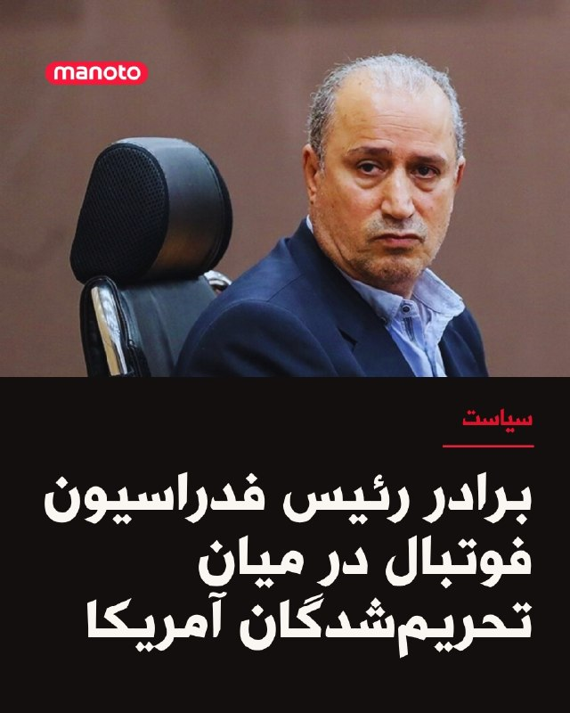

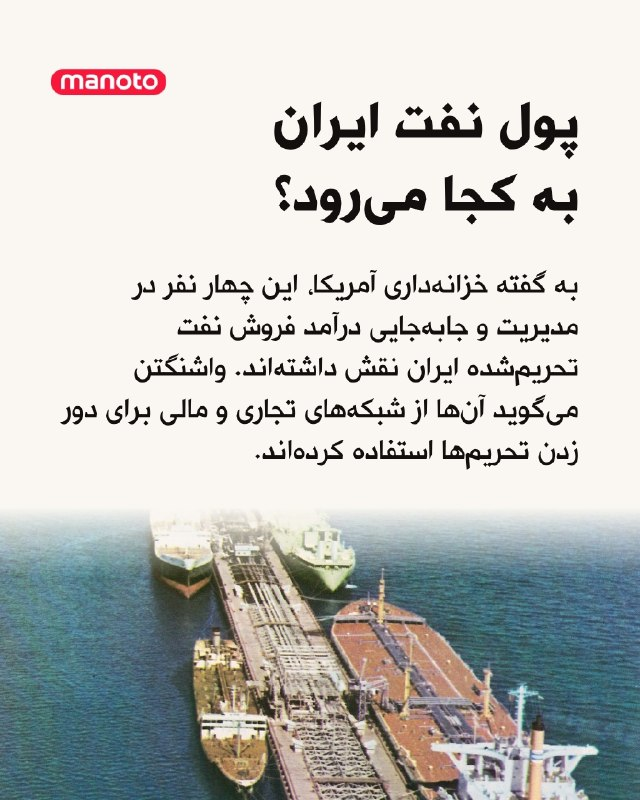

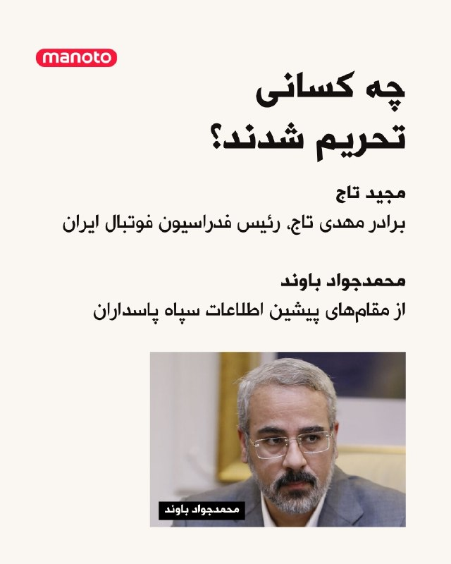

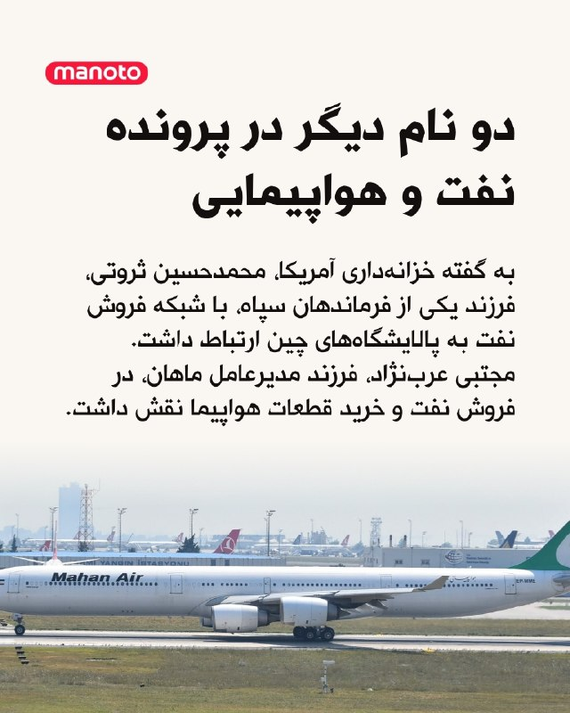

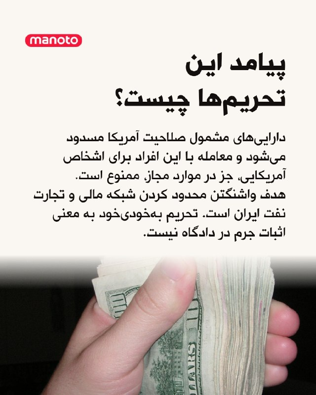

وزارت خزانه‌داری آمریکا چهار ایرانی را در ارتباط با فروش نفت تحریم‌شده ایران تحریم کرد. مجید تاج، برادر مهدی تاج، رئیس فدراسیون فوتبال ایران، در میان تحریم‌شدگان است.  

خزانه‌داری آمریکا می‌گوید این افراد در فروش نفت ایران به خریداران خارجی و وصول درآمد آن نقش داشته‌اند. دارایی‌های مشمول صلاحیت آمریکا مسدود می‌شود و معامله با این افراد برای اشخاص آمریکایی، جز در موارد مجاز، ممنوع است.  
@[VahidOOnLine](https://t.me/VahidOOnLine/271421)  

📡 [@VahidOnline](https://t.me/VahidOnline)

· · ·

**🕒 ۱۴۰۵/۰۸/۳۰ ۱۸:۰۸** · [پست 79199](https://t.me/VahidOnline/79199)

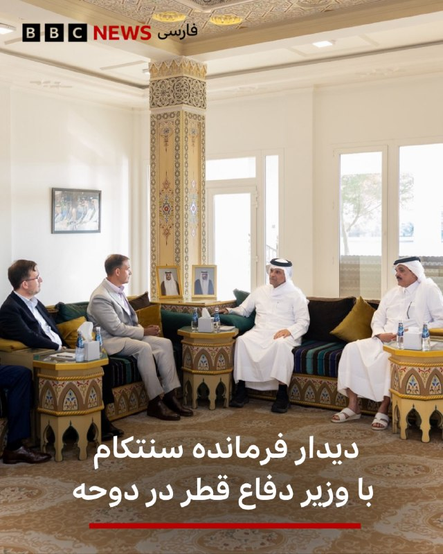

باراک راوید، منبع خبر در اکسیوس و کانال ۱۲ اسرائیل، دقایقی پیش:  
به گفته یک منبع آگاه، علی الثوادی، فرستاده قطر، شب گذشته برای گفت‌وگو با مقام‌های ایرانی به تهران سفر کرد. این سفر بخشی از تلاش‌ها برای ازسرگیری مذاکرات میان آمریکا و ایران است.  
[BarakRavid](https://x.com/BarakRavid/status/2124147996908564627)  
از سوی دیگر:   
برد کوپر، فرمانده سنتکام، و هیئت همراهش با سعود بن عبدالرحمن آل ثانی، وزیر دفاع قطر در دوحه دیدار کردند.  

برد کوپر هفته پیش به اسرائیل سفر و با مقام‌های اطلاعاتی و نظامی اسرائیل ملاقات کرده بود.  
وزارت دفاع قطر در شبکه اجتماعی ایکس نوشت در این دیدار درباره «شماری از موضوعات مورد علاقه دو طرف و راه‌های تقویت و توسعه» بحث و بررسی شد.  
@[VahidHeadline](https://t.me/VahidHeadline/332641)  

📡 [@VahidOnline](https://t.me/VahidOnline)

· · ·

**🕒 ۱۴۰۵/۰۸/۳۰ ۱۷:۳۸** · [پست 79197](https://t.me/VahidOnline/79197)

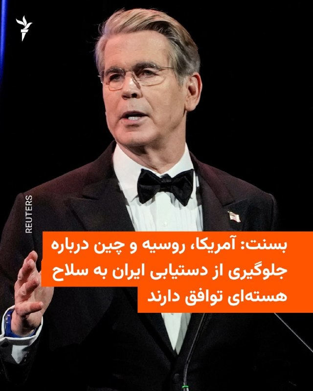

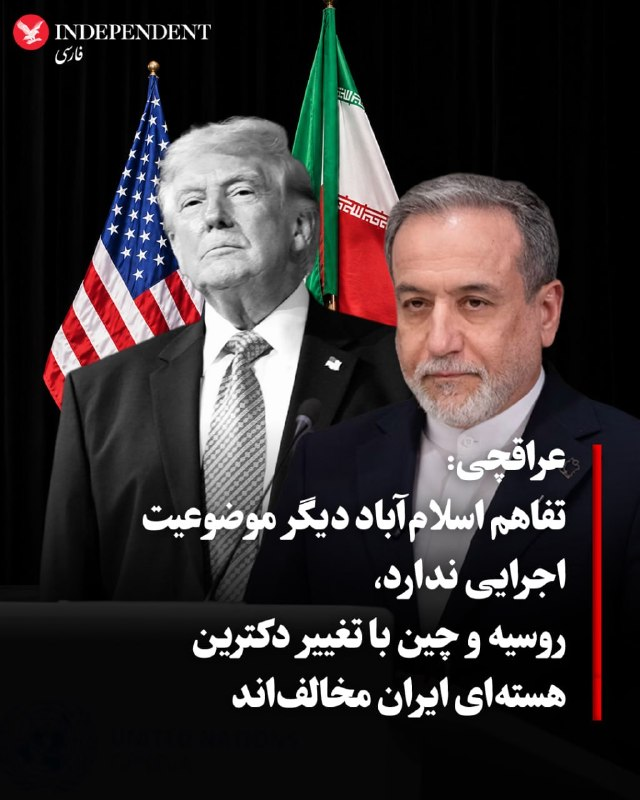

اسکات بسنت، وزیر خزانه‌داری آمریکا، می‌گوید دونالد ترامپ در دیدارهای اخیر خود با رهبران روسیه و چین، با آن‌ها درباره جلوگیری از دستیابی ایران به سلاح هسته‌ای و ضرورت تضمین آزادی کشتیرانی در تنگه هرمز «به اجماع رسیده است.»  
بسنت روز جمعه ۲۹ آبان در گفت‌وگو با شبکه سی‌ان‌بی‌سی گفت آمریکا، روسیه و چین در این دو موضوع با یکدیگر اتفاق نظر دارند و «هر سه کشور با آن موافق‌اند».  
@[VahidHeadline](https://t.me/VahidHeadline/332591)  
عراقچی در مصاحبه‌ای با روزنامه دولتی ایران که روز شنبه ۳۰ آبان منتشر شد، افزود: «من معتقدم نباید تصور کنیم کسانی که خواهان تغییر دکترین هستند، منطق سستی دارند؛ آن‌ها هم منطق قوی‌ای دارند.»  
@[VahidHeadline](https://t.me/VahidHeadline/332626)  
عراقچی درباره احتمال تغییر دکترین هسته‌ای ایران تأکید کرد که چنین تصمیمی پیامدهای بسیار مهمی خواهد داشت و روسیه و چین نیز در این زمینه مواضع مخالفی دارند.  

وزیر امور خارجه جمهوری اسلامی در گفت‌وگو با روزنامه «ایران» از پیشنهاد هفت‌روزه ایران به آمریکا خبر داد که پس از حدود دو ماه رایزنی و با توصیه واسطه‌ها، به طرحی ۴۸ ساعته تبدیل شد.   

بر اساس این پیشنهاد، آمریکا باید در روز نخست تعهدات موردنظر ایران را اجرا می‌کرد و ایران نیز در روز دوم تنگه هرمز را بازگشایی می‌کرد.

… [ادامه در تلگرام](https://t.me/VahidOnline/79197)

· · ·

**🕒 ۱۴۰۵/۰۸/۳۰ ۱۷:۲۸** · [پست 79192](https://t.me/VahidOnline/79192)

پس از گرانی‌های پی‌درپی، چند روزی‌ست که نوبت به محدودیت در خرید نان رسیده است.  

دولت مسعود پزشکیان از اواسط آبان ۱۴۰۵، بدون اطلاع‌رسانی عمومی قبلی، اجرای آزمایشی طرح‌های تازه‌ای برای کنترل خرید نان را در برخی استان‌ها آغاز کرده است؛ طرح‌هایی که به گفته مقام‌های صنفی، با هدف مقابله با کم‌فروشی و خریدهای غیرمتعارف اجرا می‌شوند.  
در استان‌هایی از جمله مرکزی، خوزستان و زنجان، تغییرات سامانه‌های فروش نان و محدودیت خریدهای حجیم، شهروندان را با سردرگمی و تغییر مبلغ پرداختی روبه‌رو کرده است. هم‌زمان، اجرای آزمایشی فروش وزنی نان در برخی مناطق، به تشکیل صف‌های طولانی مقابل نانوایی‌ها انجامیده است.  
مشکلات تنها به نانوایی‌ها محدود نمانده و گزارش‌هایی از قطع سهمیه آرد خام برخی خانوارهای عشایری نیز منتشر شده است.  
در حالی که دولت از کنترل مصرف و جلوگیری از تخلف سخن می‌گوید، هنوز توضیح شفافی درباره جزئیات اجرای طرح‌ها و تاثیر آن‌ها بر خرید روزانه خانوارها ارائه نشده است.  
نان که قوت غالب بسیاری از خانوارهای ایرانی است، حالا به یکی دیگر از نگرانی‌های روزمره آن‌ها تبدیل شده است.  
@[VahidHeadline](https://t.me/VahidHeadline/332584)

… [ادامه در تلگرام](https://t.me/VahidOnline/79192)

🎬 ویدیو: [مشاهده در تلگرام](https://t.me/VahidOnline/79192?single)

🎬 ویدیو: [مشاهده در تلگرام](https://t.me/VahidOnline/79193?single)

🎬 ویدیو: [مشاهده در تلگرام](https://t.me/VahidOnline/79194?single)

🎬 ویدیو: [مشاهده در تلگرام](https://t.me/VahidOnline/79195?single)

🎬 ویدیو: [مشاهده در تلگرام](https://t.me/VahidOnline/79196?single)

· · ·

**🕒 ۱۴۰۵/۰۸/۳۰ ۰۰:۴۶** · [پست 79191](https://t.me/VahidOnline/79191)

پست اسکات بسنت، وزیر خزانه‌داری آمریکا، ترجمه ماشین:  
رژیم استبدادی ایران هرگز از ترجیح دادن منافع خود بر منافع شهروندانش دست برنمی‌دارد، حتی در شرایطی که مردم عادی ایران با کمبود نان و سوخت مواجه‌اند.  

ذخایر نفتی این رژیم در دریا به پایان رسیده و ممکن است هرگز درآمد حاصل از نفتی را که پیش‌تر فروخته است، دریافت نکند.  

این کشتی در حال غرق شدن است.  
[SecScottBessent](https://x.com/SecScottBessent/status/2123885854716252526)  
متن بالا رو روی این پست اکانت وزارت خزانه‌داری امریکا نوشته که دو دقیقه قبلش منتشر شد، ترجمه ماشین:  
امروز، در چارچوب عملیات «طرد اقتصادی» (Operation Economic Outcast)، وزارت خزانه‌داری آمریکا افراد کلیدی موسوم به «امین‌های نفتی» را هدف قرار می‌دهد؛ افرادی که رژیم ایران برای تسهیل فروش نفت در خارج از کشور به آن‌ها متکی است.  

در شرایطی که هیچ محموله نفتی خارج از محدوده محاصره نظامی آمریکا در دریا باقی نمانده و از زمان آغاز عملیات «طرد اقتصادی» نیز هیچ نفتی در کشتی‌ها بارگیری نشده است، رژیم تلاش می‌کند میلیاردها دلار از درآمدهای نفتی خود را از این امین‌های نفتی پس بگیرد.  

در بسیاری از موارد، این امین‌های فاسد درآمد حاصل از فروش نفت را برای منافع شخصی خود نگه داشته‌اند.  
[USTreasury](https://x.com/USTreasury/status/2123885407938998420)

… [ادامه در تلگرام](https://t.me/VahidOnline/79191)

🎬 ویدیو: [مشاهده در تلگرام](https://t.me/VahidOnline/79191)

· · ·

**🕒 ۱۴۰۵/۰۸/۲۹ ۲۳:۳۷** · [پست 79190](https://t.me/VahidOnline/79190)


آکسیوس روز جمعه ۲۹ آبان‌ماه به نقل از دو منبع آگاه گزارش داد که استیو ویتکاف و جرد کوشنر، فرستادگان دونالد ترامپ، روز پنجشنبه ۲۸ آبان‌ماه در برلین با مقام‌های ارشد قطر درباره ازسرگیری مذاکرات هسته‌ای میان واشنگتن و تهران دیدار کردند.  

به گفته منابع آگاه، شیخ محمد بن عبدالرحمن آل ثانی، نخست‌وزیر قطر، و علی الثوادی، فرستاده او، در این نشست حضور داشتند. قطر طی هفته‌های گذشته برای ازسرگیری آتش‌بس، احیای مذاکرات هسته‌ای و جلوگیری از جنگی دیگر تلاش کرده است.  

ترامپ روز جمعه اعلام کرد که ایران خواهان توافق است، اما توافقی را که برای او قابل‌قبول باشد، نمی‌پذیرد. او تأکید کرد که واشنگتن به دنبال «توافق واقعی» است و نباید اجازه دستیابی تهران به سلاح هسته‌ای داده شود.  
@[VahidOOnLine](https://t.me/VahidOOnLine/271285)  

📡 [@VahidOnline](https://t.me/VahidOnline)

· · ·

**🕒 ۱۴۰۵/۰۸/۲۹ ۲۳:۳۶** · [پست 79189](https://t.me/VahidOnline/79189)

دونالد ترامپ، رئیس‌جمهور آمریکا، روز جمعه ۲۹ آبان بار دیگر گفت جمهوری اسلامی خواهان توافق برای پایان جنگ با ایالات متحده است، اما حاضر نیست توافقی را امضا کند که برای او قابل قبول باشد.  

او با تأکید بر اینکه واشینگتن به دنبال «توافقی واقعی» با تهران است، نه «توافقی ساختگی»، مقام‌های جمهوری اسلامی را متهم کرد که طی ۵۱ سال گذشته طرف‌های مقابل خود را فریب داده‌اند.  

این در حالی است که او روز پنجشنبه در در سه مصاحبهٔ جداگانه اعلام کرد که برای تصمیم‌گیری دربارهٔ انجام حملات نظامی جدید علیه ایران عجله‌ای ندارد و به آغاز سال میلادی آینده به‌عنوان زمان احتمالی تصمیم‌گیری اشاره کرد.  

دونالد ترامپ در بخش دیگری از نشست خبری روز جمعه بار دیگر تأکید کرد که آمریکا به جمهوری اسلامی اجازه دستیابی به سلاح هسته‌ای نخواهد داد.  
او گفت: «ما اجازه نمی‌دهیم آن‌ها سلاح هسته‌ای داشته باشند. ایران هرگز سلاح هسته‌ای نخواهد داشت؛ هرگز».  

رئیس‌جمهور آمریکا همچنین دربارۀ دیدار اخیر خود با ولادیمیر پوتین، رئیس‌جمهور روسیه، و شی جین‌پینگ، رئیس‌جمهور چین، گفت که موضوع جلوگیری از دستیابی ایران به سلاح هسته‌ای به‌طور مفصل در مذاکرات سه‌جانبه مطرح شده است.  
ترامپ گفت: «به‌ویژه دربارۀ اطمینان از اینکه ایران هرگز سلاح هسته‌ای نخواهد داشت، به‌تفصیل گفت‌وگو کردیم».

… [ادامه در تلگرام](https://t.me/VahidOnline/79189)

🎬 ویدیو: [مشاهده در تلگرام](https://t.me/VahidOnline/79189)

· · ·

**🕒 ۱۴۰۵/۰۸/۲۹ ۱۹:۵۴** · [پست 79188](https://t.me/VahidOnline/79188)

🖼 *(عکس بعد از ۲۴ ساعت حذف شده)*

مرکز عملیات تجارت دریایی بریتانیا () گزارشی درباره وقوع حادثه‌ای در فاصله ۸ مایل دریایی شمال خصب در عمان دریافت کرده است.  
یک نفتکش که در حال خروج از تنگه هرمز بوده، از ناحیه دماغه سمت چپ با پرتابه‌ای ناشناس هدف قرار گرفته است.  
مسئول امنیت شرکت کشتیرانی (CSO) از وقوع آتش‌سوزی در این شناور خبر داده است.   
[UK\_MTO](https://x.com/UK_MTO/status/2123809424359702774)  

📡 [@VahidOnline](https://t.me/VahidOnline)

· · ·

**🕒 ۱۴۰۵/۰۸/۲۹ ۱۸:۴۷** · [پست 79187](https://t.me/VahidOnline/79187)

پیام‌های دریافتی:  

ساعت 18.45 یه انفجار در محدوده شهر قشم  

سلام وحید جان همین الان یه موشک به پدافند قشم خورد  

سلام وحید جان امروز ۲۹ ابان ساعت ۱۸:۴۶ دقیقه در قشم فقط یک صدای مهیب شنیده شد که احتملا از سمت پدافند قشم بوده و شاید پرتابه به پدافند خورده  

سلام وحید جان ساعت ۶ و ۴۶ دقیقه یک صدای انفجاری اومد قشم  

آپدیت؛  
خبرگزاری تسنیم، وابسته به سپاه پاسداران:  
اصابت موشک به حاشیه شهر قشم  

▪️ یک موشک ساعت ۱۸:۵۰ امروز به حاشیه شهر قشم اصابت کرد  

▪️ به گزارش خبرنگار تسنیم در جزایر خلیج فارس، ساعت ۱۸:۵۰ امروز یک موشک از سوی دشمن آمریکایی ـ صهیونیستی به محدوده‌ای در حاشیه شهر قشم اصابت کرد.  

▪️  جزئیات بیشتر درباره میزان خسارات احتمالی و ابعاد این حادثه پس از دریافت اطلاعات موثق اعلام خواهد شد.  
آپدیت:  
احمد نفیسی، معاون سیاسی، امنیتی و اجتماعی استانداری هرمزگان، جمعه ۲۹ آبان اعلام کرد که صدای انفجار و دود مشاهده‌شده در قشم ناشی از عملیات انهدام مهمات عمل‌نکرده باقی‌مانده از حملات آمریکا بوده است.  

مقام‌های استان هرمزگان پیش از انتشار گزارش‌ها درباره شنیده شدن صدای انفجار در قشم، اطلاعیه‌ای درباره اجرای عملیات انهدام مهمات در روز جمعه منتشر نکرده بودند.  
@[VahidOOnLine](https://t.me/VahidOOnLine/271262)

… [ادامه در تلگرام](https://t.me/VahidOnline/79187)

· · ·

**🕒 ۱۴۰۵/۰۸/۲۹ ۱۷:۱۲** · [پست 79186](https://t.me/VahidOnline/79186)

🖼 *(عکس بعد از ۲۴ ساعت حذف شده)*

پیام‌های دریافتی:   
#قشم 29 ابان 15:55  
صدای شلیک موشک از قشم  

وحید جان یه صدای مهیب شبیه صدای فعال شدن پدافند هوایی در قشم اومد الان  

همین الان ساعت ۱۵:۵۶ صدای پرتاب موشک و رد موشک تو آسمان قشم  

قشم موشک فرستادن هوا ۱۵:۵۵  

۳:۵۶ وحید جان جنگنده از رو اسمون قشم رد شد  

امروز ۲۹ آبان حوالی ساعت ۱۵:۵۵ دقیقه یک موشک از سمت قشم به تنگه هرمز شلیک شد که از بالای قشم رد شد و صدای نسبتا بلندی داشت  

الان یه موشک از قشم پرتاب شد به مکان نامعلوم و این هم رد موشک  

سلام وحید جان همین چند دقیقه پیش یک موشک از قشم به سمت تنگه شلیک شد  

📡 [@VahidOnline](https://t.me/VahidOnline)

· · ·

**🕒 ۱۴۰۵/۰۸/۲۹ ۱۷:۱۲** · [پست 79185](https://t.me/VahidOnline/79185)

🖼 *(عکس بعد از ۲۴ ساعت حذف شده)*

دادستانی عمومی و انقلاب اشنویه در آذربایجان غربی از بازداشت شش نفر و صدور کیفرخواست در پرونده تعرض‌جنسی به زنی دارای معلولیت خبر داد. این پرونده در حالی به دادگاه ارسال شده که طی سال‌های گذشته گزارش‌های متعددی از خشونت جنسی علیه زنان و دختران دارای معلولیت در ایران منتشر شده و نهادهای حقوق بشری درباره کمبود حمایت و نبود آمار شفاف در این زمینه هشدار داده‌اند.  
@[VahidHeadline](https://t.me/VahidHeadline/332453)  

📡 [@VahidOnline](https://t.me/VahidOnline)

· · ·

**🕒 ۱۴۰۵/۰۸/۲۹ ۱۷:۱۱** · [پست 79180](https://t.me/VahidOnline/79180)

🖼 *(عکس بعد از ۲۴ ساعت حذف شده)*

در پی افشای پرونده قاچاق نفت به ارزش صدها میلیون دلار، دولت عراق برای بازپس‌گیری کنترل منطقه جرف‌الصخر از کتائب حزب‌الله وارد عمل شده است. با وجود میانجیگری اسماعیل قاآنی و آغاز استقرار نیروهای دولتی، هنوز مشخص نیست این توافق تا چه اندازه نفوذ شبه‌نظامیان وابسته به جمهوری اسلامی را محدود خواهد کرد.  
@[VahidOOnLine](https://t.me/VahidOOnLine/271210)  

📡 [@VahidOnline](https://t.me/VahidOnline)

· · ·

**🕒 ۱۴۰۵/۰۸/۲۹ ۱۷:۱۰** · [پست 79179](https://t.me/VahidOnline/79179)

🖼 *(عکس بعد از ۲۴ ساعت حذف شده)*

شبکه حقوق بشر کردستان از کشته‌شدن «بهمن خدری» کولبر ۳۴ ساله و پدر دو فرزند، بر اثر تیراندازی نیروهای مرزبانی جمهوری‌اسلامی در منطقه مرزی «بانه» خبر داد. این دومین مورد گزارش‌شده کشته‌شدن کولبران با شلیک نیروهای مرزبانی در این شهرستان طی یک هفته گذشته است.  
@[VahidHeadline](https://t.me/VahidHeadline/332434)  

📡 [@VahidOnline](https://t.me/VahidOnline)

· · ·

**🕒 ۱۴۰۵/۰۸/۲۹ ۰۴:۵۷** · [پست 79178](https://t.me/VahidOnline/79178)

🖼 *(عکس بعد از ۲۴ ساعت حذف شده)*

به گزارش خبر آنلاین روز پنجشنبه ۲۸ آبان صدف حق‌بین، زن جوان ۲۳ ساله اهل خمام در استان گیلان، سه‌شنبه ۲۷ آبان در جریان یک مهمانی با شلیک گلوله شریک عاطفی سابقش کشته شده است.  

بر اساس روایت‌های منتشرشده در رسانه‌های محلی، مرد جوان با سلاح شکاری وارد محل مهمانی شد، حاضران را در اتاقی حبس کرد و سپس به سراغ صدف رفت. برخی گزارش‌ها می‌گویند او پس از ضرب‌وشتم صدف، از او خواست موافقتش را با ازدواج اعلام کند و پس از مخالفت او، به سویش شلیک کرد. انگیزه مرتبط با مخالفت صدف با ازدواج در گزارش رسمی پلیس تایید نشده و پلیس از «اختلافات شخصی» سخن گفته است.  

در شبکه‌های اجتماعی همچنین به آخرین مطالب منتشرشده صدف حق‌بین پیش از کشته‌شدنش اشاره شده است. بر اساس تصاویر منتشرشده از حساب کاربری او در اینستاگرام، صدف دو شب پیش از کشته‌شدن، مطلبی در سوگ «سوگند صیادی»، در روایتگر خود منتشر کرده بود.  

سرهنگ ایمان جهان‌دیده، فرمانده انتظامی خمام، وقوع این قتل را تایید کرد و گفت عامل قتل پس از تیراندازی از محل گریخت، اما ماموران او را در مدت کوتاهی در مخفیگاهش بازداشت کردند. به گفته او، یک قبضه سلاح شکاری نیز کشف شده و متهم در تحقیقات به ارتکاب قتل اعتراف کرده است.

… [ادامه در تلگرام](https://t.me/VahidOnline/79178)

· · ·

**🕒 ۱۴۰۵/۰۸/۲۸ ۲۱:۴۶** · [پست 79177](https://t.me/VahidOnline/79177)

🖼 *(عکس بعد از ۲۴ ساعت حذف شده)*

دونالد ترامپ، رییس‌جمهوری آمریکا، در گفت‌وگو با باراک راوید، خبرنگار کانال ۱۲ اسرائیل، پنج‌شنبه ۲۸ آبان اعلام کرد که هنوز درباره اقدامات بعدی علیه ایران تصمیم نگرفته است. او گفت: «من برای گرفتن هیچ تصمیمی درباره ایران عجله ندارم. ببینیم پس از آغاز سال جدید، یعنی بعد از اول ژانویه، چه اتفاقی می‌افتد.»  

باراک راوید در گزارش خود اعلام کرد که بنیامین نتانیاهو، نخست‌وزیر اسرائیل، برای ازسرگیری هرچه سریع‌تر جنگ با جمهوری اسلامی به ترامپ فشار می‌آورد.  
راوید همچنین گزارش داد که در دولت ترامپ نسبت به زمان ارائه این اطلاعات از سوی اسرائیل تردیدهایی وجود دارد. یک مقام آمریکایی نزدیک به ترامپ گفته است که مطرح شدن این اطلاعات در مقطع کنونی ظاهرا با انگیزه‌های سیاسی همراه است.  

بر اساس این گزارش، کاخ سفید از پنتاگون و جامعه اطلاعاتی آمریکا خواسته است واکنش احتمالی ایران به سناریوهای مختلف حمله نظامی، از جمله حمله به نیروگاه‌ها یا تاسیسات هسته‌ای، را ارزیابی کنند.  
کانال ۱۲ اسرائیل گزارش داد که حمله احتمالی آمریکا ممکن است با مشارکت اسرائیل انجام شود و اهداف آن می‌تواند تاسیسات هسته‌ای مستحکم، پل‌ها، نیروگاه‌ها و فرماندهان نظامی ایران باشد.  

به گفته راوید، موضوع ایران قرار است در روزهای آینده بار دیگر در دستور کار ترامپ قرار گیرد و تصمیم او ممکن است پیش یا پس از اول ژانویه گرفته شود.

… [ادامه در تلگرام](https://t.me/VahidOnline/79177)

· · ·

**🕒 ۱۴۰۵/۰۸/۲۸ ۱۹:۴۹** · [پست 79176](https://t.me/VahidOnline/79176)

🖼 *(عکس بعد از ۲۴ ساعت حذف شده)*

سازمان دفاع مدنی عربستان سعودی روز پنجشنبه ۲۸ آبان اعلام کرد که یک برج در مرکز مالی ریاض، پایتخت این کشور، در جریان حمله حوثی‌های یمن دچار آسیب شده است.  

در بیانیه این نهاد آمده است که این حمله به وارد آمدن خسارات مادی به چندین طبقه از این برج و همچنین ساختمان‌های مجاور آن منجر شده، اما تاکنون هیچ‌گونه تلفات یا جراحتی گزارش نشده است. تیم‌های امدادی و مقام‌های ذی‌ربط بلافاصله در محل حادثه حاضر شده و اقدامات لازم را برای تأمین امنیت منطقه و ارزیابی دقیق خسارات آغاز کرده‌اند.  
@[VahidOOnLine](https://t.me/VahidOOnLine/271088)  

📡 [@VahidOnline](https://t.me/VahidOnline)

· · ·

**🕒 ۱۴۰۵/۰۸/۲۸ ۱۶:۳۹** · [پست 79173](https://t.me/VahidOnline/79173)

🖼 *(عکس بعد از ۲۴ ساعت حذف شده)*

دونالد ترامپ، رئیس‌جمهوری آمریکا، روز پنج‌شنبه ۲۸ آبان، در دیدار سه‌جانبه با شی جین‌پینگ، رئیس‌جمهوری چین، و ولادیمیر پوتین، رئیس‌جمهوری روسیه، در شهر شنژن چین گفت سه رهبر با برگزاری این نشست «در حال رقم زدن تاریخ» هستند.  
ترامپ در آغاز مذاکرات اعلام کرد که جنگ اوکراین نیز از موضوعات مورد بحث در این دیدار خواهد بود. او گفت: «ما دربارهٔ جنگ میان روسیه و اوکراین گفت‌وگو خواهیم کرد.»  

رئیس‌جمهوری آمریکا افزود سه رهبر دربارهٔ مسائل مهم جهانی نیز تبادل نظر خواهند کرد. این نشست نخستین گردهمایی رهبران آمریکا، چین و روسیه در قالب یک دیدار سه‌جانبه به‌شمار می‌رود.  

شی جین‌پینگ نیز پیش‌تر این دیدار را دارای «اهمیتی تاریخی و تحول‌آفرین» توصیف کرده و گفته بود سه کشور باید برای مقابله با چالش‌های جهانی همکاری کنند و به‌طور مشترک در حفظ صلح و ثبات جهانی نقش داشته باشند.  
@[VahidOOnLine](https://t.me/VahidOOnLine/271021)

… [ادامه در تلگرام](https://t.me/VahidOnline/79173)

🎬 ویدیو: [مشاهده در تلگرام](https://t.me/VahidOnline/79174?single)

🎬 ویدیو: [مشاهده در تلگرام](https://t.me/VahidOnline/79175?single)

· · ·

**🕒 ۱۴۰۵/۰۸/۲۸ ۱۶:۳۷** · [پست 79172](https://t.me/VahidOnline/79172)

🖼 *(عکس بعد از ۲۴ ساعت حذف شده)*

ابراهیم صادقی، قاضی شاغل در دادگستری پیرانشهر‌، شامگاه چهارشنبه ۲۷ آبان در تیراندازی در محله حیدرآباد تبریز کشته شد.  
همسر و پسر خردسال او نیز در این حمله جان باختند.  
گزارش‌های رسانه‌های محلی حاکی است دختر خردسال خانواده از تیراندازی جان سالم به در برده است.  

مرکز اطلاع‌رسانی پلیس آذربایجان شرقی اعلام کرد ساعت ۹ شب، وقوع تیراندازی در خیابان پاسداران به مرکز فوریت‌های پلیسی گزارش شد و ماموران به محل رفتند.   
بر اساس توضیحات پلیس که خبرگزاری‌های تسنیم و مهر منتشر کردند، در این حادثه چهار نفر هدف گلوله قرار گرفتند؛ سه نفر جان باختند و فرد مهاجم نیز پس از شلیک به خود مجروح شد و به مرکز درمانی انتقال یافت. پلیس گفته است بررسی ابعاد حادثه و علت تیراندازی ادامه دارد.  

رسانه‌های محلی هویت قاضی کشته‌شده را ابراهیم صادقی اعلام کرده‌اند و نوشته‌اند او اهل روستای بهربی‌لی در منطقه قاراداغ بود و در دادگستری پیرانشهر کار می‌کرد.   
به گزارش این رسانه‌ها، مهاجم با تفنگ برنو ابتدا به صادقی که داخل خودروی تندر ۹۰ بود شلیک کرد و سپس همسر و پسر خردسال او را هدف گرفت. دختر خانواده نیز در یک مغازه ساندویچی پناه گرفت و آسیبی ندید.  

حسین محمدزاده، دادستان عمومی و انقلاب مرکز آذربایجان شرقی، به رسانه‌ها گفته است مهاجم از بستگان همسر صادقی بوده و میان آن‌ها اختلاف‌هایی وجود داشته است.

… [ادامه در تلگرام](https://t.me/VahidOnline/79172)

· · ·
